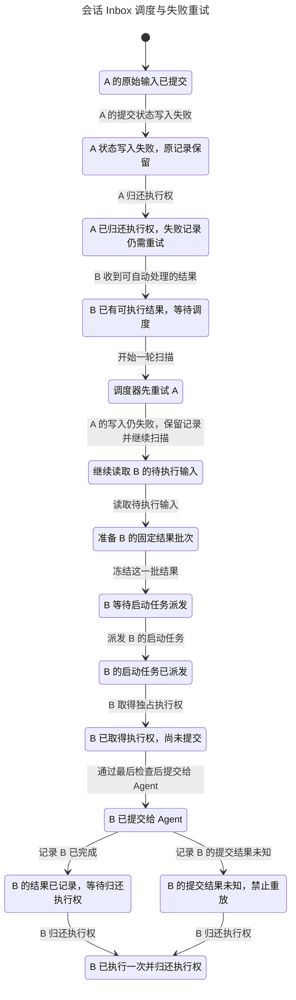
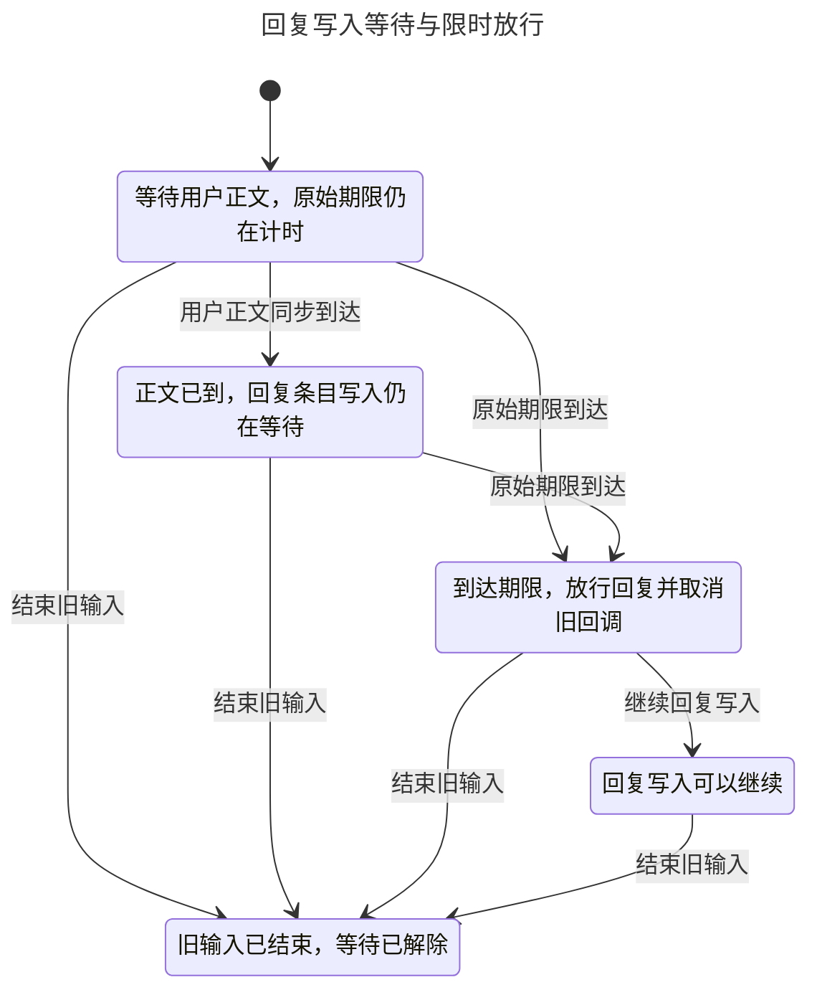

# Session Inbox 的状态机与故障隔离

只为 Session Inbox 这一套系统建模：多端投递、输入接纳和提交、结果续跑、回复等待。产品代码已修复三条原先失败的路径，并把准备批次、诊断及同步适配器异常纳入隔离检查。这里描述已提交的修复；验证映射固定产品提交与精确源码哈希。

## 为什么选这个系统

历史统计基准为 `886ad65f0c80635063eade5add93171440af8647`。统计窗口是北京时间 **2026-08-09 至 2026-11-09**，按提交者时间筛选可达的第一父提交。只统计第一方生产源码，排除测试、故事、生成文件、vendor 和独立 ACP adapter。每次提交在每个模块中只计一次；修复采用 `fix:` / `fix(scope):` 标题识别，改动行数采用新增加删除。标题和代码量都是选择信号，不是缺陷概率。

| 模块或核心文件 | 改动提交 | fix 提交 | 新增＋删除行数 |
| --- | ---: | ---: | ---: |
| CLI Session 模块 | 210 | 139 | 51,953 |
| Session 执行核心 `session-execution-service.ts` | 111 | 68 | 10,955 |
| 消息处理入口 `message-handler.ts` | 148 | 81 | 10,218 |
| Inbox 所在 orchestration 模块 | 45 | 23 | 11,762 |
| 对照：CLI Agent 模块 | 104 | 64 | 12,799 |
| 对照：CLI Loro 模块 | 93 | 49 | 12,980 |

UI 目录也有更多修复，不能因为目录大就称其最易错。这里优先选择反复修复 **输入保留、重复消费、Stop、取消后释放、未知结果恢复和执行卡住** 的执行系统：它的错误能造成重复执行、输入丢失，或者让其他会话不能继续。选定的是本次最值得深入的高风险系统，不是统计上已证明缺陷率最高的模块。

[selection.json](../verification/state-machines/selection.json) 保留统计方法、候选排名和代表性公开修复提交。仓库是 shallow checkout，但本地第一父链始于 8 月 7 日，早于本次窗口；不声称覆盖所有远程分支。重新统计：

```sh
python3 .agents/verification/state-machines/history.py --out /tmp/lody-session-selection.json
```

## 状态分别由谁持有

| 状态 | 所有者 | 边界 |
| --- | --- | --- |
| 待执行输入、固定批次、消费与 Stop | 执行主机的 SQLite | 已准备不等于已提交；结果未知不能重放 |
| 未确认的 pause/release/settle 写入 | 原有 Effect scope 的 Map | 失败记录保留，独立记录继续尝试；显式恢复返回合并 Cause |
| 调度唤醒与启动任务 | 合并唤醒 Queue、`running` Set | 扫描错误不能终止扫描器；启动异常必须释放其存活标记 |
| 投递失败确认 | 主机串行 watcher 写入的每输入 ID 映射 | 新消息或下一次超时不能擦掉旧失败，生产者不清理恢复确认 |
| 回复写入等待 | 每个输入自己的 TurnHistoryGate | waiting/opening/open 分开；原始期限覆盖回调，结束立即放行 |

Inbox 不在每个客户端各执行一份。其他设备通过正文同步、用户凭据、激活元数据和可选 RPC 影响执行主机；模型把不同文档/通道的到达拆开，而不是任意打乱一个 CRDT import 的因果顺序。[Spec](../../specs/session-orchestration.md#idempotent-message-consumption) 定义意图，[Session 规则](../../apps/cli/src/session/AGENTS.md) 和 [Inbox 规则](../../apps/cli/src/orchestration/AGENTS.md) 定义边界。

## 故障如何被限制在自身

[调度服务](../../apps/cli/src/orchestration/inbox/service.ts) 逐条尝试所有独立的重试记录，成功才删除对应记录，最后向显式恢复调用者返回合并后的错误。后台扫描报告这个错误后继续读待执行输入；准备一个批次失败也只跳过该项。诊断、launch 或存储适配器在返回 Effect 前同步抛错，同样被相应边界接住。中断仍结束 scope 中的任务，没有新增持久阻塞状态或运行时所有者。

下面是 pstack 生成的当前调度图。展示配置固定 B 在 A 释放执行权后到达；完整检查不采用这个到达顺序限制。展示视图合并执行阶段内的重复扫描步骤，完整诊断仍保留全部变量。



[投递失败确认](../notes/implemented/bug-fix/2026-11-10-missing-history-acknowledgements.md) 使用 `missingHistoryUserMsgIds`，同时读取旧标量。只有同一会话串行的主机 watcher 增加记录，生产者只发布新激活，不再清除旧失败。正文/RPC 选择、待执行判断、持久接纳、Roost 激活和界面使用同一个精确 ID 判断。两次失败后，迟到的旧消息仍被排除，新 ID 仍可使用。旧超时也不能误判恢复期间刚到的新激活。

[回复等待器](../../apps/cli/src/session/turn-history-gate.ts) 在写入前回调等待期间保留原始截止时间。到期或结束立即放行，并给回调发送取消信号。[MessageHandler](../../apps/cli/src/lib/message-handler.ts) 在异步读取后、实际写入前检查该信号，防止迟到回调重新打开已结束的回复条目。已经发出的写入不被当作已取消；结果继续被观察。下面也是 pstack 生成的当前图：



[调度报告](../skills/verify-session-execution/chart-report.md) 与 [回复等待报告](../skills/verify-session-execution/gate-chart-report.md) 记录展示合并、状态数量及每条性质。

## 验证结果

| 检查 | 当前结果 | 范围 |
| --- | --- | --- |
| 调度安全 | PASS | 1,112 个状态；Stop、固定成员、消费顺序、未知不重放、保留失败、释放不清掉他人 |
| 健康会话进展 | PASS | 459 个状态；A 持续失败也不要求故障先恢复 |
| 多端投递安全与进展 | PASS | 1,696 个状态；两客户端、两输入、分开的到达与两次超时 |
| 第一条输入正文永久不可达 | PASS | 246 个状态；第二条最终完成或有明确投递失败；第一条可待恢复 |
| 回复等待安全与进展 | PASS | 回调不返回时 8 个状态；会返回时 12 个状态；进展不假定用户最终按 Stop |
| 真实 Effect＋SQLite | PASS | 九类边界/恢复轨迹；A 定向写入错误和原生 SQLite 容量错误期间 B 均可开始，A 所在会话的新输入也能提交，故障修复后原记录可补写 |
| Stop、新输入和 epoch | PASS | 336 种 SQL 命令交错；每种后均检查新输入/未来结果，迟到 Stop/release 不动新执行 |
| 投递与取消选择 | PASS | 24 个取消快照、30 个到达顺序；真实恢复方法保留两次失败，旧消息不重新入选 |
| 回复源代码 | PASS | 14 个 owning Vitest 用例；真实写入方法的两条迟到回放保留旧条目的结束状态、不改变新条目 |
| 恢复旧错误的变体 | 均被抓住 | 扫描阻塞、丢失败记录、越过 start/owner 检查、忘记失败身份、卡住等待及缺少迟到写入检查 |

SQL 容量 fixture 通过 `max_page_count` 限制 A 的合成约 1 MiB 错误诊断，而给 B 的小写入保留空间；它证明的是局部 SQLite 故障隔离，不是操作系统磁盘耗尽事故。额外检查包括：失败的 pause 回调不跳过独立 release/settle，持续 prepare 错误与坏诊断不阻塞 B 的后续 Inbox，launch 同步抛错不留下永久 running 标记，失败 Stop 只否决自己的旧输入，以及失败 settlement 不丢失已提交请求的记录。

```sh
python3 .agents/verification/state-machines/check.py
```

新机器可加 `--prepare-tools`；固定工具和原始输出保存在仓库外。当前默认命令应退出 0；当前性质失败退出 1；工具/映射无法完成退出 2。故意恢复旧错误的变体必须失败，但不能把当前代码的失败转成 PASS。额外源代码检查可运行 `expanded.py --source-only`；`--safety-only` 明确不运行时间性质，不能替代默认检查。[结果快照](../verification/state-machines/results.json)、[扩展结果](../skills/verify-session-execution/expanded-results.json)、[覆盖映射](../skills/verify-session-execution/coverage.json) 与 [证明义务](../skills/verify-session-execution/requirements.md) 保留范围和限制。

## 证明与验收边界

这是同一系统三个有限模型切片和真实代码边界回放，没有证明它们与整个生产实现完全对应，也没有证明无限设备/无限消息的所有时序。时间性质使用明确的弱公平假设；永久断网不能保证远程执行，整个数据库不可写时也不能安全授权未记录的输入。原始错误、待恢复记录和未知结果不能被删除来换取可用性。

回放没有运行实际多端 Loro/Roost 同步、签名/设备撤销、主机租约生产者、真实 Provider、完整 UI 或原生设备。迟到回复检查编译完整真实写入方法，但使用合成的 SQLite history 端口和诊断 span，不是 HistoryWriter 的完整验收。仓库缺少安装依赖，`pnpm check` 和 `pnpm format` 因缺少 tsgo/oxfmt 未完成；修改范围使用匹配版本的外部 Oxfmt，原生边界检查也通过外部 TypeScript 解析器执行。这些不替代全仓库 CI。

Session 的 `AGENTS.md` 字数上限由 1,200 调整为 1,280，完整保留新增输入确认和等待期限规则，并给后续维护留出空间。

## 技能来源

沿用 pstack 固定版本 `6b0300214a09fd6029cfb7077043125758cd1fd2` 的 [create-formal-verification-skill](https://github.com/cursor/plugins/blob/6b0300214a09fd6029cfb7077043125758cd1fd2/pstack/skills/create-formal-verification-skill/SKILL.md)、[maintain-formal-verification-skill](https://github.com/cursor/plugins/blob/6b0300214a09fd6029cfb7077043125758cd1fd2/pstack/skills/maintain-formal-verification-skill/SKILL.md) 与 [statechart](https://github.com/cursor/plugins/blob/6b0300214a09fd6029cfb7077043125758cd1fd2/pstack/skills/statechart/SKILL.md)。只保留 [verify-session-execution](../skills/verify-session-execution/SKILL.md) 这一套系统技能。当前已补完之前受本机端口权限限制的时间性质和新状态图；检查通过不表示已完成产品发布或设备验收。
