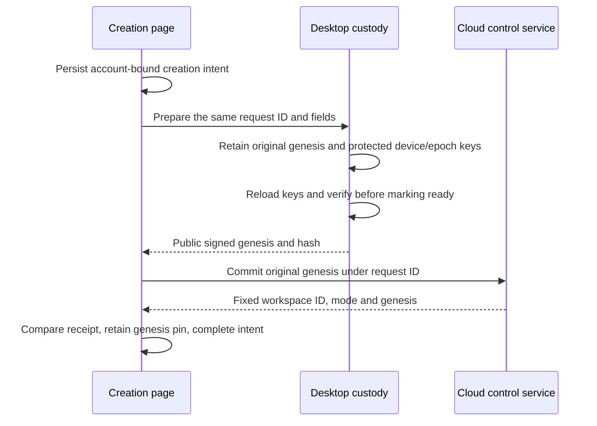

# E2EE workspace creation and ledger inspection

[中文](e2ee-workspace-bootstrap.zh.md)

This developer preview creates a new, fixed-mode encrypted workspace and exposes its verified control history. It does not open document synchronization, chat, attachments, machines, invitations or recovery enrollment. The public OSS desktop remains local-only; cloud composition supplies the control-plane port. This is not all-platform Beta acceptance.

## Reading map

| Question                                    | Owner                                                                                              |
| ------------------------------------------- | -------------------------------------------------------------------------------------------------- |
| Library services, protocol and whitepaper   | [Core guide](../../packages/e2ee-core/README.md)                                                   |
| Public cloud requests and responses         | [Cloud DTOs](../../packages/cloud-api/src/e2ee-workspaces.ts)                                      |
| Host/cloud composition and ownership        | [Platform port](../../packages/platform/src/e2ee-workspaces.ts)                                    |
| Durable device preparation                  | [Desktop bootstrap](../../apps/electron/src/main/services/e2ee-bootstrap.mts)                      |
| Cloud account and receipt checks            | [Cloud adapter](../../packages/components/src/providers/cloud-e2ee-workspaces.ts)                  |
| Pending requests and fixed local identity   | [Renderer storage](../../packages/components/src/lib/e2ee-workspace-storage.ts)                    |
| Signature verification and readable history | [Ledger reader](../../packages/components/src/lib/e2ee-ledger-history.ts)                          |
| Control page                                | [Workspace ledger](../../packages/components/src/components/pages/e2ee-workspace-control-page.tsx) |
| Runtime admission                           | [Runtime provider](../../packages/components/src/providers/runtime-provider.tsx)                   |
| Decision and evidence limits                | [Implementation note](../notes/implemented/feature/2026-10-17-e2ee-workspace-bootstrap.md)         |

## Creation ownership

The developer preference controls new creation, not access to existing workspaces or retry of an unresolved intent. Only a host with the persistent preparation capability offers creation. Desktop main verifies the signed-in account itself; IPC exposes neither arbitrary signing nor private-key export. The Ed25519 and X25519 private keys, and epoch zero, remain in desktop custody. Cloud creation receives public canonical signed bytes. Workspace names and slugs are ordinary cloud metadata in this preview.

Each request ID freezes account, name, slug and genesis. An unknown cloud result retries the same bytes, and never switches mode or replaces identity. Independent windows retain independent pending requests; completing one must not remove another. Pending intents are parsed per canonical request key; malformed JSON or a mismatched key remains byte-for-byte in storage for reconciliation and cannot block healthy or new requests. Host storage owns interrupted key preparation. Missing protected material after an interrupted preparation fails visibly instead of silently creating replacement keys.

The cloud response binds the product workspace ID to `contentMode=e2ee`, version 1 and `cryptoOrgId=genesisHash`. It identifies an encrypted organization within the existing cloud service; it does not select another deployment. The ordinary workspace-creation API cannot create or convert an encrypted workspace. Server account membership authorizes reading public control records, not decrypting content or enrolling a device.

## History and runtime boundary

History starts at genesis and follows a fixed advertised head/count across pages. The client checks every signature, chain transition, index and final checkpoint using the core verifier. Pagination cannot silently skip, reorder, duplicate, truncate or splice records. Rows explain each ledger operation and expose original public details for inspection. The current creation slice produces the genesis record; future accepted records appear through the same reader, without invented events.

Verified history checkpoints are retained per account and workspace, with independent storage keys so concurrent windows cannot overwrite a newer observation. Only a prefix actually verified by the core is recorded. Later pages and refreshes must agree with every retained checkpoint; a failed or incomplete refresh keeps the previous history visible and never accepts a shorter or conflicting chain.

A locally pinned genesis is independent of the history response. A device without that pin is explicitly shown a server-anchored verification state; a valid signature alone cannot prove it received the intended organization's genesis. The history page does not claim a new device is enrolled.

A known encrypted mode or genesis pin takes precedence over a later server claim of plaintext. Ordinary cache cleanup must preserve these identity records. An authenticated plaintext descriptor is retained per account and workspace ID for later offline startup because mode cannot change in place; a proof saved under an earlier slug still applies and is rewritten under the current slug. After the session is confirmed, the runtime provider also retains proofs for the other listed, not-encrypted workspaces in the background. The control-only encrypted route never constructs the old Repo/execution runtime. Backend admission independently rejects its ordinary Streams, token, sharing and execution routes.

E2EE stays invisible to ordinary users ([decision](../notes/implemented/feature/2026-10-17-e2ee-workspace-bootstrap.md#invisible-until-enabled-correction)). A workspace that requires admission is one with local encrypted evidence for this account (genesis pin, learned encrypted mode, encrypted proof, unreadable mode records, or an unresolved encrypted creation intent for its slug) or one the workspace listing marks `contentMode: 'e2ee'`. Any other workspace without a retained proof opens through the pre-E2EE offline-first path with a provisional admission, and `describe` runs in the background. An encrypted answer retires that runtime before the verdict is recorded and routes to the control page. A newer, malformed, mismatched or locally contradicted answer retires it, fails closed and records a sticky rejected-mode marker for that account and workspace (kept for the session if storage refuses it), so Retry and every later initialization wait for authoritative admission. Failure wording for a rejected workspace stays generic unless developer encrypted creation is on, because a rejection does not prove encryption. A failure that describes no mode keeps the runtime and is retried at the next initialization. A cached workspace ID is still not plaintext proof; it is only the pre-E2EE availability default. For a workspace this device has no evidence for and the listing does not mark (or has not loaded yet), the backend's admission is the boundary until background verification answers.

Legacy organizations with all four mode/crypto fields absent may receive an explicit `legacy-unclassified` admission only after the service excludes retained encrypted-workspace evidence. That preserves their existing behavior without classifying them as plaintext. This account/workspace/slug-bound admission can also be retained for offline startup; a local encrypted pin always overrides it. Partial or unknown formats and lookup failures never grant this compatibility path.

Without retained admission, a workspace that requires admission needs a server workspace ID and the same account's live authentication before querying mode. Backend authentication that has not caught up with the session (the Convex auth-mismatch case), opaque query server errors and network failures retry with the auth-recovery backoff. Each of those mode-admission waits, including an unresponsive mode read, ends after 15 seconds; the gate then shows an in-place Retry action. Its wording is ordinary ("Loading workspace", "Unable to open workspace") unless the workspace is known to be encrypted or the developer encrypted-creation option is on; failures unrelated to mode, such as a rejected shutdown of the previous runtime, never use mode wording. Outer sign-in and access-loading gates still use their existing recovery screens, and may appear first when there is no local token. The same account becoming authenticated or the browser reconnecting also retries a failed admission. Cancelling or timing out releases the authentication subscription; superseding a read does not block the next workspace, and a late response cannot admit the old workspace. Authentication refresh after admission does not rebuild the runtime, and a restart of the same account/workspace (local-agent toggle, retry) keeps the last verified mode so the workspace does not unmount. Cache-to-server confirmation of the same workspace ID and storage events for other accounts/workspaces preserve the runtime and held sends. Changes to this workspace's encrypted evidence still invalidate admission.

An authenticated ordinary/legacy descriptor can open the current runtime even if its offline cache cannot be written, such as when storage quota is full. This loses offline admission for the next launch, not the current verified admission. Descriptor validation, evidence reads and encrypted identity writes still fail closed. A cache persistence exception must never swallow a pin conflict, corrupt evidence or a mode downgrade.

## Ledger compatibility

Ledger v1 freezes when a production deployment first enables creation, not when this code merges; until then an owner-approved format change may regenerate the vector, and production creation waits for a format review of the open permission-ledger items. After the freeze it is permanent: the [foundations Spec](../../specs/e2ee-foundations.md#format-compatibility) owns the contract, and `packages/e2ee-core/test/ledger-v1-vector.json` (generated by an independent Python encoder) must keep verifying unchanged. New operations need an earlier capability declaration (tag 9) from an Owner or Admin personal device. This client supports no capability, so a genuine declaration ends verification at its position: the control page shows the verified prefix, stops paging and asks the user to update Lody. A newer mode version or unknown `activation` likewise fails closed with an update message instead of reporting damage. Snapshot and other formats stay current-only because they can be rebuilt from v1 history.

## Encrypted markers and local recovery

Workspace lists (desktop switcher, mobile sheet, onboarding) show a lock from the listed `contentMode`. That metadata cannot prove plaintext: a listed encrypted mode only makes the workspace wait for authoritative admission, and a forged marker cannot open plaintext data or block an encrypted route. The control page is titled "Encrypted workspace" with a "Developer preview" tag. It opens with a ledger verification card: the 64-digit verification code, the ledger version (verified record count) beside its label, and a QR code. The page states no pin verdict, because a consistent-but-unpinned ledger is the normal case on other devices and a warning there only alarms people; failures still show as alerts. Explanations, the workspace ID and the genesis hash sit behind a help button. The code is core's comparison digest (`ledgerStateDigest`, equal to a comparison note's `stateDigest`), which binds protocol, genesis, version, head and the actual permission state, as the [whitepaper](../../specs/e2ee/whitepaper.md) requires of safety codes; a bare head hash is not enough. Members compare it out of band by copying it or scanning the QR (camera via `getUserMedia` and `jsqr`; pasting always works). Same version and digest is a match; an earlier version whose head is this ledger's record at that position is an older copy of the same history; any other difference at the same or a shared position is a mismatch. Results are not persisted, so the page does not yet show "independently compared". Below come current members and one readable line per record; each line expands to the record fields and raw bytes. Cloud composition may provide account profile labels through the optional `memberProfiles` directory. The route reads it independently from ledger history and discards late replies after account, workspace or refresh changes. The page resolves crypto user IDs through verified current members, then uses names and avatars for display only; unknown members retain "Member N" by admission order. Directory failure does not block verification. The connected route never infers the creator from this device's genesis pin. Profiles cannot change roles, permission state, key pins or the verification code; removed members retain their ledger labels when absent from the current directory. `e2ee-ledger-overview.ts` and `e2ee-ledger-verification.ts` derive all of this and grant no authority. The page does not claim content is protected: no content is connected yet.

Failures are classified before any recovery is offered. Server history that does not verify, network and authentication failures only offer refresh and diagnostics. Readable identity conflicts remain possible substitutions or downgrades and have no automatic reset. An unreadable renderer pin or known-encrypted marker can be rebuilt from the same account/workspace native verified ledger only when all readable identity records agree with that genesis. Recovery archives every damaged original before any replacement and never learns a replacement pin from the server. Recovery first removes unreadable optional caches and re-reads evidence; readable evidence retries without native access. Only damaged sticky markers use expected-account-bound `readIdentity`. That IPC reads verified local identity under the account lock, preserves existing readers and closes a cold temporary read before replying, without granting status/content access. Admission Retry and native ledger entry use this repair; missing native identity or a conflict directs the user to compare codes on a trusted paired device and re-pair only after confirming identity. A progress conflict (rollback or fork against this device's observed checkpoint) offers a two-step reset of observed progress for that one workspace, meant only after support confirms the server history. Unreadable optional caches (mode proofs and observed checkpoints) can be deleted; pins, known-encrypted and rejected-mode markers and creation intents never are. Retrying a plaintext mode-admission failure caused by an unreadable cache removes only those entries and re-reads storage in place. "Copy diagnostics" produces a report with identifiers, hashes, counts, build information and error codes; it excludes account IDs, keys, signatures and record bodies, and stays visible when clipboard access is denied.

## Remaining integration

Recovery enrollment, approved device joining, ledger mutations, protected data transports and all-platform custody remain separate batches. Closing the creation option preserves existing control access and pending reconciliation. This preview does not establish production deployment, native OS keychain usability, recovery coverage, or encrypted real-time collaboration.

Rollout order: deploy the backend exposing `e2eeWorkspaces.describe` before shipping the client. Ordinary workspaces call it only in the background, so an unavailable operation leaves them running and unverified rather than blocked. Workspaces that require admission still need it; the timeout makes their failed first admission recoverable in place. A full localStorage quota prevents retaining new proofs, which only means the next launch verifies in the background again.

## Private ledger storage behind the cloud port

Creation and history use Convex actions; mode description remains a query. The private backend stores original signed ledger records in a separate Streams bucket and verifies complete core authorization before conditional append. No public DTO exposes a Streams address or credential. Clients continue verifying original records and retained checkpoints independently.

Creation spans a database reservation and an external atomic genesis write/readback. A pending request retains its original bytes; only the backend attempt that owns the durable writer can dispatch. A settled failure before any write dispatch, or an explicit rejection of every write attempt, can release ownership for exact retry. An unknown append result is resolved by reading its position and, if empty, replaying the same signed bytes at the saved CAS offset, never by timeout or re-signing. An ambiguous genesis PUT keeps a permanent marker that blocks erasure and account-deletion completion: the current Streams service lets a late PUT recreate a deleted URL. Only the Streams permanent-delete tombstone ([loro-streams#428](https://github.com/loro-dev/loro-streams/issues/428)) plus a delayed-old-PUT integration test can lift that gate; no timeout, HEAD 404 or Convex row edit substitutes for it. This boundary does not enable the content runtime or provide a product ledger-editing UI.

## Explicit native identity reset

[Local identity recovery](../notes/implemented/feature/2026-10-27-e2ee-local-identity-reset.md)
adds whole-directory archival and independent per-workspace custody. Pending creation
owners move intact after server publication; exact retries follow retained request
receipts. Permission/keyring errors offer repair and retry. Missing/corrupt originals
offer explicit reset and fresh approved pairing; account archival is available for
permanent OS protection loss. Confirmation binds account/auth generation and is rechecked
after lock admission and native drain. SQLite image corruption keeps its originals
and exposes this recovery. Cold identity reads open only the workspace directory.
Local-history and trusted-pin failures offer explicit archival and fresh approval;
a failed writer close instead requires restarting Lody and exposes no reset control.
Renderer genesis pins, history checkpoints and mode
evidence remain. Earlier shared developer custody is not imported; account archival
preserves it. Archived unsent work is retained without replay and old remote devices
are not revoked. Personal identities still require OS protection.

## Member controls and terminal local cleanup

The native member controls sign ordinary `SetRole` and capability-1 `RemoveMember` commands through the existing `host.manage` entry and its durable submission journal. Only `rotate` recovers an uncommitted candidate; independent commands first reconcile any unknown CAS using its original bytes, then compare the full operation intent before reporting success. Role changes require Owner authority. Owner/Admin removal preserves the epoch and leaves rotation to the existing settings key-update entry. A `rotationRequired` hint never gates sending. Only a credential-authenticated whole-member removal response triggers automatic cleanup: match the original native account/device/credential, retain a terminal receipt, stop the workspace and drain its owners. The account coordinator then takes the exclusive identity lease before erasing native data. Renderer replicas, cursors, high-water state and pending inputs are deleted only in their stopped account/workspace/window scopes. CLI execution uses the same stop/drain rule and keeps user project directories. Busy/interrupted deletion retries on the next relevant workspace open; ordinary network and individual-device failures retain data. See [the decision and limits](../notes/proposed/architecture/2026-10-28-e2ee-member-controls-and-local-removal.md).
