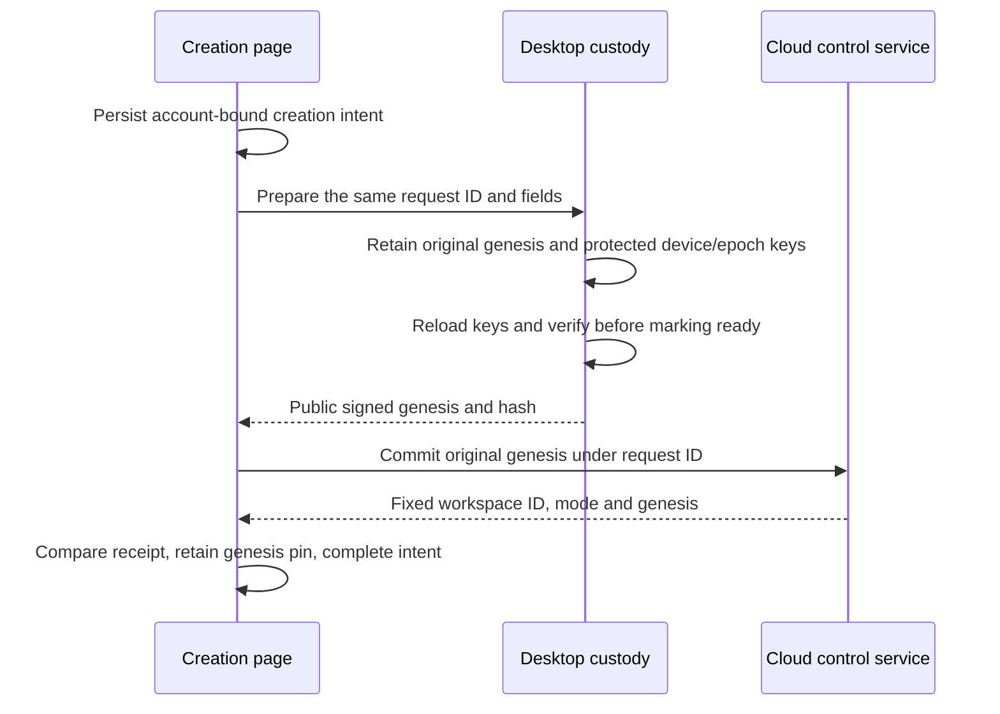

# E2EE workspace creation and ledger inspection

[中文](e2ee-workspace-bootstrap.zh.md)

This developer preview creates a new, fixed-mode encrypted workspace and exposes its verified control history. It does not open document synchronization, chat, attachments, machines, invitations or recovery enrollment. The public OSS desktop remains local-only; cloud composition supplies the control-plane port. This is not all-platform Beta acceptance.

## Reading map

| Question | Owner |
| --- | --- |
| Library services, protocol and whitepaper | [Core guide](../../packages/e2ee-core/README.md) |
| Public cloud requests and responses | [Cloud DTOs](../../packages/cloud-api/src/e2ee-workspaces.ts) |
| Host/cloud composition and ownership | [Platform port](../../packages/platform/src/e2ee-workspaces.ts) |
| Durable device preparation | [Desktop bootstrap](../../apps/electron/src/main/services/e2ee-bootstrap.mts) |
| Cloud account and receipt checks | [Cloud adapter](../../packages/components/src/providers/cloud-e2ee-workspaces.ts) |
| Pending requests and fixed local identity | [Renderer storage](../../packages/components/src/lib/e2ee-workspace-storage.ts) |
| Signature verification and readable history | [Ledger reader](../../packages/components/src/lib/e2ee-ledger-history.ts) |
| Control page | [Workspace ledger](../../packages/components/src/components/pages/e2ee-workspace-control-page.tsx) |
| Runtime admission | [Runtime provider](../../packages/components/src/providers/runtime-provider.tsx) |
| Decision and evidence limits | [Implementation note](../notes/implemented/feature/2026-10-17-e2ee-workspace-bootstrap.md) |

## Creation ownership

The developer preference controls new creation, not access to existing workspaces or retry of an unresolved intent. Only a host with the persistent preparation capability offers creation. Desktop main verifies the signed-in account itself; IPC exposes neither arbitrary signing nor private-key export. The Ed25519 and X25519 private keys, and epoch zero, remain in desktop custody. Cloud creation receives public canonical signed bytes. Workspace names and slugs are ordinary cloud metadata in this preview.

Each request ID freezes account, name, slug and genesis. An unknown cloud result retries the same bytes, and never switches mode or replaces identity. Independent windows retain independent pending requests; completing one must not remove another. Host storage owns interrupted key preparation. Missing protected material after an interrupted preparation fails visibly instead of silently creating replacement keys.

The cloud response binds the product workspace ID to `contentMode=e2ee`, version 1 and `cryptoOrgId=genesisHash`. It identifies an encrypted organization within the existing cloud service; it does not select another deployment. The ordinary workspace-creation API cannot create or convert an encrypted workspace. Server account membership authorizes reading public control records, not decrypting content or enrolling a device.

## History and runtime boundary

History starts at genesis and follows a fixed advertised head/count across pages. The client checks every signature, chain transition, index and final checkpoint using the core verifier. Pagination cannot silently skip, reorder, duplicate, truncate or splice records. Rows explain each ledger operation and expose original public details for inspection. The current creation slice produces the genesis record; future accepted records appear through the same reader, without invented events.

Verified history checkpoints are retained per account and workspace, with independent storage keys so concurrent windows cannot overwrite a newer observation. Only a prefix actually verified by the core is recorded. Later pages and refreshes must agree with every retained checkpoint; a failed or incomplete refresh keeps the previous history visible and never accepts a shorter or conflicting chain.

A locally pinned genesis is independent of the history response. A device without that pin is explicitly shown a server-anchored verification state; a valid signature alone cannot prove it received the intended organization's genesis. The history page does not claim a new device is enrolled.

A known encrypted mode or genesis pin takes precedence over a later server claim of plaintext. Ordinary cache cleanup must preserve these identity records. An authenticated plaintext descriptor can be retained, bound to account/workspace/slug, for later offline local startup because mode cannot change in place. Old caches without a verified mode require one online lookup; an arbitrary cached workspace ID is not plaintext proof. The control-only encrypted route never constructs the old Repo/execution runtime. Backend admission independently rejects its ordinary Streams, token, sharing and execution routes.

Legacy organizations with all four mode/crypto fields absent may receive an explicit `legacy-unclassified` admission only after the service excludes retained encrypted-workspace evidence. That preserves their existing behavior without classifying them as plaintext. This account/workspace/slug-bound admission can also be retained for offline startup; a local encrypted pin always overrides it. Partial or unknown formats and lookup failures never grant this compatibility path.

## Remaining integration

Recovery enrollment, approved device joining, ledger mutations, protected data transports and all-platform custody remain separate batches. Closing the creation option preserves existing control access and pending reconciliation. This preview does not establish production deployment, native OS keychain usability, recovery coverage, or encrypted real-time collaboration.

Rollout order: deploy the backend exposing `e2eeWorkspaces.describe` before shipping the client. Ordinary workspaces also use this operation to obtain their first admission record; disabling the developer preference does not bypass it.
