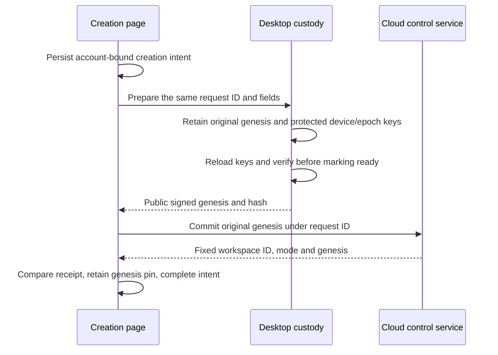

# E2EE workspace creation and ledger inspection

[中文](e2ee-workspace-bootstrap.zh.md)

This developer preview creates a new, fixed-mode encrypted workspace and exposes its verified control history. It does not open document synchronization, chat, attachments, machines, invitations or recovery enrollment. The public OSS desktop remains local-only; cloud composition supplies the control-plane port. This is not all-platform Beta acceptance.

## Reading map

| Question | Owner |
| --- | --- |
| Library services, protocol and whitepaper | [Core guide](../../packages/e2ee-core/README.md) |
| Public cloud requests and responses | [Cloud DTOs](../../packages/cloud-api/src/e2ee-workspaces.ts) |
| Host/cloud composition and ownership | [Platform port](../../packages/platform/src/e2ee-workspaces.ts) |
| Durable device preparation | [Desktop bootstrap](../../apps/electron/src/main/services/e2ee-bootstrap.mts) |
| Cloud account and receipt checks | [Cloud adapter](../../packages/components/src/providers/cloud-e2ee-workspaces.ts) |
| Pending requests and fixed local identity | [Renderer storage](../../packages/components/src/lib/e2ee-workspace-storage.ts) |
| Signature verification and readable history | [Ledger reader](../../packages/components/src/lib/e2ee-ledger-history.ts) |
| Control page | [Workspace ledger](../../packages/components/src/components/pages/e2ee-workspace-control-page.tsx) |
| Runtime admission | [Runtime provider](../../packages/components/src/providers/runtime-provider.tsx) |
| Decision and evidence limits | [Implementation note](../notes/implemented/feature/2026-10-17-e2ee-workspace-bootstrap.md) |

## Creation ownership

The developer preference controls new creation, not access to existing workspaces or retry of an unresolved intent. Only a host with the persistent preparation capability offers creation. Desktop main verifies the signed-in account itself; IPC exposes neither arbitrary signing nor private-key export. The Ed25519 and X25519 private keys, and epoch zero, remain in desktop custody. Cloud creation receives public canonical signed bytes. Workspace names and slugs are ordinary cloud metadata in this preview.

Each request ID freezes account, name, slug and genesis. An unknown cloud result retries the same bytes, and never switches mode or replaces identity. Independent windows retain independent pending requests; completing one must not remove another. Host storage owns interrupted key preparation. Missing protected material after an interrupted preparation fails visibly instead of silently creating replacement keys.

The cloud response binds the product workspace ID to `contentMode=e2ee`, version 1 and `cryptoOrgId=genesisHash`. It identifies an encrypted organization within the existing cloud service; it does not select another deployment. The ordinary workspace-creation API cannot create or convert an encrypted workspace. Server account membership authorizes reading public control records, not decrypting content or enrolling a device.

## History and runtime boundary

History starts at genesis and follows a fixed advertised head/count across pages. The client checks every signature, chain transition, index and final checkpoint using the core verifier. Pagination cannot silently skip, reorder, duplicate, truncate or splice records. Rows explain each ledger operation and expose original public details for inspection. The current creation slice produces the genesis record; future accepted records appear through the same reader, without invented events.

Verified history checkpoints are retained per account and workspace, with independent storage keys so concurrent windows cannot overwrite a newer observation. Only a prefix actually verified by the core is recorded. Later pages and refreshes must agree with every retained checkpoint; a failed or incomplete refresh keeps the previous history visible and never accepts a shorter or conflicting chain.

A locally pinned genesis is independent of the history response. A device without that pin is explicitly shown a server-anchored verification state; a valid signature alone cannot prove it received the intended organization's genesis. The history page does not claim a new device is enrolled.

A known encrypted mode or genesis pin takes precedence over a later server claim of plaintext. Ordinary cache cleanup must preserve these identity records. An authenticated plaintext descriptor can be retained, bound to account/workspace/slug, for later offline local startup because mode cannot change in place. Old caches without a verified mode require one online lookup; an arbitrary cached workspace ID is not plaintext proof. The control-only encrypted route never constructs the old Repo/execution runtime. Backend admission independently rejects its ordinary Streams, token, sharing and execution routes.

Legacy organizations with all four mode/crypto fields absent may receive an explicit `legacy-unclassified` admission only after the service excludes retained encrypted-workspace evidence. That preserves their existing behavior without classifying them as plaintext. This account/workspace/slug-bound admission can also be retained for offline startup; a local encrypted pin always overrides it. Partial or unknown formats and lookup failures never grant this compatibility path.

Without retained admission, initialization needs a server workspace ID and the same account's live authentication before querying mode. Each of those mode-admission waits, including an unresponsive mode read, ends after 15 seconds; when the mode gate is visible it shows a connection/authentication explanation and an in-place Retry action. Outer sign-in and access-loading gates still use their existing recovery screens, and may appear first when there is no local token. The same account becoming authenticated or the browser reconnecting also retries a failed admission. Cancelling or timing out releases the authentication subscription; superseding a read does not block the next workspace, and a late response cannot admit the old workspace. Authentication refresh after admission does not rebuild the runtime. Cache-to-server confirmation of the same workspace ID and storage events for other accounts/workspaces preserve the runtime and held sends. Changes to this workspace's encrypted evidence still invalidate admission.

An authenticated ordinary/legacy descriptor can open the current runtime even if its offline cache cannot be written, such as when storage quota is full. This loses offline admission for the next launch, not the current verified admission. Descriptor validation, evidence reads and encrypted identity writes still fail closed. A cache persistence exception must never swallow a pin conflict, corrupt evidence or a mode downgrade.

## Ledger compatibility

Ledger v1 freezes when a production deployment first enables creation, not when this code merges; until then an owner-approved format change may regenerate the vector, and production creation waits for a format review of the open permission-ledger items. After the freeze it is permanent: the [foundations Spec](../../specs/e2ee-foundations.md#format-compatibility) owns the contract, and `packages/e2ee-core/test/ledger-v1-vector.json` (generated by an independent Python encoder) must keep verifying unchanged. New operations need an earlier capability declaration (tag 9) from an Owner or Admin personal device. This client supports no capability, so a genuine declaration ends verification at its position: the control page shows the verified prefix, stops paging and asks the user to update Lody. A newer mode version or unknown `activation` likewise fails closed with an update message instead of reporting damage. Snapshot and other formats stay current-only because they can be rebuilt from v1 history.

## Encrypted markers and local recovery

Workspace lists (desktop switcher, mobile sheet, onboarding) show a lock from the listed `contentMode`. That metadata is display-only: admission still resolves the persisted descriptor, and a missing or forged listing can neither open plaintext data nor block an encrypted route. The control page is titled "Encrypted workspace" with a "Developer preview" tag. It opens with a ledger verification card: the 64-digit verification code, the ledger version (verified record count) beside its label, and a QR code. The page states no pin verdict, because a consistent-but-unpinned ledger is the normal case on other devices and a warning there only alarms people; failures still show as alerts. Explanations, the workspace ID and the genesis hash sit behind a help button. The code is core's comparison digest (`ledgerStateDigest`, equal to a comparison note's `stateDigest`), which binds protocol, genesis, version, head and the actual permission state, as the [whitepaper](../../specs/e2ee/whitepaper.md) requires of safety codes; a bare head hash is not enough. Members compare it out of band by copying it or scanning the QR (camera via `getUserMedia` and `jsqr`; pasting always works). Same version and digest is a match; an earlier version whose head is this ledger's record at that position is an older copy of the same history; any other difference at the same or a shared position is a mismatch. Results are not persisted, so the page does not yet show "independently compared". Below come current members and one readable line per record; each line expands to the record fields and raw bytes. Members show an avatar and name when a profile is known: today only this account, attached to the genesis member and only when this device holds the creation pin. Others fall back to "Member N" by admission order, and actions are attributed to the signing device's member. Names are display data from account profiles, not ledger facts. `e2ee-ledger-overview.ts` and `e2ee-ledger-verification.ts` derive all of this and grant no authority. The page does not claim content is protected: no content is connected yet.

Failures are classified before any recovery is offered. Server history that does not verify, network and authentication failures only offer refresh and diagnostics. An identity conflict (pin or known mode contradicting the server, or an unreadable pin) is treated as a possible substitution or downgrade and has no client reset. A progress conflict (rollback or fork against this device's observed checkpoint) offers a two-step reset of observed progress for that one workspace, meant only after support confirms the server history. Unreadable optional caches (mode proofs and observed checkpoints) can be deleted; pins, known-encrypted markers and creation intents never are. Retrying a plaintext mode-admission failure caused by an unreadable cache removes only those entries and re-reads storage in place. "Copy diagnostics" produces a report with identifiers, hashes, counts, build information and error codes; it excludes account IDs, keys, signatures and record bodies, and stays visible when clipboard access is denied.

## Remaining integration

Recovery enrollment, approved device joining, ledger mutations, protected data transports and all-platform custody remain separate batches. Closing the creation option preserves existing control access and pending reconciliation. This preview does not establish production deployment, native OS keychain usability, recovery coverage, or encrypted real-time collaboration.

Rollout order: deploy the backend exposing `e2eeWorkspaces.describe` before shipping the client. Ordinary workspaces also use this operation to obtain their first admission record; disabling the developer preference does not bypass it. The timeout makes a failed first admission recoverable in place, but does not restore offline access to an old cache without a verified proof. A full localStorage quota likewise prevents retaining new ordinary proof for the next offline launch. These are rollout and offline-availability limits, not grounds for treating a cached ID as plaintext.

## Private ledger storage behind the cloud port

Creation and history use Convex actions; mode description remains a query. The private backend stores original signed ledger records in a separate Streams bucket and verifies complete core authorization before conditional append. No public DTO exposes a Streams address or credential. Clients continue verifying original records and retained checkpoints independently.

Creation spans a database reservation and an external atomic genesis write/readback. A pending request retains its original bytes; only the backend attempt that owns the durable writer can dispatch. A settled failure before any write dispatch, or an explicit rejection of every write attempt, can release ownership for exact retry. An unknown append result is resolved by reading its position and, if empty, replaying the same signed bytes at the saved CAS offset, never by timeout or re-signing. An ambiguous genesis PUT keeps a permanent marker that blocks erasure and account-deletion completion: the current Streams service lets a late PUT recreate a deleted URL. Only the Streams permanent-delete tombstone ([loro-streams#428](https://github.com/loro-dev/loro-streams/issues/428)) plus a delayed-old-PUT integration test can lift that gate; no timeout, HEAD 404 or Convex row edit substitutes for it. This boundary does not enable the content runtime or provide a product ledger-editing UI.
