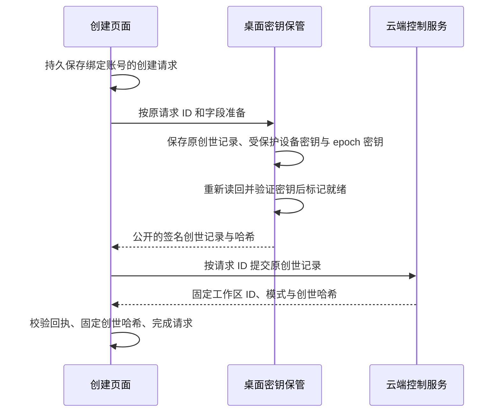

# E2EE 工作区创建与账本查看

[English](e2ee-workspace-bootstrap.md)

这个开发者预览可以创建模式固定的新加密工作区，并查看经过验证的控制账本。尚未开放文档同步、聊天、附件、机器、邀请或恢复登记。公开 OSS 桌面仍只运行本地模式；云端组合提供控制接口。这不代表全平台 Beta 验收完成。

## 阅读入口

| 问题 | 负责位置 |
| --- | --- |
| 库的服务、协议与白皮书 | [Core 导读](../../packages/e2ee-core/README.md) |
| 公开云端请求与响应 | [Cloud DTO](../../packages/cloud-api/src/e2ee-workspaces.ts) |
| 宿主与云端组合、调用归属 | [平台接口](../../packages/platform/src/e2ee-workspaces.ts) |
| 设备持久初始化 | [桌面初始化](../../apps/electron/src/main/services/e2ee-bootstrap.mts) |
| 云端账号与创建回执校验 | [云端适配器](../../packages/components/src/providers/cloud-e2ee-workspaces.ts) |
| 待确认请求与本地固定身份 | [渲染进程存储](../../packages/components/src/lib/e2ee-workspace-storage.ts) |
| 签名验证与可读历史 | [账本读取器](../../packages/components/src/lib/e2ee-ledger-history.ts) |
| 控制页面 | [工作区账本](../../packages/components/src/components/pages/e2ee-workspace-control-page.tsx) |
| 运行时准入 | [Runtime provider](../../packages/components/src/providers/runtime-provider.tsx) |
| 决策与验证范围 | [实施记录](../notes/implemented/feature/2026-10-17-e2ee-workspace-bootstrap.zh.md) |

## 创建过程的责任

开发者选项控制新建入口，不控制已有工作区访问或未确认请求的重试。只有具备持久准备能力的宿主才提供创建。桌面主进程独立验证当前登录账号；IPC 不提供任意签名或私钥导出。Ed25519、X25519 私钥以及 epoch zero 留在桌面保管中，云端创建只接收公开的规范签名字节。这个预览中的工作区名称和 slug 仍属于普通云端元数据。

每个请求 ID 固定账号、名称、slug 与创世记录。云端结果未知时重试相同字节，不改变模式或替换身份。不同窗口分别保留未确认请求；完成其中一个不能删除另一个。宿主存储负责处理中断的密钥准备；中断后缺少受保护材料时明确失败，不静默生成替代密钥。

云端响应将产品工作区 ID 绑定到 `contentMode=e2ee`、版本 1 和 `cryptoOrgId=genesisHash`。这是现有云服务内的加密组织标识，不是切换部署。普通工作区创建 API 不能创建或转换加密工作区。云端账号成员资格只允许读取公开控制记录，不代表能够解密内容或登记设备。

## 历史与运行时边界

历史从创世开始，分页始终固定同一个声明的账本头和条数。客户端用 core 验证器检查每个签名、状态变化、索引和最终检查点。分页不能静默跳过、重排、重复、截断或拼接记录。每行解释账本操作，并可查看原始公开字段。本批创建只产生创世记录；之后接入的有效记录通过同一个读取器展示，不虚构历史事件。

已验证的历史检查点按账号和工作区保留，并使用独立存储键，避免多个窗口覆盖较新的观察结果。只有 core 实际验证过的前缀才会被记录。后续分页和刷新必须与每个已有检查点一致；刷新失败或尚未补齐历史时，继续保留之前的历史，不接受更短或冲突的链。

本地固定的创世哈希独立于历史响应。没有本地记录的设备会明确显示“以服务端创世为起点”的验证状态；签名有效本身不能证明拿到的是预期组织。账本页面不声称新设备已被授权加入。

已知加密模式或本地创世记录优先于服务端后来返回的明文声明。普通缓存清理必须保留这些身份记录。经过在线认证的明文描述可按账号、工作区和 slug 保存，供之后离线启动本地运行时使用，因为本批不允许原地改模式。未认证模式的旧缓存需要先联网查询一次，任意缓存工作区 ID 不能证明它是明文。加密控制页不创建旧 Repo 或执行运行时；后端也独立拒绝其普通 Streams、令牌、分享和执行入口。

历史组织的四个模式/加密字段全部缺失时，服务端排除已有加密工作区证据后，可以明确返回 `legacy-unclassified` 准入。它延续旧行为，不将组织分类为明文；按账号、工作区和 slug 固定后也可供离线启动。本地加密记录始终优先。部分字段缺失、未知格式或查询失败都不能获得这个兼容入口。

没有已保存的准入记录时，初始化需要服务端工作区 ID 和同一账号的真实认证，再查询工作区模式。上述模式准入等待及未响应的模式查询都会在 15 秒后结束；模式关卡可见时，会显示连接或认证原因并提供原地重试。没有本地登录令牌时，外层登录或权限等待页可能先出现，仍使用原有的恢复界面。同一账号重新认证或浏览器恢复联网也会重试失败的准入。取消或超时会释放认证订阅；切换工作区不等待旧查询返回，迟到的旧响应也不能打开旧工作区。准入完成后的认证刷新不会重建运行时。缓存 ID 被同一个服务端 ID 确认、其他账号或工作区的存储事件，都会保留当前运行时和待发送内容。当前工作区的加密证据发生变化时仍会重新检查准入。

已认证的普通或 legacy 准入可以打开当前运行时，即使存储配额已满、无法写入离线缓存。此时影响的是下次启动的离线准入，不是当前已验证的准入。描述符校验、证据读取和加密身份写入仍在失败时阻止启动；不能把信任锚冲突、损坏证据或模式降级当成缓存写入异常忽略。

## 后续接入

恢复登记、经过授权的设备加入、账本变更、加密数据通道与全平台保管仍是后续批次。关闭新建选项保留已有控制访问及待确认请求恢复。本预览不证明生产已部署、原生系统密钥库可用、恢复覆盖完整或加密实时协作已经可用。

部署顺序：先发布提供 `e2eeWorkspaces.describe` 的后端，再发布新客户端。普通工作区首次取得准入记录也调用此接口，关闭开发者选项不会跳过它。超时让首次准入失败可以在当前页面重试，但没有验证证明的旧缓存仍不能离线打开；localStorage 配额耗尽时，新的普通模式证明也无法保存供下次离线启动。这是发布与离线可用性的限制，不能因此把缓存 ID 当作明文证明。

## 云接口背后的私有账本存储

创建与历史读取使用 Convex action，模式描述仍为 query。私有后端把原始签名账本放在独立 Streams bucket，完整验证 core 权限后才做条件追加。公开 DTO 不提供 Streams 地址或凭据；客户端仍独立验证原始记录与已保存的检查点。

创建分为数据库预留与外部创世记录的原子写入、读回确认。待处理请求保留原始字节，只有持久写入状态的拥有者可以发出写请求。调用已结束且确定尚未发出写入、或每次写入都被明确拒绝时，可以释放状态供相同请求重试；已发出但结果未知时，只能读回原位置确认，不能靠超时、盲目重放或重新签名判断。删除等待在途写入结束，并确认外部清除。如果结果未知的写入始终没有出现，账号删除仍会被阻断：当前 Streams 网关没有持久栅栏或墓碑，无法证明旧 PUT/CAS 不会在解锁或删除后迟到。运维人员不能只凭 HEAD 404 或直接修改 Convex 数据库行清除写入所有权。安全的处理需要先部署 Streams 持久栅栏，再由 Convex 核对 binding、写入 token 和检查点完成恢复，并用延迟旧写入的联调验证。在此之前，E2EE 账号擦除存在尚未解决的发布阻断。这些改动不开放内容运行时或产品账本编辑 UI。
