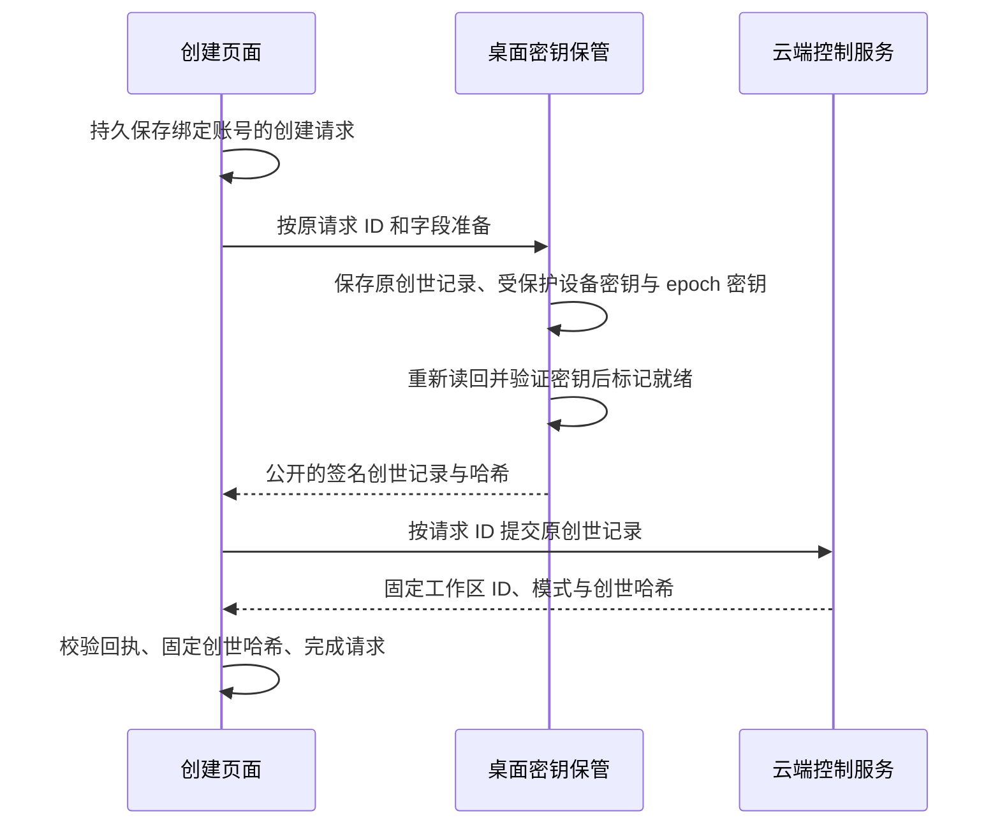

# E2EE 工作区创建与账本查看

[English](e2ee-workspace-bootstrap.md)

这个开发者预览可以创建模式固定的新加密工作区，并查看经过验证的控制账本。尚未开放文档同步、聊天、附件、机器、邀请或恢复登记。公开 OSS 桌面仍只运行本地模式；云端组合提供控制接口。这不代表全平台 Beta 验收完成。

## 阅读入口

| 问题                     | 负责位置                                                                                     |
| ------------------------ | -------------------------------------------------------------------------------------------- |
| 库的服务、协议与白皮书   | [Core 导读](../../packages/e2ee-core/README.md)                                              |
| 公开云端请求与响应       | [Cloud DTO](../../packages/cloud-api/src/e2ee-workspaces.ts)                                 |
| 宿主与云端组合、调用归属 | [平台接口](../../packages/platform/src/e2ee-workspaces.ts)                                   |
| 设备持久初始化           | [桌面初始化](../../apps/electron/src/main/services/e2ee-bootstrap.mts)                       |
| 云端账号与创建回执校验   | [云端适配器](../../packages/components/src/providers/cloud-e2ee-workspaces.ts)               |
| 待确认请求与本地固定身份 | [渲染进程存储](../../packages/components/src/lib/e2ee-workspace-storage.ts)                  |
| 签名验证与可读历史       | [账本读取器](../../packages/components/src/lib/e2ee-ledger-history.ts)                       |
| 控制页面                 | [工作区账本](../../packages/components/src/components/pages/e2ee-workspace-control-page.tsx) |
| 运行时准入               | [Runtime provider](../../packages/components/src/providers/runtime-provider.tsx)             |
| 决策与验证范围           | [实施记录](../notes/implemented/feature/2026-10-17-e2ee-workspace-bootstrap.zh.md)           |

## 创建过程的责任

开发者选项控制新建入口，不控制已有工作区访问或未确认请求的重试。只有具备持久准备能力的宿主才提供创建。桌面主进程独立验证当前登录账号；IPC 不提供任意签名或私钥导出。Ed25519、X25519 私钥以及 epoch zero 留在桌面保管中，云端创建只接收公开的规范签名字节。这个预览中的工作区名称和 slug 仍属于普通云端元数据。

每个请求 ID 固定账号、名称、slug 与创世记录。云端结果未知时重试相同字节，不改变模式或替换身份。不同窗口分别保留未确认请求；完成其中一个不能删除另一个。请求按规范的账号/请求 key 逐条解析，坏 JSON 和 key 不匹配的条目原样保留供对账，不阻塞健康请求或新请求。宿主存储负责处理中断的密钥准备；中断后缺少受保护材料时明确失败，不静默生成替代密钥。

云端响应将产品工作区 ID 绑定到 `contentMode=e2ee`、版本 1 和 `cryptoOrgId=genesisHash`。这是现有云服务内的加密组织标识，不是切换部署。普通工作区创建 API 不能创建或转换加密工作区。云端账号成员资格只允许读取公开控制记录，不代表能够解密内容或登记设备。

## 历史与运行时边界

历史从创世开始，分页始终固定同一个声明的账本头和条数。客户端用 core 验证器检查每个签名、状态变化、索引和最终检查点。分页不能静默跳过、重排、重复、截断或拼接记录。每行解释账本操作，并可查看原始公开字段。本批创建只产生创世记录；之后接入的有效记录通过同一个读取器展示，不虚构历史事件。

已验证的历史检查点按账号和工作区保留，并使用独立存储键，避免多个窗口覆盖较新的观察结果。只有 core 实际验证过的前缀才会被记录。后续分页和刷新必须与每个已有检查点一致；刷新失败或尚未补齐历史时，继续保留之前的历史，不接受更短或冲突的链。

本地固定的创世哈希独立于历史响应。没有本地记录的设备会明确显示“以服务端创世为起点”的验证状态；签名有效本身不能证明拿到的是预期组织。账本页面不声称新设备已被授权加入。

已知加密模式或本地创世记录优先于服务端后来返回的明文声明。普通缓存清理必须保留这些身份记录。经过在线认证的明文描述按账号和工作区 ID 保存，供之后离线启动使用，因为模式不能原地修改；按旧 slug 保存的证明仍然有效，并会改写到当前 slug 下。会话确认后，运行时提供者还会在后台为列表中其他未标记加密的工作区保存证明。加密控制页不创建旧 Repo 或执行运行时；后端也独立拒绝其普通 Streams、令牌、分享和执行入口。

E2EE 对普通用户保持不可见（[决定](../notes/implemented/feature/2026-10-17-e2ee-workspace-bootstrap.zh.md#启用前不可见修正)）。需要准入的工作区，是本账号在本机有加密证据的工作区（创世 pin、已知加密模式、加密证明、无法读取的模式记录，或 slug 相同且未完成的加密创建请求），或工作区列表标记为 `contentMode: 'e2ee'` 的工作区。其他没有已保存证明的工作区，按 E2EE 之前的离线优先路径以临时准入打开，`describe` 在后台执行。返回加密模式时，先退役该运行时再记录结论，并转到控制页；返回更新的、格式错误的、ID 不符或与本地证据矛盾的结果时，同样退役并失败关闭，并为该账号和工作区记录一个持久的“模式被拒”标记（存储拒绝写入时在本次会话内保留），之后的重试和每次初始化都会等待权威准入；被拒的工作区失败文案保持通用，除非开发者打开了加密创建，因为被拒不能证明它是加密的；不描述任何模式的失败则保留运行时，下次初始化再验证。缓存的工作区 ID 仍不能证明明文，它只是沿用 E2EE 之前的可用性默认值。对于本机没有证据、列表也未标记（或尚未加载）的工作区，在后台验证返回之前，由后端准入负责拦截。

历史组织的四个模式/加密字段全部缺失时，服务端排除已有加密工作区证据后，可以明确返回 `legacy-unclassified` 准入。它延续旧行为，不将组织分类为明文；按账号、工作区和 slug 固定后也可供离线启动。本地加密记录始终优先。部分字段缺失、未知格式或查询失败都不能获得这个兼容入口。

没有已保存的准入记录时，需要准入的工作区要先取得服务端工作区 ID 和同一账号的真实认证，再查询工作区模式。后端认证尚未跟上会话（Convex 认证不一致的情况）、不透明的查询服务端错误和网络失败，会按认证恢复的退避间隔重试。上述等待及未响应的模式查询都会在 15 秒后结束，之后关卡提供原地重试。除非工作区已知是加密的，或开发者打开了加密创建选项，否则文案都是普通的（“正在加载工作区”“无法打开工作区”）；与模式无关的失败（例如上一个运行时关闭失败）从不使用模式文案。没有本地登录令牌时，外层登录或权限等待页可能先出现，仍使用原有的恢复界面。同一账号重新认证或浏览器恢复联网也会重试失败的准入。取消或超时会释放认证订阅；切换工作区不等待旧查询返回，迟到的旧响应也不能打开旧工作区。准入完成后的认证刷新不会重建运行时；同一账号和工作区的重启（切换本地代理、重试）会保留上一次已验证的模式，工作区不会卸载。缓存 ID 被同一个服务端 ID 确认、其他账号或工作区的存储事件，都会保留当前运行时和待发送内容。当前工作区的加密证据发生变化时仍会重新检查准入。

已认证的普通或 legacy 准入可以打开当前运行时，即使存储配额已满、无法写入离线缓存。此时影响的是下次启动的离线准入，不是当前已验证的准入。描述符校验、证据读取和加密身份写入仍在失败时阻止启动；不能把信任锚冲突、损坏证据或模式降级当成缓存写入异常忽略。

## 账本兼容性

账本 v1 在生产部署第一次开放创建时冻结，而不是在这些代码合入时；此前经所有者批准的格式修改可以重新生成样例，开放生产创建前须先对权限账本中的待定事项做格式审查。冻结之后永久有效：契约见[基础规范](../../specs/e2ee-foundations.zh.md#格式兼容性)，由独立 Python 编码器生成的 `packages/e2ee-core/test/ledger-v1-vector.json` 必须原样通过验证。新操作需要此前出现过由 Owner 或 Admin 个人设备签署的能力声明（标签 9）。当前客户端不支持任何能力，因此遇到真实声明时在该位置停止验证：控制页展示已验证的部分、停止翻页，并提示用户升级 Lody。更新的模式版本或未知的 `activation` 同样失败关闭，提示升级，而不是报告损坏。快照和其他格式仍只支持当前格式，因为它们可以从 v1 历史重建。

## 加密标识与本机救援

工作区列表（桌面切换器、移动端面板、引导页）根据列表里的 `contentMode` 显示锁图标。这份元数据不能证明明文：列表标记为加密只会让工作区等待权威准入，伪造的标记既不能打开明文数据，也不能阻止进入加密路由。控制页标题为“加密工作区”，并带“开发者预览”标记。页面开头是账本核验卡片：64 位核验码、标签旁的账本版本（已验证记录数）和二维码。页面不显示 pin 相关结论：在其他设备上“历史一致但未 pin”是正常情况，对此告警只会让人不安；真正的故障仍以提示框显示。说明文字、工作区 ID 和创世哈希都收在帮助按钮后面。核验码是核心库的比对摘要（`ledgerStateDigest`，与比对记录中的 `stateDigest` 相同），绑定协议、创世、版本、head 和实际权限状态，符合[白皮书](../../specs/e2ee/whitepaper.zh.md)对安全码的要求；只比 head 哈希不够。成员通过复制或扫码在带外比对（摄像头经 `getUserMedia` 和 `jsqr`，粘贴始终可用）。版本和摘要都相同即一致；对方版本较旧且其 head 等于本账本该位置的记录，说明是同一历史的旧副本；同一位置或共同位置上的其他差异均为不一致。比对结果不持久保存，因此页面尚不显示“已独立核对”。下方依次是当前成员，以及每条记录一行的可读摘要，展开后显示记录字段和原始字节。云端组合可以通过可选的 `memberProfiles` 目录提供账号资料。路由独立读取资料和账本历史，并丢弃账号、工作区或刷新轮次变化后的迟到资料。页面先通过已验证的当前成员，把加密用户 ID 对应到成员，再显示姓名和头像；资料未知时仍按加入顺序显示“成员 N”。资料查询失败不阻断核验。已接通目录的路由不会根据本机持有创世 pin 推断创建者。资料不能改变角色、权限状态、固定公钥或核验码；当前目录不含已移除成员时，其历史记录保留账本标签。`e2ee-ledger-overview.ts` 和 `e2ee-ledger-verification.ts` 只做这些推导，不授予任何权限。页面不宣称内容已受保护，因为目前还没有接入任何内容。

提供任何恢复手段之前，先对失败分类。服务端历史验证失败、网络和登录问题，只提供刷新和诊断信息。有效身份冲突仍按可能的替换或降级处理，不自动重置。无法读取的界面 pin 或 known-encrypted 标记，可从同账号、同工作区的 native 已验证账本重建；所有可读身份记录必须与该 genesis 一致。先归档所有损坏原文，再替换标记，不从服务端学习替代 pin。恢复先清除坏可选缓存并重读证据，已可读就直接重试；只有持久标记仍损坏才调用绑定预期账号的 `readIdentity`。该 IPC 在账号锁内临时读取已验证身份，保留已有 reader，无 reader 时在回复前关闭本次读取；不授予 `status` 或内容访问权限。准入 Retry 与原生账本入口使用此恢复；没有可信本机身份或存在冲突时，提示在可信已配对设备上核对验证码，确认身份后再重新配对。进度冲突（服务端历史相对本机记录的进度出现回滚或分叉）提供两步确认的重置，只清除该工作区的已观察进度，应在支持人员确认服务端历史无误后使用。无法读取的可选缓存（模式证明和已观察进度）可以删除；pin、已知加密标记、模式被拒标记和创建请求永远不删。明文工作区因缓存无法读取导致模式准入失败时，重试只删除这些条目，并在原地重新读取存储。“复制诊断信息”生成的报告只含标识、哈希、数量、构建信息和错误码，不含账号 ID、密钥、签名或记录正文；剪贴板被拒绝时报告仍可见。

## 后续接入

恢复登记、经过授权的设备加入、账本变更、加密数据通道与全平台保管仍是后续批次。关闭新建选项保留已有控制访问及待确认请求恢复。本预览不证明生产已部署、原生系统密钥库可用、恢复覆盖完整或加密实时协作已经可用。

部署顺序：先发布提供 `e2eeWorkspaces.describe` 的后端，再发布新客户端。普通工作区只在后台调用它，接口不可用时普通工作区继续运行、保持未验证，而不是被阻止。需要准入的工作区仍依赖它，超时让首次准入失败可以在当前页面重试。localStorage 配额耗尽时无法保存新的证明，影响只是下次启动仍在后台验证。

## 云接口背后的私有账本存储

创建与历史读取使用 Convex action，模式描述仍为 query。私有后端把原始签名账本放在独立 Streams bucket，完整验证 core 权限后才做条件追加。公开 DTO 不提供 Streams 地址或凭据；客户端仍独立验证原始记录与已保存的检查点。

创建分为数据库预留与外部创世记录的原子写入、读回确认。待处理请求保留原始字节，只有持久写入状态的拥有者可以发出写请求。调用已结束且确定尚未发出写入、或每次写入都被明确拒绝时，可以释放状态供相同请求重试。结果未知的追加，先读回原位置；位置为空时，用保存的 CAS offset 重发同一份已签名字节，绝不靠超时或重新签名判断。结果未知的创世 PUT 会留下一个永久标记，阻止擦除和账号删除完成：当前 Streams 服务允许迟到的 PUT 在已删除的 URL 上重建 stream。只有 Streams 的永久删除墓碑（[loro-streams#428](https://github.com/loro-dev/loro-streams/issues/428)）加上延迟旧 PUT 的联调测试才能解除这道限制；超时、HEAD 404 或修改 Convex 数据行都不能替代。这些改动不开放内容运行时或产品账本编辑 UI。

## 显式重置本机身份

[本机身份恢复](../notes/implemented/feature/2026-10-27-e2ee-local-identity-reset.zh.md)
提供完整目录归档与按工作区独立保管。创建 owner 在服务端发布后整体移动，
原字节重试跟随保留的请求回执。权限或钥匙串问题引导修复后重试；原件缺失或
损坏提供显式重置和重新审批配对；系统保护永久丢失时可归档账号。渲染器的
genesis 固定值、历史检查点和模式证据保留。不导入旧共享开发保管，账号归档
仍保留其证据。未发送数据保留但不自动重放，不撤销远端旧设备。个人身份仍
要求系统保护。

重置确认绑定账号与认证 generation，并在取得锁和原生 drain 后复核；SQLite 镜像损坏保留原件并显示恢复入口。冷身份读取仅打开对应工作区目录。本机历史或可信 pin 不可用时提供显式归档与重新审批；写入者关闭失败则要求重启 Lody，不提供重置控件。

## 成员管理与本地终结清理

原生成员管理通过独立持久提交日志签署普通 SetRole 和 capability 1 的 RemoveMember。角色调整仅 Owner 可用；Owner/Admin 移除保持 epoch，复用设置里的密钥更新入口，rotationRequired 不阻塞发送。仅设备凭据确认的整成员移除触发自动清理：核对原生账号/设备/凭据，保留终结标记，停止并等待该工作区运行结束，再由账号协调器取得独占身份租约后删除原生数据。Renderer 仅清理已停止的账号/工作区/窗口副本、游标、高水位和待发送输入。CLI 同样先停止执行并等待结束，保留用户项目目录。租约繁忙或清理中断在下次打开相关工作区时重试；普通网络错误和单设备撤销保留数据。见[决定与限制](../notes/proposed/architecture/2026-10-28-e2ee-member-controls-and-local-removal.zh.md)。
