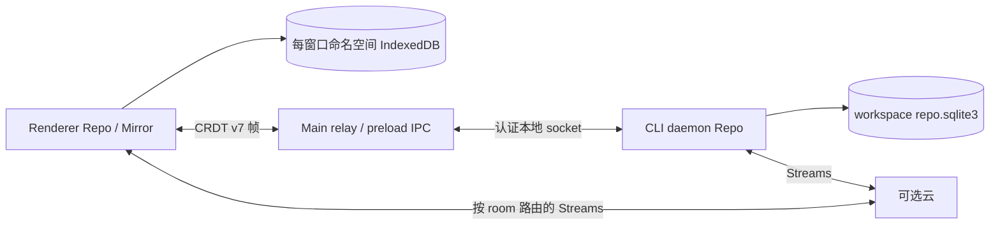
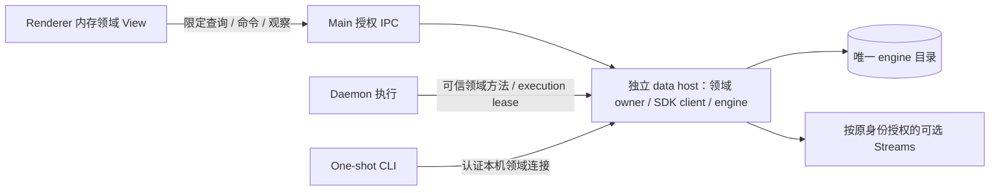

# Electron 接入 loro-repo-rs 0.1.0 的迁移计划

状态：P0–P4 已接入显式选择的 native 路径，默认仍为 legacy。本地完整领域与普通 Cloud FI/FIS 分别验收；跨平台、其它 Cloud 领域和正式发布仍有独立门槛。核对日期：2026-11-19。

建议 renderer 与 daemon 复用同一领域实现，桌面连接**同一个独立数据 host**，只有 host 打开 engine 数据目录。先验证发布物和真实 Electron 打包，再按完整 room 迁 Flock，最后迁 Loro 文档。Roost 保持现状。

现有 [WorkspaceData 提案](../notes/proposed/architecture/2026-10-14-workspace-data-services.zh.md) 仍拥有领域契约、秘密隔离、owner 与部署模式的决策；本文补充固定发布包的能力、缺口及实施阶段。当前仍为 renderer IndexedDB 与 CLI SQLite 两套副本。[旧持久化决策](../notes/implemented/architecture/2026-09-27-loro-repo-flock-persistence-migration.md) 解释数据与 cursor 必须绑定副本的历史原因，不能在这次迁移中取消。

## 1. 证据与验证边界

- Lody 检查基线：`58e33cec245b2f5e7586d0c7beb6a02ce148219c`；实施包含隔离验收、共同目录边界、独立 native host、local-only FI/FIS 试点及迁移/回滚工具；默认 backend 仍为 legacy。
- 从正式 registry 安装并读取 README、package.json、types、exports 和 JS：`@loro-dev/loro-repo-engine@0.1.0`、`@loro-dev/loro-repo-client@0.1.0`、`@loro-dev/json-patch@0.1.0`。没有用 workspace link 代替发布物。
- 对照源码固定 `1d80000d7f6b7301442a6e2c7c558cd69e6ab88a`。发布 engine/client README 与此提交逐字节相同；SHA-256 分别为 `181e99e29a305374845e58fada304b049cb38db4da2b988db584d68725dde925`、`0abeb30d2c18b778d00e549fe8a67c1f9a8f20b2314883fc25b28d8d60897f24`。
- workflow `44060386444`、latest、跨进程加密/轮换/SIGKILL 等验收来自上游交接，本轮没有重跑，也不作为 Lody 验收。#285/#287 不在 0.1.0；特别不借用 #287 的 Windows writer identity 重试行为。
- 本轮实际验证：macOS arm64、Node `v26.13.1`，真实发布 native engine、Flock WASM `0.5.0`、Loro `1.17.0`，合成数据独立目录。验证第二 engine 被排他锁拒绝、两个 client 共享状态、`ensureEngineHost` 附着者 close 不停原 host、Flock 文件及删除可见性、prefix 订阅/`whenVisible`、过期 CAS 拒绝、Meta helper、Loro snapshot 导入、Text splice/导出容器保留、正常停止重开读回。
- 新增的 [P0 lab](../../apps/electron/scripts/repo-engine-lab/README.md) 在真实 Electron 44.9.3/macOS arm64 中验证 ASAR/native 加载、两个 sandbox renderer 与独立 Node client 共用 host、Meta 目录、双向 history 更新、Flock 删除/CAS、订阅 watermark、丢 ACK 后查询、SIGKILL/重连 reset 和冷启动。它使用合成 UI/Node fixture，不是产品聊天或产品 daemon 的完整验收。
- 未验证：其它五个平台、安装包签名/notarization、异常断电、真实用户旧库迁移、旧新云客户端混跑、Lody E2EE、产品性能和通用 cloud outbox 恢复。产品接入的已验收范围见 §9。

发布依据：[engine](https://www.npmjs.com/package/@loro-dev/loro-repo-engine/v/0.1.0)、[client](https://www.npmjs.com/package/@loro-dev/loro-repo-client/v/0.1.0)、[json-patch](https://www.npmjs.com/package/@loro-dev/json-patch/v/0.1.0)。源码定位为上述 SHA 的 `rust/npm/engine/`、`rust/packages/client/src/{client,types,framer,node,lody-schemas,lody-routes,repo-meta}.ts` 和 `rust/packages/json-patch/`；不将上游非公开实现复制进公开 Lody 文档。

## 2. 当前数据与进程边界

### Flock 的具体含义

这里 Flock 是 `@loro-dev/flock-wasm` 的 tuple-key CRDT 表，用于当前值、目录和索引；不是 Unix `flock(2)` 文件锁，也不是整个 Loro 栈的统称。[workspace catalog](../../pnpm-workspace.yaml) 当前为 `loro-repo 0.25.0`、`@loro-dev/flock-wasm ^0.5.0`、Loro `1.17.0`、Mirror `2.3.2`，streams-crdt override 为 `0.20.0`。替换旧 TS Repo/Flock 执行和持久化，不等于取消 Flock 数据模型，也不自动迁移 Loro history 或 Roost。

| 数据范围 | 模型与标识 | 关键文件 |
| --- | --- | --- |
| 文档存在性、列表元数据、named Flock 注册 | Meta Flock，`e/m/ef` 等 tuple keys | [CLI doc manager](../../apps/cli/src/lib/loro/doc.ts)、[renderer runtime](../../packages/components/src/providers/create-workspace-runtime.ts) |
| 工作区项目、MCP、Role、项目默认 MCP | `<ws>:wf:workspace` | [workspace-flock](../../packages/shared/src/workspace-flock.ts)、[catalog hook](../../packages/components/src/hooks/use-workspace-catalog.ts)、[CLI catalog](../../apps/cli/src/lib/loro/workspace-catalog-sync.ts) |
| 机器配置、能力、本地项目、持久命令 | `<ws>:mf:<machine>` | [machine-flock](../../packages/shared/src/machine-flock.ts)、[rows hook](../../packages/components/src/hooks/use-machine-flock-rows.ts)、[command watcher](../../apps/cli/src/lib/loro/machine-flock-command-watcher.ts) |
| Schedule registry / 定义 | `<ws>:sr` Flock / `schedule-*` LoroDoc | [schedule repository](../../packages/shared/src/schedule-repository.ts)，定义持久化与 registry 持久化有先后顺序 |
| 文件索引 / 失效信号 | `<ws>:fi:<owner-session>` / `fis` Flock | [publisher](../../apps/cli/src/lib/code-collab/code-collab-flock-publish.ts)，180 天 TTL，不进入 repo Meta；文件正文仍走 Machine RPC |
| Session 控制、队列、Loro history | `session-*` LoroDoc + Mirror/HistoryWriter | [SessionData](../../packages/shared/src/session-data/loro.ts)、[CLI SessionBackend](../../apps/cli/src/session/session-backend.ts) |
| Roost history | 原 Node owner / RPC / renderer cache | [Roost bridge](../../packages/components/src/lib/roost-session-bridge.ts)、[CLI adapter](../../apps/cli/src/session/roost-session-backend.ts)，本轮不迁 |
| presence / machine-monitor | 临时状态，不是持久 Flock | [本地数据面](cli-lib-local-loro-data-plane.md)、[presence](cli-lib-loro-presence.md) |

图示为当前形态；OSS local composition 没有云边。main 只是转发者，CLI daemon 是独立进程，并不在 main 的 JS heap 中。

1. [create-workspace-runtime](../../packages/components/src/providers/create-workspace-runtime.ts) 创建 renderer Repo；[storage factory](../../packages/components/src/providers/workspace-repo-storage.ts) 明确使用 `IndexedDBStorageAdaptor`。runtime 附近仍有 SQLite/OPFS 旧注释，不能据此推断实际存储。每窗口 cache identity 隔离副本/cursor，Mirror/React stores 在 renderer。
2. [target router](../../packages/components/src/providers/workspace-target-router.ts) 区分 local/cloud/dual，按 machine 所有权选 room 路由及就绪来源；[Streams factory](../../packages/components/src/providers/workspace-streams-transport.ts) 负责 renderer 云同步。renderer 自己 author 并持久化更新，本地通道为 CRDT 同步，已不是写意图命令。
3. [renderer connection](../../packages/components/src/providers/local-loro-data-plane-connection.ts) 使用 `loro.subscribe/send/event/status`；[preload](../../apps/electron/src/preload/index.ts) 暴露受限 `ipc.invoke/on/send`；[register-services](../../apps/electron/src/main/ipc/register-services.ts) 校验 product-window sender 和消息 schema。[LoroIpc](../../apps/electron/src/main/ipc/services/loro-ipc.ts) 仅查连接状态。
4. [relay](../../apps/electron/src/main/services/loro-data-plane-relay.ts) 读取私有端点/token、认证重连、跟踪窗口 peer，销毁/导航时 detach；[CLI server](../../apps/cli/src/lib/local-loro-data-plane-server.ts) 分到 workspace engine。[protocol](../../packages/shared/src/local-loro-data-plane.ts) 为 v7 JSON-line 帧，带 workspace/peer、VV 和分片；与 SDK v2 长度前缀帧不兼容。
5. [CLI store](../../apps/cli/src/lib/loro/sqlite-repo-store.ts) 使用 `getLodyDataDir()/loro-repo/<ws>/repo.sqlite3`，加密工作区可传独立 repository directory。Meta/named Flock checkpoint 与副本绑定；LoroDoc durable cursor 只有 daemon 续用，one-shot 默认内存 cursor。目前多个 CLI 进程可能打开同一个旧 SQLite，各有内存副本；这不证明新 engine 可多进程直接写同一目录。
6. [doc manager](../../apps/cli/src/lib/loro/doc.ts) 拥有 Repo、Session wrapper、transport 和本地桥。named Flock 本地兴趣借 cloud room；renderer-only Session join 用一次性 raw reconcile，不建长期 SessionDocument，最后 holder 按真实所有权 unload。Meta/workspace catalog 长驻，其它 catalog 空闲释放；machine 修改先 flush，再由 [sync coordinator](../../apps/cli/src/lib/loro/machine-flock-sync-coordinator.ts) 后台上传。
7. [application](../../apps/electron/src/main/application.ts) 组合 CliService 和 relay；关闭 Run local agent 会关 relay，cloud control-only 不应探测/启动执行 daemon。未来“关闭执行但数据 host 继续”是需要验收的新行为。窗口退出仅释放自己的订阅，不能停其它窗口/daemon 的 owner。

本地数据面文档仍提到已不存在的 `specs/local-first-two-plane.md`。本文以实际 v7、路由和当前 scoped 规则判断行为，不将缺失 Spec 视作批准；原页另补充了当前依据。

## 3. 发布包能力映射与缺口

| 需求 | 0.1.0 已有 API / 能力 | 迁移工作 |
| --- | --- | --- |
| 单本机 owner | `startEngine/Engine.stop/engineVersion`；`files.lock`、`engine.json`、每 namespace SQLite；`ENGINE_BUSY` | 固定部署模式、目录 binding、supervisor；锁不负责产品授权或升级协调 |
| 多进程访问 | `./node` 的 `connectEngine/ensureEngineHost`；`./browser` 的 `RepoClient/RepoTransport` | 两端复用领域 adapter；renderer 不连接通用 raw engine API |
| Flock | `flockGet/Scan/Batch/Subscribe`、prefix/range/limit、CAS | 同步 get/scan/set 变异步；旧 row-event 与新投影事件不可直接互换，UI 读 scoped 内存 View |
| Meta | `repoMeta()/RepoMetaClient`，`e/m/ef/efx` 与 soft-delete helper | createRoom 不等于目录生命周期完成；归档/restore/purge/fi 例外仍由应用负责，不能拿 deleteRoom 代替业务删除 |
| Loro | `readDoc/subscribeDoc/applyDocPatch`、schema、causal inspection、raw import/export、CAS/rebase | 内置 Lody schema 只是起点，需对本仓库 schema、旧容器/unknown 字段逐项验证，不能只比 JSON |
| 观察 | 初值、subpath patch、watermark、`whenVisible` | value 是所选完整投影，patch 相对订阅路径；初次/reset 替换投影，不能当旧 Flock 行事件直接应用 |
| 重连 | 重注册 auth/protector，再恢复观察、reconnect reset | 已发送 RPC 断线后拒绝且不自动重放；业务结果可能 unknown，要按原业务 ID 查询 |
| 云同步 | `configureRemote`、routes/shards/bucket/space、auth provider、`syncNamespace`、remote health | 对齐 stream ID、TTL、zstd/旧快照/token refresh；namespace current 不等于每 room 的首个权威 baseline |
| E2EE | protector、具体 writer、AAD、paused drain、ContentKeyring | 不替代 Lody ledger/pairing/custody；native keyring 无持久 custody/ledger 验证；远端加密不代表 SQLite 本地加密 |
| 导入 | `importRoomState(snapshot,updates,enqueueOutbox,writer)`、`setStreamCheckpoint` | 逐来源冻结与覆盖证明；API 不等于自动升级器 |
| Native | napi6、Node >=20、六个精确版本 optional 包 | Lody Node-API 10+ 和安全版本要求照旧；接 staging/asar/签名/afterPack，不能按 Electron ABI rebuild |

正式切换前必须关闭或明确排除的缺口：

- **释放与 authority：** 公共类型没有旧 Repo 的 room lease/waitFor 或显式 unload 接口，但固定发布源码的 `server.rs::evict_idle_room_backends` 已实现按访问顺序淘汰：每 namespace 的空闲 loaded backend 上限为 16，仍有文档/Flock 订阅的 room 不参与淘汰，并有对应 hardening 测试。因此缺少公开 unload 本身不是 SDK 阻塞项。应用要正确结束订阅；Electron 大量房间的实际内存、后台同步 interest 和精确 room baseline 仍需验收，不能仅从 unsubscribe 推导全部资源已释放。
- **Flock 无损验证/回滚：** get/scan 只给当前值，不公开 tombstone/HLC/peer entry，没有等价 Flock raw export；无公开 MVR 写接口。现业务主要 LWW，但旧 migration 工具使用 getEntry 区分删除/从未存在；不能以 found=false 替代。只读值相同不足以证明完整迁移。
- **事务边界：** transactCas 是冲突重试，不是任意跨 room 事务；单 room atomic patch/batch 不覆盖 Meta/正文/registry/ACP。权限、prepared launch、queue promotion 条件检查不能拆成 RPC read→await→write。
- **回执：** whenVisible 只证明本 namespace、本 engine 会话的订阅可见性，无内置 deadline；不代表上传、执行或备份。须绑定 runId/source generation，断线后刷新快照，不继承旧 txId waiter。
- **durability：** README 明确 WAL + synchronous=NORMAL。ACK 可表达事务提交和进程崩溃恢复，不能承诺断电不丢数据。EngineOptions 无 FULL 配置；若 Lody 要求更强保证，先补 SDK 和测试。
- **native 隔离：** 正式 0.1.0 曾在复用的 Vitest worker 内出现 SIGBUS，崩溃栈指向 engine addon 的 tokio worker；具体原因未证明。renderer suite 使用与产品边界一致的独立 Node host，由官方 Scope 管理并确认实际退出，worker 不加载 engine addon。该隔离不等于修复 SDK 内部缺陷；native 致命退出仍必须让测试失败并保留合成存储。
- **权限：** socket OS 访问控制不是领域/workspace 授权。raw API 可改 remote、注册 crypto provider、删除 room；README 的透明 MessagePort 示例不能直接用于产品 renderer。
- **分发许可：** 三个入口及 native 平台包标为 UNLICENSED，engine 说明源码非公开。公开 npm 下载不等于 OSS 再分发授权；加入公开依赖和桌面包前确认授权及 notices，不复制非公开实现。
- **平台：** Linux glibc >=2.35，不覆盖 musl/armv7；六个包存在不代表六个平台 Lody 已通过验收。

## 4. 推荐共享方式

“共用实现/接口”指相同领域逻辑、schema、校验与 adapter；仍可连不同 owner。“共用同一实例/目录”指所有本机窗口/main/daemon/one-shot 连接唯一 engine，只有 host 直接开目录。桌面终态同时做到两者；不同机器、账号/保护身份、local/cloud composition 不混用实例。

| 方案 | 优点 | 代价与结论 |
| --- | --- | --- |
| 两进程各开 engine，同目录 | 表面简单 | 第二个被锁拒绝；不绕锁、不直写 SQLite |
| 各开 engine、各自目录 | 可隔离替换 | 保留副本/同步成本，不满足同实例目标，只适合实验/明确兼容期 |
| main 内嵌 | 少一个 JS 进程 | native abort 与 main 共命运，app 退出影响 daemon；不推荐默认 |
| 执行 daemon 内嵌 | 无头简单、写入少一跳 | 关/重启 Agent 影响 UI；保留为无头长期模式，data-only daemon 是需另验的备选 |
| 独立普通 Node host | 关执行仍可用，多窗口/CLI 共用，隔离 native 故障 | 多一进程和 IPC，需 lease/supervisor；桌面首选。utilityProcess 可实验，但不能假设跨 Electron 退出存活 |

沿用 WorkspaceData §8.2：目录持久记录 independent/embedded 模式，选定 supervisor 启动，其他 client attach。不靠 ensureEngineHost 让任意 first starter 随机拥有永久 host；busy 时验证 binding/协议，不兼容明确拒绝，不另开空库 fallback。

- host 持 engine handle、领域写者、RepoClient、持久化/outbox 和已迁 room 的同步；daemon 保留 ACP/终端/文件及执行，main 注入原生登录/凭据 ports。host 内也用 socket client 访问 engine 是统一执行顺序，不是第二 engine。
- renderer 仅保留内存 View、UI 偏好和未提交草稿。迁完的 room 不再建 WASM Repo/IDB/云 transport；未迁 room 和 Roost cache 保留。
- 优先沿用 IpcService/@IpcMethod 和 push 契约。高频观察若用 MessagePort，也只传限定领域 DTO/增量，不透传 RepoClient wire。host/main 校验 sender、binding、方法、字段和可信 writer；renderer 自报 namespace/writer 不是授权。token/密钥不下发。Node 可信 adapter 可私用 SDK，业务不拿 raw handle。
- catalog host 化前完成现提案的 write-only secret 编辑单元，避免 raw Flock 把保存的凭据读回普通 renderer。多个请求者共用单物理 writer，仍分别验证 requester/执行身份/E2EE signer；只有实际授权等价才可合并连接。
- 新目录从 getLodyDataDir/平台 namespace 派生，例如 `data-owner/v1/<binding-key>/`，保留账号、workspace、genesis/保护身份及原 installation 隔离。channel 是否共享遵循既有 profile，不擅自合并 Stable/Nightly，也不按窗口另建 engine。

并发与恢复：单 room CAS/领域条件命令保护读改写，跨 room 保留 saga/补偿；取消等待不等于写终止，断线已发请求按 unknown 查询原业务 ID。queueWhileReconnecting 只是内存排队，不能代替用户输入持久 custody。重启时校验 protocol 2、runId、应用 binding/能力版本，恢复 providers/观察；reset 替换 View，旧 callback/异步查询/txId 不更新新 generation。

生命周期：窗口 close/reload/navigation 仅释放自身观察/port；有其它窗口或 daemon lease 则 host 继续。关 Run local agent 停执行 lease，桌面 data lease 独立。app 退出但 daemon 仍持 lease，host 继续且 daemon supervisor 接管恢复；无人使用才在有界 shutdown 中停止入口、等在途工作、报告未确认持久化、关闭 client 和 engine。stop 为同步 native 调用，须验证阻塞预算，不在 UI 主线程无限等。异常退出等真实进程终止、锁释放后重启；timeout 不允许旧写者未停就开新写者，失败不永久锁死独立 workspace。

实施 owner 生命周期时按 [Effect skill](../skills/effect-ts/SKILL.md) 评估完整小单元；SDK Promise 是第三方边界，不把整套旧编排包一层 Effect 就宣布迁移完成。本轮有限 owner、lease 与迁移控制的实际边界已记入 [charter ledger](../notes/proposed/architecture/2026-09-27-effect-lifecycle-migration-roadmap.md#unit-ledger)；ACP、Turn 和旧 Repo 编排仍分别保留其原有 owner。

## 5. 旧数据、共存和回滚

切换单位是**同 binding 的完整 room 及其领域依赖**，不能按窗口或同一 Flock 的单 key 拆 owner。若无法排除 legacy 对该 room 的隐式 acquire/同步，应扩大至完整 workspace，不能双写补救。

1. 盘点所有来源：daemon SQLite、各窗口/历史 cache identity 的 IDB、旧活跃进程、submissions/ready-input/附件 receipts 等唯一副本。逐 room 登记来源、格式、权限、cursor、未上传归属；不为枚举全开历史 Session 房间。
2. 停该切片生产者与同步，等待真实写入 settlement；其它切片继续。导出 Loro 二进制 snapshot/updates、Flock 文件/必要 JSON updates，保留 tombstone/clock。SQLite 用一致备份或关库读取，不复制活跃主文件而遗漏 WAL；IDB flush 后保留只读源。
3. 新建版本化 staging 目录，无 remote 时先 createRoom 再 importRoomState，逐来源合并。禁止 scan→put 重建 Flock、JSON 重建 Loro、最后一个窗口覆盖前面输入；这些会改变 clock/peer/容器身份/历史。
4. 证明完整性：读回 Loro VV 覆盖每来源，且无 pending dependencies；Flock 要证明 tombstone/HLC/版本覆盖，get/scan 不足，须补受支持 export/inspect 或离线验证工具。核对唯一副本 receipts，JSON 一致不是充分条件。
5. 只有已证明远端同步的输入用 enqueueOutbox:false；含本地未上传内容按原授权 writer/归属用 true。不能把不同设备/Agent 工作全归当前机器 signer。clean/dirty 无法证明的来源留在 staging，不丢弃、不宣称完成。
6. checkpoint 最后处理：只有 state 覆盖对应接收位置且 remote/stream/AAD/codec 一致才 setStreamCheckpoint。不能取最大 offset 或拼不同副本 cursor；默认重新 bootstrap，证明不足不迁 cursor。完成所有来源后才 configureRemote，旧上传同时退出或已验证兼容。
7. 原子发布 room owner manifest，记录 backend/格式/模式/source generation/来源验证。新请求只进新 owner；旧 IDB/SQLite 保留只读。旧 v7 import、Streams 上传、后台扫描、eager worker 对该 room 全退出。未迁 Meta 可继续是唯一 registry，登记仍由原领域 owner 完成；engine Meta 不并行当第二权威。跨 registry/正文保留原可恢复分步回执。
8. 先发布能识别 owner/协议的兼容客户端。真正旧二进制不认识 marker，可能重建旧库并向云上传。local-only 实测启动互斥/目录隔离；cloud 必须证明双向 wire/快照混用，或提供作用域明确的最低版本/写权限门禁，并测离线设备再上线。不为单机迁移全局撤销共享凭据。

共存是不同 room 各有一个权威路径，不是同 room 两 backend 相互写。只读 shadow 用独立目录/namespace、禁 remote、接冻结样本，不可写回业务，也不宣称是恢复副本。

回滚分两类：新 owner 未接业务写前，可丢 staging 解冻旧路径；已有新写后旧库已过期，不能翻 flag。必须停新写、保留新库/outbox/receipts，通过已验收无损逆向导出或向前修复恢复。0.1.0 没有公共 Flock raw export；当前已用固定版本只读 SQLite compatibility reader 验证 compacted snapshot 的完整逆导出。它只接受 schema 1、plaintext、head/compacted/snapshot tx 相等的 Flock/Meta，不能据此承诺 checkpoint/outbox 或云端回滚。

## 6. 六个 phases

FI/FIS、local WF 与本机 MF 首切片开关已实现，使用方式见 §9；其余领域仍须按实际组合验收。P3/P4 每个领域各自交付，不能打成一次全仓改造。

### P0：共享 host 与打包验证，推荐首先实施

- 目标/模块：合成数据独立 host，两个 Node 进程 client、两个 Electron 窗口，走真实 package/afterPack；不接真实数据/云凭据。
- 前置：分发许可、固定 0.1.0/integrity、仓库支持的 Node/Electron。产品默认 repoBackend=legacy，实验独立 dataDir；raw MessagePort 只限隔离实验。
- 验证：多进程同时启动只一个 host，附着者 close 不停 owner，竞争 CAS、中文/删除、初值/patch/watermark、断线未知写/reset，SIGKILL/锁释放/outbox 恢复、native crash 隔离、大帧/慢订阅/关闭预算及六平台。
- 回滚/完成：移除实验即可。交付真实 Electron 行为证据、durability 决定、Flock export/释放/authority 缺口处理意见；只通过本轮 Node smoke 不完成 P0。

### P1：共同领域接口与只读 shadow

- 目标/模块：先 session directory 的只读 summary/分页/观察，封装 renderer Meta 投影和 daemon catalog reader；实际业务仍旧 Repo。冻结合成样本导新 engine 对照，不采集真实 transcript 作 fixture。
- 前置：P0 结论、WorkspaceData directory/SyncAuthority 契约；按锁定 Effect 版本评估切片，保留同步内存读时机。
- 开关：directorySource=legacy；shadow 禁云、独立目录，无产品写回，不复制每次 mutation 到两套 backend。
- 验证：初值/监听无缺口、分页、归档过滤、空与未就绪、workspace 晚回复 fence、多窗口独立释放、CLI 冷 catalog 不误报权威空。
- 回滚/完成：关 shadow 即可；实际消费者只依领域契约，无公开 Repo/Doc/SDK handle，行为等价。可独立发布重构，但不宣称已共享实例。

### P2：local-only 首个真实 Flock 切片

- 目标/模块：可重建 Code Collab fi+fis 一组，接 publisher、renderer 失效观察和 host；文件/diff-store 仍 daemon Machine RPC，fi/fis 不进 Meta，不加 Roost room。
- 前置：host supervisor、窄领域 IPC、local-only 零云；确认能按 room 排除 legacy acquire/后台同步，否则不能开试点。
- 开关：持久 room manifest 选择 legacy/native；同 owner-session 的 fi/fis 同进同出，其它 Meta/machine/session 仍旧路径。
- 验证：首个 RPC 快照先返回再 publish、不变文件不失效、预算/TTL、signal 失败定向修复、重启重建、多窗口重连、关执行后的 View 退化、零新增云请求、不丢文件/草稿。
- 回滚/完成：停新 publisher，旧路径从文件系统/RPC 重建索引后切回，无需逆写 Flock clock。两端使用同一个 native room，切片无旧 IDB/SQLite writer，其余旧依赖保留。

### P3：持久 Flock 和普通云，逐 room 交付

- 目标/模块：workspace catalog wf → 单 machine 完整 mf → schedule registry sr；分别验收，再切完整 Meta，最后将 fi/fis 扩到普通云。不按同一 mf 内的 family key 分物理 owner。
- 前置：clock/tombstone 覆盖和逆向导出缺口关闭、catalog write-only secret 编辑完成、旧客户端/云 wire/快照混用验收。sr 同时覆盖旧 definition 的保存顺序。
- 开关：room manifest、领域 adapter，按 §5 冻结导入切换。未迁 Meta 仍唯一 registry；Meta 自身是单独完整目录切换，不持续复制两套 e/m/ef。
- 验证：多来源离线 put/delete 冲突，磁盘满/重启 checkpoint 不越数据，命令 initial scan/rejoin rescan、取消优先、已确认动作不重复执行，catalog 权限、local-first 后台上传、Role 远端确认，旧设备上线与 codec/TTL。
- 回滚/完成：新写前可解冻旧库；新写后仅已验收无损逆向迁移或保留 native 修复。reverse export/cloud fencing 未证明不扩大 pilot。该 room 全部生产者、读者、one-shot 和后台路径收齐，仅一个持久化/上传 owner。

### P4：非 Roost 的 Loro 文档与 Session 控制

- 目标/模块：preview comments → schedule definition → Session control/queue 与 Loro history。Prompt Shortcuts 的独立权限/provider/outbox/body/revision 是额外切片，不借 workspace token 顺带迁。
- 前置：schema/容器双向 round trip、完整条件命令、HistoryWriter 唯一写入语义。不能用 renderer 任意 patch 充当新 HistoryWriter，不能拆开同步 guard。
- 开关：文档 owner manifest；native Loro adapter 实现现有 SessionData/SessionBackend，Roost factory/bridge 保持原样。Roost session 仍有 Loro control doc，control 可单独迁，正文不能被新 engine 接管或重写。
- 验证：streaming 只更受影响 turn/子路径，巨大历史首帧/重连帧预算，edit/resend/条件补偿/fork、promotion/权限回复、import cursor+history 原子关系、Agent 身份、唯一副本 inputs/附件 receipts；旧 opaque/unknown 字段和 $cid 不变。
- 回滚/完成：逐文档验 raw 二进制逆向合并；无法无损恢复不开正式写。每切片退出重复 Mirror/Repo/IDB/transport，保持条件规则与性能预算；Roost 正文/cache 不计入完成标准。

### P5：E2EE 适配与收尾

- 目标/模块：只迁已覆盖的非 Roost room protected transport，接现 core/client/machine host 的 protector/auth；不启用 SDK vault、不替换 ledger。
- 前置：AAD/codec/custody、账号退役/撤销、sealed outbox 的实际集成及 raw IPC/secret 边界验收。普通工作区成功不自动开启 protected workspace。
- 开关：独立 capability；不支持时整个 protected workspace 留旧实现，不降 plaintext 或另开空 namespace。
- 验证：多 writer/撤销/轮换前已封与未封数据、历史 epoch/缺 key、host/main 重启、account replacement、关窗/断线 crypto 实际 drain，失败不推进 cursor。上游 E2EE 验收不能替代 Lody 用例。
- 回滚/完成：保留密文/keys/outbox/原请求身份，冻结切片走已验恢复，不清身份。删旧依赖前列尽 Web/mobile/provider/迁移工具等剩余消费者，只删 Electron 已无消费者的路径；Roost native staging 保留。

## 7. Native 分发与跨平台验收

修改位置是 [cli-native-deps](../../apps/electron/scripts/cli-native-deps.mjs)、[sync-cli-dist](../../apps/electron/scripts/sync-cli-dist.mjs)、[afterPack](../../apps/electron/scripts/eb-after-pack.mjs)、[builder](../../apps/electron/electron-builder.yml)、[Vite](../../apps/electron/electron.vite.config.ts) 和 CLI 外部依赖清单。新 engine 已进入按目标平台核对的 staging 清单；安装成功仍不等于 packaged app 可加载，其余平台与签名安装包需要独立验收。

host bundle externalize engine，stage 入口和准确版本平台包/.node，保留 index.js 解析结构并放 asar 外。client/json-patch 为 JS，明确 browser/node 条件；renderer 不引 Node entry 或 optional json-patch/loro bridge。交叉打包不能用宿主 optional binary：按目标取包、核 integrity/os/cpu/version。沿用既有 package 脚本与 ELECTRON_RUN_AS_NODE 继承，不按 Electron ABI rebuild napi6。

macOS 签名前检查 native 资源，最终签名/notarization 后测真实 app；host 所属 executable 和 inherit entitlements 需实证，system Node 通过不够。

| 目标 | 必须在匹配环境实际验收 |
| --- | --- |
| darwin arm64 / x64 | packaged Electron 加载、host/CLI 共用、双窗口、关窗后台执行、签名/Gatekeeper、升级读回 |
| linux arm64-gnu / x64-gnu | glibc 2.35 基线、解包路径、UDS 权限、SIGKILL 恢复、正常关闭 |
| win32 arm64-msvc / x64-msvc | named pipe 本地权限、空格/中文路径、锁释放、writer identity、安装升级、Electron 加载 |

各目标还验旧→新→允许的恢复路径、disk-full/read-only、协议不兼容、单 writer、多进程观察断连、unknown 写查询、帧/队列上限。#287 不在 0.1.0，Windows 须测当前包或明确后续最低版本。

性能先测旧基线再定预算：全部进程总 RSS、目录首帧、history p95、stream patch 字节/延迟、全窗口重连、Streams 请求/下行、关停耗时。不预写收益百分比；一个 host 仍需有限 room/interest 生命周期，不能以同进程代替资源界限。

## 8. 推荐起点与待决策

第一阶段建议 P0：直接回答一个 backend 实例能否可靠供 Electron 与 daemon 使用，不先搬用户数据。P1 随后完成只读 directory 接口；首个真实写试点为 P2 可重建 fi/fis，而非整个 Session 或 MCP 凭据目录。

需要维护者决定：

1. 接受独立 host 的进程/IPC 成本，以及“关 Run local agent 只停执行、数据继续”的新行为吗？无头内嵌模式是否保留？
2. 本地保存要进程崩溃恢复还是也要断电 durability？后者应先补 SDK FULL 等能力和测试。
3. UNLICENSED 发布物是否获 OSS 依赖/二进制再分发授权？若只许 cloud edition，如何保持 local composition 独立？
4. 是否同意可重建 file-index pilot，以及 persistent Flock 前必须具备 clock/tombstone 覆盖证明和无损 rollback？本文建议要求。
5. 普通云允许已证明的旧新协议混用，还是最低版本门禁？离线旧 writer 无法约束前，不切云目录。
6. P4 真实 HistoryWriter/queue 条件命令能否由现 patch/CAS 完整表达？需要 native 领域原子操作则先补 SDK，不弱化 guard；Roost 仍不入范围。

用户已授权持续实施 P0–P4，并允许以精确本地 built SDK 继续集成与测试，无需等待 npm 发版。
loro-repo 修复可创建 PR、CI 通过后合入；Lody 产品迁移仍不发布。普通 SDK bug 可按同样方式
推进；SDK 大改或重要 Spec 调整才需要用户决策。跨平台、云与尚未满足的兼容条件仍按独立验收门槛处理，保留旧数据与安全约束。

## 9. 当前实施边界

| 阶段 | 当前落地 | 未完成部分 |
| --- | --- | --- |
| P0 | 真实 Electron ASAR/native lab；产品 host entry、精确 target staging、packaged 资源与加载 gate；macOS arm64 验证 | 其它五平台、真实签名/安装包、断电与云 outbox |
| P1 | 共用 directory list/get/observe；renderer Meta projection 与 CLI existence query 借用已有 Repo；保留原 bootstrap fence/authority | 完整分页/远端 authority 与跨平台验收 |
| P2 | 可选 local FI/FIS producer、认证 IPC JSON consumer、整组 binary import/rollback；独立模式 main/daemon 共用数据 host；完整本地 E2E 24 场景/251 步通过；默认不开 | 其它平台与真实安装包；独立模式 Windows handoff 明确拒绝 |
| P3 | local WF 物理切换；本机 MF 首切片完整迁移、只写编辑与真实 ACP 对话、删除及开关关闭后的重启验收；MF/SR 精确 room-set 冻结；SR main/renderer/daemon 组合；whole Meta external owner 与隐式作者接管、四次真实桌面启动及 ACP 对话验收；普通云 tail/checkpoint adapter；Cloud FI/FIS 实际产品组合通过 legacy→native→关开关后三次启动，独立 Node 设备同步通过 | 其它 Cloud room、两个 Electron 设备 UI、旧设备与多成员混跑 |
| P4 | native 历史投影、queue/control、完整 CLI SessionDocument/Backend 语义切片；可信 Node 负责私有 prompt；mixed inline/新 Map 使用固定本地 SDK 条件写；main/renderer 域 IPC 和权威 Meta 组合；Preview/Schedule/Session 独立迁移轮通过，新 profile 全领域开关完整 E2E 24 场景/251 步通过 | 其它 Cloud 领域、跨平台；历史偶发读取失败仍未定因 |

### 本地 SDK 构建用于持续集成

[snapshot 脚本](../../scripts/prepare-local-loro-repo-sdk.mjs) 将已构建的 engine、client 和
json-patch 复制为同一 `0.1.0-lody-local.<artifact>` 开发包，产物内不记录本机目录。
当前 native 产物只面向 macOS arm64；只在独立测试 checkout 使用 pnpm overrides，
原工作树与正式 registry 版本保持明确区分。归档清单记录源码和每个包的 SHA256；不改写
正式包的已安装字节。

可信 Node 组合通过 [SDK proof](../../packages/shared/src/node/native-repo-sdk-compatibility.ts)
核对三包的同一 artifact、目标和实际 addon SHA，并将 artifactId 绑定到独立 host 的实际
engine generation。仍运行旧 engine 的实例不能因客户端方法存在而获得新写能力。
Session 的 `set_value`、lossless i64 等能力按该证据显式传入，正式旧包保留原有拒绝。
新一批 SDK 修复生成新的冻结产物，不覆盖旧回执；尚未验收的能力不因本地 semver 自动启用。
编译时也固定 artifactId，拒绝旧 JS bundle 搭配新包元数据。当前固定构建已包含独立
`flockScanEntries/flockSubscribeEntries`，可区分删除与合法 null；它们不属于正式 0.1.0。

### Local FI/FIS 试点

[daemon pilot](../../apps/cli/src/lib/loro/native-file-index-pilot.ts) 仅接受本地 user/workspace、
`shared-durable` daemon、无 Streams/E2EE。`LODY_NATIVE_FILE_INDEX=1` 选择试点；已有 journal
保持已发布 owner，去掉 flag 不会改回旧库。桌面退出并停止旧 daemon 后，用
`LODY_NATIVE_FILE_INDEX=rollback` 启动可做整组无损回滚。索引可重建，但实现仍归档原二进制，
并验证 native 新写与旧数据完整合并、旧 Repo 明确持久化后才发布 legacy owner。

只有 [host entry](../../apps/cli/src/lib/loro/native-repo-host-entry.ts) 打开 engine 目录，
[host Scope](../../apps/cli/src/lib/loro/native-repo-host.ts) 管进程代际；renderer 与 daemon
通过同一实例的领域接口访问 FI/FIS。各 child attempt 独立释放后才重启；最多三次自动重启。
SDK 处理仍活 host 的 socket 重连与订阅 reset，已发 mutation 不重放。退出先断自有
client/host 再有界等迁移 drain；晚回复不可推进 journal，释放失败保留实际 process lease。
默认仍是 daemon-owned 试点。对新 local profile，`LODY_NATIVE_REPO_MODE=independent` 使用
[共用独立 host Layer](../../packages/shared/src/node/native-repo-independent-host.ts)，main 与 daemon
各持控制租约和 SDK 连接。main 的租约不随执行开关释放；最后一份租约结束后 host 退出。
启动者必须先收到 bootstrap 租约 ACK，显式移交进程树后才允许第二个租约。SDK 连接代际
变化只重建受影响观察者，未知写不重放。新模式使用独立绑定目录，拒绝自动采用已有 classic
room journal；Windows 因 process-tree handoff 未实现而明确拒绝，不回退旧 writer。
真实 main/daemon 租约与 SDK 断线恢复测试通过；本地完整 E2E 为 24 场景/251 步通过。
这些证据不代替 Windows/Linux、签名安装包或普通云验收。

生产 [publisher](../../apps/cli/src/lib/code-collab/code-collab-flock-publish.ts) 共用异步
publication port，native 实现只允许本 workspace FI/FIS、分批 CAS、不配置 remote/Meta。
旧 FI/FIS admission 在整组 native owner 下拒绝；renderer 不创建对应旧 Flock/IDB 副本。
本地 v7 ping/pong 明确协商 native snapshot 能力，旧 pong 才选择 legacy live Flock；
超时不猜测 backend。只读 JSON snapshot 经现有有界 writer，初值仍先走 Machine RPC，
native 断线撤销 ready，重连 reset 替换 projection。Roost、文件正文与 diff-store 保持原路径。

### Local WF 产品切换

`LODY_NATIVE_WORKSPACE_CATALOG=1` 只作用于本地 Electron，并选择上述 independent host。
[main 协调器](../../apps/electron/src/main/services/native-workspace-catalog-migration.ts)
先验证 host，再暂停 daemon 启动并确认执行已释放，通过持久 registration/revision 协议冻结
全部已注册窗口。每个窗口关闭 WF 的旧读写、订阅与持久化后，才只读导出其 IDB 来源。
[独立 helper](../../apps/cli/src/lib/loro/native-workspace-catalog-migrate.ts) 取得旧 SQLite
writer lease，合并全部来源、验证完整二进制与 room head 后发布 native owner；main 核对
原 revision 与实际 native 存储，再推送 owner 变化并恢复 daemon。

renderer 只使用窄 catalog IPC，daemon 使用同一个 Node 领域实现与独立 SDK 租约。旧 WF
不会重新入场或同步；切换中的写被拒绝，观察者从旧投影经非权威冻结态转为 native 完整投影。
同页 SPA 导航保持 registration，真正文档导航或窗口关闭才撤销，过期 ticket 不得影响新窗口。
丢失 helper stdout ACK 后保留冻结状态和原来源归档，重试核实原 journal；不重新采集来源或猜测成功。
已发布 owner 即使撤掉环境变量也不恢复旧 writer，缺失 native 库明确拒绝创建空替代库。

已实跑开启 FI/FIS 和 WF 的完整本地 Electron E2E：24 场景、251 步通过。
MCP 场景覆盖 UI 保存、daemon 读取并启动对话、切换 Session 路由及删除；只读证据验证
主进程 owner 与迁移 journal 均为 native，业务写使 room head 从迁移 proof 后继续增长。
另有 [旧数据迁移预演](../../e2e/src/migration/workspace-catalog.ts)：同一合成 profile
先用旧 backend 经 UI 保存非空 MCP，再启用 native 读回、编辑、重启删除、再次重启验删除。
实际迁移 proof 为 1，编辑后 head 为 2，删除及再次重启均为 3；每轮全部自有进程确认退出。
这些结果覆盖 OSS 本地组合；不代表 Convex、Riverrun、多成员、跨平台或真实安装包验收。

### MF/SR 的组合边界

MF 的 Query/editor/Commands/CAS 核心已位于
[共用 Node 入口](../../packages/shared/src/node/native-machine-catalog.ts)，CLI 的
execution/provider/launch 继续组合私有能力。main bridge 按窗口、registration、machine
隔离实例和编辑票据；授权必须来自 main 核实的整 room、持久 owner 与当前 engine 代际，
不能从 renderer 的 machineId 或 DTO 推断。普通投影不带凭据，也去掉可能包含保存的
runtimeOverrides 原串的 sourceVersion；可信 runtime 与 CAS 保留原字段。

本地撤销与物理释放分开：retire 同步拒绝后续读写并撤监听；close/retryCleanup 必须等
实际 unsubscribe ACK 或原 transport 已丢失。SDK 先忘 handle 的第二次 no-op 不能作证明。
CLI composite 的 void close 只撤销本地能力，持有它的组合还须等待 cleanup；Effect
finalizer 已实际等待。关闭 product frame 或首次投影发送失败，main 仍保留失败释放 owner。

[Electron IPC](../../apps/electron/src/main/ipc/services/machine-catalog-ipc.ts) 已注册七个领域方法，
默认仍为 legacy，只有通过完整迁移并持久发布 owner 后才发放 native MF grant。所有调用先核实 product
main frame；renderer 只带 registration/request/machine，main 派生真实 account、workspace 与
存储 owner。编辑、命令和 upload 在执行前后核对 expectedGeneration；取消按原逻辑请求保留
有界记录，覆盖回复丢失与迟到 admission，不用第二次 SDK no-op 冒充释放成功。

[Renderer source](../../packages/components/src/providers/native-machine-catalog-ipc.ts) 使用同一
Node 核心的安全投影和编辑票据，独立管理各机器的 generation、草稿与订阅。成功的本地读取
不以云 synced=true 为管理前提，Node 仍逐条执行授权和 CAS；临时断线保留最后安全投影并暂停
新命令，真实撤权只移除对应机器。显式重新连接先完成旧订阅释放，未知结果不重放命令。
Electron 只传 Error.message，专用桥仅识别当前方法的有限错误码，不将诊断或凭据带回 UI。
本机 MF 首切片已接入持久选路与启动注册；未覆盖的生产者仍须逐项接入，不能据此宣布整个 P3 完成。

MF/SR 的 [整组窗口协议](../../packages/shared/src/renderer-flock-room-group.ts) 与 WF 独立。
每个 group 明确绑定所选完整 room 集合，FULL SQLite 为每 room 保留唯一 claim，允许同一
workspace 的不重叠 MF 组逐台迁移。其它机器继续 legacy，新机器不会因已有 group 而被误冻；
重叠集合、过期 ticket 和迟到 ACK 不得改写原 group。每个窗口枚举所选 room 的全部历史
IDB 副本及 present/absence，gate 可组合读、写、订阅、持久化和 transport 的 drain。

本机 MF 首切片通过 `LODY_NATIVE_MACHINE_CATALOG=1` 显式启用。预检只接受当前本机的完整
room 组及支持的 Meta 形态；其它机器或不支持的输入在冻结前拒绝，保留原路径可用。
迁移 helper 获取旧 daemon writer barrier，归档完整 SQLite/IDB 来源，并校验实际 native
存储与可信 SDK artifact。已发布的 native owner 在开关关闭后仍保持 native，不退回旧副本。

[迁移 E2E](../../e2e/src/migration/machine-catalog.ts) 使用同一个合成 profile，依次通过
legacy UI 创建 Provider、native 只改名称、实际 ACP 执行验证私有命令与 prompt 保留、
重启删除及关闭开关后再次重启。每次均确认 main、daemon 与独立 engine 退出，原数据
身份不变，native head 前进且删除不复活。此验收的 Session 正文仍为 legacy，不计入 P4。
SR 的领域桥与工具已具备，实际 application/renderer 组合及验收仍需完成。

### 旧 inline turn 的兼容条件写

[真实 native owning test](../../apps/cli/src/session/native-session-control.test.ts) 与 writer suite
分别验证旧 inline turn、后续 Map/Text、opaque 内容、Text CID、并发 CAS 与范围补偿。
固定本地 SDK 的 `set_value` 允许同次 CAS 保持旧 literal 表示并创建新 Map/Text；只有通过
实际 SDK/host artifact 验证的可信 Node owner 才启用，正式 0.1.0 仍拒绝不支持的 mixed 写入。
unsafe JS Number 继续拒绝，signed i64 bigint 仅在无损 wire 能力成立时通过。

共用 Node kernel 已抽取，main 与 daemon 的域服务接入同一权威 Meta；renderer 通过有限读写 IPC 使用只读投影，不拿可写 Doc 或任意 patch。产品 runtime 已按持久路由选择 body，native 路由不会退回旧 Mirror 或后台预取。逐 Session 预留、完整来源归档、全窗口和 daemon 冻结协调已接入，恢复后的固定 SDK 上有 50 项 Session、本地通信及旧连接回归测试通过。本地 Session 桌面整轮已通过：迁移旧会话、创建原生新会话、实际 ACP 对话，以及关闭选择开关后重启读取两者历史。该结果不代表 Cloud 或全部 P4 已完成。

### 持久 room 与 Session 的剩余切换条件

通用整组迁移协调器只接受冻结后的明确来源清单，归档完整 CRDT 二进制，再导入、compact、
校验时钟/删除/unknown 内容，最后发布 owner。rollback 的维护态先写入同一个 FULL SQLite
journal；重启后的 admission 仍拒绝匹配 room，只有整组逆向合并成功才在同一事务清除。
renderer WF 导出使用只读 IDB transaction，包含原快照及未压缩 JSON/binary queue；不调用
会 compact 或写 checkpoint 的 SDK load API。WF 已接入全窗口协议；MF/SR 必须建立各自的
生产者冻结与来源清单，不能把 WF 的冻结回执视为其它 room 也已冻结。

普通云 adapter 对授权 room 核对真实 HTTP tail 与持久 checkpoint。`syncNamespace` 返回
成功并不证明已追到 tail；SDK 一轮可能止于 4 MiB。`paused` 不代表断网，仍会上传部分
outbox；因此退出/离线隔离需要 owner 停止实际网络能力，不能借 paused/removeRemote 冒充。
本地 quiet import 不发布云端合并基线。已验证逐组基线方法：冻结完整 room 组、compact，
为该组首次配置稳定的新 remote ID，使其生成完整 update batch；已存在 remote 必须是精确、
物理 stream 不重叠的路由。保留旧 remote 的 outbox/checkpoint，不删除或重配；未知 ACK
只恢复原 remote 的持久队列，不另建 ID。真实 HTTP/旧 Streams codec 与两个独立 native
host 已验证该边界。普通 Cloud FI/FIS 已接入实际产品 composition：同一 profile 经 legacy、所选 native cohort、关开关后三次启动，文件树均正常，持久 native owner 不回退；另一个独立 Node 设备的真实上游同步通过。这不覆盖其它 Cloud room、两个 Electron 设备 UI 或多成员验收。

Meta 的正式 0.1.0 scan 隐藏 tombstone，会误把已删除 leaf 回退到旧 inline 值；该版本
保持拒绝这种投影。固定本地 SDK 已提供显式 entries opcode，旧 engine 会拒绝而非忽略
参数；完整 raw Flock 导出也纳入本地能力验证。目录读取须保持删除、合法 null、bigint 和
完整增量，不能在 Lody 猜解 FLKD 二进制。

旧 TS SDK 的 body 落盘、purge、TTL 与默认 sync 也会隐式访问 Meta。接入使用显式
`createWithExternalMetadata` 工厂与 `loro-external-metadata-v1` 能力，初始化前核实工厂，
初始化后核实 external 模式；不会创建、读取或同步旧 Meta Flock。当前独立 checkout
固定使用 SDK #298 合入源码 `5ec71a8f716ab025f314805907fed2704959bf07` 的本地 TS 包，
不把该能力记为正式 registry 已发布。Rust 三包与旧 TS 包分别核对不可变产物；恢复构建会产生新的原生 artifact，不冒用旧产物身份。

main 保留完整元数据，向 renderer 只投影允许的 Session/Machine 字段及封闭嵌套形状，
不下发 Agent launch、环境变量或旧 capability 的私密快照。WF/MF/SR 必须先完成原生切换；
Meta 在 renderer Repo 构造前做独立整组冻结和捕获，避免先启动旧隐式作者。
未知提交使原实例停止后续写入，不重放；确认原订阅关闭后新 scope 读回实际状态，使用
新 generation，不能把 revision 重置灌入旧 SDK cache。只有实际 SDK 的明确未提交错误
可保留后续无关写入。CLI/main/renderer adapter 的联合验证已覆盖这些边界；桌面四次启动
迁移用例仍需单独验收。

### 本地恢复构建与当前验收边界

当前本地 SDK 从 `5ec71a8f716ab025f314805907fed2704959bf07` 重建并逐文件核对 SDK 来源。新的 macOS arm64 原生 artifact 为 `a7579732cf8b8055fdfb4c302697884bf824ae5ed42573e2b0126694e203cc7f`；旧 TS tarball 重新计算的 SHA256 为 `489a6b4ae44a9993b4c9f9907de6111e5c3a089101afb97073de5d32531b19d9`。它们是本地开发产物，不是 npm 新发布版本。

四次启动的桌面用例位于 `e2e/src/migration/workspace-meta.ts`。默认先验证 WF/MF/SR、external Meta 和旧正文；`LODY_E2E_NATIVE_SESSION_BODY=1` 额外选择 Session 正文迁移，并读取持久 journal 核对旧会话、新会话及关闭开关后的 owner。默认用例已通过四轮真实 Electron 验收：旧历史、新 ACP 对话、关闭开关后的重启及各轮进程退出均通过。这个结果仅覆盖本地 WF/MF/SR 与 external Meta，Session 正文仍为旧路径。

Session 正文只在 `LODY_NATIVE_SESSION_BODY=1` 时新选入迁移；已冻结或已发布的持久路由不依赖开关。Preview 评论和定时任务定义使用独立协议、来源清单与 `LODY_NATIVE_DOCUMENT_DOMAINS` 开关；只读 route 不创建或迁移文档。Roost 正文保持原路径。

本地 `migration:session` 已通过，持久 journal 确认旧会话和新会话均走 native；`migration:schedule` 也已通过真实 UI 创建、编辑与关闭开关后的重启读取。定时任务定义的 native room 存在，旧 SQLite 和 renderer IndexedDB 均没有该正文；所有主进程、daemon 和 native host 均确认退出。验收结果分别保留在本地忽略目录 `artifacts/native-migration-current-evidence-20261118/p4-session-passed-round/` 和 `schedule-passed-round/`。Preview 的独立四次启动验收也已通过实际 MCP 报告页面、UI 创建评论、Resolve 状态修改、关闭开关后的评论读取，以及 native 路由、旧正文缺席和进程退出。普通 Cloud FI/FIS 的实际三次启动与独立 Node 设备同步已另行通过；其它 Cloud 领域及其他平台仍分别验收。此前一次 Preview 后的新 Session 重启读取失败未定位，后续通过轮不能视为该问题已修复。

新 profile 的全开关验收另行覆盖启动组合：renderer 在创建 Repo 前完成 WF、MF、SR 的注册、全窗口冻结和迁移，再注册并切换 Meta；Repo 创建后复用原注册，不建立第二套 gate。未打开 Repo 的本窗口仍提供真实 IndexedDB 来源，其他窗口和 daemon 的冻结不省略。此顺序修复已通过实际 runtime 与主进程 controller 的回归，完整桌面套件仍须单独通过。

### 当前本地整体验收

macOS arm64 使用固定 `a7579732…` 本地 SDK，完整 `pnpm check`、`pnpm format`、`e2e:check`、公开边界及文档检查通过。重建后的默认 legacy 冒烟为 6 场景/42 步；独立验收轮 `native-p0-p4-final-20261119` 开启 FI/FIS、WF、MF、SR、whole Meta、Session body 与非 Roost 文档领域，完整 E2E 为 24 场景/251 步，均无失败。该轮保存独立截图、trace 与 native owner 证明，位于本地忽略目录 `artifacts/native-migration-current-evidence-20261118/final-all-native-passed-round/`，不与旧失败轮混用。

整轮发现并修复了 MCP 编辑器在本机身份迟到时误关草稿的问题；账号/工作区变化和旧机器工具/认证结果仍隔离。另一次 CLI 全套检查在 fake timer 恢复用例停滞，后续无诊断源码的完整检查通过，但停滞未定因。此前的偶发 Session 读取失败与分叉 route 的 metadata-unavailable 诊断也保留为未定因记录，不以重跑通过声明修复。默认仍为 legacy，Roost 未迁，未发布；其它 Cloud 领域、真正旧设备混跑、多成员、其余平台和正式安装包均不由本地通过代替。
