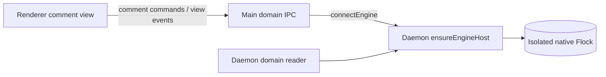

# Native Repo desktop slices

This design replaces the closed #2892 prototype from main. The first slice is
experimental, local-only and disabled unless both desktop and daemon start with
`LODY_NATIVE_PREVIEW_COMMENTS=1`. It requires the running local daemon. Cloud,
E2EE, Roost, Meta and existing preview-comment rooms retain their current owners.



## Delivery plan and budgets

| Slice | Scope                                                                        |                  New product line budget |
| ----- | ---------------------------------------------------------------------------- | ---------------------------------------: |
| 1     | One SDK host, shared observation lifecycle, local new Preview comments       |          2,400; hard review target 3,000 |
| 2     | One room migration executor: freeze, stage, verify, publish; preview adapter |                                    1,500 |
| 3     | Schedule definitions and registry as one dependency slice                    |                                    1,800 |
| 4     | Catalog/Meta bounded reads and incremental views, separately reviewed        |                                    2,500 |
| 5     | Session control/history, then optional cloud and encrypted adapters          | estimate after dependencies are verified |

Preview comments have an existing finite mutation vocabulary and no scheduler,
execution receipts or cancellation dispatch. Schedule definitions require the
registry, executor and cross-session control to agree. Slice 1 therefore chooses
comments. Its new storage uses one row per comment, keyed by session and comment
id, plus a per-session prefix view. It does not convert existing Loro comments to
Flock or claim preservation of their history. The explicit experiment is a new,
separate local dataset; turning it off shows the unchanged legacy dataset.

## First slice contract

The daemon owns the SDK host and its shutdown. Main only attaches: closing a
window/main client must not stop the daemon host. A host stop invalidates every
old observation; SDK reconnect supplies a fresh snapshot and generation. Unknown
writes are never replayed automatically. Commands retain their business ids and
may be reconciled by exact-key read. The SDK lock arbitrates concurrent owners;
there is no Lody PID registry, binary fingerprint gate or host retry framework.

One transport-neutral observation owns establishment, callback invalidation and
confirmed release on both Node and renderer. Domain code supplies authorization,
projection and commands, not a second release state machine. Establishment gives
ownership before readiness so cancellation can release an in-flight open. Online
release failure remains observable and retryable. Disconnect is an invalidation,
not an empty authoritative view. Gap requires a new snapshot, never partial repair.

Main admits only trusted product windows in the local composition and binds the
implicit workspace and local author from the atomic local catalog. Renderer input
cannot choose a namespace, raw key, engine path, writer or cloud credential. No
engine handle crosses IPC. Each observation is scoped to one sender and removed
on navigation/destruction; other windows retain their observations.

Exact reads use `flockReadMany`; prefix pagination uses `flockScanPage` with row
and byte budgets. Conditional writes cover precisely the rows read, including
absent targets. `flockSubscribeChanges` delivers a snapshot then changed rows.
No regular operation scans an entire room. Local commit/visibility is not cloud
replication. The experiment has no remote transport and advertises no cloud sync.

## Migration boundary

Slice 2 inventories SQLite and every renderer IDB source, freezes all authors of
the selected legacy room, imports original bytes into staging and verifies Loro
causal/container fidelity or Flock tombstone/clock/peer fidelity before an atomic
owner publication. No scan-to-put migration or dual writes. Preserve old stores
read-only; after new writes, rollback requires lossless reverse export or forward
repair. A generic executor owns this sequence; domains supply validation only.

## Development and evidence

Declared dependencies remain registry versions until the SDK release. Development
uses an uncommitted override of all SDK packages built from
`795bafcb6fd112fdaa0971a92db1c89133f2bcd5`; product code targets its APIs directly.
Keep the PR draft until the published dependency replaces that override. Published
0.1.0 cannot typecheck/run the new APIs; record that CI limitation explicitly.

The benchmark uses synthetic 10,000/100,000-row datasets and fixed target prefix
size, recording p50/p95/p99 exact read, conditional write and observed incremental
update latency. Initial snapshot cost depends on selected rows and is reported
separately from steady-state updates. Measurements establish local SDK behavior,
not packaged Electron or real-device acceptance.

The [decision record](../notes/proposed/architecture/2026-11-19-native-repo-first-slice.md)
explains the lifecycle boundary and why this does not replace existing Repo owners.

## Measured local performance

Apple M5 Pro, macOS arm64, Node 26.13.1, release SDK build at the SHA above.
One synthetic room, 32 rows in the selected session prefix, all remaining rows
outside it. Each measurement has 20 warmups and 100 samples. Reads select one key;
write latency includes read-set acquisition, domain validation and conditional
commit ACK. Update latency runs from command start to the Node observation callback,
so it includes commit work and is not additive to write latency.

| Room rows | Operation                   | p50 ms | p95 ms | p99 ms |
| --------: | --------------------------- | -----: | -----: | -----: |
|    10,000 | Read one comment            |  0.088 |  0.123 |  0.141 |
|    10,000 | Conditional comment write   |  0.584 |  0.699 | 11.859 |
|    10,000 | Observed incremental update |  0.578 |  0.687 | 11.840 |
|   100,000 | Read one comment            |  0.093 |  0.128 |  0.187 |
|   100,000 | Conditional comment write   |  1.095 |  1.380 |  1.563 |
|   100,000 | Observed incremental update |  1.089 |  1.373 |  1.551 |

The selected 32-row initial snapshot took 1.721 ms / 1.042 ms respectively.
Every measured update delivered exactly one row. With 10x total room cardinality,
read p95 grew 1.04x, conditional write p95 1.97x and update p95 2.00x. This agrees
with bounded key reads and changed-row delivery rather than a full-room scan;
it is not an asymptotic proof. The 10k p99 write/update spike is retained in the
report; this experiment does not isolate SDK compaction, storage or scheduling
causes. A selected session containing 100k comments and renderer repaint latency
are separate workloads, not covered by this fixed-prefix experiment.

Reproduce with the local SDK override installed:

```sh
LODY_NATIVE_BENCH=1 pnpm --filter @lody/shared exec vitest run tests/native-preview-comments.benchmark.test.ts
```

The optional `LODY_NATIVE_BENCH_OUTPUT` writes the JSON result. The experiment
is skipped in ordinary correctness suites and uses no latency threshold assertion.
