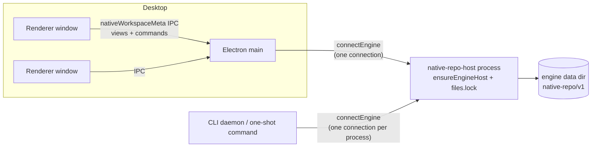

# Native Workspace Meta

How the desktop and daemon read and write Workspace Meta (the `e/m/ef/efx`
document catalogue) through the native loro-repo-rs engine instead of their two
legacy Meta Flock replicas. Binding rules live in
[`packages/shared/src/node/AGENTS.md`](../../packages/shared/src/node/AGENTS.md#native-repo-native-repots-native-workspace-metats);
the decisions and rejected alternatives are in the
[proposal note](../notes/proposed/architecture/2026-11-19-native-workspace-meta.md).

The mode is opt-in with `LODY_NATIVE_WORKSPACE_META=1`, read by both the daemon and
desktop main. It applies only to the local platform and unencrypted workspaces: the
OSS desktop has no cloud Meta, and cloud replication of a native room is a separate,
unstarted slice.

## Processes and connections

- **Host.** `dist/native-repo-host.js` is a separate entry of the CLI bundle
  ([`native-repo-host.ts`](../../packages/shared/src/node/native-repo-host.ts)). It
  calls `ensureEngineHost`, closes its own client and exits when the engine idles out
  sixty seconds after the last connection closes. A second launch loses `files.lock`
  and exits.
- **Connection.** [`connectNativeRepo`](../../packages/shared/src/node/native-repo.ts)
  is process-wide and memoized per data directory. If no endpoint answers, it launches
  the host (the daemon with its own Node, desktop main with the embedded CLI runtime)
  and waits for publication. Its reconnect factory never gives up: after a host crash,
  whichever process reconnects first relaunches the host. Neither side ever stops the
  host, so one side quitting does not affect the other.
- **Renderer.** A window never sees the engine. Main admits only the local
  platform's single workspace and exposes `available/open/release/commit/importLegacy`
  ([`native-workspace-meta-ipc.ts`](../../apps/electron/src/main/ipc/services/native-workspace-meta-ipc.ts)).
  Views are owned per window and dropped on navigation or destruction.

## One observation lifecycle

`observe` in [`native-repo.ts`](../../packages/shared/src/node/native-repo.ts) is
the only subscription state machine; `observeFlock`, `observeFlockRegisters` and
`observeLoroDoc` differ only in their subscription and initial load. `observeFlock` subscribes to changed
keys from the current head with no snapshot (`snapshot: false`), so no frame grows
with the room. It then reads initial state as bounded `flockScanPage` pages, each a
fresh `start`-bounded query at its own head. A change that arrives while pages are
loading is kept only if its `roomTxId` is newer than the page that returned its key.
The listener receives one `snapshot`, then `changes`; disconnect or a gap emits
`invalidated`. After the SDK resubscribes on reconnect, or after a gap, the same
load runs again, so every view recovers from a new snapshot.

`observeFlockRegisters` is the same lifecycle with a different load: the
subscription also carries each change's clock (`registers: true`), the initial
state is the room's complete raw export, and buffered or repeated changes merge
in any order because they are Flock records with clocks.

`observeLoroDoc` subscribes to a `loro_doc` room's binary updates and loads its raw
snapshot. Updates that arrive during the load import in any order because Loro
merges idempotently.

## Named Flock documents

The workspace catalog (`<ws>:wf:workspace`), every machine Flock
(`<ws>:mf:<machine>`) and the schedule registry (`<ws>:sr`) are owned natively by
the same switch (`isNativeFlockDocId`). Its consumers keep using `repo.openFlockDoc` and the in-memory wasm
Flock: the repo is given loro-repo's external Flock owner
([`native-flock-docs.ts`](../../packages/shared/src/node/native-flock-docs.ts)), so the
replica is loaded from the native room's raw export, receives changes with clocks,
and commits local changes on the existing persistence barriers (`flush`,
`persistFlockDocNow`, `syncOnce`) with `importRoomState`. Owned documents are never
written to local storage and never routed to the local data plane. The renderer
opens and commits them through main (`openFlockDoc`/`commitFlockDoc`), which admits
only the workspace's owned ids. Migration imports the fixed ids plus every owned
document in each legacy replica's inventory; write-back walks the Flock registry
in the written-back Meta, so documents first created in native mode (a new
machine's Flock) return too.

Writers: the daemon and each renderer hold their own replica and commit
independently. The same key resolves by Flock clock (last writer wins) in every
replica and the native room; different keys are all kept. A commit that fails
(host down) rejects its barrier, keeps the change pending in the replica, and the
next barrier commits it; it is never reported as committed.

Real sizes from a long-lived local workspace on the development machine (1,296
documents, 106k Meta registers) bound the in-memory trade-off: `wf` 24 rows / 8 KB
file, the largest of ten `mf` rooms 524 rows / 100 KB, `sr` 97 rows / 12 KB. Each
replica is the whole room, as with the legacy storage-backed replica.

## Session documents

Session Loro documents (`session-*`, `isNativeDocId`) are owned natively by the same
switch. Their roughly 170 call sites keep using `repo.openPersistedDoc` and the
in-memory `LoroDoc`: the repo is given loro-repo's external document owner
([`native-docs.ts`](../../packages/shared/src/node/native-docs.ts)). On open the
replica loads the room's raw snapshot (`exportLoroRaw`) and then receives binary
updates from an update subscription (`observeLoroDoc`, the third load on the one
observation lifecycle). Local changes commit as Loro updates with
`importRoomState` on the existing persistence barriers. A reload after reconnect
delivers the snapshot again, which imports as an update. The renderer opens and
commits through main (`openDoc`/`commitDoc`), which admits only owned ids.

Writers merge as Loro CRDT updates: concurrent appends from the daemon and a
renderer are both kept in every replica. A failed commit stays pending in the
replica and is retried by the next barrier, as for named Flock documents.

Migration is lazy and per document: the first open from a source imports that
source's complete legacy snapshot (a lossless Loro merge), checks with
`inspectDocCausal` that the room's version covers the legacy oplog version, and
then publishes `['loro_doc', <id>, <source>]`. A native write marks
`['loro_doc', <id>, 'native']`. Write-back walks those markers and merges each
room's export into the legacy CLI store before removing its markers.

Opening does not project the whole history. The Loro Session reader serves the
latest directory page and older pages on request
(`readLatestDirectoryPage`/`readOlderDirectoryPage`), so the conversation view
uses the same windowed path as Roost; turn ids are found by scanning back from the
tail. The document itself is still loaded whole. A repo that unloads a document
whose changes were all committed keeps its bytes (loro-repo
`externalDocsRetainBytes`, default 64 MiB): reopening imports them locally and
asks the owner only for the ops past that version (`exportLoroSince`; through
main, `openDoc` with `since`).

### Remote Session documents (no renderer replica)

By the owner's decision, a native renderer holds no Session document: everything
in it is read from the engine, which loads rooms lazily, and written through main.
`createSessionStore` composes `native-remote-session-store.ts` for native Session
ids instead of opening a replica.

- **Reads.** [`remote-loro.ts`](../../packages/shared/src/session-data/remote-loro.ts)
  pages the history (`readDocListFields`, one subpath read per turn body) for the
  windowed ConversationView. [`remote-document.ts`](../../packages/shared/src/session-data/remote-document.ts)
  keeps every control root (`session`, `mq`, `humanInputReceipts`, `cancelRequest`,
  `forkOperation`, `notification`, `preview`, `externalHistoryCursor`,
  `acpRuntimeConfig`) as small JSON. One `doc_subscribe_paths` observation
  (`shareObservation`) serves both: list and id edits become structural ranges,
  other history edits changed turn ids, and a changed control root is re-read.
- **Writes.** The renderer computes JSON patches and main applies them with
  `applyDocPatch`. Session rooms persist a `DocSchema` derived from the Mirror
  schema (`engine-doc-schema.ts`): objects become maps and arrays lists, strings
  stay primitive, declared streaming fields are texts, and `mq` is a movable list
  whose items expose `$cid`. A test compares the containers and JSON with what the
  HistoryWriter and the Mirror write. Control changes (queue rows by `$cid`,
  receipts, Stop) are diffed from an optimistic state and applied at the version
  they were computed on (`rebase`). History commands the renderer uses
  (`appendTurn`, `replaceTurn`, `respondPermission`, `user-status`) reuse the
  HistoryWriter's planners and validation on the stored JSON of the turns they
  touch; appends are `rebase`, edits `cas` with bounded retries. Positional diffs
  edit only changed fields, so a concurrent stream into the same turn is kept.
  `replaceEditableTail`, imports and stored copies are refused.
- **Authorization and outcomes.** Main admits patches only to `history`, `mq`,
  `humanInputReceipts` and `cancelRequest`; a receipt only as a set for the current
  local user (`authorizeSessionPatch`). A refused write rolls the optimistic state
  back to the engine's; a lost reply is `RemoteWriteIndeterminateError` and is never
  treated as unwritten. Receipts are committed before the turn is written or
  activated (`commitSessionState`).
- **Why not a write replica in main.** Running the HistoryWriter in main would
  need `loro-crdt` in the Electron main bundle (it ships only with the embedded
  CLI); routing writes to the daemon would reintroduce proxy authoring, which the
  CLI rules forbid. The schema is derived from the Mirror; the SDK's earlier
  Session preset, which did not match it, is removed (`lody/remove-session-preset`).
- **Parity.** The renderer's commands share the HistoryWriter's planners and
  validation, but apply through JSON patches rather than the writer's Loro
  operations. Moving the writer onto the same patch application would touch its
  streaming paths and legacy text/primitive representations, so a differential
  test instead runs every renderer command through both and compares the stored
  JSON and containers.

Measured choices for the primitives: JSONPath (`LoroDoc.jsonpath`) was not used
for the batch read — per-item projections drop absent fields, so results do not
align; the first query on a loaded 100k-item document costs about 150 ms whatever
it selects; filters cost 0.5–0.8 s; and results are unbounded. Changed paths come
from the document's own events (0.01–0.1 ms per commit at 100k items), not
`LoroDoc::diff` between versions (160–1,150 ms). `subscribeJsonpath` only signals
that a path may have changed, with no position, so it cannot name changed turns.

### Daemon: replicas only for running Sessions

The daemon opens a replica (`getOrCreateSessionDoc`) when it runs or is about to
run a Session, and reads every other Session of its own machine from the engine
(`LoroDocumentManager.openIdleSessionReader`). The boundary is drawn by what a
call does after it reads, not by who calls it.

**Synchronous, on a replica.** A call that checks and then writes in one decision
needs the in-process document, because the check and the write must see the same
state with no await between them. These are: the permission response (find the
request, answer it), auto-seen (scan scalars, commit with its guard), the import
cursor recheck and history write, the editable-tail replacement and its rollback,
local-project import and Edit & Resend, queue pushes and the dispatch watcher,
`markMessageQueueSignalChecked`, `TurnHistoryGate`, and an observation that
subscribes and captures its initial directory without a gap. All of them run on a
Session that is running or about to run, so taking a replica for them costs
nothing extra. They keep the synchronous rules in the
[session-data contract](../../packages/shared/src/session-data/AGENTS.md).

**Asynchronous, remote.** A read whose result is only reported needs no replica:
MCP `lody_session_list`/`status_many` (the execution snapshot), `session_history`,
quote resolution, the queue list, `lody session status`/`show`, and the GC's
goal check for an evicted document. These go through a read port
(`openNativeSessionReader`, typed as `SessionReadPort`: history, directory, turns, transcript, queue, latest goal, metadata and control changes).

How the rules are kept:

- The read port has no write methods, so a check-then-write cannot be built on a
  remote read: a caller that writes must take the replica path, where the
  no-await rules already apply. A remote read is a snapshot and never authorizes
  a later write; writers recheck inside their own transaction, as before.
- A cached replica always wins (`peekSessionDoc`): it can hold committed local
  changes the engine has not yet received, and reads must see the process's own
  writes. Another machine's Session keeps the transient synchronized read.
- An idle read never opens a replica, so it does not arm auto-seen, model summary
  or the GC cache, and a status read cannot mark a turn seen.
- The execution snapshot reads the last 128 directory rows and the queue, and
  reads the whole directory only when that tail holds no assistant turn. The goal
  check reads turn items back from the tail in pages of 32 and stops at the first
  goal; a Session without any goal reads all its items once, without retaining
  them.

The same port serves automation and schedule condition reads (turn finalized,
pending provider work, schedule run settled), `lody session history`, and
`lody session observe`: an observed idle Session follows the engine's changed-path
observation, whose reset after a host restart re-reads the directory. Every path
goes through `openSessionReadPort`, which also refuses Roost Sessions (their
history is not in the document). Writes outside a turn (rename, archive, queue
edits from the CLI) and the dispatch-default reads that precede a send still open
a replica.

`lody session history` counts every visible turn, and visibility depends on each
item's type and whether its text is blank, so the remote read projects every
turn's items page by page and keeps only the projection, then reads the selected
turns whole. With 50k turns that is about 4.3 s, against 10.4 s for the same
selection on an open replica (after a 0.7–1.1 s open). Neither is bounded; a
bounded count needs a visibility index or a nested-field projection primitive.

## Schedule and Preview comment documents

Schedule documents (`schedule-*`) use the same external document owner and lazy
per-document migration as Session documents; `isNativeDocId` covers both, and
`isNativeSessionDocId` selects the Session-only paths (remote store, idle reads,
remote reads and patches through main). A Schedule document holds one definition,
its prompt, message and recent activity, so every process keeps a replica: there
is no history that grows. Each room declares its own Mirror's roots
(`engineDocSchemaFor`), never the Session schema. Write-back walks them with the
Session documents.

Preview comment documents (`preview-comment-*`) are owned the same way and also
kept as replicas: they hold the visual comments of one Session. Only renderers
open them, so the CLI would never reach its lazy migration; instead it imports
every Preview comment document in its legacy store when native mode starts
(the storage inventory lists them, and a published source is skipped).

## Workspace Meta

[`native-workspace-meta.ts`](../../packages/shared/src/node/native-workspace-meta.ts)
keeps one observation per workspace per process and projects only changed keys
into rows. It implements loro-repo's incremental external metadata adapter
(`loro-external-metadata-v2`), so every existing `repo.getDocMeta` / `upsertDocMeta`
/ `watch` caller keeps its API:

- reads come from the indexed in-memory view;
- each command reads only its own keys or prefixes with `flockReadMany`, then writes
  with `flockBatchConditional` against that read set (a conflict re-reads, at most
  four times), and resolves after the observation has delivered the commit;
- updates carry only changed rows to the controller and the UI event bus.

The daemon passes the adapter to `LoroRepo.createWithExternalMetadata` and joins no
legacy Meta room. The renderer does the same through an IPC adapter
([`providers/native-workspace-meta.ts`](../../packages/components/src/providers/native-workspace-meta.ts)).
The four CLI helpers that scanned the raw Meta Flock read `repo.listDoc()` in this mode.

## Migration from legacy replicas

Every native room (Meta and each owned named Flock document) uses the legacy key
layout unchanged and migrates with the same `importLegacyRoom` step. Each legacy
replica is a
_source_: the CLI SQLite store (`cli-sqlite`) and each renderer IndexedDB store
(`renderer:<db>`). For each source:

1. **Freeze.** In native mode the source's legacy Meta is never opened for writing,
   so its export is final.
2. **Import.** The complete Flock JSON export (tombstones, clocks, unknown fields) is
   merged with `importRoomState` (no outbox). Flock is LWW per key, so importing a
   stale or repeated source cannot override newer native state.
3. **Verify.** Bounded pages compare every legacy key's state. Keys that differ are
   imported once more and re-read: an older record cannot change a key that holds
   a newer register, so a changed key proves an incomplete import.
4. **Publish.** A marker `['meta', source]` in the `lody-migrations` Flock room ends
   that source's migration; startup skips published sources.

This is the room-level step a workspace import also needs (merge an exported room
into an existing workspace), so the general export/import feature can call
`importLegacyMeta` per room rather than adding another framework.

Turning the flag off writes native state back. Native mode leaves a
`native-meta-published` file beside the CLI SQLite store. A legacy-mode daemon that
finds it merges the native room's complete export (`exportFlockRaw`, with clocks
and tombstones) into its legacy Meta Flock, persists it, and removes the
`cli-sqlite` marker and the file. Renderers then receive the merged catalogue over
the existing local data plane. Because the marker is gone, enabling the flag again
re-imports the replica, including edits made while the flag was off. Native mode
has no released data, so this is a development switch-back with no compatibility
handling; a failed write-back is logged and retried on the next start.

## Slices and budgets

| Slice    | Content                                                                                               | Product-line budget   |
| -------- | ----------------------------------------------------------------------------------------------------- | --------------------- |
| 1 (this) | Host, shared connection, observation, Meta adapter, migration, daemon/main/renderer wiring, packaging | 1,500 (actual ≈1,300) |
| 2        | Write-back on flag-off                                                                                | 400 (actual ≈60)      |
| 3        | Workspace catalog (`wf`) on the same lifecycle                                                        | 600 (actual ≈390 net) |
| —        | Switch to the released SDK packages when loro-repo #290/#308 ship                                     | manifests only        |
| 4        | Machine Flock (`mf`) and schedule registry (`sr`)                                                     | 800 (actual ≈40)      |
| 5        | Session Loro documents through the external document owner                                            | 700 (actual ≈490)     |
| 6        | Paged Session directory; reopen from retained bytes plus ops since its version                        | 400 (actual ≈140)     |
| —        | Cold 100k-turn opens: owner decision pending (segmented history or SDK transfer work)                 | to be sized           |
| 10       | Daemon reads idle Sessions from the engine; replicas only for running Sessions                        | 300 (actual ≈160)     |
| 11       | Automation, schedule, `session history` and `observe` reads on the same port                          | 250 (actual ≈140 net) |
| 12       | Schedule documents (`schedule-*`) on the same owner                                                   | small (actual ≈20)    |
| 13       | Preview comment documents (`preview-comment-*`) on the same owner                                     | small (actual ≈30)    |
| —        | Legacy agent/machine documents on the same owner                                                      | small per type        |
| —        | Cloud replication of native rooms (needs remote Meta design)                                          | separate proposal     |

## Performance

Linux x64, Node 26.13.1, release engine from loro-repo `0fa4fb92` (identical
to the build measured before #306/#307 merged). One host process; the daemon-side repo and a second
connection (standing in for main) share it. Synthetic legacy Meta: three registers
per document; half the documents are soft-deleted and a third have a tombstoned
field. 20 warm-up and 200 measured samples; milliseconds.
Reproduce with `LODY_NATIVE_META_BENCH=1` on
[`native-workspace-meta.benchmark.test.ts`](../../packages/shared/tests/native-workspace-meta.benchmark.test.ts).

| Docs (registers) | Operation                                                       |   p50 |   p95 |   p99 |
| ---------------: | --------------------------------------------------------------- | ----: | ----: | ----: |
|        10k (33k) | `getDocMeta` (product read)                                     | 0.004 | 0.007 | 0.034 |
|      100k (333k) | `getDocMeta` (product read)                                     | 0.004 | 0.006 | 0.013 |
|              10k | bounded engine read (`e` key + `m` prefix)                      | 0.589 | 0.872 | 1.050 |
|             100k | bounded engine read                                             | 0.604 | 0.865 | 1.077 |
|              10k | single-field `upsertDocMeta` (read, conditional write, visible) | 1.306 | 2.214 |  42.6 |
|             100k | single-field `upsertDocMeta`                                    | 1.995 | 2.907 | 504.7 |
|              10k | write → other connection's repo event                           | 3.506 | 4.705 |  49.2 |
|             100k | write → other connection's repo event                           | 4.356 | 9.858 | 512.1 |

Startup load (open plus paged initial view) takes 332 ms at 10k and 3,413 ms at
100k; it is the one path proportional to catalogue size, because the UI lists
every document. One-time migration takes 0.8 s and 19.0 s. The write p99 tail
grows with the room and is not caused by Lody: it matches the engine's periodic
whole-room auto-compaction inside the write path, an SDK follow-up.

Owned named Flock documents, same machine and method (milliseconds; open = new
repo plus loaded replica; write = `put` plus committed `persistFlockDocNow`;
update = write until the other connection's replica shows it):

|   Rows (file) | Operation |  p50 |  p95 |  p99 |
| ------------: | --------- | ---: | ---: | ---: |
|   24 (0.6 KB) | open      | 1.69 | 2.78 | 6.27 |
|            24 | write     | 1.00 | 1.68 | 3.57 |
|            24 | update    | 0.66 | 1.69 | 3.18 |
|  524 (4.4 KB) | open      | 3.84 | 4.91 | 5.95 |
|           524 | write     | 0.96 | 1.75 | 12.2 |
|           524 | update    | 0.62 | 1.54 | 9.39 |
| 5,000 (37 KB) | open      | 10.2 | 21.9 | 24.9 |
|         5,000 | write     | 0.94 | 1.22 | 76.0 |
|         5,000 | update    | 0.93 | 1.58 | 84.1 |

Session documents: synthetic histories written with the real `HistoryWriter`
(alternating 200-character user turns and 1,500-character assistant turns);
milliseconds. _Raw export_ is one `exportLoroRaw` through a second connection;
_append visible_ is `appendTurn` plus the committed barrier until the other
replica shows the turn (50 samples after 10 warm-ups). Reproduce with
`LODY_SESSION_LOAD_BENCH=1000,10000,100000` on
[`session-doc-load.benchmark.test.ts`](../../packages/shared/tests/session-doc-load.benchmark.test.ts).

|   Turns | Snapshot | Raw export | Append visible p50 / p95 / p99 |
| ------: | -------: | ---------: | -----------------------------: |
|   1,000 |   0.4 MB |        8.4 |               2.2 / 3.4 / 10.0 |
|  10,000 |   3.8 MB |       78.6 |                2.0 / 3.6 / 4.1 |
| 100,000 |  38.5 MB |        877 |               2.0 / 4.4 / 10.1 |

Appending is within the 50 ms target at every size.

First screen: the renderer's real composition (`createConversationSession`) until
the view is ready with its tail hydrated, then a lease on the latest 50 turns,
with idle passes run as soon as they are scheduled. _Load_ is the in-process
import (legacy) or `openPersistedDoc` through the native owner on one host
connection; _reopen_ is the same repo after `unloadDoc`. Milliseconds, total
(load + view + last 50). Reproduce with `LODY_SESSION_FIRST_SCREEN_BENCH=1000,10000,100000`
on [`session-first-screen.benchmark.test.ts`](../../packages/components/tests/session-first-screen.benchmark.test.ts).

|   Turns | Legacy, whole directory | Legacy, paged | Native cold, whole | Native cold, paged | Native reopen, paged |
| ------: | ----------------------: | ------------: | -----------------: | -----------------: | -------------------: |
|   1,000 |                      82 |            33 |                 86 |                 35 |                   20 |
|  10,000 |                     246 |            23 |                480 |                167 |                   35 |
| 100,000 |                   4,793 |           331 |              5,654 |              1,579 |                  197 |

The paged directory meets the 200 ms target everywhere except the 100k cold
opens. Their cost is loading the whole document: a 104 ms import plus about
220 ms of first reads for legacy; for native, 1.5 s, of which the engine
re-encodes the snapshot (about 600 ms), base64 JSON transfer and decoding take
about 250 ms, and the import the rest. A reopen in the same process asks only for
newer ops. The SDK framer fix (`lody/framer-chunks`) is required: without it the
client recopied its receive buffer per socket chunk, and a 38.5 MB open took
10–12 s.

Remote store (no replica: control roots plus the paged history view),
`LODY_SESSION_FIRST_SCREEN_PATHS=remote`; _cold_ follows a host restart, so it
includes launching the host and opening the namespace. Total ms: 1,000 turns 82
cold / 9 warm; 10,000 turns 34–45 / 8–11; 100,000 turns 304–310 / 11–12. The
renderer's RSS does not grow measurably; the engine host adds about 60 MB for a
loaded 100k-turn room. Launching and connecting to the host take about 196 ms of
the 100k cold open (once per app start).

Three engine costs were removed on the way:

- `lody/compact-by-bytes`: a migrated snapshot stayed update-encoded, and the
  first read after a restart took 6.0 s and 1.18 GB.
- `lody/declared-root-reads`: reading below an undeclared root looks it up through
  the document's shallow value, which registers every container of a freshly
  loaded document (~240 ms at 100k). Session rooms declare `history` as a list
  (`createDocRoom`), and declared roots resolve by type.
- `lody/declared-root-reads`, second commit: re-declaring an identical schema on
  a new connection no longer reloads and revalidates the document.
- The view itself: see below.

ConversationView keeps only loaded rows of a paged reader (holes elsewhere, a
stable sentinel per requested hole), and whole-history loops start at
`loadedFrom`. With an instant reader at 100k turns: open 43 → 1.3–2.6 ms, heap
36.9 → 1.6 MB, and the refresh after each appended turn p50 105 → 1.1 ms (p95
124–136 → 1.3–2.2 ms); the refresh had rebuilt every position on each append.
With the sparse view, the legacy path's 100k first screen is 219 ms and the native
replica's reopen 48 ms.

Daemon reads of idle Sessions (`LODY_DAEMON_IDLE_BENCH=4x50000`, four 50k-turn
Sessions, 19.2 MB snapshot each). Before: each read opened a replica that the
daemon cache retained. After: engine reads.

| Per Session                     | Replica (before)       | Engine (after)       |
| ------------------------------- | ---------------------- | -------------------- |
| Status snapshot, cold           | 580–715 ms open + ~1 s | 208–257 ms           |
| Status snapshot, warm           | ~1 s (whole directory) | 6.1–6.3 ms           |
| Latest 50 directory rows (list) | —                      | 2.9–3.6 ms           |
| Latest turn body                | 0.2–0.8 ms             | 0.8–1.3 ms           |
| Daemon RSS, all four            | +254 MB                | +0.6 MB              |
| Engine host RSS, all four       | +118 MB (already warm) | +161 MB (cold rooms) |

The host launch (186 ms) is excluded; cold engine reads are the room load.

Memory with one 100k-turn Session open: the replica adds about 65–90 MB to the
opening process (in-process measurement 87.5 MB), and the engine host 10–15 MB
for a loaded room; RSS deltas below 20 MB are within measurement noise.

## Limits

- Session documents require unreleased SDK branches: binary Loro update
  subscriptions (`lody/loro-doc-updates`), the external Loro document owner
  (`lody/external-docs`), the client framer fix (`lody/framer-chunks`), exports
  since a version (`lody/loro-export-since`), retained reopen
  (`lody/external-docs-reuse`), list-field reads and changed paths
  (`lody/doc-list-read`), size-triggered compaction (`lody/compact-by-bytes`) and
  declared-root reads (`lody/declared-root-reads`). Local builds are used only through an uncommitted
  override.
- The remote store's measurements use one engine connection; the renderer adds a
  main-process IPC hop per read, which the benchmark does not measure, and no
  packaged desktop run exists yet. The daemon reads idle Sessions from the engine
  for the paths listed above; the others still open a replica.
- The engine host unloads least recently used idle rooms past 16 per namespace
  and, with `lody/idle-room-byte-budget`, past 64 MiB of their encoded size.
  Twenty idle 20k-turn Sessions read once: host +275 MB with the count alone,
  +140 MB with the budget. Freed memory is not always returned to the system:
  after whole-history transcript reads the host stayed about 330 MB above its
  start.
- A commit already sent when the host dies is an unknown outcome. Per the SDK
  contract this latches that repo's metadata writes until it is recreated; reads
  continue. Commits attempted while disconnected are certain non-commits.
- No signed installer, real-window acceptance or platforms other than Linux x64
  have been exercised.
