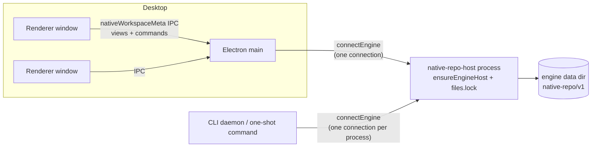

# Native Workspace Meta

How the desktop and daemon read and write Workspace Meta (the `e/m/ef/efx`
document catalogue) through the native loro-repo-rs engine instead of their two
legacy Meta Flock replicas. Binding rules live in
[`packages/shared/src/node/AGENTS.md`](../../packages/shared/src/node/AGENTS.md#native-repo-native-repots-native-workspace-metats);
the decisions and rejected alternatives are in the
[proposal note](../notes/proposed/architecture/2026-11-19-native-workspace-meta.md).

The mode is opt-in with `LODY_NATIVE_WORKSPACE_META=1`, read by both the daemon and
desktop main. It applies only to the local platform and unencrypted workspaces: the
OSS desktop has no cloud Meta, and cloud replication of a native room is a separate,
unstarted slice.

## Processes and connections

- **Host.** `dist/native-repo-host.js` is a separate entry of the CLI bundle
  ([`native-repo-host.ts`](../../packages/shared/src/node/native-repo-host.ts)). It
  calls `ensureEngineHost`, closes its own client and exits when the engine idles out
  sixty seconds after the last connection closes. A second launch loses `files.lock`
  and exits.
- **Connection.** [`connectNativeRepo`](../../packages/shared/src/node/native-repo.ts)
  is process-wide and memoized per data directory. If no endpoint answers, it launches
  the host (the daemon with its own Node, desktop main with the embedded CLI runtime)
  and waits for publication. Its reconnect factory never gives up: after a host crash,
  whichever process reconnects first relaunches the host. Neither side ever stops the
  host, so one side quitting does not affect the other.
- **Renderer.** A window never sees the engine. Main admits only the local
  platform's single workspace and exposes `available/open/release/commit/importLegacy`
  ([`native-workspace-meta-ipc.ts`](../../apps/electron/src/main/ipc/services/native-workspace-meta-ipc.ts)).
  Views are owned per window and dropped on navigation or destruction.

## One observation lifecycle

`observeFlock` is the only subscription state machine. It subscribes to changed
keys from the current head with no snapshot (`snapshot: false`), so no frame grows
with the room. It then reads initial state as bounded `flockScanPage` pages, each a
fresh `start`-bounded query at its own head. A change that arrives while pages are
loading is kept only if its `roomTxId` is newer than the page that returned its key.
The listener receives one `snapshot`, then `changes`; disconnect or a gap emits
`invalidated`. After the SDK resubscribes on reconnect, or after a gap, the same
load runs again, so every view recovers from a new snapshot.

`observeFlockRegisters` is the same lifecycle with a different load: the
subscription also carries each change's clock (`registers: true`), the initial
state is the room's complete raw export, and buffered or repeated changes merge
in any order because they are Flock records with clocks.

## Named Flock documents

The workspace catalog (`<ws>:wf:workspace`) is owned natively by the same
switch. Its consumers keep using `repo.openFlockDoc` and the in-memory wasm
Flock: the repo is given loro-repo's external Flock owner
([`native-flock-docs.ts`](../../packages/shared/src/node/native-flock-docs.ts)), so the
replica is loaded from the native room's raw export, receives changes with clocks,
and commits local changes on the existing persistence barriers (`flush`,
`persistFlockDocNow`, `syncOnce`) with `importRoomState`. Owned documents are never
written to local storage and never routed to the local data plane. The renderer
opens and commits them through main (`openFlockDoc`/`commitFlockDoc`), which admits
only the workspace's owned ids (`nativeFlockDocIds`).

Writers: the daemon and each renderer hold their own replica and commit
independently. The same key resolves by Flock clock (last writer wins) in every
replica and the native room; different keys are all kept. A commit that fails
(host down) rejects its barrier, keeps the change pending in the replica, and the
next barrier commits it; it is never reported as committed.

Real sizes from a long-lived local workspace on the development machine (1,296
documents, 106k Meta registers) bound the in-memory trade-off: `wf` 24 rows / 8 KB
file, the largest of ten `mf` rooms 524 rows / 100 KB, `sr` 97 rows / 12 KB. Each
replica is the whole room, as with the legacy storage-backed replica.

## Workspace Meta

[`native-workspace-meta.ts`](../../packages/shared/src/node/native-workspace-meta.ts)
keeps one observation per workspace per process and projects only changed keys
into rows. It implements loro-repo's incremental external metadata adapter
(`loro-external-metadata-v2`), so every existing `repo.getDocMeta` / `upsertDocMeta`
/ `watch` caller keeps its API:

- reads come from the indexed in-memory view;
- each command reads only its own keys or prefixes with `flockReadMany`, then writes
  with `flockBatchConditional` against that read set (a conflict re-reads, at most
  four times), and resolves after the observation has delivered the commit;
- updates carry only changed rows to the controller and the UI event bus.

The daemon passes the adapter to `LoroRepo.createWithExternalMetadata` and joins no
legacy Meta room. The renderer does the same through an IPC adapter
([`providers/native-workspace-meta.ts`](../../packages/components/src/providers/native-workspace-meta.ts)).
The four CLI helpers that scanned the raw Meta Flock read `repo.listDoc()` in this mode.

## Migration from legacy replicas

Every native room (Meta and each owned named Flock document) uses the legacy key
layout unchanged and migrates with the same `importLegacyRoom` step. Each legacy
replica is a
_source_: the CLI SQLite store (`cli-sqlite`) and each renderer IndexedDB store
(`renderer:<db>`). For each source:

1. **Freeze.** In native mode the source's legacy Meta is never opened for writing,
   so its export is final.
2. **Import.** The complete Flock JSON export (tombstones, clocks, unknown fields) is
   merged with `importRoomState` (no outbox). Flock is LWW per key, so importing a
   stale or repeated source cannot override newer native state.
3. **Verify.** Bounded pages compare every legacy key's state. Keys that differ are
   imported once more and re-read: an older record cannot change a key that holds
   a newer register, so a changed key proves an incomplete import.
4. **Publish.** A marker `['meta', source]` in the `lody-migrations` Flock room ends
   that source's migration; startup skips published sources.

This is the room-level step a workspace import also needs (merge an exported room
into an existing workspace), so the general export/import feature can call
`importLegacyMeta` per room rather than adding another framework.

Turning the flag off writes native state back. Native mode leaves a
`native-meta-published` file beside the CLI SQLite store. A legacy-mode daemon that
finds it merges the native room's complete export (`exportFlockRaw`, with clocks
and tombstones) into its legacy Meta Flock, persists it, and removes the
`cli-sqlite` marker and the file. Renderers then receive the merged catalogue over
the existing local data plane. Because the marker is gone, enabling the flag again
re-imports the replica, including edits made while the flag was off. Native mode
has no released data, so this is a development switch-back with no compatibility
handling; a failed write-back is logged and retried on the next start.

## Slices and budgets

| Slice    | Content                                                                                               | Product-line budget   |
| -------- | ----------------------------------------------------------------------------------------------------- | --------------------- |
| 1 (this) | Host, shared connection, observation, Meta adapter, migration, daemon/main/renderer wiring, packaging | 1,500 (actual ≈1,300) |
| 2        | Write-back on flag-off                                                                                | 400 (actual ≈60)      |
| 3        | Workspace catalog (`wf`) on the same lifecycle                                                        | 600 (actual ≈330)     |
| —        | Switch to the released SDK packages when loro-repo #290/#308 ship                                     | manifests only        |
| 4        | Machine Flock (`mf`) and schedule registry (`sr`)                                                     | 800                   |
| 5        | Cloud replication of native rooms (needs remote Meta design)                                          | separate proposal     |

## Performance

Linux x64, Node 26.13.1, release engine from loro-repo `0fa4fb92` (identical
to the build measured before #306/#307 merged). One host process; the daemon-side repo and a second
connection (standing in for main) share it. Synthetic legacy Meta: three registers
per document; half the documents are soft-deleted and a third have a tombstoned
field. 20 warm-up and 200 measured samples; milliseconds.
Reproduce with `LODY_NATIVE_META_BENCH=1` on
[`native-workspace-meta.benchmark.test.ts`](../../packages/shared/tests/native-workspace-meta.benchmark.test.ts).

| Docs (registers) | Operation                                                       |   p50 |   p95 |   p99 |
| ---------------: | --------------------------------------------------------------- | ----: | ----: | ----: |
|        10k (33k) | `getDocMeta` (product read)                                     | 0.004 | 0.007 | 0.034 |
|      100k (333k) | `getDocMeta` (product read)                                     | 0.004 | 0.006 | 0.013 |
|              10k | bounded engine read (`e` key + `m` prefix)                      | 0.589 | 0.872 | 1.050 |
|             100k | bounded engine read                                             | 0.604 | 0.865 | 1.077 |
|              10k | single-field `upsertDocMeta` (read, conditional write, visible) | 1.306 | 2.214 |  42.6 |
|             100k | single-field `upsertDocMeta`                                    | 1.995 | 2.907 | 504.7 |
|              10k | write → other connection's repo event                           | 3.506 | 4.705 |  49.2 |
|             100k | write → other connection's repo event                           | 4.356 | 9.858 | 512.1 |

Startup load (open plus paged initial view) takes 332 ms at 10k and 3,413 ms at
100k; it is the one path proportional to catalogue size, because the UI lists
every document. One-time migration takes 0.8 s and 19.0 s. The write p99 tail
grows with the room and is not caused by Lody: it matches the engine's periodic
whole-room auto-compaction inside the write path, an SDK follow-up.

Owned named Flock documents, same machine and method (milliseconds; open = new
repo plus loaded replica; write = `put` plus committed `persistFlockDocNow`;
update = write until the other connection's replica shows it):

|   Rows (file) | Operation |  p50 |  p95 |  p99 |
| ------------: | --------- | ---: | ---: | ---: |
|   24 (0.6 KB) | open      | 1.69 | 2.78 | 6.27 |
|            24 | write     | 1.00 | 1.68 | 3.57 |
|            24 | update    | 0.66 | 1.69 | 3.18 |
|  524 (4.4 KB) | open      | 3.84 | 4.91 | 5.95 |
|           524 | write     | 0.96 | 1.75 | 12.2 |
|           524 | update    | 0.62 | 1.54 | 9.39 |
| 5,000 (37 KB) | open      | 10.2 | 21.9 | 24.9 |
|         5,000 | write     | 0.94 | 1.22 | 76.0 |
|         5,000 | update    | 0.93 | 1.58 | 84.1 |

## Limits

- Requires unreleased SDK changes: loro-repo #301–#307 (#306 adds changes
  subscriptions without a snapshot, #307 the incremental external metadata
  contract) plus register-bearing changes and the external named Flock owner
  (branches `lody/flock-changes-registers`, `lody/external-flock-docs`). Local
  builds are used only through an uncommitted override.
- A commit already sent when the host dies is an unknown outcome. Per the SDK
  contract this latches that repo's metadata writes until it is recreated; reads
  continue. Commits attempted while disconnected are certain non-commits.
- No signed installer, real-window acceptance or platforms other than Linux x64
  have been exercised.
