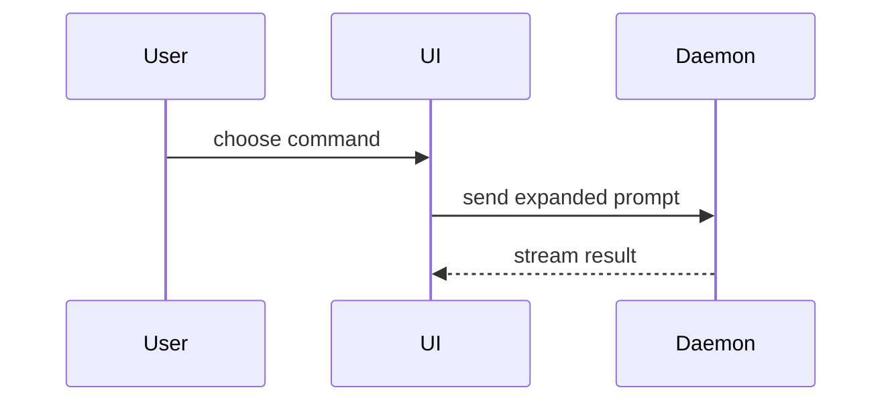

# Visual explanations

Help a reader understand the current topic visually. Pick the smallest view that
makes the key point clear, and keep the surrounding prose brief. These examples
are conceptual; the rules that govern them are in
[structural explanations](../README.md#structural-explanations).

Authors of a pull request: apply this in `## Visual explanation`. Nothing needs
to be installed.

Every pull request fills `## Visual explanation`. Agents invoke `$show-me` before
writing it. A change is complex when it crosses component, runtime, or authority
boundaries; changes multi-step control or data flow; or exceeds 200 changed lines.
Complex changes include one of the structural views below. For a simple change,
write `Simple change: <why a visual would not help review>` instead. The PR policy
automatically enforces the 200-line floor; reviewers enforce the semantic cases.

- Show logic or an algorithm as pseudocode:

```text
on(save)
  if content is unchanged
    return cached result
  write new content
  return fresh result
```

- Show runtime control flow as a call tree:

```text
submitForm
  createSession
    persistPrompt
    launchAgent
  navigateToSession
```

- Show UI structure as a component tree, including state and module boundaries that matter:

```tsx
<SessionPage> (apps/example/src/routes/session.tsx)
  useSessionEvents()
  <SessionToolbar>
    <RunSkillButton> (packages/ui)
```

- Show file responsibility or a broad refactor as a shallow file tree:

```text
src/
├── commands/       # parses user actions
├── sessions/       # owns session state
└── transport/      # sends API requests
```

- Show component interaction, control flow, or data flow with Mermaid:



- Use `diff` when the point is what changes and the surrounding shape already exists. Match the diff shape to the topic.

For a component change:

```diff
 <SessionPage>
   useSessionEvents()
   <SessionToolbar>
+    <RunSkillButton />
   <SessionTimeline>
+    <SkillResultCard />
```

For a file-layout change:

```diff
 src/
 ├── commands/
+│   └── show-me.ts       # expands the slash command
 ├── sessions/
-└── transport.ts
+└── transport/
+    ├── client.ts
+    └── stream.ts
```

For a call-tree or call-stack change:

```diff
 submitForm
   createSession
     persistPrompt
+    expandSkillMention
     launchAgent
-  navigateToSession
+  navigateToSession
+    subscribeToEvents
```

For a state or control-flow change:

```diff
 on(save)
-  write content
+  if content is unchanged
+    return cached result
+  write new content
+  invalidate cache
```

- Show the whole block when most of it is new, when omitted context would hide ownership or order, or when the user needs a copyable target shape:

```ts
function expandSkill(command: string): string {
  const skillName = command.slice(1);
  return `use the ${skillName} skill`;
}
```

- For a visual UI, layout, state comparison, or concept too dense for Mermaid, write one focused HTML file — a diagram, an infographic, or a short slide deck, whichever fits the point. Match the product's colors, type, spacing, and components; use real labels and data; support desktop and mobile. Then open it for the user:

```
Bash(open path/to/show-me-{description}.html)
```

## UI screenshots

For a PR that changes visible UI, we recommend a labeled **Before / After**
screenshot pair in the template's matching section, with a short caption explaining
the change. Agent authors should try to capture the baseline before editing and the
final result after verification as part of their implementation loop. Use the
actual running UI or its owning Storybook fixture, with synthetic data and
comparable viewport, theme, and interaction state so the difference is clear.

Prepare a safe scene before capture: prefer demo or synthetic fixtures and an
isolated development data directory over a personal workspace. Crop to the
relevant UI while retaining enough context to judge the change. Inspect both
images before uploading for conversation text, source contents,
names, avatars, local paths, repository details, notifications, credentials, and
other private content. If cropping or redaction is needed, inspect the final
export and share only that sanitized file; do not upload or commit the private
original alongside it. Follow the repository's prohibition on captured user or
agent transcripts.

Keep PR-only screenshots in temporary or ignored paths and out of Git commits.
Upload safe images as GitHub attachments with `gh pr create --attach` or
`gh pr edit --attach`.
For an existing PR, keep its complete body in `/tmp/pr-body.md` and put
`` and `` in its Before / After
table, then upload the referenced files:

```sh
gh pr edit 123 --body-file /tmp/pr-body.md \
  --attach /tmp/before.png --attach /tmp/after.png
```

The CLI replaces matching local image references with uploaded attachment URLs.
Without a body file, `--attach` appends the images to the existing PR body. Check
`gh pr edit --help` for the installed CLI's attachment support. Any linked artifact
must be accessible to reviewers; a local filesystem path alone is not reviewable.
Captions should identify the relevant state and any deliberate comparison differences.

Screenshots are recommended, not mandatory, and add no submission requirement or
automated gate. Authors may omit screenshots without explanation. The existing
structural-view rules still apply independently.

## Choosing and placing a view

Place each visual next to the short text it supports. Keep only the calls, files, props, states, and boundaries needed to answer the user's current question or the options to resolve the current discussion point.

You may use one of these, you may use several, it is unlikely you will use all of them. Use your judgement and don't overwhelm the user.

Keep each view at one abstraction level.
Indentation means directory containment, component containment, or calls; do not
mix these relationships in one tree. Expand a module in a separate focused view
when needed. In a PR, any supporting artifact must be accessible to reviewers;
opening a local HTML file alone does not make it accessible. Do not add visuals
for ceremony.
