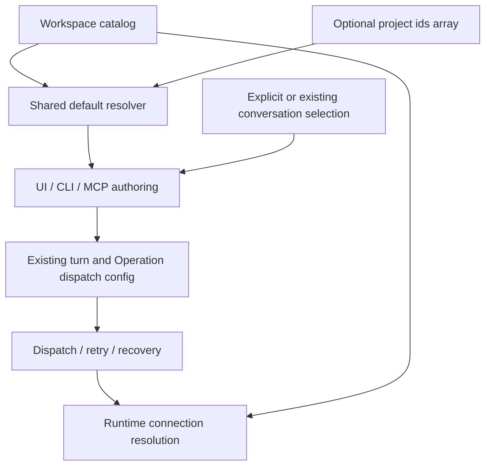

# Project default MCP authoring policy

Status: implemented
Translation: current

[中文](2026-10-09-project-default-mcp.zh.md)

## Abstract

Project conversations need reusable MCP selections without changing accepted
turns. The revised design stores one optional ids array per project in workspace
Flock, resolves it when authoring a new conversation, and reuses existing per-turn
and Operation dispatch configuration. This replaces the initial per-server override
proposal, accepting whole-list conflict resolution and no automatic additions after
customization. Shared, CLI/MCP and desktop project UI are implemented. Packaged desktop
walkthrough remains unverified.

## Decision and responsibilities

The [Spec](../../../../specs/project-default-mcp.md) owns semantics.
Draft PR: [#1708](https://github.com/LodyAI/Lody/pull/1708).
The 2026-10-19 design revision simplifies project policy to one row and preserves
UI/CLI/MCP coverage as the final scope. An absent row inherits workspace defaults; an
explicit empty list disables all. A customized project stops following later
workspace default edits. Concurrent edits to one project replace the list under
Flock ordering. This is a deliberate trade-off against per-server tri-state
inheritance and independent switch conflict resolution.

Shared owns project identity, row validation and the pure default resolver.
Components owns the Tab, authorized durable writes, ready snapshot and scoped draft
selection. CLI/MCP authoring resolves target-project defaults or target-conversation
selection and writes ids. Operation acceptance uses its existing per-target config;
recovery never rereads defaults. Runtime continues to resolve connections from the
catalog and driving turn. Preserve [catalog durability](../../../docs/workspace-catalog-durability.md)
and the [local orchestration boundary](2026-09-29-local-session-orchestration.md).

The earlier proposal added per-server overrides, extensive UI controls and new
protocol negotiation. These are unnecessary for the initial scope. The existing
wire field carries explicit ids, so use targeted compatibility checks. Loading,
permissions, durable writes, click-time snapshots and local boundaries remain
correctness requirements; Flock or an existing `synced` flag does not prove them.

## Implementation evidence and limits

`workspace-mcp.ts` now supplies project keys and replacement-default selection;
`workspace-flock.ts` parses, scans and writes project preference rows. The shared
invariant is updated from two layers to catalog/project defaults/turn selections.
CLI create resolves defaults before preparation; continuation retains the target's
selection. CLI JSON selection and MCP optional arrays preserve explicit `[]`.
Single/batch MCP Operations freeze resolved ids in existing target dispatch configs;
recovery preserves old Operations as empty when no ids were captured.

Shared tests exercise absence/empty/replacement, removed ids, identity isolation and
row updates. CLI tests exercise ready-read failures, frozen selection after preference
edits, and explicit opt-out. The local integration suite verifies real daemon-backed
MCP creation and continuation, persisted Operation configuration, batch opt-out
inheritance, and zero product-cloud access. Final full-check results belong in the
PR; do not infer packaged UI validation from these tests.

The desktop project tab and all three composers are integrated. The catalog room
exposes local-load readiness and read failure; selection resets synchronously on
workspace/project scope changes. The writer checks workspace and project authority
before persisting, and upload failure does not roll back a local save. Local
projects require the machine owner; GitHub projects require a signed-in user and
a repository connected to the workspace. This follows existing client-side
management boundaries, not a new server-side row authorization mechanism.

UI Designer reported 4,910 passing component tests and light/dark Storybook checks.
Integration reran 76 tests across selection, catalog room, writer and input
submission. The packaged Electron app was not walked through. Mobile project
settings retain their existing layout. A failed catalog open retries after all
room consumers release; a loaded local snapshot remains usable offline.
No additional project policy is resolved at ACP startup, and Role rows do not gain
MCP selections.
