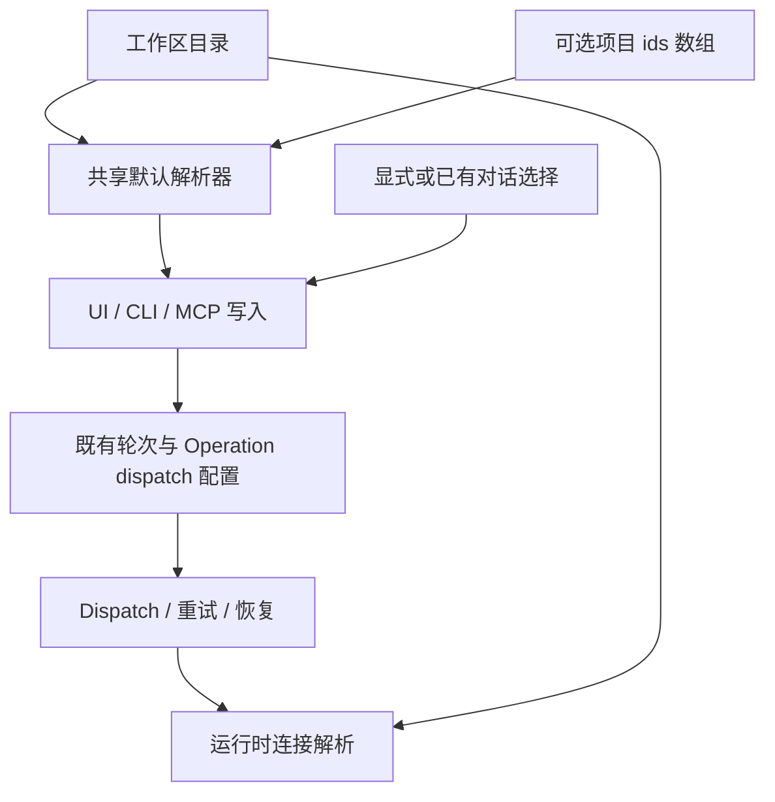

# 项目默认 MCP 的轮次写入策略

Status: implemented
Translation: current

[English](2026-10-09-project-default-mcp.md)

## 摘要

项目对话需要可复用的 MCP 选择，同时不能改变已接受的轮次。修订方案在工作区
Flock 为每个项目保存可选 ids 数组，在新对话写入时解析，复用既有每轮与 Operation
的 dispatch 配置。它替代最初逐个 MCP 覆盖的方案，明确接受整组冲突及自定义后
不自动加入全局新增项的代价。共享层、CLI/MCP 和桌面项目 UI 已实现；尚未走查打包桌面应用。

## 决策与职责

[Spec](../../../../specs/project-default-mcp.zh.md)负责语义。
草稿 PR：[#1708](https://github.com/LodyAI/Lody/pull/1708)。
2026-10-19 修订将项目策略简化为一行，同时保留 UI/CLI/MCP 作为最终范围。
无行继承工作区默认；显式空列表全关。自定义项目停止跟随后续工作区默认修改。
同一项目并发编辑按 Flock 顺序替换列表，明确接受这一代价，避免逐个 MCP 的三态
继承和独立开关冲突处理。

Shared 负责项目身份、行校验和纯默认解析器；Components 负责 Tab、带授权的持久化
写入、就绪快照和草稿隔离；CLI/MCP 写入解析目标项目默认或目标对话选择并保存 ids。
Operation 接受复用既有逐目标配置，恢复不重读默认。运行时仍根据目录和驱动轮次
解析连接。保持[目录持久化](../../../docs/workspace-catalog-durability.md)和
[本地编排边界](../../implemented/architecture/2026-09-29-local-session-orchestration.zh.md)。

原提案的逐项覆盖、额外 UI 控件和新协议协商不是首版必需。已有 wire 字段可以携带
显式 ids，只做定向兼容检查。加载、权限、持久化、点击时快照和本地边界仍是正确性
要求；采用 Flock 或已有 `synced` 标记都不能直接证明它们。

## 实施证据与限制

`workspace-mcp.ts` 提供项目 key 和整组默认选择；`workspace-flock.ts` 解析、扫描及
写入项目行。共享约束从两层更新为目录/项目默认/轮次选择。
CLI 创建在准备前解析默认，续聊保留目标选择。CLI JSON 参数和 MCP 可选数组保留
显式 `[]`。单项/批量 MCP Operation 在既有目标 dispatch 配置冻结 ids；旧 Operation
没有捕获 ids 时，恢复保持空选择。

共享测试覆盖缺省/空/替换、删除 ids、身份隔离及行更新。CLI 测试覆盖读取失败、
偏好修改后冻结选择及显式关闭。本地集成套件验证真实 daemon repo 的 MCP 创建、
续聊、持久化 Operation 配置、批量关闭继承及零产品云访问。最终全量检查结果写入
PR；不能根据这些测试声称已验证打包 UI。

桌面项目 Tab 和三个输入入口已集成。目录 room 暴露本地读取就绪及失败状态，选择
在 workspace/项目切换时同步重置。writer 在持久化前检查 workspace 与项目权限，
上传失败不回滚本地保存。本地项目要求机器所有者；GitHub 项目要求已登录用户及
仓库已连接当前 workspace。这沿用客户端管理边界，不是新增服务端逐行授权机制。

UI Designer 报告组件全量 4,910 项测试通过，并完成浅色/深色 Storybook 走查。
集成后重跑选择、目录 room、writer 和输入提交四套测试，76 项通过。尚未走查打包
Electron 应用；移动端项目设置维持现有布局。目录打开失败需所有 room 消费者释放后
才重试；已读取的本地快照可离线使用。ACP 启动不解析项目策略，Role 不增加 MCP
选择字段。
