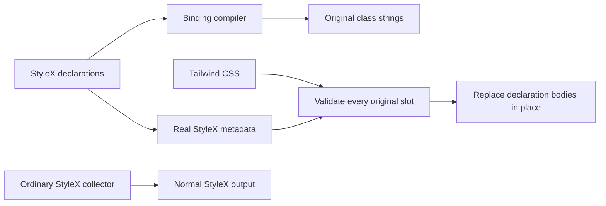

# StyleX declarations with legacy cascade contracts

Status: implemented
Translation: current

PR: [#1875](https://github.com/LodyAI/Lody/pull/1875) (draft)

[中文](2026-10-31-stylex-cascade-compatibility.zh.md)

## Abstract

Historical implementation: this bridge has been removed. See [direct StyleX and framework retirement](2026-10-22-tailwind-to-stylex-migration.md#direct-stylex-and-framework-retirement) for the current architecture. The account below preserves its decision, failures and evidence; source links pin the commit before removal.

Moving public Tailwind defaults across layers or replacing their class identities changes supported caller precedence. A bounded build adapter now gives StyleX ownership of ninety-three single-field keys and one closed font-weight pair with one hundred and sixteen authored bindings used at two hundred and seventy-two utility positions in MobileInlinePicker, AdaptiveTabStrip, the public legacy Sidebar, WorkspaceCard, SessionMentionDropLayer, ContextSwitch, ContainerQueryProvider, SessionMonacoTextViewer, LocalTerminalPanel, AcpSessionSelect, UnifiedProjectSelector, ChatComposer, LoroSidebar, AttachmentAddMenu, message actions, window-drag geometry, CommandDialog, the two Mention field owners, SidebarFilterPopover and SessionUsagePopover, while retaining the original selectors, classes and rule positions. It removes each original declaration before inserting actual StyleX compiler metadata; ordinary StyleX collection remains separate. Real production, development and current-source integration comparisons preserve rendering and CSS, but the bridge still depends on Tailwind candidate retention and ordering. This is a migration boundary, not removal of Tailwind or a general styling API.

## Ownership and compilation

| Owner                                                                                                                                                                           | Responsibility                                                                                                                               |
| ------------------------------------------------------------------------------------------------------------------------------------------------------------------------------- | -------------------------------------------------------------------------------------------------------------------------------------------- |
| [`legacy-defaults.stylex.ts`](https://github.com/LodyAI/Lody/blob/11390b40320b01a8f5807850de65a011253cedda/packages/components/src/style/legacy-defaults.stylex.ts)             | Ninety-four StyleX keys, ninety-five physical declarations and one hundred and sixteen authored scalar/group class bindings.                 |
| [`legacy-declaration-profile.ts`](https://github.com/LodyAI/Lody/blob/11390b40320b01a8f5807850de65a011253cedda/packages/components/src/style/legacy-declaration-profile.ts)     | One explicit declaration/property/legacy-alias map and ordered binding membership; the existing source scan retains its ninety-four aliases. |
| [`vite-legacy-declarations.ts`](https://github.com/LodyAI/Lody/blob/11390b40320b01a8f5807850de65a011253cedda/packages/components/vite-legacy-declarations.ts)                   | Closed source compilation, declaration equivalence and replacement at the original CSS slots.                                                |
| [`legacy-declaration-bridge.test.ts`](https://github.com/LodyAI/Lody/blob/11390b40320b01a8f5807850de65a011253cedda/packages/components/tests/legacy-declaration-bridge.test.ts) | Real compiler, `cn`, source-map, rejection and recovery behavior.                                                                            |

The pre-transform validates a fixed AST grammar before React/docgen transforms.
It accepts literal single-field declarations, the closed font-weight pair and the one hundred and sixteen approved `stylex.props`
bindings, folds them with the pinned native compiler, and emits their original
class strings in the original order. Dynamic values, conditions, namespace
escapes, mixed class construction and unsafe query loaders reject. The source
module throws if consumed without its build adapter.

The CSS transform runs after Vite's CSS processing and before CSS publication.
It validates all original selectors, `utilities` contexts, the exact single-field or closed-pair bodies,
values and importance before mutating anything. Each old declaration is detached
and replaced by a clone of the real metadata declaration at that same position.
There is no second effective Tailwind body, new specificity, layer reordering,
shared ordinary atom or extra inline source-retention declaration.

The only multi-declaration exception is the exact `font-medium` writer-first
pair. Both fields read the same element-local `--font-weight-medium` variable.
The compiler associates the two native atoms by property, preserves the original
registration and rejects any omitted, reordered, duplicate, important, unequal
or unexpected field before mutation. The
[font-pair decision](2026-11-03-stylex-font-writer-pair.md) owns that acceptance;
other writer rules and variants remain unsupported.

The adapter follows the actual Tailwind Vite optimization phase. Serve mode leaves
declarations raw; the two official build entries share their Tailwind options with
the adapter, which applies the same locked optimizer and CSS-minification setting
to genuine metadata clones. Raw/library callers do not infer optimization merely
from build mode. The direct components dependency is loaded relative to this module
so the bundled Electron config does not resolve it from the wrong package owner.

Optimization can merge simple class selectors into a single physical declaration.
The adapter validates that member list and context without moving or rewriting it.
All plans claim physical declarations before any mutation; two keys claiming the
same declaration reject. Complex selectors, repeated members and unequal or
multiple unexpected slots still reject. This preserves canonical optimizer output
without hard-coded transparent colors or maximum-number spellings.

Non-alias metadata must not introduce Tailwind candidates. The first combined
renderer build turned the new literal CSS property name into an extra legacy
selector, although Storybook CSS matched. Actual locked source scanning and a
minimal compiler control isolate that property string as the cause. Splitting
only its source literal preserves the same metadata value and removes the
unintended candidate; no stylesheet or collector patch is used. The original
four-build cut, selector difference and eight-pair browser supplement remain
frozen. The repaired source cut has its own build/test qualification.

The locked container-query plugin and Tailwind v4 both emit the same
`@container` slot in development; production merges them. Only this alias permits
two slots, each independently validated and replaced without deduplication. Other
duplicate, missing, unequal, important or extra-body slots reject. Static opacity
numbers/percentages compare numerically within 0–1; the original element-local
`calc(var(--spacing) * 0)` remains an expression, not literal zero.

The calc-zero minimum-width normalization belongs only to the `min-w-0`
alias. Applying it to every `min-width` rejected an otherwise exact200px native
slot. Other aliases keep exact-value comparison; the zero alias still rejects
literal0 or200px even when both compared bodies match. Three added real compiler/
Tailwind regression cases preserve that distinction. Replaying the original
rejected247 source now passes all four PostCSS modes; current91-key/113-binding
CSS and native code remain unchanged across all modes. This tool correction adds
no consumer credit and does not accept247's separate ordinary-style visual failure.

Storybook, components Vite, the Electron renderer and components Vitest install
the adapter. Vitest's binding-only route is a test transform, not application SSR.
The normal StyleX collector remains unchanged. Compiler inputs use direct pinned
Babel 7.29.7, StyleX 0.19.0 and PostCSS 8.5.6 dependencies; trace-mapping 0.3.31 verifies
maps. These versions already existed in the lock/cache. There is no compiler
cache, epoch, generated shared stylesheet or experiment-directory import.

## Public compatibility and counting

The original class identities keep `cn`/`twMerge` group recognition and preserve
named, arbitrary-property, opaque StyleX, ancestor and real Radix Slot precedence.
The retained 366px container query and frozen-transition utilities keep their
existing paths. DOM, refs, events, disabled state and responsive behavior do not
move into the compiler adapter.

Two hundred and seventy-two consumer utility positions becoming imported bindings are not that many fewer
remaining legacy occurrences. The ninety-four aliases and two hundred and seventy-two compiled output occurrences
remain explicit compatibility dependencies. Scanner v2 continues to report only
its recognized AST occurrences; the bridge's known outputs are listed separately
and added back for the conservative remaining boundary. The
[migration note](2026-10-22-tailwind-to-stylex-migration.md#public-callers-and-the-remaining-cascade-boundary)
owns those exact source cuts and counts.

Widen only a demonstrated owner after its real Before capture and caller
checks. Distinct keys may use different values of the same CSS property. The
compiler adds one private native `stylex.props` probe per validated key, associates
its actual atom IDs with metadata, and removes every probe before publication.
It does not infer key identity from property/value sets or metadata ordering.
Overlapping properties inside one binding, atom deduplication, unknown atoms and
reserved probe-name collisions reject. This remains a closed build transform,
without runtime probes or a general CSS framework.
When consumers no longer need these legacy selector contracts, remove their
bindings, aliases, adapter wiring and compiler dependencies together. No public
compatibility contract is retired by this change.

## Evidence and limits

Local artifacts live under `packages/components/artifacts/visual/`.

| Boundary                   | Measured evidence                                                                                                                                                                                                                             | Limit                                                                                                                                                                                                                  |
| -------------------------- | --------------------------------------------------------------------------------------------------------------------------------------------------------------------------------------------------------------------------------------------- | ---------------------------------------------------------------------------------------------------------------------------------------------------------------------------------------------------------------------- |
| Frozen215 production       | Eight real pairs,456 complete nodes, PNG/RGBA exact;106 CSS resources byte-identical.                                                                                                                                                         | Prepared212 closure, not the later full Root tree. Four asset path names differ while their paired CSS bytes match.                                                                                                    |
| Frozen215 development      | Four real pairs,304 complete nodes, PNG/RGBA exact; only40 exact debug-source line attributes differ. JS bindings, owners and nine CSS slots map to source.                                                                                   | Eight unique declarations include two real container slots. This is not a Windows OS run or application SSR.                                                                                                           |
| Official renderer builds   | Two actual renderer-only builds and their complete CSS match; ordinary collectors remain isolated.                                                                                                                                            | Build verification, not a newly captured whole Electron App or backend acceptance.                                                                                                                                     |
| Current215+216 integration | Eight new production pairs/456 nodes are PNG/RGBA exact; only14 individually hashed CSS resource URLs differ. All106 CSS files match;620 component files/6,218 tests pass with4,789 inputs unchanged.                                         | Includes recorded user working-tree edits. The two sides freeze the same documented source cut; later Markdown and fixture formatting have separate build qualification. Original216's719raw-pixel OPEN is not closed. |
| Compiler and HMR           | Seventeen actual compiler/binding/map/rejection tests pass. The final real update observes HTTP 200→404→200 and an error overlay while unequal0.6 metadata is rejected; the loaded page stays0.7 and recovery returns0.7 without the overlay. | Rejecting unequal publication does not make the whole page fail closed. Earlier cached-last-good responses and four rejected HMR gate assumptions remain recorded.                                                     |

`leaves215-acceptance.html`, `leaves215-delivery.json` and
`root215216-current-cut-delivery.json` own the raw records, original PNGs, build
inputs, exact CSS comparisons and failures. The formatted persistent controls
fixture has equal runtime AST after actual JSX lowering; that is separate from
new PNG credit. The final documentation/fixture build retains its own source bank
rather than rewriting the original eight-pair matrix.

The formatted-fixture/documentation build preserves all106 CSS resources. Its
6,875 emitted module identities match, while12 original strict AST differences
remain explicit: four preload dependency tables carry new artifact references,
and eight modules change ten interop mode arguments. The real React and ReactDOM
exports and emitted helper take the same default/descriptor branch in both modes;
a synthetic truthy-module/default counterexample differs, so this qualification
is specific to those actual inputs. It is not whole-module raw AST equality or
new screenshot credit. Initial identity collisions and overbroad React-only
assumptions remain rejected evidence.

The final adapter lint cleanup uses existing PostCSS map types, one documented
opaque-AST type boundary and three explicit undefined returns. Seventeen owning
tests, component/tool types and scoped lint pass; actual Vite/Oxc lowering differs
only at those three equivalent returns. The original six-error lint result and
both source versions remain. The6,218-test run belongs to its recorded earlier
cut; cleanup does not claim a fresh full-suite run. Final real-build qualification
also checks this adapter and the final source-scanned documentation together.

The Sidebar extension preserves every original `cn` position, public/ancestor and
Slot precedence. Scope217 adds five flat properties and28 utility positions;
scope218 reuses the same thirteen properties at21 more positions, without changing
the compiler algorithm. Their original21-pair matrices are19 and20 PNG/RGBA exact.
Three mobile-layout frames remain OPEN:217 has32,090 raw pixels with maximum
channel difference1;218 has21,320 with maximum3. All threshold12 counts are zero,
but target ROIs contain differences, so they are not dismissed as background-only.
The Chromium iPhone-UA/DPR3 runs exercise mobile layout with fine-pointer/hover
behavior; they are not Safari, real-device or touch acceptance. Both106-resource
CSS comparisons match and each frozen component cut passes620 files/6,218 tests.

The218 registration-order rejection remains evidence for the closed grammar.
Fourteen development CSS slots and eight scalar bindings have author mappings,
but the newly bound GroupAction owner maps to null: that is a real debug mapping
loss, not complete source-map equivalence. Original217 test-only arbitrary-height
candidates and their builds remain frozen. The final Root `cn` test constructs
its same60px input at runtime so implicit Tailwind scanning does not introduce a
production rule absent from Root's original stories; final Root build qualification
is separate from those original captures. Source and visual evidence are owned by
`leaves217-delivery.json`, `leaves218-delivery.json` and their independent reviews.

The WorkspaceCard/drop-layer extension221 reuses those same thirteen properties
through three appended bindings at nine utility positions. Its seventeen real
Storybook pairs are PNG/RGBA exact over2,377 body and36 target records; only
seventeen individually verified CSS URLs differ. Trusted native drag/drop,
self-exclusion, disabled drops and retained drafts are exercised. Two actual
isolated Electron pairs also match PNG/RGBA over633 nodes/four targets. Their
fixed-position IDs, resource paths and actual boot elapsed writer/reader differences
remain explicit, including two physical hidden-mark `animation-delay` fields;
matching pixels do not establish identical startup history or
actual-App drag coverage. The first container's missing CLI discovery marker and
its failure remain; the retry copies the existing workspace marker and identical
prebuilt runtime bytes to both private containers, without changing CLI source.

The committed native-drag/caller fixture is shared by both221 source cuts. Its
new literal candidates can enter Tailwind's implicit production scan, while its
StyleX atoms belong to the story graph. Therefore those106 matching resources
prove the frozen common-fixture comparison, not CSS identity against the older
Root tree without that fixture. Final combined Root qualification stays separate.

Sidebar/ContextSwitch extensions223–225 preserve the original complete class
strings and caller/Slot ordering. Scope223's23 pairs/3,414 nodes/238 targets are
PNG/RGBA exact and120 real CVA/cn combinations return identical bytes. It authors
two new bindings, but production emits only one: the padding scalar is inlined
as its original literal at real readers. Source export counts are not runtime-bank
counts. A previously non-null desktop-frame owner mapping becomes null; the
fourteen development CSS slots and two new helper mappings remain verified.

ContextSwitch224 retains27/32 exact PNG pairs; five paint OPENs total812 raw pixels
(maximum channel difference1), while716 full target records differ only at32
resource URLs. Scope225 adds four distinct property slots with the locked actual
expressions: height from local spacing, a20rem maximum, local large-radius variable
and muted HSL with its explicit alpha1. Its original39 pairs retain34 exact PNGs,
five paint OPENs/924 raw pixels and four real published-indicator differences at
spacing initial. A separate actual reselect pair matches nineteen new records;
it neither reconstructs the old measurement history nor closes those originals.
The twenty-one compiler tests include real preset-derived values and individual
rejection mutations; no algorithm, state logic or specificity patch is added.

Sidebar Label226 adds one non-shrinking declaration/binding while retaining its
public native/Slot class identity. All18 original PNG/RGBA pairs match over3,600
body records and32 targets; two actual post-pointer Header thumb transforms
remain different. Three proposed Switch cleanups were not adopted. A real public popup-container
comparison proves the Desktop cleanup changes flex-shrink0→1 under a supported
zero-specificity ancestor; a normal higher-specificity control remains1→1.
Header and Mobile are still unproved by that Desktop probe. The original flat-comparator
RangeError and report-path overflow are preserved; the final report fixes only
its own text wrapping. A Root integration first matched a different h-8 Input
line; source-diff/inventory checks rejected it before commit. The saved bad source
and its corrected GroupLabel-only diff remain explicit evidence.

Build extension227 has28 real compiler/slot/map tests. Eight production, four DEV
and twelve separate two-height controls pairs preserve all324 captured target
records apart from24 precise iframe URL ports. Twenty-one PNG pairs match;
three original production OPENs total762 raw pixels, with no threshold12 pixels.
All106 production Storybook CSS files, one official renderer CSS file and the
original thirty compiled exports match bytes. The sample has no consumer credit;
Root's Label extension is a separate18-declaration/31-binding cut. Its report-only
Escape cleanup failure is retained and fixed in the final offline viewer.

Dimensions228 transfers twelve existing Sidebar height/radius positions through
five appended keys and bindings, reusing the same closed compiler. All21 pairs
are PNG/RGBA exact across4,564 body and728 target records. Real size variants,
disabled/Slot/caller and ancestor paths, local spacing/radius values, CSS-wide
spacing values and Chrome mobile drawer interaction retain their original class
strings and complete captured fields apart from21 verified CSS resource URLs.

Editor/container229 transfers eight positions in three native owners through one
height key and three bindings. All18 pairs are PNG/RGBA exact over4,172 body and18
target records: ten existing Monaco caller cases, four actual windowed-conversation
containers and four real terminal cases after a pointer click into an existing
Form input. Captured DOM, semantic accessibility and post-screenshot actions match
apart from precisely qualified resource URLs and accessibility references. The
original healthy focused-terminal Before-only sample and43 cursor-paint pre/post
differences remain; focused blink history is unqualified. Existing negative Monaco
mapped offsets remain unchanged and are not presented as fully visible viewports.

Both isolated units inherited the earlier metadata source literal on both sides;
their byte-equal renderer proofs establish that common source cut, not equivalence
against8f or the repaired final Root. The Root merge preserves the scan-safe
property value and lint directive, appends228 then229 without replacing the
profile, and requires its own combined build qualification. No new compiler
algorithm, component API, ref, lifecycle or event behavior is introduced.

ACP230 transfers nineteen positions through eight keys and nine bindings. Its36
real pairs are PNG/RGBA exact over5,816 body and264 target records, with107 matching
CSS resources and84 actual cn/twMerge cases. Three additional candidates remain
utilities: their old raw-value oracle rejected production canonicalization.

Sidebar231 transfers twenty positions through eight keys and eight bindings,
including the actual input-field and sidebar-background variables. All20 pairs
are PNG/RGBA exact over4,079 body and305 targets. Root and subtree palette values,
CSS-wide spacing, RTL and supported native/Slot/CVA callers are covered. The two
UA drawer cases use fine-pointer/hover Chrome; they do not prove touch behavior.

ProjectSelector233 transfers nine positions with five bindings; its input fill
reuses231's canonical key. Its32 real pairs contain27 exact PNGs and five OPENs
totaling151 raw/72 threshold pixels. Complete captured fields match apart from64
individually verified CSS URLs, but selection endpoints were not captured. A caret
cause is unproved. Offline fallback is exercised; no loaded-avatar claim is made.
The original failures and these OPENs remain in their frozen per-unit reports.
The frozen combined230–233 cut adds26 real pairs:22 PNGs exact and four OPENs
totaling72 raw/72 threshold pixels over5,182 body/305 targets. Native selection
endpoints match; the line's paint cause remains unproved. Its four official builds
and107 CSS assets pass, while a real default PostCSS/Vite path rejects optimized
aspect-ratio spelling. That failure remains in its immutable report.

Build235 shares the actual PostCSS configuration's explicit optimization value
with the adapter. The configured factory and bridge therefore agree during both
serve and build, independently of Vite CSS minification. PostCSS's empty optimize
object defaults to non-minified output; its semantics differ from the Vite producer.
Raw/library mode stays explicit, and two producer options together reject. Seven
actual factory/hook cases and the existing37 tests pass. Unit inputs limit source
discovery to the approved aliases with the real preset/theme; actual source builds
qualify implicit scanning separately. This keeps the phase tests independent of
repository size and machine load without replacing the real compiler. Independent real default
Vite CSS builds now accept and preserve the old24-key baseline's256,846-byte asset.
The raw opacity70%→.7 spelling difference predates this fix; it is not newly
byte-equal raw CSS. The four-file unit has separate qualification from current Root.

Composer234 transfers thirty positions through sixteen bindings. Its53 desktop-
family pairs are PNG exact over6,653 body/175 targets. Eight separate mobile-UA
layout pairs exercise the actual24px minimum and bottom Drawer:three are exact,
five retain24,723 raw/one threshold pixel over1,126 body/28 targets, with all other
captured fields matching apart from sixteen verified URLs. These are mouse-driven
Chrome scenes with touch points0, not hardware/touch acceptance. Narrow desktop
width alone did not reach that branch; the initial touch-reset cause assumption
was also disproved, and both zero-accepted attempts remain. Root reuses the existing
padding-zero key as well as six ACP keys, avoiding duplicate atoms without changing
the frozen candidate. The frozen234 cut's55 keys/77 bindings need their own final combined
qualification; neither the original matrices nor235's44-key proof replace it.
Build-only232/235 earn zero consumer credit.

The236–240 continuation transfers thirty further ownership positions with zero
net utility removal. Composer base colors add seven, LoroSidebar ten,
AttachmentAddMenu five, message-action chrome seven and the ACP font pair one.
The236–240 bank has69 keys,70 physical declarations,89 bindings and32 distinct
CSS properties, including the private font writer. Its214 retained outputs still
depend on the original Tailwind aliases and sorting. Its combined Root
build/browser qualification is separate from these isolated unit reports.

| Unit               | Real acceptance                                                                | Retained limits                                                                                                                                                                                                                             |
| ------------------ | ------------------------------------------------------------------------------ | ------------------------------------------------------------------------------------------------------------------------------------------------------------------------------------------------------------------------------------------- |
| Composer236        | Desktop12/24 PNGs exact; mobile2/4 exact;107 CSS pairs exact.                  | Desktop12 paint OPENs240raw, mobile2 OPENs6,916raw/180threshold; another PNG-exact mobile state has three hover-field differences. Separate hover-none control does not close them. Alpha border stays Tailwind after raw oracle rejection. |
| LoroSidebar237     | All27 PNG pairs exact,6,391 body/135 target records;107 CSS pairs exact.       | CTA/workspace radio callbacks are verified; three menu actions establish paint/close only. Report close-race failure remains recorded.                                                                                                      |
| Attachment238      | Formal19/24 PNGs exact,3,433 body/106 targets;107 CSS pairs exact.             | Five OPENs199,629raw/zero-threshold; three exact root-only controls are not submenu acceptance. Two complex MCP widths stay Tailwind after exact raw-value rejection.                                                                       |
| Message actions239 | 31/33 PNGs exact,5,861 body/125 targets;107 CSS pairs exact.                   | Two mobile-tap OPENs71raw/2threshold. Arbitrary public icon, selection Range, independently gated Check-present feedback and fine/hover capability are not established. Original state writers remain.                                      |
| ACP font240        | 24/24 PNGs exact,3,969 body/255 targets;108 CSS pairs across six builds exact. | One label only; synthetic research's24 DOM cases in three images are a different scope. Normalized bank prefix and final Root composition require separate verification.                                                                    |

Each `leaves236` through `leaves240` delivery, its HTML and independent review
retain the actual inputs, URL carriers, initial failures and cleanup outcomes.
No new exact PNG or CSS asset closes an original pixel, hover-field or device
limitation. The message resting opacity remains the exact raw `0%` expression.

The qualified236–240 Root combination has50 real pairs:44 PNGs exact and six
pixel OPENs totaling30,840 raw/201 threshold pixels. One dark Drawer also retains
three hover-state differences. All175 exact URL carriers are qualified; complete
pre/post objects are stable on each side. Its six builds preserve108 CSS pairs and
the stable component regression passes620 files/6,257 tests. That qualification
belongs to its frozen69-key/70-declaration/89-binding source cut.

The qualified241/242/244 cut transfers31 positions with zero net removal,
using87 keys/88 physical declarations/104 bindings over40 distinct properties.
Its245 outputs retain their legacy contracts; its combined validation is separate
from these isolated reports. That frozen cut excludes243 and245.

| Unit                  | Real acceptance                                                                                                                                                                | Retained limits                                                                                                                                                                                                                                                                                                        |
| --------------------- | ------------------------------------------------------------------------------------------------------------------------------------------------------------------------------ | ---------------------------------------------------------------------------------------------------------------------------------------------------------------------------------------------------------------------------------------------------------------------------------------------------------------------- |
| Window geometry241    | Eight final reduced pairs are PNG/RGBA exact over944 body/72 targets;107 CSS pairs match. All public exported types remain exact.                                              | Original14-position candidate is rejected despite26 exact PNGs: two exported constants widened literal types to string. Three positions remain raw constants; caption padding also stays Tailwind after raw-value mismatch. Synthetic IPC geometry does not prove native OS dragging or fullscreen.                    |
| Existing font pair242 | Four consumers reuse the existing pair at five positions;108 CSS pairs and complete compiled bank remain equal. Thirty of35 formal PNGs match.                                 | Five OPENs total216,383 raw/66,585 threshold pixels. One natural mobile Back endpoint has27 linked focus/highlight fields; its timing history was not captured. One separate Back→Home pair is exact and does not close that endpoint.                                                                                 |
| Sidebar frame/Rail244 | Fifteen positions;28/30 PNGs exact,3,988 body/117 targets and107 CSS pairs match. Final unowned-format restoration has identical actual production JS and389 Oxide candidates. | Two UA Drawer OPENs total32,151 raw/zero threshold pixels, maximum channel delta1. Both viewport-height aliases retain their additional supports fallback. The rejected Provider-omission candidate and invalid first AST visitor remain evidence, not acceptance. Legacy Sidebar is absent from the actual App graph. |

The qualified243/245 continuation transfers fourteen more positions through
four new keys and seven bindings, producing91 keys/92 physical declarations/
111 bindings and259 retained outputs across nineteen source owners. CommandDialog
keeps the actual42rem maximum rather than substituting a container token; z-index
and radius read their element-local variables. Mention changes only class bindings,
leaving caret, selection, range and mirror synchronization code intact. No compiler
grammar or net dependency-removal scope is added.

Its isolated Command report has37 pairs/31 exact PNGs and six OPENs totaling120
raw/120 threshold pixels. Mention has21 pairs/20 exact PNGs, but one exact image
still has fourteen mirror-height fields differing and another has20 differing
pixels. Dark readonly could not stabilize and has no paired visual credit. One
separate naturally initialized mirror pair is exact; it does not replace either
OPEN. Combined validation is owned separately by the Root243/245 report.

The common Mention fixture had two real lint errors from shadowed updater
parameters. Only those local bindings and formatter whitespace changed after capture. Actual Oxc
lowered whole ASTs match after precisely those two bound-identifier renames, and
all244 Oxide candidates match; lowered JS bytes differ. This is qualified alpha
equivalence, not a new final-source build or screenshot. Original errors and source
versions remain in the evidence.

Sidebar Input/Skeleton246 adds eight positions through two existing-field
bindings, leaving91 keys/92 physical declarations unchanged and raising the current
bank to113 bindings/267 retained outputs. Its isolated twelve pairs contain eight
exact PNGs and four OPENs totaling56,902 raw/22 threshold pixels; all sampled fields
match apart from24 qualified URLs. Current Root integration has a separate
qualification. The fixture's explicit random input does not establish CSS-variable
forwarding: the existing Skeleton primitive replaces the caller style with its
own StyleX style. Responsive Drawer evidence uses an independent iPhone-UA Chrome
session, not width alone, Safari or hardware touch. Original driver/port failures
and the corrected namespace-export summary remain evidence.

Popup247/250 transfers five more positions through three new keys/bindings,
reusing the existing intrinsic-width and corner declarations. The accepted18+9
pairs are PNG/RGBA exact, with108 complete CSS resources equal on each cut.
Ordinary caller StyleX is not interchangeable: the rejected Usage candidate let
the primitive's later same-layer rules win, changing radius12→14 and a scoped
surface from padding18/radius19/height80 to12/14/68. Its nine changed images,
53-passing/20-failing original gate and CSSOM diagnosis remain rejected evidence.
The final bridge preserves the original cascade without a specificity patch;
250 reuses qualified247 After frames as Before rather than claiming a new capture.

The separate Spinner248/251 changes use the existing physical `diameter` API,
remove eight source utilities and add no bridge grammar or primitive API.
Their18+14 pairs are exact after individually qualifying the unchanged primitive's
new class/inline width-height carriers; raw records are not wholly identical.
The fixtures project actual phase-specific owner JSX into real Menu or Composer/
Button/Spinner hosts, not full SessionDetail/ChatLanding controllers or RPC.
The reduced Menu local-spacing supplement samples completed0.01ms size transitions
at400ms; it does not establish natural completion of those size transitions.
Initial spacing's300px invalid-at-computed-value result is preserved on both sides.
The final Root combination has its own frozen source and visual acceptance.

The full AST checker visits every child with a void callback and retains JSX text;
a mutation in the second statement and the omitted Provider class both reject.
Whole-file inverse checks protect unowned source bytes. Late format-only
qualification is not a new final-source build, screenshot or debug-map equality
claim. Each delivery and its independent review owns the precise source versions,
raw comparisons, negatives and report-only corrections.

The original production Vite pipeline does not publish a usable CSS source map.
JS and real development CSS author mappings are verified; complete production CSS
mapping is not claimed and no global Vite workaround is included. Actual component
Vite CSS transforms returned, but its earlier `server.close()` retained an
unsettled-await failure. The source generated by that check was preserved and
restored to its locked bytes; it does not establish normal cleanup.

## Rejected routes that still constrain the design

The original immutable reports remain evidence, not adopted implementations.

| Route                                                       | Demonstrated failure and retained boundary                                                                                                                                                                                                                                                                                                                                                                               |
| ----------------------------------------------------------- | ------------------------------------------------------------------------------------------------------------------------------------------------------------------------------------------------------------------------------------------------------------------------------------------------------------------------------------------------------------------------------------------------------------------------ |
| Native utilities sublayers and early/late extraction156/159 | Unlayered utility rules beat sublayers. Early insertion changes a real Slot grid parent/flex child from55→28px; late insertion breaks reverse Slot, caller width840→0 and the retained active minimum180→0. Thirteen selected Adaptive successes and66 exact screenshots do not repair those contracts.                                                                                                                  |
| Shared collectors or hashes                                 | Two locked unplugin instances share a rule store; the declared legacy layer option is not forwarded. Reusing ordinary atoms changes overflow despite equal pixels. Even exact-position independent hashes break named `w-0`, `opacity-50` and `block` because `twMerge` does not recognize them. A second merge registry would not preserve exported raw strings.                                                        |
| Generated output and history164/168                         | An old JS response outlives its center atom when CSS changes with HMR disconnected. A private history extension repaired that window experimentally, but introduced ownership machinery that this stable-class bridge does not need. The55raw/32threshold spacing OPEN stays open.                                                                                                                                       |
| Trial171/180/184 and restoration188                         | Earlier66 paired images and actual App crops match, while whole-App39raw and312raw OPENs remain. Three real arbitrary-property callers later change width598→16, minimum598→840 and clipping/hit chains. All thirteen trial paths were restored; those trials receive zero production credit. Virtual Win/POSIX normalization tests were not an actual Windows run.                                                      |
| Exact-slot/206 prototype                                    | Twelve static controls and one actual opacity owner established the smaller boundary. Its seven production plus two DEV pairs cover 505 nodes, but corrected percentage handling did not recapture the seven production images. Transitive compiler resolution, proof-directory wiring and incomplete pipelines were not accepted. Its CSS 404 retained last-good0.7 with no overlay; it is not the later215 HMR result. |

All original source-map gaps, unknown cleanup outcomes, wrong-fixture captures,
readiness failures and visual OPENs remain in their owning reports. Neither a
new default-only success nor CSS byte equality closes unrelated historical
layout, state, paint or observer-history differences.
