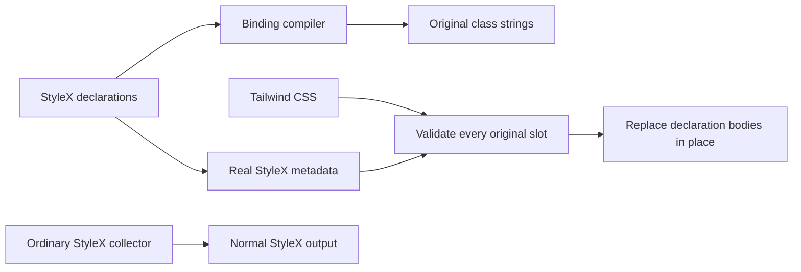

# StyleX declarations with legacy cascade contracts

Status: implemented
Translation: current

PR: [#1875](https://github.com/LodyAI/Lody/pull/1875) (draft)

[中文](2026-10-31-stylex-cascade-compatibility.zh.md)

## Abstract

Moving public Tailwind defaults across layers or replacing their class identities changes supported caller precedence. A bounded build adapter now gives StyleX ownership of eighteen flat declarations with thirty-one authored bindings used at eighty-six utility positions in MobileInlinePicker, AdaptiveTabStrip, the public legacy Sidebar, WorkspaceCard, SessionMentionDropLayer and ContextSwitch, while retaining the original selectors, classes and rule positions. It removes each original declaration before inserting actual StyleX compiler metadata; ordinary StyleX collection remains separate. Real production, development and current-source integration comparisons preserve rendering and CSS, but the bridge still depends on Tailwind candidate retention and ordering. This is a migration boundary, not removal of Tailwind or a general styling API.

## Ownership and compilation

| Owner                                                                                                          | Responsibility                                                                                                                            |
| -------------------------------------------------------------------------------------------------------------- | ----------------------------------------------------------------------------------------------------------------------------------------- |
| [`legacy-defaults.stylex.ts`](../../../../packages/components/src/style/legacy-defaults.stylex.ts)             | Eighteen real StyleX declarations and thirty-one authored scalar/group class bindings.                                                    |
| [`legacy-declaration-profile.ts`](../../../../packages/components/src/style/legacy-declaration-profile.ts)     | One explicit declaration/property/legacy-alias map and ordered binding membership; the existing source scan retains its eighteen aliases. |
| [`vite-legacy-declarations.ts`](../../../../packages/components/vite-legacy-declarations.ts)                   | Closed source compilation, declaration equivalence and replacement at the original CSS slots.                                             |
| [`legacy-declaration-bridge.test.ts`](../../../../packages/components/tests/legacy-declaration-bridge.test.ts) | Real compiler, `cn`, source-map, rejection and recovery behavior.                                                                         |

The pre-transform validates a fixed AST grammar before React/docgen transforms.
It accepts literal flat declarations and the thirty-one approved `stylex.props`
bindings, folds them with the pinned native compiler, and emits their original
class strings in the original order. Dynamic values, conditions, namespace
escapes, mixed class construction and unsafe query loaders reject. The source
module throws if consumed without its build adapter.

The CSS transform runs after Vite's CSS processing and before CSS publication.
It validates all original selectors, `utilities` contexts, single declarations,
values and importance before mutating anything. Each old declaration is detached
and replaced by a clone of the real metadata declaration at that same position.
There is no second effective Tailwind body, new specificity, layer reordering,
shared ordinary atom or extra inline source-retention declaration.

Non-alias metadata must not introduce Tailwind candidates. The first combined
renderer build turned the new literal CSS property name into an extra legacy
selector, although Storybook CSS matched. Actual locked source scanning and a
minimal compiler control isolate that property string as the cause. Splitting
only its source literal preserves the same metadata value and removes the
unintended candidate; no stylesheet or collector patch is used. The original
four-build cut, selector difference and eight-pair browser supplement remain
frozen. The repaired source cut has its own build/test qualification.

The locked container-query plugin and Tailwind v4 both emit the same
`@container` slot in development; production merges them. Only this alias permits
two slots, each independently validated and replaced without deduplication. Other
duplicate, missing, unequal, important or extra-body slots reject. Static opacity
numbers/percentages compare numerically within 0–1; the original element-local
`calc(var(--spacing) * 0)` remains an expression, not literal zero.

Storybook, components Vite, the Electron renderer and components Vitest install
the adapter. Vitest's binding-only route is a test transform, not application SSR.
The normal StyleX collector remains unchanged. Compiler inputs use direct pinned
Babel 7.29.7, StyleX 0.19.0 and PostCSS 8.5.6 dependencies; trace-mapping 0.3.31 verifies
maps. These versions already existed in the lock/cache. There is no compiler
cache, epoch, generated shared stylesheet or experiment-directory import.

## Public compatibility and counting

The original class identities keep `cn`/`twMerge` group recognition and preserve
named, arbitrary-property, opaque StyleX, ancestor and real Radix Slot precedence.
The retained 366px container query and frozen-transition utilities keep their
existing paths. DOM, refs, events, disabled state and responsive behavior do not
move into the compiler adapter.

Eighty-six consumer utility positions becoming imported bindings are not eighty-six fewer
remaining legacy occurrences. The eighteen aliases and eighty-six compiled output occurrences
remain explicit compatibility dependencies. Scanner v2 continues to report only
its recognized AST occurrences; the bridge's known outputs are listed separately
and added back for the conservative remaining boundary. The
[migration note](2026-10-22-tailwind-to-stylex-migration.md#public-callers-and-the-remaining-cascade-boundary)
owns those exact source cuts and counts.

Widen only a demonstrated flat owner after its real Before capture and caller
checks. Distinct keys may use different values of the same CSS property. The
compiler adds one private native `stylex.props` probe per validated key, associates
its actual atom ID with flat metadata, and removes every probe before publication.
It does not infer key identity from property/value sets or metadata ordering.
Overlapping properties inside one binding, atom deduplication, unknown atoms and
reserved probe-name collisions reject. This remains a closed build transform,
without runtime probes or a general CSS framework.
When consumers no longer need these legacy selector contracts, remove their
bindings, aliases, adapter wiring and compiler dependencies together. No public
compatibility contract is retired by this change.

## Evidence and limits

Local artifacts live under `packages/components/artifacts/visual/`.

| Boundary                   | Measured evidence                                                                                                                                                                                                                             | Limit                                                                                                                                                                                                                  |
| -------------------------- | --------------------------------------------------------------------------------------------------------------------------------------------------------------------------------------------------------------------------------------------- | ---------------------------------------------------------------------------------------------------------------------------------------------------------------------------------------------------------------------- |
| Frozen215 production       | Eight real pairs,456 complete nodes, PNG/RGBA exact;106 CSS resources byte-identical.                                                                                                                                                         | Prepared212 closure, not the later full Root tree. Four asset path names differ while their paired CSS bytes match.                                                                                                    |
| Frozen215 development      | Four real pairs,304 complete nodes, PNG/RGBA exact; only40 exact debug-source line attributes differ. JS bindings, owners and nine CSS slots map to source.                                                                                   | Eight unique declarations include two real container slots. This is not a Windows OS run or application SSR.                                                                                                           |
| Official renderer builds   | Two actual renderer-only builds and their complete CSS match; ordinary collectors remain isolated.                                                                                                                                            | Build verification, not a newly captured whole Electron App or backend acceptance.                                                                                                                                     |
| Current215+216 integration | Eight new production pairs/456 nodes are PNG/RGBA exact; only14 individually hashed CSS resource URLs differ. All106 CSS files match;620 component files/6,218 tests pass with4,789 inputs unchanged.                                         | Includes recorded user working-tree edits. The two sides freeze the same documented source cut; later Markdown and fixture formatting have separate build qualification. Original216's719raw-pixel OPEN is not closed. |
| Compiler and HMR           | Seventeen actual compiler/binding/map/rejection tests pass. The final real update observes HTTP 200→404→200 and an error overlay while unequal0.6 metadata is rejected; the loaded page stays0.7 and recovery returns0.7 without the overlay. | Rejecting unequal publication does not make the whole page fail closed. Earlier cached-last-good responses and four rejected HMR gate assumptions remain recorded.                                                     |

`leaves215-acceptance.html`, `leaves215-delivery.json` and
`root215216-current-cut-delivery.json` own the raw records, original PNGs, build
inputs, exact CSS comparisons and failures. The formatted persistent controls
fixture has equal runtime AST after actual JSX lowering; that is separate from
new PNG credit. The final documentation/fixture build retains its own source bank
rather than rewriting the original eight-pair matrix.

The formatted-fixture/documentation build preserves all106 CSS resources. Its
6,875 emitted module identities match, while12 original strict AST differences
remain explicit: four preload dependency tables carry new artifact references,
and eight modules change ten interop mode arguments. The real React and ReactDOM
exports and emitted helper take the same default/descriptor branch in both modes;
a synthetic truthy-module/default counterexample differs, so this qualification
is specific to those actual inputs. It is not whole-module raw AST equality or
new screenshot credit. Initial identity collisions and overbroad React-only
assumptions remain rejected evidence.

The final adapter lint cleanup uses existing PostCSS map types, one documented
opaque-AST type boundary and three explicit undefined returns. Seventeen owning
tests, component/tool types and scoped lint pass; actual Vite/Oxc lowering differs
only at those three equivalent returns. The original six-error lint result and
both source versions remain. The6,218-test run belongs to its recorded earlier
cut; cleanup does not claim a fresh full-suite run. Final real-build qualification
also checks this adapter and the final source-scanned documentation together.

The Sidebar extension preserves every original `cn` position, public/ancestor and
Slot precedence. Scope217 adds five flat properties and28 utility positions;
scope218 reuses the same thirteen properties at21 more positions, without changing
the compiler algorithm. Their original21-pair matrices are19 and20 PNG/RGBA exact.
Three mobile-layout frames remain OPEN:217 has32,090 raw pixels with maximum
channel difference1;218 has21,320 with maximum3. All threshold12 counts are zero,
but target ROIs contain differences, so they are not dismissed as background-only.
The Chromium iPhone-UA/DPR3 runs exercise mobile layout with fine-pointer/hover
behavior; they are not Safari, real-device or touch acceptance. Both106-resource
CSS comparisons match and each frozen component cut passes620 files/6,218 tests.

The218 registration-order rejection remains evidence for the closed grammar.
Fourteen development CSS slots and eight scalar bindings have author mappings,
but the newly bound GroupAction owner maps to null: that is a real debug mapping
loss, not complete source-map equivalence. Original217 test-only arbitrary-height
candidates and their builds remain frozen. The final Root `cn` test constructs
its same60px input at runtime so implicit Tailwind scanning does not introduce a
production rule absent from Root's original stories; final Root build qualification
is separate from those original captures. Source and visual evidence are owned by
`leaves217-delivery.json`, `leaves218-delivery.json` and their independent reviews.

The WorkspaceCard/drop-layer extension221 reuses those same thirteen properties
through three appended bindings at nine utility positions. Its seventeen real
Storybook pairs are PNG/RGBA exact over2,377 body and36 target records; only
seventeen individually verified CSS URLs differ. Trusted native drag/drop,
self-exclusion, disabled drops and retained drafts are exercised. Two actual
isolated Electron pairs also match PNG/RGBA over633 nodes/four targets. Their
fixed-position IDs, resource paths and actual boot elapsed writer/reader differences
remain explicit, including two physical hidden-mark `animation-delay` fields;
matching pixels do not establish identical startup history or
actual-App drag coverage. The first container's missing CLI discovery marker and
its failure remain; the retry copies the existing workspace marker and identical
prebuilt runtime bytes to both private containers, without changing CLI source.

The committed native-drag/caller fixture is shared by both221 source cuts. Its
new literal candidates can enter Tailwind's implicit production scan, while its
StyleX atoms belong to the story graph. Therefore those106 matching resources
prove the frozen common-fixture comparison, not CSS identity against the older
Root tree without that fixture. Final combined Root qualification stays separate.

Sidebar/ContextSwitch extensions223–225 preserve the original complete class
strings and caller/Slot ordering. Scope223's23 pairs/3,414 nodes/238 targets are
PNG/RGBA exact and120 real CVA/cn combinations return identical bytes. It authors
two new bindings, but production emits only one: the padding scalar is inlined
as its original literal at real readers. Source export counts are not runtime-bank
counts. A previously non-null desktop-frame owner mapping becomes null; the
fourteen development CSS slots and two new helper mappings remain verified.

ContextSwitch224 retains27/32 exact PNG pairs; five paint OPENs total812 raw pixels
(maximum channel difference1), while716 full target records differ only at32
resource URLs. Scope225 adds four distinct property slots with the locked actual
expressions: height from local spacing, a20rem maximum, local large-radius variable
and muted HSL with its explicit alpha1. Its original39 pairs retain34 exact PNGs,
five paint OPENs/924 raw pixels and four real published-indicator differences at
spacing initial. A separate actual reselect pair matches nineteen new records;
it neither reconstructs the old measurement history nor closes those originals.
The twenty-one compiler tests include real preset-derived values and individual
rejection mutations; no algorithm, state logic or specificity patch is added.

Sidebar Label226 adds one non-shrinking declaration/binding while retaining its
public native/Slot class identity. All18 original PNG/RGBA pairs match over3,600
body records and32 targets; two actual post-pointer Header thumb transforms
remain different. Three proposed Switch cleanups were not adopted because their
public popup-container contract is unresolved. The original flat-comparator
RangeError and report-path overflow are preserved; the final report fixes only
its own text wrapping. A Root integration first matched a different h-8 Input
line; source-diff/inventory checks rejected it before commit. The saved bad source
and its corrected GroupLabel-only diff remain explicit evidence.

Build extension227 has28 real compiler/slot/map tests. Eight production, four DEV
and twelve separate two-height controls pairs preserve all324 captured target
records apart from24 precise iframe URL ports. Twenty-one PNG pairs match;
three original production OPENs total762 raw pixels, with no threshold12 pixels.
All106 production Storybook CSS files, one official renderer CSS file and the
original thirty compiled exports match bytes. The sample has no consumer credit;
Root's Label extension is a separate18-declaration/31-binding cut. Its report-only
Escape cleanup failure is retained and fixed in the final offline viewer.

The original production Vite pipeline does not publish a usable CSS source map.
JS and real development CSS author mappings are verified; complete production CSS
mapping is not claimed and no global Vite workaround is included. Actual component
Vite CSS transforms returned, but its earlier `server.close()` retained an
unsettled-await failure. The source generated by that check was preserved and
restored to its locked bytes; it does not establish normal cleanup.

## Rejected routes that still constrain the design

The original immutable reports remain evidence, not adopted implementations.

| Route                                                       | Demonstrated failure and retained boundary                                                                                                                                                                                                                                                                                                                                                                               |
| ----------------------------------------------------------- | ------------------------------------------------------------------------------------------------------------------------------------------------------------------------------------------------------------------------------------------------------------------------------------------------------------------------------------------------------------------------------------------------------------------------ |
| Native utilities sublayers and early/late extraction156/159 | Unlayered utility rules beat sublayers. Early insertion changes a real Slot grid parent/flex child from55→28px; late insertion breaks reverse Slot, caller width840→0 and the retained active minimum180→0. Thirteen selected Adaptive successes and66 exact screenshots do not repair those contracts.                                                                                                                  |
| Shared collectors or hashes                                 | Two locked unplugin instances share a rule store; the declared legacy layer option is not forwarded. Reusing ordinary atoms changes overflow despite equal pixels. Even exact-position independent hashes break named `w-0`, `opacity-50` and `block` because `twMerge` does not recognize them. A second merge registry would not preserve exported raw strings.                                                        |
| Generated output and history164/168                         | An old JS response outlives its center atom when CSS changes with HMR disconnected. A private history extension repaired that window experimentally, but introduced ownership machinery that this stable-class bridge does not need. The55raw/32threshold spacing OPEN stays open.                                                                                                                                       |
| Trial171/180/184 and restoration188                         | Earlier66 paired images and actual App crops match, while whole-App39raw and312raw OPENs remain. Three real arbitrary-property callers later change width598→16, minimum598→840 and clipping/hit chains. All thirteen trial paths were restored; those trials receive zero production credit. Virtual Win/POSIX normalization tests were not an actual Windows run.                                                      |
| Exact-slot/206 prototype                                    | Twelve static controls and one actual opacity owner established the smaller boundary. Its seven production plus two DEV pairs cover 505 nodes, but corrected percentage handling did not recapture the seven production images. Transitive compiler resolution, proof-directory wiring and incomplete pipelines were not accepted. Its CSS 404 retained last-good0.7 with no overlay; it is not the later215 HMR result. |

All original source-map gaps, unknown cleanup outcomes, wrong-fixture captures,
readiness failures and visual OPENs remain in their owning reports. Neither a
new default-only success nor CSS byte equality closes unrelated historical
layout, state, paint or observer-history differences.
