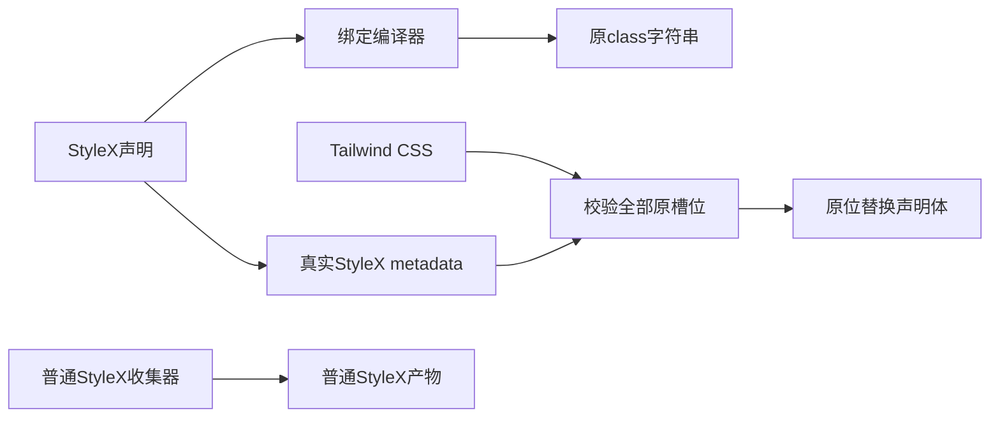

# 保留旧层叠合同的 StyleX 声明

Status: implemented
Translation: current

PR: [#1875](https://github.com/LodyAI/Lody/pull/1875) (draft)

[English](2026-10-31-stylex-cascade-compatibility.md)

## 摘要

把公开Tailwind默认值移到其他层或更换class身份，会改变受支持调用方的优先级。有限构建adapter现通过七十七个源码绑定，让StyleX拥有MobileInlinePicker、AdaptiveTabStrip、公开旧Sidebar、WorkspaceCard、SessionMentionDropLayer、ContextSwitch、ContainerQueryProvider、SessionMonacoTextViewer、LocalTerminalPanel、AcpSessionSelect、UnifiedProjectSelector与ChatComposer共一百八十四个utility位置使用的五十五条flat声明，同时保留原selector、class与规则位置。它先移除原声明，再插入真正StyleX compiler metadata，普通StyleX收集器保持独立。真实生产、开发及当前源码组合比较保持渲染与CSS，但过渡桥仍依赖Tailwind候选保留和排序。这是迁移边界，不代表移除Tailwind，也不是通用样式API。

## 归属与编译

| Owner                                                                                                          | 职责                                                                     |
| -------------------------------------------------------------------------------------------------------------- | ------------------------------------------------------------------------ |
| [`legacy-defaults.stylex.ts`](../../../../packages/components/src/style/legacy-defaults.stylex.ts)             | 五十五个真实StyleX声明及七十七个源码scalar／group class绑定。            |
| [`legacy-declaration-profile.ts`](../../../../packages/components/src/style/legacy-declaration-profile.ts)     | 唯一声明／属性／旧alias映射及有序绑定成员；现有源码扫描保留五十五alias。 |
| [`vite-legacy-declarations.ts`](../../../../packages/components/vite-legacy-declarations.ts)                   | 闭合源码编译、声明等价门禁与原CSS槽位替换。                              |
| [`legacy-declaration-bridge.test.ts`](../../../../packages/components/tests/legacy-declaration-bridge.test.ts) | 真实compiler、cn、source map、拒绝及恢复行为。                           |

pre-transform在React／docgen之前校验固定AST语法，只接受literal flat声明及七十七个批准的
stylex.props绑定，以锁定原生compiler折叠后输出原有顺序的旧class字符串。动态值、条件、
namespace逃逸、混合class构造及不安全query loader均拒绝；缺少adapter时源码模块直接抛错。

CSS变换位于Vite CSS处理之后、发布之前，先校验全部原selector、utilities context、单声明、
值及important，再做任何修改。每个旧声明实际detach，原槽位插入真实metadata声明的clone。
没有另一份生效Tailwind body、新特异性、全局层序调整、共享普通atom或额外inline保活声明。

adapter跟随真正Tailwind Vite优化阶段：serve保留原始声明，两个官方build入口与adapter共用
Tailwind options，真实metadata clone使用同一锁版optimizer及CSS minify设置。raw／library
调用方不能只凭build mode推断优化。新增components直接依赖相对adapter模块加载，避免
Electron打包配置从错误包owner解析。

优化可能把简单class selector合并到同一物理声明。adapter原样校验member列表及context，
不移动或重写selector。全部计划先认领物理声明再做任何修改；两个key认领同一声明即拒绝。
复杂selector、重复member、不等值及意外多slot仍拒绝，不硬编码透明色或最大数字的优化拼法。

非alias元数据不得引入Tailwind候选。首轮组合renderer构建把新增的CSS属性名字面量扫描为
额外旧selector，尽管Storybook CSS相同。实际锁版扫描与最小compiler对照确认该字符串为原因；
仅拆分源码literal即可保同一元数据值并移除意外候选，不patch样式表或collector。原四构建切面、
selector差异及八对浏览器补充均冻结保留，修复后源码有独立构建／测试资格。

锁定container-query插件及Tailwind v4在DEV各产生同一个@container槽位，生产会合并。
仅该alias允许两槽，分别校验替换，不去重；其它重复、缺失、不等值、important或额外body均拒绝。
静态opacity数字／百分比只在0–1内按数值比较；元素本地calc(var(--spacing) * 0)保留为表达式，
不能换字面零。

Storybook、components Vite、Electron renderer及components Vitest接入adapter。
Vitest仅绑定路径是测试transform，不代表应用SSR。普通StyleX收集器不变。直接锁版依赖为
Babel7.29.7、StyleX0.19.0、PostCSS8.5.6，trace-mapping0.3.31核map；版本均已在lock／cache。
没有compiler cache、epoch、共享生成CSS或实验目录import。

## 公开兼容与计数

保留旧class身份，使cn／twMerge继续识别utility组，并保named、arbitrary-property、opaque
StyleX、祖先及真正Radix Slot的优先级。原366px container query及冻结transition utility沿用旧路径。
DOM、ref、事件、disabled及响应式行为不迁入adapter。

一百八十四个consumer utility位置换成import绑定不等于剩余旧utility减少同样次数。五十五alias及一百八十四个编译后输出出现次数
仍是明确兼容依赖。v2 scanner仍只报告它识别的AST次数；桥的已知输出另列，并加回保守剩余边界。
精确源码切面及数字由[迁移Note](2026-10-22-tailwind-to-stylex-migration.zh.md#公开调用方与剩余层叠边界)负责。

只在真实Before及调用方检查后扩展已证明的flat owner。不同key可用同一CSS属性的不同值；
compiler给每个已校验key追加私有native stylex.props探针，以真实atom ID关联flat metadata，
发布前完全删除探针，不按属性／值集合或metadata顺序猜key身份。同一绑定内属性重叠、
atom去重、未知atom及保留探针名冲突仍拒绝。它仍是封闭构建转换，没有runtime探针或通用CSS框架。
consumer不再需要旧selector合同时，应一起删除对应绑定、alias、接线及compiler依赖；此次不退役公开兼容合同。

## 证据与限制

本地证据位于packages/components/artifacts/visual/。

| 边界             | 实测证据                                                                                                                                               | 限制                                                                                                                 |
| ---------------- | ------------------------------------------------------------------------------------------------------------------------------------------------------ | -------------------------------------------------------------------------------------------------------------------- |
| 冻结215生产      | 八真实对／456完整节点、PNG／RGBA同，106 CSS资源字节同。                                                                                                | prepared212闭包，不是后续整个Root；四资源pathname不同，但配对CSS字节相同。                                           |
| 冻结215开发      | 四真实对／304完整节点、PNG／RGBA同，仅40个精确debug-source行号属性不同。JS绑定、owner及九CSS槽位有真实作者映射。                                       | 八unique声明含两个实际container槽；不是Windows整机或应用SSR。                                                        |
| 官方renderer构建 | 两次真正renderer-only构建及完整CSS同，普通collector隔离。                                                                                              | 构建验证，不是新增整Electron App截图或后端验收。                                                                     |
| 当前215＋216组合 | 八新增生产对／456节点PNG／RGBA同，仅14个逐一hash的CSS资源URL变化。106 CSS全同；4,789输入全程不变，620组件文件／6,218测试通过。                         | 包含记录内用户working-tree修改；两侧同一明确源码切面，后续Markdown／fixture格式化另验build。216原719raw OPEN不关闭。 |
| Compiler及HMR    | 十七真实compiler／binding／map／拒绝测试通过；最终真实更新HTTP200→404→200，不等价0.6被拒绝时overlay出现，已加载页面仍0.7；恢复新文档为0.7且无overlay。 | 拒绝不等价发布不代表整页fail closed。此前cached-last-good响应及四个错误HMR门禁假设均保。                             |

leaves215-acceptance.html、leaves215-delivery.json及root215216-current-cut-delivery.json
保原始记录／PNG、构建输入、CSS对比及失败。持久控制story格式化后经真正JSX lowering，runtime
AST相同；不增加新PNG信用。最终文档／fixture构建保自己source bank，不重写原八对矩阵。

格式化fixture／文档构建保106份CSS。6,875个实际module身份同，但原十二处strict AST差异
仍明确保留：四preload依赖表携带新artifact引用，八模块共十个interop mode参数变化。真实React／
ReactDOM export与产物helper在两模式走相同default／descriptor分支；合成truthy module／default
反例确实不同，故资格仅限这些实际输入，不称整module raw AST相同，也不加新截图信用。
原身份碰撞及过强React-only假设仍为拒绝证据。

最终adapter lint清理只用现有PostCSS map类型、一个有因opaque-AST类型边界及三个显式undefined返回。
十七owning测试、组件／工具类型及限定lint通过；真正Vite／Oxc lowering仅这三个等价return不同。
原六error lint与两版源码保留。6,218全套测试属于已记录此前cut，不把清理称为新全套回归；最终真实
构建另一起核该adapter及最终受扫描文档。

Sidebar扩展保留每个原cn位置及公开调用方、祖先和Slot优先级。217新增五条flat属性及28个utility位置；
218沿用同十三属性，再迁21个位置，不改compiler算法。各原21对矩阵分别19、20对PNG／RGBA同。
三个移动布局帧仍OPEN：217共32,090原始像素、最大通道差1；218共21,320、最大3。
threshold12计数均零，但target ROI含差异，不能归为纯背景。Chromium的iPhone UA／DPR3运行
覆盖移动布局，实测为fine pointer／hover，不是Safari、实体设备或touch验收。两批106份CSS均同，
各冻结组件cut通过620文件／6,218测试。

218绑定注册顺序拒绝保留为闭合语法证据。十四DEV CSS槽及八scalar绑定有作者映射，
但新增GroupAction owner映射为null，属于真实debug mapping损失，不称完整source map等价。
217原测试专用arbitrary-height候选及构建继续冻结。最终Root的cn测试在运行时构造同一个60px输入，
防止隐式Tailwind扫描加入Root原故事没有的生产规则；最终Root构建资格与原截图分开。
源与视觉证据由leaves217-delivery.json、leaves218-delivery.json及其独审负责。

WorkspaceCard／drop-layer扩展221沿用同十三属性，通过三个追加绑定迁九个utility位置。
十七真实Storybook对PNG／RGBA同，覆盖2,377 body／36 target记录，仅十七个逐一验证的CSS URL变化。
真实trusted原生拖放、self排除、disabled拒绝及draft保留均执行。另两对隔离Electron实图PNG／RGBA同，
覆盖633节点／四target；固定位置ID、资源路径及真实boot elapsed writer／reader差异明确保留，含两个隐藏mark的物理animation-delay字段；
像素一致不证明相同启动历史，也不证明实际App拖放。首容器缺CLI发现marker的失败继续保留；
重试仅向两私有容器复制既有workspace marker与相同预构建runtime，不修改CLI源码。

持久native-drag／caller fixture由221两侧共同使用。新增literal候选会进入Tailwind隐式生产扫描，
而fixture的StyleX atom属于story图；故106份资源相同仅证明该冻结共同fixture切面，不能扩成与无此
fixture的旧Root树CSS相同。最终组合Root资格单独核验。

Sidebar／ContextSwitch扩展223–225保留完整原class字符串与caller／Slot顺序。
223的23对／3,414节点／238 target PNG／RGBA全同，120个真实CVA／cn组合返回字节同。
两个新增源码绑定在生产只独立输出一个，padding scalar在实际reader被内联为原literal；
不能把源码export数当运行时bank数。此前非null的desktop-frame owner映射新增null，
十四DEV CSS槽及两个新helper作者映射仍准确，缺口不修补或隐藏。

ContextSwitch224为32对中27 PNG同，五个paint OPEN共812原始像素（最大通道差1）；
716完整目标记录仅32资源URL不同。225新增四个不同属性槽，使用锁定实际表达式：局部spacing高度、
20rem上限、局部large-radius变量与显式alpha1的muted HSL。原39对保34 PNG同、五paint OPEN共
924原始像素，以及spacing initial端点四个真实indicator发布读数差。独立真实reselect补充对的十九
新记录相同，但不恢复旧测量历史或关闭原差。二十一compiler测试含真实preset值与逐项拒绝变异；
不改算法、状态逻辑或特异性。

Sidebar Label226新增一条不收缩声明／绑定，保公开native／Slot class身份。18原PNG／RGBA对全同，
覆盖3,600 body记录／32目标；两个真实post-pointer Header滑块中间transform仍不同。三处Switch
cleanup均未采用；真实公开popup-container对照证明Desktop在合法零特异性祖先下flex-shrink由0变1，
普通高特异性对照仍1→1。Header／Mobile仍未被该Desktop探针证明。原比较器RangeError及报告长路径溢出均保留，
最终报告只修自身换行。Root集成一度误命中另一个h-8 Input行，被源码diff／库存检查在提交前拒绝；
坏源及修正后的GroupLabel限定差异都有记录。

构建扩展227通过28个真实compiler／slot／map测试。八生产、四DEV及独立双高度十二对，
324目标完整记录除24个精确iframe端口URL外全同；21 PNG对同，三原生产OPEN共762raw／零threshold12。
106份生产Storybook CSS、一份官方renderer CSS及原三十编译导出逐字节同。sample不给consumer信用；
Root的Label扩展属于独立十八声明／三十一绑定切面。报告自身Escape清图失败保留并在最终离线viewer修复。

尺寸228通过追加五key／五绑定迁十二个Sidebar高度／圆角位置，沿用同一封闭compiler。
21对PNG／RGBA全同，覆盖4,564 body／728 target，真实size、disabled／Slot／caller及祖先、
局部spacing／radius和CSS-wide间距值、Chrome移动drawer交互均保原class及完整捕获字段；
仅21个已验证CSS资源URL不同。

编辑器／容器229通过一个高度key与三个绑定迁三个原生owner共八处。18对PNG／RGBA全同，
覆盖4,172 body／18 target：十个既有Monaco caller、四个真实windowed conversation容器，
及四个真实terminal，后者由pointer点击既有Form输入来失焦。捕获DOM、语义可访问性及截图后动作
除精确资源URL／可访问性ref外相同。原健康focused-terminal Before-only与43项光标绘制pre/post差
继续保留，不声称focused blink历史等价。原Monaco负mapped offset保持，不夸为完整屏内viewport。

两隔离单元的共同基线均继承旧元数据literal；renderer字节同只证明该共同切面，不能扩为与8f或
已修复Root等价。Root按228再229追加，保扫描安全的属性值及lint directive，不覆盖整个profile，
组合构建资格另验。不引入新compiler算法、组件API，也不改ref、生命周期或事件行为。

ACP230通过八key／九绑定转移十九处。36真实对PNG／RGBA全同，5,816body／264target，
107CSS资源及84个实际cn／twMerge组合相同。另三个候选因旧raw oracle拒绝生产canonical
表示而继续保utility，不计信用。

Sidebar231通过八key／八绑定转移二十处，保真正input-field及sidebar-background变量。
20对PNG／RGBA全同，4,079body／305target；覆盖根／子树palette、CSS-wide spacing、RTL
及native／Slot／CVA调用方。两个UA drawer实测fine pointer／hover Chrome，不代表touch。

ProjectSelector233以五绑定转移九处，input fill复用231唯一canonical key。32真实对中27 PNG
相同，五OPEN共151raw／72threshold；完整已采字段除64个逐一验证CSS URL外同，但未采
selection endpoints，不能证明caret因果。覆盖离线fallback，没有loaded-avatar信用。
原失败及OPEN保留在冻结单批报告。冻结230–233组合另有26真实对，22PNG同／四OPEN
共72raw／72threshold，5,182body／305target；新原生选区端点同，但竖线绘制原因未证。
四个官方构建及107CSS通过，同时真实默认PostCSS／Vite路径因aspect-ratio优化拼法被拒，
该失败保留在不可变报告。

仅构建235让实际PostCSS配置的显式优化值与adapter共享，在serve／build均匹配真实producer，
不按Vite CSS minify猜测。PostCSS空optimize对象默认不minify，与Vite producer语义不同。
raw／library仍显式，两个producer选项同时出现即拒。七个实际factory／hook场景加原37测试通过；单元输入用真实preset／theme并把源码发现限定在
批准alias，真正源码构建另验隐式扫描，使阶段测试不依赖仓库体积和机器负载，仍使用真实compiler。
独立真实默认Vite CSS构建现接受，且保旧24key基线256,846B完整asset字节同。raw opacity70%→.7
是原有拼法差异，不是此次新增raw CSS字节全同。四文件单元资格与当前Root分列。

Composer234通过十六绑定转移三十处。53个desktop-family对PNG全同，6,653body／175target；
八个另列mobile-UA布局对覆盖实际24px下限与bottom Drawer：三对同，五OPEN保24,723raw／
一个threshold，1,126body／28target，除十六个已验证URL外其它已采字段同。这些是touch0、
鼠标驱动Chrome，不是硬件／touch验收。仅缩桌面宽度未达该分支；最初touch-reset因果也被否，
两次零接受尝试均保。Root复用既有padding-zero及六ACP key避免重复atom，不改冻结候选。
当前55key／77binding仍需最终组合资格，原矩阵及235的44key证明不能代替。仅构建232／235不给
consumer信用。

原生产Vite管线不发布可用CSS source map。JS及真实DEV CSS作者映射已验证，不称生产CSS映射完整，
也没有全局Vite workaround。实际components Vite CSS transform已返回，但早先server.close保
unsettled-await失败；该检查产生的源码已保留并恢复为锁定字节，不据此声称正常cleanup。

## 仍约束设计的被拒路径

原不可变报告仍为历史证据，不是已采用实现。

| 路径                                    | 已证明失败与保留边界                                                                                                                                                                                               |
| --------------------------------------- | ------------------------------------------------------------------------------------------------------------------------------------------------------------------------------------------------------------------ |
| 原生utilities子层与前／后置提取156／159 | 未分层utility胜过子层。前置使真Slot grid父／flex子55→28px；后置破坏反向Slot、caller宽840→0及保留active minimum180→0。十三个Adaptive子集与66张相同截图不能修复这些合同。                                            |
| 共享collector或hash                     | 锁版双unplugin共享rule store，声明的legacy layer选项未转发。复用普通atom改变overflow，尽管PNG相同；即使原位独立hash也因twMerge不识别而破坏named w-0、opacity-50和block。额外merge registry也不能保公开raw字符串。  |
| 生成产物与history164／168               | HMR断开时旧JS响应晚于center atom的CSS删除。私有history扩展仅实验修复该窗口，并引入当前稳定class桥不需要的归属设施。55raw／32threshold间距OPEN仍保。                                                                |
| 171／180／184与188恢复                  | 此前66成对图与实际App裁切相同，但整App39raw及312raw OPEN保留。随后三个真实arbitrary-property caller改变宽598→16、minimum598→840及裁切／命中链。十三试验路径全恢复，信用零；虚拟Win／POSIX规范化不等于Windows整机。 |
| 原位slot／206原型                       | 十二静态控制及单一真实opacity owner证明较小边界。七生产加二DEV对覆盖505节点，但百分比修正后未重采七生产图。传递compiler解析、proof目录接线及不完整管线未采用；其CSS404保留旧0.7且无overlay，不是后续215的HMR结果。 |

全部原source-map缺口、未知cleanup、错误fixture采集、readiness失败及视觉OPEN仍在各自报告。
新的默认子集成功或CSS字节相同，不能关闭不相干的历史布局、状态、绘制或observer-history差异。
