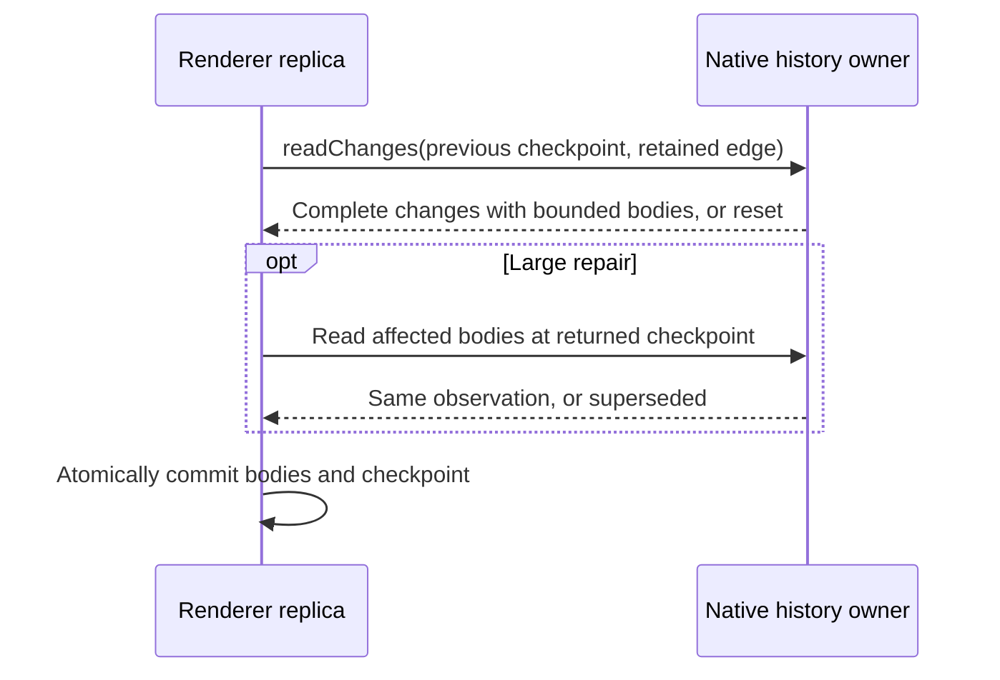

# Recover Roost replicas from durable incremental checkpoints

Status: implemented
Translation: current

[中文](2026-10-16-roost-incremental-history.zh.md)

## Abstract

A renderer that missed a history revision rebuilt its durable replica by reading
unchanged message bodies, while normal observation supersession accumulated the
same backoff as transport failures. Background history reads also competed with
human sends at machine intake and in the local message processor. Independently
negotiated owner checkpoints now cover missed logical changes, allow atomic
replica repair, and retry superseded observations without increasing network
backoff; reserved request pools keep send acceptance independent of history-read
capacity. Synthetic native-storage, renderer and encrypted-RPC regressions verify
these behaviors. Missing recovery evidence still requires safe replacement, and
these tests do not measure a live session's latency.

## Problem and responsibilities

The previous renderer accepted a single consecutive notification as a complete
delta. Coalesced notifications or reconnects can instead expose revision 1 followed
by revision 3; the last notification does not describe revision 2. Keeping only
that hint would lose edits, while the safe fallback reread every body in pages of
40. A 6000-row replica therefore requested 150 pages even for a tail-only change.
An observation overtaken by another valid write also doubled retry delay, up to
ten seconds, despite a successful transport.

Machine RPC had sixteen shared ordinary handler permits and acquired them at
intake. A waiting ordinary request could stop intake before a later send or
control request was classified. Local processing separately serialized history
reads and writes on the same session queue.

The native history owner remains authoritative for active-branch membership,
state, permissions and accepted writes. The renderer owns a read-only IndexedDB
replica. The dispatcher owns admitted requests through actual task settlement;
neither a replica checkpoint nor a cancelled waiter proves input acceptance.

## Durable change coverage

An optional `sessionHistoryIncremental` capability, version 1, is independent of
the existing history protocol version 2. Negotiated page reads request
`withCheckpoint`; unmodified legacy queries receive their previous wire shape.
Only opted-in queries receive the typed `superseded` retry reason.

The owner stores semantic change receipts in a local Roost index after verifying
its signed native event interval and before publishing the control cursor.
Receipts contain changed logical identities and the earliest affected structural
position, never history bodies or commands. Mixed state edits and tail appends
retain both components. Each checkpoint binds an owner/stream scope, native event
cursor and a persistent random receipt identity.

`readChanges` checks the old anchor and every covered interval. Foreign scope,
missing anchors, an uncovered interval, or an unverified native mutation returns
explicit reset. A crash between a native mutation and receipt persistence leaves
an uncovered interval, rather than claiming an incomplete delta is complete.
Reads additionally verify that the native cursor matches the published cursor;
a reply cannot pair new native evidence with an old owner projection.

The renderer requests bodies with the interval using `includeBodiesFrom`. Repairs
of at most 500 changed/suffix bodies arrive in one coherent reply, avoiding a
network round trip between change discovery and body hydration during streaming.
Larger repairs use separate `atCheckpoint` body reads; the owner refuses a newer
observation instead of mixing it with the requested interval. One IndexedDB
transaction checks the expected head and advances bodies, positions, revision and
checkpoint. A coherent reply can advance the replica even when a newer control
hint arrives before it; the replica remains readable and immediately catches up
again. Body-only changes preserve the directory revision, so existing cached page
cursors remain usable. Unknown coverage retains the previous coherent slot while
a complete replacement is staged.

## Retry and request ownership

Superseded observations and coherent replies behind newer hints retry at the next
timer turn. Transport, storage and
malformed-result failures retain exponential recovery backoff. Cold initial
reads likewise retain their read owner through ordinary supersession, yielding
after a bounded number of attempts instead of presenting it as storage failure.
No user write is automatically replayed.

Machine RPC acquires permits inside tracked tasks and classifies foreground work
first within a received batch. It retains sixteen ordinary execution permits,
four history-write permits, four control permits and four overload-response
permits. Ordinary admission defaults to 128 including queued work; excess
unstarted ordinary requests receive a capacity refusal. Overload replies and
each foreground queue are independently bounded at 128; an exhausted overload
reply queue leaves additional ordinary requests to caller timeout. History writes
are not shed by ordinary overload. Owner writers still serialize mutations.

The local processor has a separate history-read pool, bounded at eight active
session lanes, and retains the existing history-write lane and ordering.
Activity, queue counts and drain include both pools.

The lifecycle contract is:

- Trigger: a subscriber, a newer owner/control-cursor observation or a pending
  read retry requests replica refresh; an incoming RPC or local message starts
  request scheduling.
- Owner: the bridge retains its refresh/read promises; the dispatcher retains
  admitted tasks, and the native owner retains serialized mutations.
- Cancellation: unsubscribe/dispose/stop fences future work. Already dispatched
  raw work remains tracked until it settles; no new cancellation guarantee is
  inferred from a local waiter ending.
- Handoff: receipt publication precedes the control cursor, protected body reads
  precede the atomic replica commit, and write dispatch remains with the owner.
- Failure recovery: supersession restarts observation, other read failures back
  off, unknown coverage rebuilds safely, and write outcomes retain their existing
  acceptance/dispatch recovery contracts.

Correction (2026-10-16): the first repair did not subscribe to reconnect or independent
owner observation. The [peer-reader follow-up](2026-10-16-roost-peer-reader-readiness.md)
now adds checkpoint observation, live capability and runtime recovery wakeups.

## Alternatives and trade-offs

The Roost SDK's event log and generic message view support incremental replay.
Its generic view does not supply Lody's active-branch, state and permission
projection. Reimplementing raw event-envelope interpretation in the renderer
would duplicate SDK responsibilities. Semantic receipts reuse the existing owner
projection and SDK verification while keeping the renderer protocol small.

Using only the last notification after a gap was rejected because an earlier
state edit and a later append can both be missed. Priority sorting alone was
insufficient: an earlier batch could already fill the shared handler pool and
block intake of a later human send.

The small Effect migration assessment was deferred. The bridge still depends on
unfinished Lody Promise orchestration for Repo observation, timer scheduling and
RPC transport; moving only the new coordination into a native unit would not
complete its consumer ownership. The new persistence helper uses the genuine
third-party Roost boundary, with no added Effect runner or dependency update.

Receipts retain one small local metadata record per published native interval;
there is no pruning policy in this change. Storage and replay work grow with
changed intervals, while body transfer scales with affected cached rows. First
population and unknown coverage still use bounded pages. A branch rewrite can
affect a large suffix. The [peer-reader follow-up](2026-10-16-roost-peer-reader-readiness.md)
repairs cold-open identity, keeps capabilities live and adds independent owner observation.
The [storage follow-up](2026-10-16-roost-storage-write-amplification.md) separately
removes repeated full-content batch receipts on the hot streaming path.

This complements the
[native runtime decision](../../proposed/architecture/2026-10-09-roost-native-runtime.md)
and the [single writer](../architecture/2026-09-07-single-history-writer.md);
it does not change accepted-input identity, provider dispatch, or native storage
format. Current implementation responsibilities are documented in the
[session README](../../../../apps/cli/src/session/README.md#incremental-replica-recovery)
and [RPC explanation](../../../docs/rpc-loro-streams-rpc.md#request-scheduling).
The existing [history-write Spec](../../../../specs/session-history-writes.md)
remains draft.

## Verification and limits

The owning behavioral suites cover:

- Real SQLite-backed Roost receipts across close/reopen, mixed edits and appends,
  missing coverage and foreign scope.
- The production owner and MessageHandler refusing a body read at a superseded
  checkpoint, with current-checkpoint reads succeeding.
- IndexedDB replicas with 120 and 6000 synthetic 4 KiB messages: skipped revisions
  repair edits and appends through both inline bodies and the protected-read
  path, without reading unchanged historical pages; offline reopen retains both,
  and body-only repairs keep earlier directory cursors valid. The final revision
  also verifies a 6000-row history with only its last 40 rows cached: a successful
  checkpoint repair finishes without rereading the unchanged latest page.
- Atomic cache abort, truncation, stale-head refusal and staged reset retaining
  the old readable snapshot until replacement completes.
- Explicit timer control showing supersession retries with zero backoff,
  including cold open, and four successive coherent streaming replies advancing
  the UI while every reply is already behind a newer control notification.
- Encrypted RPC with saturated ordinary execution/admission capacity: history
  send and ping complete while reads remain gated; excess reads receive refusal.
- A gated local read while same-session writes complete in their original order.

Final verification and full-run limitations are recorded in the
[peer-reader note](2026-10-16-roost-peer-reader-readiness.md#verification-and-limits).
All fixtures are synthetic and local. No linked product session was opened or
sent a message. Local checks do not establish production timing or deployment.
