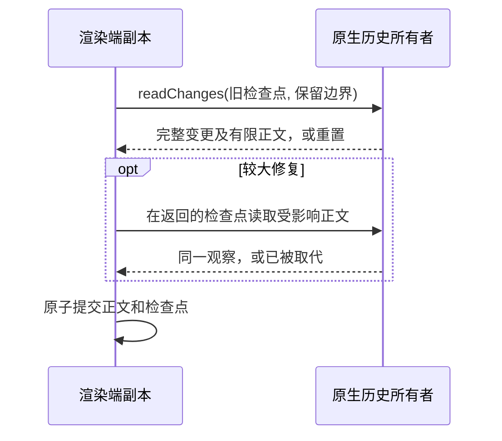

# 用持久增量检查点恢复 Roost 副本

Status: implemented
Translation: current

[English](2026-10-16-roost-incremental-history.md)

## 摘要

渲染端漏过历史版本后，会重新读取未变化的消息正文来重建持久副本；正常的观察被新写入取代时，也会像网络故障一样不断增加退避。后台历史读取还会在机器请求入口和本地消息处理器中与用户发送争用通道。新增独立协商的所有者检查点，可完整覆盖遗漏的逻辑变更并原子修复副本；被取代的观察直接重试，保留的请求通道使发送接纳不再受历史读取容量阻塞。原生存储、渲染端与加密 RPC 的合成回归验证了这些行为。恢复证据缺失时仍需安全替换，测试结果不代表真实会话的端到端延迟。

## 问题与职责

原渲染端只把连续版本的单条通知当作完整增量。通知合并或重连可能使观察从版本 1 直接到版本 3，而最后一条通知并不包含版本 2 的变更。只使用这个提示会漏掉编辑；原来的安全回退则每页读取 40 条正文。即使只有尾部变化，6000 条副本也需要请求 150 页。另一次有效写入取代当前观察时，即使传输成功，也会使重试延迟倍增，最终达到十秒。

机器 RPC 原有十六个共享普通处理许可，并在接收入口等待许可。一个普通请求可能让入口停止，后面的发送或控制请求尚未分类就被阻塞。本地处理器还把同会话历史读取和写入串行放进同一队列。

原生历史所有者继续负责活动分支成员、状态、权限和写入接纳；渲染端负责只读 IndexedDB 副本。分发器持有已接纳请求直至任务实际结束。副本检查点和本地等待取消都不是输入接纳凭据。

## 持久变更覆盖

可选的 `sessionHistoryIncremental` 能力版本 1 与现有历史协议版本 2 独立。协商后的分页读取请求 `withCheckpoint`；原样的旧查询仍收到原有消息结构。只有明确使用新查询字段的请求才收到带类型的 `superseded` 重试原因。

所有者验证自身签名的原生事件区间后，在本地 Roost 索引中保存语义变更记录，再发布控制游标。记录只包含变化的逻辑身份和最早受影响的结构位置，不保存历史正文或命令。同一批状态编辑和尾部追加保留两种信息。检查点绑定所有者与流作用域、原生事件游标以及持久随机记录身份。

`readChanges` 检查旧锚点与每一段覆盖区间。作用域不同、锚点缺失、区间不连续或原生变更未经验证时，明确返回重置。原生写入成功但语义记录尚未保存就崩溃，会留下不连续区间，不会把不完整增量标为完整。读取还会验证原生游标与已发布游标一致，避免用新的原生证据给旧投影视图背书。

渲染端通过 `includeBodiesFrom` 请求变更区间及其正文。最多 500 条变化或后缀正文在同一次一致回复中返回，避免持续输出时在发现变更与读取正文之间再跨一次网络往返。较大修复使用独立的 `atCheckpoint` 正文读取；所有者遇到新观察会拒绝，而不是混合两个区间。单个 IndexedDB 事务检查预期副本头，同时推进正文、位置、版本和检查点。即使较新的控制提示先于回复到达，一致回复也能推进副本，保留可读状态后立即继续追赶。只改正文时保留目录版本，因此已有缓存分页游标继续有效。覆盖未知时，在另一槽位完成替换前保留原有一致副本。

## 重试与请求所有权

被取代的观察及落后于新提示的一致回复在下一个计时器轮次重试。传输、存储和响应损坏仍采用指数恢复退避。冷启动的初始读取也会保留读取所有者，在有限次数尝试后让出执行，再继续处理正常的观察替换，避免把它显示为存储故障。用户写入不会被自动重放。

机器 RPC 在持有任务内获取许可，同一接收批次优先分类前台任务。保留十六个普通执行许可，历史写入、控制和过载回复各四个许可。普通请求默认最多接纳 128 个，包含排队任务；超额且尚未开始的普通请求得到容量拒绝。过载回复和每个前台队列各自最多保留 128 个；回复队列也耗尽时，额外普通请求交给调用方超时处理。普通请求过载不会丢弃历史写入，所有者写入器仍串行修改。

本地处理器新增独立历史读取池，最多八个活跃会话通道，保留原历史写入通道与顺序。活动数量、队列数量和排空都包含两个池。

生命周期合同：

- 触发：订阅者、新所有者或控制游标观察、待完成读取重试请求副本刷新；传入 RPC 或本地消息触发请求调度。
- 所有者：桥接持有刷新和读取 Promise；分发器持有已接纳任务；原生所有者持有串行写入。
- 取消：退订、销毁和停止阻止后续工作；已分发的原始工作仍被跟踪至结束，不能从本地等待结束推断新增的取消保证。
- 交接：语义记录先于控制游标发布；受保护正文读取先于原子副本提交；写入分发仍由所有者接管。
- 失败恢复：观察被取代时重新观察；其他读取失败退避；覆盖未知时安全重建；写入结果沿用已有接纳与分发恢复合同。

更正（2026-10-16）：首轮修复没有订阅重连或独立主机观察。[跨成员读取后续修复](2026-10-16-roost-peer-reader-readiness.zh.md)现在补充了检查点观察、实时能力及运行时恢复唤醒。

## 备选与取舍

Roost SDK 的事件日志和通用消息视图支持增量重放，但通用视图不提供 Lody 的活动分支、状态和权限投影。在渲染端重新解释原始事件封装会重复 SDK 职责。语义记录复用现有所有者投影与 SDK 验证，同时保持渲染端协议简单。

跳号后只使用最后通知会漏掉较早的状态编辑和较晚的追加。只在批内排序也不足够：前一个批次可能已经占满共享处理池，阻塞后续用户发送的接收入口。

评估后暂缓小范围 Effect 迁移。桥接仍依赖尚未完成迁移的 Lody Promise 编排，包括 Repo 观察、计时器调度和 RPC 传输；只迁移新增协调代码无法完成消费者所有权迁移。新增持久化辅助模块使用真正的第三方 Roost 边界，没有新增 Effect 执行器或修改依赖版本。

每个发布的原生区间保留一条小型本地元数据记录，本次没有裁剪策略。存储和重放工作随变化区间增加，正文传输随受影响的缓存行增加。首次填充和覆盖未知仍按有限分页读取，分支改写可能影响较大后缀。[跨成员读取后续修复](2026-10-16-roost-peer-reader-readiness.zh.md)修复冷打开身份、持续读取能力并提供独立主机观察；[存储后续修复](2026-10-16-roost-storage-write-amplification.zh.md)单独消除热流式路径的重复整条正文批次收据。

本决策补充
[原生运行时决策](../../proposed/architecture/2026-10-09-roost-native-runtime.zh.md)
和[单一写入器](../architecture/2026-09-07-single-history-writer.zh.md)，
不改变已接纳输入身份、提供方分发或原生存储格式。当前实现职责记录在
[会话 README](../../../../apps/cli/src/session/README.md#incremental-replica-recovery)
和 [RPC 说明](../../../docs/rpc-loro-streams-rpc.md#request-scheduling) 中。
现有[历史写入 Spec](../../../../specs/session-history-writes.zh.md)仍为草案。

## 验证与边界

所属行为测试覆盖：

- 真实 SQLite Roost 记录的关闭重开、混合编辑与追加、覆盖缺失和不同作用域。
- 生产所有者和 MessageHandler 拒绝旧检查点正文读取，新检查点读取成功。
- 120 和 6000 条、每条 4 KiB 的合成 IndexedDB 副本：跳过版本后，通过同回复正文及独立受保护读取两条路径修复编辑和追加，不读取未变历史页；离线重开保留两者，只改正文后早期目录游标仍有效。
  最终版本还验证 6000 条历史只缓存末尾 40 条时，检查点修复成功后直接结束，不再读取未变的最新整页。
- 原子缓存中止、截断、旧副本头拒绝，以及重置时保留旧可读副本直到替换完成。
- 显式控制计时器验证观察被取代后零退避重试，包括冷启动；四次连续输出的一致回复在每次都已落后于新控制通知时，仍持续推进界面。
- 加密 RPC 的普通执行与接纳容量饱和：读取仍被门控时，历史发送和 ping 完成，额外读取得到拒绝。
- 本地读取被门控时，同会话写入仍按原顺序完成。

最终验证与全套运行限制记录见[跨成员读取说明](2026-10-16-roost-peer-reader-readiness.zh.md#验证及限制)。
全部夹具均为合成本地数据，没有打开截图中的产品会话或向其发送消息。
本地检查不能证明生产时延或部署完成。
