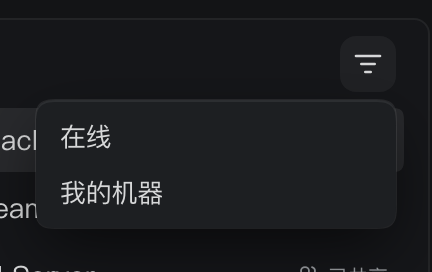
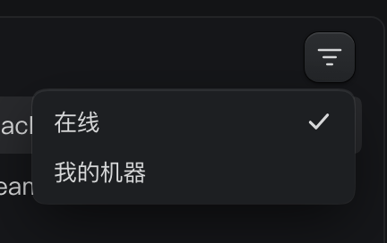

# 紧凑的机器过滤菜单

Status: implemented
Translation: current

[English](2026-10-20-machine-filter-menu-density.md)

## 摘要

机器过滤菜单在两个条件都未选中时仍保留前方勾选列，短标签因此缩进，菜单也显得过大。
现在使用现有的紧凑宽度，将勾选标记放到文字后方。
去掉重复标题和分隔线后，菜单只保留两行筛选条件。
“在线”和“我的机器”仍可独立选择，保留键盘导航，切换条件时菜单保持打开。

## 决定

[菜单组件族](../feature/2026-09-11-ui-menu-primitives.md) 保留标记的空间，避免勾选出现时
文字移动。`Menu.CheckboxItem` 新增可选的 `indicatorSide="end"`，与已有单选行的
位置选项保持一致，将标记区域移到文字后方；默认仍在前方。
产品组合该选项与 `width="compact"`（最小宽度 180px），没有修改共享菜单的尺寸
或行样式。更长标签仍可撑大菜单。触发按钮保留已有翻译的可访问名称。

UI 图库中的紧凑示例展示右侧勾选。所属菜单测试覆盖两种位置的鼠标和键盘激活，
设置页面浏览器测试检查真实机器过滤菜单及过滤后的列表。

## 验证

菜单与图库测试共 52 项全部通过。中英文浏览器案例通过：菜单宽 180px、高 64px，
标签起点距离菜单边缘小于 14px，勾选不会使文字移动。真实列表从四台机器变为两台
在线机器，再变为一台在线且属于自己的机器；键盘切换和重新打开菜单均保留筛选状态。
两个包的类型检查与针对修改文件的类型感知 lint 均通过。提交前的 `pnpm format`
和完整 `pnpm check` 也已通过，包含工作区类型检查、lint、测试与边界检查。
文档检查仍有 subagent-events 双语笔记中原有的六个 Kimi/Pi 子模块缺失链接，
没有新增文档错误。

## 截图

