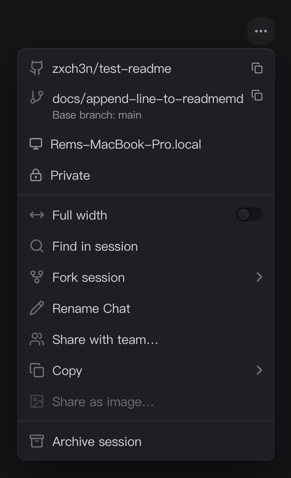

# 会话菜单开关焦点

Status: implemented
Translation: current

[English](2026-10-20-session-menu-switch-focus.md)

## 摘要

用鼠标打开会话操作菜单时，指针还停留在触发按钮上，“全宽显示”就出现了高亮。
原因是行内开关可以接收 Tab 焦点，菜单的初始焦点选择了它，并使所在行高亮。
现在将开关移出 Tab 顺序，键盘导航由菜单行统一承接。
开关仍然可以直接点击，键盘打开时仍会聚焦操作项；仅打开菜单不会改变偏好。

## 决定与证据

本次修正[会话全宽模式](../feature/2026-09-28-conversation-wide-mode.md)
引入的行尾开关的焦点行为。Base UI 1.7 的菜单弹层在鼠标打开时会聚焦第一个
可以通过 Tab 到达的后代；菜单行最初为 `tabIndex=-1`，但嵌套开关没有该限制。
为开关设置 `tabIndex=-1` 后，鼠标打开时焦点留在菜单表面，原有键盘导航仍会
进入菜单行。无需覆盖共享菜单的自动聚焦逻辑，也没有用样式隐藏高亮。

外层菜单行保留键盘激活与 `closeOnClick=false`；开关保留自己的点击处理与
阻止冒泡。因此用户仍可直接点击开关，视觉设计保持不变，并且不会多出第二个
键盘停靠点。

## 验证

所属的会话菜单与全宽模式测试共 15 项全部通过。回归测试覆盖鼠标打开、方向键导航、
键盘打开、关闭菜单，以及通过菜单行和直接点击开关改变偏好。
浏览器中也通过真实 SessionHeaderMenu Storybook 组件验证了鼠标打开、悬停、键盘打开、
菜单行激活、直接点击开关，以及 Escape 关闭。
完整的 `pnpm check` 通过，包括工作区类型检查、类型感知与 Effect lint、全部配置的
工作区测试、国际化验证和边界检查；`pnpm format` 也通过。
文档检查仍报告 subagent-events 笔记中原有的六个本地 Kimi/Pi 子模块缺失链接；
本次修改没有新增失效链接。

截图来自合成的 Storybook 示例，未配置可选的分享和所有者转移回调；生产页面
仍保留这些入口原有的显示条件。截图时指针停留在触发按钮上。

