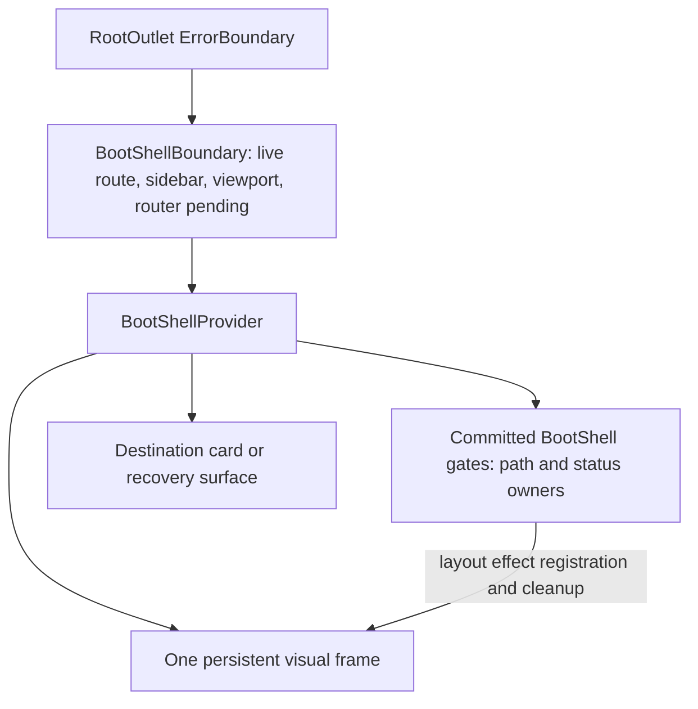

# Boot shell layout and readiness handoff

Status: implemented
Translation: current

[中文](2026-10-19-boot-shell-layout-handoff.zh.md)

## Abstract

Matching loading marks alone did not keep the startup frame aligned with the real workspace card across redirects and loading gates. Static startup and the real card now share geometry, while one React presentation coordinator carries the frame across committed gates. Readiness still belongs to the gates and router: pending navigation retains the last committed presentation if Suspense cleans up its owner, and the frame releases when no owners remain and navigation has settled. The trade-off is a dormant mounted frame and an explicit owner protocol; seven browser tests cover geometry and handoff behavior, while startup timing remains unmeasured.

## Decision and ownership

This is a partial follow-up to the [first-paint decision](2026-09-26-boot-shell-first-paint.md), revising its rejection of a retained overlay protocol while preserving its static first-paint approach. No new Spec is needed: the startup guarantees described in [default app entry](../../../../specs/app-startup-landing.md) remain unchanged; this note does not approve that draft Spec.

`WORKSPACE_FRAME_CSS` is document-safe geometry shared by static BootShell and real `WorkspaceCard`: 8px gutter, 10px radius, border and shadow. The real card maps visual values to UI StyleX tokens. The boot script records plain/workspace layout (including a workspace card with its sidebar collapsed), width, theme, mobile and compact state before paint. Workspace geometry therefore does not depend on showing a sidebar. The sidebar width atom reads storage synchronously so React starts at the same width as the document shell.

`BootShellBoundary` lives inside `RootOutlet`'s `ErrorBoundary`. Its provider always mounts one visual frame, dormant unless a committed owner or its pending-navigation handoff activates it. `BootShell` declarations register owner-scoped path/status in layout effects: the latest committed owner wins, and cleanup removes only its own ID. `BootNavigate` hints the target path before routing completes. `PreloadedMainLayout` retains its lazy-code fallback; login's `BrowserRedirect` draws BootShell during asynchronous handoff, and Electron completion uses the boot variant.

The visible sequence is static shell → React gate → redirect target hint → lazy layout fallback → actual card with content `LoadingPlaceholder` using the same mark → ready content. Each step retains its existing readiness condition. Boot presentation alone mounts neither workspace UI nor workspace providers; scope readiness continues to fail closed.

## Handoff and trade-off

React can clean up a gate's layout effect when Suspense hides an outgoing route, before the destination is ready. `BootShellBoundary` therefore derives `pending` through `useRouterState` using `state.isLoading || state.status === 'pending'`: `isLoading` alone can become false before the pending match renders. A current owner takes precedence; with no owners, the provider retains the last committed presentation only while navigation is pending. When no owners remain and `pending` is false, it releases the frame and clears that retained presentation, so a later ordinary session navigation cannot resurrect the fullscreen boot overlay.

At release, the frame immediately becomes inert and `aria-hidden`, loses its live status, and fades over 160ms. Decorative geometry transitions take 320ms; reduced motion disables animation. Neither a timer nor an animation event decides readiness. The outer error boundary unmounts the coordinator on failure; existing `BlockingWaitPlaceholder` recovery replaces its gate and is immediately usable.

A persistent dormant frame avoids remounting presentation between owners, at the cost of retained DOM and a registration protocol that must handle overlapping commits and cleanup. Owner IDs prevent an outgoing gate from clearing a newer presentation; router pending bridges Suspense cleanup without retaining stale boot state after navigation settles. This replaces the earlier choice to have each React gate draw an independent equivalent frame; it does not turn the presentation coordinator into a data-readiness authority.

## Live stylesheet correction

The initial handoff implementation used React's hoisted `style href` resources.
Those resources keep their original content: a real Storybook hot update changed
the shared CSS module but left the inserted boot stylesheet text unchanged. Fresh
page comparisons did not exercise that failure. `DocumentStyle` now renders an
ordinary React-owned style element, so its content updates in place and disappears
when its owner unmounts. A layout effect retires the marked inline sheet only after
the replacement commits, preserving the first paint until React takes over. The
boot frame renders its mark without a second copy of the same stylesheet; separate
live owners can each carry a sheet rather than sharing immutable global resources.
The card shadow is one black layer, offset 1px down with 2px blur at 3% opacity.

A regression exercises static-sheet retirement, computed shadow changes on the
same mounted target, unrelated-sheet preservation, and removal on unmount. The
focused boot/preload suites pass 40 tests; all seven existing browser regressions
also pass. A separate real Vite update check changed shadow opacity to 12% and back
to 3% in the same browser document, confirming both BootShell and the actual card
followed each edit without reloading the page. That check does not claim to cover
a packaged Electron window.

## Evidence and limits

A real-router home redirect regression with explicitly held promises covers Suspense cleanup and the gap between `isLoading` becoming false and the pending match rendering. The final focused run passed 94 tests across boot presentation, delayed layout imports, home redirects, blocking-wait recovery, workspace identity, login, and boot failure. The renderer CSP suite passed all five tests.

Seven E2E tests passed on the existing installed headless Chromium build 1248 through a temporary ignored Playwright configuration. The pinned build 1208 was unavailable, so this browser evidence uses the alternate installed browser. Tests compare geometry and material with real `WorkspaceCard` in light/dark themes, sample a paused `CSSTransition` midpoint and reversal, verify immediate input after handoff, and cover collapsed/settings layouts, compact desktop, phone layout, and reduced motion. A document-only case confirms the inline shell has the same frame without product CSS or React.

No packaged-window recording or startup latency measurement is claimed. Component typechecking remains blocked by unrelated errors in `loro-sidebar.tsx:734` and `home-week-usage.ts:59`. Lint reports the existing unused `ENTRANCE_TAGLINE` in the login page; the startup modules pass their targeted lint checks.

Document checking has existing missing ACP-submodule links and oversized `AGENTS.md` failures. The owning [component guide](../../../docs/components-package.md#startup-frame-and-handoff) explains current behavior; the earlier first-paint note remains historical evidence rather than evidence of this handoff's browser performance.
