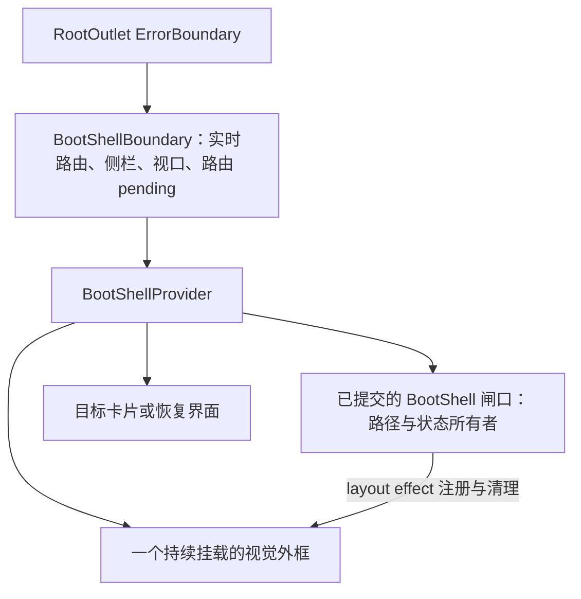

# 启动外壳的布局与就绪交接

Status: implemented
Translation: current

[English](2026-10-19-boot-shell-layout-handoff.md)

## 摘要

只有相同的加载标志，仍不能让启动画面在重定向和加载闸口之间始终对齐真实工作区卡片。静态启动画面与真实卡片现在共享几何样式，由一个 React 展示协调器在已提交的闸口之间延续外框。就绪判定仍归闸口与路由所有：导航尚未完成而 Suspense 已清理所有者时，保留最后提交的展示；所有者为空且导航结束后才释放外框。代价是保留一个休眠的已挂载外框和显式所有者协议；七项浏览器测试覆盖几何与交接行为，启动耗时仍未测量。

## 几何后续修正

后续的[工作区薄包边修正](../bug-fix/2026-10-23-thin-workspace-frame.zh.md)将下文记录的
8px／10px 共享几何改为 4px 包边与 14px 圆角；本记录关于共享几何所有权与就绪判定的
决定保持不变。

## 决策与职责

这是对[首帧决策](2026-09-26-boot-shell-first-paint.zh.md)的部分后续修订：保留静态首帧方案，但修改其中拒绝保留覆盖层协议的选择。无需新增 Spec：[默认应用入口](../../../../specs/app-startup-landing.zh.md)描述的启动保证不变；本记录也不代表批准该草案 Spec。

`WORKSPACE_FRAME_CSS` 是静态 BootShell 与真实 `WorkspaceCard` 共用、可在文档加载阶段使用的几何样式：8px 间距、10px 圆角、边框与阴影。真实卡片将视觉值映射到 UI StyleX token。启动脚本在绘制前记录 plain/workspace 布局（包括侧栏收起时的工作区卡片）、宽度、主题、mobile 与 compact 状态。因此工作区几何不依赖侧栏是否显示。侧栏宽度 atom 同步读取存储，确保 React 从与静态文档外壳相同的宽度开始。

`BootShellBoundary` 位于 `RootOutlet` 的 `ErrorBoundary` 内。其 provider 始终挂载一个视觉外框，仅在已提交的所有者持有它或导航尚未完成的交接期间激活，否则处于休眠状态。`BootShell` 声明在 layout effect 中按所有者注册路径与状态：最后提交的所有者生效，清理只能移除自己的 ID。`BootNavigate` 在路由完成前提示目标路径。`PreloadedMainLayout` 保留代码懒加载 fallback；登录页的 `BrowserRedirect` 在异步交接期间绘制 BootShell，Electron 完成页面使用 boot 变体。

可见顺序为：静态外壳 → React 闸口 → 重定向目标提示 → 懒加载布局 fallback → 真实卡片及使用相同标志的内容 `LoadingPlaceholder` → 就绪内容。每一步保留既有就绪条件。不会仅为启动展示而挂载工作区 UI 或 provider；作用域未就绪时仍拒绝展示不匹配的内容。

## 交接与取舍

Suspense 隐藏离开的路由时，React 可能在目标就绪前就清理闸口的 layout effect。因此 `BootShellBoundary` 通过 `useRouterState` 以 `state.isLoading || state.status === 'pending'` 推导 `pending`：仅用 `isLoading` 时，它可能在 pending match 渲染前就变为 false。当前所有者优先；没有所有者时，provider 仅在导航尚未完成期间保留最后提交的展示。所有者为空且 `pending` 为 false 时，释放外框并清除保留的展示，避免之后普通的 Session 导航重新唤起全屏启动覆盖层。

释放时，外框立即变为 inert 和 `aria-hidden`，移除 live status，再以 160ms 淡出。装饰性几何过渡为 320ms；减少动态效果设置会禁用动画。定时器和动画事件都不决定就绪。外层错误边界在失败时卸载协调器；既有 `BlockingWaitPlaceholder` 恢复界面替换闸口后立即可用。

持续挂载的休眠外框避免了所有者交接时重新挂载展示层，代价是保留 DOM，并维护能处理重叠提交与清理的注册协议。所有者 ID 防止旧闸口的清理移除新展示；路由 pending 跨越 Suspense 清理造成的空档，同时避免导航结束后保留过期启动状态。这替代了此前由各 React 闸口独立绘制等价外框的选择，但没有让展示协调器成为数据就绪的判定者。

## 实时样式修正

最初的交接实现用了 React 提升到文档头部的 `style href` 资源。这类资源会保留首次插入的内容：实际 Storybook 热更新修改了共享 CSS 模块，但已插入的启动样式表文本没有更新。重新打开页面后的对比没有覆盖这个失败路径。现在 `DocumentStyle` 渲染由 React 直接管理的普通 style 元素，内容可原位更新，所有者卸载时样式也会移除。layout effect 仅在替换样式提交后移除带标记的内联样式，因此 React 接管前仍保留静态首帧。启动外框直接绘制标志，避免再次插入同一份样式；不同实时所有者可以各自携带样式，不再共享不可变的全局资源。卡片阴影为一层黑色，向下偏移 1px、模糊 2px、透明度 3%。

回归覆盖静态样式移交、同一已挂载目标上的实际阴影更新、无关样式保留，以及卸载后移除样式。启动与预加载两个定向套件共通过 40 项测试，既有七项浏览器回归也全部通过。另一次实际 Vite 更新检查在同一浏览器文档内将阴影透明度临时改为 12%，再恢复为 3%，确认 BootShell 与真实卡片均随每次修改更新，无需重新加载页面。此检查不代表验证了打包后的 Electron 窗口。

## 证据与限制

使用显式挂起 promise 的真实路由 home 重定向回归覆盖了 Suspense 清理，以及 `isLoading` 变为 false 与 pending match 渲染之间的空档。最终定向运行共通过 94 项测试，覆盖启动展示、延迟布局导入、home 重定向、阻塞等待恢复、工作区身份、登录与启动失败。渲染器 CSP 套件的五项测试全部通过。

七项 E2E 测试使用临时忽略的 Playwright 配置，在已安装的无头 Chromium build 1248 上通过。固定的 build 1208 不可用，因此该浏览器证据使用另一已安装浏览器。测试对比浅色/深色主题下真实 `WorkspaceCard` 的几何与材质，采样已暂停的 `CSSTransition` 中点与反向过渡，验证交接后立即输入，并覆盖侧栏收起、设置、compact desktop、手机布局与减少动态效果。纯文档用例确认：没有产品 CSS 或 React 时，内联外壳仍绘制相同外框。

此处不声称完成了打包窗口录制或启动耗时测量。组件类型检查仍受 `loro-sidebar.tsx:734` 和 `home-week-usage.ts:59` 的无关错误阻塞。Lint 报告登录页既有的未使用 `ENTRANCE_TAGLINE`；启动模块的定向 lint 检查通过。

文档检查存在既有的 ACP 子模块缺失链接与 `AGENTS.md` 超限失败。[组件指南](../../../docs/components-package.md#startup-frame-and-handoff)解释当前行为；此前的首帧记录保留为历史证据，不是本次交接在浏览器中性能表现的证据。
