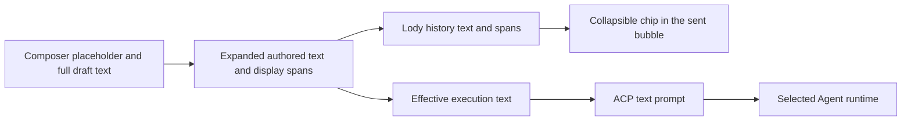

# Conversation selection quotes: withdrawal and reintroduction

Status: implemented
Translation: current
PR: [#2191](https://github.com/LodyAI/Lody/pull/2191)

[中文](2026-11-01-conversation-selection-quote-reintroduction.zh.md)

## Abstract

Conversation text quoting was merged in #1801 on October 23, 2026 and withdrawn the next day after selection/scrolling jitter and interaction concerns. Its generic pasted-text path already preserved display spans in Lody history, although it did not identify a quoted source message. The replacement makes a read-only snapshot an atomic inline composer unit and projects it to ordinary ACP text for every Agent. A dedicated display span preserves that unit through Lody history and supported editing, with explicit machine compatibility gating. Seven Agent paths have source evidence; the complete Agent catalog still needs versioned runtime acceptance, and the reported jitter has not been reproduced.

## Evidence and chronology

Dates below use Asia/Shanghai. This record uses public issues, PR discussions and source; it includes no captured conversations or user data.

| Date              | Evidence and significance                                                                                                                                                                                                                                                                                                                                                                                     |
| ----------------- | ------------------------------------------------------------------------------------------------------------------------------------------------------------------------------------------------------------------------------------------------------------------------------------------------------------------------------------------------------------------------------------------------------------- |
| September 20      | [#830](https://github.com/LodyAI/Lody/pull/830) established native conversation selection retention. The [owning note](../../implemented/bug-fix/2026-09-20-conversation-text-selection.md) explains row corridors, history leases and held prose/folding. It supplies copying continuity, not an annotation action.                                                                                          |
| October 18        | [#1649](https://github.com/LodyAI/Lody/pull/1649) merged document selection feedback and image markup. Its composer staging path was reused by the later conversation quoting work.                                                                                                                                                                                                                           |
| October 21–22     | [#1781](https://github.com/LodyAI/Lody/issues/1781) requested selecting passages, optional comments and multiple pending selections sent together. The issue proposed an anchored editor for fine pointers and a composer bar opening a sheet for narrow/coarse-pointer surfaces. [#1801](https://github.com/LodyAI/Lody/pull/1801) was opened on October 22 with a single composer-bar presentation instead. |
| October 23, 13:49 | #1801 merged as [24f09670d](https://github.com/LodyAI/Lody/commit/24f09670d80ee6d1665089816bd9cb6daf1f5d85), closing #1781.                                                                                                                                                                                                                                                                                   |
| October 24, 10:04 | [#1848](https://github.com/LodyAI/Lody/pull/1848) merged as [00849074b](https://github.com/LodyAI/Lody/commit/00849074b9e1933261c552ccb672665f83b5bd74), reverting the feature, tests, story and bilingual note. Its original body only identifies the reverted PR.                                                                                                                                           |
| October 26        | The [original author's follow-up](https://github.com/LodyAI/Lody/pull/1848#issuecomment-6413120201) reports the feature missing from 0.108.0/0.108.1 and asks for the reason and an explicit disposition of the closed issue. This is a user report, not independent release-binary verification.                                                                                                             |
| October 28        | A [maintainer reply](https://github.com/LodyAI/Lody/pull/1848#issuecomment-6457419496) identifies jitter when selecting text and scrolling down, and says interaction design needs internal discussion. No diagnostic trace or specific root cause accompanies it.                                                                                                                                            |
| November 1        | Public `main` at [aa0d011f5](https://github.com/LodyAI/Lody/tree/aa0d011f58ea50d8aa9f5497514e7b499a696b38) has no conversation quote component/helper or composer API. #1781 remains closed. Scoped public PR searches found no replacement implementation; search absence alone cannot rule out work under another name.                                                                                     |

## What the removed feature actually did

The [capture and bar](https://github.com/LodyAI/Lody/blob/24f09670d80ee6d1665089816bd9cb6daf1f5d85/packages/components/src/components/ai-gui/selection-quote.tsx#L60-L190) listened to document selection changes. It accepted text when the native range's common ancestor resolved to a conversation row whose turn existed in the surface's `ConversationView`. Empty selections and selections over 50,000 characters were ignored. A range spanning sibling virtual rows does not resolve through that ancestor lookup; repeated separate captures were the way to accumulate quotes across messages.

Selection raised a preview with Cancel and Quote and comment above the main composer. There was no separate per-quote comment editor in that bar. Acceptance called `addSelectionQuote`, then [`insertLargePastedTextAtSelection`](https://github.com/LodyAI/Lody/blob/24f09670d80ee6d1665089816bd9cb6daf1f5d85/packages/components/src/components/sessions/session-chat-input-area.tsx#L1593-L1611) with `append: true`. Each accepted capture became a pasted-text chip, with a shortened quote as its label. Multiple chips could coexist with ordinary question text in the draft.

The [formatter](https://github.com/LodyAI/Lody/blob/24f09670d80ee6d1665089816bd9cb6daf1f5d85/packages/components/src/lib/conversation-selection-quote.ts#L7-L22) carried only `{ text }`. A synthetic example of the expanded submission is:

```text
Why is this step needed?

Message selection
Selected content:
> The renderer retains selected rows.
> It releases them when selection ends.
```

The final payload used ordinary text input blocks. It had no quoted message ID, source range, revision or separately bound comment. However, pasted-text display spans were retained alongside the authored text, so sent history could still collapse the quote back into a generic pasted-text chip. Factual correction: the earlier account conflated flattening the Agent-bound prompt with losing all Lody display structure. What was absent was chat-source quote semantics and navigation, not generic chip persistence.

A [pre-merge fix](https://github.com/LodyAI/Lody/commit/ea66701ba64b64f63b56494aee5ff8acf8cfe2ac) bracketed the chip label so its icon slots would not hide the quote's first and last character. That fix was already included in #1801; it is not evidence of an unresolved defect that caused the revert.

## Jitter: established facts and unverified mechanisms

The maintainer's report establishes the symptom and the need to revisit interaction design. Public discussions do not establish a separate backend, persistence or delivery failure.

Source gives two concrete places to investigate:

1. The [bar insertion](https://github.com/LodyAI/Lody/blob/24f09670d80ee6d1665089816bd9cb6daf1f5d85/packages/components/src/components/sessions/session-chat-interface.tsx#L7079-L7099) is in ordinary layout flow beside the composer. Its conditional mount adds padded controls; narrow layouts give the preview its own line. Thus appearing/disappearing changes the space available to the flexing conversation viewport while the user is selecting. This is a plausible trigger for the reported jitter, not a demonstrated root cause or proof of an oscillating feedback loop.
2. Capture deliberately survives a collapsed native caret to avoid losing the quote between pointerdown and click. A pointerdown outside the bar clears it, while a later valid selectionchange can capture it again. Scrollbar interaction and native drag autoscroll deserve browser verification together with the changing layout. This code inspection does not prove which event sequence occurred in the report.

The removed [focused suite](https://github.com/LodyAI/Lody/blob/24f09670d80ee6d1665089816bd9cb6daf1f5d85/packages/components/tests/conversation-selection-quote.test.tsx) used jsdom and tested formatting, surface ownership, sticky capture, dismissal and handoff. Composer tests covered chip expansion and rejected sends. These do not measure viewport geometry or exercise native drag autoscroll. #1801 reports Chromium interaction and a live-agent flow, but provides no automated scrolling acceptance case for this feature; iOS/Safari ordering was explicitly unverified.

## Installed Codex comparison

On November 1, read-only inspection used `/Applications/ChatGPT.app/Contents/Resources/app.asar`, bundle identifier `com.openai.codex`, version `26.1021.31345`. Only packaged implementation was inspected. Extracted vendor files stayed in temporary storage; no vendor source, app records or captured conversations were added to the repository. The original `composer-content-75731baf379a.js` has SHA-256 `827127a23cef7a9043815453ad52eecc5095c3b32155d07b651fcab2254745b6`.

The relevant modules are under the archive's `webview/assets/`:

| Module                                                  | Observed responsibility                                                                                                            |
| ------------------------------------------------------- | ---------------------------------------------------------------------------------------------------------------------------------- |
| `overlay-56db5fb6ebc3.js`                               | Native selection ownership, cloned range/text, pointer lifecycle, visible bounds and a portal-positioned toolbar.                  |
| `composer-thread-reference-drop-target-3af03ff5f4a8.js` | Connects the Work/Codex toolbar action to response annotation creation. Availability is conditional on the active surface/backend. |
| `annotation-editor-77a8f76bc999.js`                     | Optional rich-text comment editor, saved/direct-submit modes, draft preservation and dismissal handling.                           |
| `composer-content-75731baf379a.js`                      | Source markers, anchored annotation editor, composer attachment summaries, edit/remove/navigation and submission handoff.          |
| `app-initial-feb30b196d11.js`                           | Annotation/source construction, draft arrays, prompt formatting, payload schema validation and history reconstruction.             |
| `subagent-activity-chip-group-a0fc2223efe0.js`          | Completed response annotation targets and inline annotation references in answers, including preview/navigation.                   |

### Capture and layout

The toolbar hides during an active pointer selection and reevaluates after pointerup/pointercancel. Selection, scroll and resize updates are scheduled with `requestAnimationFrame`; selection endpoints are checked against the target surface and editable content is excluded. The toolbar uses a fixed/absolute portal, visible selection rectangles, clipping bounds, viewport clamping and the thread footer as a lower boundary. It does not insert an extra toolbar into the conversation's ordinary flex layout.

The response annotation builder captures selected text and a source containing `messageId`, `startOffset` and `endOffset` when offsets can be mapped into the response's Markdown target. A separate DOM anchor carries a selector, text offsets and range text for local placement. Draft creation assigns an ID and appends to `responseTextAnnotations`; the optional comment is stored as `annotation`, not interspersed with unrelated composer prose. These anchors are captured locations, not evidence of revision-aware stability through arbitrary message edits.

The comment editor and numbered source markers render in fixed portal layers. CSS Custom Highlight retains the selected range after native selection is cleared, without wrapping the message's text in extra layout nodes. The editor uses selection geometry, scroll/resize observation and fixed floating placement with collision handling. Its comment can be saved for the next composer send or submitted directly; accepted direct submission retires only the unchanged captured annotation. Completed non-commentary response targets are explicitly marked interactive in the inspected renderer path.

### Structured UI and text transport are independent

The inspected Work response-annotation path renders a composer attachment summary, with numbered selections, selected text, optional comments, edit/remove and source navigation callbacks. It keeps those records separate from the prompt text. This establishes a structured contextual unit; it does **not** establish an annotation atom inserted at an arbitrary caret in the rich-text document, nor does it make CSS `display: inline-block` the feature's data model.

The bundle also has a separate `selectedTextAttachments` path for simpler snippets and other sources. Its generic UI can aggregate snippets under a selection-count pill. The Work toolbar callback inspected here creates `responseTextAnnotations`, so the two paths should not be described as one interchangeable quote implementation.

At the agent boundary, response annotations are projected to `{ text, annotation, source }` and JSON-encoded inside `<response-annotations>` delimiters under a response-annotations heading. The local draft ID and DOM placement anchor are not part of that projection. The surrounding formatter asks the assistant to associate answers with one-based annotation indexes. This is textual transport with an explicit recoverable format, rather than pasting a Markdown blockquote into the user's question.

The history reader parses that JSON through a schema, reconstructs `responseAnnotations` and carries them into render records. Answer directives of the form `:codex-annotation{index="1"}` render as inline references with selection/comment previews and optional source navigation. Thus the inspected implementation retains an identifiable quote/comment unit across submission and display without requiring the model input to be a dedicated binary or non-text block type. Its delimited text format is still a durable contract and would need coordinated validation/replay/rendering in Lody.

The fetched [official remote-work article](https://developers.openai.com/blog/mastering-codex-remote-for-engineering) confirms selecting transcript text to start a side chat, but does not specify the implementation above; those findings come from this pinned local bundle. Native UI automation rejected access to Codex itself, so no live click, screenshot or browser acceptance result is claimed. Source presence and capability branches do not prove every account or mode exposes the controls.

## Chat quote lifecycle and agent compatibility

Scope here is selecting prose from an existing chat message, staging it as an inline quote in the current composer, adding a question and sending it to the selected Agent. Other reference features do not establish support for this interaction. Source inspection uses public Lody `aa0d011f58ea50d8aa9f5497514e7b499a696b38`, repository-pinned adapters and managed-runtime manifest source commits.

### Existing reusable display and history contract

The current composer has a generic `PastedTextDraft` with `id`, full `text`, `displayText` and placeholder `start`/`end`. Its preview editor can edit the captured text. [`buildPastedTextRewrites`](https://github.com/LodyAI/Lody/blob/aa0d011f58ea50d8aa9f5497514e7b499a696b38/packages/components/src/lib/pasted-text-draft.ts#L232-L260) replaces each placeholder with the full text and creates a `pasted_text` span containing the expanded range, display label and draft ID. Submission stores both text and spans.



[`inputBlocksToHistoryItems` and `historyItemsToInputBlocks`](https://github.com/LodyAI/Lody/blob/aa0d011f58ea50d8aa9f5497514e7b499a696b38/packages/shared/src/session-input.ts#L546-L622) preserve/sanitize those spans. [`MessageTextWithChips`](https://github.com/LodyAI/Lody/blob/aa0d011f58ea50d8aa9f5497514e7b499a696b38/packages/components/src/components/mentions/message-text-chips.tsx#L174-L239) uses them to show the original chip label and expand its full text on click. This behavior already existed at #1801: the quoted text was flattened for execution, but generic chip display metadata survived in authored history. The earlier claim that all block structure disappeared on submission was incorrect.

This is not yet a dedicated chat-quote model. The [span kind list and fields](https://github.com/LodyAI/Lody/blob/aa0d011f58ea50d8aa9f5497514e7b499a696b38/packages/shared/src/message-text-spans.ts#L31-L72) have no conversation quote kind, source message identity or separately associated question/comment. The draft ID in `target` is not a quoted history message ID. A new quote span kind or metadata field must be declared in both sanitization and the strict [input schema](https://github.com/LodyAI/Lody/blob/aa0d011f58ea50d8aa9f5497514e7b499a696b38/packages/shared/src/message-schemas.ts#L212-L239); an ad hoc field is not a compatible shortcut. Source navigation is an optional additional guarantee, not a prerequisite for a snapshot quote.

### Shared execution boundary

[`resolveSessionExecutionInputBlocks`](https://github.com/LodyAI/Lody/blob/aa0d011f58ea50d8aa9f5497514e7b499a696b38/packages/shared/src/session-input.ts#L505-L523) uses the effective prompt text while authored text/spans remain available to history/editing. The CLI's [`buildAcpPromptBlocks`](https://github.com/LodyAI/Lody/blob/aa0d011f58ea50d8aa9f5497514e7b499a696b38/apps/cli/src/lib/message-handler.ts#L2438-L2537) reads the text, not its display spans. [`AgentClient.prompt`](https://github.com/LodyAI/Lody/blob/aa0d011f58ea50d8aa9f5497514e7b499a696b38/apps/cli/src/agent/agent-client.ts#L2720-L2763) forwards the resulting ACP content blocks to the selected Agent. A source quote stored only as display metadata would not provide that context to the model; its text must be included in execution serialization.

The following provider paths were inspected; these are source-level transport observations, not successful commercial-provider requests:

| Agent            | Observed handling of ACP text                                                                                                                                                                                                                                                                                |
| ---------------- | ------------------------------------------------------------------------------------------------------------------------------------------------------------------------------------------------------------------------------------------------------------------------------------------------------------ |
| Codex            | [`buildPromptItems`](https://github.com/LodyAI/acp-extension-codex/blob/304d594ee59d7ee69c1cd22d9b6b163b639329cf/src/CodexAcpClient.ts#L1618-L1647) maps text to native text input, with `text_elements: []`.                                                                                                |
| Claude           | [`promptToClaude`](https://github.com/LodyAI/acp-extension-claude/blob/3f9997d1f2a357136065ae30f8302fa9f0e7f6e4/src/acp-agent.ts#L11285-L11306) creates an SDK user text block; its MCP slash-command rewrite is a separate branch.                                                                          |
| Kimi             | [`acpBlocksToContentParts`](https://github.com/LodyAI/acp-extension-kimi/blob/743c6641b89870dbd0596d1726ae4d34d42844e2/packages/acp-server/src/convert.ts#L26-L32) copies text to the native user content part. This commit comes from Lody's managed-runtime manifest, not its different submodule pointer. |
| Pi               | [`promptContent`](https://github.com/LodyAI/acp-extension-pi/blob/918b3d61eca1dfac91668c3aaead9d6928fd4b7d/src/connection.ts#L809-L839) joins text blocks into the native message; prompt and steer share this conversion.                                                                                   |
| DeepSeek Harness | [`admitAcpPrompt`](https://github.com/LodyAI/acp-extension-dsh/blob/c5c384ce7e8403f5f0847d106e0082c009cb4c44/src/adapter.ts#L1061-L1089) accumulates ACP text into native text blocks.                                                                                                                       |
| Grok             | [The wrapper](https://github.com/LodyAI/acp-extension-grok/blob/2fc653bde0b1cc2570c9da308d4585526ed55591/src/proxy.js#L870-L879) forwards `session/prompt` unchanged to its runtime. The runtime's model request was not inspected.                                                                          |
| Devin            | [The wrapper](https://github.com/LodyAI/acp-extension-devin/blob/15c12e1cbbe98f5ae78aed9701080340c544665e/src/proxy.ts#L241-L251) forwards the prompt envelope to its runtime. The runtime's model request was not inspected.                                                                                |

The current builtin catalog also includes Bub and DimCode. In pinned main `packages/shared/src/ai.ts` and `apps/cli/src/setting.ts`, Bub uses the user's local `bub acp`, and builtin DimCode uses the user's local `dimcode acp`; these are not pinned managed runtime artifacts. A separate DimCode registry entry names `dimcode@0.5.12 acp`. Registry/custom configurations can select further ACP implementations and versions. Those paths have host-boundary evidence, not inspected external text conversion or successful runtime acceptance.

No inspected path transports a Lody composer node or its display spans as a native quote. A common chat quote formatter belongs before this shared ACP boundary, rather than in the Codex adapter. Text transport compatibility does not establish quote semantics, correct model interpretation, or desktop annotation UI compatibility.

### Editing and history restoration limits

The current [edit entry](https://github.com/LodyAI/Lody/blob/aa0d011f58ea50d8aa9f5497514e7b499a696b38/packages/components/src/components/ai-gui/view.tsx#L4163-L4171) takes the expanded authored text. [The editor](https://github.com/LodyAI/Lody/blob/aa0d011f58ea50d8aa9f5497514e7b499a696b38/packages/components/src/components/ai-gui/user-message-editor.tsx#L107-L116) recomputes spans from current mention ranges without receiving the original pasted drafts. Thus the full quote text survives that entry, but preserving a quote block through edit-and-resend is not an existing guarantee. The session's edit-and-resend entry is also currently gated to supported builtin Codex/Claude sessions with an eligible fork boundary, not every Agent.

The [fallback replay builder](https://github.com/LodyAI/Lody/blob/aa0d011f58ea50d8aa9f5497514e7b499a696b38/packages/shared/src/replay-prompt-builder.ts#L169-L174) reads `item.text` and applies a bounded replay budget; it does not consume display spans. A quote represented entirely by a source ID or span would need explicit replay behavior. Provider-native imported history without Lody spans likewise cannot be assumed to reconstruct a custom quote chip. Native resume and Lody's fallback replay are different paths; source-text inclusion must not depend on which Agent owns the session.

These facts narrow the required work: reuse generic chip placement, text expansion and history display where appropriate, then define the chat quote's snapshot/serialization and editing/restoration behavior. They do not prove that changing only the toolbar or only the Codex request completes the feature.

## Implementation experiment

The implementation uses repository-pinned adapters without provider-specific quote formats. The transport research above remains pinned to its explicitly cited November 1 sources; live runtime acceptance is separate from that source evidence. The [draft contract](../../../../specs/conversation-message-quotes.md) records the proposed durability/compatibility guarantee and remains unapproved.

`MessageQuoteAction` captures one continuous rendered prose/code region and clones its native range after pointer release. Its portal never enters the conversation layout; drag hides it, scroll/resize repositions it, and the owning surface/visibility controls its lifetime. Cross-region selections explain that excerpts can be added separately. Captures above 50,000 UTF-16 units are rejected rather than truncated. Snapshots reflect rendered selection text, not a Markdown-source export or the clipboard's separate KaTeX conversion.

The composer inserts at its last actually used caret, appending if none exists. Insertion uses the mention primitive's shared splice so existing internal mentions and external atoms move together. An internal draft flag distinguishes read-only chat snapshots from editable pasted text; the primitive still treats both as externally owned atomic ranges. Quotes have a filled inline label, full read-only preview and explicit removal. Bounded text/range undo is enabled only after a quote is present; transient IME and read-only submission projections never enter it. Deleted immutable payloads remain available to that history. Supported user-message editing restores quote ranges and snapshots without adding editing support to other Agents.

The wire/history kind is `message_quote`, with `quoteVersion: 1`, the display label and quote ID in `target`. It remains an existing text input block. Boundaries stay inside the formatted quote, so expanding and restoring an inline atom never inserts newlines into adjacent user prose. The exact v1 representation is:

```text
<message-quote>
Quoted message (context):
> First source line
> Second source line
</message-quote>
```

Only explicitly marked, valid v1 spans are decoded. Arbitrary Markdown is not guessed; corrupt/unknown metadata leaves readable expanded text. The same frozen text goes through the existing shared execution boundary, including supported queue/steer, retry and fallback replay. Replay budgets still apply. No native Agent quote object or generated annotation directive is required. New structured input is gated by target `messageQuotes` v1, including edit/resend; missing support preserves the draft and explains the required update. The central current-capability advertisement includes this version.

Quote-containing drafts persist full expanded text/spans and position-mapped committed mention identities under a versioned workspace/session local-storage key, matching the existing device-local composer storage model. Mount reconstructs quote/paste atoms, exact inline spacing and committed mention identities; in-memory edits take precedence. Read-only pending projections do not erase draft ranges, and rejected submission rehydrates them. Deleted snapshot payloads live exactly as long as their editor-history references. Storage failure gives an actionable copy/send warning rather than claiming persistence. Rejection preserves the draft, and acceptance clears only unchanged captured generations. No new hosted operation, attachment, history writer or source-message navigation was added.

### Alternatives and ownership

Restoring the old layout bar would retain its UX and geometry failure. Reusing the generic pasted-text wire identity would not distinguish read-only quote snapshots or provide validated reconstruction. A message-ID-only reference would depend on Provider history and replay context; the chosen snapshot is self-contained. Codex's annotation model would add a separate comment workflow and model-output contract that this feature does not require.

The existing native-selection-retention decision remains active: it still owns row corridors, hydration leases and presentation holds. Generic pasted text remains editable and keeps its existing thresholds. These are reused boundaries, not superseded decisions; their owning documents retain those facts.

## Verification and limits

- `session-chat-input-submission.test.tsx` exercises the real session input area for caret insertion, atomic deletion/undo/redo, rejection, missing machine support and restoration from persisted quote input. `message-copy.test.ts` covers supported edit reconstruction; `pasted-text-draft.test.ts` covers ordered snapshots, Unicode/code/blank lines, repeated storage round-trips and corrupted metadata. `path-mention-insert.test.tsx` checks existing mention offsets across external atom insertion.
- The quote case in shared `history-writer.test.ts` crosses the actual SessionMirror/HistoryWriter and snapshot export/import boundary, then checks execution text and invalid display metadata. This establishes persistence rather than a mock callback observation.
- `tests/e2e/message-quotes.spec.ts` uses production selection, composer, stream and bubble components in a synthetic Storybook harness. Chromium tests measure viewport geometry/position around native selection, interleaved quotes/questions, opaque quote covers under the application's theme palette, read-only preview, removal, undo/redo and narrow rejected-draft retention. The fixture's controller is not a running desktop daemon or a commercial model request.
- Source conversion is evidenced above for seven Agent paths; Bub/DimCode and registry/custom paths still need exact-installation runtime verification. No all-Agent live request, physical touch/Safari acceptance, packaged desktop release, issue mutation, PR or human design approval is claimed. Native-imported history without Lody spans stays expanded text; v1 offers snapshot preview, not stable original-message navigation.
