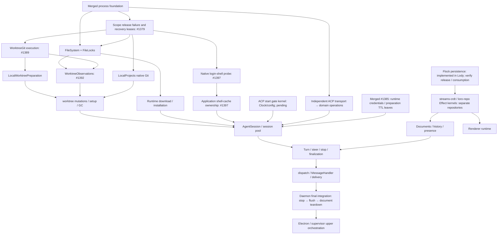
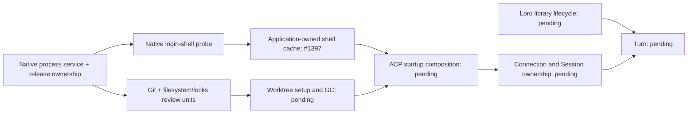

# Lody lifecycle migration roadmap onto Effect

Status: proposed
Translation: current

[中文](2026-09-27-effect-lifecycle-migration-roadmap.zh.md)

## Abstract

Lody's lifecycle defects cluster around hand-written timers, Promise chains,
cancellation flags and swallowed failures. The merged Effect 4.0.2 foundations
cover process ownership and several native leaves, while upper daemon orchestration
remains unfinished. This roadmap organizes independently accepted responsibility
units by actual dependencies and records kernel, consumer and application-owner
completion separately; native orchestration must use Effect rather than wrap
unfinished Lody Promise workflows. The Loro lifecycle must migrate inside its
libraries after verifying Flock persistence prerequisites, while pure calculations
stay ordinary functions. The skill and guide select version-matched primitives,
behavioral acceptance and optional responsibility splits for large mixed modules;
the ledger records evidence and limits rather than an estimated repository percentage.

## Runtime revision

The initial survey below describes the v3 baseline. The workspace now uses
Effect 4.0.2; new layers use `Context.Service` and `Layer.effect`, and tests use
`TestClock` from `effect/testing`. See the [v4 migration decision](../../implemented/architecture/2026-10-09-effect-v4-migration.md).

## Basis for the ranking

These are historical survey counts, not current completion metrics.

- **Lifecycle share of fixes.** Of the last three months' 511 fix commits, about 116 are races,
  hangs, leaks, cancellation, or reconnection bugs. Per file, the highest are:
  - `apps/cli/src/lib/message-handler.ts`: 43 of 61 fix commits are lifecycle-related;
  - `session-execution-service.ts`: 34 of 43.
- **Hand-written mechanisms in non-test code** (timers / swallowed catches / disposed-style
  flags, rough counts):

  | Directory                           | Timers | Swallowed catches | Disposed-style flags |
  | ----------------------------------- | ------ | ----------------- | -------------------- |
  | `apps/cli/src/lib`                  | 91     | 70                | 38                   |
  | `packages/components/src/providers` | 51     | 27                | 27                   |
  | `apps/electron/src/main`            | 32     | 10                | 8                    |

  In addition, 83 renderer files hand-write `let cancelled/disposed = false`, and about 35 files
  in `apps/cli/src` use `child_process` or `cross-spawn` directly.

- **Existing Effect footholds:**

  | File                                                          | Effect usage                            |
  | ------------------------------------------------------------- | --------------------------------------- |
  | `apps/cli/src/lib/loro/connection-recovery.ts`                | serial Queue + Fiber event loop         |
  | `packages/components/src/providers/local-reconnect-loop.ts`   | `Clock` + `Fiber`, injectable TestClock |
  | `apps/cli/src/session/session-access-retry.ts`                | `Schedule`                              |
  | `apps/cli/src/lib/pr-poller`                                  | `Layer`                                 |
  | `packages/components/src/lib/code-collab-file-index-cache.ts` | `ScopedCache`                           |

## Layering principle

### Seven layers

Dependencies point downward only.

| Layer               | Contents                                                                                                                                                                | Third-party boundary (wrapped only here)       |
| ------------------- | ----------------------------------------------------------------------------------------------------------------------------------------------------------------------- | ---------------------------------------------- |
| L6 entry adapters   | MessageHandler RPC handlers, dispatch watcher, MCP/Operation delivery; the only place allowed to call `runtime.run*`                                                    | —                                              |
| OperationInbox / Coordinator | Shared scoped SQLite / pure rules / registered Session, ACP, history and operator Host-lease adapters | Native scheduling, reconciliation, execution/close owners | Production coordinator/Session use entry bridges; execution owner records submission receipts; offline CLI consumes native operator recovery | Scope owns connection, queue, fibers and offline operator Host lease; retained execution/cleanup owners support independent recovery | [Implementation boundary](../../implemented/architecture/2026-10-12-operation-inbox.md); upstream Session/ACP/history migration remains incomplete |
| L5 turn             | TurnService (registry and stop control), TurnProgram, Steer, finalization stages                                                                                        | —                                              |
| L4 session resource | AgentSessionPool (per-session `RcMap`, interruptible create), AgentSession (scope over process, connection, terminals, sandbox), start gate, managed-runtime resolution | —                                              |
| L3 ACP connection   | AcpConnection (requests as Effects, connection-level raw-work set, `closed` Deferred, notification Stream), AgentClient operations, ACP terminals                       | `@agentclientprotocol/sdk`                     |
| L2 state and cloud  | SessionDocuments, SessionHistory, SessionPresence, CloudPort; built on `loro-repo/effect`                                                                               | see the Loro sync stack below                  |
| L1 OS leaf          | ProcessService (spawn, exec, awaitExit, terminateTree with platform strategies), Git, FileSystem, LoginShellEnv                                                         | `node:child_process`, `cross-spawn`, `node:fs` |
| L0 platform         | DaemonRuntime (`ManagedRuntime` + root scope), Clock/TestClock, Logger bridge, Config, Tracing                                                                          | winston, `process.env`                         |

### Definition of done

Assess a responsibility unit, not its filename or the presence of Effect imports.
A native kernel meets all of these criteria:

- Its boundary and actual consumer path are named. Public asynchronous operations
  compose Effects with observable typed failures; pure calculations remain ordinary functions.
- Its own waiting, concurrency, retries and cancellation use Effect. Dependencies
  are native capabilities or genuine external I/O adapters, not wrapped unfinished
  Lody Promise orchestration. Registered upstream adapters remain explicit exceptions.
- Required capabilities come through Services/Layers. Construction requirements
  may be satisfied by a Layer; they need not also appear in every method's `R`.
  Ordinary input values and pure helpers do not need a Service.
- Every acquired resource and background task has an owner through Scope,
  acquire/release or a verified native resource container. Cancellation reaches
  lower work, and callers can await cleanup. Release ordering and bounded waits
  are verified; unresolved resources retain their owner and report failure.
- Failure, timeout, interruption and release failure remain observable, including
  combined Causes. Local cancellation does not imply that a remote request ended.
- The native kernel contains no internal program launches through `Effect.run*`
  or `ManagedRuntime.run*`, Legacy calls or hand-written Promise/timer lifecycle.
  Execution stays at registered application/compatibility entries. Effect-returning
  operators such as `Stream.runCollect` remain valid composition. Real SDK/platform
  adapters may bridge callbacks and cancellation once.
- Behavioral tests exercise the actual boundary: ordering, cancellation, retries,
  replacement and failure paths as applicable. Clock-driven workflow tests use
  injected clocks; real platform regressions complement test Layers.

Track **kernel, consumers and application ownership separately**. A single-kernel,
explicitly deprecated Legacy facade may remain with named consumers and a deletion
condition; that means consumer migration is unfinished. Operation-scoped resources
are valid owners, but do not establish daemon-wide shutdown completion. A unit is
fully integrated only when its consumer and required application-owner work is
also complete. Update the ledger and owning evidence when any dimension changes.

### Our code versus third-party boundaries

- **Our own Promise modules must be rewritten to this definition.** Examples:
  `LoroDocumentManager`, `SessionDocument`, `AgentClient`, `Session`. They must not merely be
  wrapped in `Effect.tryPromise`, which would leave their lifecycle unmanaged.
- **Only real I/O boundaries may be wrapped once:** Node built-ins, third-party SDKs, database
  drivers, browser APIs.
- **Pure synchronous computation stays plain functions** and does not enter Effect. This
  covers `loro-crdt` and `flock-wasm` encode/decode and merge, and the `history-actions.ts`
  reducer.

### Rules during migration

- **Follow actual dependencies bottom-up.** Layer numbers are a map, not a global
  serial schedule. Independent ACP transport and Loro work can proceed separately;
  an upper unit waits for the particular capabilities it consumes.
- **Temporary facades.** Upper-layer callers not yet migrated use a new service through a
  `runtime.runPromise` facade. The facade is marked temporary and deleted when that upper
  layer migrates.
- **Cross-repository dependencies.** When an unfinished dependency lives in another repository,
  this repository may:
  1. first define a Tag matching that dependency's future Effect interface;
  2. adapt the current Promise version with a temporary Layer;
  3. replace only that Layer once upstream is done.

### Small migrations alongside features and fixes

The dedicated series and ordinary feature/fix work can both deliver native leaves.
Limiting migration to the series would leave ready modules accumulating new Promise
mechanisms; rewriting every touched module would expand tasks into unfinished
dependency chains. The root [Effect rule](../../../../AGENTS.md#effect-reference)
therefore requires assessment and prefers a complete, task-related migration when
its actual dependencies and verification scope are ready. The
[selection guide](../../../docs/cli-effect-ts.md#small-migrations-during-feature-and-fix-work)
owns the practical process and the roughly 500-line sizing reference.

This reference measures extra review scope rather than net file growth and creates
no approval gate. The migration must improve the requested behavior and meet the
existing completion criteria with real consumers and behavioral regression coverage.
Larger or blocked work remains a separately scoped unit. Pure computation stays
ordinary code. Reduced complexity and stronger lifecycle behavior are goals to
verify, not guarantees provided merely by choosing Effect. This workflow guidance
changes no product contract; it does not need a new Spec document.

### Boundary rules

The base PR #1070 provides `.agents/docs/cli-effect-ts.md`; the proposed lifecycle layers
add these boundary requirements:

- keep `Effect.run*`/`ManagedRuntime.run*` program launches at registered entries;
- construct rejecting Promises inside `tryPromise` and forward its signal; when raw
  work ignores cancellation, retain ownership until completion or confirmed termination;
- every interrupt is owned by a scope or awaited;
- timeouts go on the waiter;
- every wait inside a finalizer has a clock/deferred bound that works while uninterruptible;
- ACP shutdown explicitly terminates/closes before raw-work joins or scope close; an ownership
  coordinator retains blocked resources rather than reporting release. See the
  [shutdown-order correction](2026-09-27-effect-turn-execution-and-acp-process-ownership.md#shutdown-order-correction-2026-10-09-effect-400);
- `FiberMap` replacement does not await the old fiber;
- scope close is memoized, because a second `Scope.close` does not wait for the first close's
  finalizers.

## L2 and the Loro sync stack

### Lody's four services

| Service          | Effect concept                                                                                                                                                                                                                        | Replaces                                                                                                                |
| ---------------- | ------------------------------------------------------------------------------------------------------------------------------------------------------------------------------------------------------------------------------------- | ----------------------------------------------------------------------------------------------------------------------- |
| SessionDocuments | `RcMap<SessionId, DocHandle>` whose lookup is `acquireRelease(open and join the room, unload then invalidate)`, with an idle TTL                                                                                                      | `getOrCreateSessionDoc`'s `sessions`, `pendingSessionDocs`, `withLocalDocOwnership`, `isDestroyed`, and hand-written GC |
| SessionHistory   | An interpreter of `HistoryAction`/`MetaPatch` values. `commit(batch)` shields local write sequences from cancellation; this alone provides neither crash recovery nor cross-peer CRDT transactions; changes are exposed as a `Stream` | Promise writes such as `sessionData.commands.applyHistoryAction`, and the `subscribeSessionChanges` callback            |
| SessionPresence  | `hold(sessionId, phase)` is an `acquireRelease` lease with its heartbeat as an in-scope `Effect.repeat(Schedule.spaced)`; machine three-state liveness is a `SubscriptionRef`                                                         | Scattered start/clear calls and ten timers                                                                              |
| CloudPort        | A capability interface whose methods return Effects with tagged errors; callers compose timeouts and retries with `timeout`/`Schedule`; one Layer each for local and cloud                                                            | Promise methods that take `timeoutMs`                                                                                   |

Turn code only produces data such as `HistoryAction`/`MetaPatch` and never sees `LoroDoc` or
loro-repo. Only the SessionHistory and SessionDocuments implementations touch `LoroDoc`, and
handles expose only Effect methods. `applyHistoryAction(entries, action)` in
`packages/shared/src/session-data/history-actions.ts` is already a pure reducer. It can be the
shared core of both the interpreter and the in-memory test Layer.

### Decision: an Effect core for loro-repo and streams-crdt

Most of this layer's defects come from the sync libraries not exposing their lifecycle:

- #4: unload/invalidate ordering;
- #774: a join stuck in connecting forever;
- #399: the watchdog tore down a healthy connection;
- #12: a reconnect storm.

Lody can only compensate from outside, with `connection-recovery.ts` (1087 lines) and the room
management in `doc.ts`. Wrapping the libraries from outside cannot put persistence and
reconnection under Effect, so the decision is to go inside the libraries:

- **Scope.** loro-repo and the layer beneath it, `@loro-dev/streams-crdt`, are migrated
  together:
  - loro-repo: about 12.5k lines in the local 0.19.1 checkout, with 12 timers, 55
    disposed/closed flags and 42 swallowed catches;
  - streams-crdt: about 10k lines in the local 0.15.1 checkout. It holds the reconnect and
    backoff state machine.

  Both checkouts are behind the 0.20.3/0.16.0 versions Lody uses, so these numbers are only
  indicative.

- **Shape.** Both libraries become Effect internally and expose two entries:
  - `loro-repo/effect`: Tags, Layers, handles that need a Scope, and Streams. Lody uses this
    entry directly.
  - the existing Promise API: a thin facade over a `ManagedRuntime`, so other consumers such as
    bitnote, inkpeer and lody-e2ee-core are unaffected.
- **Internal mapping:**

  | Current part                                       | After                                                                                                                         |
  | -------------------------------------------------- | ----------------------------------------------------------------------------------------------------------------------------- |
  | Repo creation and close                            | `Layer.effect`, releasing in order: flush → close transport → close storage                                                   |
  | `doc-manager` cache and `unloadDoc`                | `RcMap<DocId, DocHandle>`; consumers can attach finalizers to a handle, which makes Lody's local room invalidation structural |
  | Room join                                          | a `joinRoom` that needs a Scope; one fiber per attempt, interrupted when superseded; callers compose timeouts                 |
  | Room status callbacks                              | `SubscriptionRef<RoomStatus>` / `Stream`                                                                                      |
  | streams-crdt reconnect and backoff                 | an injectable `Schedule` (exponential, jittered, resetAfter)                                                                  |
  | `flock-debounce`, `meta-persister`                 | `Queue` + `Stream` debounce, flushed when the scope closes                                                                    |
  | `event-bus`                                        | `PubSub` / `Stream`                                                                                                           |
  | sqlite / IndexedDB / filesystem storage            | a `Storage` Tag with one Layer each; handles use `acquireRelease`                                                             |
  | streams / websocket / broadcast-channel transports | a `Transport` Tag with one Layer each                                                                                         |

- **Constraints:**
  - Hot paths stay synchronous functions: CRDT update import/export, per-token update writes,
    and single flock writes. Effect takes over opening, joins, reconnection, persistence
    scheduling and close.
  - `effect` is a peerDependency of both libraries. They share one copy with Lody, at an aligned
    version (currently 4.0.2).
  - The Promise facade must let other consumers' existing tests pass unchanged. That is the
    acceptance condition for the library-side PRs.
- **Order.**
  - Finish the [loro-repo Flock persistence migration](../../implemented/architecture/2026-09-27-loro-repo-flock-persistence-migration.md)
    first, then start the libraries' Effect migration, so the two projects do not rewrite the
    persistence layer at the same time.
  - Each library's migration is its own project, with its own plan in its own repository.
- **Lody is not blocked.**
  - Lody defines its `LoroRepo` Context.Service against the expected `loro-repo/effect` interface.
  - It first adapts the current Promise version with a temporary Layer, registered for deletion.
  - When the libraries publish their Effect entry, only that Layer is replaced. SessionDocuments,
    SessionHistory and SessionPresence stay unchanged.

## Migration units

### Process foundation: implemented, not completion of L0/L1

[#1065](https://github.com/LodyAI/Lody/pull/1065),
[#1069](https://github.com/LodyAI/Lody/pull/1069) and
[#1348](https://github.com/LodyAI/Lody/pull/1348) are merged. The shared core uses
Effect 4.0.2, official ChildProcess/ChildProcessSpawner and Node Stream/Sink
adapters with Lody's bounded tree backend. The CLI process-options module only
composes Layers, and the obsolete promise-facade is deleted. Sandbox acquisition
rolls back and successful command Scopes retire after configuration, whole-tree
exit and drained stdio. Legacy imports stay visible across all process consumers.

File locks are the first subsequent dependency unit; see the
[file-lock decision](../../implemented/architecture/2026-10-10-effect-file-lock-lifecycle.md).
They supply a real filesystem protocol, fair interruptible local admission and
observable cleanup failures. LocalProjects and WorktreeGit execution have native
kernels under draft review; worktree mutation/setup/GC, managed
runtime installation, startup gates, SDK requests, Sessions and Turns remain to
migrate. Process unification does not finish those lifecycles or daemon ownership.

### L2 and the Loro sync stack

See the previous section. Local data plane join/unload joins this unit:

- **Where:** `packages/shared/src/local-loro-data-plane-server.ts`,
  `local-loro-transport.ts`, `apps/cli/src/lib/local-loro-data-plane-server.ts`, and `doc.ts`.
- **Evidence:** #4, `0ec3656a`, `c1a502f7`, #774; open #485 and #398.
- **Target:** room lifecycle moves into the RcMap, and Flock freshness sync falls back to the
  local replica with `timeout` + `orElse`.
- **Constraint:** **"unload, then invalidate" must be preserved.**

### Connection recovery, presence, and machine liveness (CLI)

- **Where:** `apps/cli/src/lib/loro/connection-recovery.ts`, `workspace-presence.ts`, `machine-monitor.ts`,
  `session-active-presence.ts`.
- **Evidence:** #12, #673; open #399, #484, #1028.
- **Split:**
  - **Presence and machine liveness** belong to Lody's own L2 (SessionPresence and the machine
    three-state). They can go first on the temporary `LoroRepo` Layer.
  - **Connection recovery** shrinks to policy configuration and health signals once
    streams-crdt/loro-repo take over reconnection with a `Schedule`. It is not rewritten before
    that, to avoid rewriting it twice.
  - **Machine access registration** can move to a background fiber with a `Schedule` on its own,
    first (#1028).
- **Constraints:**
  - First read [`.agents/docs/cli-lib-loro-presence.md`](../../../docs/cli-lib-loro-presence.md) and
    [`cli-lib-local-loro-data-plane.md`](../../../docs/cli-lib-local-loro-data-plane.md), and invoke
    the `lody-loro-sync-stack` skill.
  - Keep the deliberate split between `onStreamsOnline` and `onMetaRoomSynced`.
  - A throttled emit may be delayed, never dropped.

### L3–L5: ACP connection, session resource, and turn

Owned by [turn execution and ACP process ownership](2026-09-27-effect-turn-execution-and-acp-process-ownership.md).
The turn layer depends on L2 and, by the layering rule, finishes last.

### L6: dispatch watcher and MessageHandler

- **Where:** `session-dispatch-watcher.ts` (2874 lines), `session-dispatch-logic.ts`,
  `message-handler.ts` (9762 lines).
- **Evidence:** #676, #166, #1043/#1050 (open #1040), #595, fe26b552; open #939, #553.
- **Target:**
  - one worker fiber per session: `FiberMap` + a sliding `Queue`, or a dirty flag + `Semaphore(1)`;
  - session events become subscriptions on the instance scope, and finalization happens only
    when no turn owns the session;
  - usage flushes retry durably with a `Schedule`;
  - the `runtime.runPromise` facades left by lower layers are deleted.
- **Constraint:** CRDT pointers and duplicate rows still need a data-model fix.

### Managed runtime download and ACP login (an L4 dependency)

- **Where:** `managed-agent-runtime.ts`, `acp-authentication.ts`, `acp-binary-manager.ts`,
  `npx-cache.ts`, `abortable-zip.ts`.
- **Evidence:** #878, #829, #881; open #828, #505.
- **Target:**
  - downward interruption replaces AbortSignal threading;
  - shared installs use `RcMap` or `Deferred` + consumer leases;
  - resumable downloads use a `Schedule`;
  - scratch and partial files use `acquireRelease`;
  - the auth flags become one reason value.
- **Constraints:**
  - Keep every install-cancellation rule in `apps/cli/src/agent/AGENTS.md`.
  - Must finish before L4's RuntimeResolver.

### Worktrees and file locks (an L4/L5 dependency)

- **Where:** `worktree-manager.ts`, `legacy-speculative-worktrees.ts`, `worktree-gc.ts`,
  `packages/shared/src/node/file-lock.ts`.
- **Evidence:** #76, #6; open #296 (possibly fixed by #620; needs checking).
- File-lock implementation is delivered in #1377; its owning decision defines
  the behavior guarantee and single Legacy facade.
- Remaining work migrates Git/worktree operations and marker admission, with GC
  owned by the daemon Scope. Changing return types or repeating Promise methods
  does not complete these units.

### Orchestration delivery

- **Where:** `operation-coordinator.ts`, `operation-store.ts`.
- **Evidence:** #322, #461, #200; open #675.
- **Target:**
  - a `FiberMap` keyed by operation;
  - `Schedule` for retries and deadlines;
  - one scope per requester session, so Stop can cancel pending deliveries. This depends on the
    turn layer's stop reasons.
- **Outside Effect's control:** the SQLite store's generation fences and cross-process MCP hosts.

### Renderer workspace runtime

- **Where:** `create-workspace-runtime.ts` (4731 lines), `workspace-machine-rpc-facade.ts`,
  `atoms/runtime.ts`, `use-machine-flock-rows.ts`, `use-session-doc.ts`, `atoms/doc-meta.ts`,
  `prompt-shortcut-provider.tsx`.
- **Evidence:** #449, #898, #989; open #480.
- **Target:**
  - split per transport into `Layer.effect`;
  - keyed resources use `RcMap`;
  - presence is cleared only when its scope closes;
  - the React seam stays jotai, subscribing through `useSyncExternalStore` or `atomEffect`,
    without adopting `@effect/atom`.
- **Dependency:** the renderer also uses loro-repo, so this unit starts after
  `loro-repo/effect` is available, which avoids writing a temporary adapter first.
- **Constraint:** most `AGENTS.md` files under components are near the 8 KiB limit, so new rules
  require routing content out first.
- **Where Effect does not apply** (about 60% of renderer lifecycle defects):
  - URL ↔ state two-way sync (#193);
  - derived-state conflicts (#613, #496);
  - virtual-list measurement timing (#695, #896, #674);
  - third-party library behaviour (#722).

### Electron main, the embedded CLI, and cli-supervisor

- **Where:** `apps/electron/src/main/services/cli-service.ts`, `loro-data-plane-relay.ts`,
  `packages/cli-supervisor/src/supervisor.ts`.
- **Evidence:** #849, #742; open #448, #938, #1054.
- **Target:**
  - process spawning and termination migrate to the shared process layer
    in the final cross-runtime consumer PR; #1065 introduces the core;
  - one scope per sender;
  - proxy settings go into a `SubscriptionRef`, with defined restart semantics;
  - the supervisor becomes one fiber + `Schedule`.
- **Constraints:**
  - `apps/electron/AGENTS.md` is at the edge of the 8 KiB limit.
  - Electron main's `node --test` fails on extensionless imports of shared code.

### Low priority

Migrate these only when touched:

- the preview proxy;
- `packages/loro-streams-rpc`;
- the PR poller;
- the Electron updater.

## Fixes that need not wait for Effect

- **#1054:** attach an `error` listener to `DailyRotateFile` and degrade to stderr on ENOSPC,
  instead of an uncaught exit.
- **#448:** wrap the relay's `send` in try, and stop callbacks after `destroyed`.
- **#553:** make the history-sync single-flight join the in-flight run.
- **Close after checking:** #296, and the download half of #828.

## Migration guidance and progress

Guidance review: [#1452](https://github.com/LodyAI/Lody/pull/1452).

Merged leaves and Effect imports do not show whether their consumers or final
owners have migrated. The unit ledger below separates those facts. It groups
responsibilities that can be independently accepted, rather than requiring one
row per file or a global sequence of layer numbers.

The [Effect skill](../../../skills/effect-ts/SKILL.md) first selects review, debug,
feature/fix or dedicated migration mode. Review investigates changed behavior;
debugging isolates the cause. Neither initiates a migration. Feature/fix work may
defer migration when dependencies or verification do not fit its scope. For
implementation, start from behavioral contracts, prefer official primitives and
check installed-version semantics before choosing custom coordination. This charter
owns prerequisites and completion criteria; the [guide](../../../docs/cli-effect-ts.md)
owns conventions/testing; each unit's Note records decisions, evidence and limits.
The root AGENTS.md routes implementers to the relevant sections and ledger rows.
Read the resolved release's Effect guide fully once in the current context, then
load task-specific references; re-read when the version or context is lost.

The guide's [five contract questions](../../../docs/cli-effect-ts.md#behavior-contract)
make trigger, resource owner, cancellation, handoff and failure recovery explicit
in the owning Note. Apply only relevant questions. This replaces an unconditional
migration checklist with a behavior-based choice; it adds no per-task document or
mandatory Service for ordinary inputs and pure helpers.

Small cohesive modules stay together. Only large modules mixing calculation,
domain coordination and platform implementation should consider a pure/workflow/
platform responsibility split. Workflow code may consume abstract Services and
perform I/O when executed; Layer construction is not inherently a platform adapter.
This is a Lody convention consistent with the Service/Layer model in
[version-matched Effect references](../../../docs/cli-effect-ts.md#version-matched-reference),
not an upstream requirement for three directories or a fixed size threshold.

Maintain a row when migration facts change: scope, prerequisites, native boundary,
consumers, owners or acceptance evidence. Ordinary unrelated changes do not require
ledger updates. Add independently delivered units as they emerge; split rows when
their contracts can be accepted separately. An unfinished dependency prevents
claiming its dependent kernel complete, even when a temporary adapter permits delivery.

The ledger is manual evidence, not an automated purity proof. Nearest scoped rules,
behavioral tests and applicable boundary guards defend completed boundaries; record
guard gaps rather than claiming existing process checks cover all workflows. Do not
estimate repository progress from PR counts, removed Promises or a global percentage.
Older Effect islands remain unverified until assessed against these criteria.

Keep implementation state separate from verification evidence. The kernel,
consumer and ownership columns describe delivered boundaries; the evidence column
and linked Note record the tested revision, environment, scenarios and limits.
An untested platform is a verification gap, not by itself proof of unfinished
implementation. Conversely, passing a leaf suite cannot complete its consumers.
Update changed facts without recertifying unchanged rows on every PR.

### Guidance evaluation cases

Use these synthetic tasks when evaluating a guidance revision. Judge the agent's
scope decision and proposed observable checks, not whether it repeats keywords.

| Task | Expected decision and evidence |
| --- | --- |
| Fix a timeout in a module whose dependencies still use Promise orchestration | Deliver the fix; explain why migration is deferred without traversing and rewriting the whole dependency chain. |
| Cancel an Effect waiting on an abort-ignoring Promise | Distinguish wait cancellation from raw work; retain the lease and test a controlled late completion. |
| Cancel one reader of a shared producer | Preserve other leases; verify the producer remains usable and last-owner cleanup is awaited. |
| Body and release fail together | Preserve both failures and recovery ownership through the Promise boundary; do not rely on plain squash. |
| Extract a pure helper and collect a Stream in an existing workflow | Keep the helper ordinary; allow Effect-returning Stream operators without creating a runtime or unnecessary Service. |
| Review a diff near a pre-existing lifecycle defect | Compare base/head, distinguish introduced breakage from baseline, and follow P0/P1 reporting rules without starting a rewrite. |

These are evaluation inputs and expected outcomes, not completed independent agent
runs. A future evaluation should record the prompt/guidance revision, resulting
diff or findings, behavioral checks and deviations using synthetic fixtures only.

This guidance revision changes no product guarantees or Specs. Document/skill checks
verify structure and references; no independent agent-use benchmark has established
that the guidance improves implementation quality.

## Unit ledger

Snapshot: main `bcb1aa8712b2d040912d735f1ae6ef2fc832ab35`, 2026-10-11.
“Native” below records merged kernel evidence, not fresh certification on every
platform. “Pending” is unfinished migration; “partial” names completed leaves within
an unfinished unit. Unassessed islands and untested environments are recorded as
evidence limits rather than mixed into the implementation status.
Ownership describes the actual lease/Scope boundary and remaining application work.
Pure calculation is outside this ledger. This is the known lifecycle work queue,
not an exhaustive inventory of the repository.

| Responsibility unit                                  | Actual prerequisites                                                 | Kernel                      | Consumers                            | Ownership / integration                              | Evidence and remaining work                                                                                                                                                                                                                          |
| ---------------------------------------------------- | -------------------------------------------------------------------- | --------------------------- | ------------------------------------ | ---------------------------------------------------- | ---------------------------------------------------------------------------------------------------------------------------------------------------------------------------------------------------------------------------------------------------- |
| Stdio MCP host lifetime | SDK 2.0.0 stdio and Node events | Native host wait/Scope | Internal command entry | Command scope; tool Promise owners unchanged | [Decision](../../implemented/bug-fix/2026-10-14-mcp-stdio-lifetime.md); HTTP and tool orchestration remain outside this unit |
| Bounded process execution and release                | Official process contracts, Node/platform backend                    | Native                      | Native and Legacy                    | Process/container scopes; daemon root pending        | [Process decision](../../implemented/architecture/2026-10-09-effect-official-process-service.md), [release recovery](../../implemented/bug-fix/2026-10-10-effect-process-release-failure.md); Windows descendant ownership still needs separate work |
| FileLocks: local queue and cross-process lease       | FileSystem, native pid probe                                         | Native                      | Native and Legacy                    | Per-operation lease; compatibility runtime remains   | [Lock decision](../../implemented/architecture/2026-10-10-effect-file-lock-lifecycle.md); remove facade after worktree/install callers migrate                                                                                                       |
| LocalProjects Git operations                         | Process, filesystem                                                  | Native                      | Legacy manager paths remain          | Command scopes                                       | [Git decision](../../implemented/architecture/2026-10-10-effect-local-project-git.md); manager coordination pending                                                                                                                                  |
| WorktreeGit execution                                | Process, filesystem                                                  | Native                      | Legacy manager paths remain          | Command scopes                                       | [Execution decision](../../implemented/architecture/2026-10-10-effect-worktree-git-execution.md); mutations are a separate unit                                                                                                                      |
| Worktree observations                                | FileLocks, WorktreeGit                                               | Native                      | Legacy observation entry remains     | Owned/borrowed lock lease                            | [Observation decision](../../implemented/architecture/2026-10-10-effect-worktree-observations.md); migration does not complete mutation/setup/GC                                                                                                     |
| Finite local-source preparation                      | WorktreeGit, filesystem; borrows mutation lease                      | Native                      | Legacy worktree entry remains        | Caller mutation lease and temporary resources        | [Preparation decision](../../implemented/architecture/2026-10-10-effect-local-worktree-preparation.md); manager mutation coordination pending                                                                                                        |
| Login-shell probe and shared cache                   | Process release ownership, Clock                                     | Native                      | Native entries; Legacy launchers     | Application-owned cache; probe scopes                | [Shell decision](../../implemented/architecture/2026-10-10-effect-login-shell-probe.md); launchers delete Legacy after migration                                                                                                                     |
| Runtime credential lease                             | Platform token port, filesystem, Clock                               | Native leaf                 | Legacy Session glue                  | Exact credential lease                               | [Credential decision](../../implemented/architecture/2026-10-10-runtime-owned-github-context.md); preparation control [removed](../../implemented/simplification/2026-10-16-remove-draft-session-preparation.md); raw startup pending                |
| Worktree mutations                                   | Locks, Git, observations, local preparation                          | Pending                     | Promise orchestration                | Mutation/replacement owner pending                   | Manager ownership and failure retention must replace Promise coordination                                                                                                                                                                            |
| Setup scripts                                        | Process, worktree mutations; actual injected callbacks               | Pending                     | Promise orchestration                | Script/task scopes pending                           | Native process calls alone do not migrate callback orchestration                                                                                                                                                                                     |
| Worktree GC                                          | Mutations, setup, metadata writers and active owners                 | Pending                     | Promise orchestration                | Shared cleanup owner pending                         | Must reconcile active ownership before deletion; timer replacement alone is insufficient                                                                                                                                                             |
| Managed-runtime download/install                     | Locks, filesystem, network and extraction boundaries                 | Pending                     | Promise orchestration                | Shared-task leases pending                           | Cancellation and partial-install cleanup required                                                                                                                                                                                                    |
| ACP startup gate kernel                              | Clock, configuration and logging                                     | Pending                     | Promise waiters/callbacks            | Admission/waiter owner pending                       | No intrinsic process prerequisite; startup callbacks are separate unfinished work                                                                                                                                                                    |
| ACP transport and domain operations                  | Process, SDK adapter; raw request tracking                           | Pending                     | Promise requests                     | Connection/raw-work owner pending                    | Can migrate independently of worktree/install; preserve unknown steer outcome                                                                                                                                                                        |
| AgentSession and pool                                | Worktree/startup, install, shell, gate, ACP, credential leaves       | Partial                     | Promise orchestration                | Complete instance/replacement owner pending          | Credential/preparation leaves are native; full Session cancellation is unfinished                                                                                                                                                                    |
| Session history owner readiness                     | Third-party Repo observe/snapshot, Clock                            | Native                      | MessageHandler execution entry       | Per-request stream scope; shutdown cancellation      | [Readiness decision](2026-10-09-roost-native-runtime.md#history-owner-readiness); no body open before owner/backend readiness; native Repo/Doc leases now adopted; upper Session lifecycle remains pending                                                                                  |
| History RPC precondition refusal persistence         | SQLite driver                                                       | Native                      | MessageHandler RPC callbacks         | Scoped handle per operation; FULL refusal transaction | [Readiness decision](2026-10-09-roost-native-runtime.md#history-owner-readiness); refusal survives restart until request expiry; Promise RPC dispatch lifecycle remains pending |
| streams-crdt / loro-repo lifecycle | Released CRDT 0.19.0, Client 0.12.0 and Repo 0.23.0; Effect 4.0.2 | Native library entries available | CLI/MCP directory reads native Repo at its business entry; Doc stores use the registered Legacy entry; native leases own room inventory/recovery and current-state baseline waits; retired Session views reinitialize under the same-key owner | Workspace owns native Repo; Legacy Doc/Flock cache persists before eviction so failed saves preserve borrowable replicas; native release retains retry owner; scoped room recovery and SDK retry receipts; Session retries and online sweeps select failed rooms, including SDK-health-confirmed failed initialization still projected joining; only server transport failure resets its connection; forced local peer recovery remains intact | [Release adoption](../../implemented/architecture/2026-10-16-streams-repo-release-adoption.md); [consumer ownership](2026-10-16-native-workspace-repo.md); upper application orchestration remains unfinished |
| Workspace presence and remote generations | Published streams-crdt 0.19.0 / client 0.12.0; native tokens | Native | Product doc/bridge via one Legacy facade | CLI application registry, workspace and generation Scopes | [P5 decision](../../implemented/architecture/2026-10-12-effect-workspace-presence.md); token sharing and actual SDK release covered; P6 leases are native; the registry retires a failed-release owner instead of blocking the workspace, and MCP commands borrow the daemon owner ([decision](../../implemented/architecture/2026-10-16-daemon-hosted-mcp-workspace-commands.md)); upper relay integration remains pending |
| Local presence and physical socket writer | Native local-origin source; genuine Flock SDK export; Node host turn/write/drain | Native lower writer | CLI doc/socket and room engine via one Legacy facade | Process-wide FIFO pacer and shared connection lanes; bounded release retains original owner | [P7 writer decision](../../implemented/architecture/2026-10-12-effect-local-presence-writer.md); room/LoroRepo and application integration remain pending |
| Session active presence lease / heartbeat | Synchronous local publication, Clock; actual Turn child Scope | Native | Native Turn acquisition; MessageHandler phase/read callbacks | Per-Turn lease; Legacy analytics/application entry | [P6 decision](../../implemented/architecture/2026-10-13-effect-session-presence-leases.md); full Session/Turn/daemon and analytics ownership remain pending |
| Streams token provider | Native credential ports, WebCrypto/fetch and Clock | Native | CLI borrowed Legacy; renderer/Machine RPC owned Legacy | CLI workspace Scope; other application consumers pending | One provider/cache for durable and presence; cancellation only releases caller lease; unresolved I/O retains recovery owner |
| Server-time calibration maintenance | Clock, bounded abort-aware time fetch | Native loop; synchronous epoch/offset model unchanged | CLI startup / React via `startTimeSyncLegacy` | Application lifetime; stop aborts fetch and fences late samples | [Clock correction fix](../../implemented/bug-fix/2026-10-17-presence-clock-calibration.md); upper application orchestration remains Legacy |
| Documents, history and presence                      | Native Loro lifecycle; existing history reducer                      | Partial: native Repo/Doc leases, presence and local writer | Mixed application orchestration          | Session presence and workspace Doc leases native; upper wrapper/Turn owners pending; lower writer native         | Existing islands unassessed; preserve unload-before-invalidate and existing writer/read responsibilities                                                                                                                                                                          |
| Turn, steer, stop and finalization                   | Session owners and document/history/presence owners                  | Pending                     | Promise orchestration                | Turn tasks pending; native session presence lease integrated                    | Both dependency paths required; preserve typed stop and pending-input behavior                                                                                                                                                                       |
| dispatch, MessageHandler and daemon integration      | Turn, delivery and document flush                                    | Pending                     | Promise orchestration                | Shell root runtime exists; broader ownership pending | Stop sessions → flush final writes → tear down documents; report external release failures                                                                                                                                                           |
| Renderer / Electron / supervisor upper orchestration | Actual per-unit platform and sync dependencies                       | Pending        | Existing islands and process callers | Upper resource/task owners pending                   | Existing islands unassessed; process caller unification is not upper workflow completion; refine into units before delivery                                                                                                                                                       |

## Delivery dependency graph

Arrows mean prerequisites, not a global serial ordering. File locks, Git leaves,
worktree observations/local preparation and the application shell cache are now
merged foundations; subsequent units start from latest main or a new dependent branch.



The file-lock native-program compatibility projection also depends on #1379;
its kernel continues using the existing pid probe. File locks are reviewed in [#1377](https://github.com/LodyAI/Lody/pull/1377).
Native Git validation exposed swallowed Scope release failure; the independent
correction [#1379](https://github.com/LodyAI/Lody/pull/1379) retains recovery leases.
LocalProjects is reviewed in [#1381](https://github.com/LodyAI/Lody/pull/1381)
above #1379. Its kernel does not depend on FileLocks; worktree setup/GC must
integrate both. WorktreeGit execution is reviewed in
[#1389](https://github.com/LodyAI/Lody/pull/1389); its kernel needs the process
foundation and filesystem, while its review base includes LocalProjects to avoid
repeating manager changes. The native
[worktree observation unit](../../implemented/architecture/2026-10-10-effect-worktree-observations.md)
integrates FileLocks and WorktreeGit on a foundation containing refreshed main.
It does not complete mutation/setup/GC ownership. #1385 is merged and supplies
runtime credential leases and preparation TTL/control only (that control was later
removed with draft preparation); raw ACP/worktree startup and full session ownership
remain unfinished.
The finite [local-source preparation unit](../../implemented/architecture/2026-10-10-effect-local-worktree-preparation.md) depends on filesystem/Git and borrows the existing mutation lease. Its review base includes observations because their manager boundary is shared; the native kernels are independent.
Library-side prerequisite verification: the [release adoption](../../implemented/architecture/2026-10-16-streams-repo-release-adoption.md) consumes official streams-crdt 0.19.0, streams-client 0.12.0 and loro-repo 0.23.0, retaining Effect 4.0.2 and Flock WASM 0.4.4. The additive native Repo entry and SDK upload/read-epoch APIs are published prerequisites. The [native consumer adoption](2026-10-16-native-workspace-repo.md) in the same #1607 now connects CLI/renderer durable ownership, direct directory helpers, the local v7 client, eager workers and private shortcut SDK rooms. Existing application Promise APIs use WorkspaceRepoLegacy over the same native Repo; host server, Session/Turn, grants, RPC and host storage relocation remain separate units. Recheck upstream rules and contracts for each migration unit.
The seven-unit foundation stack below merged into main on 2026-10-11. Worktree
mutations/setup/GC, runtime installation, ACP and the Loro kernels remain unfinished.

The application shell cache has established CLI/Electron root runtimes. Extend
these owners as native services enter composition rather than adding a runtime per
service; complete unified daemon ownership and preserve two-phase shutdown. A registered temporary upstream
adapter can unblock Lody integration, but does not mark the sync stack complete.
Verify Flock's published and consumed versions and each repository's rules before
library work; the initial local-checkout size/version survey is historical.

## Verification limits

- The ranking and mechanism counts come from git history, issues, and code grep, not runtime
  measurement.
- The loro-repo and streams-crdt numbers come from local checkouts older than the versions Lody
  uses.
- "Likely closes" is inference: each unit must reproduce and verify it during implementation.
- Not assessed:
  - migration effort;
  - Effect's real cost on hot paths and renderer bundle size;
  - the effect on release cadence.

## v4 baseline and PR ownership

[#1070](https://github.com/LodyAI/Lody/pull/1070), the existing Effect consumer and test-tooling
migration to v4, is merged into main. [#1057](https://github.com/LodyAI/Lody/pull/1057) was
merged into its former base branch rather than main; [#1355](https://github.com/LodyAI/Lody/pull/1355)
restores only these bilingual plans onto main.

The former #1355 → #1065 → #1069 → #1348 stack is merged. The shared official
process service retains Lody's bounded backend; its caller migration does not
finish whole L0/L1 or daemon ownership. New reviews use fresh branches and actual
dependency edges. File locks (#1377), Git leaves (#1381/#1389), worktree observations
(#1392) and local preparation (#1394) are review units, not a claim that mutations,
setup/GC or Session cancellation are complete.

The independent [login-shell probe unit](../../implemented/architecture/2026-10-10-effect-login-shell-probe.md)
depends on process release-failure ownership (#1379), not worktree preparation.
Its finite probe and application-owned cache are native in #1397. CLI/Electron
entries now own this service through their root runtime; remaining launchers use
explicit Legacy accessors. This does not finish other daemon owners. Maintain both actual paths:



The finite probe preserves the CLI three-second pending wait while retaining
actual failures. It does not migrate runtime downloads or the startup gate. The
Loro library mainline remains independent; Turn waits for both actual dependency
paths, not a global sequence of layer numbers.

### Merged foundation stack

The seven reviews below merged into main on 2026-10-11:

```text
main → #1379 → #1377 → #1381 → #1389 → #1392 → #1394 → #1397
```

Each PR targeted the preceding PR's head branch and contained that predecessor.
This replaced the temporary worktree/shell integration bases. The order was a
review and merge sequence: LocalProjects does not acquire FileLocks, the Git
execution kernel does not require LocalProjects, and the finite shell probe
requires process ownership rather than worktree preparation. Preserve the actual
dependency diagrams above when planning the next units. Process acquisition error
conversion now retains setup failure and every unresolved recovery lease. These
PRs are merged foundations for small task-related units and the next dedicated
migrations; this stack does not mark any subsequent daemon phase complete.
