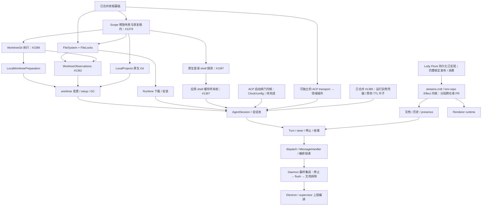
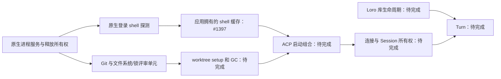

# Lody 生命周期 Effect 迁移路线图

Status: proposed
Translation: current

[English](2026-09-27-effect-lifecycle-migration-roadmap.md)

## 摘要

Lody 的生命周期缺陷集中在手写定时器、Promise 链、取消标志和吞掉的失败。已合并的 Effect 4.0.2 基础覆盖进程所有权与若干原生叶子，上层 daemon 编排仍未完成。本路线图按真实依赖组织可独立验收的职责单元，分别记录内核、消费者、应用拥有者的完成状态；原生编排必须使用 Effect，不能包装尚未迁移的 Lody Promise 工作流。Loro 生命周期应在核实 Flock 持久化前置条件后深入库内部迁移，纯计算保持普通函数。Skill 与指南负责选择版本一致的原语、行为验收及大型混合模块的可选职责拆分，台账记录证据与局限，不估算全仓百分比。

## 运行时修订

下文的初始调研描述的是 v3 基线。工作区现在使用 Effect 4.0.2；新层使用
`Context.Service` 与 `Layer.effect`，测试从 `effect/testing` 导入 `TestClock`。
见 [v4 迁移决定](../../implemented/architecture/2026-10-09-effect-v4-migration.zh.md)。

## 排序依据

以下是历史调查计数，不是当前完成度指标。

- 近三个月 511 个 fix 提交中约 116 个属于竞态、卡死、泄漏、取消、重连类；按文件统计，
  `apps/cli/src/lib/message-handler.ts`（61 个 fix 提交中 43 个与生命周期相关）与
  `session-execution-service.ts`（43 个中 34 个）最高。
- 非测试代码中手写机制的粗略计数（定时器 / 被吞的 catch / disposed 类标志）：
  `apps/cli/src/lib` 91 / 70 / 38，`packages/components/src/providers` 51 / 27 / 27，
  `apps/electron/src/main` 32 / 10 / 8；renderer 有 83 个文件手写 `let cancelled/disposed = false`；
  `apps/cli/src` 中约 35 个文件直接使用 `child_process` 或 `cross-spawn`。
- 现有 Effect 立足点：`apps/cli/src/lib/loro/connection-recovery.ts`（Queue + Fiber 串行事件循环）、
  `packages/components/src/providers/local-reconnect-loop.ts`（`Clock` + `Fiber`，可注入 TestClock）、
  `apps/cli/src/session/session-access-retry.ts`（`Schedule`）、`apps/cli/src/lib/pr-poller`（`Layer`）、
  `packages/components/src/lib/code-collab-file-index-cache.ts`（`ScopedCache`）。

## 分层原则

### 七层

依赖只能向下。

| 层          | 内容                                                                                                                              | 第三方边界（只在此包装一次）                   |
| ----------- | --------------------------------------------------------------------------------------------------------------------------------- | ---------------------------------------------- |
| L6 入口适配 | MessageHandler RPC 处理器、dispatch watcher、MCP/Operation 投递；唯一允许调用 `runtime.run*` 的地方                               | —                                              |
| L5 Turn     | TurnService（注册表与停止控制）、TurnProgram、Steer、收尾阶段                                                                     | —                                              |
| L4 会话资源 | AgentSessionPool（按会话的 `RcMap`，可中断创建）、AgentSession（进程、连接、终端、sandbox 的作用域）、启动闸门、托管 runtime 解析 | —                                              |
| L3 ACP 连接 | AcpConnection（请求即 Effect、连接级原始工作集合、`closed` Deferred、通知 Stream）、AgentClient 操作、ACP 终端                    | `@agentclientprotocol/sdk`                     |
| L2 状态与云 | SessionDocuments、SessionHistory、SessionPresence、CloudPort；下接 `loro-repo/effect`                                             | 见下文 Loro 同步栈                             |
| L1 OS 叶子  | ProcessService（spawn、exec、awaitExit、terminateTree 与平台策略）、Git、FileSystem、LoginShellEnv                                | `node:child_process`、`cross-spawn`、`node:fs` |
| L0 平台     | DaemonRuntime（`ManagedRuntime` + 根作用域）、Clock/TestClock、Logger 桥接、Config、Tracing                                       | winston、`process.env`                         |

### 完成判定

按职责单元验收，不按文件名或是否导入 Effect 判断。原生内核必须满足：

- 明确边界与真实消费路径；公开异步操作通过 Effect 组合，失败以有类型的错误暴露；纯计算保持普通函数。
- 自己的等待、并发、重试与取消由 Effect 管理。依赖是原生能力或真正的外部 I/O 适配器，不能包装尚未迁移的 Lody Promise 编排。已登记的上游临时适配仍是明确例外。
- 所需能力经 Service/Layer 提供。构建依赖可由 Layer 满足，不要求同时出现在每个方法的 `R` 中；普通输入值和纯 helper 不必成为 Service。
- 每项资源和后台任务通过 Scope、acquire/release 或验证过的原生资源容器获得明确拥有者。取消传到下层，调用方能等待清理；验证释放顺序与有界等待，无法确认释放时保留拥有者并报告失败。
- 失败、超时、中断及释放失败保持可观察，包括组合 Cause。本地等待取消不意味着远端请求已结束。
- 原生内核不通过内部 `Effect.run*` 或 `ManagedRuntime.run*` 启动程序，不包含 Legacy 调用或手写 Promise/定时器生命周期；仅已登记的应用/兼容入口执行。返回 Effect 的 `Stream.runCollect` 等算子仍可组合。真实 SDK/平台适配器可以在边界桥接一次回调与取消。
- 行为测试覆盖真实边界中适用的排队、取消、重试、替换和失败路径；依赖时钟的 workflow 使用注入时钟，真实平台回归补充测试 Layer。

分别记录**内核、消费者、应用所有权**。单一内核的明确 deprecated Legacy 门面可以暂留，但必须记录具体消费者与删除条件，此时消费者迁移尚未完成。操作级 Scope 是有效拥有者，但不证明 daemon 整体关停完成。只有消费者与所需应用拥有者也完成，才算完整集成；任一维度改变都更新台账和 owning 证据。

### 自己的代码与第三方边界

- 自己的 Promise 模块（例如 `LoroDocumentManager`、`SessionDocument`、`AgentClient`、`Session`）
  必须按上述判定重写，不能只在外面套一层 `Effect.tryPromise`，否则生命周期仍无人管理。
- 只有真正的 I/O 边界允许包装一次：Node 内建模块、第三方 SDK、数据库驱动、浏览器 API。
- 纯同步计算（`loro-crdt`、`flock-wasm` 的编解码与合并，`history-actions.ts` 的 reducer）
  保持普通函数，不进入 Effect。

### 迁移期规则

- 按真实依赖自底向上：层号不是全局串行要求。ACP transport 与 Loro 可独立推进；
  上层只等待它实际消费的能力完成。
- 尚未迁移的上层调用方经 `runtime.runPromise` 门面使用新服务；门面标注为临时，并在对应上层
  迁移时删除。
- 当依赖属于另一个仓库且尚未完成时，允许在本仓库先定义与其未来 Effect 接口一致的 Tag，
  用临时 Layer 适配现有 Promise 版本；上游完成后只替换该 Layer。

### 随功能与修复推进的小型迁移

专门的迁移系列与日常功能/修复工作都可以交付原生叶子模块。只依靠系列推进，会让已经
具备条件的模块继续累积 Promise 机制；触及模块就全部重写，则会把任务扩展到尚未完成的
依赖链。因此，根 [Effect 规则](../../../../AGENTS.md#effect-reference) 要求评估迁移机会，
并在真实依赖与验证范围就绪时优先完成一个直接服务当前需求的完整单元。
[选择指南](../../../docs/cli-effect-ts.md#small-migrations-during-feature-and-fix-work)
负责具体流程和约 500 行的规模参考。

这个参考衡量额外评审范围，不按文件净增长计算，也不新增审批门槛。迁移必须改善当前
需求涉及的行为，接入真实消费路径，并用行为回归覆盖满足既有完成标准。较大或被依赖
阻塞的工作仍作为独立单元安排；纯计算保持普通代码。减少复杂度、改善生命周期行为是
需要验证的目标，选择 Effect 本身不提供这些保证。这项工作方式建议不改变产品契约，
不需要新增 Spec 文档。

### 边界规则（使用指南已由基础 PR #1070 提供，生命周期层补充以下要求）

`Effect.run*`/`ManagedRuntime.run*` 仅在已登记入口启动程序；可拒绝的 Promise 在 `tryPromise` 内创建并传递 signal，底层忽略取消时保留拥有者直到完成或确认终止；中断必须被某个作用域
持有或被等待；超时放在等待者上；finalizer 内的等待必须有上限；`FiberMap` 替换不等待旧 fiber；
作用域关闭必须记忆化，因为第二次 `Scope.close` 不等待第一次的 finalizer。finalizer 内采用在
不可中断区域也能结束的时钟/Deferred 上限；ACP 关停由协调器先显式终止/关闭、再 join 原始
工作和关闭 scope。仍被阻塞的资源保留拥有者，不能报告释放。详见
[关停顺序修正](2026-09-27-effect-turn-execution-and-acp-process-ownership.zh.md#关停顺序修正2026-10-09effect-400)。

## L2 与 Loro 同步栈

### Lody 侧的四个服务

| 服务             | Effect 概念                                                                                                                                                | 取代                                                                                                          |
| ---------------- | ---------------------------------------------------------------------------------------------------------------------------------------------------------- | ------------------------------------------------------------------------------------------------------------- |
| SessionDocuments | `RcMap<SessionId, DocHandle>`，lookup 为 `acquireRelease(打开并加入 room, 先 unload 再 invalidate)`，带 idle TTL                                           | `getOrCreateSessionDoc` 的 `sessions`、`pendingSessionDocs`、`withLocalDocOwnership`、`isDestroyed` 与手写 GC |
| SessionHistory   | 执行 `HistoryAction`/`MetaPatch` 值的写入器；`commit(batch)` 避免本地取消打断写入序列；不可中断本身不提供崩溃恢复或跨 peer CRDT 事务；变化以 `Stream` 暴露 | `sessionData.commands.applyHistoryAction` 等 Promise 写入与 `subscribeSessionChanges` 回调                    |
| SessionPresence  | `hold(sessionId, phase)` 为 `acquireRelease` 租约，心跳为作用域内的 `Effect.repeat(Schedule.spaced)`；机器三态用 `SubscriptionRef`                         | 分散的 start/clear 调用与十个定时器                                                                           |
| CloudPort        | 能力接口，方法返回带标签错误的 Effect；超时与重试由调用方用 `timeout`/`Schedule` 组合；local 与 cloud 各一个 Layer                                         | 接收 `timeoutMs` 的 Promise 方法                                                                              |

turn 代码只产出 `HistoryAction`/`MetaPatch` 这类数据，看不到 `LoroDoc` 或 loro-repo；只有
SessionHistory 与 SessionDocuments 的实现能接触 `LoroDoc`，handle 对外只暴露 Effect 方法。
`packages/shared/src/session-data/history-actions.ts` 中 `applyHistoryAction(entries, action)`
已是纯 reducer，可直接作为写入器与内存测试 Layer 的共同核心。

### 决定：loro-repo 与 streams-crdt 改为 Effect 内核

Lody 这一层的缺陷（#4 unload/invalidate 顺序、#774 join 永久停在 connecting、#399 watchdog 拆掉
健康连接、#12 重连风暴）大多源于同步库没有交出生命周期，Lody 只能在外面用
`connection-recovery.ts`（1087 行）与 `doc.ts` 的 room 管理补偿。只在外面包装无法让持久化与
重连归 Effect 管理，因此决定深入库内部：

- **范围**：loro-repo（本地 0.19.1 检出约 1.25 万行，12 处定时器、55 处 disposed/closed 标志、
  42 处被吞的 catch）与其下层 `@loro-dev/streams-crdt`（本地 0.15.1 检出约 1 万行，重连与退避
  状态机所在）一起改造。两个本地检出都落后于 Lody 使用的 0.20.3/0.16.0，数字只作量级参考。
- **形态**：库内部全部用 Effect；对外同时提供 `loro-repo/effect`（Tag、Layer、需要 Scope 的
  handle、Stream）与现有 Promise API。后者是基于 `ManagedRuntime` 的薄门面，使 bitnote、inkpeer、
  lody-e2ee-core 等其他使用方不受影响。Lody 直接使用 Effect 入口。
- **内部对应**：

  | 现有部分                                     | Effect 化后                                                                                           |
  | -------------------------------------------- | ----------------------------------------------------------------------------------------------------- |
  | Repo 创建与关闭                              | `Layer.effect`，释放顺序为 flush → 关 transport → 关 storage                                          |
  | `doc-manager` 缓存与 `unloadDoc`             | `RcMap<DocId, DocHandle>`，消费方可在 handle 上挂 finalizer（Lody 的本地 room invalidate 由此结构化） |
  | room join                                    | 需要 Scope 的 `joinRoom`，每次尝试一个 fiber，被取代即中断，超时由调用方组合                          |
  | room 状态回调                                | `SubscriptionRef<RoomStatus>` / `Stream`                                                              |
  | streams-crdt 重连与退避                      | 可注入的 `Schedule`（exponential、jittered、resetAfter）                                              |
  | `flock-debounce`、`meta-persister`           | `Queue` + `Stream` 防抖，作用域关闭时 flush                                                           |
  | `event-bus`                                  | `PubSub` / `Stream`                                                                                   |
  | sqlite / IndexedDB / 文件系统存储            | `Storage` Tag，各一个 Layer，句柄用 `acquireRelease`                                                  |
  | streams / websocket / broadcast-channel 传输 | `Transport` Tag，各一个 Layer                                                                         |

- **约束**：
  - 热路径（CRDT update 导入导出、按 token 流入的更新写入、单次 flock 写入）保持同步函数，
    Effect 只接管打开、join、重连、持久化调度与关闭。
  - `effect` 作为两个库的 peerDependency，与 Lody 共用同一份并对齐版本（当前 4.0.2）。
  - Promise 门面必须让其他使用方的现有测试不改即通过，作为库侧 PR 的验收条件。
- **顺序**：先完成 [loro-repo Flock 持久化迁移](../../implemented/architecture/2026-09-27-loro-repo-flock-persistence-migration.zh.md)，
  再开始库的 Effect 改造，避免两项工作同时改写持久化层。库的改造在各自仓库立项、各自出计划。
- **Lody 不被阻塞**：Lody 侧按 `loro-repo/effect` 的预期接口定义 `LoroRepo` Context.Service，先用临时 Layer
  适配现有 Promise 版本并登记删除；库发布 Effect 入口后只替换该 Layer，SessionDocuments、
  SessionHistory、SessionPresence 不变。

## 迁移单元

### 进程基础：已实现，但不代表整个 L0/L1 完成

[#1065](https://github.com/LodyAI/Lody/pull/1065)、
[#1069](https://github.com/LodyAI/Lody/pull/1069)、
[#1348](https://github.com/LodyAI/Lody/pull/1348) 均已合并。共享核心使用 Effect 4.0.2、
官方 ChildProcess/ChildProcessSpawner 与 Node Stream/Sink，保留 Lody 有界进程树后端。
CLI process-options 只组合 Layer，旧 promise-facade 已删除。Sandbox 失败或中断回滚，
成功命令在配置完成、整棵树退出和 stdio 关闭后释放子 Scope；所有进程消费保留 Legacy 可见。

文件锁是之后第一个依赖单元，见[文件锁决定](../../implemented/architecture/2026-10-10-effect-file-lock-lifecycle.zh.md)：
真实文件协议、公平且可取消的本地登记、可观察的清理失败。LocalProjects 和 WorktreeGit 执行已有待审的原生内核；worktree 变更/setup/GC、
runtime 安装、启动闸门、SDK 请求、Session 与 Turn 仍需迁移；进程统一
不代表这些生命周期或 daemon 所有权已完成。

### L2 与 Loro 同步栈

见上一节。本地数据面 join/unload（`packages/shared/src/local-loro-data-plane-server.ts`、
`local-loro-transport.ts`、`apps/cli/src/lib/local-loro-data-plane-server.ts`、`doc.ts`，证据
#4、`0ec3656a`、`c1a502f7`、#774，开放 #485、#398）并入此单元：room 生命周期进入 RcMap，
Flock 新鲜度同步用 `timeout` + `orElse` 回落本地副本。约束：**必须保持"先 unload 再 invalidate"**。

### 连接恢复、presence 与机器存活（CLI）

- 位置：`apps/cli/src/lib/loro/connection-recovery.ts`、`workspace-presence.ts`、`machine-monitor.ts`、
  `session-active-presence.ts`。
- 证据：#12、#673；开放 #399、#484、#1028。
- 拆分：presence 与机器存活属于 Lody 自己的 L2（SessionPresence 与机器三态），可在临时
  `LoroRepo` Layer 上先行；连接恢复在 streams-crdt/loro-repo 以 `Schedule` 接管重连后收缩为
  策略配置与健康信号，在此之前不重写，避免两次改写。机器访问注册改为带 `Schedule` 的后台
  fiber 可独立先做（#1028）。
- 约束：先读 [`.agents/docs/cli-lib-loro-presence.md`](../../../docs/cli-lib-loro-presence.md) 与
  [`cli-lib-local-loro-data-plane.md`](../../../docs/cli-lib-local-loro-data-plane.md)，并先调用
  `lody-loro-sync-stack` skill；保留 `onStreamsOnline` 与 `onMetaRoomSynced` 的刻意拆分，被节流的
  emit 只能延后不能丢弃。

### L3–L5：ACP 连接、会话资源与 Turn

由 [Turn 执行与 ACP 进程所有权](2026-09-27-effect-turn-execution-and-acp-process-ownership.zh.md)
负责。Turn 层依赖 L2，按分层原则最后完成。

### L6：Dispatch watcher 与 MessageHandler

- 位置：`session-dispatch-watcher.ts`（2874 行）、`session-dispatch-logic.ts`、
  `message-handler.ts`（9762 行）。
- 证据：#676、#166、#1043/#1050（开放 #1040）、#595、fe26b552；开放 #939、#553。
- 目标：每会话一个 worker fiber（`FiberMap` + sliding `Queue` 或"脏标记 + `Semaphore(1)`"）；
  会话事件改为实例作用域上的订阅，收尾只在无拥有者 turn 时发生；用量 flush 用 `Schedule` 持久
  重试；删除各层留下的 `runtime.runPromise` 门面。
- 约束：CRDT 指针与重复行仍需数据模型层面修复。

### 托管 runtime 下载与 ACP 登录（L4 的依赖）

- 位置：`managed-agent-runtime.ts`、`acp-authentication.ts`、`acp-binary-manager.ts`、`npx-cache.ts`、
  `abortable-zip.ts`。
- 证据：#878、#829、#881；开放 #828、#505。
- 目标：中断向下传播取代逐层 AbortSignal；共享安装用 `RcMap` 或 `Deferred` + 消费者租约；
  续传用 `Schedule`；scratch 与 partial 文件用 `acquireRelease`；认证标志改为单一原因值。
- 约束：`apps/cli/src/agent/AGENTS.md` 的安装取消规则逐条保留。须在 L4 的 RuntimeResolver 之前完成。

### Worktree 与文件锁（L4/L5 的依赖）

- 位置：`worktree-manager.ts`、`legacy-speculative-worktrees.ts`、`worktree-gc.ts`、
  `packages/shared/src/node/file-lock.ts`。
- 证据：#76、#6；开放 #296（可能已被 #620 修复，需核实）。
- 文件锁内核已在 #1377 实现；其行为保证与单一 Legacy 门面以所属决定为准。
- 剩余目标：迁移 Git/worktree 操作与 marker 排队；GC 由 daemon Scope 拥有。仅改变函数返回类型、或让计时循环调用 Promise 方法，不构成这些单元完成。

### 编排投递

- 位置：`operation-coordinator.ts`、`operation-store.ts`。
- 证据：#322、#461、#200；开放 #675。
- 目标：按 operation 的 `FiberMap`、`Schedule` 重试与期限、每个请求方会话一个作用域，使 Stop
  能取消挂起投递（依赖 Turn 层的停止原因）。SQLite store 的代际栅栏与跨进程 MCP host 不受
  Effect 控制。

### Renderer workspace runtime

- 位置：`create-workspace-runtime.ts`（4731 行）、`workspace-machine-rpc-facade.ts`、`atoms/runtime.ts`、
  `use-machine-flock-rows.ts`、`use-session-doc.ts`、`atoms/doc-meta.ts`、`prompt-shortcut-provider.tsx`。
- 证据：#449、#898、#989；开放 #480。
- 目标：按 transport 拆成 `Layer.effect`；按 key 的资源用 `RcMap`；presence 只在作用域关闭时清空；
  React 接缝保持 jotai，通过 `useSyncExternalStore` 或 `atomEffect` 订阅，不引入 `@effect/atom`。
- 依赖：renderer 同样使用 loro-repo，应在 `loro-repo/effect` 可用后开始，避免先写临时适配。
- 约束：components 下多数 `AGENTS.md` 接近 8 KiB 上限，新增规则前需要转移内容。
- 不适用 Effect 的部分（约占 renderer 生命周期缺陷六成）：URL 与状态双向同步（#193）、派生
  状态冲突（#613、#496）、虚拟列表测量时序（#695、#896、#674）、第三方库行为（#722）。

### Electron main、内嵌 CLI 与 cli-supervisor

- 位置：`apps/electron/src/main/services/cli-service.ts`、`loro-data-plane-relay.ts`、
  `packages/cli-supervisor/src/supervisor.ts`。
- 证据：#849、#742；开放 #448、#938、#1054。
- 目标：CLI 子进程与各处进程终止在最后的跨运行时 PR 迁到共享进程层；#1065 先引入核心；每个 sender 一个
  作用域；代理设置放进 `SubscriptionRef` 并定义重启语义；supervisor 改为单个 fiber + `Schedule`。
- 约束：`apps/electron/AGENTS.md` 已在 8 KiB 上限边缘；electron main 的 `node --test` 对 shared
  的无扩展名导入会失败。

### 低优先级

preview 代理、`packages/loro-streams-rpc`、PR poller、Electron updater：只在触及时顺带迁移。

## 不需要等 Effect 的独立修复

- #1054：给 `DailyRotateFile` 挂 `error` 监听，ENOSPC 时降级到 stderr 而不是 uncaught 退出。
- #448：relay 的 `send` 包 try，并在 `destroyed` 后停止回调。
- #553：历史同步 single-flight 改为加入进行中的那一次。
- 核实后关闭：#296、#828 的下载部分。

## 迁移引导与进度

引导修订评审：[#1452](https://github.com/LodyAI/Lody/pull/1452)。

叶子 PR 合并或代码导入 Effect，不能说明消费者与最终拥有者也已迁移。下面的单元台账分别记录这些事实；按可独立验收的职责组织，不要求一个文件一行，也不按层号全局串行。

[Effect skill](../../../skills/effect-ts/SKILL.md)先区分 review、debug、feature/fix 与专门迁移。Review 检查变化的行为，debug 定位原因，二者都不主动启动迁移。功能/修复可在依赖或验证超出范围时推迟迁移。实现时先明确行为合同，优先官方原语，再核对已安装版本语义，最后决定是否需要自定义协调。本纲领负责依赖与完成标准，[指南](../../../docs/cli-effect-ts.md)负责惯例与测试，每个单元的 Note 负责决策、证据与局限。根 AGENTS.md 将实现者引向相关章节与台账行。当前上下文中首次完整阅读所解析版本的 Effect 指南，之后按任务加载资料；版本变化或上下文丢失时重读。

指南的[五问行为合同](../../../docs/cli-effect-ts.md#behavior-contract)要求在 owning Note 中明确触发、资源拥有者、取消、交接和失败恢复，仅回答适用的问题。这用行为判断替代无条件迁移清单，不增加每任务文档，也不要求普通输入与纯 helper 成为 Service。

小而内聚的模块保持在一起。只有混合计算、领域编排和平台实现的大模块，才考虑 pure/workflow/platform 职责拆分。Workflow 可依赖抽象 Service，执行时可以发生 I/O；Layer 构建不天然属于平台适配。这是与[版本一致的 Effect 资料](../../../docs/cli-effect-ts.md#version-matched-reference)中 Service/Layer 模型一致的 Lody 惯例，不是上游强制的三个目录或固定行数门槛。

迁移事实改变时更新对应行：范围、前置依赖、原生边界、消费者、拥有者、验收证据。无关的日常修改无需更新台账。出现独立交付单元时登记，行为合同可独立验收时拆行。临时适配允许交付，也不能让依赖尚未完成的内核被宣称为完成。

台账是人工维护的证据，不是自动纯化证明。最近的 scoped 规则、行为测试和适用边界守卫保护已完成边界；记录守卫缺口，不能声称现有进程检查覆盖全部 workflow。不按 PR 数量、移除 Promise 数或全仓百分比估算进度。旧 Effect 孤岛未经这些标准核对，保持未核验。

实现状态与验证证据分开记录。内核、消费者、所有权列描述已交付边界；证据列及链接的 Note 记录测试 revision、环境、场景与局限。未测试平台是验证缺口，本身不证明实现未完成；反过来，叶子测试通过也不代表消费者完成。只更新变化的事实，不要求每个 PR 重新认证未变的行。

### 引导评估场景

评估引导修订时使用以下合成任务，判断 agent 的范围选择和拟验证的可观察行为，不检查它是否复述关键词。

| 任务 | 预期选择与证据 |
| --- | --- |
| 修复依赖仍使用 Promise 编排的模块中的超时 | 完成修复，解释推迟迁移的原因，不遍历重写整条依赖链。 |
| 取消正在等待忽略 abort 的 Promise 的 Effect | 区分等待取消与原始工作，保留租约，用可控的迟到完成验证。 |
| 取消共享生产者的一个读者 | 保留其他租约，验证生产者仍可用且最后拥有者等待清理。 |
| 主体与释放同时失败 | 在 Promise 边界保留两类失败和恢复所有权，不依赖普通 squash。 |
| 提取纯 helper，并在既有 workflow 收集 Stream | helper 保持普通函数；允许返回 Effect 的 Stream 算子，不创建 runtime 或无必要的 Service。 |
| Review 涉及既有生命周期缺陷附近的 diff | 比较 base/head，区分新增破坏与基线，遵守 P0/P1 报告规则，不启动重写。 |

这些是评估输入与预期结果，不是已经完成的独立 agent 实验。后续评估应记录 prompt/指引 revision、产出 diff 或 findings、行为检查和偏差，仅使用合成 fixture。

本次引导修订不改变产品保证或 Specs。文档/skill 检查只验证结构与引用；尚未通过独立 agent 使用实验确认引导能改善实现质量。

## 单元台账

快照：main `bcb1aa8712b2d040912d735f1ae6ef2fc832ab35`，2026-10-11。
“原生”记录已合并的内核证据，不代表重新验证了所有平台；“待迁移”表示尚未完成；“部分”明确已完成的叶子。尚未评估的孤岛和未测试的环境记在证据局限中，不混入实现状态。所有权列说明实际租约/Scope 边界与应用集成余项。纯计算不计入台账；这是已知生命周期工作队列，不是全仓完整清单。

| 职责单元                                  | 真实前置依赖                                          | 内核               | 消费者                          | 所有权 / 集成                           | 证据与余项                                                                                                                                                                                                       |
| ----------------------------------------- | ----------------------------------------------------- | ------------------ | ------------------------------- | --------------------------------------- | ---------------------------------------------------------------------------------------------------------------------------------------------------------------------------------------------------------------- |
| OperationInbox / Coordinator | 共享 scoped SQLite／纯规则／登记的 Session、ACP、历史及 operator Host lease adapter | 原生调度、协调、执行与关闭所有者 | 生产 Coordinator／Session 使用入口桥接，提交回执由执行 owner 记录；离线 CLI 消费原生人工恢复 workflow | Scope 拥有连接、队列、fiber 及离线操作者 Host lease；保留执行／清理所有者以独立恢复 | [Implementation boundary](../../implemented/architecture/2026-10-12-operation-inbox.zh.md); 上游 Session／ACP／历史迁移未完成 |
| Stdio MCP 服务生命周期 | SDK 2.0.0 stdio、Node 事件 | 原生服务等待/Scope | 内部命令入口 | 命令 Scope；工具 Promise 所有者不变 | [决策](../../implemented/bug-fix/2026-10-14-mcp-stdio-lifetime.zh.md)；HTTP 与工具编排不在本单元范围 |
| 有界进程执行与释放                        | 官方进程合同、Node/平台后端                           | 原生               | 原生与 Legacy                   | 进程/container Scope；daemon 根待完成   | [进程决定](../../implemented/architecture/2026-10-09-effect-official-process-service.zh.md)、[释放恢复](../../implemented/bug-fix/2026-10-10-effect-process-release-failure.zh.md)；Windows 后代归属仍需单独工作 |
| FileLocks：本地队列与跨进程租约           | FileSystem、原生 pid probe                            | 原生               | 原生与 Legacy                   | 操作租约；兼容 runtime 仍存在           | [锁决定](../../implemented/architecture/2026-10-10-effect-file-lock-lifecycle.zh.md)；worktree/install 消费者迁移后删门面                                                                                        |
| LocalProjects Git 操作                    | 进程、文件系统                                        | 原生               | manager Legacy 路径仍存在       | 命令 Scope                              | [Git 决定](../../implemented/architecture/2026-10-10-effect-local-project-git.zh.md)；manager 协调待迁移                                                                                                         |
| WorktreeGit 执行                          | 进程、文件系统                                        | 原生               | manager Legacy 路径仍存在       | 命令 Scope                              | [执行决定](../../implemented/architecture/2026-10-10-effect-worktree-git-execution.zh.md)；mutation 是独立单元                                                                                                   |
| Worktree observations                     | FileLocks、WorktreeGit                                | 原生               | Legacy observation 入口仍存在   | 自持/借用锁租约                         | [观察决定](../../implemented/architecture/2026-10-10-effect-worktree-observations.zh.md)；不代表 mutation/setup/GC 完成                                                                                          |
| 有限本地源准备                            | WorktreeGit、文件系统；借用 mutation 租约             | 原生               | Legacy worktree 入口仍存在      | 调用方 mutation 租约与临时资源          | [准备决定](../../implemented/architecture/2026-10-10-effect-local-worktree-preparation.zh.md)；manager mutation 协调待迁移                                                                                       |
| 登录 shell 探测与共享缓存                 | 进程释放所有权、Clock                                 | 原生               | 原生入口；Legacy launcher       | 应用拥有缓存；探测 Scope                | [Shell 决定](../../implemented/architecture/2026-10-10-effect-login-shell-probe.zh.md)；launcher 迁移后删 Legacy                                                                                                 |
| Runtime 凭据租约                          | 平台 token port、文件系统、Clock                      | 原生叶子           | Legacy Session 胶水             | 精确凭据租约                            | [凭据决定](../../implemented/architecture/2026-10-10-runtime-owned-github-context.zh.md)；预热控制已[移除](../../implemented/simplification/2026-10-16-remove-draft-session-preparation.zh.md)；启动待完成       |
| Worktree mutations                        | 锁、Git、observations、本地准备                       | 待迁移             | Promise 编排                    | mutation/替换拥有者待完成               | 用原生协调替换 manager Promise 链并保留失败                                                                                                                                                                      |
| Setup scripts                             | 进程、worktree mutation、真实注入回调                 | 待迁移             | Promise 编排                    | 脚本/任务 Scope 待完成                  | 进程调用原生不代表回调编排原生                                                                                                                                                                                   |
| Worktree GC                               | mutations、setup、metadata writer、活跃拥有者         | 待迁移             | Promise 编排                    | 共享清理拥有者待完成                    | 删除前协调活跃所有权，换定时器不够                                                                                                                                                                               |
| Managed-runtime 下载/安装                 | 锁、文件系统、网络和解包边界                          | 待迁移             | Promise 编排                    | 共享任务租约待完成                      | 要求取消与部分安装清理                                                                                                                                                                                           |
| ACP 启动闸门内核                          | Clock、配置、日志                                     | 待迁移             | Promise 等待者/回调             | admission/等待者拥有者待完成            | 不天然依赖进程；启动回调是独立未完成工作                                                                                                                                                                         |
| DSH 系统 Node 前置检查 | PATH 文件查找、原生 Process | 原生 | ACP 启动、历史和协议认证的 Promise 入口 | 每次检查的进程 Scope；调用方取消信号 | [Node 决策](../../implemented/bug-fix/2026-10-27-dsh-system-node.zh.md)；完整 ACP 传输所有权仍待迁移 |
| ACP transport 与领域操作                  | 进程、SDK 适配、原始请求跟踪                          | 待迁移             | Promise 请求                    | 连接/原始工作拥有者待完成               | 可独立于 worktree/install；保留 unknown steer 结果                                                                                                                                                               |
| AgentSession 与池                         | Worktree/startup、install、shell、闸门、ACP、凭据叶子 | 部分               | Promise 编排                    | 完整实例/替换拥有者待完成               | 凭据/preparation 叶子原生，完整 Session 取消仍未完成                                                                                                                                                             |
| 会话历史所属机器就绪                      | 第三方 Repo 订阅/快照、Clock                         | 原生               | MessageHandler 执行入口        | 单次请求 Stream Scope；关闭取消       | [就绪决定](2026-10-09-roost-native-runtime.zh.md#历史所属机器就绪检查)；所属机器/后端就绪前不打开正文，原生 Repo/文档租约已接入；上层 Session 生命周期仍待迁移                                                                                  |
| 历史 RPC 前置拒绝结果持久化               | SQLite driver                                      | 原生               | MessageHandler RPC 回调        | 单次操作 Scope handle；FULL 拒绝事务 | [就绪决定](2026-10-09-roost-native-runtime.zh.md#历史所属机器就绪检查)；拒绝保持到原请求过期并跨重启；Promise RPC dispatch 生命周期仍待迁移 |
| streams-crdt / loro-repo 生命周期 | 正式 CRDT 0.19.0、Client 0.12.0、Repo 0.23.2；Effect 4.0.2 | 库原生入口已具备 | 产品消费者使用已发布的 Promise API | 恢复既有 Repo 和应用所有权；撤回原生消费者与 residency 迁移 | [撤回决策](../../implemented/simplification/2026-10-19-repo-upgrade-without-consumer-migration.zh.md)；保留独立 presence、token、本地 writer |
| workspace presence 与远程代次 | 正式 streams-crdt 0.19.0 / client 0.12.0、原生 token | 原生 | doc/bridge 经唯一 Legacy 入口 | CLI 根 registry、workspace 与代次 Scope | [P5 决定](../../implemented/architecture/2026-10-12-effect-workspace-presence.zh.md)；验证共享 token 和实际 SDK 释放；P6 租约已原生化；registry 让释放失败的 owner 退役而不阻塞工作区，MCP 命令借用 daemon 的 owner（[决定](../../implemented/architecture/2026-10-16-daemon-hosted-mcp-workspace-commands.zh.md)）；relay 上层接线仍待迁移；加密 presence 在原生 owner 上使用有 Scope 的 Legacy 加密桥（[边界](2026-10-28-encrypted-ephemeral-presence.zh.md#失败隔离与-effect-边界)） |
| 本地 presence 与物理 socket writer | 原生本地来源、真实 Flock SDK 导出、Node host turn/write/drain | 下层 writer 原生 | CLI doc/socket 与 room engine 经唯一 Legacy 入口 | 全进程 FIFO pacer、共享连接 lane；有界释放保留原 owner | [P7 writer 决定](../../implemented/architecture/2026-10-12-effect-local-presence-writer.zh.md)；room/LoroRepo 及应用接线仍待迁移 |
| 会话活跃 presence 租约 / 心跳 | 同步本地发布、Clock；实际 Turn 子 Scope | 原生 | 原生 Turn 准入；MessageHandler phase/读取回调 | 每 Turn 租约；Legacy analytics/应用入口 | [P6 决策](../../implemented/architecture/2026-10-13-effect-session-presence-leases.zh.md)；完整 Session/Turn/daemon 和 analytics 所有权仍待迁移 |
| Streams token provider | 原生凭据端口、WebCrypto/fetch、Clock | 原生 | CLI durable/presence/Machine RPC 借用同一工作区内核；renderer 自有 Legacy | CLI 工作区内核共享；其余应用拥有者待迁移 | 每个 CLI 工作区一个内核/缓存（[共享](../../implemented/bug-fix/2026-10-20-client-token-request-sharing.zh.md)）；取消只释放自身租约，未结束 I/O 保留恢复拥有者 |
| 服务器时间校准维护 | Clock、有期限且响应取消的时间 fetch | 原生循环；同步 epoch/offset 模型不变 | CLI 启动 / React 经 `startTimeSyncLegacy` | 应用生命周期；停止时取消 fetch 并禁止晚样本发布 | [校时修复](../../implemented/bug-fix/2026-10-17-presence-clock-calibration.zh.md)；上层应用编排仍为 Legacy |
| 文档、历史、presence                      | 原生 Loro 生命周期、既有历史 reducer                  | 部分：原生 Repo/文档租约、presence 与本地 writer | 应用编排仍混合               | 会话 presence 与 workspace 文档租约原生；上层 wrapper/Turn 待完成；下层 writer 原生       | 既有孤岛未评估；保留 unload→invalidate 与既有写入/读取职责                                                                                                                                                                       |
| Turn、steer、stop、收尾                   | Session 与文档/历史/presence 拥有者                   | 待迁移             | Promise 编排                    | Turn 任务待迁移；已接入原生 presence 租约           | 两条依赖链都就绪；保留类型化停止与 pending-input 行为                                                                                                                                                            |
| 已释放回合的完成发布 | Promise 历史/backend 与通知适配器 | 原生确认策略；依赖仍未迁移 | Session execution 调用 `publishTurnCompletionLegacy` | 现有 Host drain；关闭取消确认等待 | [决定](../../implemented/bug-fix/2026-10-26-turn-completion-signals.zh.md)；不重试通知、不引入 outbox；完整 Turn 迁移仍待完成 |
| dispatch、MessageHandler、daemon 集成     | Turn、投递、文档 flush                                | 待迁移             | Promise 编排                    | 已有 shell 根 runtime；其余所有权待完成 | 停会话→最终写入 flush→拆文档，报告外部释放失败                                                                                                                                                                   |
| Renderer / Electron / supervisor 上层编排 | 各单元真实的平台与同步依赖                            | 待迁移    | 既有孤岛与进程调用方            | 上层资源/任务拥有者待完成               | 既有孤岛未评估；统一进程调用不代表上层 workflow 完成，交付前继续拆单元                                                                                                                                                           |

## 交付依赖图

箭头表示前置依赖，不是全局串行顺序。文件锁、Git 叶子、worktree 观察/本地准备与
应用 shell 缓存已是合并后的基础；后续单元从最新 main 或新的依赖分支开始。



文件锁门面的原生程序错误投影同样依赖 #1379，内核仍使用既有 pid 探测；文件锁由 [#1377](https://github.com/LodyAI/Lody/pull/1377) 审查。原生 Git 验证发现 Scope 释放失败曾被吞掉，独立修复 [#1379](https://github.com/LodyAI/Lody/pull/1379) 保留恢复租约。LocalProjects 在 #1379 之上的 [#1381](https://github.com/LodyAI/Lody/pull/1381) 审查，其内核不依赖 FileLocks；worktree setup/GC 需要同时集成两者。WorktreeGit 执行由 [#1389](https://github.com/LodyAI/Lody/pull/1389) 审查，内核只依赖进程基础和文件系统；为避免重复管理器改动，评审 base 包含 LocalProjects。
原生 [worktree 观察单元](../../implemented/architecture/2026-10-10-effect-worktree-observations.zh.md)
在包含刷新 main 的基础上组合 FileLocks 和 WorktreeGit，不代表变更、setup 或 GC 所有权完成。
#1385 已合并，仅提供运行实例凭据租约和预热 TTL/控制（该控制后来随草稿预热一并移除）；底层 ACP/worktree 启动及完整会话所有权仍未完成。
有限[本地源准备单元](../../implemented/architecture/2026-10-10-effect-local-worktree-preparation.zh.md) 依赖文件系统/Git，借用既有变更租约。评审 base 包含观察单元，因为管理器边界共享；原生内核并不互相依赖。
库侧前置仍已发布并接入：CRDT 0.19.0、Client 0.12.0、Repo 0.23.2，保留 Effect 4.0.2 和 Flock WASM 0.4.4。#1607 的原生 workspace 消费者实现与后续 Session residency 工作已撤回；CLI/renderer、预取 worker 和快捷指令 room 恢复使用已发布的 Promise API。独立的 presence、token、本地 writer 保留。再次规划迁移前先读[撤回决策](../../implemented/simplification/2026-10-19-repo-upgrade-without-consumer-migration.zh.md)。
下文的七单元基础 stack 已于 2026-10-11 合入 main。Worktree 变更/setup/GC、runtime
安装、ACP 和 Loro 内核仍未完成。

应用 shell 缓存已建立 CLI/Electron 根 runtime。后续原生服务进入组合时扩展这些拥有者，
不要每个服务另建 runtime；继续完成统一 daemon 所有权并保留两阶段关停。已登记删除条件的临时上游适配可解除 Lody 集成阻塞，但不能
把同步栈宣称为完成。库侧工作前核实 Flock 发布/消费版本和各仓库规则；原本地检出版本与
规模调查仅为历史。

## 验证边界

排序与机制计数来自 git 历史、issue 与代码 grep，不是运行时测量；loro-repo 与 streams-crdt 的
数字来自落后于 Lody 所用版本的本地检出。"可能关闭"的 issue 是推断，需要各单元实施时复现与
验证。未评估迁移工作量、Effect 对热路径与 renderer 包体积的实际开销，以及对发布节奏的影响。

## v4 基线与 PR 职责

[#1070](https://github.com/LodyAI/Lody/pull/1070) 的已有 Effect 调用与测试工具 v4 迁移
已合入 main。[#1057](https://github.com/LodyAI/Lody/pull/1057) 合入了原基础分支而非 main；
[#1355](https://github.com/LodyAI/Lody/pull/1355) 只将这两份中英文计划恢复到 main。

此前 #1355 → #1065 → #1069 → #1348 已合并。共享官方进程服务保留 Lody 有界后端，
调用方迁移不等于整个 L0/L1 或 daemon 所有权完成。新评审使用新分支及实际依赖边；
文件锁 #1377、Git 叶子 #1381/#1389、worktree 查询 #1392 和本地准备 #1394 是评审
单元，不宣称 mutations、setup/GC 或 Session 取消已完成。

独立的[登录 shell 探测单元](../../implemented/architecture/2026-10-10-effect-login-shell-probe.zh.md)
依赖进程释放失败所有权 #1379，不依赖 worktree 准备。#1397 已原生化有限探测与
应用缓存；CLI/Electron 入口通过根 runtime 拥有此服务，剩余启动器使用显式 Legacy
访问器，不代表其它 daemon 拥有者已迁移。维护两个真实路径：



有限探测保留 CLI 三秒 pending 等待，同时保留实际失败；它不迁移 runtime 下载或启动
闸门。Loro 库主线保持独立；Turn 等待真实两边依赖，而非按层号全局串行。

### 已合并的基础 stack

下列七份评审已于 2026-10-11 合入 main：

```text
main → #1379 → #1377 → #1381 → #1389 → #1392 → #1394 → #1397
```

评审时每份 PR 以前一份的 head 分支为 base，并包含该前置分支，替代临时 worktree/shell 整合 base。这是评审与合并顺序：LocalProjects 不获取 FileLocks，Git 执行内核不要求 LocalProjects，有限 shell 探测依赖进程所有权，不依赖 worktree 准备。后续规划继续保留上面的真实依赖图。进程获取错误转换现已保留配置失败和全部未解决的恢复租约。这些 PR 已成为小型任务相关单元和后续专门迁移的基础；stack 不代表后续 daemon 阶段完成。
