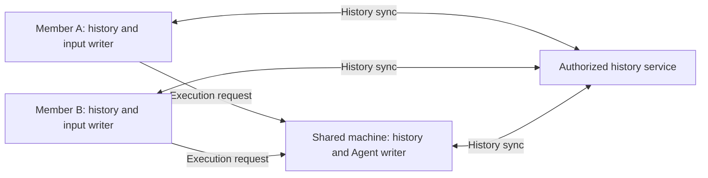

# Roost writer identities without a system credential store

Status: proposed
Type: architecture
Translation: current

[中文](2026-10-11-roost-writer-identity.zh.md)

## Abstract

The former Roost seed loader made shared-machine session creation depend on the
system credential store. The Node execution replica now persists its signing
identity in application data, using Loro's existing local-data security boundary
and existing account, Workspace and machine authorization. The writer key is
separate from human attribution and permissions. Previous Nightly keyrings are
not migrated. Independent cloud replicas and offline client authorship remain
proposed, so this note retains its proposed status.

## Implemented execution-replica storage

The [identity service](../../../../apps/cli/src/session/roost-writer-identity.ts)
stores a versioned seed/public-key pair in `<history path>.identity.sqlite3`.
An immediate SQLite transaction serializes first creation across processes.
`synchronous=FULL`, post-commit readback and public-key derivation establish the
identity returned to the native Worker. POSIX file permissions are set to `0600`
before private material is written; Windows uses the application directory's
account ACL. This is the normal store, with no keyring probe or
`LODY_ROOST_SEED_HEX` override.

The separate database keeps private metadata outside SDK history records,
replication and exports. Both databases form one durable replica and must be
backed up together while writers are stopped. Missing rows, invalid versions,
damaged seeds and key mismatches fail without replacement. An existing history
database without identity state is explicitly refused before its Worker starts.
Its bytes and keychain entries are retained, with no import, deletion, re-signing,
fabricated completion or execution replay. A new, unused `LODY_ROOST_DB_PATH`
selects a fresh replica for Nightly testing; old conversations are not adopted.

Current human inputs and Agent output both pass through the execution replica.
History retains each input's `userId` and `author`; the signing owner does not
become the requester. Multiple members and devices use the existing owner RPC
composition without copying its seed or opening a client-local Node identity store.
An independently writable local machine gets its own identity. Existing access
checks remain the authority; the key adds no permission grant. Local OSS continues
using its own application-data root with no cloud enrollment or authenticated
product-cloud calls.

The finite persistence unit is Effect-native and owns its SQLite handle through
`acquireUseRelease`. Its only Promise facade is `loadRoostOwnerSeedLegacy`,
removed when the owner pool receives the service from the daemon runtime.
SQLite lock waits are bounded to five seconds; transactions and handle closure
are synchronous, with no detached work. The larger Worker pool and session
lifecycle remain unmigrated. The pinned SDK remains 0.1.2; this unit needs no SDK
patch or publication.

## Security boundary compared with Loro

Loro's [PeerID](https://www.loro.dev/docs/concepts/peerid_management) identifies
operations rather than a secret signing identity. Loading an existing document
can use a new PeerID. Current CLI [SQLite assembly](../../../../apps/cli/src/lib/loro/sqlite-repo-store.ts)
and shared [IndexedDB assembly](../../../../packages/components/src/providers/create-workspace-runtime.ts)
persist CRDT bytes without a credential-store-backed body-encryption layer.
Local protection relies on OS-account and browser-origin boundaries. Remote access
uses the existing [Streams authorization callback](../../../../apps/cli/src/lib/loro/streams-transport.ts).
Optional transport payload protection does not establish local database encryption.

Existing history RPC envelopes derive their content key from the session ID through
[Code Collab's bootstrap derivation](../../../../packages/shared/src/code-collab.ts),
independently of the Roost signing seed. This is not secret-device-key-based E2EE;
the existing authorization boundary still controls remote access.

Roost deliberately uses that local-data boundary. Someone able to read its private
application data can obtain its seed and forge that physical writer's seals; the
seed alone grants no Workspace access. Loro operation ids do not provide seal-author
proof, and its local history also relies on the host boundary. The comparison with
mandatory keyring isolation is not a claim that Loro already offers that isolation.
A signature does not encrypt content. Future E2EE keys and their distribution remain
a separate responsibility.

Desktop [login credentials](../../../../apps/electron/src/main/auth.ts) retain
their safeStorage protection. Normal logout and renderer cache clearing do not delete
the Node identity. The unconnected [host-key contract](../../../../specs/host-identity-keys.md)
remains unchanged: this module owns only Roost signing metadata, not personal
management keys or a plaintext fallback for that API. The Roost boundary is recorded
in the [history Spec](../../../../specs/session-history-writes.md) and
[session contract](../../../../apps/cli/src/session/README.md#roost-writer-identity).

## Proposed independent-replica follow-up

The current integration requires the owning machine for uncached history and new
writes. A coherent, read-only projection already permits previously cached history
to be read offline; it cannot recover history a device never downloaded. This
persistence change does not wire native cloud history sync or offline input submission.

The future design separates history replication from execution RPC:

Each independently writable replica retains its own signing identity; private seeds
are not shared between members or devices. Authorized public bindings must establish
key possession and exact user/device/machine scope. Neither login, a valid signature
nor a key appearing in downloaded content alone enrolls a writer. Revocation refuses
new remote work while retaining public evidence needed to verify accepted history.

A fresh authorized device should obtain remotely confirmed history without the
execution machine or original private seed. Valid offline inputs should persist as
actual history entries, synchronize later and wait for the execution machine; this
does not revive a write-intent proxy. Only remotely confirmed data can be recovered
from a remote, and execution still needs the target machine online.

This requires reader/writer separation in the native SDK, which currently requires
a seed even for readers. It also requires multi-writer business projection, branch
authority, concurrent append, permission-response and Edit & Resend validation.
Core multi-replica support does not establish Lody's application semantics; local
event-cursor CAS is not distributed arbitration. Branch epochs and generation
activations currently require the execution writer, so independent writer recovery
must preserve historical admission without re-signing another writer's Turns.
Browser site-data loss can also remove keys and unsynchronized work; the design
must distinguish remotely recoverable data from lost local-only data.

Enrollment and history authorization belong to optional-cloud composition through
platform ports and public DTOs. Public OSS must remain offline/local-only.
Client enrollment and writer recovery remain proposed, with no automatic migration
of previous Nightly keyrings included in this work.

## Alternatives and evidence

Mandatory keyring storage makes headless hosts depend on an unrelated system service.
Keyring-to-file fallback retains two lifecycles. A Workspace-wide private key
complicates attribution and revocation. Keeping seeds inside the SDK's history
database risks including them in raw history backups and exports; the paired private
database gives them an explicit ownership boundary. Atomic SQLite initialization
also avoids partial key files and competing first-write publication.

The existing [local-owner suite](../../../../apps/cli/tests/roost-history-local-owner.test.ts)
covers three independent Workers racing first creation, replica isolation, reopened
sealed/branched history, human principals, private file mode, malformed/removed/
conflicting/unavailable identity state and diagnostic seed exclusion.
The [production backend suite](../../../../apps/cli/tests/roost-session-backend-contract.test.ts)
uses the default automatic identity path. Its RPC fixture exercises member A on two
devices and member B on another, shared reads/writes and a refused access gate.
These suites verify the public adapter, not the hosted authorization implementation.

Node behavior was tested on macOS, including a synthetic unavailable credential
store. No actual Linux/Windows host or hosted multi-device acceptance was run.
Independent replicas need separate end-to-end acceptance for fresh offline readers,
durable offline input, later activation without duplicate execution and revocation.
Earlier transition-note claims about wired native remote replicas do not establish
current behavior: the adapter's sync barrier still excludes remote history
confirmation. See the [current native integration limits](2026-10-09-roost-native-runtime.md),
[message principals](../../../../specs/message-author-identity.md) and
[communication responsibilities](../../../../specs/communication-architecture.zh.md).
