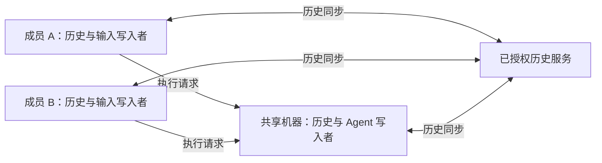

# 不依赖系统凭据存储的 Roost 写入身份

Status: proposed
Type: architecture
Translation: current
PR: [#1477](https://github.com/LodyAI/Lody/pull/1477)

[English](2026-10-11-roost-writer-identity.md)

## 摘要

原来的 Roost seed 获取路径让共享机器的会话创建依赖系统凭据存储。现在 Node 执行副本在应用数据中
保存稳定的签名身份，采用 Loro 现有的本地数据安全边界，沿用已有账号、Workspace 和机器授权。
签名密钥与人类归属、访问权限分开。旧 Nightly 钥匙串不迁移；独立云端副本和离线客户端写入仍属于提案，
因此这篇 Note 保持 proposed。

## 已实现的执行副本存储

[身份服务](../../../../apps/cli/src/session/roost-writer-identity.ts)在
`<历史路径>.identity.sqlite3` 保存带版本的 seed/公钥对。SQLite immediate 事务让跨进程首次创建串行化；
`synchronous=FULL`、提交后的重新读取和公钥派生校验，确认交给 native Worker 的身份。
POSIX 文件在写入材料前设为 `0600`，Windows 依赖应用目录的账号 ACL。
这是正常存储路径，不探测钥匙串，也不读取 `LODY_ROOST_SEED_HEX`。

单独的数据库让私有身份元数据不进入 SDK 历史记录、复制或导出。两个数据库组成一个持久副本，
应在停止写入者后一起备份。记录缺失、版本错误、seed 损坏或密钥冲突时明确失败，不生成替代身份。
已有历史数据库没有配套身份时，在启动历史 Worker 前明确拒绝。正文和钥匙串条目保留，
不导入、不删除、不重新签名、不伪造完成，也不重放执行。
新的、未使用的 `LODY_ROOST_DB_PATH` 可用于 Nightly 测试；旧会话不会被接管。

当前人类输入和 Agent 输出都经过执行副本。历史保留每条输入的 `userId` 和 `author`，
副本签名的 owner 不会变成人类发起者。多个成员和设备通过已有 owner RPC 使用同一执行机器，
不复制机器的 seed，也不打开客户端本机的 Node 身份存储。独立可写的本地机器有自己的身份。
已有访问检查继续负责授权，密钥不增加权限授予。OSS 继续使用自己的应用数据根目录，
不登记云端身份，也不发起认证的产品云请求。

这个有限持久化单元是原生 Effect 服务，通过 `acquireUseRelease` 拥有 SQLite 句柄。
唯一 Promise facade 是 `loadRoostOwnerSeedLegacy`，在 owner pool 从 daemon runtime 接收服务后删除。
SQLite 锁等待最多五秒；事务和句柄关闭同步完成，没有脱离 owner 的后台工作。
更大的 Worker pool 和会话生命周期尚未迁移。SDK 保持 0.1.2，这个单元不需要 SDK patch 或发布。

## 与 Loro 的安全边界比较

Loro 的 [PeerID](https://www.loro.dev/docs/concepts/peerid_management) 标识操作，不是秘密签名身份；
加载已有文档可以使用新的 PeerID。当前 CLI 的 [SQLite 组装](../../../../apps/cli/src/lib/loro/sqlite-repo-store.ts)
和共享界面的 [IndexedDB 组装](../../../../packages/components/src/providers/create-workspace-runtime.ts)
保存 CRDT 字节，没有通过系统凭据存储加密正文的层。本地保护依赖操作系统账户和浏览器 origin 边界。
远端访问使用已有 [Streams 授权回调](../../../../apps/cli/src/lib/loro/streams-transport.ts)；
可选的 transport 载荷保护不能证明本地数据库已加密。

已有历史 RPC envelope 通过 [Code Collab 的初始派生](../../../../packages/shared/src/code-collab.ts)
从会话 ID 派生内容密钥，与 Roost 签名 seed 分开。这不构成基于秘密设备密钥的 E2EE，
远端访问仍由已有授权边界控制。

Roost 明确采用这个本地数据边界。能够读取其私有应用数据的人可以取得 seed，伪造该底层写入者的封存签名；
seed 本身不授予 Workspace 访问权。Loro 操作 ID 不提供这项作者签名证明，其本地历史同样依赖宿主边界。
与强制钥匙串隔离的比较，不能理解成 Loro 已有这种隔离。签名不加密正文；未来 E2EE 密钥及分发仍是单独的职责。

桌面[登录凭据](../../../../apps/electron/src/main/auth.ts)保留 safeStorage 保护。
正常退出登录和 renderer 缓存清理不删除 Node 身份。尚未接入的
[host-key 合同](../../../../specs/host-identity-keys.zh.md)不变：本模块只负责 Roost 签名元数据，
不实现个人管理密钥，也没有通过明文 fallback 接通该 API。
Roost 边界已记录在[历史 Spec](../../../../specs/session-history-writes.zh.md)和
[会话合同](../../../../apps/cli/src/session/README.md#roost-writer-identity)中。

## 仍在提议的独立副本后续工作

当前接入对尚未缓存的历史读取和新写入仍需要所属机器。已有一致的只读投影可以离线读取之前缓存的历史，
不能恢复设备从未下载过的内容。本次持久化改动没有接通 native 云端历史同步，也没有实现离线输入提交。

后续设计将历史复制与执行 RPC 分开：

每个独立可写副本保留自己的签名身份，成员和设备之间不分享签名私钥。
授权的公开身份绑定要确认私钥持有，以及准确的用户/设备/机器范围。
登录、签名有效或下载内容中出现某公钥，都不能单独登记写入者。
撤销拒绝新的远端操作，同时保留验证已接受历史需要的公钥证据。

新的授权设备应能取得远端已确认历史，不需要执行机器或原始签名私钥。
合法离线输入应作为真正的历史条目持久保存，稍后同步并等待执行机器；不能恢复 write-intent 代理。
只有远端确认保留的数据才能从远端恢复，执行仍需要目标机器在线。

这要求 native SDK 分离 reader/writer，当前构造函数即使只读也要求 seed；
还要求验证多写入者的业务投影、分支权限、并发追加、权限响应和 Edit & Resend。
底层多副本能力不证明 Lody 的应用语义，本地 event cursor CAS 也不是分布式仲裁。
当前分支 epoch 和 generation 激活要求执行 writer，因此独立写入者恢复必须保留旧签名授权，
不能重新签署别人的 Turn。浏览器站点数据丢失还可能删除密钥和未同步工作，
设计必须区分可从远端恢复的数据与丢失的纯本地数据。

登记和历史授权由可选云组装通过平台端口、公开 DTO 接线，公开 OSS 保持纯本地。
客户端登记及写入者恢复仍属于提案，本次不包括旧 Nightly 钥匙串的自动迁移。

## 备选与依据

强制钥匙串会让无桌面宿主依赖额外系统服务；钥匙串失败后写文件保留两套生命周期。
Workspace 共用私钥会增加归属与撤销的复杂度。
把 seed 放进 SDK 历史数据库有随原始历史备份、导出一起泄露的风险，
配套的私有数据库提供明确的归属边界。SQLite 原子初始化也避免半写的密钥文件和相互竞争的首次发布。

已有 [local-owner 套件](../../../../apps/cli/tests/roost-history-local-owner.test.ts)
覆盖三个独立 Worker 竞争首次创建、副本隔离、重开封存/分支历史、人类归属、私有文件权限、
损坏/删除/冲突/不可用的身份状态，以及诊断排除 seed。
[生产 backend 套件](../../../../apps/cli/tests/roost-session-backend-contract.test.ts)使用默认自动身份路径，
其中 RPC fixture 验证成员 A 的两台设备和成员 B 的另一台设备共享读写，以及访问 gate 拒绝后的失败。
这些套件证明公开 adapter，不等于验证托管授权实现。

Node 行为在 macOS 上完成测试，包括模拟的系统凭据存储不可用环境；
没有进行真实 Linux/Windows 或托管多设备验收。独立副本仍需要单独端到端验证新的离线 reader、
离线输入持久化、恢复后不重复激活以及撤销权限。
早期迁移 Note 中接通 native 远端副本的记录不能证明当前行为：
adapter 的同步屏障仍没有确认远端历史保存。参见[当前原生接入边界](2026-10-09-roost-native-runtime.zh.md)、
[消息发起者](../../../../specs/message-author-identity.zh.md)和
[通信职责](../../../../specs/communication-architecture.zh.md)。
