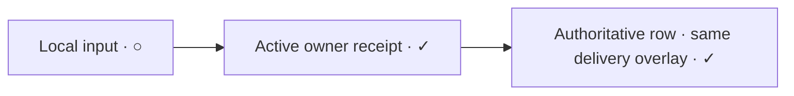

# Backend-independent local send acceptance

Status: proposed
Type: architecture
Translation: current
PR: https://github.com/LodyAI/Lody/pull/1546
Follow-up PR: https://github.com/LodyAI/Lody/pull/1570

[中文](2026-10-13-backend-independent-send-acceptance.zh.md)

## Abstract

Roost ready messages previously waited for owner history IPC/RPC before the
renderer published its write notification, exposing network and storage delay
in the send interaction. The implemented proposal accepts one frozen input into
a local projection, saves it independently, and reconciles it with an atomic
immutable owner receipt. Normal messages use the existing user-content renderer
without another status badge; owner confirmation remains the execution barrier.
First paint does not imply local persistence, owner acceptance or execution.
Follow-up measurements found millisecond-scale owner processing but additional
source coordination and history feedback in Roost. Ordinary input now combines
owner acceptance and activation in one negotiated request and uses its receipt for
delivery feedback. Local input now participates in keyed send anchoring and truthful
sending activity before owner history; formal handoff waits for a hydrated body.
Production end-to-end latency remains unmeasured.

## Decision and alternatives

Loro's live history document already owns local admission and asynchronous Repo
persistence/sync. The renderer's Roost adapter has no equivalent writable replica:
its owner still signs and stores history. The source therefore retains ready
input, not a second history document or signing writer. The
[session files draft](../../../../specs/session-files.md#7-submission-identity-and-local-writes)
defines the separation of local admission, synchronization and execution.

An ephemeral bubble alone would lose saved-input recovery. A complete writable
Roost replica would change signing, ownership and synchronization; it is outside
this change. The old [send journal removal](../../implemented/simplification/2026-09-29-remove-session-send-journal.md)
remains historical guidance: unprepared Blobs are still memory-only, and an
uncertain guide is never replayed. The new retained record is limited to immutable
ready Roost input and final attachment references.

## Responsibilities and lifecycle

1. Admission freezes account/workspace, source user, target, session/turn identity,
   content, input configuration and delivery intent. New routing metadata commits
   locally before the conversation can acquire its first history store. The row
   appears before owner work completes; local storage finishes in the background.
   Routing preparation does not acquire a history store. Background delivery
   commits the trusted `humanInputReceipts` control record before owner acceptance,
   as ordinary Loro writes and control queues do before activation. Receipt lookup
   remains read-only; slow store acquisition does not hold up local admission.
2. Account/workspace-scoped IndexedDB retains ready input in admission order.
   Saving new input applies `parseHistoryWrite` to its entry before storage
   validation, so generated file/image data with `text: undefined` behaves like
   ordinary history writes. Persisted records still decode strictly, and same-ID
   content conflicts still fail.
   Failed saves retain the only in-memory copy through projection refresh, block
   later sends in that session and keep leave protection. Ordinary cache recovery
   preserves this user database; explicit full reset may delete it.
3. The workspace's native send-resource scope owns raw storage, session Web Locks,
   store borrows and owner/control I/O. Its Promise coordinator does not claim a
   complete native migration of the document/RPC lifecycle. Cross-window workers
   reread stored input under the shared lease. Control queues retain their Loro
   writer but wait behind prior accepted input under the same lease; later inputs
   do not become predecessors. The merged projection preserves source order and
   persisted peer order, including the latest pending run configuration.
   After attachment preparation hands input to the durable owner, retry targets
   that owner even while the held queue awaits it. Preparation-only failures
   continue through the held queue's retry path.
4. `sessionInputAcceptance` version 1 gates `accept_input` and the read-only
   `inputAcceptance` query. Older or changed targets fail visibly without backend
   fallback. The acquired renderer port must match the frozen target, independently
   of mutable metadata. Existing identity/access checks and RPC refusal receipts
   remain in force.
5. The SDK binds operation identity and immutable content fingerprint in the same
   transaction as the history mutation. A missing query is unknown evidence;
   retrying the exact immutable acceptance operation safely converges with a late
   original. Current and retained generation receipts take precedence over branch
   placement. Changed input conflicts; removed input is never recreated. Unreadable
   history is a failure to observe, not evidence of removal.
6. The atomic owner history/receipt commit is the execution boundary, not the
   source observing its reply. A daemon may start committed pending history while
   that reply is lost, matching the existing Loro/history contract. The source
   offers a guide only after it observes acceptance; ordinary input publishes owner
   activation within the same acceptance request. The local projection alone cannot
   execute. A guide offer is fenced
   before handoff and never replayed after interruption. History acceptance is not
   proof of Agent execution. The local row remains until the authoritative view
   contains a hydrated body for that same ID; the UI never renders both copies.
7. Cancel/archive/delete discover durable rows independently of the window's
   snapshot, persist cancellation, and join local raw work plus matching session
   leases. A peer checks that stored fence before dispatch. Cancellation does not
   undo a remote history write. Closing joins started I/O and leaves saved unknown
   input for recovery by the same identity.

## Delivery marker continuity

The implementation in #1546 reused the ordinary message content but omitted the
metadata delivery mark for ready local input. The bubble therefore appeared
immediately without a circle; the circle or check appeared only after the same
turn entered authoritative history. This presentation gap affects both a first
message and a follow-up because both use `PendingMessageRow`.

Ready local input keeps the ordinary neutral sending circle while saving and
waiting for the owner. A positive active owner receipt now updates the existing
delivery overlay before the source confirmation transaction completes. Both the
local row and authoritative row use it, retaining the check through pending-history
handoff without adding acceptance text or mutating history status. Persisted source
state alone cannot show a check. Guide history acceptance remains distinct from
application and does not publish this acknowledgement.

Follow-up verification of the earlier desktop test package isolated the remaining
visual gap to the rotating indicator beside the bubble; message content already
appeared immediately. The adjacent loading spinner is a separate part of the
ordinary user row, outside
`UserChatBubble`. Reusing that bubble and adding its metadata circle did not render
the spinner during local Roost input, so a slow confirmation still appeared idle.
Ready input now shares the ordinary row's 500 ms loading hook and existing rotating
glyph, including the 520 px container threshold. Waiting is driven by the real
owner receipt rather than control-document synchronization. An error stops loading;
retry restarts the delay, and a receipt cancels it immediately. This corrects the
waiting feedback without making a claim about owner or network latency.

## Delivery latency comparison

The [synthetic send benchmark](../../../../apps/cli/benchmarks/roost-send.mts)
uses the production `SessionDocument` backends and measures acceptance plus the
owner observer's `seen` status. On 2026-10-14, macOS arm64 / Node 24.14.0, nine
measured sessions per backend after two warm-up sessions produced these medians:

| Input                | Loro acceptance | Roost acceptance | Loro `seen` | Roost `seen` |
| -------------------- | --------------- | ---------------- | ----------- | ------------ |
| First, after opening | 0.70 ms         | 9.45 ms          | 0.66 ms     | 17.07 ms     |
| Follow-up            | 0.42 ms         | 15.10 ms         | 0.39 ms     | 22.84 ms     |

There are nine first-input and 27 follow-up samples per backend. Each session
contains four short synthetic inputs. Roost includes native SQLite writes and
signing; Loro uses an in-memory Repo without persistence, so these are current
owner-path costs with different durability guarantees. Backend opening is measured
separately, before the first input: medians are 0.24 ms for Loro and 18.81 ms for
Roost. Warm caches and short histories do not represent cold startup or large
conversations. `seen` indicates owner observation, not Agent execution.

The follow-up benchmark's `BENCH_DISPATCH=1` mode prepares routing metadata for
both backends and includes Roost owner activation. A separate nine-session run
measured Roost acceptance/activation medians of 9.19 ms (first) and 12.40 ms
(follow-up), with `seen` medians of 16.16/19.29 ms. These local observations do not
measure network savings or establish a causal before/after timing improvement;
the gated sender tests establish removal of the serial request/readback dependency.

A baseline deterministic source-side probe uses explicit acceptance/readback gates and
real Loro control/history documents with the workspace writer. The ordinary Loro
facade forwards a positive dispatch reply into the UI delivered callback. Ready
Roost input bypasses that facade while retained, waits for owner acceptance, then
waits for an authoritative `readTurn` before offering dispatch. A cache miss can
add another owner round trip; a coherent cache or concurrent refresh can avoid it.
The background helper supplies no delivered callback, so a positive dispatch reply
does not update the UI acknowledgement overlay. A local projected row also waits
for authoritative handoff before it can show a check.

These source waits do not all delay actual delivery: the owner can independently
start committed pending history before the acceptance reply reaches the sender.
If readback already shows a non-awaiting status, the coordinator skips the dispatch
offer. Consequently the code does not imply a fixed number of network round trips
for every send. The comparison establishes extra source barriers and a slower
acknowledgement feedback path, not the cause or distribution of a reported 1–3 s
production delay. Neither the benchmark nor the probe measures live transport,
renderer IndexedDB, React/paint or execution startup. No send-protocol or
acknowledgement behavior was changed by that measurement alone. The implementation
follow-up below removes these source waits.
The benchmark and the gated source probe both completed successfully; the benchmark
also passes a TypeScript check including its production dependencies and scoped
lint. Documentation checking still reports the same six pre-existing broken links.

## Transport and compatibility

### Current Loro/Roost send comparison (2026-10-15)

At `a06a69f3e`, a ready ordinary Loro send commits the formal local history and
activation metadata through `writeUserTurn`. Its dispatch fast path and document
upload then proceed independently: `dispatchUserTurn` starts `waitUntilSynced`
without awaiting it. The owner offers the RPC input to its existing dispatch
stash, with the applicable human-inbox admission. Neither an early local history
row nor the RPC acknowledgement proves Agent execution or immediate disk durability.

Roost admission publishes a separate local input row. Before owner handoff, the
coordinator waits for its workspace save predecessor, initialization and IndexedDB
save, acquires the session Web Lock, reads the stored queue and commits the
`unknown` outcome marker. The workspace write callback then validates routing,
records human provenance, borrows the session store and invokes the combined
owner operation. Persistence is background work relative to local display, but
is a serial prerequisite for that owner request. The native owner checks the
immutable receipt, seals/writes/projects history as necessary and publishes
activation before its response. This is still one ordinary write RPC; the earlier
source history-readback/second-dispatch dependency remains removed.

Before the UI repair below, the displayed rows had different integration boundaries. Loro's
local turn enters `ConversationView` immediately. Ready Roost input is rendered by
`SessionPendingMessages` in the stream's `trailingContent`; it is absent from
the formal `virtualRows` searched by `anchorMessage`. The pending anchor therefore
resolves only when formal history contains that ID. The optimistic pre-start
derivation also reads formal `sessionHistory`, not the accepted-input projection;
actual live presence remains independent. Thus an immediate Roost bubble does
not establish the same scroll/pre-start behavior as a locally appended Loro turn.
This explains a concrete presentation difference without attributing a particular
production pause to network, storage or CPU. A pending input must not be relabeled
as owner-delivered or executing merely to hide that difference.

Four temporary behavioral probes extended the owning accepted-input suite using
real Loro documents/writer, the production coordinator, isolated fake IndexedDB
and explicit gates. The Loro probe retained formal history, its view index and
pre-start timestamp while document sync and the dispatch reply were both held;
releasing only the reply published delivery while sync remained held. Three Roost
probes held source save, the `unknown` marker commit or the session lease. In each,
local input was already projected while owner history remained empty; releasing
the gate accepted the original content and confirmed its durable source record.
All four passed; the temporary additions were removed.
These prove ordering differences, not the duration of any stage. Before the repair,
the unchanged accepted-input, pending-row and dispatch-state suites passed all 62
cases after the temporary diagnostics were removed.

### Local-row anchoring and hydrated handoff

The UI repair makes each ready input a separate engine row with its immutable turn
ID as key. `anchorMessage` resolves it during the local render commit, including an
otherwise empty conversation and several outstanding inputs. It uses the existing
scroll controller and send-context position, adding no scroll writer or retry loop.
A directory placeholder with the same ID renders the local body in place; hydrated
formal history wins and cleanup retires the projection. Index membership alone no
longer removes the only displayable body. Local-only rows do not request a history
hydration range or enter `ConversationView`, outline, export, dispatch or execution
facts. Native text selection retains their UI rows and allows copy without acquiring
a fictitious history lease; removal releases that selection.

Unconfirmed, error-free ordinary input contributes a sending label. Live presence
and bounded pre-start from formal pending history retain priority. The local label
does not enable Stop, claim startup or publish delivery. Errors stop it; retry
re-enables it; a positive owner receipt uses the existing delivered overlay.
Guide and queue dispatch rules remain unchanged. Source save ordering, IndexedDB
commit, unknown-outcome marker, session lease, immutable deduplication and guide
no-replay fencing remain in place. Removing these barriers to shorten a request
without a replacement recovery protocol was rejected.

Trigger/owner: the workspace publishes accepted input; the pending-row hook owns
UI projection while the existing coordinator owns durable work. Cancellation still
joins raw work and removes its UI; it cannot undo remote commits. Handoff requires
the same ID's hydrated body. Errors and uncertain outcomes retain existing recovery
ownership. A native migration is deferred: this repair changes UI composition and a
pure visibility predicate; the coordinator still depends on the unfinished document
and RPC lifecycle and remains covered by its existing native resource scope.

Deterministic DOM regressions failed on the baseline without local engine rows,
then cover first/existing conversations, multiple inputs, queued anchors,
placeholder/body handoff, stable position and no duplicate. The owning pending and
accepted-input suites cover failure, retry, receipt, cancellation and delayed body
hydration. These verify the repaired presentation boundary, not a reduction in
owner acceptance time or elimination of the reported production pause.
The final targeted run passes 185 tests across 12 suites; component type-checking
and scoped type-aware lint pass (lint still reports warnings).
Formatting and diff whitespace checks pass. Documentation checking retains the
six baseline broken links to absent isolated ACP submodule sources and reports no
registered SHA-protected topic changes.

A packaged macOS arm64 test build used this repair on `a06a69f3e`. Packaged bytes,
embedded CLI/native bindings, Roost Worker SQLite write/reopen, ad-hoc signing and
DMG/ZIP integrity checks passed. The tester reported improvement after enabling
Roost for a new conversation. This is qualitative manual evidence, not a measured
latency bound. The submission subsequently integrates three main commits through
`2163b93fc`; that integration is checked separately and was not repackaged.
Submission verification on that integration passes `pnpm check` and `pnpm format`.

### Ordinary input in one owner request

`sessionInputDispatch` v1 independently gates `accept_input_and_dispatch` and the
optional `inputAcceptance.acceptAndDispatch` port. Ordinary sends refuse older
owners before consuming a draft or creating routing metadata; restored input also
rechecks the frozen owner and capability. Plain history acceptance and guides retain
their v1 protocol. There is no backend or transport fallback.

The existing native writer queue checks immutable receipt identity, records explicit
human provenance before acceptance, signs/stores history and checks live history and
metadata before publishing activation. Only the latest awaiting user input can move
the pointer; retries cannot move it behind a newer input. Removed/settled input,
archived/deleted metadata and the missing-history tombstone never reactivate.
The host enqueues its existing history dispatcher without awaiting Agent execution
or remote synchronization; it adds no Loro RPC payload stash.

Normal source delivery uses that single write receipt, with no authoritative readback
or second dispatch request. History observers may still issue independent reads.
Lost replies query the immutable receipt and repeat the same combined operation to
recover activation. A failure after history commit never appends another input;
current status and membership guard every retry. Guide handoff keeps its persisted
no-replay fence and application semantics.

The input coordinator's delivery ownership survives visible-row handoff and cancellation for the runtime
lifetime. The dispatch/guide facade cannot reclaim an admitted input after its row
disappears. This extends the existing completion registry with delivery intent,
without using ownership as evidence that the daemon received input.

The workspace send-resource scope and ordered leases still own source storage and
raw requests. Closing/cancellation joins started work and suppresses late source
feedback; it cannot undo owner history already committed or activation already
accepted. The owner reuses the existing writer queue and dispatcher ownership.
A native Effect migration was assessed and deferred: SessionDocuments/history and
dispatcher dependencies remain upstream Promise orchestration. No new lock/runtime
was added, and this change claims no migration completion.

Each history operation resolves the fixed owner's current transport through the
workspace router. A store must not cache the local-machine probe's initial route
or change the recipient when that route becomes unavailable. Both Node IPC guard
implementations must accept the declared history request/receipt contract.

Immutable acceptance uses `@loro-dev/roost@0.1.3`; the native
`@loro-dev/roost-node@0.1.2` graph is unchanged.

## Verification and limits

Deterministic sender tests exercise IndexedDB transactions, native send resources,
real Loro documents and the workspace writer. Coverage includes immediate display,
immutable retries, recovery and ordering, account isolation, cancellation across
windows, attachment handoff, guide replay prevention and human-input provenance
before owner acceptance. Receiver tests use the pinned native SQLite package to
cover receipt conflicts, delayed originals, reopen, retained generations and
unreadable history. Bridge and IPC tests cover route changes, all declared history
operations and malformed replies.

Packaged macOS Cloud tests cover local and remote sends with paused owners,
same-ID recovery after restart and visible refusal by unsupported targets. The
final attachment changes and operation-inbox integration passed deterministic
tests and `pnpm check`; packaged tests were not rerun for those changes. These
checks establish the covered behavior, not the original production incident's
cause, a latency guarantee or release/signing validation.

The delivery-marker follow-up was investigated from main `08a58d6f3`. Its
deterministic DOM regression fails on that revision because the local bubble has
no sending circle, then verifies the circle through all local input states and
the handoff to pending and delivered authoritative rows. This establishes the
presentation defect; it does not measure owner confirmation latency.
The adjacent-spinner regression uses a fake clock to compare the actual Loro and
local Roost rows: at 499 ms neither loads, at 500 ms both load, and an owner receipt
removes loading while preserving the check through history handoff. Before the
spinner change, the Loro case passed and the Roost case failed. A separate case
covers error, retry, and a receipt before the retry timer expires. These two
owning suites pass 48 tests. Chromium rendering confirms a visible 16 px spinner
in the waiting story, a hidden spinner below the 520 px container threshold, and
no spinner in the confirmed story. Full `pnpm check` passed with the spinner
change; after the CSS wrapper correction, components type-checking, the same 48
tests, scoped lint and formatting checks passed again. These checks do not measure
packaged-app confirmation timing or production end-to-end latency.
The initial presentation-only suite passed 84 tests; components type-checking, scoped lint and
format checks pass. Repository documentation checking remains blocked by six
existing Kimi/Pi links in the subagent-events notes. For that earlier metadata-circle-only
change, full workspace checks and packaged confirmation timing were not run.

The combined-request follow-up passes 296 focused tests: 115 sender/UI tests,
123 CLI backend/dispatcher/registration cases (including the native commit-order
case), and 58 protocol/IPC cases. Restoring the former accept/readback/dispatch
path makes both new-session and follow-up regressions fail. Explicit gates verify
feedback before the source confirmation transaction, no source readback dependency,
native provenance/activation ordering, partial-activation recovery, and no facade
reclaim after handoff or cancellation. Components, shared, CLI and benchmark type
checks pass. Recovery tests also gate source reads while checking activation retry
and cleanup after removal. Full `pnpm check`, `pnpm format`, `pnpm format:check`
and the local desktop/CLI `pnpm build` pass on remote main `c90c9f4cc` plus this
change. Documentation checking still reports the six existing Kimi/Pi links.
Owner-confirmation timing in a packaged app or staging end-to-end environment
remains unmeasured.
