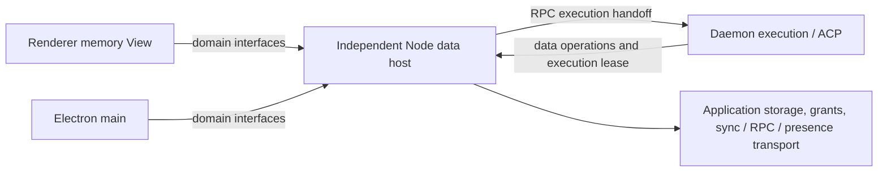

# WorkspaceData Effect Service design

Status: proposed
Type: architecture
PR: [#1572](https://github.com/LodyAI/Lody/pull/1572)
Translation: current

[中文](2026-10-14-workspace-data-services.zh.md)

## Abstract

Renderer and daemon currently maintain separate Loro replicas, persistence and network subscriptions, with additional windows increasing duplicate sync and memory costs. The proposal first unifies queries, commands and observations through domain Effect Services while preserving existing behavior, then moves desktop storage, Streams authorization and shared connections into an independent Node data process; headless daemon permanently supports the same embedded owner Layer. Daemon retains execution resources, and host survives desktop exit while daemon leases remain; centralized RPC ingress adds an IPC hop and makes remote control depend on host. The proposal remains proposed, with real storage migration, cross-process recovery, prepared handoff and performance benefits unverified.

## Background, core requirements and long-term goals

Renderer and daemon currently have separate Loro replicas, persistence and sync lifetimes, with additional windows potentially adding duplicate work. Main's local relay does not yet replace renderer persistence, uploads and live cloud subscriptions. Business code also depends directly on Repo/Doc/Mirror, coupling many callers to data ownership.

The requirement is a reliable local data source accessed through common queries, commands and subscriptions by renderer, daemon and main. Eventually an independent Node process owns application data, disk/network I/O, Streams authorization, token acquisition/refresh, backend subscriptions and upload recovery. Renderer uses memory views and retires business IndexedDB persistence. Permission management primarily means Streams data access; an in-session Agent tool permission reply is a separate business command.

The goals are a faster application, fewer replicas and duplicate downlink, and fewer bootstrap/subscription/authorization/reconnection requests. Comparisons preserve authorship, permissions, durability and recovery while measuring total process memory, streaming latency and IPC costs. Actual payloads and request counts establish benefits; connection counts are one observation.

| Stage                               | Delivery                                                                                                                                                                                                         |
| ----------------------------------- | ---------------------------------------------------------------------------------------------------------------------------------------------------------------------------------------------------------------- |
| Baseline and slice selection        | Measure current behavior before the first domain and select an independently verifiable scenario; metrics are in §9.4.                                                                                           |
| Phase one: common business boundary | Both consumers adopt the same contracts by domain, preserving read/write/sync/error behavior; each complete slice can ship independently. This is a refactor; the main performance benefits belong to phase two. |
| Phase two: unified data owner       | Desktop uses an independent Node host; headless defaults to the same embedded Layer. Complete recovery and storage migration for each topology before retiring duplicate persistence/connections.                |
| Separate management product unit    | Ship write-only credentials, editor context and conflict UX separately. It precedes phase-two catalog host cutover and is outside the phase-one mainline.                                                        |

Complete I/O ownership includes login, native credentials, media, attachments and files. Git/terminal/Agent/ACP subprocesses and embedded-page I/O belong to execution-environment boundaries; further centralization requires execution capabilities/network isolation. Native login/proxy/certificates/cookies/secure storage still require host ports; delegating from Node to main does not complete physical I/O migration. Public OSS remains local-only; official cloud composition injects optional cloud ports.

This proposal preserves the [communication architecture draft](../../../../specs/communication-architecture.zh.md)'s local/optional-cloud boundary and separate command, local-durability and remote-sync completion semantics. Independent host is a proposed change in module ownership. Cutover must update the Spec's module/path descriptions and corresponding implementation contracts; this Note does not describe the target topology as current behavior.

## 1. Core decisions

Use pinned Effect `4.0.2` `Context.Service` tags per cohesive domain, with Layers supplying in-process or client implementations. Business code depends on the Service it uses; tests supply only required domains. Bind trusted workspace, identity and account lifetime. Execution still checks authorization and business conditions.

| Service (proposed name)                                                   | Public capability                                                                                                |
| ------------------------------------------------------------------------- | ---------------------------------------------------------------------------------------------------------------- |
| `SessionDirectory`                                                        | Summary, pages, observation, create/rename/archive/restore/delete                                                |
| `SessionAccess`                                                           | Scoped session history/control/queue and user commands                                                           |
| `WorkspaceCatalog` / `CatalogManagement`                                  | Summaries/observation; separately authorized management reads/field changes; families in §2.3                    |
| `SessionSubmissions`                                                      | Workspace admission, pending, retry/cancel                                                                       |
| `WorkspaceSchedules` / `PreviewComments`                                  | Existing definitions/observation and domain operations                                                           |
| `SyncAuthority`                                                           | Target-specific historical/current authority, authoritative resyncs and explicit upload waits (§2.4)             |
| `MachineCommands`                                                         | Submit/cancel/observe durable machine commands; separate trusted MachineCommandConsumer (§2.5)                   |
| `MachineRpc`                                                              | Grouped typed requests/progress with internal routing, negotiation and authorization (§8.1)                      |
| `Presence`                                                                | Scoped viewing leases, ephemeral session/machine state and monitor; separate trusted execution publishing (§3.3) |
| `PromptShortcuts` / `FileCollaboration`                                   | Separately authorized shortcuts; owner-session file-index leases and file business methods (§3.4, §8.5)          |
| `SessionAgentWriter` (trusted execution)                                  | Agent output, promotion/recovery and terminal writes                                                             |
| `MachineLaunchData` (trusted execution)                                   | Scoped current launch view for synchronous prepared guards                                                       |
| `MachineCommandConsumer` / `SessionExecutionPresence` (trusted execution) | Scoped durable-command consumption and machine/active-turn leases, absent from ordinary renderer Layers          |

Operations continue using `OperationRepository`. An entrypoint may retain a convenience facade named `WorkspaceData` aggregating these Services; it is not another large native Service required by every consumer.

Representative types follow; production modules do not yet exist:

```ts
import { Context, Effect, Option, Scope, Stream } from 'effect';

class SessionAccess extends Context.Service<
  SessionAccess,
  {
    openSession(
      id: SessionId
    ): Effect.Effect<Option.Option<SessionHandle>, DataReadError, Scope.Scope>;
  }
>()('@lody/shared/workspace-data/SessionAccess') {}

interface SessionHandle {
  readonly capabilities: SessionDataCapabilities;
  readonly diagnostics: SessionDataDiagnostics;
  readonly history: SessionHistoryEffects;
  readonly control: SessionControlData;
  readonly queue: SessionQueueData;
  readonly commands: SessionUserCommands;
}

class SessionAgentWriter extends Context.Service<
  SessionAgentWriter,
  {
    openSession(
      id: SessionId
    ): Effect.Effect<Option.Option<SessionAgentOperations>, DataReadError, Scope.Scope>;
  }
>()('@lody/shared/workspace-data/SessionAgentWriter') {}
```

Ordinary flows use `yield* SessionDirectory` or `yield* SessionAccess`. Renderer session handles have no `agent`; its Layer/public entry exposes no trusted execution Services. Daemon execution composition supplies `SessionAgentWriter/MachineLaunchData`. Compile-time enforcement occurs when a program reaches the application runtime and its environment must be satisfied; declaring an Effect that still requires AgentWriter is itself valid. Node authorization still checks real caller identity: types prevent accidental misuse, runtime checks protect the boundary.

`openSession` opens an existing session after metadata loads, returning `None` on absence; creation is separate. Directory reads open neither bodies nor an Agent session. Method execution/Stream start checks binding/closure; old handles return DataScopeClosed. Ending acquisition retires the handle and all its observations. Canceling one observer ends only that observer. Independent consumers acquire handles sharing an internal owner. Repo, LoroDoc, FlockDoc, Mirror, SDK rooms and stored-copy handles stay within adapters/owners.

`SessionAccess.openSession` and `SessionAgentWriter.openSession` acquire separately scoped capabilities over one internal acquisition keyed by binding/session/backend/owner generation, each retaining a reference. Closing the reader ends its observations and leaves the writer usable, and conversely. Final flush/resource closure follows release of every handle, admitted command and actual I/O holder. A shared parent Scope or authorization retirement may end both. The current daemon cache has no refcount; the new adapter must implement this lifetime boundary.

## 2. Data domains and existing implementations

### 2.1 Backends and domains

`SessionHistoryEffects` covers existing `count/readAt/readTurn/readRange/readDirectory/readTurnOutput/readAll`, optional latest/older directory pages, and cold observation Streams. Reuse `SessionTurnRead`, `SessionDirectoryRow`, `SessionHistoryDirectoryPage` and `SessionDataChange`. Complete export/replay uses one consistent read.

Current persisted history backends are `loro | roost`. Bind from hydrated metadata; legacy absence follows the existing Loro rule, and new sessions retain default/Roost opt-in behavior. Roost segments project by businessId into logical turns. Ordinary HistoryView uses the same reader; backend informs creation, diagnostics and capabilities. Reads retain legacy JSON/LoroMap and unknown-field representations.

| Domain                     | Implementation and responsibility                                                                                                                    |
| -------------------------- | ---------------------------------------------------------------------------------------------------------------------------------------------------- |
| Directory/catalog          | Meta Flock indexes, key-family helpers and existing field/permission rules                                                                           |
| History/user commands      | Selected backend reader, real writer and shared planners                                                                                             |
| Control/queue/Agent writes | SessionBackend, SessionDocument and execution coordination; retain promotion ledger                                                                  |
| Submissions                | send-resource, held pending, durable ready inputs and possibly sole-copy session-input-storage rows; SessionSubmissions is their sole business owner |
| Schedule/preview           | Existing ScheduleRepository and PreviewVisualCommentMutation ordering/validation                                                                     |

### 2.2 Catalog management editing

Phase one separates ordinary summaries from authorized management DTOs. Management DTOs contain the finite configuration fields required by current forms, including env/headers/API-key values already permitted for editing/display. Flock and complete Machine launch objects stay private. Settings commands express actual changes: rename changes the name, env/header values are set/removed per key, and the owner retains unedited fields/credentials with existing validation, local-flush and independent-upload boundaries.

This fixes migration through a credential-stripped summary followed by the old whole-row upsert while preserving management UX. Existing-key validation, transport changes and verification invalidation retain current rules.

Write-only credentials, `keep/replace/clear`, short-lived editToken and edit-condition conflict UX are a separate management product unit. Phase-one renderer retains Flock replicas/authorized management values without process-level secret isolation.

Deliver this unit **before** phase-two catalog host cutover. The old management DTO is confined to phase-one in-process adapters. New IPC management reads expose non-secret fields, credential existence/verification and edit conditions; ordinary renderers receive no stored env/header/API-key secrets or Streams tokens. Authorized setting commands send newly entered values to the owner and retain unchanged fields. Agent launch credentials cross only the trusted execution capability; launch DTOs do not carry Streams tokens.

### 2.3 Catalog families and authorization

Workspace mcpServer/agentRole and machine dotlodyPath, localProject, memory, agentConfig/agentConfigIndex, acpCapability/acpModelCapability, rateLimit and builtinAgentOptOut belong to catalog. Legacy sessionLaunchConfig is a readonly compatibility input composed by MachineLaunchData, not a new write API. Magpie coordinates agentConfig/providerSetup and UI pending state; it has no separate invented Flock family.

archiveSessionCommand, deleteSessionCommand, deleteLocalProjectCommand and providerSetup/providerSetupCancellation belong to MachineCommands. Trusted consumers coordinate config-change-triggered setup rechecks. Meta directories, schedule registry and file indexes have separate owners. Each migration slice registers family projections, commands, grants, secrets and consumers (§9.3). MCP retains real active-Turn requester, summary allowlists and credential-reference rules; readable summaries do not grant management access.

### 2.4 Upload barriers and remote authority

SyncAuthority addresses business targets without room IDs/transports. These proposed core types bind epochs to account/authorization, owner and target source; new sources cannot reuse prior evidence.

```ts
type SyncTarget =
  | { kind: 'workspace-meta' }
  | { kind: 'workspace-catalog' }
  | { kind: 'machine-data'; machineId: MachineId }
  | { kind: 'session-control'; sessionId: SessionId }
  | { kind: 'schedule-definition'; scheduleId: ScheduleId }
  | { kind: 'schedule-registry' }
  | { kind: 'preview-comments'; sessionId: SessionId };

type AuthorityState =
  | { kind: 'unknown'; epoch: AuthorityEpoch }
  | { kind: 'local-authoritative'; epoch: AuthorityEpoch }
  | {
      kind: 'remote';
      epoch: AuthorityEpoch;
      baseline: 'missing' | 'complete';
      readiness: 'catching-up' | 'current' | 'unavailable';
    };
type AuthorityRequirement = 'baseline' | 'current';
type UploadWaitPolicy =
  'require-route' | 'wait-for-route' | 'bounded-confirmation' | 'retain-until-ack';

class SyncAuthority extends Context.Service<
  SyncAuthority,
  {
    authority(target: SyncTarget): Effect.Effect<AuthorityState, DataReadError>;
    observeAuthority(target: SyncTarget): Stream.Stream<AuthorityState, DataObservationError>;
    refresh(
      target: SyncTarget,
      policy: ReadSyncPolicy
    ): Effect.Effect<AuthorityState, DataReadSyncError, Scope.Scope>;
    awaitAuthority(
      target: SyncTarget,
      requirement: AuthorityRequirement
    ): Effect.Effect<AuthorityState, DataAuthorityUnavailable, Scope.Scope>;
    authoritativeResyncs(target: SyncTarget): Stream.Stream<AuthorityResync, DataObservationError>;
    awaitUpload(
      target: SyncTarget,
      policy: UploadWaitPolicy
    ): Effect.Effect<UploadReceipt, DataUploadError>;
  }
>()('@lody/shared/workspace-data/SyncAuthority') {}
```

Local-only becomes authoritative after storage/index hydration. Remote baseline records initial authoritative sync in this binding; current records the current connection gate. GC, authoritative-empty catalogs, provider consumption and schedules register their required gate separately. Owner commands recheck conditions; private AuthorityView.current() preserves synchronous callbacks.

session-control denotes the session's Loro control/delivery plane. For the Loro backend, the session-control barrier covers control fields and history updates in the same Doc. The sync register marks callers relying on that coverage; receipts retain the existing wait policy and selected-binding meaning. Roost history is confirmed by write-command/SessionSubmissions owner receipts, outside Streams upload. Phase-one aggregate waits still combine Roost local history flush with the Loro control barrier, preserving boolean/errors. Explicit history refresh belongs to the SessionAccess backend adapter.

observeAuthority provides gap-free initial state and changes; DirectoryStatus.cloud uses that same state (§3.1). refresh performs explicit catch-up for this call. authoritativeResyncs feeds scan repair through the same handler as live events, retaining existing startup/manual/dirty wakeups.

Upload waits report existing barriers, preserve local write results and prove neither per-write remote acceptance nor Agent execution. Every phase-one policy requires a real caller with registered deadline, cancellation and false/error handling; unsupported policies remain phase two. retain-until-ack maps existing schedule uploader references, not new independent custody. Cancellation preserves existing writes/resource ownership; phase two separately verifies upload recovery after client exit. Outcomes and real callers are in §9.3.

### 2.5 Durable machine commands

MachineCommands submit/cancel/observe owns §2.3 command families. SessionDirectory archive/delete and catalog Provider setup compose it internally; UI does not separately write metadata and Machine Flock. Submission receipts establish existing local Flock durability only; execution/results are independent.

Trusted MachineCommandConsumer.serve acquires initial scan, live wakeups, authoritative rescan and existing retry as one scoped consumer. Handlers receive validated command values/identity/authorization. Provider setup/cancellation retains remote authority gates, cancellation precedence and atomic agentConfig publication/setup removal; local-only uses local authority immediately. Project deletion retains archive-first, dirty-worktree refusal, queued failures and visible cleanup results.

Completion criteria are family-specific: existing completed/failed rows/responses can be observed, but request-row disappearance is not universal successful execution. Phase one adds no common durable result journal/exactly-once promise. Handler/storage/cleanup errors remain observable rather than hidden by a never error signature. Indeterminate execution retains its owner/recovery responsibility. Only trusted daemon Layers provide the consumer.

### 2.6 Storage classes and submissions ownership

| Class                 | Owner and migration                                                                                                                                       |
| --------------------- | --------------------------------------------------------------------------------------------------------------------------------------------------------- |
| Persistent CRDT       | Repo IDB/SQLite; phase two verifies persisted versions per source/document and upload custody (§8)                                                        |
| Sole-copy user data   | session-input-storage, ready inputs, pending content/attachment references; SessionSubmissions owns persistence, restore, order, cancellation and cleanup |
| Rebuildable cache     | Saved Roost pages, eager snapshots/high-water, file-path/GitHub/skills caches; domain owners manage them without deleting unmigrated primary replicas     |
| UI preferences/drafts | Renderer preferences, unsubmitted composer drafts, selection/viewport, separate from registered pending inputs                                            |

Phase one uses existing private storage adapters, retaining account/workspace/id/sequence, frozen input, canceled/deliveryStarted/unknown and fail-closed recovery. Unready Blobs retain memory ownership until ready persistence. Phase-two migration verifies every input/attachment/receipt/order state separately: these records have no Loro version vector and are neither disposable cache nor covered by transcript VV. Close stops production/handoff and joins actual I/O before storage closes.

## 3. Queries and observations

Queries/commands return Effect; observations are cold Streams acquiring leases on execution. Establish initial data/listener without a gap. Structural changes carry accurate ranges, content changes exact turn IDs. Directory summaries and body-range reads remain separate.

### 3.1 Workspace session directory

`SessionDirectory.observe(query)` supplies initial page/status followed by ordered summary upsert/remove, page changes or invalidations. Reuse Meta watch-before-scan, field live-wins, delete/restore epochs and full rereads for partial patches. Filters, sorting, parent relations and creation/deletion update affected pages. Query membership/order changes invalidate old cursors; ordinary field changes preserve unaffected cursors.

DirectoryStatus.local reports local index readiness; cloud carries the AuthorityState from SyncAuthority(workspace-meta), derived from the same source and delivered with directory observations. Local-only reports local-authoritative. UI labels may project baseline/readiness; the directory maintains no separate offline/live/reconnecting state machine. Phase one shares Meta watch/index across queries, phase two across processes; presence and unsent drafts remain separate.

### 3.2 History directory and bodies within a session

Initial `HistoryObservation` retains complete versus paged coverage; later frames use `SessionDataChange`. Phase one reuses current listener/read paths and backend recovery rather than adding a bounded asynchronous queue for renderer View delivery. Native Stream adaptation may coalesce precise rereadable invalidations. A slice that introduces a new queue/terminal failure also delivers its recovery; it cannot leave a silently stopped View.

Loro/generic Roost readers have complete-initial paths; production Roost renderer/Node owners already have bounded pages. Preserve each path's behavior/cost in phase one. Phase-two wire uses owner-established gap-free bounded page/listener acquisition. One acquisition holds Roost's Loro control-cursor and history-owner references.

Types reserve future `ObservationResetRequired`, interrupted/terminal and sourceEpoch. New IPC overflow, host restart, rebinding and Clock backoff are implemented in the phase-two client Layer (§8). Existing Roost remote-owner/read failures and cache recovery remain phase-one behavior.

SessionDataStatus.local distinguishes opening/cold/cached/empty with localHistoryReady, knownToHaveMessages and hasCaughtUp for this open. Cached covers the readable window, not all history. Preserve session-content-sync-state first frames: opening avoids skeleton flashes, known nonempty cold shows one, new empty sessions render normally, hasCaughtUp wins as current, and degraded reconnects add no body warning. Phase-two opening represents host/client View hydration rather than renderer IDB.

### 3.3 Presence and ephemeral channels

Presence.publishSessionViewing(sessionId) acquires a scoped lease with binding-injected identity/origin. Session observations, machine online/offline/unknown, monitor and on-demand sampling expose finite DTOs/cold Streams. Sampling/lease/transport errors stay typed. Ephemeral state is not persisted and supplies no durable receipt.

Owner manages heartbeats, reannouncement and final clear. Windows retain separate viewing references; closing one does not clear another. Machine online and active-turn publication exist only while the corresponding daemon's SessionExecutionPresence lease is valid; host survival cannot extend them. Ordinary renderer has no execution publication capability.

In phase two host revokes that source on daemon link closure. An injected-Clock local lease deadline detects silent loss; within a configured bounded cleanup deadline it stops renewal, removes local projections and initiates remote clear. Failed delivery converges through existing TTL/observation freshness; host crashes require that fallback too. State reports offline/unknown without claiming actual ACP completion. Normal completion joins actual ACP release before clear; link loss revokes publication only, leaving execution/recovery ownership with daemon. Reconnection reacquires a new host/daemon/lease generation; stale heartbeats cannot revive entries or clear successors. Phase two uses fake Clock to verify link close/silent loss, failed clear, host restart, multiple viewers and old/new daemon generations. Detection/local-cleanup deadlines must be bounded and prototype-calibrated rather than depend only on cloud TTL.

Retain local-author/global-replica origin partitioning, unknown versus offline, observer-driven monitor leases and local-IPC/remote-authorization rules, using existing rate/size budgets/native owners. Steer routing still combines positive activity, native support and unfinished-turn barrier; target daemon validates actual execution. Presence proves neither persistence, deletion nor uploads. PR viewing activity remains ephemeral; control/presence delivery does not wait for body throttling.

### 3.4 FileCollaboration

FileCollaboration offers owner-session index projections/observations, file reads, base-digest save commands and current/turn diff reads; LSP uses typed MachineRpc methods. Child sessions resolve the original owner. Retain target path checks, external-file read-only behavior, conflicts, evidence and memory/concurrency limits. Known-local request failure never falls back to cloud.

Phase one thinly adapts the target CLI file service and index LRU. Phase two host owns index/signal authorization, shared cache and RPC client; migrate each actual file-I/O target owner separately. File content stays outside Meta and introduces no synced text CRDT. Follow [Code Collab contracts](../../../../apps/cli/src/lib/code-collab/AGENTS.md).

## 4. Complete call boundaries for rendering, editing, and Message Queue

### 4.1 Phase-one synchronous reads and rendering

Renderer uses existing `ConversationView` plus readonly control/queue/submission/status stores. Cached-session `peek` and stable View identity preserve first frames; cold acquisition loads data. UI rendering reads memory synchronously. Registry/cache belongs to the current workspace/account binding; retirement/revocation removes old Views and stops returning their bodies.

The registered in-process reader facade preserves `SessionHistoryReader`'s `T | Promise<T>`: previously synchronous Loro count/readAt/readTurn/readRange/readDirectory/readTurnOutput/readAll remain synchronous, and asynchronous Roost paths stay asynchronous. It shares the internal reader, permission/lifetime checks and owner with Effect queries without duplicating domain rules. The facade returns DTOs, not Docs. Sync paths avoid generic runPromise/tryPromise; Effect execution remains at application entries or the registered Legacy facade.

ConversationView still has its own await-based hydration/replacement paths. Phase one tests original return timing, CLI auto-seen/permission guards without await gaps, cached first frames, exact invalidation and existing scheduling/range/pin/LRU behavior. MachineLaunchData.current retains its synchronous guard too.

### 4.2 Domain operations

| Scenario                      | Entrypoint and retained rules                                                                                             |
| ----------------------------- | ------------------------------------------------------------------------------------------------------------------------- |
| User input/permission replies | SessionSubmissions admission and SessionHandle user commands; shared coordinator for new/existing sessions                |
| Edit/resend/fork              | Complete commands with eligibility, tail/goal rechecks, rewrite barrier, copy provenance and conditional compensation     |
| Queue display/edit            | read/observe, begin/save/cancelEdit, move/remove; retain fields, opaque IDs, scheduling edit flags and head sync barriers |
| Queue steer/head fallback     | Complete acceptance/removal/execution handoff and existing unknown-outcome recovery                                       |
| Agent output/promotion        | SessionAgentWriter; prepared → history_accepted → activation_published → queue_consumed                                   |
| Schedule proposal/preview     | Domain commands retaining proposal identity, unknown content and definition → flush → registry → flush                    |

Queue IDs map existing $cid. Drafts, selection and edit-operation identity remain local UI state; old ACKs do not overwrite new drafts. Control/queue/permission changes are not throttled with body rendering.

Submissions distinguish held memory, durable ready input, owner receipts, delivery and execution; retain frozen config, FIFO/predecessor barriers, same-ID landed deduplication and scope cancellation. Pending source display does not modify authoritative history. Use §9.3 to trace actual consumers, separately verifying sole-copy inputs, attachments and recovery states.

## 5. Commands and results

The owner locally coordinates final authorization/target/business checks with writes by the existing real writer. Use editable-tail expectations, active goals, queue identities and schedule activity conditions. Observation/projection sequences fence reads only; Semaphore coordinates participating local work.

| Operation                  | Phase-one success boundary                                                                     |
| -------------------------- | ---------------------------------------------------------------------------------------------- |
| Directory/catalog          | Existing local durability/flush; upload is independent                                         |
| Ordinary history/control   | Existing commit and typed writer errors                                                        |
| Queue head editing         | Current waitUntilSynced and applied/no-op                                                      |
| Schedule                   | Existing definition/registry flush ordering                                                    |
| Explicit awaitUpload       | Registered §2.4 barrier result; unconfirmed upload does not undo prior local writes            |
| MachineCommands submission | Local Flock durability; trusted daemon gates consumption and observes family-specific outcomes |
| Submit/edit/fork/steer     | Separate source/owner/delivery/execution outcomes and recovery                                 |

Product editAndResend retains success/error; internal import/tail replacement retains accepted/rejected/indeterminate. Only rejected proves no write. Indeterminate retains its owner and queries the original outcome. Phase one keeps existing per-method deduplication/acknowledgement; phase two designs durable request journals.

## 6. Snapshots, rollback and synchronous launch checks

Selected backend owners capture/copy for fork through the existing stored-copy WeakMap, returning complete operation results. Edit compensation awaits conditional rollback before follow-up metadata, preserving later appends and opaque content. Roost uses its real writer and shared helpers.

Only trusted execution Layers expose MachineLaunchData; in-process scoped current() retains synchronous prepared peek/claim guards. Independently, host checks data authorization/current configuration while daemon claims the actual ACP resource. Reuse authorization binds request/preparation/owner generation; claim miss/cancel/disconnect queries or releases that same authorization. Configuration changes before authorization reject; later launch retains frozen configuration. Phase two proves configuration-change → authorization → resource-claim → spawn consistency/cancellation. Until proven, do not advertise prepared reuse; use explicitly revalidated cold launch.

Treat synchronous reads by consequence. Embedded deployment preserves their timing; independent deployment cannot replace each with remote read-await-write:

| Synchronous dependency                                                      | Independent-host migration                                                                                                                                |
| --------------------------------------------------------------------------- | --------------------------------------------------------------------------------------------------------------------------------------------------------- |
| Auto-seen, model summaries, backend/watch initial                           | Owner establishes gap-free observations and narrow reads/publication; explicit execution interest alone enables auto-seen, retaining last-copy guards     |
| Permission location/terminal state, plan/runtime-config, stored user copies | Complete conditional commands bind request/turn/input; owner rechecks current state, winners, sensitive-field filters and serialization                   |
| Agent batches, import/tail/capture, queue/control                           | Fixed enqueue-time assistant/user/epoch enters real writer once, retaining cursor/promotion/queue order and indeterminate outcomes; batch transport       |
| Fork/rollback/operation receipts                                            | Owner conditionally reserves/queries; daemon owns ACP/worktree saga and compensates with the same operation identity rather than stale deletion snapshots |
| Prepared/launch                                                             | Host authorizes data, daemon claims/spawns resources; prove the handoff above                                                                             |
| Readonly catalog, ordering/evidence/export                                  | Await finite DTOs with binding/revision/cancellation/late-result fences; display caches do not authorize writes                                           |
| Schedule/provider read-modify                                               | Complete conditional publish/setup in owner retains cancellation, transactions and flush/registry order; daemon owns execution resources/slots            |

Atomicity means existing conditional read/check/write and domain transactions, not a global Doc/cloud/ACP transaction. MessageHandler permission-outcome waiters already await; no-new-await guarantees belong inside real writers/guards.

## 7. Lifetimes, errors and cancellation

Workspace binding registers scoped holders. Handle closure ends related observers/fences late reads; independent handles share owners and release separately. Admitted commands keep owner leases: interruption ends the waiter, and real Promise I/O must complete/terminate before dependencies release. Workspace/auth retirement rejects new work and fences late publication.

Errors include scope-closed, access-denied, validation-rejected, condition-changed, unsupported, backend/owner-unavailable, read/write/cleanup-failed and phase-two-reserved observation-reset-required. Adapters preserve original Causes; business/IPC diagnostics use safe identifiers. Existing Roost recovery remains; client Layers implement new IPC errors.

Shutdown retires entry → awaits/records work/writers → final flush → storage/owner close. Cleanup failures retain their owner/recovery responsibility. Phase-two retries use injected Clock. Canceling observers/waiters does not terminate actual I/O; release failure retains queryable recovery responsibility rather than creating another owner.

## 8. Layers, topology and phase-two IPC

RendererDataLive composes needed ordinary Services and authorized management capabilities. DaemonDataLive adds trusted execution Services. Domain Layers share internal owners/ports. Each application reuses a runtime; business code composes Effects and React uses the registered facade.

Phase-two desktop target; headless defaults to the same DataOwnerLive embedded in daemon, with direct calls.



### 8.1 Machine RPC and control channels

MachineRpc exposes typed session, prepare, preview/files/Code Collab/LSP, Agent install/auth/capability, machine lifecycle/monitor and project/history/memory groups with progress Streams. Phase one reuses workspace-machine-rpc-facade and existing CLI ports, retaining per-method deadlines, progress order, concurrency and local-ID resolution compatibility. Known-local IPC failure never falls back to cloud; local-only constructs no cloud client.

Complete submit/edit/fork/steer/goal commands compose RPC in their data/execution coordinator; UI expresses intent. Existing request* calls migrate through registered Legacy facades. RPC replies prove neither saved data, upload nor execution. Canceling a waiter retains actual request/resource ownership; unknown writes/steers never replay automatically.

Phase two chooses centralized remote transport: DataOwnerLive owns the Streams RPC client and server request-read/response-write, tokens and recovery; daemon retains execution handlers and ACP/terminal resources. This explicitly accepts the cloud→host→daemon hop and host's impact on remote control availability to retain unified Streams I/O/authorization. Keeping server in daemon removes a hop but makes its Streams connection/token refresh an I/O exception; host-issued tokens alone still depend on host recovery.

When host is unavailable before daemon handoff, remote callers reach their existing method deadline. After handoff, losing the response yields unknown: stopping a waiter does not prove nonexecution and must not replay automatically. A live host with no daemon lease returns execution-unavailable. Daemon retains execution/release ownership; local main→daemon control ingress remains separate, while data-dependent commands report owner-unavailable/unknown. Known-local failures never go cloud. Before server cutover, phase two verifies host failure windows, a control lane independent of body backpressure, lease cleanup and result queries after recovery.

Authorized requests retain frozen business requester; this is neither host machine identity nor authorization of caller-claimed identity. Restart/upgrade preserves ACK/handoff order; ordinary callers receive no SDK client/token/plane selector.

### 8.2 Owner placement

| Deployment                                      | Data owner and access                                                                                                           |
| ----------------------------------------------- | ------------------------------------------------------------------------------------------------------------------------------- |
| Before migration/phase one                      | Keep existing embedded daemon ownership and renderer storage; migrate domain calls                                              |
| Phase-two desktop                               | Prefer an independent plain Node host shared by renderer/main/local daemon/one-shot CLI                                         |
| Phase-two headless, single daemon               | Permanently support and default to the same embedded DataOwnerLive; Agent batches call directly without IPC                     |
| Headless shared service or independent lifetime | Optionally use an independent host with the same core Layer and local socket/named-pipe client                                  |
| Remote/old machines                             | Each machine has its own owner; remotes use existing ports/RPC, old versions retain isolated storage and explicit compatibility |

Connection sharing comes from one owner, which daemon itself can provide. Desktop prefers an independent host because UI still needs data when local Agent execution is disabled/restarted, and data recovery needs a separate lifetime. Measure added IPC, memory and launch costs; a daemon data-only mode is valid too but must separate execution switches/data scopes. Supervisor describes an existing process-management role, not an additional permanent supervisor process.

Embedded and independent deployment share domain code, persistence rules and the new storage layout; both are permanently valid. Persistent bootstrap state fixes embedded/independent placement per directory, never startup races. Independent-mode daemon always connects/launches host; handshake refusal cannot fall back to embedding. While any daemon lease exists, host remains running; desktop app exit does not end host. Unexpected host exit is recovered by the daemon-side supervisor in the directory's persisted mode, completing exclusive recovery with a new owner generation. Until recovery, report owner-unavailable. Live placement changes require explicit user action, stopping all Agents/writers and joining actual I/O before drain/flush/exclusive release, publishing mode and acquiring a new owner generation. Record placement, protocol version and data format separately. Rejected handshakes cannot create another writer.

### 8.3 Legacy storage isolation and cutover

New owners use a versioned new path under `getLodyDataDir()`, such as `data-owner/v1/<binding-storage-key>/`, distinct from old repo.sqlite3 paths and renderer IndexedDB names. Preserve account/workspace/environment/channel isolation. Stop old producers, export/reconcile saved and unuploaded daemon/window data, import into the new path and verify recovery, then publish a one-way cutover record. Per source/document, durable host readback Loro OpLog vectors must dominate frozen renderer versions with no pending imports; keep old IDB readonly/undeleted until then. Separately verify Flock versions/tombstones, sole-copy inputs and unuploaded custody. Markers coordinate new clients only.

Supported compatibility entries require upgrade and block editing. Freeze legacy directories as recovery archives rather than writable replicas. Protocol-unaware binaries cannot gain new UI behavior from markers: test path isolation/read-only handling, launcher restrictions and legacy credential invalidation separately. Register affected local/remote deployments and upgrade routes first; shared account/workspace/CLI credentials may affect old remote daemons. Block cloud cutover when impact cannot be isolated rather than invalidating globally. New paths prevent opening the host primary through old paths; preventing a newly created legacy store from uploading to cloud is a separate migration gate. Verify these conditions before phase-two cutover; cutover does not enable automatic dual writes or legacy reimport.

### 8.4 Versions and capabilities

New local data-protocol handshakes explicitly declare wire version, DTO/projection features, host epoch and identity binding; incompatibility rejects before lease/write. This is a new business protocol, separate from the old local-loro v7 CRDT envelope.

Remote operations follow [shared negotiation rules](../../../../packages/shared/AGENTS.md#machine-protocol-negotiation) and MachineMeta.protocolCapabilities key/version pairs. Missing means unsupported; CLI versions do not establish capability. Future sessionHistoryProjection v1 is registered in machine-protocol-capabilities.ts only after implementation. Local handshake and remote capability checks are separate. Mixed versions preserve understood fields and identify compatibility modes.

### 8.5 Authorization domains and connection owners

Host here includes permanently embedded DataOwnerLive; process placement does not change logical ownership.

| Authorization/connection                                             | Phase-one owner                          | Phase-two owner and constraints                                                                                              |
| -------------------------------------------------------------------- | ---------------------------------------- | ---------------------------------------------------------------------------------------------------------------------------- |
| Workspace Meta/session/machine/schedule sync                         | Existing renderer/daemon owners          | Host preserves principals/permissions; count only rooms proven legally shareable                                             |
| Cloud Machine RPC                                                    | Existing renderer/CLI clients/servers    | Host owns client/server network ingress; daemon executes. Explicit host-failure coupling for remote control (§8.1)           |
| Presence/machine monitor                                             | Existing renderer/daemon transports      | Host transport; daemon execution leases determine machine/active publication lifetime (§3.3)                                 |
| Separate Prompt Shortcuts private/workspace index/body authorization | Scoped renderer provider                 | Separate host PromptShortcuts Scope, never workspace-wide tokens; original read/write grants and prior durable-close barrier |
| Code Collab file index/signal                                        | Renderer LRU and target daemon publisher | Host owner-session lease/LRU, local-RPC seed/no cloud fallback; FileCollaboration projections/file commands                  |
| Eager worker/snapshot/high-water                                     | Renderer worker/rebuildable cache        | Host coalesces room+authorized interest without UI stores/Mirrors or replacing unuploaded replicas                           |
| Roost owner RPC                                                      | Renderer bridge/Node history owner       | Host client plus target data owner; retain paging/branch/receipts, same-machine backend uses owner Layer                     |
| Streams/machine/Provider credentials                                 | Existing owners                          | Host scoped grants/tokens, separately trusted launch leases, no renderer Streams token                                       |
| Public managed-runtime download                                      | Existing execution download capability   | Explicit temporary I/O exception using existing port/owner, excluded from connection benefits; separate migration acceptance |
| UI preferences/unsubmitted drafts                                    | Renderer                                 | Renderer without data-sync credentials                                                                                       |

Actual platform ports supply authorization; separate readonly grants cannot authorize workspace writes. Register domain, identity, secrets and owner before adding new files/families/connections. Benefits require completed host ownership, equivalent grants and measured sharing; two different principals may still retain separate subscriptions inside one host.

### 8.6 Phase-two in-progress body transport

Observed in-progress turns use versioned deltas and bounded backpressure, avoiding a full-turn IPC reread per token. Normal appending of N body bytes targets O(N) transfer; control/auth messages are independent and gaps recover. Baseline/prototypes determine budgets, frames and chunking.

One candidate is a narrow business projection: start with tail text append and affected-item replacement; domain events retain directory/scalar changes. Another is a memory-only Loro replica inside a private renderer adapter, receiving one-way binary increments from host. Business code keeps the same DTOs/commands with no public Doc, renderer persistence, cloud connection or binary write channel. Roost retains its own projection adapter.

Compare bootstrap/increment/rebuild bytes, decode/total memory, latency, unknown content, tools/subagents and remote Roost end-to-end cost before choosing each backend's private transport. Start the narrow projection prototype first; general splice/nested bindings are outside the current contract. Existing subagent streaming must pass behavioral/performance gates before cutover; frequent full-item replacement does not pass O(N) acceptance. Baseline/prototype metrics are in §9.4; implementation determines budgets/wire details.

### 8.7 Phase-two View recovery

The IPC bridge consumes initial/changed/interrupted/terminal and sourceEpoch-fences stale reads/pages/facts. Reset obtains a new gap-free initial, rebuilds directory/coverage/cursors and body/fact caches, and retains View/UI draft/anchor/range/pin intent. Local reset retains the handle; host replacement retires/rebinds history/control/queue/submission together.

Recovery distinguishes bounded single-flight reset/unavailability retry, range-read failures, permanent errors and denied/scope-closed termination. Injected Clock, consecutive-failure budgets, release cancellation, deep-anchor relocation and snapshot assembly are real phase-two client-Layer gates. Extend the current one-shot SessionObservation.initial ingestion in that phase, before introducing these terminal errors.

DataScopeClosed means local acquisition ended; host replacement invalidating a remote lease under a live acquisition reports owner-unavailable. Advance root generation before retiring old handles to distinguish intentional closure from recoverable reconnection. Authorization retirement revokes old View read/publication capability.

## 9. Implementation and validation

### 9.1 Inventory-driven domain acceptance

Implementation slices pin source SHA and cover Repo/Doc/Mirror, Flock, sync/authority, RPC/presence and durable inputs. Every file/API maps to a Service method or explicit adapter/exemption/removal condition. §9.3 supplies starting points; candidate scans establish neither complete call graphs nor migration. Removing public WorkspaceRuntime.repo/SessionDocStore.doc and generic writers covers all consumers; tours use synthetic InMemory Layers.

Define required contracts before the first slice. Implementation adds AST boundaries as lint in pnpm check (Oxlint rule or dedicated script) for migrated domains in components/components, hooks and CLI/session, commands, mcp and orchestration: no Repo/Doc/transport imports, aliases/type escapes or raw fields except individually registered adapters. Unmigrated rows retain bounded baselines/removal gates without new escapes; register new raw dependencies first. Check imports/member access/reexports; behavioral tests cover dynamic authorization/state. Move the existing no-materialized-history-in-components source constraint into lint with its slice; preserve behavioral tests instead of using Vitest source-reading boundary tests.

Close a domain only after every row maps or receives an approved exemption and real consumer tests/static checks pass. Each waitUntilSynced/firstSynced/authority caller verifies policy, local-only, no route, unready, false/errors, cancellation and recovery in the same PR. Baseline selects independently releasable directory/viewing slices; full coverage is the final ledger state.

### 9.2 Phase validation

Phase-one sync/command/RPC/presence Layers may adapt existing implementations through registered Legacy entries without claiming native lifecycle completion. Phase one validates domain/current-behavior equivalence, original sync/async timing, first frames/invalidation, shared holders/cancellation, backend binding, real writers, credential retention, queue/input/execution ordering and a Doc-free business boundary. New faults introduced by a slice are delivered with recovery; host restart, IPC overflow, cross-process rebinding and new management UX are outside the phase-one mainline.

Phase two validates permanent embedded/independent compositions, local handshake/remote capabilities, every synchronous dependency's migration, authorization generations, increments/rebuild/backpressure, prepared handoff, durable writes/upload recovery, credential prerequisites and legacy storage isolation. Compare benefits and added costs with baseline. Real prototypes determine protocols and budgets.

### 9.3 Sync callers and consumer migration starting points

Source inspection pins [main df5b5a068e2f6a44118a30d0cc8fa34c2e4fcc49](https://github.com/LodyAI/Lody/tree/df5b5a068e2f6a44118a30d0cc8fa34c2e4fcc49). Line numbers below belong to that revision; refresh the target revision/call graph before each slice. Candidate inspection covers CLI/components raw data APIs, injected callbacks and storage entries. These are implementation starting points, not completed migrations.

| Phase-one upload policy | Existing callers                                                                                                   | Behavior to preserve                                                                                                                                             |
| ----------------------- | ------------------------------------------------------------------------------------------------------------------ | ---------------------------------------------------------------------------------------------------------------------------------------------------------------- |
| wait-for-route          | create-workspace-runtime:4394–4426,4518–4524; use-session-doc:456; session-send-delivery:179                       | Transport/join and selected binding; Loro same-Doc control/history coverage supports send confirmation/head editing; retain detached/missing-room/Abort branches |
| bounded-confirmation    | CLI loro/doc:2505–2542; session-backend:503; dispatch-watcher, message-handler, local-project-history-sync-service | Original default 4s; unavailable/deadline false; preserve ignore/error/notification fallback per caller                                                          |
| require-route           | streams-room-binding:63–65; connection-recovery:409,1000–1001                                                      | Missing-route errors retain existing refresh/deadline wrappers, not a blanket CLI-store default                                                                  |
| retain-until-ack        | schedule-write-sync:5,24,43,60–65; create-workspace-runtime:4572–4585                                              | Local writes return first; uploader ref survives idle/reconnect; dispose/Abort also ends waiting without proving remote ACK                                      |

UploadReceipt distinguishes barrier-completed (local-primary/remote), not-attempted, not-confirmed and not-required-local. Destination/reason fields use known evidence only. Throws remain errors, false never becomes success and interruption fabricates no receipt. Roost roost-node-session:2009 only flushes local history; roost-session-backend:400–404 still combines history flush and control waiting, without a remote Roost-upload claim.

| Authority dependency                                 | Target and gate                                                                                                                            |
| ---------------------------------------------------- | ------------------------------------------------------------------------------------------------------------------------------------------ |
| Worktree GC, empty catalog                           | workspace-meta/catalog baseline and complete local index, distinguishing deleted from unseen                                               |
| machine-flock-command-watcher, provider setup/cancel | Existing machine-data authoritative join/rescan; recheck cancellation before final publication                                             |
| schedule-sync-gate                                   | Reestablish current each connection generation; the first-sync Promise cannot authorize later connections                                  |
| Explicit sync/export, reconnect repair               | This-call refresh/per-target Results; retain --offline/startup/manual/dirty and separate cheap-online wakeups from rate-limited Meta scans |

Register each file/API in these groups with destination method, authorization/secrets, adapter scope and removal condition. Shared packages, Electron/platform ports, public return types and dynamic injection belong to the corresponding slice call graph.

| Domain                      | Key consumers and completion conditions                                                                                                                                                 |
| --------------------------- | --------------------------------------------------------------------------------------------------------------------------------------------------------------------------------------- |
| Directory/access            | GC, pr-poller, CLI session/sync/export/MCP, chat-landing/tour; equivalent full metadata/deletion/live pagination                                                                        |
| History/control/submissions | MessageHandler, dispatch/execution, ConversationView/use-session-doc, export/import, pending/input storage; preserve synchronous facade, real writers, sole copies and unknown delivery |
| Catalog/machine commands    | agent-config/MCP/Role, resource discovery, memory, Magpie, local projects/settings; close each family, grant, credential-preservation and cancellation rule                             |
| RPC/presence/adjacent data  | operation-coordinator, submit routing, preview/files/LSP, Shortcuts, file-index LRU, eager worker, Roost bridge; retain grants, origin/leases, receipts and target routes               |

Start with session directory: close Meta observation/index and SyncAuthority projection, query/pagination and create/rename, then compose archive/delete through MachineCommands. Real consumer end-to-end behavior closes the scope. Complete slices may ship while other domains remain pending.

### 9.4 Measurement and validation limits

Capture baseline before implementation; compare phase two using the same data/window/machine scale:

| Metric                                                                                                  | Purpose                                                                                                       |
| ------------------------------------------------------------------------------------------------------- | ------------------------------------------------------------------------------------------------------------- |
| Per-room/principal subscriptions, bootstrap/downlink bytes, grants and token-refresh counts             | Identify legally shareable duplication rather than count different identities/logical connections as benefits |
| Cold/cached first frames, streaming turn latency, incremental/rebuild IPC bytes and backpressure queues | Verify faster UI without O(N²) rereads of long bodies                                                         |
| Agent batch enqueue → host admission → writer apply → local durability → visible UI                     | Measure desktop hot-write latency/throughput/queueing separately; embedded headless adds no IPC               |
| RSS, JS heap and Wasm memory across host/daemon/all renderers, startup/decode costs                     | Compare narrow projections and readonly Loro replicas at total multi-window cost                              |
| Host/daemon restart, cancellation, authorization generations, upload recovery and RPC handoff           | Performance gains retain existing data-safety/availability boundaries                                         |

This is a business/architecture contract awaiting implementation. Fixed-source inspection, framework type references and earlier finite models clarify the design. Real Effect/Repo/SQLite/IndexedDB/IPC integration, prepared handoff, Clock/cleanup behavior and product performance require validation with implementation. Documentation/translation checks establish neither runtime acceptance nor approval of existing protocol changes.
