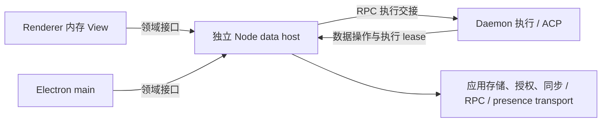

# WorkspaceData Effect Service 设计

Status: proposed
Type: architecture
PR: [#1572](https://github.com/LodyAI/Lody/pull/1572)
Translation: current

[English](2026-10-14-workspace-data-services.md)

## 摘要

renderer 与 daemon 当前各自持有 Loro 副本、持久化和网络订阅，多窗口会增加重复同步与内存成本。提议先用按领域拆分的 Effect Services 统一两端查询、命令与观察，保留现有行为，再将桌面存储、Streams 授权和共享连接迁入独立 Node 数据进程；无头 daemon 长期支持内嵌同一 owner Layer。daemon 保留实际执行资源，host 在 daemon lease 存续时跨桌面退出继续运行；集中 RPC 网络入口增加一次 IPC，并让远端控制依赖 host。方案仍为 proposed，真实存储迁移、跨进程恢复、prepared handoff 和性能收益尚未验证。

## 背景、核心需求与长期目标

renderer 与 daemon 当前分别持有 Loro 副本、持久化和同步生命周期，多窗口可能继续增加重复工作。main 的本地 relay 尚不能替代 renderer 的持久化、上传和云 live 订阅。业务又直接依赖 Repo/Doc/Mirror，移动数据 owner 会牵动许多调用路径。

核心需求是让 renderer、daemon 和 main 通过共同查询、命令与订阅使用可靠的本机数据来源。长期由独立 Node 进程管理应用数据、磁盘/网络 I/O、Streams 授权、取 token、refresh、后端订阅与上传恢复，renderer 使用内存视图并退出业务 IndexedDB 持久化。权限管理首先指 Streams 数据访问；会话内给 Agent 的工具权限回复是独立业务命令。

目的在于提高应用速度、减少重复副本和下行，以及重复 bootstrap、订阅、授权和重连请求。性能比较保留原有作者、权限、持久化和恢复保证，同时测量所有进程总内存、流式延迟和 IPC 成本。实际 payload 与请求量是收益证据，连接数只是其中一个观察值。

| 阶段                 | 交付内容                                                                                                         |
| -------------------- | ---------------------------------------------------------------------------------------------------------------- |
| 基线与切片选择       | 在第一个领域实现前测量现状，选择能独立验证的真实场景；指标见 §9.4。                                              |
| 一期：共同业务边界   | 两端按领域接入相同业务契约，保持原读写、同步与错误行为；每个已闭合切片可独立发布。这是重构，主要性能收益在二期。 |
| 二期：统一数据 owner | 桌面使用独立 Node host，无头默认内嵌同一 Layer；完成各自恢复与存储迁移后，再退出重复持久化/连接。                |
| 独立管理产品单元     | write-only 凭据、编辑上下文与冲突 UX 单独交付；它是二期 catalog 接入 host 的前置条件，不计入一期主线。           |

完整 I/O 目标包括登录、原生凭据、媒体、附件与文件能力。Git、终端、Agent/ACP 子进程及嵌入网页自身 I/O 属于执行环境边界，进一步集中需要执行能力与网络隔离设计。原生登录/代理/证书/cookie/安全存储仍需宿主 port；只有 Node 委托 main 执行时，物理 I/O 尚未全部迁入 Node。公共 OSS 保持 local-only，官方 cloud composition 注入可选云 ports。

本提案保留[通讯架构草稿](../../../../specs/communication-architecture.zh.md)的本地/可选云边界，以及命令、本地持久化、远端同步的独立完成语义。独立 host 是待实施的模块归属调整；切换时须同步更新 Spec 中的模块/路径与对应实现约束，本 Note 不把目标拓扑写成现状。

## 1. 核心决定

采用锁定 Effect `4.0.2` 的 `Context.Service`，按内聚领域拆分；Layer 注入进程内或 client 实现。业务依赖它实际使用的 Service，测试只提供所需领域。绑定可信 workspace、身份与账号生命周期；方法执行仍检查权限与业务条件。

| Service（建议名称）                                               | 公共能力                                                                             |
| ----------------------------------------------------------------- | ------------------------------------------------------------------------------------ |
| `SessionDirectory`                                                | summary、分页、观察、创建、改名、归档/恢复/删除                                      |
| `SessionAccess`                                                   | scoped 会话 history、control、queue 与用户命令                                       |
| `WorkspaceCatalog` / `CatalogManagement`                          | 普通 summary/观察；授权管理读取与明确字段修改，family 范围见 §2.3                    |
| `SessionSubmissions`                                              | workspace 范围 admission、pending、retry/cancel                                      |
| `WorkspaceSchedules` / `PreviewComments`                          | 既有定义/观察与领域操作                                                              |
| `SyncAuthority`                                                   | 业务目标的历史/当前权威、权威重同步与显式上传等待，见 §2.4                           |
| `MachineCommands`                                                 | 提交、取消和观察机器持久命令；可信消费使用独立 MachineCommandConsumer，见 §2.5       |
| `MachineRpc`                                                      | 分组的 typed request/进度；内部选路、协商与鉴权，见 §8.1                             |
| `Presence`                                                        | scoped viewing lease、临时会话/机器状态和 monitor；执行发布使用独立可信能力，见 §3.3 |
| `PromptShortcuts` / `FileCollaboration`                           | 独立授权的快捷指令；按 owner session 借用文件索引与文件业务接口，见 §3.4、§8.5       |
| `SessionAgentWriter`（可信执行）                                  | Agent 输出、promotion/recovery、终态等执行写入                                       |
| `MachineLaunchData`（可信执行）                                   | 同步 prepared guard 所需的 scoped 当前启动视图                                       |
| `MachineCommandConsumer` / `SessionExecutionPresence`（可信执行） | 持久命令的 scoped 消费；machine/active-turn 临时 lease；普通 renderer Layer 不提供   |

operations 继续复用 `OperationRepository`。可在组合入口保留名为 `WorkspaceData` 的便利 facade；它聚合这些 Services，不另建要求所有消费者依赖的巨大 Service。

代表性类型如下；生产模块尚未创建：

```ts
import { Context, Effect, Option, Scope, Stream } from 'effect';

class SessionAccess extends Context.Service<
  SessionAccess,
  {
    openSession(
      id: SessionId
    ): Effect.Effect<Option.Option<SessionHandle>, DataReadError, Scope.Scope>;
  }
>()('@lody/shared/workspace-data/SessionAccess') {}

interface SessionHandle {
  readonly capabilities: SessionDataCapabilities;
  readonly diagnostics: SessionDataDiagnostics;
  readonly history: SessionHistoryEffects;
  readonly control: SessionControlData;
  readonly queue: SessionQueueData;
  readonly commands: SessionUserCommands;
}

class SessionAgentWriter extends Context.Service<
  SessionAgentWriter,
  {
    openSession(
      id: SessionId
    ): Effect.Effect<Option.Option<SessionAgentOperations>, DataReadError, Scope.Scope>;
  }
>()('@lody/shared/workspace-data/SessionAgentWriter') {}
```

普通流程使用 `yield* SessionDirectory` 或 `yield* SessionAccess`。renderer 的公共会话句柄没有 `agent`，其 Layer 与公开入口不提供可信执行 Services。daemon 执行 composition 才提供 `SessionAgentWriter/MachineLaunchData`。编译检查发生在程序提交到应用 runtime、环境依赖必须被满足的边界；声明一个尚需 AgentWriter 的 Effect 本身仍可通过类型检查。节点端继续验证调用身份，类型能力防止误用，运行时授权守住实际边界。

`openSession` 打开既有、已加载元数据的会话，缺失返回 `None`；创建为独立命令。读目录不打开正文或激活 Agent。方法执行和 Stream 启动检查 binding/closed，旧句柄返回 DataScopeClosed。句柄随其 acquisition 结束，其全部观察同时退役；取消单个观察只结束该观察。独立消费者各取句柄、共享内部 owner。Repo、LoroDoc、FlockDoc、Mirror、SDK room 与 stored-copy handle 留在适配器/owner 内。

`SessionAccess.openSession` 与 `SessionAgentWriter.openSession` 获取不同权限的 scoped 句柄，按同一 binding/session/backend/owner generation 共用内部 acquisition，并分别持有引用。关闭读句柄只结束它的观察，写句柄仍可用；反向同理。最后一个句柄、已接受命令和真实 I/O holder 都释放后，才最终 flush/关闭物理资源；共同父 Scope 或授权退役可以同时结束两者。当前 daemon 缓存尚无引用计数，这属于新适配器必须交付的生命周期边界。

## 2. 数据域与现有实现的映射

### 2.1 后端与领域

`SessionHistoryEffects` 覆盖现有 reader 的 `count/readAt/readTurn/readRange/readDirectory/readTurnOutput/readAll`，以及有能力时的 latest/older directory page，观察为冷 Stream。沿用 `SessionTurnRead`、`SessionDirectoryRow`、`SessionHistoryDirectoryPage`、`SessionDataChange` 等 DTO；完整 export/replay 使用一次一致读取。

当前持久化历史后端为 `loro | roost`。按完成 hydration 的 metadata 绑定；旧 discriminator 缺失按既有 Loro 规则，新会话保留默认与 Roost opt-in。Roost physical segments 按 businessId 投影为逻辑 turn。普通 HistoryView 使用同一 reader，backend 只用于创建策略、诊断和能力说明。读取保留 legacy JSON/LoroMap 与未知字段表示。

| 领域                         | 实现来源与责任                                                                                                                            |
| ---------------------------- | ----------------------------------------------------------------------------------------------------------------------------------------- |
| directory / catalog          | Meta Flock 索引、key-family helpers 与既有字段/权限规则                                                                                   |
| history / 用户命令           | 选定 backend 的 reader、真实写者和共享 planners                                                                                           |
| control / queue / Agent 写入 | SessionBackend、SessionDocument 与执行协调；promotion ledger 保留                                                                         |
| submissions                  | send-resource、held pending、durable ready-input 和 session-input-storage 中可能是唯一副本的待发输入；SessionSubmissions 是唯一业务 owner |
| schedule / preview           | ScheduleRepository、PreviewVisualCommentMutation 的既有顺序与验证                                                                         |

### 2.2 Catalog 管理编辑

一期分开普通 summary 与授权管理 DTO。管理 DTO 提供现表单真正需要的有限配置字段，包括按原权限允许编辑/显示的 env、headers、API key 等值；底层 Flock 和完整 Machine launch 对象保持私有。设置命令表达实际变更，改名只改名称，env/header 按键设置或删除，owner 保留未改字段和原凭据，并沿用现有校验、本地 flush 与独立上传边界。

这修复“用删掉凭据的 summary 初始化旧表单后 whole-row upsert”的迁移错误，同时保留现有管理体验。已有 key 校验、transport 切换与验证状态失效按原业务规则处理。

write-only 凭据、`keep/replace/clear`、短期 editToken 和编辑条件冲突 UX 为独立管理产品单元，一期 renderer 仍持有 Flock 副本及授权管理值，没有进程级秘密隔离收益。

该单元须在二期 catalog 切到 host **之前**交付。旧管理 DTO 只用于一期进程内适配器；新 IPC 管理读取只提供非秘密字段、凭据存在/验证状态和编辑条件，普通 renderer 不取得已保存的 env/header/API key 秘密值或 Streams token。表单新输入值经授权设置命令送入 owner；未改字段保留。Agent 启动所需凭据只经可信执行能力交接，Streams token 不随 launch DTO 下发。

### 2.3 Catalog family 与权限范围

workspace Flock 的 mcpServer/agentRole；machine Flock 的 dotlodyPath、localProject、memory、agentConfig/agentConfigIndex、acpCapability/acpModelCapability、rateLimit、builtinAgentOptOut 归 catalog。旧 sessionLaunchConfig 是只读兼容输入，由 MachineLaunchData 组合，不增加新写入口。Magpie 目前是 agentConfig/providerSetup 的导入协调与 UI pending 状态，不虚构独立 Flock family。

archiveSessionCommand、deleteSessionCommand、deleteLocalProjectCommand、providerSetup/providerSetupCancellation 归 MachineCommands；Agent config 变化触发 setup 重查由可信 consumer 协调。Meta 目录、schedule registry 和文件索引有各自 owner，不归普通 catalog。每个 family 的投影、命令、读写授权、秘密与消费者在迁移切片逐项登记（§9.3）；MCP 保留 active Turn 的真实 requester、summary allowlist 和凭据引用规则，管理权限不从 summary 可读性推导。

### 2.4 同步回执与远端权威

SyncAuthority 按业务目标表达同步，不公开 room id/transport。下列是提议的核心类型；epoch 同时绑定账号/授权、owner 与目标来源，不能在新来源复用旧证据。

```ts
type SyncTarget =
  | { kind: 'workspace-meta' }
  | { kind: 'workspace-catalog' }
  | { kind: 'machine-data'; machineId: MachineId }
  | { kind: 'session-control'; sessionId: SessionId }
  | { kind: 'schedule-definition'; scheduleId: ScheduleId }
  | { kind: 'schedule-registry' }
  | { kind: 'preview-comments'; sessionId: SessionId };

type AuthorityState =
  | { kind: 'unknown'; epoch: AuthorityEpoch }
  | { kind: 'local-authoritative'; epoch: AuthorityEpoch }
  | {
      kind: 'remote';
      epoch: AuthorityEpoch;
      baseline: 'missing' | 'complete';
      readiness: 'catching-up' | 'current' | 'unavailable';
    };
type AuthorityRequirement = 'baseline' | 'current';
type UploadWaitPolicy =
  'require-route' | 'wait-for-route' | 'bounded-confirmation' | 'retain-until-ack';

class SyncAuthority extends Context.Service<
  SyncAuthority,
  {
    authority(target: SyncTarget): Effect.Effect<AuthorityState, DataReadError>;
    observeAuthority(target: SyncTarget): Stream.Stream<AuthorityState, DataObservationError>;
    refresh(
      target: SyncTarget,
      policy: ReadSyncPolicy
    ): Effect.Effect<AuthorityState, DataReadSyncError, Scope.Scope>;
    awaitAuthority(
      target: SyncTarget,
      requirement: AuthorityRequirement
    ): Effect.Effect<AuthorityState, DataAuthorityUnavailable, Scope.Scope>;
    authoritativeResyncs(target: SyncTarget): Stream.Stream<AuthorityResync, DataObservationError>;
    awaitUpload(
      target: SyncTarget,
      policy: UploadWaitPolicy
    ): Effect.Effect<UploadReceipt, DataUploadError>;
  }
>()('@lody/shared/workspace-data/SyncAuthority') {}
```

local-only 在本地存储/index 就绪后成为权威。远端 baseline 是本 binding 已完成初始权威同步的证据，current 是当前连接门槛；GC、可信空 catalog、provider 消费和 schedule 各自登记所需门槛。领域命令在 owner 再检查条件；同步 callback 由私有 AuthorityView.current() 保留时机。

session-control 仅表示会话的 Loro 控制/delivery 面；Loro 后端时，session-control 屏障覆盖同 Doc 的控制字段与历史更新；依赖这一点的调用点在同步登记表中标注，回执仍按原等待策略与所选 binding 解释。Roost 历史由写命令/SessionSubmissions 的 owner receipt 确认，不计为 Streams 上传。一期聚合等待仍组合 Roost 本地 history flush 与 Loro control 屏障，保留原 boolean/异常；显式 history refresh 由 SessionAccess 的 backend adapter 负责。

observeAuthority 提供无缺口的初值和状态变化，DirectoryStatus.cloud 复用这份状态（§3.1）。refresh 是本次显式追赶；authoritativeResyncs 是扫描型修复的输入，与实时事件共用处理入口，并保留现有 startup/manual/dirty 唤醒。

上传等待只报告既有屏障，不改变本地写入结果，也不证明逐写远端接收或 Agent 执行。每个一期策略须映射真实调用点，登记期限、取消和 false/异常处理；无调用依据的策略留给二期。retain-until-ack 对应现有 schedule uploader 引用，不等于二期独立 custody。取消保留写入与原资源所有权规则；二期另验客户端退出后的上传恢复。结果与真实调用点见 §9.3。

### 2.5 Machine 持久命令

MachineCommands 的 submit/cancel/observe 处理归属 §2.3 的命令 family。SessionDirectory 的 archive/delete 和 catalog 的 Provider setup 在内部组合它，UI 不再先写 metadata 再自行写 Machine Flock。提交回执只证明原本地 Flock durable；执行与结果独立。

可信 MachineCommandConsumer.serve 在一个 scoped acquisition 内接好 initial scan、实时 wakeup、权威 rescan 和原有重试；handler 只拿校验后的命令值与授权/身份。provider setup/cancellation 保留远端 authority gate、取消优先和最终 agentConfig + setup 删除的同一 commit；local-only 立即按本地权威处理。删除本地项目保持先归档、脏 worktree 拒删、失败留队列与可见 cleanup 结果。

消费后的完成判据按 family 登记：已有 completed/failed row/response 可观察；请求 row 消失不能一律当“执行成功”。一期不新增所有命令共用的 durable result journal 或 exactly-once 语义。handler/存储/清理错误可观察，serve 不用 never 错误签名掩盖失败；不确定执行保留原 owner 和恢复责任。consumer 只由可信 daemon Layer 提供。

### 2.6 存储分类与 submissions owner

| 类别             | owner 与迁移规则                                                                                                            |
| ---------------- | --------------------------------------------------------------------------------------------------------------------------- |
| 持久 CRDT        | Repo 的 IDB/SQLite；二期按每来源、每文档的持久版本覆盖与上传 custody 验收，见 §8                                            |
| 唯一副本用户数据 | session-input-storage、ready-input、待发内容/附件引用；SessionSubmissions 负责持久化、恢复、排序、取消与清理                |
| 可重建缓存       | Roost 已保存页面、eager snapshots、高水位、文件路径/GitHub/skills 缓存；各领域 owner 管理，不能顺带删尚未完成迁移的原始副本 |
| UI 偏好与草稿    | renderer 的偏好、未提交 composer 草稿、选区/viewport；与已登记的待发输入分开                                                |

SessionSubmissions 一期使用现有 private storage adapter，保持 account/workspace/id/sequence、冻结输入、canceled/deliveryStarted/unknown 与 fail-closed 恢复。未准备的 Blob 保留 memory owner，ready 后才进入持久流程。二期专用迁移逐条核对输入和附件、receipt/顺序状态；它们没有 Loro 版本向量，不能当缓存或只靠正文 VV 删除。服务关闭先停止生产/交接、join 实际 I/O，再关闭存储。

## 3. 查询与观察契约

查询/命令返回 Effect，观察为冷 Stream，执行时才获取 lease。初始数据与 listener 建立无缺口观察；结构变化报告准确范围，内容变化报告准确 turn ids。目录 summary 与正文范围读取分开。

### 3.1 工作区会话目录

`SessionDirectory.observe(query)` 返回 initial page/status 与有序 summary upsert/remove、页更新或失效。复用 Meta 的先 watch 后扫描、按字段 live-wins、删除/恢复 epoch 与部分 patch 补读。筛选、排序、父子关系与创建/删除更新受影响的页；query membership/order 变化使旧 cursor 失效，普通字段更新保留不受影响 cursor。

DirectoryStatus.local 表示本地索引就绪；cloud 直接携带 SyncAuthority(workspace-meta) 的 AuthorityState，由同一个状态源派生并随目录观察发送。local-only 报 local-authoritative。UI 可从 baseline/readiness 映射显示文案，目录不另维护 offline/live/reconnecting 状态机。一期多个目录查询共享 Meta watch/index，跨进程合并留二期；presence 与未发送草稿另组合。

### 3.2 会话内历史目录与正文

`HistoryObservation` 的 initial 保留 complete 与 paged 两种覆盖语义，后续为 `SessionDataChange`。一期复用现有 listener/read 路径和 backend 自己的恢复行为，不额外为 renderer View 构造一条有界异步队列。native Stream 适配可合并准确的可重读失效集合；若某个切片引入新的队列/终结错误，则由该切片同时交付恢复，不能留下订阅静默停止的 View。

当前 Loro 和通用 Roost reader 有全目录初始路径；生产 Roost renderer/Node owner 已有有界分页路径。一期保留各自成本和行为，二期 wire 使用 owner 的无缺口有界 page/listener。Roost 的 Loro control cursor 与 history owner 引用随同一个 acquisition 管理。

类型为未来 `ObservationResetRequired`、interrupted/terminal、sourceEpoch 留出位置。新增的 IPC 队列超额、host restart、重绑与 Clock 退避在二期 client Layer 落地，见 §8；一期保留现有 Roost 远程 owner 不可用、读取失败与缓存恢复语义。

SessionDataStatus.local 区分 opening、cold、cached、empty，并携带 localHistoryReady、knownToHaveMessages 与本次 open 的 hasCaughtUp；cached 只说明当前可读窗口有内容。沿用 session-content-sync-state 的首帧规则：opening 避免闪 skeleton，已知有内容的 cold 显示 skeleton，新空会话正常显示；已有 hasCaughtUp 优先 current，重连降级不制造新的正文提示。二期 opening 对应 host/client View hydration，不再依赖 renderer IDB。

### 3.3 Presence 与临时通道

Presence 的 publishSessionViewing(sessionId) 获取 scoped lease；身份与 origin 由 binding 注入。观察会话、machine online/offline/unknown、monitor 与按需 sample 返回有限 DTO/冷 Stream。sample 和 lease/transport 错误保持 typed，不吞成 void。临时值不落盘、不提供 durable 回执。

心跳、重连声明与 final clear 在 owner 内。不同窗口的 viewing lease 分别计引用；关闭一个不清另一个。machine online 和 active-turn 仅在对应 daemon 的 SessionExecutionPresence lease 有效时发布，host 自身存活不延长它们；普通 renderer 无此发布能力。

二期 host 检测 daemon 链路关闭即撤销该来源发布；静默失联由注入 Clock 的本机 lease deadline 检出，并在配置的有界清除期限内停止续期、移除本地投影、发起远端 clear。接收不到 clear 时由原 TTL/观察 freshness 收敛；host 崩溃也只能走该兜底。状态报告 offline/unknown，不宣称实际 ACP 已结束。正常结束仍先 join 实际 ACP 释放；断链只撤销发布权限，daemon 保留真实执行/恢复责任。重连必须以新 host/daemon/lease generation 重新取得声明，旧心跳不能复活或清除新条目。二期用 fake Clock 验 IPC close/静默失联、clear 失败、host 重启、多窗口 viewer 与新旧 daemon generation；检测和本地清除期限须有界，原型校准，不能只等云 TTL。

保留本地作者 store/全局 replica 的 origin 分区、unknown 与 offline 区别、monitor 的 observer lease 与本地 IPC/远端授权限制，复用现有 rate/size budget 和 native owner。steer 路由仍结合正的 live activity、native capability 与 unfinished-turn barrier；目标 daemon 再验证实际执行。presence 不证明数据保存、删除或上传完成；PR poller 的 viewing 活跃度继续使用该临时源。控制与临时更新不等待正文节流。

### 3.4 FileCollaboration

FileCollaboration 提供按 owner session 借用的索引投影/观察、文件读取与带 base digest 的保存命令、当前/turn diff 读取；LSP 复用 MachineRpc 的 typed 方法。子会话解析到原 owner，沿用目标端路径检查、外部文件只读、冲突返回、证据与内存/并发限制。已确定本机的请求失败不转云。

一期薄适配既有目标 CLI 文件服务与索引 LRU；二期 host 接管索引/signal 授权、共享缓存和 RPC client，实际文件 I/O 的目标 owner 逐项迁移。文件内容不写 Meta，也不引入 synced text CRDT；沿用 [Code Collab 约束](../../../../apps/cli/src/lib/code-collab/AGENTS.md)。

## 4. 渲染、编辑与 Message Queue 的完整调用边界

### 4.1 一期同步读与渲染

renderer 使用现有 `ConversationView` 及 control/queue/submission/status 的只读 stores。缓存会话的 `peek` 和稳定 View 身份负责首帧；冷会话 acquisition 负责加载。UI render 同步读取内存值。registry/cache 限定当前 workspace/account binding，退役/撤权后旧 View 退出 registry 并停止返回正文。

登记的进程内 reader facade 保留 `SessionHistoryReader` 的 `T | Promise<T>` 契约：Loro 原本同步的 count、readAt/readTurn/readRange/readDirectory/readTurnOutput/readAll 仍同步返回，Roost 原本异步的路径保持异步。它与 Effect 查询共享同一个内部 reader、权限/生命周期检查和 owner，不复制领域规则。facade 只返回 DTO，不给出 Doc。同步路径不经通用 runPromise/tryPromise；运行 Effect 程序的执行点仍为应用入口或登记 Legacy facade。

这不表示 ConversationView 的每条路径都同步：当前 hydration/replacement 自己有 await。一期验收原同步调用的返回时机、CLI auto-seen/权限检查无 await 缺口、缓存首帧、按 turn 失效和原有调度，保持既有可见范围/pin/LRU 行为。MachineLaunchData 的 current guard 同样保持同步。

### 4.2 领域操作

| 场景                         | 对应入口与保留规则                                                                                    |
| ---------------------------- | ----------------------------------------------------------------------------------------------------- |
| 用户输入、权限回复           | SessionSubmissions admission、SessionHandle 用户命令；新/旧 session 共用协调者                        |
| 编辑重发 / resend / fork     | 完整领域命令；既有 eligibility、tail/goal recheck、rewrite barrier、复制 provenance 与条件补偿        |
| queue 显示与修改             | read/observe、begin/save/cancelEdit、move/remove；保留字段、opaque itemId、调度编辑标记和队头同步屏障 |
| queue steer / head fallback  | 完整接受、移除、执行交接；未知结果按原规则恢复                                                        |
| Agent 输出与 queue promotion | SessionAgentWriter；prepared → history_accepted → activation_published → queue_consumed               |
| schedule proposal / preview  | 各领域命令，保留 proposal 身份、未知内容、definition → flush → registry → flush                       |

queue 行 ID 映射既有 $cid；草稿、选区和 edit operation identity 保留在 UI，旧 ACK 不覆盖新草稿。控制、队列和权限状态不随正文渲染节流。

submissions 区分 held memory input、durable ready input、owner receipt、delivery 与执行，保留冻结配置、FIFO/predecessor barrier、同 ID landed 去重与 scope cancel。pending source 显示不进入权威 history。迁移按 §9.3 追踪真实消费者，并单独核对唯一副本输入、附件和恢复状态。

## 5. 命令与结果

owner 在本地协调内重查权限、目标和业务条件，再由既有真实写者执行。条件采用 editable tail 的 expected turn、active goal、queue identity、schedule activity 等领域条件。订阅/投影序号只做读侧 fencing，Semaphore 只约束参与本地协调的工作。

| 操作                         | 一期成功边界                                                       |
| ---------------------------- | ------------------------------------------------------------------ |
| 目录与 catalog               | 既有本地持久化/flush；后续 upload 独立报告                         |
| 普通 history/control         | 既有 commit 与 typed writer 错误                                   |
| queue 队头编辑               | 保留当前 waitUntilSynced 屏障与 applied/no-op                      |
| schedule                     | 保留 definition/registry flush 顺序                                |
| 显式上传等待 awaitUpload     | §2.4 调用点登记的原屏障结果；此前本地写入不因未确认改成未发生      |
| MachineCommands 提交         | 本地 Flock durable；消费由可信 daemon 门控，结果按 family 单独观察 |
| submit / edit / fork / steer | 保留 source、owner、delivery、执行的各自结果与恢复流程             |

产品 editAndResend 返回既有 success/error；内部 import/tail replacement 保留 accepted/rejected/indeterminate。只有 rejected 证明未写入，indeterminate 查询原结果并保留原 owner。一期沿用各方法已有去重与确认，二期再设计 durable request journal。

## 6. 快照、回滚与同步启动检查

fork/copy 由选定 backend owner capture/copy，使用既有 stored-copy WeakMap；公共调用获得完整操作结果。编辑重发的补偿路径 await 条件 rollback，再处理后续 metadata；保留后追加行和 opaque 内容。Roost 使用其真实写者与共享 helpers。

MachineLaunchData 仅由可信执行 Layer 提供；进程内 scoped current() 保留 prepared peek/claim 的同步 guard。独立模式中数据侧授权/当前配置检查由 host 完成，daemon 仍 claim 实际 ACP resource。复用授权绑定 request/preparation/owner generation；claim miss、取消或断线查询/释放同一授权，配置在授权前变化则拒绝。授权后的 launch 使用原冻结配置。二期必须验证“配置变化 → 授权 → resource claim → spawn”的一致性与取消；未证明时不广告 prepared reuse，采用明确重新校验的冷启动路径。

同步读按影响处理；内嵌形态保持原同步调用，独立形态不能逐次远程 read-await-write：

| 同步依赖                                                      | 独立 host 模式迁移                                                                                                       |
| ------------------------------------------------------------- | ------------------------------------------------------------------------------------------------------------------------ |
| auto-seen、模型摘要、backend/watch initial                    | 在 owner 建立无缺口观察并做窄读取/发布；auto-seen 只由明确执行兴趣启用，保留最后副本 guard                               |
| permission 定位/终态、plan/runtime-config、用户 stored copies | 固定 request/turn/input 身份的完整条件命令；owner 重查当前状态，保留赢家、敏感字段过滤和原串行顺序                       |
| Agent 批次、import/tail/capture、queue/control                | 固定 enqueue-time assistant/user/epoch 一次进入真实 writer，保留 cursor/promotion/queue 顺序和 indeterminate；按批次传输 |
| fork/rollback/操作回执                                        | owner 条件预留/查询；daemon 持有 ACP/worktree saga，按同一 operation 身份补偿，不用旧快照决定删除                        |
| prepared/launch                                               | 数据授权在 host，实际 claim/spawn 在 daemon；按上述 handoff 证明一致性                                                   |
| 只读 catalog、ordering/evidence/export                        | 可 awaited 有限 DTO，保留 binding/revision/取消与晚回复 fence；展示缓存不作写入许可                                      |
| schedule/provider 读改                                        | 完整 conditional publish/setup 命令在 owner，保留取消优先、原事务与 flush/registry 顺序；执行资源/slots 归 daemon        |

这里的原子性是原条件读/检查/写及领域既有事务，不是跨 Doc/云/ACP 的全局事务。MessageHandler 的 permission outcome waiter 已异步；无新增 await 缺口的要求在实际 writer/guard 内。

## 7. 生命周期、错误与取消

workspace binding 登记所有 scoped holder。句柄关闭结束关联观察并封锁晚读；多个句柄共享 owner，各消费者独立释放。已经 admission 的命令保留自己的 owner lease，caller interruption 只结束等待，实际 Promise I/O 完成/确认终止后才释放依赖。workspace/授权退役拒绝新工作并封锁晚发布。

错误包含 scope-closed、access-denied、validation-rejected、condition-changed、unsupported、backend/owner-unavailable、read/write/cleanup-failed，以及为二期保留的 observation-reset-required。adapter 保留原始 Cause，业务/IPC diagnostics 使用安全标识。原有 Roost 错误恢复继续存在；新 IPC 错误由 client Layer 实现。

关闭顺序为退役入口 → 等待/记录工作与写者 → 最终 flush → 关闭存储/owner。清理失败保留原 owner 和恢复责任。二期重试用注入 Clock，取消观察/等待不等于终止实际 I/O；release 失败须有可查询的恢复责任，不能再造 owner。

## 8. Layer、拓扑与二期 IPC

RendererDataLive 按所需领域组合普通 Services 与授权管理能力；DaemonDataLive 额外提供可信执行 Services。领域 Layer 共享 internal owner/ports。每个应用入口复用 runtime，普通业务组合 Effects，React 由登记 facade 桥接。

二期桌面目标结构如下；无头默认将同一 DataOwnerLive 内嵌在 daemon，直接调用。



### 8.1 Machine RPC 与控制通道

MachineRpc 按 session、prepare、preview/files/Code Collab/LSP、Agent 安装/认证/能力、machine lifecycle/monitor、project/history/memory 等业务组暴露 typed 方法与进度 Stream；一期复用 workspace-machine-rpc-facade 和 CLI 既有 ports。保留每方法 timeout、进度序列、并发上限、本机 ID 解析期兼容行为；已确定本机的 IPC 失败不转云，local-only 不创建云客户端。

完整 submit/edit/fork/steer/goal 命令在其数据/执行协调 owner 组合 RPC，UI 只表达意图；已有原始 request* 作为登记 Legacy facade 逐个迁移。RPC replies 不替代数据保存/上传/执行证明。取消等待保留原始在途请求与资源 owner；未知写入/steer 不自动重发。

二期选择集中远端传输：DataOwnerLive 持有 Streams RPC client，以及 server 的请求读/响应写、token 与重连；执行 handler、ACP/终端资源仍由 daemon 持有。接受云→host→daemon 的额外一跳和 host 对远端控制的可用性影响，以满足统一 Streams I/O 与授权。server 留在 daemon 可以减少一跳，但它的 Streams 连接与 token 刷新会成为集中 I/O 的例外；只由 host 发 token 仍依赖 host 恢复。

host 不可用且请求尚未交给 daemon 时，远端沿用方法 deadline 超时；已经交接、响应丢失时为 unknown，停止等待不证明未执行，也不自动重发。host 活着但 daemon lease 不可用时返回明确 execution-unavailable。正在执行的 daemon 保留执行/释放责任；本机 main→daemon 控制入口独立保留，涉及数据的命令仍报告 owner-unavailable/unknown。本机已确定路由失败不转云。二期须验证 host 故障各窗口、control lane 不受正文背压、lease 清除与恢复后结果查询，再切 server。

授权请求保留冻结业务 requester；它不是 host 机器身份或 caller 自报身份的授权证明。重启/升级维持 ACK/handoff 顺序，普通调用方无 SDK client/token/通信平面选择。

### 8.2 owner 的部署位置

| 部署形态                     | 数据 owner 与接入                                                            |
| ---------------------------- | ---------------------------------------------------------------------------- |
| 迁移前/一期                  | 保留现有 daemon 进程内 owner 与 renderer 存储，按领域换调用接口              |
| 二期桌面                     | 优先独立普通 Node host；renderer/main/本机 daemon/one-shot CLI 共享它        |
| 二期无头、单 daemon          | 永久支持并默认内嵌同一 DataOwnerLive；Agent 批次直接调用，无额外 IPC         |
| 无头共享服务或需独立生命周期 | 按需独立 host，使用同一核心 Layer，加本机 socket/named pipe client           |
| 远端/旧版机器                | 每台机器有自己的 owner；远端经既有 ports/RPC，旧版保留隔离数据与明确兼容模式 |

共享网络连接来自一个 owner，daemon 自身也能承担 owner。桌面首选独立 host，是因为停用/重启本机 Agent 后 UI 仍需数据，数据恢复不应绑定执行进程的生命周期；新增进程的 IPC、内存和启动成本必须实测。daemon data-only 模式也是合法备选，但须拆开执行开关与数据 scope。supervisor 是既有进程管理角色，不要求另开一个常驻 supervisor 进程。

内嵌与独立部署共用领域实现、持久化规则和新存储布局；它们是长期合法形态。每个数据目录以持久 bootstrap 状态固定 embedded/independent 位置，不按启动竞争选择。independent 模式的 daemon 总是连接/启动 host；协议拒绝不内嵌 fallback。只要还有 daemon lease，host 就保持运行；桌面 app 退出不结束 host。host 意外退出时，由 daemon 侧 supervisor 按目录持久模式重新拉起/连接 host，并完成排他恢复与新 owner generation；恢复前报告 owner-unavailable。运行中位置切换由用户显式发起，先停止所有 Agent 与其他写者、join 实际 I/O，再 drain/flush/释放独占权，发布新模式并取得新 owner generation。进程位置、协议版本和数据格式分别记录，不由阶段或版本猜测；拒绝握手不启动第二个写者。

### 8.3 旧存储隔离与切换

新 owner 使用 `getLodyDataDir()` 下的版本化新路径，例如 `data-owner/v1/<binding-storage-key>/`，不复用旧 repo.sqlite3 路径或 renderer IndexedDB 名称。绑定保留账号/workspace/环境/channel 隔离。先停止旧生产者，导出并核对 daemon 与各窗口的已保存和待上传数据，迁入新路径并验证恢复，再单向发布切换记录。逐来源/逐文档验证 host 持久读回的 Loro OpLog 版本向量包含冻结 renderer 版本，且无 pending import；满足前旧 IDB 保持只读、不删除。VV 之外仍核对 Flock tombstone/版本、唯一副本输入与未上传 custody；marker 只协调新客户端。

产品兼容入口对旧格式提示升级并禁止编辑；旧目录冻结为恢复用归档，不继续作为可写副本。不识别协议的旧二进制无法靠 marker 获得新 UI：旧路径隔离/只读、启动器限制、旧凭据失效等须分别实测。撤销前登记受影响的本机/远端部署与升级入口；共享账号/workspace/CLI 凭据可能影响远端旧 daemon，无法隔离影响时先阻塞该云切换，不做全局失效。新路径保证它不能按旧路径打开 host 的主库；阻止它另建旧库后向云端写入是额外迁移条件。这些条件在二期切换前逐项验证；切换后不自动双写或重新导入旧库。

### 8.4 版本与能力

本地新 data protocol 的握手独立声明 wire version、支持的 DTO/投影特性、host epoch 与绑定身份；不兼容在取得 lease/写入前拒绝。它是新业务协议，不混入旧 local-loro v7 CRDT envelope。

远程操作依据 [shared 协商规则](../../../../packages/shared/AGENTS.md#machine-protocol-negotiation)与 MachineMeta.protocolCapabilities 的 key/version，缺失表示不支持，不按 CLI 版本猜能力。未来 sessionHistoryProjection v1 必须真正实现后才登记到 machine-protocol-capabilities.ts；本地握手与远端能力各自验证。混合版本保留理解的字段，诊断说明兼容模式。

### 8.5 授权种类与连接归属

这里的 host 包含长期内嵌的 DataOwnerLive；物理进程位置不改变以下逻辑归属。

| 授权/连接                                               | 一期 owner                           | 二期 owner 与约束                                                                                        |
| ------------------------------------------------------- | ------------------------------------ | -------------------------------------------------------------------------------------------------------- |
| workspace Meta/session/machine/schedule 同步            | renderer、daemon 原 owners           | host，保留各 principal/权限；只有证明同身份合法共享的 room 才计去重                                      |
| 云端 Machine RPC                                        | renderer/CLI 现有 client/server      | host 持有 client 与 server 网络入口；daemon 执行。明确接受 host 故障时的远端控制耦合（§8.1）             |
| presence、machine monitor                               | renderer/daemon 原 transports        | host transport；machine/active 发布有效期由 daemon 执行 lease 决定（§3.3）                               |
| Prompt Shortcuts 独立授权、private/workspace index/body | renderer scoped provider             | host 的独立 PromptShortcuts scope；不借 workspace-wide token，读写均按原 grant，切换时等旧 durable close |
| Code Collab 文件索引与 signal                           | renderer LRU、目标 daemon publish    | host 的 owner-session lease/LRU；本机 RPC 先 seed，失败不转云；FileCollaboration 返回投影与文件命令      |
| eager-sync worker/snapshot/high-water                   | renderer worker 与可重建缓存         | host 按 room+授权 interest 合并预取；不获取 UI store/Mirror，不替换未上传副本                            |
| Roost owner RPC                                         | renderer bridge / Node history owner | host client＋目标数据 owner；分页/branch/receipt 保持，同机后端在同一 owner Layer                        |
| Streams/机器/Provider 凭据                              | 原各自 owner                         | host 管理 scoped grant/token；trusted launch lease 独立，普通 renderer 无 Streams token                  |
| 公共 managed-runtime 下载                               | 现有执行下载 capability              | 暂保留既有 port/执行 owner，作为显式 I/O 例外，不计连接去重；进一步收拢单独验收                          |
| UI 偏好、未提交草稿                                     | renderer                             | renderer；不使用数据同步凭据                                                                             |

所有授权由实际 platform ports 注入；独立只读 grant 不等于整个工作区的读写权限。新文件/未知 family/连接先登记 domain、identity、秘密和 owner，再加入迁移。只有完成 host 归属、授权等价与实际连接合并的行计收益；一个 host 内两种不同 principal 的订阅仍可各自存在。

### 8.6 二期进行中正文传输

进行中的已观察 turn 走版本化 delta 和有界背压，避免每 token 经 IPC 重读整条正文。正常追加 N 字节的正文传输目标为 O(N)；控制/授权消息独立，缺口可重建。预算、帧和分片在基线及原型之后定案。

候选一为窄业务投影：先支持尾部文本追加与受影响单项替换，目录/标量沿用领域事件。候选二为 renderer private adapter 持有纯内存 Loro replica，由 host 单向转发 Loro 增量；业务仍使用相同 DTO/命令，Doc 不公开，renderer 不持久化、不连云、无二进制写入通道。Roost 仍由自己的 adapter 提供投影。

两者比较 bootstrap/增量/重建字节、解码与总内存、流式延迟、未知内容、工具/子会话和远端 Roost 的端到端成本，再确定 backend 私有传输实现。首选原型为窄投影；通用 splice/嵌套 bindings 暂不进入契约。已有子会话流式场景必须通过性能与行为 gate 后才能切换，不能把高频整项替换算作 O(N) 已通过。基线与原型指标见 §9.4，预算与 wire 细节在实施时定案。

### 8.7 二期 View 恢复

IPC client bridge 消费 initial/changed/interrupted/terminal，按 sourceEpoch 封锁旧读/页/fact。reset 取得新无缺口 initial，重建 directory/coverage/cursor 与正文/fact 缓存，保留 View 身份和 UI 草稿/anchor/range/pin 意图。局部观察 reset 保留句柄；host 换代时 acquisition 一次退役并重绑 history/control/queue/submission。

恢复区分 reset/owner-unavailable 的有界 single-flight 重试、范围读取错误、永久失败与 denied/scope-closed 终止。Clock 注入、连续失败预算、release 取消、深 anchor 重新定位和大 snapshot 组装均为二期 client Layer 的真实测试条件。已有一次性 SessionObservation.initial 需在该阶段扩展 ingestion；在引入这些 terminal 错误前完成对应恢复。

DataScopeClosed 表示本地 acquisition 已结束；仍活跃 acquisition 的远端 lease 因 host 换代失效报告 owner-unavailable。根 generation 在退役旧句柄前推进，从而区分主动关闭与可恢复重连。授权退役撤销旧 View 的可读和发布能力。

## 9. 实施与验证

### 9.1 清单驱动的领域验收

实施切片固定源码 SHA，覆盖 Repo/Doc/Mirror、Flock、同步/权威、RPC/presence 与持久输入；每文件/API 映射到 Service 方法，或明确 adapter/豁免原因和删除条件。§9.3 提供同步与消费者起点；候选扫描不是完整调用图，也不算迁移通过。公共 WorkspaceRuntime.repo、SessionDocStore.doc 和泛型 writer 的删除覆盖所有消费者；tour 使用合成 InMemory Layer。

第一个切片前定所需 Service 契约。实现时将 AST 静态边界作为 pnpm check 的 lint（Oxlint 规则或独立脚本）：components/components、hooks 与 CLI/session、commands、mcp、orchestration 的已迁移领域禁止 Repo/Doc/transport 导入、别名/类型逃逸与 raw 字段访问；只允许逐文件登记的 adapter。未迁移行保留有期限/删除条件的 baseline，不新增逃逸；新 raw 依赖须先登记。静态检查覆盖 import、成员访问和 re-export，行为测试负责动态授权/状态。现有 no-materialized-history-in-components 的源码约束随切片迁入 lint；行为测试保留，不用 Vitest 读取源码充当边界检查。

按领域关闭 ledger：相关行全部映射/批准豁免、真实消费者测试和静态边界通过，才标迁移；waitUntilSynced/firstSynced/authority 的每个调用点在同一 PR 验证策略、local-only、无路由、未就绪、false/错误、取消和恢复。按基线选目录或会话观看切片独立发布，全覆盖是最终 ledger 状态。

### 9.2 分期验证

一期同步/命令/RPC/presence Layer 可薄适配既有实现，登记 Legacy，不声明原生生命周期迁移已完成。一期验证领域规则与当前行为等价、原同步/异步读时机、首帧与失效、共享 holder/取消、后端绑定、真实 writer、凭据保留、queue/输入/执行顺序及业务无 Doc 边界。仅有该切片实际引入的新故障需要同期交付恢复；host restart、IPC overflow、跨进程重绑和新管理 UX 不在一期主线。

二期分别验证长期内嵌/独立 host 两种组合、本机握手/远程能力、全部同步依赖的迁移、权限换代、增量/重建/背压、prepared handoff、写入与上传恢复、凭据前置单元及旧存储隔离；与基线比较收益和额外成本。协议与预算由真实原型结果确定。

### 9.3 同步调用点与消费者迁移起点

源码审计固定在 [main df5b5a068e2f6a44118a30d0cc8fa34c2e4fcc49](https://github.com/LodyAI/Lody/tree/df5b5a068e2f6a44118a30d0cc8fa34c2e4fcc49)。以下行号属于该版本；每个实施切片先刷新目标版本与调用图。候选扫描覆盖 CLI/components 的原始数据 API、注入回调与存储入口，下面给出实施起点，不表示消费者已完成迁移。

| 一期上传策略         | 现有调用依据                                                                                                       | 必须保留的行为                                                                                                   |
| -------------------- | ------------------------------------------------------------------------------------------------------------------ | ---------------------------------------------------------------------------------------------------------------- |
| wait-for-route       | create-workspace-runtime:4394–4426、4518–4524；use-session-doc:456；session-send-delivery:179                      | transport/join 与选定 binding；Loro 同 Doc 控制/历史覆盖支撑发送确认和队头编辑；保留 detached/无 room/Abort 分支 |
| bounded-confirmation | CLI loro/doc:2505–2542；session-backend:503；dispatch-watcher、message-handler、local-project-history-sync-service | 原默认 4s；不可用/超时 false；忽略、报错、通知 fallback 逐调用点保留                                             |
| require-route        | streams-room-binding:63–65；connection-recovery:409、1000–1001                                                     | 缺路由错误按既有 refresh/deadline 包装处理，不作为全部 CLI store 默认行为                                        |
| retain-until-ack     | schedule-write-sync:5、24、43、60–65；create-workspace-runtime:4572–4585                                           | 本地写先返回，上传引用穿过 idle/reconnect；dispose/Abort 也结束等待，不能据此报告远端 ACK                        |

UploadReceipt 区分 barrier-completed（local-primary/remote）、not-attempted、not-confirmed、not-required-local；目的地和原因只报告实现实际知道的值。throw 留在错误通道，false 不升格为成功，中断不伪造回执。Roost 的 roost-node-session:2009 只 flush 本地历史；roost-session-backend:400–404 仍组合 history flush 与 control 等待，不能报告 Roost 远端上传。

| 权威依赖                                             | 目标与门控                                                                                              |
| ---------------------------------------------------- | ------------------------------------------------------------------------------------------------------- |
| worktree GC、空 catalog                              | workspace-meta/catalog 的 baseline 与完整本地索引；区分删除与尚未看到                                   |
| machine-flock-command-watcher、provider setup/cancel | machine-data 的原 authoritative join/rescan；取消在最终发布前再检查                                     |
| schedule-sync-gate                                   | 每次连接 generation 重建 current，首次同步 Promise 不能授权后续连接                                     |
| 显式 sync/export、重连修复                           | 本次 refresh 与逐 target Result；保留 --offline、startup/manual/dirty；廉价在线唤醒与限频 Meta 扫描分开 |

消费者按下列分组逐文件/API 登记，记录目标方法、权限/秘密、adapter 范围和删除条件；共享 packages、Electron/platform ports、公开返回类型与动态注入也进入对应切片调用图。

| 领域                     | 重点消费者与关闭条件                                                                                                                                               |
| ------------------------ | ------------------------------------------------------------------------------------------------------------------------------------------------------------------ |
| 目录与访问               | GC、pr-poller、CLI session/sync/export/MCP、chat-landing/tour；完整 metadata、删除与实时分页行为等价                                                               |
| 历史/control/submissions | MessageHandler、dispatch/execution、ConversationView/use-session-doc、export/import、pending/input storage；同步 facade、真实 writer、唯一副本与未知 delivery 保留 |
| catalog/机器命令         | agent-config/MCP/Role、resource discovery、memory、Magpie、本地项目与设置表单；每 family、授权、凭据保留和取消优先分别关闭                                         |
| RPC/presence/附属数据    | operation-coordinator、submit routing、preview/files/LSP、Shortcuts、file-index LRU、eager worker、Roost bridge；连接授权、origin/lease、回执及 target 路由保留    |

首个切片选择会话目录：先闭合 Meta 观察/索引与 SyncAuthority 投影、查询/分页及创建改名，再通过 MachineCommands 承接归档/删除。按真实消费者的端到端行为关闭范围，范围内完成的切片可以发布；其余领域保留待迁移状态。

### 9.4 测量与验证限制

动工前采相同场景的基线，二期在相同数据/窗口/机器规模下比较：

| 指标                                                                         | 验证目的                                                   |
| ---------------------------------------------------------------------------- | ---------------------------------------------------------- |
| 每 room/principal 的订阅、bootstrap、下行字节、授权与 token refresh 次数     | 找到可合法共享的重复成本，避免把不同身份或逻辑连接数当收益 |
| 冷/缓存首帧、流式 turn 延迟、IPC 增量/重建字节、背压队列                     | 验证界面更快，长正文没有 O(N²) 重读                        |
| Agent batch enqueue → host admission → writer apply → 本地 durable → UI 可见 | 单列桌面热写延迟、吞吐和排队；无头内嵌不增加 IPC           |
| host/daemon/所有 renderer 的 RSS、JS heap 与 Wasm 内存，启动/解码成本        | 多窗口比较窄投影与只读 Loro replica 的总成本               |
| host/daemon 重启、取消、权限换代、上传恢复与 RPC handoff                     | 性能收益同时满足原数据安全和可用性边界                     |

本方案是待实施的业务与架构契约。固定源码审计、框架类型参照和早期有限模型用于澄清设计；真实 Effect/Repo/SQLite/IndexedDB/IPC 集成、prepared handoff、Clock/清理行为和产品性能仍须在对应实现中验证。文档与翻译检查不代表运行时实现通过，也不批准现行协议变更。
