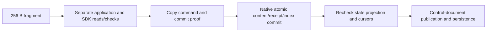

# Roost streamed-append CPU structure audit

Status: proposed
Type: architecture
Translation: current
Owner: Codex

[中文](2026-10-23-roost-append-cpu-structure.zh.md)

## Abstract

Comparable cumulative CPU for 1,000 messages and 10,000 appends cannot be explained
away by faster history selection. Atomic commits do apply, but those appends still
issue 151,003 serial Native requests, including 50,000 empty event polls. Actual
Native write requests account for about 19% of diagnostic append-process CPU and
the main thread about 49%, including SDK proof copies, protocol processing and
control-document publication. This range does not show a revived full-history
scan: each fragment still crosses too many independent checking/publication
boundaries. The investigation is complete. The user subsequently authorized isolated
Roost-specific optimizations with correctness and performance verification;
implementation is now in progress, with Loro fixed.

## Scope and provenance

Lody integration `812bc3c21da3b3d160eccd6f2cbd05884962d4eb`; SDK SHA-256
`2285aa4c49293cae1bd9b3abdf0d6643840c2d37dd707bd868318dde9e9d26ca`;
shared-body Native SHA-256
`56b737124db34a1dba137856582f5c1809a696bc30ebb22ee49bedea85adb0e2`.
The SDK path still contains `0.2.0`, but verified bytes belong to the previous
unreleased combined candidate, not the published old package. Incremental
semantics, atomic content/checkpoints, dispatch indexes and shared-body storage
are all included.

Initial authorization covered CPU investigation. The later 2026-10-23 request
authorizes the isolated implementation/acceptance recorded below; merging,
publishing, deploying, weakening durability or changing plain Loro remain outside scope. The common-adapter
prototype remains stopped. The
[preceding fixed-reference audit](../testing/2026-10-22-control-update-block-prototype.md#append-versus-history-selection-fixed-reference-audit)
and [validation workflow](../../../docs/roost-validation.md) own baseline and
measurement boundaries; this report adds actual attribution.

## Execution and measurement

Retain the same synthetic fixture: 500 user/assistant rounds, 1,000 messages,
10,000×256 B appends and a 16 KiB tool payload per assistant. FULL/WAL, immediate
persistence, incremental consumption, full validation and retries stay intact.
Loro is neither rerun nor modified; reference rows reuse previous complete
original-adapter samples.

Diagnostics change only an external Native JS package copy and a temporary
harness. The Rust addon stays fixed. The main thread records actual append
intervals and thread CPU; Native Worker records thread CPU, time, method and JSON
bytes around each synchronous request. A 500 μs main-thread V8 profile is filtered
by monotonic clock into actual append intervals. Creation, consumer reads,
window diagnostics and final materialization are excluded from append samples.
Request records contain methods, key/table identifiers and limited synthetic
stacks, not captured conversation fixtures.

Native request spans do not overlap, confirming serial round trips. Nested wall
times are not added to CPU. Process CPU includes all threads, whereas thread
counters cover the main thread and Native request functions only; the residual
is not fully attributed. V8 percentages refer to 8,350 non-idle append samples,
not exact shares of entire-process CPU.

The first attempt inserted profiler start into final validation; stopping raised
`Session is not connected`. It remains `attempt-1`, excluded from valid performance
samples. Correct the entry to surround the write loop and retry once on fresh data:
`attempt-2` passes write/reopen/paging. Limits stay 1,536 MiB heap, 2 GiB RSS and
4 GiB free disk before each stage. To recover disk, archive only two completed
synthetic old Roost trial copies, comparing every file's SHA-256 after archive
readback before removal. JSON, failures, seeds and all Loro copies are retained.

## Fixed baseline and diagnostic resources

Original uninstrumented rows are medians of two trials. DB is history+control
growth relative to empty, excluding WAL/SHM. RSS covers the whole process;
parentheses are growth since backend open. Append CPU excludes separately measured
dispatch selection.

| Streamed 1,000 messages       | Append CPU s | Append p95 ms | RSS MiB (+growth) | DB growth KiB |
| ----------------------------- | ------------ | ------------- | ----------------- | ------------- |
| Current Roost, uninstrumented | 10.874       | 1.743         | 615.4 (+214.8)    | 24,242        |
| Fixed Loro, uninstrumented    | 10.808       | 1.215         | 662.9 (+301.8)    | 13,720        |
| Roost diagnostic, one trial   | 11.343       | 1.456         | 985.0 (+656.5)    | 24,108        |

Diagnostic WAL is 7.98 MiB current allocation, not cumulative writes. Extra
profiles/request records retain memory and perturb CPU/timing. The last row is
attribution evidence, not a speedup, memory regression or storage optimization.

## What 10,000 appends execute

| Native request                            | Count  | Mean per append | CPU inside Native request s |
| ----------------------------------------- | ------ | --------------- | --------------------------- |
| Content/receipts/derived-index writeBatch | 10,000 | 1.0             | 2.178                       |
| indexRead                                 | 91,000 | 9.1             | 0.646                       |
| eventsAfter                               | 50,000 | 5.0             | 0.403                       |
| Initial format-check indexScan            | 3      | 0.0003          | <0.001                      |

Total: 151,003 requests, 15 on an ordinary append and up to 20 for first-message
planning/initial format checks. All 10,000 write results report
`metadataAttached` / `derivedIndexesApplied` true. The former four-write-transaction
path did not return. All 50,000 event responses are 23 bytes, matching the current
compact Native reply `{"ok":true,"result":[]}`: polls return empty pages rather
than replaying history.

The main thread sends 67.40 MiB JSON to the Worker and receives 6.86 MiB: about
74.25 MiB for 2.44 MiB new text plus proofs/receipts/progress. This is a **local
thread protocol**, not network traffic, Loro Stream offset or total disk bytes.
Even a single writeBatch sends about 4.45 KiB JSON on average.

Mean process CPU per append is 1.451 / 1.121 / 1.082 ms over the first 1,000,
next 4,000 and last 5,000 appends. Native requests stay around 15.1 per fragment.
This range supports expensive per-fragment fixed overhead, not a revived linear
history scan; it does not establish behavior at every larger history size.

## CPU attribution and structural causes

| CPU during instrumented appends                             | Seconds | Share of this process CPU |
| ----------------------------------------------------------- | ------- | ------------------------- |
| Whole main thread                                           | 5.551   | 48.9%                     |
| Native Worker writeBatch requests                           | 2.178   | 19.2%                     |
| Native Worker index/event read requests                     | 1.049   | 9.2%                      |
| Other threads/request perimeter/instrumentation: unresolved | 2.565   | 22.6%                     |

Exclusive main-thread sampling categories are control CRDT/persistence 21.84%,
Native JS protocol/transport 21.04%, SDK `structuredClone` 12.48%, GC 2.74%, and
other/unknown 41.89%. These non-idle main samples cannot be added to Native CPU
percentages above, and the remaining work is not all removable overhead.

Three measured structural costs:

1. **One append lacks one complete command boundary.** Application resolution /
   checkpoints, receipt lookup, SDK catch-up, generation guard, post-commit state
   projection, operation cursor and publication cursor observe independently.
   The ordinary hit path uses nine index reads, five empty polls and one write,
   all serial. Write-transaction merging did not merge these read/observation
   boundaries.
2. **Commit proof reconstruction/copying.** `NodeLodyHistory.commitContentBatch`
   owns writes/options, clones host-facing expected/derived rows and then clones
   the cached plan after commit: three `structuredClone` sites on the hit path.
   Profile stacks locate them in that SDK method, not repeated old-body copies.
   Caller input isolation and preventing a host from mutating private proof are
   correctness requirements; removing copies blindly is invalid. Ownership /
   representation needs a deliberate change to eliminate duplication.
3. **Roost control publication still traverses Loro per fragment.** The mirror
   update and automatic persistence from `setRoostHistoryCursor` occur inside /
   during waits in `applyAgentBatch`. A short subsequent explicit `persistDocNow`
   only measures its remaining barrier work; it does not make control storage
   free. Loro was not changed, and silently throttling notifications or delaying
   durability is outside this optimization boundary.

Stacks also confirm `refreshTurnProjections` clears the target state cache, then
`projectMessages → readState → lookup` checks the state record again; even staged
primary installation performs the absent-state lookup. On a compact agent-receipt
miss, `lookupOperation` additionally queries generic publication receipts. That
route serves current complex writes; it cannot simply be deleted as old-format
compatibility. These are concrete repeated-observation opportunities, each still
subject to remote-event, branch-switch and retry correctness.

## Direction requiring discussion

First consolidate the **Roost-specific prepared snapshot → atomic commit →
authoritative-result installation** boundary. Observe an append's required
index/events coherently, place enduring conditions in Native transaction
comparisons, then advance projections from verified cursor/seq/coverage rather
than rechecking the same facts in neighboring layers. Make SDK command/proof byte
ownership explicit, reducing repeated object copies while keeping host mutation
from affecting private evidence. Plain Loro and control-notification semantics
stay unchanged.

This does not authorize deleting fourteen checks or merely running them in
parallel: independent observations can admit intervening remote events. Acceptance
must cover concurrency/remote events, stale, lost reply, branch switch, retries,
caller mutation and hosts changing submitted parameters. The redesign concerns
Roost SDK/Native and Lody's Roost integration; exact interfaces and achievable
benefits remain unverified. Do not promise the entire gap will disappear or give
unmeasured speedup factors.

## Verification and handoff

Fresh data completes write, separate-process reopen and complete unique paging.
Expected content, receipt retries, complete cross-process digests and the existing
fixed business digest agree. Both databases pass six total SQLite quick/foreign-key
checks across three stages. Failed instrumentation and the valid retry remain.
Full Rust/CLI CI is not rerun because product runtime and Rust inputs stay fixed.
Source/Native/SDK/original-dependency hashes, original harness bytes and both CLI
links are checked at final handoff; formatting/docs checks are recorded separately.
No commit, push, PR creation, publication or deployment occurs.

External `shared-body-validation/append-cpu-structure/` retains:
`run-profile.py` / `prepare-profile.py` / `profile-hooks.mjs` reproduce diagnostics;
`attempt-1` records the diagnostic error; `attempt-2` holds profiles, request lists,
thread CPU, append intervals, resource JSON and passing logs; `analysis.json` is
the append-filtered summary. Archive manifests preserve per-file SHA and recovery
locations for old Roost trials. Existing remote PRs stay untouched.

## Authorized implementation — 2026-10-23

The user approved evaluating and optimizing the identified costs. Preserve the
existing event-cursor/owner/generation/receipt contracts and publication timing.
First cut: transaction-compare generation pointers rather than reread before an
already cursor-fenced commit; return the SDK's settled cursor after its required
fresh empty poll; install staged state including a proven absent overlay; use
certified content results between chunks; avoid redundant proof copies by moving
a privately detached retained proof across the host-call boundary. Keep a fresh
publication poll and reload on foreign events. Do not remove the generic current
receipt recovery route or change Loro/control persistence.

Implementation is confined to Roost SDK and CLI Roost files. Native Rust remains
fixed, so reuse the verified shared-body addon. Effect feature/fix assessment uses
resolved Effect 4.0.2: no task/lease/cancellation responsibility changes, so a
lifecycle migration adds no benefit and is deferred. The existing serial writer
continues to own settlement and stale retries; unknown writes still fail and
recover only through durable receipts.

Acceptance: real-Native caller/host mutation, checkpoint tampering, pending remote
events, cursor/generation races, lost replies, old/current receipts, overlays and
reopen; the owning CLI suites and SDK type/build/checkpoint suite. Then repeat the
fixed short, 1,000-message/10,000-append and 1 MiB workloads, plus prepared long
prefix selection as resources allow. Report append CPU/latency, operation types,
RSS trajectory/growth, DB/WAL and unchanged Loro references. A partial diagnostic
is not a performance claim. No release, deployment, push or PR is authorized by
this local optimization request. Raw results live in external `append-command/`.

### Implementation checkpoint

Generation guards now transaction-compare `next` and bound `epoch`, retaining
existing standalone create checks. Command-local evidence advances a settled
cursor only for contiguous metadata-attached/applied SDK groups; index events and
uncertainty invalidate it. Staged projections preserve the preflight's absent
state result only for the exact certified interval. Applied goal values survive
commands only behind same-host/fresh-cursor equality, and errors clear them.
Generic receipt recovery, fresh publication polls and per-fragment control
persistence remain. SDK retains detached private proof without a third hot-path
clone and uses the freshly checked settled cursor.

135 distinct CLI tests pass, including two new index-only pointer races; the
modified backend/branch suites rerun 103/103 after priming the goal reuse race.
The new race fixture first chose a non-application table name; Native correctly
rejected its verification read. Corrected to `app_synthetic_receipts` and retained
the initial failure logs. SDK process-host tests 38/38 and Native tests 38/38 pass
with zero skips; configured CLI typecheck passes. Timed measurements are running
serially after correctness checks. No lifecycle migration, Rust/layout change,
Loro change or release action has occurred.

## Completed local optimization acceptance — 2026-10-23

Only Roost Node SDK and CLI Roost integration changed. There is no Rust, Native
protocol, storage-format, plain Loro, notification or per-action persistence
change. All original Native build inputs and the verified shared-body addon stay
fixed. The SDK privately detaches new proof plans once and keeps every host-call
proof copy and transaction precondition. Generation pointers now share content's
transaction CAS, including index-only pointer races. A command-local certified
checkpoint carries the between-chunk cursor; publication still polls freshly.
Staged state includes proven absence, and known goal values bind host+fresh cursor.

Actual 10,000-append diagnostic requests fall from **151,003 to 71,503 (−52.6%)**.
The ordinary append is **15 → 7** requests (9,500/10,000 new appends); the other
500 initialize a message's proof/goal. New totals: 31,500 index reads, 30,000 event
reads, 10,000 write batches and 3 format scans. All 10,000 writes retain applied
derived indexes and attached metadata. The remaining generic current-receipt
lookup is required recovery, not a compatibility reader. Control publication
still uses its existing Loro document; this cut does not eliminate that cost.
The counter run is not an acceptance CPU/RSS sample.

Two trials per regular cell, before→after→after→before for Roost, then a fresh
unchanged Loro reference. Apple M4/32 GiB, Node 24.22.1, heap 1,536 MiB, RSS limit
2 GiB, SQLite WAL/FULL and per-action control persistence. Same immutable harness,
content, operation identities, incremental reader and window diagnostics. SDK
variants use one absolute isolated package path; installed Loro's 103 files are
verified unchanged. CPU is process user+system during appends, excluding creation,
finish, window diagnostics and final export. RSS includes the whole test process,
not Native alone; growth is from backend open. DB includes control+history growth
above empty, excluding WAL/SHM. WAL columns are sampled allocation, not bytes written.

Append CPU improves 13.5%–28.0%; p95 improves 12.1%–45.2%. RSS and DB have no
meaningful reduction. Short/mixed paths remain more CPU-expensive than Loro; the
1 MiB reply is faster, and 10,000 cumulative appends have a modest CPU advantage.
The 1,000/10,000-prefix 20-append p50 rises about 0.09/0.10 ms; cold-first append
and CPU do not show a material regression. Do not claim every warm append is
faster. Regular tables use this paired baseline; earlier absolute values above are
historical references, not a speedup denominator. These short fresh-process samples include JIT/GC, while the 10,000-append
cumulative workload measures sustained work. One 1 MiB full export was 183.99 ms; all other after samples were 23.04–24.65 ms.
Two extra fresh reopens per side make that row n=4; report all samples/ranges,
not an established export regression or a GC attribution. A disk-reserve refusal
stopped further optional repeats before a stage started. No full agent/session recovery,
network or renderer claim is made. Mixed tool/plan/text batches are not independent
per-operation timings; thought-only/tool-only/plan-only costs remain unmeasured.

The 100-message prefix initially had highly variable 20-append CPU. Retain both
original trials and add only four paired repeats: six-trial medians 0.1409 →
0.1412 s (no clear change), p50 1.679 → 1.515 ms. Prefix 1,000/10,000 stay n=2;
prior Loro prefix references are explicitly earlier runs, with n=1 at 10,000 due
to the previously recorded RSS refusal. Their selection timing excludes full
backend loading, synchronization and agent resume.

| Workload                        | CPU s before → after / Loro | Append p95 ms before → after / Loro | RSS MiB before → after / Loro | RSS growth MiB before → after / Loro | DB growth KiB before → after / Loro |
| ------------------------------- | --------------------------- | ----------------------------------- | ----------------------------- | ------------------------------------ | ----------------------------------- |
| 2 messages / 56 KiB reply       | 0.336 → 0.289 / 0.096       | 1.390 → 1.222 / 0.448               | 390.5 → 391.5 / 358.7         | 62.3 → 62.1 / 61.5                   | 242 → 242 / 128                     |
| 1,000 messages / 10,000 appends | 8.407 → 7.274 / 7.921       | 0.961 → 0.843 / 0.817               | 547.1 → 540.6 / 581.1         | 220.0 → 213.3 / 278.6                | 24,208 → 24,230 / 13,720            |
| 1 MiB reply / 1,024 appends     | 1.288 → 0.927 / 2.663       | 1.673 → 1.113 / 4.939               | 474.6 → 473.5 / 516.1         | 146.1 → 146.2 / 213.8                | 1,810 → 1,810 / 1,448               |
| 20 messages / mixed + resumed   | 1.646 → 1.367 / 0.659       | 3.305 → 1.811 / 0.791               | 512.6 → 515.4 / 510.6         | 186.4 → 188.0 / 208.2                | 3,300 → 3,288 / 1,904               |

| Workload                        | Variant   | User / assistant / finish p95 ms | Whole write-stage CPU s | Sampled peak RSS MiB | WAL MiB | Reopen→latest ms | Oldest page ms | Full export ms | Paging total ms |
| ------------------------------- | --------- | -------------------------------- | ----------------------- | -------------------- | ------- | ---------------- | -------------- | -------------- | --------------- |
| 2 messages / 56 KiB reply       | baseline  | 19.73 / 10.44 / 3.10             | 0.581                   | 390.5                | 7.08    | 72.09            | 0.19           | 3.80           | 3.66            |
| 2 messages / 56 KiB reply       | candidate | 17.99 / 10.23 / 3.67             | 0.529                   | 391.5                | 7.09    | 72.73            | 0.19           | 3.81           | 1.40            |
| 2 messages / 56 KiB reply       | loro      | 13.98 / 1.59 / 1.17              | 0.172                   | 358.7                | 3.17    | 37.12            | 0.13           | 0.30           | 1.96            |
| 1,000 messages / 10,000 appends | baseline  | 4.67 / 9.02 / 1.86               | 25.324                  | 547.1                | 7.99    | 265.82           | 776.54         | 751.88         | 857.49          |
| 1,000 messages / 10,000 appends | candidate | 4.61 / 8.14 / 1.77               | 23.356                  | 540.6                | 7.97    | 269.66           | 772.65         | 747.76         | 832.61          |
| 1,000 messages / 10,000 appends | loro      | 0.57 / 1.04 / 0.23               | 10.090                  | 586.8                | 3.96    | 604.41           | 0.47           | 8.09           | 49.09           |
| 1 MiB reply / 1,024 appends     | baseline  | 22.75 / 12.15 / 6.63             | 1.990                   | 474.6                | 7.90    | 91.27            | 0.40           | 24.73          | 2.08            |
| 1 MiB reply / 1,024 appends     | candidate | 19.83 / 10.77 / 6.00             | 1.525                   | 473.5                | 7.90    | 94.64            | 0.34           | 24.50          | 3.61            |
| 1 MiB reply / 1,024 appends     | loro      | 14.04 / 1.80 / 1.28              | 2.805                   | 648.7                | 3.94    | 69.46            | 0.24           | 0.27           | 4.27            |
| 20 messages / mixed + resumed   | baseline  | 19.84 / 17.28 / 7.26             | 3.107                   | 523.8                | 7.94    | 167.43           | 1.14           | 31.15          | 14.00           |
| 20 messages / mixed + resumed   | candidate | 18.77 / 14.11 / 5.63             | 2.567                   | 515.4                | 7.93    | 160.55           | 1.19           | 30.41          | 13.41           |
| 20 messages / mixed + resumed   | loro      | 15.25 / 1.89 / 0.69              | 0.856                   | 510.6                | 3.94    | 85.54            | 0.99           | 0.72           | 4.63            |

| Workload                        | Variant   | Category          | n     | p50 / p95 / max ms     |
| ------------------------------- | --------- | ----------------- | ----- | ---------------------- |
| 2 messages / 56 KiB reply       | baseline  | text              | 224   | 0.922 / 1.390 / 5.105  |
| 2 messages / 56 KiB reply       | candidate | text              | 224   | 0.748 / 1.222 / 4.274  |
| 2 messages / 56 KiB reply       | loro      | text              | 224   | 0.281 / 0.448 / 3.067  |
| 1,000 messages / 10,000 appends | baseline  | text              | 10000 | 0.700 / 0.961 / 19.006 |
| 1,000 messages / 10,000 appends | candidate | text              | 10000 | 0.569 / 0.843 / 12.437 |
| 1,000 messages / 10,000 appends | loro      | text              | 10000 | 0.131 / 0.817 / 46.917 |
| 1 MiB reply / 1,024 appends     | baseline  | text              | 1024  | 0.919 / 1.673 / 5.356  |
| 1 MiB reply / 1,024 appends     | candidate | text              | 1024  | 0.628 / 1.113 / 14.278 |
| 1 MiB reply / 1,024 appends     | loro      | text              | 1024  | 1.714 / 4.939 / 50.969 |
| 20 messages / mixed + resumed   | baseline  | textToolPlanBatch | 100   | 1.732 / 3.797 / 8.588  |
| 20 messages / mixed + resumed   | baseline  | text              | 890   | 1.026 / 2.766 / 15.608 |
| 20 messages / mixed + resumed   | baseline  | textMarkup        | 10    | 4.687 / 7.434 / 7.434  |
| 20 messages / mixed + resumed   | candidate | textToolPlanBatch | 100   | 1.423 / 2.128 / 7.483  |
| 20 messages / mixed + resumed   | candidate | text              | 890   | 0.790 / 1.383 / 5.376  |
| 20 messages / mixed + resumed   | candidate | textMarkup        | 10    | 4.127 / 7.251 / 7.251  |
| 20 messages / mixed + resumed   | loro      | textToolPlanBatch | 100   | 0.602 / 1.267 / 6.838  |
| 20 messages / mixed + resumed   | loro      | text              | 890   | 0.304 / 0.587 / 6.108  |
| 20 messages / mixed + resumed   | loro      | textMarkup        | 10    | 0.922 / 3.150 / 3.150  |

| Variant   | Resume p95 ms | First resumed append p95 ms |
| --------- | ------------- | --------------------------- |
| baseline  | 27.826        | 4.693                       |
| candidate | 18.610        | 7.483                       |
| loro      | 3.725         | 4.938                       |

| Prefix messages | Variant (n)   | Backend open ms | First / warm selection ms | Cold first append ms | 20-append p50 ms | CPU for 20 appends s | RSS latest → after selections → before full MiB |
| --------------- | ------------- | --------------- | ------------------------- | -------------------- | ---------------- | -------------------- | ----------------------------------------------- |
| 100             | baseline (6)  | 93.83           | 2.538 / 0.378             | 15.15                | 1.679            | 0.1409               | 363.1 → 363.6 → 374.4                           |
| 100             | candidate (6) | 94.38           | 2.432 / 0.329             | 15.02                | 1.515            | 0.1412               | 362.9 → 363.4 → 375.7                           |
| 100             | priorLoro (2) | 53.10           | 3.195 / 1.382             | not summarized       | 0.430            | 0.0301               | 395.0 → 395.7 → 397.6                           |
| 1000            | baseline (2)  | 104.45          | 2.743 / 0.366             | 25.18                | 1.628            | 0.1673               | 366.4 → 366.9 → 377.0                           |
| 1000            | candidate (2) | 103.80          | 2.321 / 0.315             | 20.92                | 1.721            | 0.1583               | 367.4 → 368.0 → 377.9                           |
| 1000            | priorLoro (2) | 326.24          | 10.880 / 6.292            | not summarized       | 0.319            | 0.0477               | 551.4 → 573.1 → 578.7                           |
| 10000           | baseline (2)  | 177.65          | 2.382 / 0.387             | 77.38                | 2.162            | 0.1326               | 416.2 → 416.6 → 423.1                           |
| 10000           | candidate (2) | 172.14          | 2.403 / 0.315             | 76.33                | 2.262            | 0.1332               | 415.7 → 416.1 → 422.8                           |
| 10000           | priorLoro (1) | 3233.72         | 82.694 / 56.502           | not summarized       | 0.311            | 0.0883               | 1884.6 → 1784.1 → 1772.0                        |

| 10,000-append workload phase | Variant   | RSS / JS heap used / external / array buffers MiB |
| ---------------------------- | --------- | ------------------------------------------------- |
| process-start                | baseline  | 298.8 / 150.8 / 7.3 / 0.9                         |
| process-start                | candidate | 299.1 / 150.9 / 7.3 / 0.9                         |
| process-start                | loro      | 299.1 / 151.0 / 7.3 / 0.9                         |
| backend-open                 | baseline  | 326.8 / 161.8 / 7.4 / 0.9                         |
| backend-open                 | candidate | 327.0 / 161.8 / 7.4 / 0.9                         |
| backend-open                 | loro      | 302.2 / 151.8 / 7.4 / 0.9                         |
| before-window-read-1000      | baseline  | 474.5 / 257.0 / 15.1 / 7.4                        |
| before-window-read-1000      | candidate | 472.0 / 253.6 / 15.4 / 7.8                        |
| before-window-read-1000      | loro      | 386.6 / 204.3 / 11.9 / 1.0                        |
| before-window-read-5000      | baseline  | 526.5 / 203.6 / 17.0 / 7.3                        |
| before-window-read-5000      | candidate | 524.3 / 179.0 / 15.2 / 5.5                        |
| before-window-read-5000      | loro      | 505.2 / 286.7 / 36.2 / 1.0                        |
| before-window-read-10000     | baseline  | 546.8 / 251.6 / 22.6 / 10.3                       |
| before-window-read-10000     | candidate | 540.6 / 210.0 / 20.0 / 7.6                        |
| before-window-read-10000     | loro      | 581.5 / 213.8 / 91.2 / 0.5                        |
| after-full-materialization   | baseline  | 568.7 / 233.5 / 13.5 / 1.2                        |
| after-full-materialization   | candidate | 555.0 / 269.0 / 13.9 / 1.5                        |
| after-full-materialization   | loro      | 583.5 / 229.5 / 93.6 / 0.4                        |

| Workload                        | Variant   | Open min–max ms (n) | Reopen→latest min–max ms (n) | Full export min–max ms (n) |
| ------------------------------- | --------- | ------------------- | ---------------------------- | -------------------------- |
| 2 messages / 56 KiB reply       | baseline  | 56.65–58.37 (2)     | 71.02–73.16 (2)              | 3.79–3.82 (2)              |
| 2 messages / 56 KiB reply       | candidate | 58.18–58.63 (2)     | 72.48–72.98 (2)              | 3.75–3.87 (2)              |
| 2 messages / 56 KiB reply       | loro      | 20.39–21.98 (2)     | 35.83–38.41 (2)              | 0.29–0.32 (2)              |
| 1,000 messages / 10,000 appends | baseline  | 245.54–253.38 (2)   | 262.44–269.20 (2)            | 734.73–769.02 (2)          |
| 1,000 messages / 10,000 appends | candidate | 251.41–255.60 (2)   | 267.69–271.63 (2)            | 745.64–749.89 (2)          |
| 1,000 messages / 10,000 appends | loro      | 554.64–614.95 (2)   | 574.21–634.61 (2)            | 7.65–8.52 (2)              |
| 1 MiB reply / 1,024 appends     | baseline  | 63.96–103.13 (4)    | 74.26–119.34 (4)             | 23.13–26.89 (4)            |
| 1 MiB reply / 1,024 appends     | candidate | 63.17–95.57 (4)     | 73.41–111.63 (4)             | 23.04–183.99 (4)           |
| 1 MiB reply / 1,024 appends     | loro      | 52.64–52.68 (2)     | 68.79–70.14 (2)              | 0.25–0.30 (2)              |
| 20 messages / mixed + resumed   | baseline  | 148.57–151.93 (2)   | 165.94–168.92 (2)            | 29.90–32.40 (2)            |
| 20 messages / mixed + resumed   | candidate | 143.02–143.87 (2)   | 159.55–161.54 (2)            | 29.62–31.20 (2)            |
| 20 messages / mixed + resumed   | loro      | 63.26–73.67 (2)     | 80.64–90.44 (2)              | 0.72–0.73 (2)              |

### Verification, resource limits and handoff

135 distinct CLI behavioral tests pass, with 103/103 rerun after the two modified
suites; Native 38/38 and SDK process-host index 38/38, zero skips. Coverage includes
caller/host mutation, index-only generation races, checkpoint CAS changes, pending
remote work, a primed goal cache raced by an owner write, lost replies, current
receipt recovery, overlays, signed parents, branches and reopen. SDK build/types
and CLI configured typecheck pass. No Rust inputs changed, so no Rust rebuild or
full Rust suite is repeated. Whole-workspace CI is not claimed by these owning
checks; no implementation commit/push/PR/release/deployment occurs.

112 regular stages pass write/reopen/paging or prefix measure/verify, with 200
SQLite quick/foreign-key checks; three diagnostic stages add six quick checks.
Complete expected outputs, canonical business digests across before/after/Loro,
per-backend reopen digests, receipt retries and complete unique paging all pass.
The runner stopped before stage 69 when copying a large seed consumed the 4 GiB
free-space reserve; no product stage failed and no limit was relaxed. Byte-verified
recoverable archives of owned old synthetic Roost data/unused v9 seed reclaimed
space, then the remaining four stages and 16 targeted repeats passed. Other tests
did not run concurrently with timed measurements.

Raw `append-command/results.json`, stage JSON/logs, request counts, source hashes
and archive manifests live outside Git alongside reproducible runner/collector
scripts. Every archived file is read back and SHA-256 compared before raw removal.
Original SDK/Native links, harness bytes, Loro bytes and current candidate sources
are restored/verified. Formatting, final docs checks and any resulting limits are
recorded in the final artifact manifest. No release is authorized by a benchmark.

### Final dependency audit and bounded read follow-up

Final resolution checks found the independent Native test checkout's SDK dev link
pointed at the old reference copy. That initial 38-test run is not candidate
acceptance. CLI tests, SDK direct-import tests and all benchmarks already loaded
the candidate. Temporarily redirecting only that isolated Native dev link to the
candidate SDK yields **38/38 passing, zero skips**, then restores the old link;
`native-candidate-test.log` is the accepted evidence.

The 1 MiB reopen/export follow-up completes four additional fresh-process reads
(two per side), with eight additional SQLite quick/foreign-key checks and exact
reopen digests. Combined n=4 medians are 24.73 ms before and 24.50 ms after.
The original 183.99 ms after outlier remains in the 23.04–183.99 ms range; all
other after samples are 23.04–24.65 ms. Its cause is unproven and it did not recur.
A second disk-reserve refusal stops further optional repeats before execution;
none of the 112 primary stages is invalidated or a product failure. Retain both
coordinator refusals. No further scale/steady-read claim is inferred.

Final SDK source/dist comparison differs only in `lody-history.ts`/`.js`; both
measured CLI runtime files retain identical TypeScript token streams after
formatting. All core/Native build hashes, fixed Loro bytes, original harness and
dependency links are checked again. Final docs check: 0 errors, 71 pre-existing
warnings. Root-wide CI and unchanged Rust checks were not rerun; the owning
211 distinct behavioral cases, builds and configured typecheck are the acceptance.

### Architecture review, after the storage experiments — 2026-10-23

The user redirected the investigation from the small candidate's timing variance
to the architecture that leaves a large aggregate gap. Keep the field-removal
candidate unmerged and freeze all product runtime/Native/Loro bytes. Review the
complete write/publication/recovery boundary, attribute retained bytes by owner,
and distinguish required history from duplicated progress. Reuse the completed
measurements; run only a small isolated request trace if needed to identify the
remaining boundaries. Do not implement a new publication or storage design in
this review. Record findings and explicit correctness obligations here before
discussing the next implementation.

The subsequent user-requested feasibility review is owned by the
[Native command/publication proposal](2026-10-23-roost-native-publication-boundary.md).
It records a concrete head/observer/recovery design and the small measured scope
of the offline cold-projection model; no new product implementation is implied.

#### Findings and evidence

The current implementation has an incomplete command/publication boundary, not
evidence of a failed single-owner immutable-Turn model. The previous work did
merge content, local receipts, metadata and eligible derived indexes into one
Native write transaction. It did not make the surrounding observations or the
control-document publication part of that transaction. Reusing a proof reduced
cost without removing this architectural split.

A new diagnostic runs only 20 synthetic 256-byte appends and a separate-process
reopen, with the current SDK and identical shared-body Native binary. There are
19 ordinary seven-request appends and one 13-request initialization. Every append
then invokes the control-document publisher once. An ordinary append executes:

1. Read generation/epoch, then freshly check the event tail.
2. Read the compact operation receipt; on a miss, the still-current generic
   receipt route freshly checks events and reads its binding.
3. Submit one atomic `writeBatch`; freshly check events again for publication.
4. Update the Loro control document and finish its existing persistence barrier.

The seven Native requests are serial and carry 5,832 request JSON bytes for a
256-byte text fragment in the inspected ordinary sample. Its `writeBatch` is
4,649 bytes: 2,884 bytes are 14 expected-index rows, and 729 bytes describe six
derived puts. This is local Worker protocol overhead, not network/Stream bytes.
The 14 preconditions are justified by the current split ownership, including
index-only generation/publication changes; deleting checks or replacing all of
them with the event cursor would be incorrect. Moving a complete, coherently
versioned command into the owner is a design candidate, not an implemented or
measured speedup. All relevant writers would have to advance that version in
their transaction. Receipt/digest conflict recovery remains mandatory.

Storage is a separate structural problem. The existing byte audit of the
CPU-optimized shared-body baseline, before the optional operationId deletion,
has identical business content in both backends. These are **absolute** write-stage
allocations, excluding WAL/SHM, from one attribution sample:

| Retained category                                              |             MiB |
| -------------------------------------------------------------- | --------------: |
| Native shared frame blocks                                     |          11.555 |
| Native core projection/event/header/descriptor values          |           2.160 |
| Lody SDK/receipt/dispatch values                               |           1.392 |
| Native SQL keys, records, indexes and page allocation overhead |           4.577 |
| Lody control database                                          |           4.172 |
| Roost total / unchanged Loro total                             | 23.855 / 13.488 |

The control document's current 246 bytes produced 12,001 updates and 38,504 CRDT
operations. Its cursor/count/change facts overlap the authoritative Native
commit metadata, but control currently owns the published-cursor barrier and
cross-owner wakeups; it cannot simply be removed. Even a hypothetical free
control database leaves Native alone at 1.46 times the entire Loro database in
this sample. That is an accounting bound, not a realizable optimization result.
Native layout must be assessed too: 23,000 projection rows and additional
binding, publication, branch and dispatch indexes retain distinct access paths.
There is no evidence that every index is redundant. Their repeated identity and
row-level representation has a real cost. Ordinary KV compression and namespace
interning already exist, and hot-row packing/page-geometry experiments failed
the throughput/size gates. Do not repeat those as new architectural fixes.

The original final-body duplication is absent: projections reference immutable
frame spans. Plain targeted text appends operate on the current message and the
40-message branch window, not all older bodies. This preserves a structural
advantage for on-demand opens; it does not excuse cumulative CPU or storage
amplification. Whole-history import/replacement/unbound operations remain distinct
paths and are not covered by the ordinary-append trace.

The proposed next boundary is one Native commit authority for content, receipts,
publication progress and durable changes, with reconnectable subscribers deriving
from its committed journal. Loro continues serving unrelated collaborative
metadata; neither Loro code nor its generic persistence path changes. Native
storage consolidation is a second, coordinated design: retain exact export/sync
bytes and bounded lookup/range behavior while reducing stable identity and
per-record overhead. Hot/cold separation is only a candidate; seal latency, cold
append and full/partial recovery costs are unverified. Do not promise Loro-sized
files or universal write speedups from either proposal.

Before implementation, prove crash/lost-reply recovery, digest conflicts,
generation/branch races including index-only writes, publication ordering,
subscribe-bootstrap/reconnect with no lost wake, and pending remote work. Keep
FULL durability and per-action completion. Preserving latest-window reads, exact
wire bytes and signature/seq/owner checks is mandatory; deleting receipts, dropping
retained updates or postponing durability is not the proposed solution.

Raw diagnostic: external `shared-body-validation/architecture-boundary-audit/`
contains the request trace, summary, harness/coordinator and execution/restoration
manifests. Write and reopen content checks plus SQLite quick/FK checks pass.
948 runtime/SDK/Rust source files, the fixed addon, 103 original Loro package files,
the original benchmark harness and dependency links are verified unchanged.
Diagnostic timings are not new acceptance CPU/RSS samples. Product runtime, PRs,
releases and deployments were not changed in this architecture review.

### Prefix storage reporting correction

The chat comparison omitted storage despite the validation guide's report contract.
The primary streamed workload remains 24,230 / 13,720 KiB DB growth (Roost/Loro),
1.77×; this CPU cut did not shrink storage. Add the previously omitted fixed-prefix
storage rows below. These are absolute control+history DB totals, NOT growth above
empty. Preparation imports final message bodies rather than their streaming edit
sequence; final count is prefix+4. Loro rows are earlier unchanged reference runs
(n=1 at 10,000), not newly rerun here. Keep these separate from the genuine
1,000-message/10,000-append result. WAL/SHM allocation is not body/sync bytes;
network bodies and Stream offset advance remain unmeasured.

| Prefix | Variant      | n   | Initial DB MiB | Final DB MiB | Sampled WAL MiB | SHM MiB |
| ------ | ------------ | --- | -------------- | ------------ | --------------- | ------- |
| 1000   | Roost before | 2   | 14.910         | 14.973       | 2.269           | 0.062   |
| 1000   | Roost after  | 2   | 14.910         | 14.973       | 2.269           | 0.062   |
| 1000   | Loro prior   | 2   | 26.590         | 26.590       | 17.846          | 0.062   |
| 10000  | Roost before | 2   | 146.910        | 146.977      | 4.589           | 0.062   |
| 10000  | Roost after  | 2   | 146.910        | 146.977      | 4.589           | 0.062   |
| 10000  | Loro prior   | 1   | 265.059        | 265.059      | 178.214         | 0.375   |
