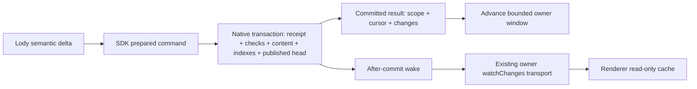

# Roost Native command and publication boundary

Status: proposed
Type: architecture
Translation: current
Owner: Codex
Updated: 2026-10-23

[中文](2026-10-23-roost-native-publication-boundary.zh.md)

## Abstract

Roost writes already share an atomic content transaction, but surrounding checks
and publication still cross independent SDK, Native and Loro boundaries. Propose
a complete Native command and durable published head, observed through the
existing owner transport, to remove per-fragment control-document history and
repeated proof transport. All transaction checks, receipts and retained frames
remain. The coordinated implementation is local and behaviorally checked; measured CPU/storage gains and remaining regressions are recorded below. A separate lossless
cold-projection model saves only 3.1% of total storage in the inspected workload;
do not make that layout change the main refactor.

## Evidence and decision scope

The [architecture audit](2026-10-23-roost-append-cpu-structure.md#architecture-review-after-the-storage-experiments--2026-10-23)
owns the fixed sources and attribution. Ordinary 256-byte appends still use seven
serial Native requests. One inspected write request is 4,649 JSON bytes, including
2,884 bytes of fourteen expected-index rows. This is local protocol overhead.
The retained control database is 4.172 MiB despite a current 246-byte value in the
attribution sample. Shared-body duplication is already fixed; namespace interning
and independent KV compression already exist.

This review proposes changing ownership of **history publication**, not moving
all Lody control state into Roost. Queue/cancel/configuration/human attribution and
workspace activation retain their existing owners and ordering. It changes no
authorization or signature guarantee. Loro library code, generic persistence and
the plain Loro backend remain fixed. Product intent remains on-demand history
with durable per-action completion; exact new internal APIs still need review.

## Proposed command path

The SDK prepares an owned command from its previous certified observation: stream,
generation/activation epoch, target identity, operation identity/digest, expected
seq, delta and publication preconditions. Warm writes submit that command directly;
receipt lookup and generation/seq/index comparisons occur **inside** Native's
transaction. Native still compares all required rows, including index-only
changes. Do not substitute the event cursor for fourteen independent invariants
or introduce a global revision that some writer fails to advance. Cold/stale
preparation refreshes the coherent snapshot. No Lody schema decoder needs to be
copied into Rust core.

The same transaction checks the operation receipt/digest, commits content and its
existing receipts, updates eligible projections and durable change metadata, and
advances the published head only when the whole interval is certified. Its reply
describes that committed observation. The owner installs deltas only against the
matching previous head; a newer notification/reply supersedes it. Independent
reads continue obtaining fresh authoritative observations.

The warm-path target is one Native command, with preparation or repair on cold,
stale and exceptional paths. The final isolated counter confirms this for 95% of ordinary appends; this does not establish an all-path speed claim.
Native must distinguish an identical committed receipt from a conflicting digest,
and route an existing complex receipt to recovery without applying content.
The returned snapshot must not be reconstructed from an assumed earlier success.
Existing receipt-only and complex recovery routes cannot be removed until their
consumers are replaced.

Three implementation choices were considered. Merely batching preflight reads
retains separate observation/write boundaries and repeated proof transport.
Porting the whole Lody adapter into Rust would duplicate or relocate substantial
application semantics. A Native private prepared-proof handle could avoid sending
the fixed proof, but introduces eviction, restart, scope and aggregate-memory
lifetimes. **Do not add those handles in the first unit.** First use the existing
explicit immutable preconditions with atomic idempotent submission and one
publication authority. This retains the proof's JSON bytes initially; measure
that remaining cost before introducing a cache or a generic command framework.

## Published head and recovery

The head is a current Native record, not a second append-only notification log.
It binds observation scope, generation/activation identity, published-through
cursor, publication revision and logical count. Existing durable event metadata
owns change coverage; the head must not duplicate every old change payload.
Physical event progress and fully indexed/published progress remain distinct.

- A completely indexed local command advances content and head atomically.
- If pending/foreign work prevents certification, content may commit while the
  ready head stays behind. The existing durable journal tail identifies repair
  work. One owner catches up, then CAS-publishes the complete head. Readers must
  not expose an unindexed future body as a coherent published snapshot. Repair
  failure is scoped and observable, not an indefinitely silent wait.
- Lost replies recover through existing receipts. A duplicate must not reapply
  text or pretend its old result is the current branch. If the exact local
  projection cannot be certified, reload the affected bounded window.
- Generation replacement remains prepare-then-activate. Publish its complete new
  head before making the existing activation pointer visible; old writers remain
  fenced. Do not assume cross-stream atomicity.

RPC pages, bodies and head must describe one stable observation. Use a scoped
checkpoint/head identity across generation changes; a scalar event cursor or
globally compared `historyRevision` alone is insufficient. Renderer cache rows
and checkpoint still advance atomically. Foreign evidence resets the latest
window, keeps the prior readable snapshot until replacement commits, and never
sweeps old bodies. Remove the control-document revision dependency from the
owner RPC, command RPC client, renderer bridge and cache comparisons together.
Preserve offline cached reads and existing transport/access boundaries.

## Observation without blocking writes

Before this unit, Rust core already had after-commit, coalesced subscriptions,
but Native did not expose a nonblocking notification subscription. Its ordinary Worker request lane
is serial. A long Native watch on that lane would prevent the writes that wake
it; this design explicitly rejects that implementation.

Expose an owned, bounded Native wake channel outside ordinary request execution.
Register before obtaining the initial head; drain the persisted journal from its
checkpoint. Signals may coalesce, but journal coverage cannot be lost. Both local
writes and remote sync commits on the shared Native owner must wake it. Reuse
Machine RPC/Electron `watchChanges` for consumers; do not add per-session network
connections. A stopped subscriber releases its waiter, not the shared writer.

Trigger: active history observers. Owner: the existing pooled Native client,
with per-session leases. Cancellation: unsubscribe/abort joins or unregisters the
observer; it never labels dispatched writes canceled. Handoff: reconnect registers
and resumes from durable evidence. Failure: existing bounded owner diagnostics
and retryable reads retain readable cache data; commit notification failure never
turns a committed write into a claimed rollback. Close stops admission, releases
subscriptions and follows the existing bounded finalization policy. No new
permanent workspace gate, detached retry owner or Effect dependency upgrade.

Wake guarantees remain within the supported shared Store owner. Independent
processes must route through that owner; current core subscriptions do not provide
cross-Store/process filesystem notifications. Do not silently claim that support.

## Native layout feasibility result

An isolated model moves **only sealed projection nodes** from individual KV rows
to per-Turn bounded blocks, using the actual current Rust `Page::pack` and
`lz4_flex` encoder. It keeps headers/verification flags, mutable SDK indexes,
receipts and every original frame/event/update block byte-identical. Sealing does
not make publication membership, conflicts or verification upgrades immutable.

The existing synthetic 1,000-Turn sample has 23,000 moved projection rows. They
become 1,000 blocks, largest decoded block 2,563 bytes; every key/value round-trips
exactly. Baseline and model are both independently backed up and VACUUMed with
the same 4 KiB geometry:

| Offline allocation                  | Baseline KiB | Model KiB |       Reduction |
| ----------------------------------- | -----------: | --------: | --------------: |
| Native database                     |       19,616 |    18,884 | 732 KiB / 3.73% |
| Native + unchanged control database |       23,888 |    23,156 | 732 KiB / 3.06% |

This is a layout feasibility model, not a runnable Native format or a CPU/RSS/
read/seal benchmark. The source DB/WAL hashes, all non-projection records and
decoded moved records are checked unchanged; both copies pass quick/FK checks.
Raw script, codec helper and `layout-model.json` are in external
`shared-body-validation/architecture-refactor-feasibility/`. These model copies
must not be opened with the current Native runtime.

Do not prioritize this storage refactor on these savings. A future version needs
atomic seal-time movement, bounded compaction memory, unchanged range reads and
verification upgrades, and measured seal/cold-read costs. It would require a new
experimental private container with no old reader/migration; do not clear old data.

## Delivery and acceptance

First review/implement the complete command, Native head and complete observer
consumer path as one coordinated unit. Core wire frames, IDs and seal hashes need
not change; application/RPC capability negotiation does. Ship matching CLI,
renderer and SDK/Native support, remove the superseded cursor publisher, and
reject unsupported experimental combinations explicitly. Do not add a second
long-term reader or silently fall back to Loro. A core storage-format change is
not a prerequisite for this unit.

Extend the existing owning suites from the [validation workflow](../../../docs/roost-validation.md)
with crash/lost reply, receipt conflict, index-only/generation races, pending
remote work, subscribe/bootstrap overlap, reconnect, canceled waiters, read
coherence and offline cache behavior. A ready head must never certify missing
indexes, and old generation writers must never resurrect a branch.

Then use fixed Loro bytes and paired four-workload plus 100/1,000/10,000-prefix
measurements. Report CPU, RSS growth, DB/control/Native allocation, ordinary/cold/
resumed append and finish/seal/read latency in chat. Preserve FULL/WAL and each
action's persistence completion; no timers, throttled durability or larger caches
may create the result. No acceptance or magnitude is promised before those checks.

## Authorized implementation

The user authorized this proposal's implementation after the feasibility review.
Implementation is complete locally, with measured limits below; no all-path performance or release acceptance is implied. Preserve the prior combined local
changes, freeze a source/dependency baseline, implement Native receipt-aware
commands and an independent bounded wake channel, then move publication and all
consumers together. Use the existing validation workflow, without restarting
unrelated experiments. Native ownership is recorded in Roost's
`2026-10-23-native-command-publication.md`. No merge, release, deployment or data
cleanup is part of this authorization.

## Correctness and lifecycle verification

The Native receipt comparison and content/index transaction distinguish partial
immutable replay from digest conflict. A lost reply cannot append content twice.
Only receipt-backed immutable input/agent commands may recover partial durable
work. Once an action completes, publication CAS races retry projection/publication
only; exhaustion reports `publication_stale` while retaining the committed body.
Ordinary actions with durable evidence are not replayed.

Generation replacement captures its raw host/id/history/epoch before awaiting,
prepares the new head before activation, then compares old head, absent `next`
and exact epoch in the activation transaction. Both index-only race regressions
reject stale writes without changing the old stream or foreign activation pointer.
Scope closures bind the active host/window rather than a concurrent resolution.

Native notifications run outside the serial request lane. Parent consumption
acknowledges the one in-flight hint; dirty-stream coalescing, bounded index-key
hints and one queued owner refresh prevent message/closure accumulation. Every
pooled registration gets a fresh bootstrap before service admission. Unchanged
index CAS emits no hint. Close/unsubscribe cannot create another subscription or
close a shared writer. Independent Store/process filesystem wakes remain unsupported.

Protocol v3, RPC checkpoint straddling, command-RPC observation and renderer cache
v3 move together. A retired Loro revision cannot outrank a Native checkpoint; old
data is retained without an old reader/migration. Foreign edits invalidate old
loaded pages from a complete contiguous head hint, or conservatively from zero.

Rust serial tests pass 379 with six ignored; the initial parallel run's three rs3
loopback failures are retained and isolated serial rs3 passes 22/22. Native/sync
49/49, SDK process index 38/38, combined CLI 132/132, shared protocol 27/27 and
renderer/cache 111/111 pass. Configured types/build, Rust/Native clippy and public
boundary pass. Two interrupted performance runs (71/91 stages) are preliminary;
only the final frozen run below supports the resource claims. These checks are
not a six-platform release or a strict all-path performance guarantee.

## Final local resource measurements

Frozen sources/binaries are recorded in the external environment/build manifests.
Node 24.22.1 / Apple M4; two trials per cell, baseline→candidate→Loro→Loro→candidate→baseline.
Both Roost sides include the previous integrated CPU/shared-body work. This unit
compares only the command/publication boundary. All completed variants have equal
canonical business content, reopen digests and unique complete paging; Roost
stable-retry verification passes. FULL/WAL and per-action persistence are unchanged.
No other tests or compilation overlap the main paired measurement intervals.

DB growth includes control + Native allocation above empty DBs, excluding WAL/SHM
and the independent identity DB. RSS is the entire Vitest/JS/Native process before
full export; growth is relative to backend-open, not Native-exclusive retention.
Values are medians of two trial statistics. Full per-trial categories and memory
trajectories remain in external results.json and raw stage files.

| Workload                        | Variant   | DB growth KiB | Control KiB | Append CPU s | Append p50 / p95 ms | RSS MiB / growth MiB |
| ------------------------------- | --------- | ------------- | ----------- | ------------ | ------------------- | -------------------- |
| 2 messages / 224 appends        | baseline  | 218           | 56          | 0.378        | 1.03 / 2.10         | 387.1 / +49.2        |
| 2 messages / 224 appends        | candidate | 164           | 0           | 0.268        | 0.66 / 1.66         | 387.7 / +60.3        |
| 2 messages / 224 appends        | loro      | 128           | 128         | 0.106        | 0.32 / 0.54         | 354.0 / +36.7        |
| 1,000 messages / 10,000 appends | baseline  | 23,320        | 3,248       | 10.097       | 0.72 / 2.10         | 545.1 / +218.1       |
| 1,000 messages / 10,000 appends | candidate | 20,108        | 0           | 6.113        | 0.45 / 1.09         | 546.6 / +209.7       |
| 1,000 messages / 10,000 appends | loro      | 13,720        | 13,720      | 9.273        | 0.13 / 0.99         | 580.6 / +278.0       |
| 1 MiB assistant reply           | baseline  | 1,716         | 264         | 0.990        | 0.68 / 1.36         | 472.5 / +145.0       |
| 1 MiB assistant reply           | candidate | 1,448         | 0           | 0.769        | 0.48 / 1.18         | 489.4 / +162.0       |
| 1 MiB assistant reply           | loro      | 1,448         | 1,448       | 2.501        | 1.59 / 3.87         | 491.4 / +188.7       |
| Mixed tools / resumed writes    | baseline  | 3,202         | 272         | 1.442        | 0.83 / 2.33         | 518.9 / +191.1       |
| Mixed tools / resumed writes    | candidate | 2,930         | 0           | 1.090        | 0.59 / 1.73         | 527.5 / +201.1       |
| Mixed tools / resumed writes    | loro      | 1,904         | 1,904       | 0.776        | 0.34 / 1.10         | 496.8 / +194.5       |

| Workload                        | Variant   | User / assistant / finish p95 ms | Resume / first resumed append p95 ms | Write-stage CPU s | Sampled peak RSS MiB | WAL MiB | Open→latest ms | Oldest page ms | Full export ms |
| ------------------------------- | --------- | -------------------------------- | ------------------------------------ | ----------------- | -------------------- | ------- | -------------- | -------------- | -------------- |
| 2 messages / 224 appends        | baseline  | 21.45 / 13.51 / 3.14             | not triggered                        | 0.675             | 387.1                | 7.04    | 124.87         | 0.24           | 4.89           |
| 2 messages / 224 appends        | candidate | 24.52 / 14.28 / 3.45             | not triggered                        | 0.617             | 387.7                | 4.14    | 114.67         | 0.23           | 7.07           |
| 2 messages / 224 appends        | loro      | 14.52 / 2.13 / 1.40              | not triggered                        | 0.205             | 354.0                | 3.17    | 39.97          | 0.13           | 0.32           |
| 1,000 messages / 10,000 appends | baseline  | 8.84 / 14.02 / 3.92              | not triggered                        | 31.327            | 545.1                | 7.98    | 383.82         | 1078.83        | 962.95         |
| 1,000 messages / 10,000 appends | candidate | 6.78 / 10.40 / 3.45              | not triggered                        | 30.470            | 546.6                | 4.21    | 205.44         | 885.49         | 773.48         |
| 1,000 messages / 10,000 appends | loro      | 0.66 / 1.14 / 0.34               | not triggered                        | 11.573            | 584.9                | 3.96    | 397.20         | 0.69           | 9.28           |
| 1 MiB assistant reply           | baseline  | 29.95 / 12.66 / 7.20             | not triggered                        | 1.702             | 472.5                | 7.91    | 219.22         | 0.44           | 29.36          |
| 1 MiB assistant reply           | candidate | 25.72 / 13.24 / 9.06             | not triggered                        | 1.602             | 489.4                | 4.15    | 173.01         | 0.43           | 26.02          |
| 1 MiB assistant reply           | loro      | 22.35 / 2.26 / 1.60              | not triggered                        | 2.665             | 642.9                | 3.94    | 60.57          | 0.20           | 0.24           |
| Mixed tools / resumed writes    | baseline  | 23.91 / 13.23 / 6.23             | 18.26 / 5.45                         | 2.738             | 523.5                | 7.96    | 263.14         | 1.14           | 30.33          |
| Mixed tools / resumed writes    | candidate | 24.40 / 14.16 / 6.95             | 18.49 / 2.62                         | 2.784             | 536.9                | 4.20    | 234.31         | 4.00           | 40.76          |
| Mixed tools / resumed writes    | loro      | 17.31 / 2.02 / 0.87              | 1.35 / 4.49                          | 0.985             | 497.2                | 3.94    | 70.01          | 0.97           | 0.75           |

Fixed prefixes use already prepared indexes and the same current message/20 appends. Roost is paired; Loro is freshly prepared and measured after the paired stages. No historical number fills a failed measurement. This excludes first network download/indexing and renderer-visible recovery.

| Prefix | Variant   | Open / first / warm selection ms | First append ms | Append p50 / p95 ms | Append CPU s | RSS latest→selected→appended MiB | Full export ms |
| ------ | --------- | -------------------------------- | --------------- | ------------------- | ------------ | -------------------------------- | -------------- |
| 100    | baseline  | 190.82 / 3.00 / 0.48             | 17.89           | 2.09 / 17.89        | 0.168        | 363.3 → 363.9 → 373.3            | 80.50          |
| 100    | candidate | 186.82 / 2.56 / 0.33             | 8.83            | 1.27 / 8.83         | 0.089        | 363.0 → 363.4 → 368.8            | 77.95          |
| 100    | loro      | 33.73 / 2.83 / 0.80              | 11.98           | 0.32 / 11.98        | 0.023        | 330.7 → 338.0 → 346.1            | 1.03           |
| 1000   | baseline  | 213.21 / 2.48 / 0.33             | 24.96           | 1.26 / 24.96        | 0.145        | 366.8 → 367.3 → 374.5            | 789.37         |
| 1000   | candidate | 196.38 / 2.58 / 0.33             | 8.96            | 1.72 / 8.96         | 0.134        | 366.5 → 367.0 → 373.9            | 811.82         |
| 1000   | loro      | 152.61 / 9.67 / 5.29             | 19.00           | 0.28 / 19.00        | 0.046        | 493.2 → 497.6 → 502.7            | 8.12           |
| 10000  | baseline  | 260.21 / 2.69 / 0.36             | 81.43           | 1.72 / 81.43        | 0.132        | 417.4 → 417.7 → 446.0            | 7876.54        |
| 10000  | candidate | 269.13 / 2.98 / 0.71             | 11.42           | 0.96 / 11.42        | 0.039        | 417.2 → 417.6 → 419.8            | 7799.33        |

The 10,000-prefix Loro complete stage exceeds the unchanged 2 GiB process RSS
guard twice, including an isolated fresh-seed retry. The final `after-release`
assertion prevents measure.json output, so neither its first over-budget phase
nor append latency can be recovered. Do not call this an append OOM or compute a
speedup ratio from it. Keep both failures; no budget was relaxed. There are 110
successful stages and 185 SQLite quick/FK checks. The two earlier interrupted
71/91-stage runs are preliminary and excluded.

### Outcome and remaining limits

A separate same-workload counter diagnostic passes write/reopen/paging. Native
requests drop 71,503→11,500: 95% of appends use 7→1 requests; each assistant's first
chunk still performs three index reads plus its commit. All 10,000 commits apply
metadata and atomic derived indexes. No receipt, CAS or persistence guarantee is
removed. Instrumented timing/RSS is not used as performance evidence.

This improves CPU/storage but does not establish superiority over Loro everywhere.
Short/mixed append CPU is respectively 2.53×/1.41× Loro; streaming 1,000-message
and 1 MiB append CPU is 0.66×/0.31× Loro. DB growth remains 1.00–1.54× Loro. RSS
does not fall in every workload: the 1 MiB process grows 472.5→489.4 MiB, with
opened-baseline growth +145.0→+162.0 MiB. Without Native-exclusive or post-GC live
retention evidence this proves neither a leak nor a memory improvement.

At prefix 1,000 the immediate 20-append p50 is 1.26→1.72 ms, although the first
append falls 24.96→8.96 ms. The last eight appends' two-trial median is about
1.07→0.71 ms. Retain all early/late samples; do not present these as fully warmed
or exclude slow samples. Exact function attribution is unproven. Two trials do
not prove a strict all-path speed guarantee. Real network/sync bytes/offsets, ACP,
renderer latency, Native-exclusive RSS and power-loss simulation are unmeasured.

Implementation and local validation are complete with these limits. Status stays
proposed; no merge, release or deployment. Matching new SDK/Native and
CLI/renderer must ship together; published npm 0.2.0 lacks these capabilities.
Loro library, generic persistence, plain Loro backend and online user data stay
fixed. External native-publication/ holds sources/build manifests, stage logs,
failures, counts and raw resources; no databases or captured transcripts enter Git.

Matching Native review: [loro-dev/roost#28](https://github.com/loro-dev/roost/pull/28). The consumer draft uses the tested integration base; new npm SDK/Native publication remains required.

Submission checks: root pnpm format passes. pnpm check types/lint/Effect and
workspace tests pass (CLI 4,552, components 5,962, shared 1,610), then desktop
staging fails against a bare source link without installed platform metadata.
The complete Electron suite passes separately against the same candidate staged
in the actual split-package layout; i18n and all remaining boundary guards pass.
Do not relabel that root command or the published npm graph as passing. Initial
unused-parameter/protocol-golden and setup failures remain with corrected runs;
docs reports zero errors and 71 warnings.

Consumer draft: [LodyAI/Lody#1839](https://github.com/LodyAI/Lody/pull/1839), reviewed against codex/roost-stack-integration. Land the preceding stack and Roost #28, publish matching packages, then update consumer pins and retarget for final merge.
