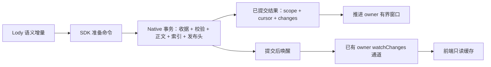

# Roost Native 命令与发布边界

Status: proposed
Type: architecture
Translation: current
Owner: Codex
Updated: 2026-10-23

[English](2026-10-23-roost-native-publication-boundary.md)

## 摘要

Roost 已有正文原子事务，但外围检查和发布仍跨 SDK、Native、Loro 独立执行。建议由 Native 持有准备好的命令及持久发布头，通过已有 owner 通道订阅，去掉逐片段控制文档历史和重复凭据传输；事务检查、收据和原始帧完整保留。本地实现与行为检查已完成，实测 CPU/体积收益及剩余回退见下文。另一个无损封存投影模型在所检查负载中仅省整套存储的 3.1%，不应把该布局调整作为主重构。

## 证据与待评审范围

[架构审计](2026-10-23-roost-append-cpu-structure.zh.md#存储实验后的架构审查--2026-10-23)拥有固定源码和归因。普通 256-byte 追加仍有 7 次串行 Native 请求；所检查的写请求 JSON 4,649 字节，其中 14 项索引前置条件占 2,884 字节。这是本地协议开销。逐字节归因样本的控制库为 4.172 MiB，当前控制值仅 246 字节。正文共享已经完成；namespace 编号和普通 KV 独立压缩也已存在。

本轮讨论的是**历史发布**的归属，不把所有 Lody 控制状态移到 Roost。队列、取消、配置、用户归属及 Workspace 激活继续保留原 owner 与顺序，不改变授权或签名保证。Loro 本体、通用持久化及纯 Loro 路径固定不动。产品意图仍是按需历史与每动作持久完成；具体新接口仍待评审。

## 建议的命令路径

SDK 从前一次经过认证的观察准备独立拥有的命令：stream、generation/激活 epoch、目标身份、操作身份/摘要、预期 seq、增量和发布前置条件。温写入直接提交命令，收据查询以及 generation/seq/索引比较都在 **Native 事务内**完成。Native 仍比较全部所需记录，包含不发事件的索引修改。不能用 event cursor 替换 14 项独立不变量，也不能新增一个部分写入者忘记推进的全局 revision。冷/过期路径重新准备一致快照；Rust 核心不需要复制一套 Lody schema 解析器。

同一事务检查操作收据/摘要，提交正文与原有收据，更新满足条件的投影和持久变更元数据，且仅在整个区间经过认证时推进发布头。回复描述这一次已提交观察。owner 只在前一 head 匹配时安装增量；已观察到更新的通知/回复时不能倒退。独立读取仍获取新的权威观察。

温路径目标是一次 Native 命令；冷、过期和异常路径允许准备或修复。这是设计目标，不是已完成的调用次数或速度收益。Native 必须区分相同的已提交收据与冲突摘要；已有复杂收据时只转入恢复，不追加正文。返回快照不能基于假定的先前成功重建；现有纯收据及复杂恢复路径要等其消费者完整替换后才能删除。

评估过三种实现选择：只合并预读仍保留观察/写入的分离边界与重复凭据传输；把整个 Lody adapter 移到 Rust 会重复或搬迁大量业务语义；Native 私有准备凭据句柄虽可减少固定凭据传输，却增加逐出、重启、scope 和总内存的生命周期。**第一单元不加这种句柄。**先使用现有显式不可变前置条件，完成原子幂等提交与单一发布权威；固定凭据的 JSON 字节暂时保留，测清剩余成本后再决定是否需要缓存或通用命令框架。

## 发布头与恢复

head 是 Native 中的一条当前记录，不再追加另一份通知历史。它绑定观察 scope、generation/激活身份、已发布 through 游标、发布 revision 和逻辑 count。变更覆盖仍由已有持久事件元数据承担；head 不复制所有旧变更载荷。物理事件进度与已完成索引/发布的进度保持区分。

- 完成全部索引的本地命令原子推进正文和 head。
- 待处理或外来工作使认证失败时，正文可以已经提交，但 ready head 暂不前进。既有持久日志尾部标识待修复工作；一个 owner 追赶完成，再 CAS 发布完整 head。读取不能把尚未索引的后续正文标为一致快照。修复失败要局部、可观察，不能静默无限等待。
- 丢回复通过已有收据恢复；重复请求既不重复追加，也不把旧结果冒充当前分支。无法证明本地投影时，重载受影响的有界窗口。
- generation 替换继续先准备再激活；在既有激活指针可见前完成新 head，旧写入者继续被隔离。不假定跨 stream 原子性。

RPC 页、正文和 head 必须来自同一次稳定观察。跨 generation 使用带 scope 的 checkpoint/head 身份，不能只用标量 event cursor 或全局比较的 historyRevision。前端缓存行和 checkpoint 仍原子推进；外来凭据只重置最近窗口，新窗口提交前保留旧的可读快照，不自动扫旧正文。owner RPC、命令 RPC client、前端 bridge 和缓存比较必须一起去掉控制文档 revision 依赖，保留离线已缓存读取及现有传输/访问边界。

## 订阅不能阻塞写入

本轮之前，Rust 核心已有提交后合并通知，但 Native 尚未暴露非阻塞订阅。其普通 Worker 请求通道是串行的；若把 Native 长等待塞进该通道，会堵住本来应唤醒它的写入。本方案明确排除这种实现。

在普通请求执行之外暴露有 owner、容量有界的 Native 唤醒通道。先注册，再读初始 head，之后按 checkpoint 追持久日志。信号可合并，日志覆盖不能丢；共享 Native owner 的本地与远端同步提交均要唤醒。消费者复用 Machine RPC/Electron watchChanges，不新增每会话网络连接。取消订阅者只释放其 waiter，不终止共享 writer。

触发来自活跃历史观察者；归属为现有池化 Native client，每会话持有租约。取消要注销或等待释放订阅，不把已派发写入标成取消。重连接手从持久凭据续读。失败沿用有界诊断和可重试读取，保留可读缓存；通知失败不能把已提交写入报告成已回滚。关闭时停止接纳、释放订阅并沿用有界终结策略。不增加永久 Workspace gate、无主后台重试或 Effect 依赖升级。

唤醒保证限定于支持的共享 Store owner；独立进程应通过该 owner 访问。当前核心订阅不提供跨 Store/进程文件通知，不能暗中宣称具备该能力。

## Native 布局的可行性结果

隔离模型**只将封存的 projection 节点**从逐条 KV 转为每 Turn 的有界块，调用当前实际 Rust Page::pack 与 lz4_flex 编码。header/验证标记、可变 SDK 索引、收据及原始 frame/event/update 块保持逐字节一致。消息封存不代表发布成员关系、冲突或验证升级都不可变。

既有千条合成样本有 23,000 条可移动投影记录，成为 1,000 个块；最大解码块 2,563 字节，所有键值往返精确。基线和模型均独立备份，再以相同 4 KiB 页尺寸 VACUUM：

| 离线分配量          | 基线 KiB | 模型 KiB |            减少 |
| ------------------- | -------: | -------: | --------------: |
| Native 库           |   19,616 |   18,884 | 732 KiB / 3.73% |
| Native + 未改控制库 |   23,888 |   23,156 | 732 KiB / 3.06% |

这是布局可行性模型，不是可供 Native 打开的格式，也不是 CPU/RSS、读取或 seal 性能验收。源 DB/WAL 哈希、所有非投影记录和解码后的移动记录都核对未变，双方副本 quick/FK 通过。脚本、实际 codec 辅助程序和 layout-model.json 保存在外部 shared-body-validation/architecture-refactor-feasibility/；这些模型副本不得交给当前 Native 运行。

按这个收益，不优先做该存储重构。后续版本仍须原子完成 seal 阶段移动，限制整理内存，保持范围读取和验证升级，并实测 seal/冷读成本。若采用，需要新的实验私有容器格式，不保留旧 reader/migrate，也不清理旧数据。

## 交付与验收

优先将准备命令、Native head 和完整订阅消费链作为一个协调单元评审/实现。核心 wire 帧、ID 和 seal hash 不必改变；应用/RPC 能力协商要改变。CLI、前端和 SDK/Native 配套交付，删除被替代的游标发布路径，不支持的实验组合明确拒绝。不保留第二套长期 reader，不静默回退 Loro；此单元不以修改核心存储格式为前提。

复用[固定验证流程](../../../docs/roost-validation.md)所属 suites，扩展崩溃/丢回复、收据冲突、不发事件的索引/generation 竞争、远端待接纳、首次订阅/快照重叠、重连、取消 waiter、一致读取和离线缓存用例。ready head 不能认证缺失索引，旧 generation 写入者不能恢复被替换分支。

之后固定 Loro 字节，配对跑四负载与 100/1000/10000 前缀。在聊天内同时报告 CPU、RSS 增长、DB/control/Native 分配量、普通/冷/继续追加以及 finish/seal/读取时延。保持 FULL/WAL 和每动作持久完成；不得用 timer、延迟持久化或扩大缓存造收益。验收前不承诺优化幅度。

## 已授权实现

用户在可行性评估后授权实现本方案。本地实现已完成，测量限制见后文；尚未认可全路径性能或发布验收。保留之前的本地组合改动，先固定源码/依赖基线，实现 Native 事务内收据查询与独立有界唤醒，再统一移动发布与完整消费链。沿用既定验证流程，不重启无关实验。Native 归属记录在 Roost 的 2026-10-23-native-command-publication.md；本次授权不包含合入、发包、部署或数据清理。

## 正确性与生命周期验证

Native 在正文/索引事务内比较收据，区分不可变命令的部分重放与摘要冲突，丢回复不会
重复追加。只有带收据的不可变输入/agent 命令可恢复部分落盘操作。操作完成后的发布
CAS 竞争只重试投影/发布；耗尽后报告 publication_stale 并保留已提交正文。有持久化
证据的普通操作不会整体重放。

generation 替换在任何 await 前捕获 raw host/id/history/epoch，先准备新 head，再在
激活事务比较旧 head、next 缺失与 epoch 原值。两个 index-only 竞争用例均拒绝 stale
写入，不改旧 stream 或外来激活指针；scope 闭包绑定当前 host/window。

Native 通知独立于串行请求队列。父端消费后才 ACK，一个在途提示、dirty-stream 合并、
有界索引提示和单个 owner 刷新任务共同限制积压。每次 pooled 注册都有新初始提示，
注册完成后才暴露服务；无变化的 index CAS 不通知。关闭/退订不能新建订阅或关闭共享
writer。独立 Store/进程的文件系统通知仍不支持。

协议 v3、RPC 前后 checkpoint 校验、命令 RPC 订阅与前端 v3 缓存一起切换；旧 Loro
revision 不能覆盖 Native checkpoint，不删除旧数据，也不添加旧格式读取器/迁移。
外来修改按连续 head 的完整提示使旧页失效，覆盖不确定时保守从零失效。

Rust 串行 379 通过、6 忽略；首次并行的 3 个 rs3 本地回环失败保留，单独串行 rs3
22/22 通过。Native/sync 49/49、SDK 进程索引 38/38、合并 CLI 132/132、共享协议
27/27、前端缓存 111/111 通过；配置类型/构建、Rust/Native clippy 与 public boundary
通过。中途停止的 71/91 阶段保留为初测，只有下文最终冻结运行支持资源结论。这些检查
不能替代六平台发布或严格全路径性能保证。

## 最终本地资源测量

固定源码和二进制见 environment.json、build-inputs.json。Node 24.22.1 / Apple M4；四负载各两轮，前→后→Loro→Loro→后→前。已包含此前所有本地 CPU/共享正文改动，本轮只比较 Native 命令与发布边界。所有完成的变体业务摘要、重开与完整唯一分页相同，Roost 稳定重试验证通过；万条前缀 Loro 完整阶段两次触及 RSS 限制，未计为通过。

数据库增量为 history + control 从空库增长，不含 WAL/SHM 与独立 identity。RSS 为完整测试进程，包含 Vitest/JS/Native；增长相对 backend-open，最终全量导出前取值，不是 Native 独占内存。所有数值为两轮中位数；raw JSON 保留每轮、每类追加和完整内存轨迹。

| 负载                         | 组        | DB 增量 KiB | 控制库 KiB | 追加 CPU s | 追加 p50 / p95 ms | RSS MiB / 增长 MiB |
| ---------------------------- | --------- | ----------- | ---------- | ---------- | ----------------- | ------------------ |
| 两条消息 / 224 次追加        | baseline  | 218         | 56         | 0.378      | 1.03 / 2.10       | 387.1 / +49.2      |
| 两条消息 / 224 次追加        | candidate | 164         | 0          | 0.268      | 0.66 / 1.66       | 387.7 / +60.3      |
| 两条消息 / 224 次追加        | loro      | 128         | 128        | 0.106      | 0.32 / 0.54       | 354.0 / +36.7      |
| 1,000 条消息 / 10,000 次追加 | baseline  | 23,320      | 3,248      | 10.097     | 0.72 / 2.10       | 545.1 / +218.1     |
| 1,000 条消息 / 10,000 次追加 | candidate | 20,108      | 0          | 6.113      | 0.45 / 1.09       | 546.6 / +209.7     |
| 1,000 条消息 / 10,000 次追加 | loro      | 13,720      | 13,720     | 9.273      | 0.13 / 0.99       | 580.6 / +278.0     |
| 单条 1 MiB 回复              | baseline  | 1,716       | 264        | 0.990      | 0.68 / 1.36       | 472.5 / +145.0     |
| 单条 1 MiB 回复              | candidate | 1,448       | 0          | 0.769      | 0.48 / 1.18       | 489.4 / +162.0     |
| 单条 1 MiB 回复              | loro      | 1,448       | 1,448      | 2.501      | 1.59 / 3.87       | 491.4 / +188.7     |
| 混合工具 / 恢复续写          | baseline  | 3,202       | 272        | 1.442      | 0.83 / 2.33       | 518.9 / +191.1     |
| 混合工具 / 恢复续写          | candidate | 2,930       | 0          | 1.090      | 0.59 / 1.73       | 527.5 / +201.1     |
| 混合工具 / 恢复续写          | loro      | 1,904       | 1,904      | 0.776      | 0.34 / 1.10       | 496.8 / +194.5     |

| 负载                         | 组        | 用户/助手/结束 p95 ms | 恢复 / 首个恢复追加 p95 ms | 写阶段 CPU s | 采样峰值 RSS MiB | WAL MiB | 重开→最新 ms | 最旧页 ms | 全量导出 ms |
| ---------------------------- | --------- | --------------------- | -------------------------- | ------------ | ---------------- | ------- | ------------ | --------- | ----------- |
| 两条消息 / 224 次追加        | baseline  | 21.45 / 13.51 / 3.14  | 未触发                     | 0.675        | 387.1            | 7.04    | 124.87       | 0.24      | 4.89        |
| 两条消息 / 224 次追加        | candidate | 24.52 / 14.28 / 3.45  | 未触发                     | 0.617        | 387.7            | 4.14    | 114.67       | 0.23      | 7.07        |
| 两条消息 / 224 次追加        | loro      | 14.52 / 2.13 / 1.40   | 未触发                     | 0.205        | 354.0            | 3.17    | 39.97        | 0.13      | 0.32        |
| 1,000 条消息 / 10,000 次追加 | baseline  | 8.84 / 14.02 / 3.92   | 未触发                     | 31.327       | 545.1            | 7.98    | 383.82       | 1078.83   | 962.95      |
| 1,000 条消息 / 10,000 次追加 | candidate | 6.78 / 10.40 / 3.45   | 未触发                     | 30.470       | 546.6            | 4.21    | 205.44       | 885.49    | 773.48      |
| 1,000 条消息 / 10,000 次追加 | loro      | 0.66 / 1.14 / 0.34    | 未触发                     | 11.573       | 584.9            | 3.96    | 397.20       | 0.69      | 9.28        |
| 单条 1 MiB 回复              | baseline  | 29.95 / 12.66 / 7.20  | 未触发                     | 1.702        | 472.5            | 7.91    | 219.22       | 0.44      | 29.36       |
| 单条 1 MiB 回复              | candidate | 25.72 / 13.24 / 9.06  | 未触发                     | 1.602        | 489.4            | 4.15    | 173.01       | 0.43      | 26.02       |
| 单条 1 MiB 回复              | loro      | 22.35 / 2.26 / 1.60   | 未触发                     | 2.665        | 642.9            | 3.94    | 60.57        | 0.20      | 0.24        |
| 混合工具 / 恢复续写          | baseline  | 23.91 / 13.23 / 6.23  | 18.26 / 5.45               | 2.738        | 523.5            | 7.96    | 263.14       | 1.14      | 30.33       |
| 混合工具 / 恢复续写          | candidate | 24.40 / 14.16 / 6.95  | 18.49 / 2.62               | 2.784        | 536.9            | 4.20    | 234.31       | 4.00      | 40.76       |
| 混合工具 / 恢复续写          | loro      | 17.31 / 2.02 / 0.87   | 1.35 / 4.49                | 0.985        | 497.2            | 3.94    | 70.01        | 0.97      | 0.75        |

固定历史前缀：现成索引、当前消息和 20 次追加固定。Roost 前后配对；Loro 在本轮新建 seed 后独立两次测量；100/1,000 条完成，10,000 条两次触及 RSS 上限，无完整 CPU/时延结果。不使用历史数值填补缺口。冷追加单独列出，不混入温追加；不是首次下载、索引构建或用户界面恢复。

| 历史条数 | 组        | 打开 / 首次选择 / 温选择 ms | 首次追加 ms | 追加 p50 / p95 ms | 追加 CPU s | RSS 最新→选择后→追加后 MiB | 全量导出 ms |
| -------- | --------- | --------------------------- | ----------- | ----------------- | ---------- | -------------------------- | ----------- |
| 100      | baseline  | 190.82 / 3.00 / 0.48        | 17.89       | 2.09 / 17.89      | 0.168      | 363.3 → 363.9 → 373.3      | 80.50       |
| 100      | candidate | 186.82 / 2.56 / 0.33        | 8.83        | 1.27 / 8.83       | 0.089      | 363.0 → 363.4 → 368.8      | 77.95       |
| 100      | loro      | 33.73 / 2.83 / 0.80         | 11.98       | 0.32 / 11.98      | 0.023      | 330.7 → 338.0 → 346.1      | 1.03        |
| 1000     | baseline  | 213.21 / 2.48 / 0.33        | 24.96       | 1.26 / 24.96      | 0.145      | 366.8 → 367.3 → 374.5      | 789.37      |
| 1000     | candidate | 196.38 / 2.58 / 0.33        | 8.96        | 1.72 / 8.96       | 0.134      | 366.5 → 367.0 → 373.9      | 811.82      |
| 1000     | loro      | 152.61 / 9.67 / 5.29        | 19.00       | 0.28 / 19.00      | 0.046      | 493.2 → 497.6 → 502.7      | 8.12        |
| 10000    | baseline  | 260.21 / 2.69 / 0.36        | 81.43       | 1.72 / 81.43      | 0.132      | 417.4 → 417.7 → 446.0      | 7876.54     |
| 10000    | candidate | 269.13 / 2.98 / 0.71        | 11.42       | 0.96 / 11.42      | 0.039      | 417.2 → 417.6 → 419.8      | 7799.33     |

10,000 条前缀 Loro：固定流程的完整阶段（含全量验证和释放）两次超过 2 GiB 进程 RSS 上限。finally 的 after-release 断言阻止 measure.json 落盘，无法从该失败确定首次超限阶段或还原追加时延；不把它描述成追加本身 OOM。保留原始失败、未放宽限制。

本地边界覆盖已通过；不把 benchmark 通过等同于绝对正确性证明。真实网络字节、Stream offset、ACP 执行、前端可见延迟、独占 Native RSS 和断电测试未测量。两轮 RSS/时延有采样与 GC/系统噪声，不能据此诊断泄漏或声称所有路径提速。

成功阶段 110，另有万条 Loro 的两次 RSS 限制失败；SQLite quick/FK 检查 185。早前中途修正的 71/91 阶段保留为 preliminary，不混入本报告。

### 结果与边界

计数诊断独立于计时运行，沿用同一合成千条消息/万次追加与新进程重开/分页验证：
总 Native 请求 71,503→11,500；95% 追加为 7→1 次请求，其余 500 次为每条助手首个
片段的 3 次索引读取 + 1 次提交。两边 10,000 次提交均携带完整 metadata、应用原子
派生索引；没有关闭收据、CAS 或持久化。

CPU/体积目标有实测收益，但尚不能声称每种负载全面优于 Loro。短负载追加 CPU 为
Loro 的 2.53 倍，混合负载为 1.41 倍；流式千条/万次追加为 Loro 的 0.66 倍，单条
1 MiB 为 0.31 倍。总 DB 增量仍为 Loro 的 1.00–1.54 倍。RSS 并非各组都下降；
1 MiB 回复的进程 RSS 为 472.5→489.4 MiB，增长为 +145.0→+162.0 MiB。没有独立
Native 内存或 GC 后存活量证据，不能归因泄漏，也不能宣称内存验收改善。

固定千条前缀的 20 次启动追加 p50 为 1.26→1.72 ms，但首个追加为 24.96→8.96 ms；
后八次的两轮中位数约 1.07→0.71 ms。原始前十二次与后八次轨迹保留，未把启动阶段
样本当成已充分预热，也未擅自排除慢样本。差异的具体函数归因尚未建立，不宣称所有
路径无回退。两轮样本不能建立严格的全场景性能保证。

实现与本地验证已完成；保留上述限制，状态仍为 proposed，未合入、发布或部署。
需要一起发布新的 SDK/Native 与匹配的 CLI/renderer；当前 npm 0.2.0 不提供新能力，
不能直接拿此接入单独上线。未改动 Loro 库、通用持久化、纯 Loro 后端或在线用户数据。
完整原始数据、构建/源码哈希、阶段日志、失败记录、调用计数和恢复检查保留在外部
shared-body-validation/native-publication/；不提交运行库或捕获的用户对话。

配套 Native 审查：[loro-dev/roost#28](https://github.com/loro-dev/roost/pull/28)。消费方草稿沿用实测整合基线，新 npm SDK/Native 发布仍是门禁。

提交检查：根 pnpm format 通过；pnpm check 的类型、lint/Effect 与 workspace 测试通过，
含 CLI 4,552、components 5,962、shared 1,610。桌面 staging fixture 在裸源码链接下缺
已安装平台包，完整 Electron 套件改用相同候选的实际 split-package 布局单独通过；
i18n 和所有后续边界检查通过。未把根命令的装配失败或已发布 npm 图称为通过。初次
未用参数、协议预期值及装配失败与复测日志均保留；docs 0 错误、71 警告。

消费方草稿：[LodyAI/Lody#1839](https://github.com/LodyAI/Lody/pull/1839)，审查基线为 codex/roost-stack-integration。先合入前序栈与 Roost #28、发布匹配包，再更新消费方依赖并调整最终合入目标。
