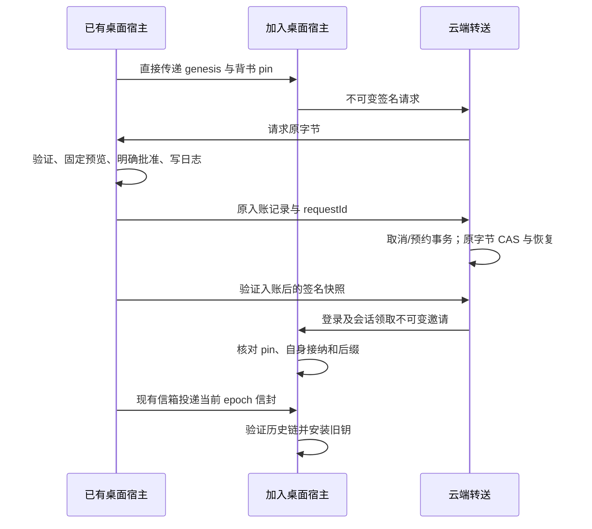

# 个人桌面配对与签名账本快照加入

Status: proposed
Translation: current

[English](2026-10-26-e2ee-personal-desktop-join.md)

## 摘要

原宿主只能重开本机创建记录，另一台桌面无法加入。本次增加独立钉住的邀请起点，复用 core 的设备接纳和签名快照，密钥始终留在原生宿主。窄加入信箱只转送不可变公开证据，不授予成员身份或密钥。当前覆盖同一 Owner/Admin 成员的另一台桌面、明确批准、原字节重试和可选完整重放。真实钥匙串、真实云端和两台安装包验收仍未完成。

## 职责与信任

已有桌面直接向加入端传递工作区/genesis、背书公钥、成员和配对会话。加入端验证 genesis，将 pin 独立于信箱保存，生成受保护的个人设备和访问凭证，使用 core 既有持钥及凭证绑定签名。终结会话后换配对 ID 不更换设备、凭证或独立 pin。

审批宿主验证持钥与绑定证明，先固定完整请求再展示公钥；只有明确批准才签名，并在 HTTP 前持久保存原记录和 requestId。预览后服务器替换请求会被拒绝。后端在同一事务中裁决取消和写入预约；admitting 仍是未知结果，直到原字节恢复证明提交或冲突。取消及已证明输掉 CAS 的会话可以归档，原件继续保留；结果未知的签名申请不能静默重置。

读回并验证入账后，审批端固定签名快照邀请并发布。信箱按设备凭证和投影检查当前 Owner/Admin 个人发布者，对不透明字节限量并分块不可变保存；加入者凭同一账号和会话在尚无可用设备凭证时领取，避免循环依赖。信箱不验签。加入端用自己保存的背书 pin 验证快照、自身 personal 接纳及公钥/凭证绑定，再安装起点；坏快照、缺页和错误 parent 不推进 pin 或游标。

## 保存、生命周期与恢复

账号 bootstrap 日志保存公开请求/邀请及受保护身份和凭证绑定。运行时选择本机创建 genesis 或合格邀请起点，不为加入设备伪造 epoch 0 密钥。快照起点的缓存重建使用保存的邀请与真实后缀；独立证据冲突仍阻断。HTTP 和密钥分发不在账号锁内等待；工作区继续保留所有者和 reader 检查，登出及关闭等待原生工作真正结束。

当前钥走 KeyMailbox，旧钥走 InstalledEpochHistory，历史钥不走 staging。邀请外层是有界 JSON 的 UTF-8 hex，snapshot 用规范 base64，不改变 core 快照/签名格式。云端最多 6 MiB ASCII hex；分块低于单文档上限，删除先按有界批次清理分块，再退休身份。

界面用绝对位置展示稀疏原始记录，不编造缺失事件；没有原始前缀就不声称已确认前缀。完整重放是用户主动操作，验证调用方选定终点并比较状态摘要、显示进度，不修改 pin、运行时或同步游标。取消后忽略迟到结果，下一次主动调用仍能恢复。

## 取舍与限制

每次加入全量重放会丢掉既定背书快照契约并增加无谓工作。直接搬 Lab 存储或旧 vault 分支会重新引入服务端验签和过时接口。本次复用 core，把加入信箱与内容 CRDT 快照分开。

当前切片只覆盖同账号 Owner/Admin。Member 额外管理者背书、远端 CLI、撤销/staging 和 epoch 重启屏障另行实施；普通工作区保持原路径。本次不代表部署、指针采用、生产开放或 Spec 批准。真实钥匙串、整应用重启、两台物理桌面、真实云网关及全平台验收仍未覆盖。

## 验证

宿主测试使用合成安全存储、真实密码学和 SQLite，覆盖独立宿主重开、原字节重试、快照/后缀拒绝、当前钥投递、旧 epoch 历史、确认对象替换和终结会话恢复。信箱测试沿真实 handler 与 Streams peer 覆盖取消/CAS 冲突及有界删除。UI/客户端覆盖明确批准、丢确认、原字节、大小限制、完整重放取消与恢复。最终精确树检查结果记录在 PR。
