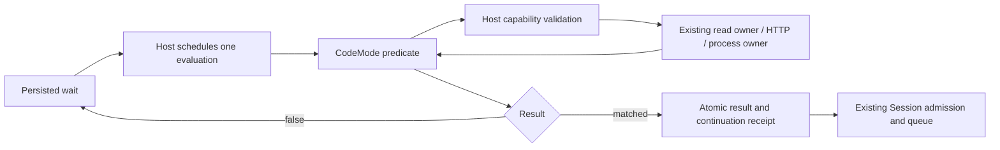

# Host-owned external checks for Automations

Status: proposed
Translation: current

[中文](2026-10-28-automation-external-checks.zh.md)

## Abstract

Automation conditions currently depend on Lody-owned observation adapters, so waiting for a new external service requires product implementation. This proposal adds generic `ctx.fetch` and `ctx.exec` capabilities while retaining the existing condition interpreter, persisted polling and same-Session continuation. The Agent writes one bounded check; the Host owns execution authority, cancellation and retries. Local command execution is an explicitly entrusted host capability, not a read-only sandbox, and checks may repeat before admission or after interruption. This is a design against commit `574334a8a`; no implementation or runtime compatibility is claimed.

## Decision and existing boundaries

Extend the [automation coordinator](2026-10-25-session-automation-coordinator.md), independently of the [CodeMode interpreter choice](2026-10-28-codemode-automation-interpreter.md). Retain `ctx.read` for internal observations and their trusted evidence. Add two generic Host operations, rather than a deployment-service adapter catalog. Keep the result `false | { resumeText, payload? }` and current scheduler.

This deliberately revises the coordinator's exclusion of a generic command runner and the current [automation invariant](../../../../apps/cli/src/automations/AGENTS.md) limiting CodeMode to reads. Those remain descriptions of current behavior until implementation lands. The consequential review decision is whether to allow explicitly entrusted local execution during unattended checks; interpreter restrictions cannot make arbitrary commands read-only. Keep this note proposed. If adopted as a durable product trust contract, record that decision in an owning Spec before shipping; there is currently no automation Spec to amend.

Current evidence:

- [`programs/codemode.ts`](../../../../apps/cli/src/automations/programs/codemode.ts) exposes one `Tool.make` read operation and creates the guest `ctx` wrapper. It sets a 30-second evaluation limit, 32 tool calls and four read slots. Registration validates function syntax without execution.
- [`context/reads-legacy.ts`](../../../../apps/cli/src/automations/context/reads-legacy.ts) validates the wait, authenticated owner and Session before owner reads. Workflow evidence is captured outside guest return data.
- [`workspace-legacy.ts`](../../../../apps/cli/src/automations/workspace-legacy.ts) evaluates `automation.wait.ready` again before admission. Generic operations therefore cannot promise one execution per polling interval.
- [`runtime/engine.ts`](../../../../apps/cli/src/automations/runtime/engine.ts) owns expiry, polling and five-consecutive-error failure. [`storage/ledger.ts`](../../../../apps/cli/src/automations/storage/ledger.ts) owns atomic result/continuation acceptance and restart recovery.
- [`process.ts`](../../../../packages/shared/src/node/process.ts) provides scoped process execution and termination-failure custody. Its `runCommand` deliberately preserves descendants after normal completion, so it is not directly suitable for checks that must leave no background work.

## Caller contract

The user says, for example, “Continue when this deployment is ready” or “Run the project's existing check until it passes.” The Agent finds the endpoint or script, writes one check and registers it, then exits. Lody chooses the polling cadence and execution budget; neither the user nor the Agent has to invent millisecond values. No polling loop, sleep, daemon, per-tick model invocation or new workflow DSL is needed inside the function.

An optional user instruction such as “Give up after half an hour” describes the lifetime of the whole wait and maps to the existing registration expiry. It is separate from the runtime's per-check timeout. An explicit request such as “Check every five minutes” can map to the existing interval; otherwise use the product default. The normal interaction reports what is being watched, whether it is still waiting, and how to cancel. It does not ask users to configure concurrency, byte limits, tool-call budgets or operation timeouts. A stalled check is reported as a check failure, distinct from “the deployment is not ready”; diagnostics should help the Agent inspect or replace the check, not ask the user to guess a larger timeout.

```js
async ({ ctx }) => {
  const response = await ctx.fetch('https://example.com/status');
  if (!response.ok) throw new Error('Deployment status request failed');
  const data = await response.json();
  return data.ready === true
    ? { resumeText: 'Deployment is ready. Continue checking.' }
    : false;
};
```

```js
async ({ ctx }) => {
  const result = await ctx.exec({
    command: 'pnpm',
    args: ['run', 'check:deployment'],
  });
  return result.exitCode === 0
    ? { resumeText: 'Deployment check passed. Continue.' }
    : false;
};
```

The second example assumes the selected script defines a nonzero exit as “not ready.” Where a script distinguishes pending from failure, the condition must inspect those codes and throw for actual failure. The Agent should use the existing script's contract rather than infer it from a name. Include deployment/job/commit identity in queries and comparisons when it matters; a generic `ready` endpoint can otherwise describe unrelated work.

Proposed API:

```ts
ctx.fetch(url: string, options?: {
  method?: 'GET' | 'HEAD';
  headers?: Record<string, string>;
}): Promise<{
  ok: boolean;
  status: number;
  headers: Record<string, string>;
  url: string;
  text(): Promise<string>;
  json(): Promise<unknown>;
}>

ctx.exec(options: {
  command: string;
  args?: string[];
  cwd?: string; // Relative to the bound Session worktree; default ".".
}): Promise<{
  exitCode: number | null;
  signal: string | null;
  stdout: string;
  stderr: string;
}>
```

`fetch` is a deliberately small response facade, not a native `Response`. The Host consumes and bounds the decoded body before crossing the tool boundary; the guest wrapper implements `text()` and `json()` over that buffered string. Repeated body reads return the same data; invalid JSON throws. No streams, cookies, browser session, file URLs or native objects cross into CodeMode. HTTP error statuses return a response; transport failures, invalid requests, timeout and excessive output throw. Redirects fail in v1, avoiding implicit target or credential changes. GET/HEAD cover the initial status-query use case; query POST requires a separate explicit method/body contract later.

`exec` accepts an executable and argument vector, with no implicit shell interpolation, interactive input, PTY, detached option or public environment override. A nonzero exit is data; inability to start, timeout and oversized output are errors. A signal exit has `exitCode: null`. Resolve the current Session's existing project/worktree on the Host and freeze its canonical identity at registration; absent or replaced worktrees fail visibly, without falling back to daemon cwd or checking out a project. Multi-project Sessions must select an existing member through a validated registration field before exec can be enabled; v1 can reject ambiguous contexts. Relative `cwd` must resolve inside that bound root, including symlinks. This is location validation, not filesystem confinement.

## Authority and credentials

Add an optional registration capability request, with no effects granted when omitted:

```json
{
  "capabilities": {
    "fetch": { "origins": ["https://example.com"] },
    "exec": { "context": "session" }
  }
}
```

This is a request, never a self-issued grant. The Host intersects it with locally entrusted Session/project policy, then freezes program revision, owner, machine, execution context and accepted capabilities. Existing permission that explicitly covers unattended checks can satisfy it; do not repeatedly ask on each poll. An ACP mode name alone does not establish a Host execution grant. When no such policy exists, registration with external capabilities returns a concrete missing-permission error and runs no check; ordinary read-only registrations continue to work. The policy must have a real authenticated local control owner, rather than an Agent-writable boolean in the registration. New capability/context fields participate in active-registration deduplication and old persisted registrations default to no external capabilities.

Check current authority at every operation and continuation admission. Revocation never expands the frozen grant. Revocation/Stop interrupts active operations and prevents late results from admitting work. Deterministic permission/context failures end a waiting check as `failed` with a safe reason; an already accepted continuation uses the existing blocked/revoked path.

For fetch-only authority, enforce exact parsed origins and permitted network destinations at connection time, including DNS results; private/loopback targets require explicit local policy. Reject URL credentials and unsupported proxy routes where target enforcement cannot be established. Do not inherit daemon cookies, tokens, internal control authentication or arbitrary authentication headers. v1 custom headers exclude credential-bearing headers; authenticated HTTP needs an opaque reference resolved by an existing credential owner with an audience bound to the requested origin. If no such resolver exists, report it unsupported rather than put secrets in persisted program text. Generic authenticated HTTP can follow separately; entrusted local scripts can use their explicitly configured credential context.

For exec, local policy entrusts ordinary OS-user execution. A script can read files, run other commands and make network requests; fetch origin restrictions do not constrain it. Neither cwd validation nor filtered environment is a security sandbox. If that authority is inappropriate, leave exec unavailable until an actual isolation backend exists. Do not silently equate the Agent's provider sandbox with daemon execution. Build an explicit child environment from the entrusted execution context and required runtime variables; do not spread the daemon environment or copy its control/broker credentials. Avoid inventing a credential vault or per-service integrations for this feature.

Node's [process API](https://nodejs.org/api/child_process.html#child_processspawncommand-args-options) defaults environment inheritance to `process.env`; the adapter must override that deliberately. Switching to [`node:vm`](https://nodejs.org/api/vm.html#vm-executing-javascript) would not supply a security boundary. No authenticated Lody product-cloud access is introduced; encrypted-workspace exclusion remains unchanged.

## Execution, repeatability and recovery



- **Trigger:** registration, persisted polling deadlines and current admission rechecks. The interpreter never owns scheduling. External status observations have point-in-time semantics; they cannot guarantee readiness remains true when the Agent eventually runs.
- **Owner:** each evaluation owns all its operations in an Effect scope. All evaluation entry paths, including admission rechecks, share one per-wait exclusion mechanism and bounded Host concurrency. This closes the overlap gap that adding an exec adapter alone would leave. Do not hold a global scheduler lock across I/O.
- **Cancellation:** timeout, expiry, cancellation, Stop and Host disposal revoke further calls, abort HTTP including body consumption, terminate the owned process tree, and join cleanup before releasing ownership. Returning early with outstanding tools fails the check and drains them; it must not commit a successful result. Cancellation cannot undo an already received remote request or script write.
- **Handoff:** retain atomic result/evidence/continuation identity and existing submission reconciliation. Neither operation supplies trusted CI/HEAD/capacity evidence. Generic results only request a same-Session prompt under ordinary admission. Existing `ctx.read` evidence remains authoritative in mixed programs; external payload cannot substitute for it. Subsequent rechecks validate eligibility without replacing the accepted resume text/payload.
- **Recovery:** conditions may execute multiple times, including between match and admission. Scripts must be observational or safely repeatable; no deploy, payment, commit or destructive action belongs in a check. There is no exactly-once tool-effect guarantee. Preserve five consecutive evaluation errors and current backoff for transient faults; `false` resets that counter. Keep ordinary false-poll intervals unchanged.

Execution limits belong to the Host, not the public `ctx.fetch`/`ctx.exec` API. Start validation with the existing 30-second evaluation ceiling, 32 total calls shared across read/fetch/exec, four concurrent calls, and 64-KiB final result. Operations inherit the remaining evaluation budget; do not add arbitrary caller-selected 10/20-second sub-budgets. Validate representative project checks before choosing the shipping runtime policy: the current interpreter ceiling is not evidence that every useful script finishes in 30 seconds. Long-running jobs need a separate execution/observation path rather than instructions to increase a hidden safety limit. Use a 128-KiB serialized tool reply ceiling, with incremental decoded-body/output limits before allocation and failure rather than silent truncation. Bound aggregate in-flight bytes as well. Process cleanup has its existing separate bounded termination budget; a predicate deadline does not imply cleanup completed at that instant. These are internal implementation constraints, not fields in the normal product interaction.

Use the native process spawner with a scope that releases the tree on success as well as failure, not `runCommand`'s preserve-on-success path. Retain any `ProcessReleaseFailed` custody and prevent overlapping reuse only for the affected execution. Unrelated waits continue. General project scripts may hold locks, so do not automatically choose the immediate-kill read-only probe policy.

Host crashes need an additional exec admission record before spawn, linked to wait/evaluation and the process owner's recoverable identity. A PID alone is not sufficient identity for killing or adoption. On restart, reconcile that owner before retrying. If release cannot be proven, mark the wait `failed` with `exec_recovery_unconfirmed`, retain cleanup custody, and deny overlapping replacement in that affected scope until resolved; do not blindly replay exec or freeze unrelated fetch/read waits. A crash between recording intent and recording spawn must also be treated as uncertain. Automatic exec restart recovery is a release gate to verify against the real process owner, not a claim made by this design. HTTP checks can retry after interruption under their repeatable-query contract.

## Diagnostics and Agent guidance

`show` should expose effective capability summaries, last check timing, operation kind, HTTP status/exit code, byte counts and safe error code. Keep summaries bounded and machine-local. Do not persist request headers, raw response bodies, command output or credential values by default; sanitize exception causes before `lastError`, since the current engine retains `Cause.pretty`. The Agent chooses a small safe result payload, and guidance must explain that resume text/payload enters Session history. Diagnostics are not a tool-effect replay ledger.

Update the bundled Automation skill with both runnable examples, shared generated schemas, capability errors, repeated-execution semantics and exit-code guidance. No new top-level MCP command runner or business-condition names are required. Existing `lody_automation` registration is enough; a dry-run tool and durable guest state are deferred.

## Implementation sequence and verification

This is one design with staged implementation, not an interpreter migration or a replacement scheduler. Keep the locked CodeMode/Effect versions and existing Legacy boundaries.

| Step | Scope and completion evidence |
| --- | --- |
| 1. Prove bridge semantics | Extend `apps/cli/src/automations/automations.test.ts` with the actual pinned CodeMode runtime: facade methods, JSON parsing, nonzero exits, shared call limits, thrown/caught failures and unawaited tools. Keep operations injected and synthetic. Verify with `pnpm --filter lody test src/automations/automations.test.ts`. |
| 2. Add generic operation contracts and fetch | Extend `packages/shared/src/automations/conditions.ts`, exports and tool schemas; add Host adapters under `apps/cli/src/automations/context/`; wire `programs/codemode.ts` and `workspace-legacy.ts`. Add accepted capabilities and dedup identity in `storage/ledger.ts`, backed by an authenticated local policy owner. Test denied and revoked authority, origin/DNS/redirect rules, bounded body consumption, cancellation and old registrations with no grants. Run `pnpm --filter lody test src/automations` and `pnpm --filter @lody/shared typecheck`. |
| 3. Add scoped exec | Use `ChildProcessSpawner` through Lody's process layer. Implement context/environment binding, successful-tree cleanup, per-wait exclusion across all evaluator paths and crash reconciliation. Extend the owning automation/workspace/Session tests using `process-testing.ts`, explicit readiness signals and injected clocks. Cover orphan descendants, cancellation, release failure, restart uncertainty, changed worktrees and independent waits. If process identity recovery is unavailable, keep exec disabled rather than claim safe replay. |
| 4. Complete caller surfaces | Update `apps/cli/src/commands/automation.ts`, `src/mcp/automation-tools.ts`, `src/mcp/skills/automations.ts` and its bundled references/examples; add CLI capability-file input to match MCP registration fields. Update module README and the nearest automation invariant only when behavior lands. Extend real CLI/control/MCP schema and skill tests. Maintain the Effect migration ledger only if ownership facts actually change. |

Before implementation, compare these paths with `574334a8a`, read their scoped instructions, resolve the consuming CLI's installed Effect and read its complete `AGENTS.md`. The current loop/interpreter are already native; new HTTP/process operations should compose Effects directly, without a new runPromise facade. No unrelated Fleet/Repo/Session migration is required.

Final gates: `pnpm check`, `pnpm format`, `pnpm run docs check`, `pnpm check:cli-process-boundary`, and `pnpm check:public-boundary` for composition changes. Tests must establish observable state and actual resource release, not source strings or mock call counts. Verify development/production CLI bundles and supported desktop process environments before enabling exec there. No package upgrade, hosted backend, Web bridge, alternate interpreter, guest filesystem API or action DSL belongs to this scope.

## Verification limits

This work inspected repository source and Node's primary documentation; it did not run a deployment endpoint, project script or live automation. The available Lody MCP catalog has no Automation control tool in this session, so no unrelated Schedule or Session mutation was used. This nested checkout has no installed Effect/CodeMode dependencies, and Node is 26.11.1, below the repository's 26.12.1 floor. Runtime tests, facade compatibility, credential-context integration and cross-platform crash cleanup remain unverified. Design-only work does not claim implementation checks passed. Repository documentation status/check commands report existing documentation debt; the delivery summary records the final check result.
