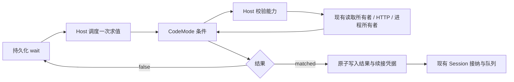

# Automation 由 Host 执行外部检查

Status: proposed
Translation: current

[English](2026-10-28-automation-external-checks.md)

## 摘要

Automation 条件目前依赖 Lody 提供的数据适配器，等待新的外部服务需要先实现产品代码。本方案增加通用的 `ctx.fetch` 和 `ctx.exec`，保留现有条件解释器、持久化轮询和原 Session 续接。Agent 编写一次有界检查，Host 负责执行权限、取消与重试。本机命令执行是明确委托的宿主机能力，不能视为只读沙箱；检查可能在接纳前或中断后重复执行。本设计基于提交 `574334a8a`，不代表已经实现或完成运行兼容性验证。

## 决策与现有边界

扩展 [automation coordinator](2026-10-25-session-automation-coordinator.zh.md)，与 [CodeMode 解释器选型](2026-10-28-codemode-automation-interpreter.zh.md) 分开。保留 `ctx.read` 及其内部权威证据，增加两个通用 Host 操作，不再为每种部署服务提供专用适配器。返回值仍为 `false | { resumeText, payload? }`，继续使用现有调度器。

这会有意调整 coordinator 排除通用命令执行器的决定，以及当前[仅允许 CodeMode 读取的约束](../../../../apps/cli/src/automations/AGENTS.md)。实现落地前，这些文档仍描述当前行为。需要评审的实质决定是：是否允许无人值守检查使用明确委托的本机执行权限；解释器限制不能让任意命令变为只读。本文保持 proposed；如果采纳为长期产品信任契约，应在发布前写入其归属 Spec，目前没有可直接修改的 automation Spec。

现有证据：

- [`programs/codemode.ts`](../../../../apps/cli/src/automations/programs/codemode.ts) 提供一个 `Tool.make` 读取操作，并构造 guest `ctx`。单次求值限制为 30 秒、32 次工具调用和四个并发读取；注册只检查函数语法，不执行。
- [`context/reads-legacy.ts`](../../../../apps/cli/src/automations/context/reads-legacy.ts) 在读取前检查 wait、认证所有者和 Session。工作流证据由 Host 获取，不来自 guest 返回值。
- [`workspace-legacy.ts`](../../../../apps/cli/src/automations/workspace-legacy.ts) 在接纳前重新求值 `automation.wait.ready`，因此新操作不能保证每个轮询周期只执行一次。
- [`runtime/engine.ts`](../../../../apps/cli/src/automations/runtime/engine.ts) 负责过期、轮询和连续五次错误后失败；[`storage/ledger.ts`](../../../../apps/cli/src/automations/storage/ledger.ts) 负责结果与续接的原子接纳及重启恢复。
- [`process.ts`](../../../../packages/shared/src/node/process.ts) 提供有作用域的进程执行和终止失败后的资源托管。但 `runCommand` 在正常完成后有意保留后代进程，不能直接用于禁止遗留后台任务的检查。

## 调用契约

用户说“这个部署好了以后继续”或“运行项目现有的检查，通过后继续”。Agent 找到接口或脚本，编写一次检查并注册，然后即可退出。Lody 决定检查频率和执行预算，用户和 Agent 都不需要猜毫秒数。函数内不需要轮询循环、sleep、常驻进程、每轮模型调用或新的工作流 DSL。

用户可以补充“最多等半小时”，这描述整个等待任务的期限，对应现有注册过期时间，与运行时单次检查超时分开。明确要求“每五分钟看一次”时可以映射到现有 interval；否则使用产品默认值。正常交互只说明正在等什么、是否还在等待，以及如何取消，不要求用户配置并发数、字节限制、调用预算或单次操作超时。检查卡住应报告为检查失败，与“部署尚未就绪”区分；诊断帮助 Agent 检查或更换检查方式，而不是让用户猜一个更大的 timeout。

```js
async ({ ctx }) => {
  const response = await ctx.fetch('https://example.com/status');
  if (!response.ok) throw new Error('Deployment status request failed');
  const data = await response.json();
  return data.ready === true
    ? { resumeText: 'Deployment is ready. Continue checking.' }
    : false;
};
```

```js
async ({ ctx }) => {
  const result = await ctx.exec({
    command: 'pnpm',
    args: ['run', 'check:deployment'],
  });
  return result.exitCode === 0
    ? { resumeText: 'Deployment check passed. Continue.' }
    : false;
};
```

第二个示例假设脚本以非零退出码表示“尚未就绪”。如果脚本区分等待与失败，条件应检查具体退出码，并为真正的故障抛错；Agent 应读取现有脚本契约，不能仅凭名称推断。必要时在查询和比较中绑定 deployment、job 或 commit 标识，否则通用 `ready` 接口可能描述无关任务。

建议 API：

```ts
ctx.fetch(url: string, options?: {
  method?: 'GET' | 'HEAD';
  headers?: Record<string, string>;
}): Promise<{
  ok: boolean;
  status: number;
  headers: Record<string, string>;
  url: string;
  text(): Promise<string>;
  json(): Promise<unknown>;
}>

ctx.exec(options: {
  command: string;
  args?: string[];
  cwd?: string; // Relative to the bound Session worktree; default ".".
}): Promise<{
  exitCode: number | null;
  signal: string | null;
  stdout: string;
  stderr: string;
}>
```

`fetch` 返回精简的响应外观，不传递原生 `Response`。Host 先读取并限制解码后的响应体，再跨越工具边界；guest 包装器基于缓冲字符串实现 `text()` 和 `json()`。重复读取返回同一数据，非法 JSON 抛错。流、Cookie、浏览器会话、文件 URL 和原生对象都不进入 CodeMode。HTTP 错误状态正常返回响应；传输失败、非法请求、超时和输出超限抛错。第一版拒绝重定向，避免隐式更换目标或转发凭据。GET/HEAD 覆盖初始状态查询需求；查询型 POST 后续单独定义方法与请求体契约。

`exec` 接收可执行文件和参数数组，不隐式进行 shell 插值，不提供交互输入、PTY、后台选项或公开环境变量覆盖。非零退出码属于结果；启动失败、超时和输出超限属于错误；信号退出时 `exitCode: null`。Host 解析 Session 已有的 project/worktree，并在注册时冻结规范化身份；目录不存在或被替换时明确失败，不能回退到 daemon cwd，也不自动 checkout。多项目 Session 必须通过经过验证的注册字段选择现有成员，第一版可以拒绝歧义上下文。相对 `cwd` 解析后必须位于绑定根目录内，包括符号链接检查；这只约束启动位置，不是文件系统隔离。

## 权限与凭据

注册增加可选的能力请求，省略时不授予外部执行能力：

```json
{
  "capabilities": {
    "fetch": { "origins": ["https://example.com"] },
    "exec": { "context": "session" }
  }
}
```

这只是请求，不能自行授权。Host 将它与本地明确委托的 Session/project 策略求交集，再冻结程序版本、所有者、机器、执行上下文和实际能力。已有权限如果明确覆盖无人值守检查，就直接沿用，不在每轮轮询时重复询问。仅凭 ACP mode 名称不能推导 Host 执行授权。没有相应策略时，携带外部能力的注册返回明确的权限缺失错误，不运行检查；原有只读注册继续工作。策略必须由真实的、经过认证的本地控制入口管理，不能是 Agent 在注册内容里随意写的布尔值。新能力和上下文字段参与活跃注册去重；旧持久化注册默认没有外部能力。

每次操作和续接接纳都重新检查当前权限；冻结的授权只能收窄。撤权和 Stop 中断活动操作，并禁止迟到结果接纳新工作。确定性的权限或上下文失效使等待中的条件进入 `failed` 并记录安全原因；已接纳的续接沿用现有 blocked/revoked 路径。

只有 fetch 权限时，在连接时检查解析后的精确 origin 与允许的网络目标，包括 DNS 解析结果；内网和回环目标需要明确的本地策略。拒绝 URL 内凭据，以及无法验证目标限制的代理路径。不继承 daemon Cookie、令牌、内部控制认证或任意认证请求头。第一版自定义请求头排除承载凭据的字段；带认证的 HTTP 应通过不透明引用，由已有凭据所有者按目标 origin 解析。没有这样的解析器时，应报告不支持，不能把密钥写入持久化程序。通用认证 HTTP 可以后续增加；受委托的本机脚本可以使用其明确配置的凭据上下文。

exec 策略委托的是普通 OS 用户权限：脚本可以读文件、启动其他命令、访问网络，fetch 的 origin 限制无法约束它。cwd 检查和过滤环境变量都不是安全沙箱。不接受这一级权限时，在真正的隔离后端可用前保持 exec 不可用；不能默认为 daemon 执行继承 Agent 提供商的沙箱。子进程环境应从受委托的执行上下文与必要运行变量显式构造，不展开整个 daemon 环境，不复制其控制或 broker 凭据。这个功能不另造凭据保险库，也不要求逐服务接入。

Node 的[进程 API](https://nodejs.org/api/child_process.html#child_processspawncommand-args-options) 默认继承 `process.env`，适配器必须显式覆盖。改用 [`node:vm`](https://nodejs.org/api/vm.html#vm-executing-javascript) 也不能提供安全边界。本方案不引入经过认证的 Lody 产品云访问，加密 workspace 仍不支持 automation。

## 执行、重复检查与恢复



- **触发：**注册、持久化轮询时间和现有接纳前复查。解释器不负责调度。外部状态只描述观察时刻，不能保证 Agent 真正运行时仍然就绪。
- **所有者：**每次求值通过 Effect scope 持有全部操作。所有求值入口，包括接纳复查，共享每个 wait 的互斥机制和有界 Host 并发；仅增加 exec 适配器不足以防止重叠执行。I/O 不能长期占据全局调度锁。
- **取消：**超时、过期、取消、Stop 和 Host 释放先禁止新调用，再终止 HTTP（含响应体读取）和所属进程树，等待清理后才释放所有权。提前返回但仍有未完成工具调用时，本次检查失败并等待清理，不能提交成功。取消无法撤销远端已收到的请求或脚本已产生的写入。
- **移交：**保留结果、证据、续接身份的原子写入与现有提交对账。两个操作都不提供可信 CI、HEAD 或额度证据；通用结果只是在正常接纳规则下请求原 Session 的新输入。混合程序中 `ctx.read` 的证据仍具有原有权威，外部 payload 不能替代它。后续复查只校验资格，不替换已接纳的续接文本和 payload。
- **恢复：**条件可以执行多次，包括匹配到输入接纳之间。脚本必须用于观察或可安全重复，不能把部署、支付、commit 或破坏性操作放进检查；工具副作用没有 exactly-once 保证。暂态故障保留连续五次求值错误失败和现有退避；返回 `false` 重置错误计数，普通未满足条件的轮询间隔不变。

执行限制由 Host 管理，不进入公开的 `ctx.fetch`/`ctx.exec` API。初始验证沿用现有单次求值 30 秒、read/fetch/exec 共用 32 次调用、四个并发调用和 64 KiB 最终结果。操作继承本轮剩余预算，不再增加由调用者选择的 10/20 秒子预算。发布前用有代表性的项目检查验证运行策略；现有解释器上限不能证明所有有用脚本都能在 30 秒内结束。长任务应走独立的执行与观察路径，不能靠让使用者调大隐藏的保护限制解决。工具回复序列化后最多 128 KiB，响应体解码和进程输出应在分配过程中逐步计量，超限失败而非静默截断，并限制总在途字节。进程清理使用已有的独立有界终止预算；条件超时不等于同一时刻完成清理。这些都是内部实现约束，不是正常产品交互的填写项。

使用原生进程 spawner，让作用域在成功和失败时都释放进程树，不走 `runCommand` 的成功保留路径。保留 `ProcessReleaseFailed` 的资源托管，只阻止受影响执行的重叠复用，不阻断无关 wait。项目脚本可能持有锁，不能自动使用只读探测的立即 kill 策略。

Host 崩溃需要在 spawn 前写入 exec 接纳记录，关联 wait、求值和进程所有者可恢复的身份。单独 PID 不足以支持安全杀进程或接管。重启后先向所有者对账再重试；无法证明释放时，将 wait 标记为 `failed`，原因为 `exec_recovery_unconfirmed`，保留清理托管，并在问题解决前禁止相关范围内的重叠替代执行。不能盲目重放 exec，也不能冻结无关 fetch/read wait。写入意图和记录 spawn 之间崩溃也属于结果不确定。自动恢复 exec 是需要对真实进程所有者验证的发布条件，本文不宣称已经具备；HTTP 查询则按可重复查询契约在中断后重试。

## 诊断与 Agent 指引

`show` 展示有效能力摘要、上次检查耗时、操作类型、HTTP 状态或退出码、字节数和安全错误码；摘要有界且保存在机器本地。默认不持久化请求头、原始响应体、命令输出或凭据。当前 engine 保留 `Cause.pretty`，因此写入 `lastError` 前需要净化异常链。Agent 选择少量安全结果作为 payload，指引应说明 resumeText/payload 会进入 Session 历史。诊断记录不承担工具副作用重放职责。

更新随产品提供的 Automation skill，包含两个可运行示例、从共享契约生成的 schema、能力缺失错误、重复执行语义和退出码说明。不增加顶层 MCP 命令执行器，也不增加业务条件枚举；现有 `lody_automation` 注册入口足够。dry-run 工具和 guest 持久化状态暂不纳入。

## 实施顺序与验证

这是一个分阶段实现的设计，不涉及更换解释器或调度器。保留锁定的 CodeMode/Effect 版本和已有 Legacy 边界。

| 步骤 | 范围与完成证据 |
| --- | --- |
| 1. 验证工具桥接语义 | 扩展 `apps/cli/src/automations/automations.test.ts`，使用实际锁定版本的 CodeMode 测试 facade 方法、JSON 解析、非零退出码、共享调用预算、抛错/捕获和未等待工具。操作通过合成依赖注入。运行 `pnpm --filter lody test src/automations/automations.test.ts`。 |
| 2. 增加通用操作契约与 fetch | 扩展 `packages/shared/src/automations/conditions.ts`、导出与工具 schema；在 `apps/cli/src/automations/context/` 增加 Host 适配器，连接 `programs/codemode.ts` 和 `workspace-legacy.ts`。`storage/ledger.ts` 增加实际能力与去重身份，由经过认证的本地策略所有者提供授权。测试拒绝/撤销权限、origin/DNS/重定向、有界读取、取消和旧注册无新增授权。运行 `pnpm --filter lody test src/automations` 和 `pnpm --filter @lody/shared typecheck`。 |
| 3. 增加有作用域的 exec | 通过 Lody 进程层使用 `ChildProcessSpawner`，实现上下文/环境绑定、正常完成后的树清理、覆盖全部求值入口的 wait 互斥和崩溃对账。扩展已有 automation/workspace/Session 测试，使用 `process-testing.ts`、显式就绪信号和注入时钟，覆盖孤儿后代、取消、释放失败、重启不确定、worktree 变化和独立 wait。无法恢复进程身份时保持 exec 禁用，不宣称可以安全重放。 |
| 4. 完成调用入口 | 更新 `apps/cli/src/commands/automation.ts`、`src/mcp/automation-tools.ts`、`src/mcp/skills/automations.ts` 及其引用/示例；CLI 增加能力文件输入，与 MCP 注册字段一致。行为落地时才更新模块 README 和 automation 约束。扩展真实 CLI/control/MCP schema 和 skill 测试；只有所有权事实变化时才更新 Effect 迁移台账。 |

实施前比较这些路径与 `574334a8a` 的差异，阅读适用的目录规则，解析 CLI 实际安装的 Effect 并完整阅读其 `AGENTS.md`。现有循环和解释器已原生化；新增 HTTP/进程操作应直接组合 Effect，不增加 runPromise facade，也不顺带迁移 Fleet/Repo/Session。

最终检查：`pnpm check`、`pnpm format`、`pnpm run docs check`、`pnpm check:cli-process-boundary`；组合边界变更还需 `pnpm check:public-boundary`。测试验证可观察状态和真实资源释放，不依赖源码字符串或 mock 调用次数。桌面启用 exec 前，验证开发/生产 CLI 包和受支持的桌面进程环境。本范围不包括依赖升级、托管后端、Web bridge、替换解释器、guest 文件系统 API 或 action DSL。

## 验证限制

本次阅读了仓库源码和 Node 官方文档，没有访问实际部署接口、运行项目脚本或执行真实 automation。当前会话的 Lody MCP 工具目录没有 Automation 控制工具，因此未借用无关 Schedule 或修改 Session。本嵌套 checkout 没有安装 Effect/CodeMode，Node 为 26.11.1，低于仓库要求的 26.12.1。运行测试、facade 兼容性、凭据上下文接入和跨平台崩溃清理尚未验证。纯设计工作不宣称实现检查通过；文档状态/检查命令报告仓库现有文档问题，交付说明记录最终检查结果。
