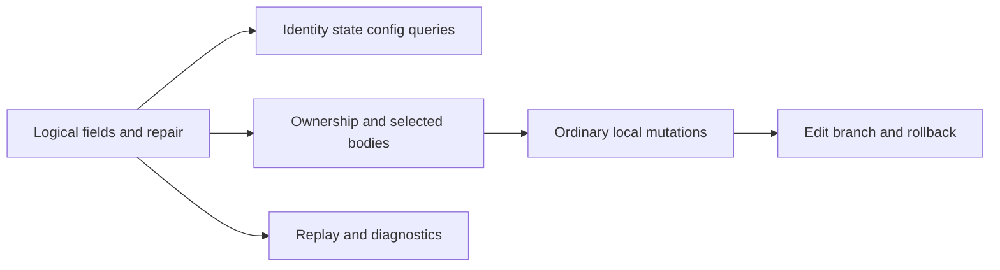

# Execution plan for Roost and Loro full history reads

Status: proposed
Type: architecture
Translation: current

[中文](2026-10-31-roost-selective-history-reads.zh.md)

## Abstract

Roost permissions, turn output, configuration and some ordinary writes still locate records through complete history arrays; directory reads and index repair also read unrelated bodies. This plan replaces those paths with logical field queries, ownership indexes and local mutations while preserving results, ordering and transaction semantics. Fork, import and explicitly requested complete-content operations remain. Agent recovery replay retains necessary traversal with bounded body buffers. The implementation uses matching Roost field/membership capabilities and selected Loro writes; source and desktop acceptance are recorded below.

## Necessary global access

Visiting every required record, exporting a complete body array and caching unrelated bodies have different costs. The table retains only access implied by the operation.

| Operation | Required information and extent | Treatment |
| --- | --- | --- |
| Fork | A [snapshot and selected prefix](../../../../apps/cli/src/session/session-fork-service.ts) supply the new conversation; the selection can cover all history | Excluded as requested; reading beyond the selected boundary is not inherently necessary |
| Import, refresh and conflict resolution | The [import planner](../../../../packages/shared/src/session-data/history-import.ts) needs source content, order and comparison with the local baseline to determine append or conflict | Exclude these complete-content operations |
| Complete export, share, copy and CLI history --all | [Export](../../../../apps/cli/src/lib/session-export/export-service.ts), [sharing](../../../../packages/components/src/lib/session-share-publisher.ts) and [copy](../../../../packages/components/src/lib/conversation-copy-source.ts) require all user-selected content | Retain; ordinary limited history views remain in scope |
| History replay when ACP cannot resume natively | The [replay builder](../../../../packages/shared/src/replay-prompt-builder.ts) chooses omission strategies from global lengths and collects all tool paths and message counts; the final default budget is 100,000 characters | Retain traversal required by existing semantics; P6 removes complete arrays and candidate prompts |
| Proving absence without an index, global statistics and multiple matches | Old goals, ownership, global deduplication and exact counts can require all relevant fields; the matching result itself can include every record | Retain field access and the actual result set; ordinary query repair uses P1 shallow projection |

Outside the exclusions, no business operation has been found to require exporting every history body at once. Without established indexes, a fixed number of metadata visits cannot be guaranteed; measure field and body reads separately.

## Evidence

The source inspection uses Lody `c5896b416`. Permission and output measurements below use `6b73bddbcabf2a0c37bc84546929ad291a26b27f`, with the same relevant logic. All fixtures are synthetic.

- A prefix of 128 messages with 1 MiB bodies plus a tiny current input/reply retained about 128.6 MiB extra JS heap while the real Native permission path waited, with peak process RSS of 1,651–1,808 MiB across two fresh-process samples. Single-turn output retained about 128.14 MiB. Both fill the same complete-history cache; their savings are not additive.
- The output implementation has retained its read-all-then-select sequence since `cf1ee8dcbd`. [Loro output](../../../../packages/shared/src/session-data/loro.ts) selects shallow fields before exporting required bodies; permission insertion and shared author lookup still have complete reads.
- Published Native 0.3.0 supports field paths through `readValue`. Under Node 24.22.1, six role, author, tool and request fields from a cold-reopened 1,048,831-byte synthetic record returned 78 bytes with `readTurn/readTurns` forbidden. This verifies the primitive; logical state overlays still need implementation.

The plan retains the selection rules of [dispatch scalar projection](2026-10-22-roost-dispatch-scalar-projection.md), receipts and transaction boundaries of [incremental mutations](2026-10-22-roost-end-to-end-incremental-mutations.md), and semantics of [GC goal queries](../../implemented/architecture/2026-10-30-application-memory-attribution.md). Those decisions remain applicable; this proposal covers their remaining body-read paths.

## Avoidable Roost complete reads

| Item and callers | Roost direction | Acceptance |
| --- | --- | --- |
| 1 [Input gate](../../../../apps/cli/src/session/turn-history-gate.ts), [prepared input](../../../../apps/cli/src/lib/prepared-session-input.ts), CLI preallocated inputs | P2: query existence by ID and linked completion state; compare only the candidate for conflicts | Preserve existing/missing/conflicting IDs and retry results without unrelated bodies |
| 2 [CLI quota, active reply, config, MCP and limited history](../../../../apps/cli/src/commands/session.ts) | P2: field counts, latest state, config selection and range reads | Preserve queue deduplication, terminal rules, provider matching, sticky Roles, limits, totals and order |
| 3 [MessageHandler attribution and goal precheck](../../../../apps/cli/src/lib/message-handler.ts) | P2/P3: query userId using the separate permission/usage predicates; use the latest-goal query | Preserve identity precedence, blank-value handling and original strings; usage can match non-user roles |
| 4 Permission insertion, response and result waiting without turnId | P3: ordered tool/request ownership, updating selected owners | Preserve duplicate tools, terminal owners, missing-owner insertion, existing outcomes and remote decisions |
| 5 [Turn output](../../../../apps/cli/src/session/roost-node-session.ts), [CLI wait](../../../../apps/cli/src/commands/session-output.ts), [Coordinator](../../../../apps/cli/src/orchestration/coordinator-workflow.ts) | P3: user scalars, first later linked assistant and later failure systems through selectTurnOutput | Preserve user headers, reply selection, failure messages, order and streaming waits |
| 6 Directory, latest role, missing-index readRange/readTurn and dispatch index repair | P1/P2: true logical fields/membership, including existing states and repair without unrelated bodies | Preserve fields across cold/old/missing/damaged indexes, segments and concurrent state |
| 7 Unknown-projection latest-goal lookup | P1/P3: goal fields and ownership replace reverse body projection | Preserve old/absent goals, newer cleared/paused precedence and metadata fallback |
| 8 [Schedule proposals](../../../../packages/components/src/components/schedules/schedule-proposal-notice.tsx) and [run list](../../../../packages/components/src/components/schedules/use-schedule-chat-runs.ts) | P2/P3: configuration fields, scheduleRun and linked reply state | Preserve display/click configuration and run counts, states and ordering |
| 9 HistoryAction goal, operation-completion, warning, file-backfilled and upsert/remove-turn | P3/P4: select all matching owners, update existing records and use sparse membership edits | Preserve all matching copies, deduplication, unknown fields, insertion order and pre-failure state |
| 10 [Worktree script output](../../../../apps/cli/src/session/worktree/worktree-script-history.ts) and Agent batches | P4: target existing IDs, append new tails and replace unbound/large-batch generation fallbacks | Preserve mixed-event order, original tool ownership, creation, receipt retries and batch atomicity |
| 11 [Edit/resend](../../../../apps/cli/src/session/session-edit-and-resend-service.ts), local rollback and ID reuse | P5: boundary fields, replacement range, old head and receipts, reusing the prefix | Preserve old fields, commit checks, concurrent-edit refusal, immediate rollback and later appends |
| 12 copy_history target-ID validation and error diagnostics | P2/P6: query candidate IDs and aggregate original log counts/samples through fields | Preserve conflict rejection boundaries and diagnostic counts/sample ordering |

Roost RPC/renderer bridges forward these reads to the owner, so changes must reach actual consumers. The legacy shared `createRoostHistoryReader` builds a complete projection; production continues through the Native/bridge readers, with remaining consumers audited and handled. Fixture readers cannot establish Native physical-read behavior.

## Loro complete body reads in scope

These nine items are included in the plan and cover paths that actually export complete history bodies. Numbers follow the Roost inventory to track shared changes. Compare each against Loro's own current behavior.

| Item | Complete-read entry | Planned change | Results that must remain identical |
| --- | --- | --- | --- |
| 1 | TurnHistoryGate, prepared input and preallocated inputs call readHistory | Reuse shallow identity lookup, linked dispatch state and candidate readTurn | Continue waiting for absent input; reject same-ID content conflicts; avoid duplicate dispatch |
| 2 | CLI quota, status, config, MCP and limited history call readHistory | Field counts, config selection and range reads | Queue deduplication, terminal newest assistant, provider matching, sticky Roles, totals, ranges and order |
| 3 | MessageHandler attribution, usage and goal prechecks call readHistory | Preserve separate userId predicates; reuse readLatestGoal | Permission identity precedence, usage matching other roles, blank checks and original string values |
| 4 | Loro permission-request commands enter writer.update; waiting without turnId calls readHistory | Select all tool owners shallowly inside HistoryWriter, then mutate locally; locate outcomes by request ownership | Duplicate tools, terminal owners, missing-owner insertion position, existing outcome precedence and merged content |
| 8 | Schedule proposals and run lists call readAll | Read config, scheduleRun, userTurnId and reply-state fields | Current config at display and click; run counts, order and state rules |
| 9 | Goal, operation-completion, warning, file-backfilled and upsert/remove enter writer.update | Selected-record and membership commands in the one HistoryWriter | All matching copies, exact warning deduplication, unknown stored fields, entry order and validation refusal |
| 10 | session-agent-writes falls back to writer.update for new targets, structural or some rich content | Reuse targeted batches and add owner lookup, creation and local edits | Mixed notification order, original tool ownership, target creation, retries and batch atomicity |
| 11 | Edit prechecks call readHistory; updateWithRollback reads all before/after mutation and during rollback | Read boundaries; add range compensation for edits with the existing closure holding before-images and shallow metadata checking complete membership conditions | Existing identity/order constraints, conflict refusal, old fields, permitted automatic read-state changes and later appends |
| 12 | copy_history target validation and error diagnostics call readHistory | Query candidate IDs; aggregate the original diagnostic fields | Rejection boundaries, global counts, abnormal sample selection and order; complete copy remains |

## Behavioral equivalence and correctness

Change record location, read granularity and temporary object lifetime. Visible text, highlighting, tool details, permission options, config, history extent and execution results must match current behavior. Record trimming or narrower matching is outside the optimization.

- Compare each backend with its own original selectors and commands. Preserve duplicate selection, all matching copies, order, absent/cleared values, attribution and errors. Shallow views select records; writing them as complete entries would discard other fields.
- Preserve one coherent observation. Loro field checks and conditional writes remain synchronous; asynchronous owner/RPC reads require verified snapshot, cursor and generation evidence. Replay must not stitch changing pages into a purported readAll observation.
- Reuse the one HistoryWriter's changed-value validation, legacy representations and stored-copy compensation. Complete existing validation before the first mutation; retain persistence-failure/indeterminate-write errors and receipts, and existing batch atomicity.
- Switch paths after result comparisons, real-storage checks and user journeys establish equivalence, then measure performance. Complete and verify existing-state projection, sparse branches and conditional rollback capabilities before switching their callers.

## Execution order

Inventory numbers identify scope; P1–P6 describe dependencies. All 12 avoidable Roost reads require fixes without item-by-item permission. Start with item 6 field access, then proceed through 3 → 4 → 5 → 7 → 1 → 2 → 8 → 9 → 10 → 11 → 12, prioritizing measured permission/output paths. P6 retains necessary replay traversal while bounding its buffers.

The nine Loro complete-body reads have planned fixes in the table above, with shared Roost dependencies tracked together. Implementation depends on behavioral equivalence; retain existing shallow output, directory and latest-goal reads with regression coverage.

Verify implementations in dependency order, then provide one consolidated account of actual changes, observable-behavior comparisons, body-read scope and validation. Explain when shared foundations cover several items, preserving current user behavior.

### P1 Logical fields and repair

Use Native field paths, headers, branch information and the existing owner queue for narrow logical directory/field reads. Directory data covers identity, order, state and allowlisted input configuration; relation queries additionally inspect tools, requests, goals, files, notices and scheduleRun. Body caches admit only explicitly requested records.

Logical fields must incorporate legacy complete states, current delta states, multiple segments and permission responses, preserving absent versus explicitly cleared values. Primary fields alone are not current state. Returning all items, patches or body-bearing contentJson strings before filtering is not shallow projection. Where existing APIs cannot project a serialized delta subtree, add supported Native/SDK logical field capabilities first; Lody does not reproduce private SDK index formats.

Bind each field observation to host, generation, branch and event cursor. Missing, old, damaged or externally invalidated indexes rebuild derived evidence from field pages and publish a complete checkpoint last. Adding query fields must not force ordinary dispatch to rebuild all bodies. Trace SDK catch-up, lookup and paging internals as well.

### P2 Narrow identity state and configuration queries

Migrate callers in the inventory individually. Quotas retain deduplication and queue counts; active-reply queries retain the rule that a terminal newest assistant means no active reply. Config retains queue precedence, sticky Roles and provider-matched model lookup. Apply CLI limits at the correct logical selection stage and compute total separately.

Permission notifications retain newest user with a nonblank userId, then metadata, then current-user precedence. Usage uses a different existing predicate that permits other roles; implement it separately. Existing-ID conflict checks still compare the selected record. UI callers use the same reader/owner; extend required RPC/IPC fields through existing schemas and capability negotiation.

### P3 Ownership indexes and selected bodies

Extend existing derived projections with the required ordered ownership evidence for toolCallId, requestId, userTurnId, goal thread, fileId, notices and scheduleRun. Store location/selection evidence, maintain it with writes and use P1 after cursor coverage is lost.

Permission insertion retains all matching tools. A terminal owner's existence prevents the missing-owner fallback; only true absence permits insertion into the actual final, unfinished assistant. Native default responses retain the earliest matching assistant; explicit turnId stays targeted. Loro retains its existing search order. Result waiting uses the same request ownership.

Reuse shared selectTurnOutput: return user scalars without the input body, the first later linked assistant and, for a failed user, every later system in order. Goal reads retain the resolver's three-string-field test, with paused/complete/cleared superseding old active goals. Goal mutations and file backfill retain all matching copies; operation-completion uses the existing operation identity, and warning deduplication checks the exact message.

Schedule runs retain scheduleId matching and the original last linked non-user reply rule. Proposal configuration is read separately at display and click time.

### P4 Ordinary local mutations

Existing upsert-turn updates the target; new tail records append directly. Unbound Agent batches select the actual owner through fields before using the existing reducer. Goal, file and notice planners receive all selected matching records and required boundaries, preserving global matching semantics.

Remove the fallback that rebuilds history when an SDK batch exceeds 64 commands. Use Native atomic writes and receipts; extend SDK support where batch limits require it. Multiple visible commits cannot replace an existing atomic operation.

Middle insertion/deletion and removed business-ID reuse are storage capability gaps, not calls that can simply lose readAll. First verify SDK/Native membership edits, prefix/body reuse and immutable signing/sealing semantics, then integrate them in Lody. Remove the corresponding generation rebuild only after arbitrary-position edits, reopen and later appends work. Fork/import generations remain.

### P5 Edit resend and compensation

Prechecks read the latest user, relevant provider boundary, target config and newest goal; revalidate inside the owner queue at commit. Reuse the unchanged prefix through existing branch operations and retain only the replacement range, old head and rollback receipt.

Roost rollback compares this operation's range. Immediate compensation restores the old head; later appends use P4 sparse replacement and remain intact. Loro edit compensation keeps before-images in the existing closure and verifies the original complete identity/order conditions through shallow membership. Retain the pre-write ID set to recognize permitted automatic read-state changes on newly inserted rows. Export only the compared/restored range, preserving existing success/refusal boundaries.

### P6 Replay and diagnostics

Format and release source records individually. Maintain total lengths, message counts and budget-sized tail buffers for the existing A/B/C strategies, plus file paths with their original insertion order and read/edit precedence. Select the original strategy at the end, preserving headers, redaction, truncation, prompt, stats and noticeMeta. Body buffers scale with the budget; temporary memory still includes the current projected record and the required path collection.

Replay readiness checks only whether replayable content exists; resume-notice deduplication reads the record before the latest user. Diagnostics aggregate item types, the bounded abnormal-meta-key sample and final-record statistics through fields, preserving existing results. Without equivalent summaries, these global facts still require traversal, without complete history or candidate prompts.

## Verification and completion

- Extend owning shared reader/writer, Native backend, permission, CLI output, Coordinator and schedule suites. Compare against existing selectors/formatters, including duplicate IDs, terminal owners, old goals, failure systems, config clearing, state overlays and detached results.
- Compare real Loro readers/writers against the original behavior, including results, persisted content, notifications and errors. Cover legacy inline/container storage, uncommitted transactions, duplicate identities, config clearing and membership changes during rollback. Trace real reads and compare final snapshots to verify untouched records.
- Exercise real Native cold reopen, old/missing/damaged indexes, external content writes and index-only generation changes. Ordinary paths forbid complete branch reads, unrelated readTurn/readTurns and parent readValue paths returning unrelated bodies; verify explicit bounded windows separately.
- Verify branch state before/after failures, receipt retries, later appends and rollback, retaining current atomicity, idempotency and immutable-record contracts.
- Use real Electron, bundled CLI, preload/IPC and renderer for long-history permissions, streamed output, goal retention/clearing, schedule cards, edit/resend and recovery, with isolated data and an external synthetic ACP Agent.
- Repeat paired fresh-process measurements with the same 128 MiB synthetic prefix and Native version. Report JS heap, footprint, peak RSS, cold/warm latency, returned bytes and actual body-read scope separately. Keep the target turn fixed while increasing history size.

Deliver reviewable implementation and evidence per stage. Existing-state projection and sparse branch capabilities are implemented; cold repair, failure recovery and fresh-process measurements establish their actual scope. Audit readHistory/readAll/readActiveBranch/readProjectedMessages and differently named scanning fallbacks at completion. Retained callers must correspond to a specific requirement under Necessary global access.

## Implementation and acceptance (2026-10-31)

Implementation uses isolated `codex/history-read-foundation`, based on `6f29141a6` (main plus GC-query PR #2118). Baseline `pnpm check` and `pnpm format` passed. The [upstream Roost PR](https://github.com/loro-dev/roost/pull/29) is based on 0.3.0 source `7cf16647e606f74be877172ec976d2b7e2edc742`; its candidate commit is `ad6dab8d167eeaccff016ae4ae77065a63f719c0`.

| Stage | Delivered behavior | Acceptance |
| --- | --- | --- |
| P1 | Selected logical primary/late/full-state/delta fields; field-only dispatch-index repair and explicit directory metadata completeness | Real Native cold/missing/corrupt-index and unrelated-body guards; old SDK Create recovery computes fingerprints inside Native |
| P2/P3 | Shared identity/config/attribution/transcript/schedule queries; ordered tool/request/output ownership; selected permission commands, waiter and goal reads | Native/RPC/replay suite 157/157; command/MCP/capability fixtures 164/164; legacy scalar and duplicate-ID behavior compared with old predicates |
| P4/P5 Roost | Sparse branch membership, removed-ID aliases, unbound/large Agent batches and guarded edit/compensation | Native 69/69, including crash/reopen/lost reply/receipt/capacity tests; unchanged physical Turns and later appends retained |
| P4/P5 Loro | Synchronous selected planning inside the one HistoryWriter, changed-range stored compensation, complete shallow ID/order guards and transitive Agent ownership | Real Loro result/snapshot comparisons; unread-prefix guard, reused-ID and renamed-prefix refusal; writer/compatibility suites passed |
| P6 | Query-based diagnostics and coherent streamed replay with bounded budget buffers | Differential replay tests cover exact prompt/stats for all strategies, terminal tails and budget edge values |

Current-owner RPC negotiates `sessionHistoryInspection` v1, returns bounded query pages and fences each page/body/absence proof with an opaque checkpoint. Revision reuse after a generation switch cannot mix observations. Older owners retain compatibility by reading one checkpoint-fenced body at a time through their existing API; they cannot supply the new fields until upgraded. This avoids a complete client array, while the upgraded owner performs logical field reads.

Duplicate IDs retain the caller's original rule: preallocated inputs compare the first stored match; the input gate accepts any matching user; edit/resend selects the actual newest user position. Unknown stored fields stay in selected bodies. A real Fork E2E exposed an existing unpublished-metadata bug: worktree setup/cleanup passed partial metadata into backend selection and interpreted absent `historyBackend` as Loro. Those paths now use the already bound backend.

Retained complete-body calls are explicit full read/export, snapshot/fork/copy/import, and generation verification for those complete-content operations. Ordinary dispatch, permission/output, repair, actions, Agent fallback and edit compensation use the new field/selected-body paths. Replay necessarily visits required bodies individually. No highlighting, content extent or repository rules were changed.

### Verification record

- Upstream: serial Rust full suite, root/Native Clippy and fmt passed; SDK 651 passed/one skipped; Native 69/69 passed. Offline publisher fixtures require the npm runner, rather than pnpm's `npm_execpath`; no package publication occurred.
- Matching optimized addon built and loaded locally with installed Rust 1.98.1. Rust 1.94 with this macOS linker produced malformed LINKEDIT alignment; source/package/toolchain pins were not changed. The final optimized binary was rebuilt from committed Roost `ad6dab8`; five selected-field/sparse behavior tests passed on that exact binary. Local binary SHA-256: `b07cc8209ef4eff6ee7e6da91ae49e3d26bbc791f3c6475795060952aca278f0`.
- Final desktop build passed. Roost: five scenarios/50 steps passed (follow-up, Fork, goal, queue, unread). Loro final rerun also passed five scenarios/50 steps. The complete stack passed CLI 5,267 (four skipped), components 6,808 and shared 1,742 tests. The foundation alone passed CLI typecheck and 363 relevant tests. Permission, output, edit/rollback and recovery boundaries additionally have real-storage/IPC behavioral tests; the five desktop scenarios do not claim every UI flow.
- `pnpm check` passed type/lint/Effect and every workspace suite before reaching Electron. Its three packaging failures came from the local Native source link, which lacked the published platform-package layout and copied build artifacts. Recreating the actual split main/platform layout fixed the environment; the complete Electron rerun passed 255 + 191 tests, and all remaining static/boundary stages passed separately. No tests or production paths were weakened for this setup failure. `pnpm format` and documentation status/check passed; no protected SHA topic changed.

### Paired optimized memory measurements

Two fresh-process pairs use baseline Lody `6f29141a6`, the measured candidate source, matching Roost `ad6dab8` and the exact optimized Native hash above, with Node 24.22.1/Rust 1.98.1 on macOS arm64. Each opens the same synthetic 128 × 1 MiB prefix and tiny current turn. Probes run sequentially without concurrent builds/tests, verify actual persisted permission/outcome or output IDs and measure the first request after setup. The earlier `6b73bddbc` and debug samples are not this final comparison.

| Metric | Permission before → after | Single-turn output before → after |
| --- | --- | --- |
| Additional retained JS heap | 125.77 → 0.51 MiB | 125.97–127.79 → 0.041 MiB |
| Additional footprint | 64.30–108.13 → 1.17–1.27 MiB | 35.93–56.91 → −0.91–0.13 MiB |
| Process peak RSS, including setup | 1552.30–1557.83 → 677.98–702.78 MiB | 986.59–1006.34 → 525.17–525.69 MiB |
| First request time | 15856–15990 → 22.45–22.92 ms | 7956–7961 → 10.30–10.50 ms |
| readActiveBranch / readAll / readHistory | 2 / 3 / 1 → 0 / 0 / 0 | 1 / 0 / 0 → 0 / 0 / 0 |

Footprint includes GC/page variation; the small output decrease is measurement noise. Heap increases describe request lifetime, while peak RSS includes startup and Native temporaries. These process measurements do not describe total multiprocess Electron usage, and permission/output savings share one cache rather than adding together. The scalar/membership proof still permits required global field visits; native original-Create fingerprint recovery visits immutable creation bytes one record at a time. Native guards and selected-field tests establish the unrelated-body boundary separately from these heap measurements.

### PR and artifact dependencies

Delivered drafts: [upstream Roost #29](https://github.com/loro-dev/roost/pull/29), [shared queries/Roost integration #2132](https://github.com/LodyAI/Lody/pull/2132), and [Loro selected writes/rollback #2133](https://github.com/LodyAI/Lody/pull/2133). The latter stacks on the foundation PR. The reviewed history-write Spec remains draft for its v2 membership-format addition.

Validation uses ignored local SDK/Native links and synthetic fixtures. Published 0.3.0 artifacts do not expose the new APIs; coordinated SDK/Native release and Lody manifest/lockfile pins are required before merging the foundation. No unrequested release, captured conversation or local binary is committed. This dependency must remain explicit in the draft PR; a normal install of the old published artifacts is not candidate acceptance.

### Loro writer PR completion

The child PR activates `HistoryWriter.updateSelected`/`updateSelectedWithRollback` for ordinary Loro actions, edit/resend and Agent fallbacks. Planning reads global small fields, exports all selected owners including transitive subagent ancestry, and rejects any change to an unselected placeholder before CRDT mutation. Compensation keeps actual stored before-images and complete pre/post identity guards; automatic seen/read on genuinely new IDs, later appends and unrelated prefix edits retain the existing behavior. The owning writer/storage/boundary suites add unread-prefix, result-equivalence and refusal-state checks. The combined source is the one used for the full suites, both final desktop runs and paired measurements above; the foundation was also validated independently before this child.
