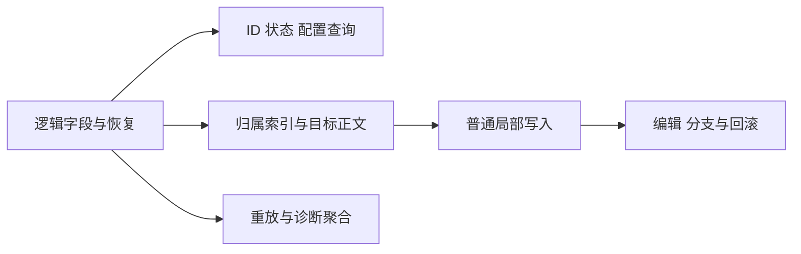

# Roost 与 Loro 历史整读修复执行方案

Status: proposed
Type: architecture
Translation: current

[English](2026-10-31-roost-selective-history-reads.md)

## 摘要

Roost 的权限、回合输出、配置与部分普通写入仍通过完整历史数组定位记录；目录接口和索引恢复也会读取无关正文。本方案把这些路径改为逻辑字段查询、归属索引和局部写入，保持现有结果、顺序和事务语义。Fork、导入和用户明确要求的完整内容操作保留。恢复 Agent 所需的历史重放保留必要遍历，改为有界正文缓冲；实现采用配套 Roost 字段／成员能力和 Loro 目标写入，源码与桌面验收记录见下文。

## 必要的全局访问

“访问全部必要记录”“导出整段正文数组”和“把无关正文装入缓存”是不同成本。下表仅保留需求决定的访问范围。

| 操作 | 必要性与保留范围 | 本次处理 |
| --- | --- | --- |
| Fork | [快照与所选前缀](../../../../apps/cli/src/session/session-fork-service.ts)构成新会话的数据来源；所选范围可能覆盖全部历史 | 按用户确定的范围排除；不把当前读取所选点之后内容的做法认定为必要 |
| 导入、刷新与冲突处理 | [导入规划器](../../../../packages/shared/src/session-data/history-import.ts)需要源内容、顺序及本地基线比较，才能判断追加或冲突 | 排除这类完整内容操作 |
| 完整导出、分享、复制，以及 CLI history --all | [导出](../../../../apps/cli/src/lib/session-export/export-service.ts)、[分享](../../../../packages/components/src/lib/session-share-publisher.ts)、[复制](../../../../packages/components/src/lib/conversation-copy-source.ts)需要用户选择的全部内容 | 保留；带 limit 的普通历史查看纳入改造 |
| ACP 无法原生恢复时的历史重放 | [重放构建器](../../../../packages/shared/src/replay-prompt-builder.ts)按全局长度选择省略策略，并收集全部工具路径和消息计数；默认最终预算为 100,000 字符 | 保留现有语义所需遍历，执行 P6 去掉完整数组和完整候选 prompt |
| 缺索引时确认不存在、全局统计、多条匹配结果 | 老目标、工具归属、全局去重和精确计数可能需要检查全部相关字段；匹配结果本身也可能覆盖全部记录 | 保留字段级访问和实际结果集；普通查询恢复使用 P1 的浅投影 |

在排除项之外，尚未找到必须一次性导出全部历史正文的业务。新索引尚未建立时，不能保证所有查询只访问固定数量的元数据；字段查询与正文查询须分别计数。

## 依据

读取逻辑核对于 Lody `c5896b416`；以下权限和输出测量使用 `6b73bddbcabf2a0c37bc84546929ad291a26b27f`，对应逻辑一致。实验均为合成数据。

- 128 条各 1 MiB 的历史正文，另加很小的当前输入和回复。两个新进程样本中，真实 Native 权限链路等待答复时额外保留约 128.6 MiB JS 堆，进程峰值 RSS 为 1,651–1,808 MiB；单回合输出额外保留约 128.14 MiB。两者填充同一个完整历史缓存，收益不能相加。
- 输出实现从提交 `cf1ee8dcbd` 引入后一直保留“先整读再筛选”。[Loro 输出读取](../../../../packages/shared/src/session-data/loro.ts)已使用浅字段选择，再导出所需正文；权限请求写入和共用的用户归属查询仍有整读。
- 已发布 Native 0.3.0 的 `readValue` 支持字段路径。Node 24.22.1 下，冷重开一条 1,048,831 字节的合成记录，六个角色、用户、工具与请求字段合计返回 78 字节；探针禁止 `readTurn/readTurns` 后仍成功。这验证了底层字段读取能力，逻辑状态叠加仍须实现。

本方案沿用[派发标量投影](2026-10-22-roost-dispatch-scalar-projection.md)的选择规则、[增量写入](2026-10-22-roost-end-to-end-incremental-mutations.md)的收据与事务边界、[GC 目标查询](../../implemented/architecture/2026-10-30-application-memory-attribution.md)的目标语义。这些决策继续有效，本方案补齐它们尚未覆盖的正文读取路径。

## Roost 可避免的整读清单

| 编号与调用 | Roost 修复方向 | 本项验收 |
| --- | --- | --- |
| 1 [输入同步门禁](../../../../apps/cli/src/session/turn-history-gate.ts)、[prepared input](../../../../apps/cli/src/lib/prepared-session-input.ts)、CLI 预分配输入 | P2：存在性按 ID 查询，派发证明只取关联完成状态；幂等冲突只比较候选条目 | 已存在、未到达、同 ID 冲突和重复提交结果一致；不读取其他正文 |
| 2 [CLI 配额、活动回复、配置、MCP 与有限历史](../../../../apps/cli/src/commands/session.ts) | P2：分别使用字段计数、最新状态、配置选择和范围读取 | 队列去重、终态判定、provider 匹配、sticky Role、limit/total/顺序一致 |
| 3 [MessageHandler 用户归属与目标预检查](../../../../apps/cli/src/lib/message-handler.ts) | P2/P3：权限和 usage 分别查询其原谓词对应的 userId；目标检查走最新目标查询 | 用户优先级、空白值和原字符串保留；usage 不被缩成只查 user |
| 4 权限请求写入、答复和无 turnId 的结果等待 | P3：按工具/请求的有序归属定位，只更新匹配 owner | 重复工具、终态 owner、无 owner 补建、已有答复和跨设备结果一致 |
| 5 [单回合输出](../../../../apps/cli/src/session/roost-node-session.ts)、[CLI 等待](../../../../apps/cli/src/commands/session-output.ts)、[Coordinator](../../../../apps/cli/src/orchestration/coordinator-workflow.ts) | P3：查 user 标量、首个后继关联 assistant、失败时的后继 system，复用 selectTurnOutput | 用户头、回复选择、失败消息、顺序和流式等待结果一致 |
| 6 目录、最新 role、缺索引 readRange/readTurn、派发索引重建 | P1/P2：增加真正的逻辑字段/成员查询，旧状态与恢复也不导出无关正文 | 冷开、旧/缺失/损坏索引、多 segment 与并发状态下读到一致字段 |
| 7 最新 goal 的投影缺失分支 | P1/P3：只读 goal 字段和归属，替换逐页投影正文 | 老目标、无目标、新 cleared/paused 覆盖旧 active、metadata fallback 一致 |
| 8 [定时提案](../../../../packages/components/src/components/schedules/schedule-proposal-notice.tsx)与[运行列表](../../../../packages/components/src/components/schedules/use-schedule-chat-runs.ts) | P2/P3：配置从字段读；运行列表按 scheduleRun 和关联回复状态生成 | 展示/点击时配置、运行列表数量、状态与排序一致 |
| 9 HistoryAction 的 goal、operation-completion、warning、file-backfilled、upsert/remove-turn | P3/P4：选择全部实际匹配 owner；已存在条目局部改，插删走局部分支 | 全部匹配副本、去重、未知字段、插入顺序和失败前状态一致 |
| 10 [worktree 脚本输出](../../../../apps/cli/src/session/worktree/worktree-script-history.ts)与 Agent 批次 | P4：已知 ID 直接更新、新尾条目追加；无目标和大批次不回退全历史重建 | 混合事件顺序、原工具归属、新建目标、重复收据与批次原子性一致 |
| 11 [编辑重发](../../../../apps/cli/src/session/session-edit-and-resend-service.ts)、局部回滚、旧 ID 复用 | P5：边界字段、替换范围、旧 head 和收据；未变前缀复用 | 旧字段、提交时核对、并发编辑拒绝、立即回滚与保留后续追加一致 |
| 12 copy_history 的目标 ID 检查与错误诊断 | P2/P6：只查待复制 ID；按字段聚合原日志的计数和样本 | ID 冲突在原有边界拒绝；日志统计与异常样本顺序一致 |

Roost RPC/renderer bridge 会把上述整读传给 owner，改造须追到实际调用者。共享的旧 `createRoostHistoryReader` 会建立完整投影；生产路径继续使用 Native/bridge reader，核对并处理其余实际消费者，测试 fixture 不能替代 Native 物理读取验证。

## Loro 整段正文读取修复范围

以下九项纳入方案，只记录确实导出整段历史正文的路径；编号沿用 Roost 清单，便于追踪共用改动。每项以 Loro 自身当前实现为行为对照。

| 编号 | 整读入口 | 记录的修复方向 | 必须保持的具体结果 |
| --- | --- | --- | --- |
| 1 | TurnHistoryGate、prepared input 和预分配输入先 readHistory | 复用浅 ID 定位、关联派发状态及候选 readTurn | 消息未到达时继续等待；同 ID 内容冲突仍拒绝；重复提交不重复派发 |
| 2 | CLI 配额、状态、配置、MCP 和有限历史查看先 readHistory | 字段计数、配置选择及范围读取 | 队列去重、最近 assistant 终态、provider 匹配、sticky Role、总数、返回范围及顺序一致 |
| 3 | MessageHandler 用户归属、usage 和目标预检查先 readHistory | 分别实现原 userId 谓词；目标预检查复用 readLatestGoal | 权限的用户优先级、usage 可匹配其他 role、空白判断与原字符串值一致 |
| 4 | permission-request 经 Loro commands 进入 writer.update；缺 turnId 的等待兜底 readHistory | 在 HistoryWriter 内浅查全部工具 owner，再局部写入；等待按请求归属读取 | 重复工具和终态 owner 判定、无 owner 时的补建位置、原有答复优先级及合并内容一致 |
| 8 | 定时提案和运行列表调用 readAll | 从配置、scheduleRun、userTurnId 和回复状态字段生成结果 | 显示与点击各自读取当前配置；列表数量、顺序及状态判定一致 |
| 9 | goal、operation-completion、warning、file-backfilled、upsert/remove 进入 writer.update | 在唯一 HistoryWriter 内增加选中记录与成员命令 | 全部匹配副本、warning 精确去重、旧未知字段、条目顺序及校验拒绝语义一致 |
| 10 | session-agent-writes 的新建目标、结构或部分富内容回退 writer.update | 复用定向批次能力，补充定位、创建和局部变更 | 混合通知顺序、原工具归属、目标创建、重试和一次批次的原子性一致 |
| 11 | 编辑预检查 readHistory；updateWithRollback 在更新前后及回滚时整读 | 预检查只读边界；为编辑补充范围补偿命令，原闭包持有 before-image，浅元数据核对完整成员条件 | 原有 ID/顺序约束、冲突拒绝、旧字段恢复、允许的自动已读变化及后续追加保留一致 |
| 12 | copy_history 目标检查和错误诊断先 readHistory | 按待复制 ID 检查冲突；按字段汇总原诊断 | 原拒绝边界、全局计数、异常样本的选择和顺序一致；完整复制本身保留 |

## 行为等价与正确性

修复只改变记录定位、读取粒度和临时对象生命周期。用户看到的正文、高亮、工具详情、权限选项、配置、历史范围和执行结果须与当前实现一致；记录裁剪或缩小匹配范围不属于本方案的优化手段。

- 分别对照各后端自身的原选择器和命令语义，保持重复项选择、全部匹配副本、顺序、缺省与显式清除、用户归属和错误结果。浅字段视图只用于选择，不能作为完整条目回写而丢失其他字段。
- 保持同一次历史观察。Loro 字段检查和条件写入继续在同一同步边界完成；异步 owner/RPC 读取使用已验证的快照、cursor 和 generation 证据，重放也不能拼接前后变化的页面冒充原 readAll。
- 复用唯一 HistoryWriter 的变更验证、旧存储形态和 stored-copy 补偿。所有待写字段在首个修改前完成原有校验；持久化失败和不确定写入沿用原错误/收据语义，批次原子性不拆散。
- 以结果对照、真实存储验证和用户流程测试作为切换条件；性能测量随后进行。旧状态投影、局部分支和条件回滚的能力缺口先补齐并验证，再切换对应路径。

## 执行顺序

表中编号用于定位范围，P1–P6 是依赖阶段。Roost 的 12 项可避免整读均须修复，无须逐项请示。先执行第 6 项的字段基础，再按 3 → 4 → 5 → 7 → 1 → 2 → 8 → 9 → 10 → 11 → 12 推进，优先完成已测出的权限和输出路径。重放按 P6 保留必要遍历并改造缓冲。

Loro 的九项整段正文读取按上表记录修复方向，依赖与 Roost 共用的改动一并追踪。实现以行为等价条件为前提；已浅读的输出、目录和最新 goal 查询保留并回归。

实施按依赖分阶段验证，最终一次汇总各项的实际改动、用户行为对照、正文读取范围及验证结果。同一基础改动覆盖多项时说明覆盖关系，沿用现有用户行为。

### P1 逻辑字段与恢复

复用 Native 的字段路径、header、分支信息和现有 owner 队列，提供窄的逻辑目录与字段读取。目录包含身份、顺序、状态和允许的输入配置；关系查询另外取得工具、请求、goal、文件、notice 和 scheduleRun 信息。正文缓存只接纳明确请求的条目。

逻辑字段必须叠加完整旧 state、当前 delta state、多 segment 和 permission response，并保持原数据的缺省/显式清除区别。单读 primary 不代表当前值；把整个 items、patches 或包含正文的 contentJson 字符串读出再筛选，也未完成浅投影。现有 API 无法投影的序列化 delta 子树，先由 Native/SDK 补充受支持的逻辑字段能力，Lody 不复制 SDK 私有索引格式。

字段快照绑定 host、generation、分支及 event cursor。索引缺失、旧版本、损坏或外部写入时，由字段页重建派生信息；完成后才发布完整检查点。普通派发不因新增查询字段而被迫重建全部正文。SDK catch-up、lookup 和分页内部调用也纳入读取追踪。

### P2 收窄已知 ID 状态和配置查询

逐个迁移清单中的调用；配额保留去重和队列计数，活动回复保留“最近 assistant 已结束即无活动回复”的规则，配置沿用队列优先、sticky Role 和匹配 provider 的 model 回查。CLI limit 在正确的逻辑选择阶段生效，total 独立计算。

权限通知沿用“最近 user 的非空白 userId → metadata → 当前用户”；usage 的原谓词允许其他 role，分别实现。已有 ID 的内容冲突检查继续比较目标条目。UI 通过同一 reader/owner 查询，所需 RPC/IPC 字段使用既有 schema 与能力协商方式扩展。

### P3 归属索引与选中正文

在既有派生投影上补充必要的有序归属：toolCallId、requestId、userTurnId、goal thread、fileId、notice 和 scheduleRun。只保存定位/选择证据；随内容写入维护，跨游标覆盖失效后用 P1 恢复。

权限请求保留全部匹配工具：终态 owner 的存在也阻止“无 owner”补建；真正无 owner 时，只能补到历史最后一条且未结束的 assistant。Native 默认答复沿用最早匹配 assistant，显式 turnId 定位不变；Loro 保留其既有查找顺序。等待结果使用相同请求归属。

输出直接复用共享 selectTurnOutput：返回 user 标量而非输入正文，选择其后第一个关联 assistant；user failed 时返回其后全部 system，保持顺序。目标读沿用原解析器的三个字符串字段条件，paused/complete/cleared 覆盖旧 active；goal 修改及文件回填保留全部匹配项，operation-completion 按既有操作身份定位，warning 去重核对精确消息。

定时任务运行列表保留 scheduleId 匹配，并按原规则选择最后一条关联的非 user 回复；配置提案在显示和点击时分别读取当前配置。

### P4 普通局部写入

已有 upsert-turn 走目标条目更新，新尾条目直接追加；无目标 Agent 批次通过字段选择实际 owner，再调用既有 reducer。目标、文件与 notice 命令只向 planner 提供选择出的匹配记录和所需边界，保持其全局匹配语义。

移除“超过 64 个 SDK 命令便重建全历史”的后备路径。复用 Native 原子写入与收据；批次大小限制需要 SDK 支持时先补能力，不能用多次可见提交替代原有一次提交。

中部插入/删除、已移除 business ID 复用属于存储能力缺口，不能直接把 readAll 删除。先在 SDK/Native 验证成员变更、前缀/正文复用与签名封存规则，再接回 Lody。任意位置变更、重开及后续追加通过后，才移除对应 generation 全量重建；Fork/导入的 generation 保留。

### P5 编辑重发与补偿

预检查读取最新 user、相关 provider 边界、目标配置与最新 goal；提交时在 owner 队列内重新核对。沿现有分支操作复用未变前缀，仅保留本次替换范围、旧 head 与回滚收据。

Roost 回滚比较本次写入范围；立即回滚恢复旧 head，已有后续追加时采用 P4 的局部成员替换并保留后续内容。Loro 的编辑补偿命令继续由原闭包持有 before-image，通过浅成员信息核对原有全部 ID/顺序条件，并保留写入前 ID 集合以识别新插入行允许的自动已读变化。只导出需要比较和恢复的范围，保持原先成功/拒绝的边界。

### P6 重放与诊断

重放逐条格式化并释放源正文，为 A/B/C 三种现有策略分别维护总长度、消息数和预算内尾部缓冲，汇总保持插入顺序及 read/edit 优先级的文件路径。结束时按原预算选择策略，执行相同头尾标记、脱敏和截断，保留 prompt、stats 与 noticeMeta 的等价性。正文缓冲随预算增长；临时内存仍包含当前投影记录和输出所需路径集合。

恢复等待只查是否已有可重放条目；resume notice 去重只查最新 user 前一条。诊断逐字段聚合全部 item 类型、限定数量的异常 meta keys 与末条统计，保持当前日志结果。缺少等价摘要时，这些全局信息仍需遍历，但不建立完整历史或候选 prompt。

## 验证与完成条件

- 在现有共享 reader/writer、Native backend、权限、CLI output、Coordinator 和 schedules 套件中扩展行为测试。以原选择器/格式化器作为结果对照，覆盖重复 ID、终态 owner、旧 goal、失败 system、配置清除、状态叠加与返回值隔离。
- 使用真实 Loro reader/writer 对照原行为，检查返回值、持久内容、变化通知和错误；覆盖旧 inline/容器形态、未提交事务、重复身份、配置清除及回滚时的成员变化。读取断言覆盖实际调用，最终内容快照用于核对无关记录保持原样。
- 使用真实 Native 冷重开、旧/缺失/损坏索引、外部内容写入和 index-only generation 变化。普通路径禁止完整分支读取、非目标条目 readTurn/readTurns，以及返回无关正文的父级 readValue；显式有限窗口读单独核对范围。
- 分支写入核对失败前后状态、收据重试、后续追加和回滚；原子性、幂等和不可变记录保持现有契约。
- 真实 Electron、bundled CLI、preload/IPC/renderer 验证长历史下的权限展示/答复、流式输出、目标保留/清除、定时卡片、编辑重发与恢复。使用隔离数据和外部合成 ACP。
- 用相同 128 MiB 合成前缀、新进程、相同 Native 版本做配对测量，分别报告 JS 堆、footprint、RSS 峰值、冷/热耗时、返回字节和实际正文读取范围；目标回合固定，增加历史规模检查成本来源。

每个阶段分别提交可审查的实现与上述结果。旧状态投影和局部分支能力已实现，实际范围由冷恢复、失败恢复和新进程测量验证。最终复核 readHistory/readAll/readActiveBranch/readProjectedMessages 及无此名称的扫描回退；保留调用须对应“必要的全局访问”中的明确需求。

## 实现与验收（2026-10-31）

实现位于隔离分支 `codex/history-read-foundation`，基于 `6f29141a6`（main 与 GC 查询 PR #2118）。基线 `pnpm check`、`pnpm format` 通过。[Roost 上游 PR](https://github.com/loro-dev/roost/pull/29) 基于 0.3.0 源码 `7cf16647e606f74be877172ec976d2b7e2edc742`，候选提交为 `ad6dab8d167eeaccff016ae4ae77065a63f719c0`。

| 阶段 | 实现行为 | 验收 |
| --- | --- | --- |
| P1 | primary／late／完整 state／delta 的逻辑字段选择；字段恢复 dispatch 索引；目录显式声明元数据完整性 | 真实 Native 冷启动／丢失／损坏索引及无关正文禁止读取；SDK 初始 Create 恢复在 Native 内计算摘要 |
| P2/P3 | 共用身份／配置／归属／有限 transcript／定时任务查询；有序工具／权限／输出归属；目标权限写入、等待及目标读取 | Native／RPC／replay 157/157；命令／MCP／能力测试 164/164；旧标量和重复 ID 与原谓词对照 |
| P4/P5 Roost | 稀疏分支成员、已移除 ID 别名、未绑定／大 Agent 批次、带边界检查的编辑／补偿 | Native 69/69，含中断／重开／丢回包／回执／容量测试；复用未变物理 Turn，保留后续追加 |
| P4/P5 Loro | 单一 HistoryWriter 内同步目标规划、变更范围存储补偿、完整浅 ID／顺序检查、递归 Agent 归属 | 真实 Loro 结果与快照对照；禁止读取无关前缀、复用 ID 和前缀改名拒绝；writer／兼容套件通过 |
| P6 | 字段诊断；同一观察下逐条重放，以预算约束缓冲 | 差分测试精确比较全部策略的 prompt／stats、末尾终态和预算边界 |

当前 owner 独立协商 `sessionHistoryInspection` v1，通过有界查询页和不透明检查点约束每个字段页／正文／不存在证明；generation 变更即使复用数值 revision 也不会混读。旧 owner 保留兼容，通过既有 API 按检查点逐条读取正文；升级前无法提供新字段。客户端不聚合完整正文数组，新 owner 则直接读逻辑字段。

重复 ID 保留调用方原有规则：预分配输入比较首个匹配；输入 gate 接受任意匹配 user；编辑选择实际最后一条 user 的位置。选中正文保留未知存储字段。真实 Fork E2E 发现既有未发布 metadata 问题：worktree 初始化／清理传入不完整 metadata，缺少 `historyBackend` 时误选 Loro；现在沿用已绑定后端。

保留的完整正文调用仅用于显式全读／导出、snapshot／Fork／复制／导入及这些完整内容操作的 generation 验证。普通派发、权限／输出、恢复索引、业务 action、Agent 后备及编辑补偿均走字段／目标正文。重放按需逐条访问正文。高亮、内容范围和仓库规则未改动。

### 验证记录

- 上游完整串行 Rust、根／Native Clippy 与 fmt 通过；SDK 651 通过、1 跳过；Native 69/69。离线发布 fixture 需从 npm 运行，不能将 pnpm 的 `npm_execpath` 当成 npm；未执行真实包发布。
- 已安装 Rust 1.98.1 成功构建并加载本机优化 addon；Rust 1.94 配合本机 macOS 链接器出现 LINKEDIT 对齐问题，未改源码／包／工具链锁定。最终优化二进制从已提交的 Roost `ad6dab8` 重建，该二进制的 5 项字段／稀疏行为测试通过。本地二进制 SHA-256：`b07cc8209ef4eff6ee7e6da91ae49e3d26bbc791f3c6475795060952aca278f0`。
- 最终桌面构建通过；Roost 五场景／50 步通过（续聊、Fork、目标、队列、未读）。Loro 最终复跑同样五场景／50 步通过。完整叠加版本通过 CLI 5,267 项（4 跳过）、组件 6,808 项、共享库 1,742 项；基础 PR 单独通过 CLI 类型检查和 363 项相关测试。权限、输出、编辑／回滚及恢复边界另有真实存储／IPC 行为测试；五个桌面场景不代表覆盖全部 UI 流程。
- `pnpm check` 在进入 Electron 前，类型／lint／Effect 及全部 workspace 套件通过；3 项打包失败来自本地 Native 源码链接缺少发布时的平台包布局，并复制了构建产物。改成真实主包／平台包布局后，完整 Electron 复跑 255 + 191 项通过，其余静态／边界阶段另行全部通过，未为布置问题弱化测试或生产路径。`pnpm format`、文档 status/check 通过，没有 SHA 保护主题变更。

### 优化构建配对内存测量

两组新进程配对使用 Lody 基线 `6f29141a6`、实测候选源码、配套 Roost `ad6dab8` 及上面的精确优化 Native 哈希；运行环境为 macOS arm64、Node 24.22.1／Rust 1.98.1。每次打开同一份 128 × 1 MiB 合成前缀和很小的当前回合，按顺序测量，不并发构建／测试，并核实实际持久化权限／结果或输出 ID。耗时为准备后的首次请求，之前的 `6b73bddbc` 与调试数据不属于这份最终对照。

| 指标 | 权限修复前 → 后 | 单回合输出修复前 → 后 |
| --- | --- | --- |
| 额外保留 JS 堆 | 125.77 → 0.51 MiB | 125.97–127.79 → 0.041 MiB |
| 额外 footprint | 64.30–108.13 → 1.17–1.27 MiB | 35.93–56.91 → −0.91–0.13 MiB |
| 含准备过程的进程峰值 RSS | 1552.30–1557.83 → 677.98–702.78 MiB | 986.59–1006.34 → 525.17–525.69 MiB |
| 首次请求耗时 | 15856–15990 → 22.45–22.92 ms | 7956–7961 → 10.30–10.50 ms |
| readActiveBranch／readAll／readHistory | 2／3／1 → 0／0／0 | 1／0／0 → 0／0／0 |

footprint 包含 GC／内存页波动，输出的微小下降属于测量噪声。新增堆反映请求生命周期，峰值 RSS 包含启动和 Native 临时分配；这些进程数字不代表整个多进程 Electron 的总占用，权限和输出的收益共享同一缓存、不能相加。必要的全局字段遍历保留，Native 初始 Create 摘要恢复也仍逐条访问不可变创建字节；真实 Native 禁止无关正文读取的测试另行核实读取范围。

### PR 与构建依赖

分为三个 draft：Roost 上游、Lody 共用查询与 Roost 接入、Loro 目标写入／回滚；Loro 叠在基础 PR 上。历史写入 Spec 增加 v2 成员格式后保持 draft，等待审阅。

验证使用忽略的本地 SDK／Native 链接和合成数据。已发布 0.3.0 不包含新 API，合并基础 PR 前需配套发布 SDK／Native，并更新 Lody manifest／lockfile；未进行未经请求的发布，不提交会话记录或本地二进制。draft PR 必须明确这项依赖，不能把旧发布包的普通安装当成候选验收。

### Loro 写入 PR 完成记录

子 PR 将普通 Loro action、编辑／重发及 Agent 后备切换到 `HistoryWriter.updateSelected`／`updateSelectedWithRollback`。规划读取全局小字段，展开所有选中归属（包含递归 subagent 祖先）；未选中占位数据发生变更会在 CRDT 写入前拒绝。补偿保留实际存储前像和完整写前／写后身份检查，新 ID 的自动 seen/read、后续追加和无关前缀编辑保留既有行为。现有 writer／存储／边界套件增加禁止读取无关前缀、结果等价和拒绝后状态检查。上面的完整套件、两后端最终桌面流程及配对测量均来自此完整叠加源码；基础 PR 在此子 PR 之前也已独立验证。
