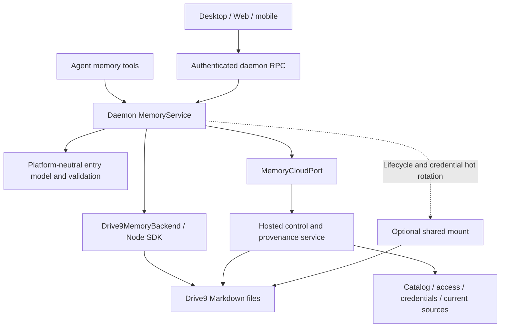

# Lody Memory on drive9: private and shared memories as files

Status: proposed
Translation: current

[中文](2026-11-09-lody-memory-drive9.zh.md)

## Abstract

The unreleased Loro-based Lody Memory stores each memory in a CRDT document. People
cannot open, index or search that document with ordinary tools, and personal E2EE
blocks cross-device use. This proposal stores each memory as Markdown files in a
hosted [drive9](https://drive9.ai/) file service. A memory is **private** (reached
only through the daemon's SDK) or **shared** (workspace members have read-write
access, with a proposed mount); visibility can change after creation. The trade-offs are that
memory content becomes plaintext on the hosted service, memory works only online,
and the OSS desktop build has no Lody Memory. P1 establishes basic scoped file
access, but the pinned Drive9 lacks mount credential hot rotation. Lody Agent tool
writes take priority; current-memory provenance is required, recoverable history
is not. Mounts must renew without interruption if shipped; their launch timing
remains open. Fresh reads and local refresh instead of SSE are a recommendation
pending approval; the [P1 gates](#p1-verification-before-implementation) remain open.

## Decision

The owner decided the following:

- **No backward compatibility.** The Loro memory never shipped, so no data is
  migrated and the
  [Loro design](../../rejected/architecture/2026-10-26-builtin-personal-memory.md)
  is rejected.
- **No E2EE for memory.** Plaintext memory on the hosted service is accepted for
  both private and shared memories. Access control replaces cryptographic
  confidentiality.
- **Shared means workspace members.** Every member of the workspace gets
  read-write access. Read-only membership is not offered initially.
- **Lody hosts the drive9 tenants.**
- **Online-only is accepted.**
- **Prioritize Agent tool writes in Lody** over arbitrary editor saves.
- **Provenance is required per current memory entry; recoverable history is not.**
  Unchanged entries retain their sources when another entry is updated.
- **External/unknown provenance is accepted** when external edits cannot be
  reliably attributed. Never carry stale Agent attribution onto changed content.
- **Credential renewal must not interrupt mounts.** Unmount/remount is not an
  acceptable renewal strategy.
- **Visibility is mutable** and stored as catalog metadata.

## Layout and identity

Each workspace has one drive9 tenant. Each memory is a directory:

```text
/memories/<memoryId>/MEMORY.md       # front matter: name, description; short entry
/memories/<memoryId>/<topic>.md      # further documents, relative paths
```

The path carries no visibility, so switching visibility moves no files. Paths are
document identity, as in the Loro design: renaming moves a file, and a visible
destination is never implicitly overwritten. Search uses drive9 `grep`/`find`
under the memory prefix rather than an in-process scan.

## Access paths

```text
             ┌──────────── hosted credential service ───────────┐
             │ catalog (memoryId, visibility, owner), membership │
             │ holds tenant owner key; issues scoped tokens      │
             └───────┬──────────────────────────────┬───────────┘
          scoped token (memory prefix)     scoped token (memory prefix)
                     │                              │
   daemon SDK client (private + shared)   drive9 mount (shared only)
   MCP tools, prompt injection, RPC       ~/Lody/Memory/<name>, editors, agents
```

- **Private memories.** Only the owner's daemon reads and writes them, through the
  drive9 JS SDK. The SDK needs Node `fs`, so it runs only in the CLI daemon.
  Renderer, Web and mobile clients go through daemon RPC. A private memory is never
  mounted.
- **Shared memories.** These use the same SDK path, with a proposed mount at
  `~/Lody/Memory/<name>`. The mount uses WebDAV on macOS and Windows, and FUSE on
  Linux; drive9's automatic mode selects this. Any member's tools, editors and
  agents can then use ordinary file operations. Whether mounts must ship at launch
  or may follow a tool-only milestone remains open.
- **Role binding.** A Role still binds `{providerId: "lody", memoryId}`, and that
  binding is frozen into each turn. MCP tools receive only the token for the bound
  memory. A mount is outside Role authorization: anything running as the user can
  read it. This is why it is limited to shared memories.

## Component architecture and ownership

This is a proposed architecture and high-level contract, not existing exports or
verified implementation. The [memory Spec](../../../../specs/agent-role-memory.md)
owns requirements. The current `packages/memory` still implements the rejected
Loro design; synchronous interfaces, local-durability receipts and historical
operations cannot be carried unchanged into network storage.



| Component | Owns | Boundary |
| --- | --- | --- |
| Clients and Agent tools | Display, queries, content edits and entry sources | No owner key; model-provided identity, memory IDs or credentials cannot widen access. |
| Daemon `MemoryService` | Frozen-turn binding, current authorization, operation IDs, source context and write coordination | User/machine come from authenticated execution; session/turn/tool call come from runtime, not model arguments. Management RPC separately authorizes the selected memory. |
| New entry core in `packages/memory` | Markdown/entry mapping, path/size validation, edit planning and source matching | Platform-neutral; no Node SDK, filesystem or private cloud imports. |
| CLI `Drive9MemoryBackend` | SDK requests, conditional writes, prefix-scoped search and error mapping | Ordinary tools need no mount; no second writable local Markdown truth source. |
| `MemoryCloudPort` | Public control/provenance service contract | DTOs in `packages/cloud-api`, injected port in `packages/platform`; hosted implementation stays outside the public repository. |
| Hosted control/provenance service | Catalog, current access, credential issuance/revocation, operation receipts and current entry sources | Owner keys remain server-side. Source records are access-controlled sensitive metadata, never workspace repo meta. |
| Mount manager | Shared mount startup/status, hot rotation and explicit revocation | Outside the Agent tool path; unverified hot rotation is not supported behavior. |

The catalog addresses `(workspaceId, memoryId)` and stores owner, visibility and
lifecycle state. Name/description remain authoritative in `MEMORY.md`; the catalog
is not a second editable profile. Creation writes the entry file before publishing
the catalog item; partial creation stays unavailable and retries the same operation
ID. Deletion first blocks new grants and revokes tokens, then removes files/source
records; it cannot report complete deletion before cleanup. Visibility transitions
and member removal need explicit revocation completion: unmounting locally or
changing catalog metadata does not prove old tokens invalid.

## High-level data and interfaces

### Entry identity and file representation

Paths identify documents; `entryId` identifies a fact/entry within a memory. The
proposal generates stable IDs in tools and associates entries through ignorable
Markdown markers while keeping prose readable. Marker syntax and parsing format
must be fixed before implementation; arbitrary paragraph boundaries are not an
already-selected definition of facts. An entry may contain several sentences;
Agents organize independent memories into entries.

Editing an entry preserves its ID; new entries receive new IDs. Reordering preserves
sources; cross-file moves explicitly retain IDs without promising a multi-file
transaction. Split/merge should allocate new IDs with `derivedFrom` references,
without attributing original content to its organizer. Identical text or a copied
old ID alone cannot inherit provenance. Duplicate IDs, missing markers or ambiguous
external content produce unknown attribution.

The source service associates entry ID, content hash and confirmed document commits
with current content. File revisions guard writes; entry hashes match sources.
Hashes or embedded source labels do not prove identity or detect unobserved edits
that restore the original bytes. `verified` means current content matches a source
record confirmed through the authenticated workflow, not factual correctness, a
complete audit trail or independent proof against a malicious device. Keep current
entries' original source and latest content-update references, not every old body.
Reconciliation receipts require a separately bounded retention policy.

### Bound tool/RPC interface

```ts
// Proposed contracts, not existing exports; IDs and revisions are opaque strings.
type Entry = {
  entryId: string;
  text: string;
  contentHash: string;
  provenance: "verified" | "pending" | "external_unknown";
};
type DocumentView = {
  path: string;
  revision: string;
  markdown: string;
  entries: Entry[];
};
type EntryEdit =
  | { kind: "insert"; afterEntryId: string | null; text: string }
  | { kind: "replace"; entryId: string; text: string }
  | { kind: "remove"; entryId: string };
type MutationResult =
  | { kind: "committed"; operationId: string; revision: string }
  | { kind: "conflict"; currentRevision: string }
  | { kind: "incomplete"; operationId: string;
      content: "applied" | "unknown"; provenance: "pending" }
  | { kind: "rejected"; code: "forbidden" | "not_found" |
      "invalid_input" | "quota_exceeded" | "unsupported" };

// Bound by the daemon, never selected by model-supplied identity fields.
interface BoundMemory {
  startup(): Promise<{ instructions: string; entry: DocumentView }>;
  list(input: { cursor?: string; limit: number }): Promise<{
    items: { path: string }[]; nextCursor?: string;
  }>;
  read(input: { path: string }): Promise<DocumentView>;
  search(input: { query: string; limit: number }): Promise<{
    hits: { path: string; excerpt?: string }[];
  }>;
  sources(input: { path: string; entryIds: string[] }): Promise<EntrySource[]>;
  create(input: { path: string; entries: { text: string }[] }): Promise<MutationResult>;
  edit(input: { path: string; expectedRevision: string;
    changes: EntryEdit[] }): Promise<MutationResult>;
  status(input: { operationId: string }): Promise<MutationResult>;
}
type EntrySource = {
  entryId: string;
  contentHash: string;
  status: "verified" | "pending" | "external_unknown";
  origin?: SourceRef;
  lastContentUpdate?: SourceRef;
  derivedFrom?: string[];
};
type SourceRef = {
  changeId: string;
  userId: string;
  machineId: string;
  sessionRef?: string;
  turnRef?: string;
  toolCallRef?: string;
  observedAt: string;
};
```

These sketches show contract shape. Network failures not shown above return distinct
`unavailable`/timeout results rather than empty content. Concrete APIs must bound
reads, searches, source queries and edit batches; oversize inputs fail explicitly,
never silently truncate before writing. List cursors are backend-opaque and do not
promise a snapshot across edits. Search identifies candidate documents before
reading the needed entries and sources.

Tool inputs contain only paths, entries and expected revisions. The daemon assigns
one operation ID per logical tool call and reuses it on retries; the same ID with a
different payload is rejected. Status queries require access through the current
binding and identity. Startup separates fixed tool instructions from entry content
returned as untrusted reference data. Create must enforce absence, never default to
unconditional overwrite; safe create-if-absent support still requires verification.
Edit updates one document, validates the entire batch before conditional submission,
and never applies only its valid subset.

Management operations `listMemories/createMemory/setVisibility/deleteMemory` are
separate from Agent tools. They accept memory IDs only with user management
authorization; Agents cannot use them to expand their binding. Document rename/delete
need independent destination-absence/expected-revision contracts. If Drive9 cannot
perform the required atomic conditional operation, return `unsupported`; a read
followed by unconditional deletion is not conflict protection. `MEMORY.md` may be
edited/cleared, never renamed/deleted.

### Hosted control and provenance port

| Operation | Main inputs | Result and guarantee |
| --- | --- | --- |
| `describeMemory` | Workspace, memory | Currently accessible catalog and capabilities; identity comes from the authenticated channel. |
| `issueCredential` | Memory, purpose `tools/mount`, requested operations | `{credentialId, token, endpoint, prefix, expiresAt, generation}`; server narrows access and does not accept arbitrary caller-selected endpoints. |
| `renewCredential` | Credential ID, expected generation | Recheck current access and return a new generation; removed members are not entitled to renewal. |
| `prepareChange` | Operation ID, path, expected revision, entry change summaries/hashes, runtime source references | Idempotent preparation receipt; server binds authenticated user/machine and validates session references and visibility. |
| `finalizeChange` | Operation ID, SDK-returned revision | Independently read and compare actual content to the prepared summary before confirming sources; a client-reported revision alone is not proof. |
| `changeStatus` | Operation ID | Unknown/applied content, pending/complete provenance and retry status. |
| `readSources` | Memory, path, current revision, entry IDs | Sources matching current content, or pending/unknown; hide inaccessible session references. |

The proposed source port uses hosted metadata storage, not Drive9 journals.
Prepare/finalize is not a distributed transaction: background reconciliation,
conditional state transitions and duplicate handling are required responsibilities.
Late completion of an old operation cannot replace newer entry sources. If the
service cannot confirm an intermediate version, retain uncertainty rather than
promoting client assertions to verified. Shared readers may see source summaries,
but source links grant no session access; return a restricted source when necessary
without exposing private reference identifiers or text.

## Main interactions and failure handling

### Agent update without a mount

1. Resolve the frozen binding and current access, obtain a prefix-scoped token,
   and read the file/revision through the SDK.
2. The Agent submits edits using returned entry IDs. The daemon validates path,
   full batch and access, preserving untouched entries' sources.
3. Persist a preparation receipt, then conditionally write Markdown using
   `expectedRevision`. Return conflicts to the Agent without blind retries.
4. The source service verifies the actual write and completes attribution. Return
   committed only after both complete, then refresh the local view.
5. Content saved without source completion returns `incomplete(applied, pending)`;
   a timed-out write with uncertain outcome returns `incomplete(unknown, pending)`.
   Retry queries the same operation first, rather than issuing a new write ID.
   Do not start the write if preparation is unavailable.

This path needs neither mounts nor SSE and does not claim atomic content/provenance
commit. Timeouts, daemon restarts and subsequent external overwrites must preserve
or recover the correct uncertain state. Verification of Drive9 revisions against
actual bytes and recovery of operation IDs after restart remain implementation work.

### Reads and external edits

Read current files on open/use, parse entries, then query matching sources; never
apply cached sources to new content without validation. If the source service is
unavailable, return content with pending status rather than cached verified
attribution. External marker/content mismatches yield external_unknown for affected
entries; reliably proven unchanged entries retain sources. A subsequent Lody edit
does not convert an external entry's origin into that Agent: it establishes update
references only for content the Agent actually adds or changes.

### Mount credential hot rotation

The high-level lifecycle is `start(lease)`, `status()`,
`rotateCredential(nextLease)`, `revoke()` and `stop()`. These are proposed new mount
contracts; the current Drive9 CLI has no verified hot rotation implementation.
After rotation acknowledgement, new requests use the new generation, mount/open
handles remain valid and in-flight writes are preserved. Renew before expiry,
handle bounded overlap and revocation of old/new credentials, and never hide auth
failures by replaying non-idempotent writes. Noninterrupting normal renewal is not
permanent network availability: renewal failure degrades explicitly without lost
writes or continued use of revoked credentials. Explicit revocation may stop
subsequent access and is distinct from normal renewal.

## Implementation order and contract verification

Define entry encoding and source-verification contracts first, then implement the
authenticated control port, SDK backend, entry tools and source UI. Add shared
mounts as a separate path. Mount launch timing remains open; engineering stages do
not decide release scope. Protect scope denial, two-writer conflicts, preservation
of untouched sources, unknown external ambiguity, idempotent operations,
reconciliation after a crash between write and source confirmation, private session
references and hot rotation with open handles/in-flight writes. These are future
acceptance targets; P1 did not validate these new interfaces. Multi-file atomic
changes, full history, live SSE and universal editor compatibility are not implied.

## Credentials

A hosted credential service holds each tenant's owner key and issues short-lived
tokens scoped to a path prefix (`POST /v1/tokens`, `{prefix, ops}`). Tokens are
issued per memory and per user, and can be revoked.

- The daemon keeps filesystem tokens in memory and passes a mount's token through
  `DRIVE9_API_KEY`, with `DRIVE9_VAULT_TOKEN` removed from the child environment.
  Vault tokens authorize secret reads; they are not filesystem-scoped API tokens.
- Lody must avoid writing tokens to `~/.drive9/config`. This alone does not prevent
  credential persistence: default FUSE mount state stores the bearer in a `0600`
  JSON file. Its `--no-persist-credentials` option requires foreground or
  unsupervised operation and is unavailable for WebDAV. WebDAV state omits the
  bearer, but its in-memory client retains the original token.
- Mount credentials are snapshots. The pinned implementation requires
  unmount/remount for renewal, which violates the required uninterrupted mount
  contract. Changing configuration or restarting a supervisor with saved
  credentials does not provide hot rotation. If mounts ship, tested hot rotation
  preserving open handles and pending writes is a release gate.
- Members of a shared memory get `read, list, search, write, delete`.

In this repository the service is an injected `packages/platform` cloud port, and
its DTOs live in `packages/cloud-api`. The OSS desktop is local-only and makes no
authenticated product-cloud requests, so it has no Lody Memory. Whether to support
a user-supplied or self-hosted drive9 endpoint is an open question.

## Changing visibility

- **Private → shared.** Issue member tokens; mount on members' devices if mounts ship.
- **Shared → private.** Revoke member tokens, then ask online daemons to unmount.
  Copies that other members already read, or cached on their disks, cannot be
  recalled. The UI must say so before confirming.

## Provenance and concurrency

- **SDK writes.** Use `expectedRevision` and return conflicts without blind retries.
  The proposed entry-level sources and prepare/finalize workflow above replace a
  file-level actor record. Actor labels may aid diagnostics but do not authenticate
  provenance. Filesystem tokens cannot append journals; the separate source service
  still requires crash recovery and idempotent reconciliation, not an atomicity claim.
- **Mount writes.** External/unknown attribution is accepted when a source cannot be
  reliably established; changed entries must not retain stale Agent attribution. The pinned
  WebDAV mount never configures `SetActor`, and `X-Dat9-Actor` is caller-supplied,
  not authenticated identity. FUSE generates a mount actor, not the proposed
  `lody:<userId>:<machineId>` identity. Neither establishes trusted provenance.
- **Events.** Filesystem tokens receive 403 from `/v1/events` and `/v1/journals`.
  Owner SSE is tenant-wide; the inspected stream loop does not revalidate expiry
  or revocation. Do not distribute owner keys to daemons to bypass this gap.
  The current recommendation for the Spec is fresh reads on open/use and local
  refresh after writes, deferring live notifications and requiring no SSE. This
  is proposed, not user-approved. If live notifications are later needed, scoped
  events with stream revocation or a membership/path-scoped hosted relay remain
  candidates; neither is implemented or approved here.
- **Concurrent mount writes.** WebDAV buffers whole files and commits unconditional
  writes on close. Its locks are local to each handler, so another mount or SDK
  writer can be overwritten. SDK revision checks protect conditional SDK writes
  only; they do not make subsequent WebDAV writes conditional.
- **History.** Journal append/read/verify works, but does not capture file versions
  or restore them. Revision numbers alone cannot recover overwritten bytes; this
  pin rejects journal artifact references and has no implemented seal operation.
  Recoverable history is not a product requirement or implementation gate. These
  limits still preclude claiming recovery from last-write-wins overwrites. Journal hashes verify
  consistency, not authenticity against an administrator able to rewrite the chain.

## Alternatives considered

- **Keep Loro with E2EE sync.** Rejected. Memories stay opaque to ordinary tools,
  search stays in-process, and release waits on personal E2EE.
- **Mount every memory, including private ones.** Rejected. A mount bypasses Role
  binding and exposes a private memory to every local process.
- **Encode visibility in the path** (`/private/…`, `/shared/…`). Rejected. Changing
  visibility would become a move and break open handles and mounts.
- **One tenant per user.** Rejected. Shared memories would need cross-tenant
  sharing, which drive9 V1 supports only as a snapshot copy.

## Consequences

- The Loro-specific code in `packages/memory` is replaced:
  - document layout, history and JSONPath search;
  - SQLite/IndexedDB persistence;
  - the Renderer replica and its local data channel.
- `packages/memory` places storage behind a `MemoryBackend` interface with a
  drive9 implementation; history-related contracts must be adjusted to the
  current-content provenance scope.
- Daemons advertise `builtinMemory: 2`. Clients reject `1`, so no Loro daemon
  serves the new contract.
- If mounts ship, Lody packages the drive9 CLI as a managed runtime and owns the
  mount lifecycle, including uninterrupted credential renewal.
- Hosting cost and quota are per tenant, so per workspace. Limits must be set
  before release.

## P1 verification before implementation

P1 is not an implementation approval. The pinned integration needs the following
work before it can meet the proposed contract:

| Area | Evidence and remaining gate |
| --- | --- |
| Scoped access | Allowed file reads succeed; sibling reads and root listing are denied. SSE and journals are denied entirely. Fresh reads on open/use and local refresh after writes are proposed instead of live notifications, pending approval; never send tenant owner keys to devices. |
| Renewal | Mount clients retain their initial credentials. If mounts ship, tested hot rotation without interruption or unmount/remount is required; uninterrupted, no-loss renewal is unverified. |
| macOS WebDAV | Scoped macOS mounts read/write successfully, but replacing an existing file with `os.replace(tmp, target)` fails with `EINVAL`. Previously read contents remain readable from cache after expiry/revocation; uncached reads and new writes fail. Arbitrary editor saves are lower priority than Agent tool writes; this limitation remains. Uninterrupted renewal is a gate if mounts ship. |
| Search and concurrency | Literal English and Chinese Markdown searches return the fixture; stale conditional writes return 409. This is not a recall benchmark or protection against unconditional mount writes. |
| Current-memory provenance | Journal permissions and append/verify work; reliable association of current content with provenance remains unresolved. Per-entry provenance is required; external/unknown attribution is accepted. Entry identity, matching and commit consistency still need a design. Recoverable history is not a gate. |
| Hosting | Local tenant readiness took approximately 6.6–9.7 seconds in two successful samples on TiDB v8.5.1. This is not hosted provisioning latency. Hosted price, quotas and provisioning SLA remain unverified; no cloud tenant was provisioned. |

## Open questions

- May a tool-only milestone ship first, or must launch include mounts?
- Should members get a read-only role later? The current decision is read-write
  for all members.

The fresh-read/local-refresh recommendation and deferred live notifications remain
proposed pending approval.

## Verification

Evidence is pinned to [`mem9-ai/drive9` commit
`b866b426ff4ab8d8409c95e77ad0cc946908bcca`](https://github.com/mem9-ai/drive9/tree/b866b426ff4ab8d8409c95e77ad0cc946908bcca).
Executed local HTTP probes used a synthetic tenant and a token restricted to
`/memories/a/`, with a second memory at `/memories/b/`. They established allowed
read 200, sibling/root denial 403, events/journals denial 403, successful
conditional write followed by stale-revision 409, and new-request rejection 401
after revocation. Search ran before overwriting the fixture and returned its path
for both `pnpm` and `中文`. These observations do not establish live stream
revocation, broad search recall, or application recovery.

Reproducible upstream test boundaries:

- `pkg/server/tokens_test.go`: `TestScopedTokenRevokeInvalidatesToken`.
- `pkg/server/server_test.go`: `TestWriteWithExpectedRevisionConflict`.
- `pkg/server`: `TestScopedBusinessEndpointGuardDeniesEndpointsOutOfWorkspaceZonesScope`,
  `TestJournalPermissionsFromClaimsFailsClosedForScopedKeys`,
  `TestParseFSScopeOpsRejectsSearchWithoutRead`, `TestJournalHTTPCreateAppendSearchVerify`,
  `TestJournalHTTPFullEntriesRequireReadPermission`,
  `TestJournalHTTPAppendSourcePermissions`, and
  `TestJournalHTTPSearchOmitsZeroTimesAndSupportsRepeatedLabels`.

These tests executed with a local TiDB database using `go test ./pkg/server
-run '<test-name-regexp>' -count=1 -v -timeout=180s`. The isolated database required
`tidb_ddl_enable_fast_reorg=OFF` and `tidb_enable_dist_task=OFF` to avoid the local
DDL ingest free-space precheck; that setup is not a production recommendation.

A live macOS WebDAV probe confirmed scoped mounts in the OS mount table. API
write → mounted read and mounted write → API read returned matching contents;
API rename → mounted read also worked. Atomic replacement over an existing file
failed with errno 22, leaving the temporary source present. After revocation and
a separate 20-second token expiry, new API requests returned 401, cached mounted
contents remained readable, uncached reads returned ENOENT, and attempted new
writes returned EIO without creating a server file. This does not establish
revocation of dirty/open handles or lossless renewal. Probe mounts were unmounted.
Single local observations were about 59 ms API-to-mount and 183 ms mount-to-API,
including subprocess and verification overhead; they are not latency percentiles
or hosted-service predictions.

Source-only findings additionally rely on `pkg/server/auth.go`,
`pkg/server/sse.go`, `pkg/server/tokens.go`, `pkg/webdav`,
`cmd/drive9/cli/mount_webdav.go`, the CLI mount credential/state code, and
`clients/drive9-js/src/client.ts`. Source inspection is not a live mount or recovery
test. The [memory Spec](../../../../specs/agent-role-memory.md) remains draft.
