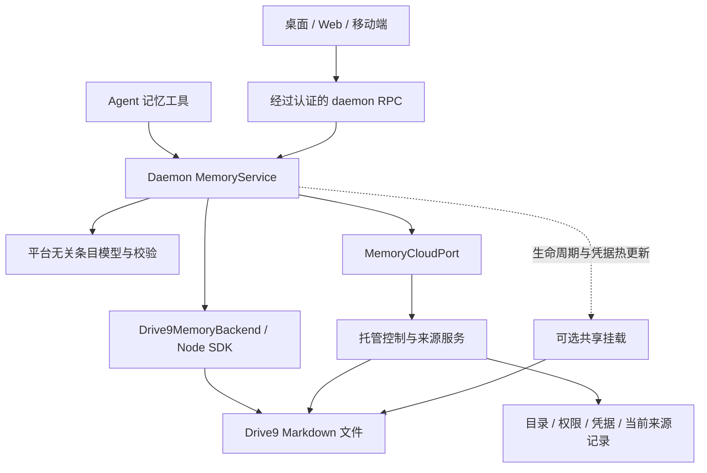

# 基于 drive9 的 Lody Memory：以文件存放私有与共享记忆

Status: proposed
Translation: current

[English](2026-11-09-lody-memory-drive9.md)

## 摘要

Lody Memory 需要可直接阅读的文件、跨设备 Agent 访问和逐条溯源。
本提案把每个记忆存成 Markdown 文件，放在托管的 [drive9](https://drive9.ai/) 文件服务中。
记忆分为**私有**和**共享**两种：私有记忆只经 daemon 的 SDK 访问；共享记忆供工作区成员读写，并提议提供挂载。可见性在创建后仍可修改。
代价是：记忆内容在托管服务上为明文，记忆只能在线使用，OSS 桌面版没有 Lody Memory。
P1 已验证基本的限定范围文件访问，但固定版本的 Drive9 缺少挂载凭据热轮换。优先支持 Lody 内 Agent 工具写入；必须记录当前记忆的来源，不要求可恢复的历史。若交付挂载，续期必须不中断挂载；挂载的交付时机仍待定。以打开/使用时重新读取及写后本地刷新代替 SSE 只是待批准的建议；[P1 门槛](#p1-实施前验证)仍未满足。

## 决策

所有者已决定：

- **记忆不做 E2EE。** 私有和共享记忆都接受在托管服务上以明文存放，以访问控制代替加密保密。
- **共享即工作区成员。** 工作区所有成员都获得读写权限，首版不提供只读成员。
- **drive9 tenant 由 Lody 托管。**
- **接受仅在线可用。**
- **优先支持 Lody 内 Agent 工具写入**，任意编辑器保存的优先级较低。
- **必须按当前记忆的每条条目记录来源，不要求可恢复的历史。** 修改其他条目时，未改条目保留其来源。
- **接受外部／未知来源**，用于无法可靠归属的外部修改；不能把旧 Agent 归属沿用到已改变的内容。
- **凭据续期不得中断挂载。** 不接受卸载后重新挂载的续期策略。
- **可见性可修改**，作为目录元数据保存。

## 布局与身份

每个工作区对应一个 drive9 tenant，每个记忆对应一个目录：

```text
/memories/<memoryId>/MEMORY.md       # front matter：name、description；简短入口
/memories/<memoryId>/<topic>.md      # 其他文档，相对路径
```

路径中不含可见性，因此切换可见性不需要移动文件。
路径就是文档身份：改名即移动文件，不会隐式覆盖已存在的目标。
搜索使用记忆前缀下的 drive9 `grep`/`find`，不在进程内扫描。

## 访问路径

```text
             ┌──────────────── 托管凭据服务 ────────────────┐
             │ 目录（memoryId、可见性、所有者）、成员关系   │
             │ 持有 tenant owner key；签发限定范围的 token  │
             └───────┬──────────────────────────┬──────────┘
          限定范围 token（记忆前缀）    限定范围 token（记忆前缀）
                     │                          │
   daemon SDK 客户端（私有 + 共享）    drive9 挂载（仅共享）
   MCP 工具、提示注入、RPC             ~/Lody/Memory/<name>、编辑器、agent
```

- **私有记忆。** 只有所有者的 daemon 通过 drive9 JS SDK 读写。SDK 依赖 Node `fs`，所以只能在 CLI daemon 中运行。Renderer、Web 和移动端都通过 daemon RPC 访问。私有记忆从不挂载。
- **共享记忆。** 走同样的 SDK 路径，并提议挂载到 `~/Lody/Memory/<name>`。macOS 和 Windows 上用 WebDAV，Linux 上用 FUSE，由 drive9 的自动模式选择。之后任何成员的工具、编辑器和 agent 都能用普通文件操作访问。首发必须包含挂载，还是可先交付仅工具里程碑，仍待决定。
- **Role 绑定。** Role 仍绑定 `{providerId: "lody", memoryId}`，并在每个 turn 中冻结。MCP 工具只拿到所绑定记忆的 token。挂载不受 Role 授权约束，以该用户身份运行的任何程序都能读取，因此只有共享记忆才挂载。

## 组件架构与职责

以下是拟实施的架构与高层合同，不是现有导出或已经验证的实现。
需求以[记忆 Spec](../../../../specs/agent-role-memory.zh.md)为准。



| 组件 | 拥有的职责 | 边界 |
| --- | --- | --- |
| 客户端与 Agent 工具 | 展示、查询、提交内容编辑、查看条目来源 | 不持有 Drive9 owner key；模型不能传入身份、记忆 ID 或凭据来扩大权限。 |
| Daemon `MemoryService` | 解析 turn 冻结绑定、校验当前授权、生成操作 ID、注入来源上下文、协调写入 | 用户／机器来自认证执行上下文，会话／turn／tool call 来自运行时；不是模型自填参数。管理 RPC 另行校验所选记忆的权限。 |
| `packages/memory` 的新条目核心 | Markdown 与条目映射、路径／大小校验、编辑计划、来源匹配规则 | 保持平台无关，不导入 Node SDK、文件系统或私有云模块。 |
| CLI 中的 `Drive9MemoryBackend` | SDK 网络请求、条件写入、限定前缀搜索、错误映射 | 普通读写不需要挂载；不用本地 Markdown 副本作为第二个可写事实源。 |
| `MemoryCloudPort` | 公开的控制与来源服务合同 | DTO 在 `packages/cloud-api`，注入端口在 `packages/platform`；具体托管实现不进入公共仓库。 |
| 托管控制与来源服务 | 记忆目录、当前权限、token 签发／撤销、操作收据、当前条目来源 | owner key 留在服务端。来源记录是受访问控制的敏感元数据，不进入 workspace repo meta。 |
| 挂载管理器 | 共享挂载的启动、状态、热更新凭据与主动撤权 | 不参与 Agent 工具路径；未经验证的热轮换不能宣称可用。 |

目录以 `(workspaceId, memoryId)` 寻址，保存 owner、visibility 和生命周期状态。
名称与描述仍以 `MEMORY.md` 为准，目录不能成为第二份可编辑档案。
创建先完成入口文件再发布目录；中途失败保持不可用状态并按同一操作 ID 重试。
删除先阻止新授权并撤销 token，再清理文件和来源记录；清理完成前不能报告全部删除成功。
私有／共享转换和成员移除需要明确的撤销完成状态，不能把本地卸载或目录改值当作旧 token 已失效。

## 高层数据与接口

### 条目身份和文件表示

文件路径标识文档；`entryId` 标识该记忆内的一条事实／条目，两者不是同一个身份。
建议工具生成稳定 `entryId`，在 Markdown 中用可忽略的标记关联条目，正文仍可直接阅读。
具体标记语法与解析格式在实现前固定；本提案不把任意段落边界当成已经确定的事实边界。
一条文本可以包含多句话，Agent 负责按独立记忆组织条目。

更新已有条目保留其 ID；新条目分配新 ID。重排不改来源；跨文件移动必须显式保留 ID，且不承诺多文件原子事务。
拆分／合并建议生成新 ID 并记录 `derivedFrom`，不把整理者冒充原始来源。
复制文本不能仅凭文本相同或携带旧 ID 就继承来源。重复 ID、丢失标记或无法可靠匹配的外部内容标为未知。

来源服务以条目 ID、内容哈希及已确认的文档提交关联当前内容；文件 revision 用于条件写入，条目内容哈希用于来源匹配。
单靠哈希或 Markdown 内的来源标签不证明身份，也不能检测未经观察的“改动后恢复原文”。
`verified` 只表示当前内容与受认证流程确认的来源记录匹配，不代表事实正确、完整历史审计或对恶意设备的独立证明。
仅保留当前条目的原始来源和最近内容更新引用；不保存每次编辑正文。操作对账收据的保留期限需单独限定。

### 绑定后的工具／RPC 接口

```ts
// Proposed contracts, not existing exports; IDs and revisions are opaque strings.
type Entry = {
  entryId: string;
  text: string;
  contentHash: string;
  provenance: "verified" | "pending" | "external_unknown";
};
type DocumentView = {
  path: string;
  revision: string;
  markdown: string;
  entries: Entry[];
};
type EntryEdit =
  | { kind: "insert"; afterEntryId: string | null; text: string }
  | { kind: "replace"; entryId: string; text: string }
  | { kind: "remove"; entryId: string };
type MutationResult =
  | { kind: "committed"; operationId: string; revision: string }
  | { kind: "conflict"; currentRevision: string }
  | { kind: "incomplete"; operationId: string;
      content: "applied" | "unknown"; provenance: "pending" }
  | { kind: "rejected"; code: "forbidden" | "not_found" |
      "invalid_input" | "quota_exceeded" | "unsupported" };

// Bound by the daemon, never selected by model-supplied identity fields.
interface BoundMemory {
  startup(): Promise<{ instructions: string; entry: DocumentView }>;
  list(input: { cursor?: string; limit: number }): Promise<{
    items: { path: string }[]; nextCursor?: string;
  }>;
  read(input: { path: string }): Promise<DocumentView>;
  search(input: { query: string; limit: number }): Promise<{
    hits: { path: string; excerpt?: string }[];
  }>;
  sources(input: { path: string; entryIds: string[] }): Promise<EntrySource[]>;
  create(input: { path: string; entries: { text: string }[] }): Promise<MutationResult>;
  edit(input: { path: string; expectedRevision: string;
    changes: EntryEdit[] }): Promise<MutationResult>;
  status(input: { operationId: string }): Promise<MutationResult>;
}
type EntrySource = {
  entryId: string;
  contentHash: string;
  status: "verified" | "pending" | "external_unknown";
  origin?: SourceRef;
  lastContentUpdate?: SourceRef;
  derivedFrom?: string[];
};
type SourceRef = {
  changeId: string;
  userId: string;
  machineId: string;
  sessionRef?: string;
  turnRef?: string;
  toolCallRef?: string;
  observedAt: string;
};
```

这些类型展示合同形状，未列出的网络失败统一返回 `unavailable`／超时等可区分结果，不伪装成空内容。
实际接口还须为读取、搜索、来源查询和编辑批次设大小／数量上限；超限明确失败，不能静默截断后写回。
`list` 的游标是后端不透明分页值，不承诺跨修改的快照；`search` 先找候选文档，再读取所需条目与来源。

工具输入只包含路径、条目与预期版本。操作 ID 由 daemon 为一次逻辑工具调用生成，重试复用；
同 ID 不同请求内容拒绝。`status` 只允许查询当前绑定与身份可访问的操作。
`startup` 分开返回固定工具指引和作为不可信参考资料的入口正文。
`create` 必须只创建不存在的文件，不能默认无条件覆盖；能否实现安全的 create-if-absent 仍需验证。
`edit` 一次只更新一个文档，先校验完整批次，再条件提交，不能部分应用合法子项。

管理接口与 Agent 工具分开：`listMemories/createMemory/setVisibility/deleteMemory` 可接收记忆 ID，
但必须经过用户管理权限校验；Agent 不能调用这些接口扩大自己的绑定。
文档 `rename/delete` 需独立的目标不存在／预期版本合同；Drive9 若没有原子条件操作，则返回 `unsupported`，
不能用“先读后无条件删除”冒充冲突保护。`MEMORY.md` 只允许编辑或清空，不允许改名／删除。

### 托管控制与来源端口

| 操作 | 主要输入 | 返回与保证 |
| --- | --- | --- |
| `describeMemory` | workspace、memory | 当前可访问的目录与能力；身份从认证通道取得。 |
| `issueCredential` | memory、用途 `tools/mount`、请求权限 | `{credentialId, token, endpoint, prefix, expiresAt, generation}`；服务端收窄权限，不能由调用方指定任意 endpoint。 |
| `renewCredential` | credentialId、预期 generation | 重新校验当前权限并返回新一代凭据；不保证已被移除成员仍可续期。 |
| `prepareChange` | operationId、path、expectedRevision、条目变更摘要／哈希、运行时来源引用 | 幂等准备收据；服务端从认证身份绑定 user/machine，并校验会话引用的可见性与合法性。 |
| `finalizeChange` | operationId、SDK 返回的 revision | 服务端独立读取并核对实际内容与准备摘要，再确认当前来源；客户端自报 revision 不能单独作为证明。 |
| `changeStatus` | operationId | 内容未知／已写入、来源待确认／已完成，以及可重试状态。 |
| `readSources` | memory、path、当前 revision、entryIds | 匹配当前内容的来源，或 pending/unknown；无权限的会话引用须隐藏。 |

来源端口是当前建议的托管元数据存储，不依赖 Drive9 journal。
`prepare/finalize` 不构成跨系统事务：后台对账、带条件的状态迁移和重复请求处理属于必须实现的职责。
旧操作迟到完成时不得覆盖较新条目的来源。服务端无法确认中间版本时保留不确定结果，不能凭客户端声明补成 verified。
共享读者可以看到来源概况，但来源会话链接不赋予会话权限；必要时返回受限来源而不泄露引用标识或私有文本。

## 主要交互与失败处理

### 不挂载的 Agent 更新

1. Daemon 解析冻结绑定并校验当前访问权，获取限定前缀 token；通过 SDK 读取文件与 revision。
2. Agent 根据读取的 `entryId` 提交编辑；daemon 校验路径、完整批次及权限，保留未改条目的来源。
3. 来源服务持久化准备收据后，backend 用 `expectedRevision` 条件写入 Markdown。冲突返回给 Agent，不盲目重试。
4. 来源服务核对实际写入并完成来源关联；两者均完成才返回 `committed`，随后刷新本地视图。
5. 内容成功而来源未完成，返回 `incomplete(applied, pending)`；写请求超时且结果不明时返回 `incomplete(unknown, pending)`。
   重试先查询同一操作的状态，不以新操作 ID 重复写入。准备收据不可用时不启动写入。

这条流程不需要挂载或 SSE，也不声称提供文件内容与来源的原子提交。
请求超时、daemon 重启、写后又被外部覆盖都必须能保留或恢复正确的不确定状态。
当前方案仍需验证 Drive9 返回 revision 与实际字节之间的核对方式，以及进程重启后的操作 ID 恢复。

### 读取与外部修改

打开或使用记忆时读取当前文件，解析条目，再查询匹配的来源；不能只用缓存来源覆盖新文件。
来源服务暂不可用时可以返回正文和 `pending`，不显示缓存的 verified 归属。
外部修改导致标记或来源不匹配时，受影响条目显示 `external_unknown`；能可靠证明未改的条目保留来源。
下一次 Lody 工具编辑不会自动把外部条目的原始来源变成该 Agent，只为其实际新增／修改建立新的更新引用。

### 挂载凭据热更新

高层生命周期为 `start(lease)`、`status()`、`rotateCredential(nextLease)`、`revoke()` 和 `stop()`。
这些是拟新增的挂载管理合同，当前 Drive9 CLI 没有已验证的热轮换实现。
`rotateCredential` 确认后，新请求必须使用新 generation，挂载点和已打开句柄保持有效，进行中写入不丢失。
应在旧凭据到期前续期，并处理旧、新凭据的有界重叠与撤销；不能用反复重放非幂等写入隐藏认证失败。
正常续期不中断不等于网络永不失败：续期失败时明确降级，不能静默丢写或继续使用已撤销凭据。
主动撤权允许停止后续访问；它与正常续期的不中断合同不同。

## 实现顺序与合同验证

先定义条目格式和来源核对合同，再实现受认证的控制端口、SDK backend、条目工具与来源 UI；
共享挂载作为独立路径接入。首版是否包含挂载仍待决定，不以工程拆分自动改变发布范围。
需要保护的行为包括：越权路径拒绝、两位写入者的版本冲突、更新单条不改其他来源、外部歧义不冒认来源、
重复操作不重复生效、内容写入与来源确认之间崩溃后的对账、受限会话不泄露，以及带打开句柄／进行中写入的凭据热轮换。
这些是未来实现的验收目标，P1 没有验证这套新接口。跨文件原子变更、完整历史、实时 SSE 与通用编辑器兼容均不由上述合同隐含提供。

## 凭据

托管凭据服务持有每个 tenant 的 owner key，签发限定路径前缀的短期 token（`POST /v1/tokens`，`{prefix, ops}`）。token 按记忆、按用户签发，可以撤销。

- daemon 在内存中保存文件系统 token，通过 `DRIVE9_API_KEY` 将挂载 token 传给子进程，并从子进程环境中移除 `DRIVE9_VAULT_TOKEN`。Vault token 授权的是 secret 读取，并不是限定文件系统范围的 API token。
- Lody 必须避免把 token 写入 `~/.drive9/config`。但仅做到这一点并不能阻止凭据持久化：默认的 FUSE 挂载状态会把 bearer 写入权限为 `0600` 的 JSON 文件。其 `--no-persist-credentials` 选项要求以前台或无监督模式运行，且不适用于 WebDAV。WebDAV 状态不保存 bearer，但内存中的客户端会保留最初的 token。
- 挂载凭据是快照。固定版本续期需要卸载后重新挂载，违反所要求的不中断挂载合同。修改配置，或让 supervisor 使用已保存的凭据重启，都不能实现热轮换。若交付挂载，必须验证热轮换保留已打开的句柄和待写入内容，作为发布门槛。
- 共享记忆的成员获得 `read, list, search, write, delete`。

在本仓库中，该服务是注入的 `packages/platform` 云端端口，DTO 放在 `packages/cloud-api`。
OSS 桌面版只在本地运行，不发起需认证的产品云请求，因此没有 Lody Memory。是否支持用户自备或自托管的 drive9 端点，仍是未决问题。

## 修改可见性

- **私有 → 共享。** 为成员签发 token；若交付挂载，再在成员设备上挂载。
- **共享 → 私有。** 撤销成员 token，再通知在线 daemon 卸载。其他成员已读过或已缓存在磁盘上的副本无法收回，界面须在确认前说明这一点。

## 来源与并发

- **SDK 写入。** 使用 `expectedRevision`，返回冲突而不盲目重试。采用上文逐条来源及 prepare/finalize 流程。actor 标签可辅助诊断，但不能认证来源。文件系统 token 无权追加 journal；独立来源服务仍须实现崩溃恢复和幂等对账，不能宣称原子提交。
- **挂载写入。** 无法可靠确认来源时，接受外部／未知归属；已改变的条目不能保留旧 Agent 归属。固定版本的 WebDAV 挂载从未配置 `SetActor`，而 `X-Dat9-Actor` 由调用方提供，并非经过认证的身份。FUSE 生成的是挂载 actor，不是提议的 `lody:<userId>:<machineId>` 身份。两者都不能建立可信的来源记录。
- **事件。** 文件系统 token 访问 `/v1/events` 和 `/v1/journals` 均返回 403。Owner SSE 覆盖整个 tenant；所检查的流循环不会重新验证过期或撤销状态。不得向 daemon 分发 owner key 来绕过这一缺口。当前对 Spec 的建议是打开/使用时重新读取、写入后本地刷新，暂缓实时通知，不要求 SSE。这只是提案，未经用户批准。若之后需要实时通知，候选方案仍包括支持流撤销的限定范围事件，或校验成员关系与路径范围的托管中继；两者均未实施或获批。
- **挂载并发写入。** WebDAV 缓冲整个文件，并在关闭时无条件写入。锁仅在各 handler 内有效，因此其他挂载或 SDK 写入者的内容可能被覆盖。SDK 版本检查只保护带条件的 SDK 写入，不会让后续 WebDAV 写入也带上条件。
- **历史。** Journal 追加、读取和验证可用，但不会捕获或恢复文件版本。仅靠版本号无法恢复被覆盖的字节；此固定版本拒绝 journal artifact 引用，也没有已实现的 seal 操作。可恢复的历史不是产品要求，也不是实施门槛；这些限制仍意味着不能宣称可恢复被后写者覆盖的内容。Journal 哈希验证的是一致性，不能证明在有能力重写整条链的管理员面前仍具真实性。

## 影响

- 存储使用 `MemoryBackend` 接口，由 daemon 持有 Drive9 实现，并支持逐条当前内容溯源。
- 兼容 daemon 声明 `builtinMemory: 2`；客户端使用 Lody Memory 前必须确认该能力。
- 若交付挂载，Lody 把 drive9 CLI 打包为托管运行时，并负责挂载生命周期，包括不中断挂载的凭据续期。
- 托管成本和配额按 tenant（即按工作区）计算，发布前须确定上限。

## P1 实施前验证

P1 不代表实施已获批准。要满足提议的合同，此固定版本的集成仍需完成以下工作：

| 领域 | 证据与剩余门槛 |
| --- | --- |
| 限定范围的访问 | 允许范围内的文件读取成功；同级记忆读取和根目录列举被拒绝。SSE 和 journal 完全不可访问。建议以打开/使用时重新读取及写后本地刷新代替实时通知，尚待批准；不得向设备发送 tenant owner key。 |
| 续期 | 挂载客户端保留最初的凭据。若交付挂载，必须验证热轮换，不得中断或卸载后重新挂载；不中断、无损续期尚未验证。 |
| macOS WebDAV | 使用限定范围 token 的 macOS 挂载读写成功，但通过 `os.replace(tmp, target)` 替换已存在文件时返回 `EINVAL`。过期或撤销后，之前读过的内容仍可从缓存读取；未缓存的读取和新写入失败。任意编辑器保存的优先级低于 Agent 工具写入，但该限制仍存在。若交付挂载，不中断续期仍是门槛。 |
| 搜索与并发 | 对英文和中文 Markdown 的字面搜索返回了测试样本；使用旧版本的条件写入返回 409。这不是召回率基准，也不能防止无条件的挂载写入覆盖内容。 |
| 当前记忆来源 | Journal 权限控制及追加/验证可用；当前内容与来源的可靠关联仍未解决。已确定逐条溯源，接受外部／未知来源；条目身份、匹配与提交一致性仍需设计。可恢复的历史不是门槛。 |
| 托管 | 在 TiDB v8.5.1 上，两个成功样本中的本地 tenant 就绪时间约为 6.6–9.7 秒。这不是托管服务的开通延迟。托管价格、配额和开通 SLA 仍未验证；未开通任何云端 tenant。 |

## 未决问题

- 是否可先交付仅工具里程碑，还是首发必须包含挂载？
- 以后是否为成员提供只读角色？当前决定是所有成员均为读写。

重新读取/本地刷新及暂缓实时通知仍是待批准的建议。

## 验证

证据固定于 [`mem9-ai/drive9` commit `b866b426ff4ab8d8409c95e77ad0cc946908bcca`](https://github.com/mem9-ai/drive9/tree/b866b426ff4ab8d8409c95e77ad0cc946908bcca)。
已执行的本地 HTTP 探测使用合成 tenant，以及限制在 `/memories/a/` 的 token，并在 `/memories/b/` 放置第二个记忆。
观测结果为：允许范围内读取返回 200，同级记忆/根目录访问返回 403，事件/journal 访问返回 403，条件写入成功后使用旧版本再次写入返回 409，撤销后新请求返回 401。
搜索在覆盖测试样本之前执行，`pnpm` 和 `中文` 都返回了样本路径。这些观测不能证明实时流撤销、广泛的搜索召回率或应用恢复能力。

可复现的上游测试边界：

- `pkg/server/tokens_test.go`：`TestScopedTokenRevokeInvalidatesToken`。
- `pkg/server/server_test.go`：`TestWriteWithExpectedRevisionConflict`。
- `pkg/server`：`TestScopedBusinessEndpointGuardDeniesEndpointsOutOfWorkspaceZonesScope`、
  `TestJournalPermissionsFromClaimsFailsClosedForScopedKeys`、
  `TestParseFSScopeOpsRejectsSearchWithoutRead`、`TestJournalHTTPCreateAppendSearchVerify`、
  `TestJournalHTTPFullEntriesRequireReadPermission`、
  `TestJournalHTTPAppendSourcePermissions` 和
  `TestJournalHTTPSearchOmitsZeroTimesAndSupportsRepeatedLabels`。

这些测试使用本地 TiDB 数据库执行，命令为 `go test ./pkg/server -run '<test-name-regexp>' -count=1 -v -timeout=180s`。
隔离数据库需要设置 `tidb_ddl_enable_fast_reorg=OFF` 和 `tidb_enable_dist_task=OFF`，以避开本地 DDL ingest 的可用磁盘空间预检查；这不是生产配置建议。

真实的 macOS WebDAV 探测在操作系统挂载表中确认了限定范围的挂载。
API 写入 → 挂载读取、挂载写入 → API 读取均返回一致的内容；API 改名 → 挂载读取也成功。
对已存在文件执行原子替换时返回 errno 22，临时源文件仍存在。
在撤销后，以及另一次使用 20 秒 token 的过期后，新 API 请求返回 401，已缓存的挂载内容仍可读取，未缓存的读取返回 ENOENT，新写入尝试返回 EIO，且未在服务端创建文件。
这不能证明脏句柄或已打开句柄的撤销行为，也不能证明无损续期。探测挂载均已卸载。
单次本地观测中，API 到挂载约为 59 ms，挂载到 API 约为 183 ms，包含子进程和验证开销；这些不是延迟分位数，也不是对托管服务的预测。

仅基于源码的发现还依赖 `pkg/server/auth.go`、`pkg/server/sse.go`、`pkg/server/tokens.go`、`pkg/webdav`、
`cmd/drive9/cli/mount_webdav.go`、CLI 挂载凭据/状态代码和 `clients/drive9-js/src/client.ts`。
源码检查不等于真实挂载或恢复测试。[记忆 Spec](../../../../specs/agent-role-memory.zh.md) 仍为 draft。
