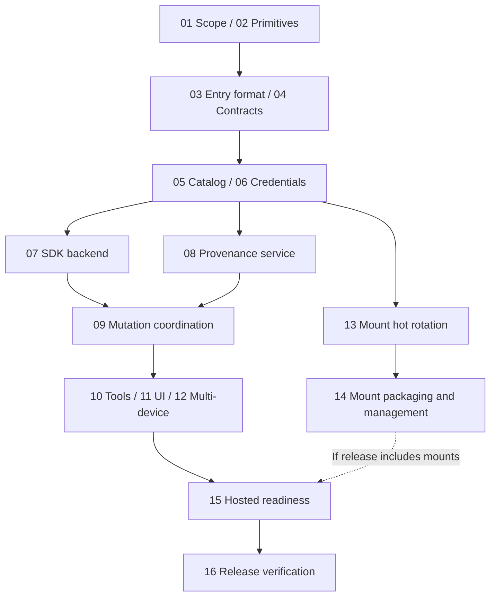

# Lody Memory step-by-step execution plan

Status: proposed
Translation: current

[中文](2026-11-09-lody-memory-execution-plan.zh.md)

## Abstract

This plan divides the current Drive9 memory proposal into deliverable steps covering files, per-entry provenance, authorization, Agent tools, UI, shared mounts and release verification. Establish testable data/access contracts before completing the Agent read/write path without a mount; credential hot rotation is a separate workstream. Each step lists dependencies, actions and completion criteria. This is an implementation plan, not evidence of completed code or approved launch scope.

## Sources and execution method

The [Spec](../../../../specs/agent-role-memory.md) owns requirements; the [architecture proposal](2026-11-09-lody-memory-drive9.md) owns components and interfaces. This plan owns sequencing, delivery boundaries and verification, complementing rather than superseding either document.

`MemoryCloudPort` is the daemon interface to Lody cloud services. Its implementation owns catalog, access, short-lived credentials and source records; Drive9 owns Markdown files. The interface is not a deployment unit; whether cloud responsibilities share a service is an implementation decision.

Every step starts **not started**. Numbers describe dependencies, not mandatory serial execution. Record deliverables and evidence in the implementing commit/PR. Name blocked capabilities and affected steps without reducing requirements to claim completion. Do not append execution logs to this plan.

## Dependencies and milestones

- **M1: Feasible contracts.** Complete technical work in 01–04; mark open product scope explicitly.
- **M2: Agent writes and entry provenance work.** Complete 05–12 without needing mounts; this does not authorize release.
- **M3: Shared mounts work.** Complete 13–14, including uninterrupted renewal on real supported platforms.
- **M4: Selected scope is deliverable.** Complete 15–16; a mount-inclusive launch requires M3 for product acceptance.

## Execution steps

### 01 · Fix release scope and success criteria

**Dependencies:** None; can start now.

**Actions:** Record whether mounts ship at launch, whether immediate cross-device refresh is required, and initial platforms. Separate confirmed requirements from open choices. Public contracts and tools can proceed before mount timing is settled.

**Deliverable and acceptance:** A release-scope table names blocked steps; silence is not approval.

### 02 · Verify required Drive9 primitives

**Dependencies:** Core requirements from 01; parallel with scope discussion.

**Actions:** In isolation verify create-if-absent, revision-to-byte association, conditional update, destination absence on rename, and expected-version delete. Record SDK errors/timeouts and token revocation/expiry. Classify each primitive as supported, requiring upstream changes, or unsupported.

**Deliverable and acceptance:** Reproducible evidence exists. Unsafe operations return unsupported; required gaps need upstream work, not read-then-unconditional-write substitutes.

### 03 · Define entry encoding and source semantics

**Dependencies:** 02.

**Actions:** Define stable entryId, Markdown markers, front matter, body hashing, duplicate IDs and missing markers in packages/memory. Specify insert/replace/remove, reorder, cross-file moves, split and merge. Prepare multilingual, multi-paragraph and external-edit examples.

**Deliverable and acceptance:** Freeze only after format review. Editing one entry preserves others; organization does not claim authorship; ambiguity is unknown. Cross-file moves specify partial failure/recovery without transaction claims.

### 04 · Fix interfaces and error contracts

**Dependencies:** 02, 03.

**Actions:** Define cloud DTOs in packages/cloud-api, injected MemoryCloudPort in packages/platform, and management RPC/turn-bound tools in shared protocol. Specify committed/conflict/incomplete/rejected, unavailable/timeouts, pagination, limits, operation IDs and capability negotiation.

**Deliverable and acceptance:** Public contracts import no private backend; OSS makes no authenticated cloud requests. Each operation defines authorization, idempotency scope and possible effects after failure; incomplete is not success.

### 05 · Implement catalog and authorization service

**Dependencies:** 04.

**Actions:** Select catalog storage in the private Cloud backend, keyed by workspaceId/memoryId with ownership, visibility and lifecycle. Implement create/list/visibility/delete orchestration, entry-file initialization, quotas, cleanup, duplicate handling and restart recovery.

**Deliverable and acceptance:** Private access is owner-only; shared access requires current membership. Unready items are unavailable. Deletion blocks grants before cleanup and reports completion only afterward. MEMORY.md owns name/description.

### 06 · Implement short-lived credential lifecycle

**Dependencies:** 05.

**Actions:** Keep owner keys server-side; issue tokens by memory prefix and tools/mount purpose. Implement generations, renewal, revocation and membership changes. Cache only in daemon memory; exclude secrets from logs, config, repo meta and subprocess state. Define early renewal, bounded retry and concurrent-request coalescing.

**Deliverable and acceptance:** Revoked access cannot renew; failure never widens scope. Validate isolation, expiry, revocation, concurrent renewal and restart without timing races.

### 07 · Implement the Drive9 file backend

**Dependencies:** 02, 04, 06.

**Actions:** Integrate the Node SDK in the CLI daemon for read/list/search/create/edit/rename/delete with path containment. Return consistent content/revision. Writes obey capabilities from 02. Handle Unicode, invalid paths, limits, network failures and uncertain writes.

**Deliverable and acceptance:** Concurrent writers receive conflicts, not silent overwrite. Memory boundaries, absolute paths and encoding bypasses are rejected. SDK stays in daemon, outside Web/mobile bundles.

### 08 · Implement provenance storage and verification

**Dependencies:** 03, 04, 05; verification uses the read contract from 07.

**Actions:** Select private source/receipt storage and implement prepareChange/finalizeChange/readSources/changeStatus. Bind authenticated identity and validate session references. Define prepared, confirming, complete, conflict and uncertain transitions. Associate entries/hashes, independently verify files, and bound receipt retention.

**Deliverable and acceptance:** Client-reported revisions alone cannot verify provenance; late old operations cannot overwrite newer sources. Shared readers cannot access private session IDs/content. State trust limits for malicious devices and unobserved external edits.

### 09 · Implement mutation coordination, idempotency and recovery

**Dependencies:** 07, 08.

**Actions:** MemoryService assigns stable operationId, prepares a receipt, conditionally writes, then confirms sources. Persist recoverable non-secret operation associations; query the same operation after restart instead of generating duplicate writes. Reconcile with bounded retries without overwriting newer content.

**Deliverable and acceptance:** Inject failures after prepare, during write, before finalize and before its response. Commit only when both parts complete. Distinguish incomplete(applied/unknown, pending). Reject different payloads under the same ID.

### 10 · Connect Roles, Agent tools and client RPC

**Dependencies:** 09.

**Actions:** Freeze providerId/memoryId per turn and recheck current authorization per operation. Connect startup/read/list/search/sources/create/edit/status; authorize management RPC separately. Inject memory text as untrusted reference material. Define offline, access-change and missing-capability errors.

**Deliverable and acceptance:** Model arguments cannot switch memories or forge identity. Unlinking preserves accepted-turn binding while revocation still applies. A real Agent reads, edits and rereads next turn without a mount.

### 11 · Implement management and per-entry source UI

**Dependencies:** 05, 10; source UI also needs 08.

**Actions:** Add create/list/profile edit/Role binding/delete/visibility and per-entry source views in shared components. Distinguish verified/pending/external_unknown, saved-but-unconfirmed, conflicts, forbidden and offline. Keep external provider behavior independent.

**Deliverable and acceptance:** Desktop/Web/mobile use daemon RPC. Privacy copy explains disclosed copies cannot be recalled; inaccessible sessions show restricted sources. Check narrow screens, keyboard use and iOS 16.4 compatibility.

### 12 · Verify multi-device use and visibility transitions

**Dependencies:** 06, 10, 11.

**Actions:** Use two members and daemons with private/shared memories. Exercise visibility transitions, membership removal, concurrent edits and offline-device reconnection. Implement the approved refresh policy; if live refresh is required, first add scoped revocable event contracts.

**Deliverable and acceptance:** Removal blocks new server access; cached sources cannot label new content. Without a live contract, do not claim instant cross-device updates. Never send owner keys to devices.

### 13 · Implement and verify mount credential hot rotation

**Dependencies:** 02, 04, 06; parallel with 07–12.

**Actions:** Implement rotateCredential(nextLease) upstream in Drive9 or in an explicitly maintained patch. Define acknowledgement, generations, in-flight requests, credential overlap and revocation. Verify supported macOS/Windows WebDAV and Linux FUSE paths.

**Deliverable and acceptance:** Normal rotation never unmounts, changes mountpoints, invalidates handles or loses writes. Revocation blocks new access; readable cache is not a new grant. Unsupported platforms remain explicitly unsupported.

### 14 · Package and integrate shared mount management

**Dependencies:** 13; UI integration also needs 11.

**Actions:** Build/checksum/distribute the pinned CLI through managed runtimes; daemon owns start/status/rotate/revoke/stop. Handle naming collisions, process exit, startup failure, credential persistence and platform unmount. Never mount private memories.

**Deliverable and acceptance:** Real packaged artifacts install and complete lifecycle checks; writes trigger correct source downgrades. Record EINVAL replacement limits and unconditional-write overwrite risks separately from ordinary read/write success.

### 15 · Prepare deployment, limits and observability

**Dependencies:** 05–12; include 14 for a mount release.

**Actions:** Establish hosted provisioning, region, cost, quotas, file/entry/search limits, rates and timeouts. Observe pending age, reconciliation backlog, renewal failure and authorization denial. Log necessary operation IDs, not bodies/tokens/private source references. Prepare isolated validation, disable controls and failure runbooks.

**Deliverable and acceptance:** Verify real hosted provisioning/isolation; local TiDB latency is not an SLA. Disabling stops new work and safely handles pending operations; rollback does not delete user files.

### 16 · Complete release validation and delivery review

**Dependencies:** Release scope from 01 is settled; 12, 15; mount releases also require 13, 14.

**Actions:** Run the acceptance matrix below, targeted tests, affected checks, type/static checks and required builds. Report complete Mac/Linux offline/E2E as evidence/trends with failures classified under owner policy. Align docs with actual capabilities; complete release config, runbooks and risk review.

**Deliverable and acceptance:** Deliver exact revisions, coverage matrix, failures/skips/unverified items, limitations and disable steps. Merge checks do not imply product acceptance; release/external deployment follows actual authorization.

## Repository and commit boundaries

| Scope | Planned owner | Suggested delivery unit |
| --- | --- | --- |
| Entry format, DTOs, ports | Public packages/memory, cloud-api, platform, shared | 03–04; independently checkable contracts |
| Catalog, access, credentials, sources, hosted config | Private Cloud backend; modules selected in 05/08 | Separate 05–06, 08, 15; depend on merged public contracts |
| SDK, coordinator, tools, RPC | Public CLI and shared protocol | 07, 09–10; enable incrementally without exposing incomplete capabilities |
| UI | Public components; private Web/mobile composition only | 11–12; preserve platform boundaries |
| Drive9 rotation | Upstream repository or explicitly maintained patch | Separate review and verification for 13 |
| Runtime packaging and mounts | Public runtime mechanism and applicable private release composition | 14; verify actual artifacts |

Commit public changes only in lody-oss; commit private work separately without feature-branch gitlink changes. Connect repositories through merged contract versions. Read scoped AGENTS.md before implementation; auth, persisted structures and release workflows require high-risk review. Split future PRs into reviewable deliveries rather than one PR for this entire plan.

## Acceptance matrix and evidence

| Product assumption | Minimum verification boundary | Steps |
| --- | --- | --- |
| Editing one entry preserves other sources | Entry core and actual source service | 03, 08–09 |
| Retrying one operation applies once; uncertainty is not success | Coordinator with controlled failure injection | 09 |
| Private/shared/revoked access follows current identity | Real service authorization and two members | 05–06, 12 |
| Conditional writes prevent silent concurrent overwrites | Real Drive9 with two writers | 02, 07 |
| External edits cannot inherit incorrect Agent attribution | Actual file edit → read → source display | 08, 11, 14 |
| Agents use memory across turns without mounting | Actual daemon and Agent tool journey | 10–12 |
| Shared sources cannot expose private sessions | Source API and restricted-user UI | 08, 11 |
| Renewal preserves handles/in-flight writes | Real mounts on each supported platform | 13–14 |
| Installed artifacts provide advertised capabilities | Packaged runtime and Cloud composition | 14–16 |

Tests protect these product behaviors or installation/release guarantees. Prefer explicit signals, injected clocks and controlled failures; avoid implementation-shape assertions and timing-dependent tests. Record revision, environment, scope and unverified limits for each item. Existing P1 evidence informs selection but does not validate new contracts.

## Release branches and disable strategy

1. **Launch without mounts:** only after an explicit product decision; finish M2/M4 and hide unfinished mount entry points.
2. **Launch with mounts:** require M2/M3/M4; successful tools do not substitute for mount hot-rotation acceptance.
3. **Immediate refresh required:** add scoped events, stream revocation and verification before 12; never reuse tenant-owner SSE credentials.
4. **Pause delivery:** keep affected capabilities disabled for unresolved authorization, attribution, lost-write or renewal defects. Preserve user files and reconciliation receipts; revalidate affected behaviors after fixes.

This plan does not authorize automatic releases, production changes or paid provisioning; handle those at delivery under existing authorization and concrete scope. Documentation and technical design can proceed now; unresolved product choices block only dependent steps.

## References and verification status

- [Architecture and pinned P1 evidence](2026-11-09-lody-memory-drive9.md#verification).
- [Requirements and release-scope questions](../../../../specs/agent-role-memory.md#questions-requiring-product-decisions).

No implementation step or product acceptance was executed by writing this plan. Interfaces, format, hosted implementation and mount hot rotation require implementation and verification in the sequence above.
