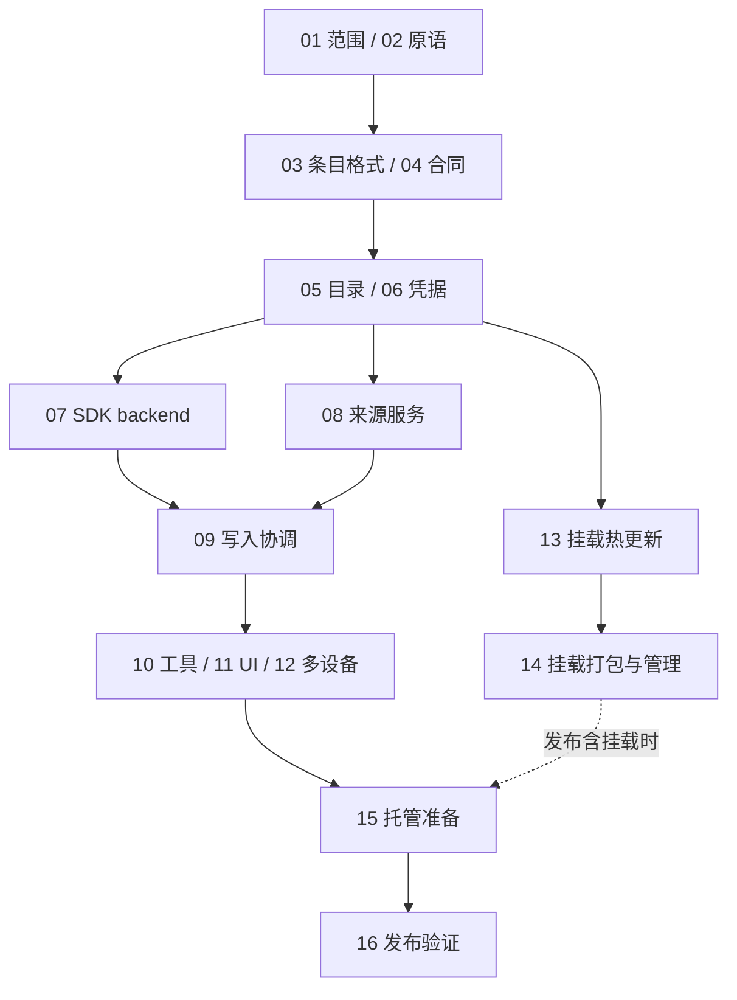

# Lody Memory 逐步执行计划

Status: proposed
Translation: current

[English](2026-11-09-lody-memory-execution-plan.md)

## 摘要

本计划把当前 Drive9 记忆方案拆成可独立交付、按依赖执行的工作步骤，覆盖文件存储、逐条溯源、授权、Agent 工具、界面、共享挂载及发布验证。先建立可验证的数据和权限合同，再完成无需挂载的 Agent 读写闭环；挂载热续期作为独立工作线。每步列明前置条件、具体动作和完成标准，便于后续执行与验收。本文只规划实施，不表示代码已完成或首发范围已获批准。

## 依据与执行方式

[Spec](../../../../specs/agent-role-memory.zh.md)定义产品要求，[架构提案](2026-11-09-lody-memory-drive9.zh.md)定义组件和高层接口；本计划只拥有实施顺序、交付边界与验收安排，不替代这两份文档。此次新增计划与现有架构提案互补，不废止已有设计。

`MemoryCloudPort` 是 daemon 调用 Lody 云服务的接口；云端实现负责记忆目录、权限、短期凭据和来源记录，Drive9 负责 Markdown 文件。接口不是新的部署单元；云端各职责是否共用一个服务在实施时确定。

所有步骤初始状态均为**待执行**。编号表示依赖顺序，不表示每步必须串行。每次完成一个步骤，在对应提交或 PR 中记录交付物与验证证据；遇到阻塞明确缺失能力及受影响步骤，不以缩减需求代替完成。不要在本文追加运行流水账。

## 依赖与交付里程碑

- **M1：合同可实现。** 完成 01–04 的技术内容；未决产品范围明确标注。
- **M2：Agent 读写与逐条来源可用。** 完成 05–12，无挂载也能验证；不是自动获准发布。
- **M3：共享挂载可用。** 完成 13–14，包含真实平台上的不中断续期验证。
- **M4：所选范围可交付。** 完成 15–16；首发含挂载则 M3 是产品验收条件。

## 执行步骤

### 01 · 固定发布范围与成功标准

**前置条件：** 无；现在可执行。

**执行动作：** 记录挂载是否首发、是否要求跨设备即时刷新、首批支持平台；区分已确认需求与待定选项。先完成公共接口和工具路径，不用等待挂载范围决定。

**交付与验收：** 形成发布范围表；未决项有明确的受阻步骤，不能默认为用户同意。

### 02 · 验证 Drive9 必需原语

**前置条件：** 01 的核心需求；与范围讨论并行。

**执行动作：** 在隔离环境验证 create-if-absent、revision 与返回字节关联、条件更新、改名目标不存在及删除预期版本；记录 SDK 错误与超时语义。验证 token 撤销范围和到期行为。为每项写明原生支持、需上游修改或不支持。

**交付与验收：** 保留可复现证据。无法安全实现的操作明确 unsupported；必需操作缺失则先补上游能力，不以先读后无条件写替代。

### 03 · 定义条目格式与来源语义

**前置条件：** 02。

**执行动作：** 在 packages/memory 定义稳定 entryId、Markdown 标记、front matter、正文哈希规则、重复 ID 检测、缺失标记处理；定义 insert/replace/remove、重排、跨文件移动、拆分与合并。准备中英文、多段文本及外部编辑样例。

**交付与验收：** 格式评审完成后才冻结。编辑一个条目不改其他来源；整理不冒充创作；无法匹配显示 unknown。跨文件移动说明部分失败与恢复，不承诺事务。

### 04 · 固定接口与错误合同

**前置条件：** 02、03。

**执行动作：** 在 packages/cloud-api 定义云服务 DTO，在 packages/platform 定义 MemoryCloudPort 注入能力，在共享协议中定义管理 RPC 与 turn 绑定工具合同。统一 committed/conflict/incomplete/rejected、不可用、超时、分页、大小上限、操作 ID 和能力协商。

**交付与验收：** 公开合同不导入私有后端；OSS 无认证云请求。每个接口注明授权主体、幂等范围、失败后是否可能已生效；客户端不把不完整当成功。

### 05 · 实现记忆目录与授权服务

**前置条件：** 04。

**执行动作：** 在私有 Cloud 后端选择并落实目录存储，按 workspaceId/memoryId 保存归属、可见性和生命周期。实现创建、列举、可见性变化与删除编排。明确入口文件初始化、配额校验、失败清理、重复请求和重新启动后的恢复。

**交付与验收：** 私有仅 owner，共享仅当前成员；未就绪目录不可使用。删除先封禁授权再清理，未清理完不报完全删除。MEMORY.md 是名称和描述的事实源。

### 06 · 实现短期凭据生命周期

**前置条件：** 05。

**执行动作：** 服务端持有 owner key，按记忆前缀与 tools/mount 用途签发 token；实现 generation、续期、撤销及成员变更联动。daemon 仅内存缓存，避免日志、配置、repo meta 和子进程状态泄露。定义到期前续期、失败退避与并发合并。

**交付与验收：** 撤权后不能续期；失败不能扩大 scope。验证目录隔离、过期、撤销、多请求续期和进程重启，不依赖真实时间竞争。

### 07 · 实现 Drive9 文件 backend

**前置条件：** 02、04、06。

**执行动作：** 在 CLI daemon 接入 Node SDK，实现 read/list/search/create/edit/rename/delete 和限制路径的校验。读取返回一致的内容与 revision；所有写操作遵循 02 的能力结果。处理 Unicode、非法路径、超限、网络失败和未知写入结果。

**交付与验收：** 两位写入者竞争时返回冲突，不静默覆盖；不能跨记忆、绝对路径或通过编码绕过范围。SDK 留在 daemon，不进入 Web/mobile bundles。

### 08 · 实现来源存储与核对服务

**前置条件：** 03、04、05；读取核对依赖 07 的合同。

**执行动作：** 选择私有后端的来源与收据存储；实现 prepareChange/finalizeChange/readSources/changeStatus。身份取自认证上下文，校验会话引用；定义 prepared、确认中、已完成、冲突和无法确认的状态迁移。来源关联当前条目与内容哈希，核对实际文件，限定收据保留时间。

**交付与验收：** 客户端自报 revision 不足以 verified；较晚完成的旧操作不能覆盖较新来源；共享读者不能获取无权访问的会话标识或正文。明确恶意设备与不可观察外部修改的信任边界。

### 09 · 实现写入协调、幂等与恢复

**前置条件：** 07、08。

**执行动作：** MemoryService 生成稳定 operationId，先准备收据，再条件写文件，再确认来源。持久化可恢复的非秘密操作关联；重启后查询原操作，不重复生成写入。后台对账采用有界重试，不能自动覆盖更新内容。

**交付与验收：** 逐个注入准备后、写入中、写后确认前、确认返回前的故障；只在两部分完成时报 committed。已写入和结果未知分别返回 incomplete(applied/unknown, pending)。同 ID 不同请求拒绝。

### 10 · 接入 Role、Agent 工具与客户端 RPC

**前置条件：** 09。

**执行动作：** 按 turn 冻结 providerId/memoryId，并在每次操作校验当前授权。接入 startup/read/list/search/sources/create/edit/status；管理 RPC 独立鉴权。将记忆正文作为不可信参考资料注入。明确 daemon 离线、权限改变和缺少能力的错误。

**交付与验收：** 模型不能通过参数切换记忆或伪造身份；取消 Role 关联不改已接收 turn，但撤权仍生效。无挂载即可完成实际 Agent 读取、更新和下一 turn 再读取。

### 11 · 实现管理界面与逐条来源界面

**前置条件：** 05、10；来源 UI 依赖 08。

**执行动作：** 在共享组件中加入创建、列表、名称/描述编辑、Role 关联、删除、可见性和逐条来源展示。区分 verified/pending/external_unknown、内容保存但来源未确认、冲突、权限拒绝及离线。外部 Provider 保留独立行为。

**交付与验收：** 桌面、Web、移动端均经 daemon RPC；隐私提示说明已披露副本不可收回；私有会话显示受限来源。检查窄屏、键盘操作和 iOS 16.4 兼容。

### 12 · 验证多设备与可见性转换

**前置条件：** 06、10、11。

**执行动作：** 使用两个成员、两台 daemon 和私有/共享记忆验证真实访问。覆盖私有转共享、共享转私有、成员移除、并发编辑和离线设备重新连接。按已确认刷新策略实现读取刷新；若要求实时刷新，先增加限定范围且支持撤权的事件合同。

**交付与验收：** 成员移除阻止新服务端访问；缓存来源不能冒充新正文来源。无实时合同则不得宣称即时跨设备更新；不向设备发送 owner key。

### 13 · 实现并验证挂载凭据热更新

**前置条件：** 02、04、06；可与 07–12 并行。

**执行动作：** 在 Drive9 上游或明确维护的补丁中实现 rotateCredential(nextLease)。定义确认时刻、generation 切换、进行中请求、旧凭据重叠与撤销。分别验证 macOS/Windows WebDAV 和 Linux FUSE 的支持范围。

**交付与验收：** 正常轮换不卸载、不改变挂载点、不使打开句柄失效、不丢写。撤权必须停止新访问；不把可读取缓存误判为新授权。未通过的平台不可标为支持。

### 14 · 打包并接入共享挂载管理

**前置条件：** 13；UI 接入依赖 11。

**执行动作：** 将固定版本 CLI 纳入托管运行时的构建、校验和分发；daemon 管理 start/status/rotate/revoke/stop。处理路径重名、进程退出、启动失败、凭据不落盘和平台卸载。私有记忆不挂载。

**交付与验收：** 实际打包产物可安装并完成生命周期；验证写入与来源降级联动。单独记录 EINVAL 编辑器替换限制和无条件写入覆盖风险，不以普通读写成功代替兼容验收。

### 15 · 部署准备、限额与运行可观测性

**前置条件：** 05–12；发布含挂载时加入 14。

**执行动作：** 确定真实托管开通、区域、成本、配额、文件/条目/搜索上限、速率与超时；定义 pending 超时、对账积压、续期失败和权限拒绝的指标。日志只记录必要操作标识，不记录正文、token 或私有来源引用。准备隔离验证环境、停用入口与故障处理手册。

**交付与验收：** 实际 hosted 环境验证开通和隔离；不能用本地 TiDB 延迟代替 SLA。停用入口可阻止新操作并安全处理未完成操作，不能通过删除用户文件回滚。

### 16 · 完成发布验证与交付评审

**前置条件：** 01 的发布范围已定，12、15；含挂载时必须完成 13、14。

**执行动作：** 执行下方验收矩阵；按仓库策略完成针对性测试、受影响检查、类型/静态检查和必要构建。完整 Mac/Linux offline/E2E 作为证据与趋势报告，失败分类按 owner policy 处理。核对文档与实际能力，完成发布配置、操作手册与风险评审。

**交付与验收：** 提供可审阅交付包：精确 revision、覆盖矩阵、失败/跳过/未验证项、产品限制和停用步骤。通过合并检查不等于产品验收；发布和外部部署按实际授权执行。

## 仓库与提交边界

| 范围 | 计划归属 | 建议提交单元 |
| --- | --- | --- |
| 条目格式、DTO、端口 | 公共 packages/memory、cloud-api、platform、shared | 03–04；新合同必须可独立检查 |
| 目录、权限、凭据、来源与 hosted 配置 | 私有 Cloud 后端；具体模块在 05/08 选定 | 05–06、08、15 分开提交，依赖已合入的公开合同 |
| SDK、协调器、工具和 RPC | 公共 CLI 与公共共享协议 | 07、09–10；逐步启用，不暴露未完成能力 |
| 界面 | 公共 components；私有 Web/mobile 仅做组合接入 | 11–12，保留平台边界 |
| Drive9 热更新 | 上游仓库或明确维护的补丁 | 13 单独评审与验证 |
| 运行时打包和挂载管理 | 公共运行时机制及适用的私有发行组合 | 14；以实际产物验收 |

公共改动只在 lody-oss 提交；私有改动另行提交，功能分支不携带子模块指针修改。各仓库依赖通过已合入的合同版本衔接。提交前读取目标目录 AGENTS.md；涉及 auth、持久化结构与发布工作流按高风险要求评审。未来实施的 PR 数量按可审阅性拆分，不把整个计划堆进一个 PR。

## 验收矩阵与证据要求

| 产品假设 | 最低验证边界 | 归属步骤 |
| --- | --- | --- |
| 一条更新不改变其他条目的来源 | 条目核心 + 实际来源服务 | 03、08–09 |
| 相同操作重试只生效一次，未知结果不报成功 | 协调器 + 可控故障注入 | 09 |
| 私有、共享与撤权按当前身份生效 | 真实服务鉴权 + 两位成员 | 05–06、12 |
| 条件写入防止并发静默覆盖 | 真实 Drive9，两位写入者 | 02、07 |
| 外部修改不能继承错误 Agent 归属 | 实际文件修改 → 读取 → 来源展示 | 08、11、14 |
| Agent 无挂载也能跨 turn 使用记忆 | 实际 daemon + Agent 工具旅程 | 10–12 |
| 共享来源不能泄露私有会话 | 来源 API 与受限用户 UI | 08、11 |
| 正常续期保留打开句柄与进行中写入 | 各支持平台真实挂载 | 13–14 |
| 安装产物具备所宣称能力 | 实际打包运行时和 Cloud 组合 | 14–16 |

测试只保护以上产品行为或安装发布保证，优先确定性信号、注入时钟与可控失败，不添加实现形状断言或依赖等待时间的测试。每项证据注明版本、环境、范围和未验证部分。现有 P1 证据可用于选型，不替代新合同的验收。

## 发布分支与停用策略

1. **首发不含挂载：** 仅在产品明确同意后采用；完成 M2 和 M4，界面不提供未完成的挂载入口。
2. **首发包含挂载：** M2、M3、M4 均满足；不能用工具读写成功替代挂载热续期验收。
3. **要求即时刷新：** 在 12 前补齐限定范围事件和流撤权方案及验证，不能复用 tenant owner SSE 凭据。
4. **暂停交付：** 有未解决的授权、错误归属、丢写或续期问题时保持相关能力关闭，保留用户文件和可对账收据。修复后按受影响行为重新验证。

本计划不授权自动发布、变更生产环境或开通付费资源；这些动作在具体交付阶段按已有授权和实际范围处理。当前可直接推进文档与技术设计，未决产品选择只阻塞其依赖步骤。

## 参考与验证状态

- [当前架构与固定版本 P1 证据](2026-11-09-lody-memory-drive9.zh.md#验证)。
- [需求与发布范围问题](../../../../specs/agent-role-memory.zh.md#需要产品决定的问题)。

本文未执行任何实施步骤或产品验收；接口、格式、托管实现和挂载热更新均需按上述顺序完成与验证。
