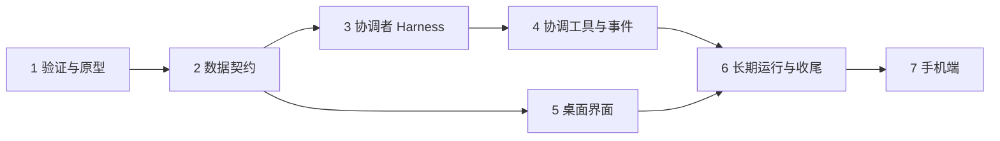

# 项目模式与协调者对话：缺口梳理与基本计划

Status: proposed
Translation: current

[English](2026-11-11-project-coordinator-mode.md)

## 摘要

对话（session）越来越多，按对话列出的侧边栏太占注意力。新模式以**项目**为最小单位：侧边栏列项目，并保留「项目 / 对话」切换。进入项目后左边是**协调者**对话，右边是该项目的全部子对话。

派生子对话、PR/CI 观测、按项目分组这些基础能力已经有了。缺的是四块：

1. 没法给一个对话设 System Prompt，也没法限制它的工具。
2. 没有「协调者」这种对话类型，子对话也不记录自己属于哪个项目的协调者。
3. 没有任务状态，也没有「子对话卡住了」通知协调者的通道。
4. 没有项目页，右侧 tab 里放不了独立对话。

本文是提案。前两轮问题 owner 已答复（见「已确定」）；原型的细节已全部定下（见「已确定」和「原型范围」）；原型之后各步的契约尚未设计。

## 已确定（owner 在需求里定的）

- 项目是新模式的最小单位；侧边栏加「项目 / 对话」切换，旧的对话模式保留。
- 项目页左边协调者、右边子对话；子对话按「需要你 / 未读 / 已完成」分组；点开子对话是右侧的新 tab，含对话、文件变更、PR。
- 协调者不执行任务，只有搜索查询和 Lody MCP；System Prompt 和工具范围由 owner 来写和限定。
- 协调者会主动发消息，并在子对话完成后总结给用户。
- 状态变更的完整规则、侧边栏展示细节：暂不定。

## 已确定（第 1 轮答复，2026-11-12）

- **协调者是一个特殊类型的对话**，仍是 session，只是带协调者标记、专用 Harness 和专用布局。（owner 定的）
- **协调者的 Harness 默认先用 Lody Agent**，即目前在开发者模式 + Lody Agent beta 开关后面的内置 Sorbet（`@sorbetai/acp`）。（owner 定的）
- 「项目」沿用侧边栏现有的项目分组：一个本地项目、一个 GitHub 仓库、一个多仓库项目各算一个项目，不新造概念。代价是同一个仓库在两台机器上的本地目录是两个项目。（起草者推荐，owner 接受）
- 每人每项目一个长期协调者，先不做多人共用。（起草者推荐，owner 接受）
- 同项目里不是协调者派生的对话也进右侧看板，标成「手动创建」，协调者能看到但不负责；子对话 tab 里保留输入框，用户可以直接和子对话说话。（起草者推荐，owner 接受）
- 任务状态第一版只做算出来的：需要你 = 等权限 / 等回答 / 失败；进行中 = 在跑；未读 = 完成且未读；已完成 = 已读，或 PR 已合并。另外只给协调者一个「标记完成 / 重新打开」的工具。（起草者推荐，owner 接受）
- 先做原型。（起草者推荐，owner 接受；做法见下一节）

## 已确定（第 2 轮答复，2026-11-12）

以下都是 owner 定的。

- **原型直接在产品仓库的新分支上搭**，不是仓库外的一次性东西。细节定完之前不开工。
- **System Prompt 和工具白名单**：owner 会给 Lody Agent 加这两个接口，协调者用它们。第一版原型先用 Agent Role 顶替。
- **子对话用哪个 agent**：协调者根据各 Agent Role 的描述自己选。
- **子对话的权限**：继承协调者的权限。指继承「权限模式」（要不要逐次询问用户），不继承协调者的工具白名单。（第 3 轮确认）
- **协调者忙时用户发消息**：steer 插入正在跑的那一轮。
- **原型跑在哪台机器**：owner 自己选。
- **目标体验**：用户只需要随时给协调者发消息，不用关心子对话的状态。协调者要把任务交代清楚、把结果收集清楚，并且知道每个子对话处在哪个阶段。这需要新的工具，或者一份共用的文档来沟通。「什么算成了」owner 暂时还答不了。

## 现状：已经有什么

| 能力 | 现状 | 出处 |
| --- | --- | --- |
| 派生子对话 | 有。`lody_session_create(_many)` 可以在任意可达机器、任意项目建对话，可带独立 worktree；记录 `openedBySessionId`。 | `apps/cli/src/mcp/README.md` |
| 完成结果回传 | 有。子对话完成后结果进入父对话的 Inbox；多个结果合并成一批；Spec 写的是父对话空闲时会被自动唤醒开一轮。 | `specs/session-orchestration.md`「Idempotent message consumption」 |
| 给运行中的子对话补充指令 | 有。`lody_session_chat` 会 steer 进正在跑的那一轮，不支持 steer 的排队。 | 同上 |
| 查看子对话在干什么 | 有。`lody_session_status_many` 返回当前动作、最近输出时间、排队输入、最近失败原因；`lody_session_list` 可按 PR 过滤。 | 同上「Coordinating many Sessions」 |
| PR / CI 状态 | 有。机器侧轮询，写进对话元数据 `pullRequests`、`pullRequestState`（CI、可合并、就绪）。 | `specs/local-github-pr-observation.md` |
| 等某个外部条件再唤醒 | 有。`lody_automation` 注册一段轮询条件（能读 PR 生命周期、CI），命中后给注册它的对话排一条续跑输入。 | `apps/cli/src/automations/README.md` |
| 侧边栏按项目分组 | 有。`sidebarOrganizeModeAtom` 的 `workspace` 模式已按 Chats / 本地项目（按机器）/ GitHub 仓库分组，可拖动排序。 | `packages/components/src/atoms/sidebar-state.ts` |
| 注意力分桶 | 部分有。已把对话分成 权限 / 提问 / 运行中 / 未读 并计数；没有「已完成」，也没有按项目汇总。 | `packages/shared/src/live-activity-summary.ts` |
| 对话旁的文件变更和 PR | 有。侧面板有 Files、All Changes、PR tab（摘要 + 变更）。 | `.agents/docs/sessions-side-panel.md` |
| 右侧面板里放一个对话 | 部分有。Side Chat 是放在侧面板的子 Tab（`parentSessionId`），和父对话共用工作区；独立对话放不进去。 | `.agents/docs/sessions-tabs-routing.md` |

「项目」今天有三种：本地项目（某台机器上的一个目录）、GitHub 仓库（只有仓库名，没有自己的记录）、多仓库项目 `WorkspaceProject`（工作区级记录，Spec 还是草稿）。对话通过 `SessionMeta.project` 关联其中一种。

**未核实：** Spec 说「空闲的父对话收到结果会自动唤醒」，`apps/cli/src/mcp/README.md` 说「结果到达本身不会唤醒空闲对话」。协调者「主动汇报」完全依赖这一点，还没有跑代码确认哪个是现状，放在计划第 1 步。

## 缺口

### A. 协调者本身（Harness）

| # | 缺什么 | 现状 | 影响 |
| --- | --- | --- | --- |
| A1 | System Prompt 通道 | Role 的 `promptPrefix` 只是拼在用户消息前面；`buildPrompt` 里还留着 `TODO: use system prompt`。 | 没法可靠地把它约束成「只协调、不干活、快速回应」。 |
| A2 | 内置工具白名单 | 代码里找不到任何 provider 的 allowed/disallowed tools 传递。Role 只能固定模型和权限模式。 | 协调者仍然能改文件、跑命令。 |
| A3 | 按对话裁剪 Lody MCP 工具 | 工具表静态注册，所有对话看到同一套（含归档、Role、MCP 配置、模拟器预览等）。 | 协调者工具太多，慢且容易跑偏。 |
| A4 | 「协调者」对话类型 | `SessionMeta` 没有 kind 字段，没有系统内置 Role。 | 界面和运行时认不出哪个对话是协调者，无法给它专用布局和专用限制。 |
| A5 | 长期对话的上下文控制 | 每批完成结果最多 64 KiB 进历史；没有针对协调者的压缩或项目记忆。 | 协调者活得越久越慢，和「极快回应」冲突。 |

### B. 协调方式

| # | 缺什么 | 现状 | 影响 |
| --- | --- | --- | --- |
| B1 | 子对话归属 | `openedBySessionId` 只记「谁建的」，和项目无关；没有工具能查「这个协调者名下全部子对话」。 | 右侧看板和协调者都拿不到完整的子对话集合。 |
| B2 | 任务状态 | 只有运行态（空闲 / 运行 / 等权限 / 初始化）。没有「已完成」「失败」「待评审」，也没有 agent 可写的状态或标签。 | 「需要你 / 未读 / 已完成」里只有未读能直接算出来。 |
| B3 | 子对话卡住时通知协调者 | 协调者只在子对话**完成**时收到回执。子对话在等权限、等用户回答时，协调者不知道。 | 协调者没法主动告诉用户「有个任务在等你」。 |
| B4 | 子对话向用户提问 / 请求关注的工具 | 没有这样的 MCP 工具；提问只出现在子对话自己的页面里。 | 用户不看子对话就看不到问题。 |
| B5 | 协调者主动消息的通知 | agent 发起的轮次会**抑制**面向用户的完成通知。 | 协调者被回执唤醒后写的总结，用户不在页面上就收不到提醒。 |
| B6 | PR / CI 事件送到协调者 | 状态已在元数据里，但要协调者自己逐个注册 automation 才会被唤醒。 | 「PR 合并了 → 任务完成」「CI 挂了 → 需要处理」不会自动发生。 |
| B7 | 链路深度和并发上限 | 委派链最多 16 跳，完成回执的续跑也算一跳；没有并发派生数量上限。 | 协调者在没有人类输入的情况下连续自动处理多轮回执会撞上 16 跳；也可能一次派出过多子对话。 |

### C. 界面

| # | 缺什么 | 现状 |
| --- | --- | --- |
| C1 | 项目页和路由 | 没有。现有的项目路由只是跳到新建对话页。 |
| C2 | 侧边栏项目行 | 有分组，但组里展开的是对话；没有「一行一个项目 + 汇总状态」的形态，也没有「项目 / 对话」切换。 |
| C3 | 右侧 tab 承载独立对话 | 顶部 tab 只放根对话和它的子 Tab；独立对话只能整页打开。两个独立对话不能并排。 |
| C4 | 子对话看板 | 没有。分桶逻辑可复用 `live-activity-summary`。 |
| C5 | 手机端 | Web 移动端、iOS 原生、Android 原生是三套各自的列表实现，都要单独做。 |

## 基本计划

### 1. 验证与原型（产品仓库新分支）

- 跑一次真实流程，确认空闲父对话收到完成回执后是否自动唤醒，并修正互相矛盾的那份文档。
- 用 Agent Role（Lody Agent + `promptPrefix` + 快模型）充当协调者，只用现有 MCP 工具，实际用一两天。组成见「原型范围」。
- 写一份 Spec（建议 `specs/project-coordinator-mode.md`），把第 2 步的契约和本文的决定写进去。

### 2. 数据契约（其余各步的地基）

- 对话类型：给对话加「协调者」标记（A4）。
- 项目与协调者的绑定：一个项目对应哪个协调者对话，存在哪。
- 子对话归属：子对话记录自己属于哪个协调者 / 项目，并能按它查询（B1）。
- 任务状态：字段、取值、谁能写（B2）。先定最小集，规则可以后补。
- 用机器协议能力位做开关，旧客户端和旧 daemon 不受影响；字段走现有对话元数据，E2EE 和 Roost 沿用同一条同步路径。

### 3. 协调者 Harness

- System Prompt 通道和内置工具白名单：接 owner 给 Lody Agent 新加的两个接口，白名单只留只读的搜索、读取（A1、A2）。
- Lody MCP 工具档位：协调者只看到派生、对话、状态、列表、历史、取消、排队这几样，加上第 4 步的新工具（A3）。
- 固定快模型；协调者对话不可改模型和权限模式。

### 4. 协调工具与事件

- 「列出我名下子对话及状态」一次返回，协调者不用自己翻（B1）。
- 设置任务状态的工具，协调者和子对话各自能写的范围按第 2 步的契约（B2）。
- 子对话进入「等权限 / 等回答 / 失败」时给协调者一条事件，走现有 Inbox 回执通道（B3、B4）。
- PR 合并、CI 失败自动变成事件，不需要协调者逐个注册 automation（B6）。
- 协调者被事件唤醒后产生的总结要给用户发通知（B5）。
- 并发派生上限；协调者的自动续跑不计入或重置 16 跳（B7）。

### 5. 桌面界面（第 2 步后即可与第 3、4 步并行）

- 侧边栏「项目 / 对话」切换；项目行带汇总状态（C2）。
- 项目页路由和两栏布局：左协调者对话，右看板（C1、C4）。
- 右侧 tab：点子对话开 tab，里面是对话 + 文件变更 + PR，复用现有侧面板的组件（C3）。
- 协调者还没接好时，界面可以先用第 1 步的假协调者联调。

### 6. 长期运行与收尾

- 协调者上下文控制：回执只留摘要、定期压缩，或项目级记忆（A5）。
- 已有对话如何进入项目看板；协调者所在机器离线时的表现。
- E2EE 工作区和 Roost 下完整走一遍。

### 7. 手机端

Web 移动端先做（复用共享组件），iOS / Android 原生各自排期（C5）。

## 已确定（第 3 轮答复，2026-11-12）

以下都是 owner 定的。

- **原型只用现有的 MCP 工具，单次沟通**：协调者派出任务，子对话做完后结果通过现有的完成回执回来。原型不加「汇报阶段」之类的新工具，也不用共用文件。
- **任务卡先不做。**
- **唤醒协调者的时机**：只有「等你」「失败」「完成」，普通的阶段推进不唤醒。
- **协调者主动找用户的时机**：同样只在这三种情况，同时到达的合成一条；用户问起时再汇总。
- **子对话需要用户拿主意时**：用户在协调者这里回答，协调者转给子对话。
- **权限继承**：继承的是权限模式。
- **原型不做权限继承**：原型用到的几个 Role，权限模式由 owner 直接设成「自动允许」。「继承」作为产品功能留到计划第 2 步，那时再定跨 provider 怎么对应。

## 原型范围

按上面的决定，原型由这些东西组成，全部是现有能力：

| 部分 | 用什么 |
| --- | --- |
| 协调者 | 一个 Agent Role：Lody Agent + 快模型，`promptPrefix` 顶替 System Prompt。它只是一个普通对话，没有专用界面。 |
| 派任务 | `lody_session_create(_many)`，协调者按各 Role 的描述选 Role。 |
| 收结果 | 现有的完成回执。子对话一轮结束，最后的回复就是结果。 |
| 「等你」 | 子对话结束这一轮并在回复里提问。对协调者来说这也是一次完成回执，它转述给用户；用户回答后，协调者用 `lody_session_chat` 转回去。 |
| 「失败」 | 现有回执里的失败原因（`usage_limit`、`agent_crash` 等）。 |
| 中途了解进度 | 用户问起时，协调者调 `lody_session_status_many`（当前动作、最近输出时间）。 |
| 看子对话 | 现有侧边栏：协调者派出的对话会缩进显示在它下面。 |

原型不包含：项目页和看板、侧边栏的「项目 / 对话」切换、协调者对话类型标记、任务卡、任何新 MCP 工具。这些留到原型结论出来之后（计划第 2 步起）。

单次沟通带来的已知局限，原型里接受：

- 子对话不结束这一轮，协调者就收不到任何消息。阶段信息只有用户问起时才查得到。
- 子对话停在工具权限确认上时，不算一轮结束，协调者不会被唤醒，也代答不了。原型里 Role 设成自动允许，所以不会出现；产品里仍是缺口（B3、B4）。
- 「任务交代得清不清楚」只留在对话历史里，没有单独的记录。

## 权限继承的现状（留给第 2 步）

用 Role 创建子对话时，子对话的权限模式取自那个 Role 自己固定的运行配置，和创建者无关（`apps/cli/src/mcp/README.md`「Role dispatch」）。不同 provider 的模式名也不通用，协调者（Lody Agent）的模式没法原样套到 Codex 或 Claude Code 的子对话上。做「继承」时要先定这个对应关系。

## 原型观察项

原型要顺带回答的事实问题：

- 空闲的协调者收到完成回执后是否自动唤醒。
- 连续自动处理回执是否会撞上 16 跳上限，多久撞一次。
- 一两天后协调者的上下文长到多大，回应是否明显变慢。
- 协调者被唤醒后写的总结，用户不在页面上时有没有通知。
- 只靠 `promptPrefix` 约束时，协调者自己动手干活的情况有多常见。
- 单次沟通够不够用：有多少次你不得不点开子对话才知道发生了什么。

## 验证范围

以上现状来自阅读文档和代码，没有运行任何流程。未核实的两点：完成回执是否唤醒空闲父对话。Lody Agent 的 System Prompt 和工具白名单接口由 owner 另行添加，本文未涉及其实现。相关的既有讨论见 [会话关系 Spec](../../../../specs/session-relations.md) 末尾提到的 #529（worker 状态汇总、未读路由、worker 面板）。
