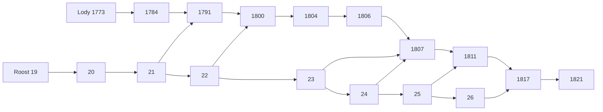

# Joint review of the Roost and Lody PR stacks

Status: proposed
Translation: current

[中文](2026-10-22-roost-pr-stack-integration.zh.md)

## Abstract

Ten open Roost PRs and thirteen open Lody PRs form cumulative dependent stacks. The audit found one sequential documentation conflict, a missing Native capability declaration and a new-toolchain Clippy gate; the authorized non-release repairs now address all three while preserving runtime/body contracts and benchmark inputs. The parent fixes are propagated through their stacks, with local compilation and completed Rust suite coverage recorded below. Publication pairing remains explicitly deferred. Today's main also upgrades Loro dependencies, so the earlier fixed-candidate results do not establish acceptance of that newer combined graph.

## Authorized non-release repairs — 2026-10-24

The user authorized fixing the non-release audit findings while explicitly
leaving publication pairing alone. The decoder Clippy fix lands in Roost #27 at
`345cc5e3b49bdfb67b38906fd649d2a58e56976d`; Roost #28 merges that parent and
adds the two missing owner-capability declarations at
`ae53cf64967d669ecdff6df32a6f34df7a74d687`. The fixed-width iterator retains
its nonempty/divisibility/count and field checks. Native runtime advertisement,
wire/body format, durability and all version fields are unchanged.

Rust 1.99.1 fmt and all-target Clippy, SDK typecheck/build and the existing Native
assignability/format checks pass. The first full serial Rust test command has
one retained rs3 HTTP `Transport(Unavailable)` failure. Its isolated retry,
complete 22-test owning suite, previously unexecuted targets and doc tests pass,
completing 379 unique passes and six existing ignored tests. No successful
unrelated suites were restarted. The checked runtime hashes match after placing
the parent/child commits; logs remain in `pr-stack-audit-20261024/fixes/`.

Lody #1839 now merges #1830 into its head, preserving the nonempty report-links
side of the only guide conflict. Before adding this report update, the entire
resolved tree is byte-for-byte identical to pre-repair #1839. Thus the repair
changes ancestry and removes the sequential conflict without changing runtime,
tests or benchmark inputs. #1845 inherits that repaired parent. Full Lody
runtime checks and benchmark measurements are reused at their recorded source
identity; this documentation/ancestry-only repair runs root formatting and docs
checks, without a new complete runtime or benchmark run.

Release versions, Rust/npm package publication, platform dependency pins, Lody
catalog/lockfile updates, current-main dependency integration and deployment
remain deferred. The audit tables below are the **pre-repair snapshot**, not
claims that the declaration/lint or documentation fixes are still outstanding.
The registry dependency graph remains an explicit release gate.

## Audit snapshot before repairs — 2026-10-24

This refresh reviews ten open Roost PRs (#19–28) and thirteen open Lody PRs
(#1773–1845, listed below). It changes no implementation, PR base, readiness,
merge, publication or deployment state. The only tracked edits are this bilingual
report, on a separate local audit branch. Findings are targeted source/contract
and merge checks, not a proof of all corruption or concurrency schedules.

### Exact current sources and merge results

| Source | Frozen commit |
| --- | --- |
| Roost main | `1b6df6199ca2973efd6912f2e7611ba306e9aaa3` |
| Roost #28 tip | `bb40f9eab9b539c5fe8ebecda61f9ee945a96a44` |
| Lody main | `c92f71fe5c4bcc0c93beb20cff4d4004a32dff41` |
| Lody #1845 tip | `56d5514f923c69c4c9dac6790e5edb9b90057b41` |
| Lody #1839 integration base | `812bc3c21da3b3d160eccd6f2cbd05884962d4eb` |

Roost has zero main-only and 19 stack-only commits. Every preceding head is an
ancestor of the next; the complete main/tip merge and the sequential #19–28
merge simulations succeed.

Lody has 15 main-only and 29 tip-only commits, with common base `957b513ee391`.
The current main and #1845 merge automatically. Five paths change on both sides:
`doc.ts`, `message-handler.ts`, `session-execution-service.ts`, the Roost backend
contract suite and `create-workspace-runtime.ts`. Targeted review finds no new
P0/P1 semantic conflict in those overlaps: main's Loro persistence-failure observer
remains in the Loro repository, and notification excerpts use the exact assistant
identity through the existing complete selected-turn read.

There is **one real sequential merge conflict**: after merging #1830, #1839
conflicts in `.agents/docs/roost-validation.md`. #1839's integration base contains
#1821 and pinned main, but not #1830. Thus #1830 is a sibling benchmark/report
branch, not a Git ancestor of #1839. The one conflict hunk has an empty #1830 side
and #1839's added report links on the other side. In an audit-only virtual tree,
retaining those links allows #1845 to merge. The resulting complete tree is
`bf03b998b142d0175abde1ed6ea708f040c84557`, **exactly identical** to current
main + #1845. No runtime/test/report addition from #1830 is missing from that
final combined tree. This demonstrates the content relationship; it does not
resolve any real branch or replace tests on that tree.

### Current dependency order

The following arrows give landing order. All Roost arrows are Git ancestry;
the Lody #1830 → #1839 step additionally needs the documentation resolution and
retarget/rebase described above.

- Roost: #19 → #20 → #21 → #22 → #23 → #24 → #25 → #26 → #27 → #28.
- Lody: #1773 → #1784 → #1791 → #1800 → #1804 → #1806 → #1807 → #1811 → #1817 → #1821 → #1830 → #1839 → #1845.

| Newer PR | Role / cross-repository prerequisite |
| --- | --- |
| [Roost #27](https://github.com/loro-dev/roost/pull/27) | Shared immutable frame bodies; follows #26; final container 10 / RSP3 |
| [Roost #28](https://github.com/loro-dev/roost/pull/28) | Receipt checks and bounded Native observation; follows #27; retains container 10 |
| [Lody #1830](https://github.com/LodyAI/Lody/pull/1830) | Benchmark/report companion to #27, above #1821; no runtime API change |
| [Lody #1839](https://github.com/LodyAI/Lody/pull/1839) | Native publication/observer/head and protocol/cache v3; requires Roost #28 and the integration base |
| [Lody #1845](https://github.com/LodyAI/Lody/pull/1845) | Position mapping and narrow history reads; follows #1839; no further Roost API |

Earlier companion boundaries remain #1791 ↔ Roost #21, #1800 ↔ #22,
#1807 ↔ #23/#24, #1811 ↔ #25 and #1817 ↔ #26. #1773/#1784 can use the
published 0.2.0 at their own heads; #1791 onward introduces unreleased requirements.

Preserve ancestry when landing this stack. If parents are squashed/rebased,
rebase and retarget descendants rather than assuming their old bases remain
valid. #1839's integration branch is not another PR or an additional optimization
to apply after the tip; preserve its main merge and owning changes while retargeting.
No PR is automatically closed, merged or marked ready by this audit.

### Supersession and independently versioned contracts

Repeated edits are cumulative refinements. No competing runtime implementation
was identified in the final combined stack. Roost #27 replaces RSP2's body copies
with RSP3 references while keeping #19's bounded inline/expand policy, #20's Native
outbox policy, #22's packed logs and #23–26's cache/checkpoint fences. #28 retains
exact transaction checks; observations are wake hints, not substitutes for journal
reads or CAS.

Actual container progression is 5 (#19), 7 (#20), 8 (#21), 9 (#22–26), then
10 (#27–28). Earlier v8/v9 assertions describe intermediate heads, not final
requirements. The final runtime accepts fresh/v10 only, without migration,
legacy reader or automatic deletion. Publish the final stack once; intermediate
containers need not become released upgrades. Old data stays with its matching
runtime unless a separate explicit data-handling decision is made.

The final Lody owner requires `commit-metadata-v1`, `derived-indexes-v1`,
`receipt-checks-v1` and `commit-observation-v1`. History protocol and renderer
cache are version 3, while agent receipts remain version 2. Dispatch position
checkpoint 2 certifies rebuildable local derived state; it is not a new body or
wire format. CLI and renderer must ship together at the protocol-v3 boundary.
These distinct version numbers do not conflict.

### Concrete CI and release blockers

The current CI failures are **not all registry-version failures**:

| Boundary | Evidence and required action |
| --- | --- |
| Roost #28 Native declarations | [Linux job](https://github.com/loro-dev/roost/actions/runs/39926735363/job/120324862721) and a Windows job build the addon, then fail the in-tree `pnpm check` with TS2322. `NativeCapability` includes `receipt-checks-v1` and `commit-observation-v1`, but [`OwnerCapability`](https://github.com/loro-dev/roost/blob/bb40f9eab9b539c5fe8ebecda61f9ee945a96a44/ts/node/client.d.mts#L4) omits both. The SDK is linked from `../../ts`, so this is a source declaration mismatch, independent of npm publication. Synchronize the capability contract and rerun Native type/platform checks. |
| Roost #27/#28 Rust | [#28 Rust check](https://github.com/loro-dev/roost/actions/runs/39926735298/job/120324860752) and #27 fail `cargo +stable clippy --offline --locked --all-targets -- -D warnings` on Rust 1.99.1 at `src/projection/codec.rs:70` (`chunks_exact_to_as_chunks`). Their preceding unit/doc tests pass. Clear the lint gate without changing byte-decoding behavior. |
| Roost release preparation | [#27 release preview](https://github.com/loro-dev/roost/actions/runs/39803040267/job/119915082257) reaches the existing published `0.2.0` collision. Source manifests still use that version. Prepare a coordinated new SDK/Native/six-platform version; no package is published by this audit. |
| Lody registry pair | [#1845 static checks](https://github.com/LodyAI/Lody/actions/runs/40000297359/job/120574799546) and #1839 still install published SDK/Native 0.2.0. They lack the new APIs/capabilities. #1839 also has real generation-fence assertion failures with that old pair, not just compiler errors. Pin the matching released SDK/Native and update the catalog/lockfile, then rerun registry-based CI; never suppress the type or capability guards. |
| Historical Roost #23/#24 matrices | Sampled failed jobs show pnpm 12.3.4 registry timeout/HTTP 503 acquisition. Those failures precede runtime assertions and are separate from the current #28 declaration failure. |

The previous matching local #1845 pair passes complete Lody root checks, including
4,559 CLI tests (4 skipped), 5,962 component tests, 1,610 shared tests and desktop
packaging/tests. That coverage includes the generation-fence cases failing with
the old registry pair. It does **not** make Roost's separate Native declaration
check green, establish a usable published dependency graph, or remove the two
Roost source/toolchain gates above.

### Remaining acceptance and next action

Current main upgrades Loro 1.16.3 → 1.17.0, LoroRepo 0.23.3 → 0.25.0 and
streams-crdt 0.19.1 → 0.19.2. Those changes are upstream, not edits made by this
audit. The earlier full-root and benchmark results retain their original pinned
sources; they do not validate today's combined dependency graph or a new Loro
comparison. No full suite or benchmark was restarted for this read/merge audit.

Before landing: clear the Roost declaration/lint/version gates; land the Roost
chain and release one matching final version from main; update the Lody pins and
lockfile, resolve the one guide conflict while retargeting the chain, then run the
owning behavior suites and required full checks on the actual combined graph.
Rebenchmark that frozen graph when reporting new current-main performance.
No implementation fixes or PR mutations are made here.

Raw GitHub metadata, failed CI logs, exact refs, ancestry/merge-tree results and
virtual-tree evidence are outside Git in
`shared-body-validation/pr-stack-audit-20261024/`. The Roost HTTPS refetch stalled
and was cancelled; GitHub API heads/main already matched exact locally available
commit objects. Lody's current refs were fetched. Virtual merges use temporary
commit/index objects and do not update working branches or remote refs.
Documentation checks validate this report separately from runtime acceptance.

## Historical evidence below — original pinned 2026-10-22 snapshot

The remaining sections preserve earlier source identities, measurements and
subsequent shared-body follow-up evidence. The current inventory, container and
landing blockers above supersede their older current-state wording; historical
benchmark results keep their stated inputs and must not be relabeled as today's
combined-tree measurements.

## Scope and source identity

Snapshot: 2026-10-22. Read-only GitHub metadata is retained outside Git with exact head/base hashes and check URLs. Existing PR branches and publication/deployment state are unchanged.

- Roost main: `1b6df6199ca2973efd6912f2e7611ba306e9aaa3`.
- Roost stack tip, [#26](https://github.com/loro-dev/roost/pull/26): `d4b07d48d53036da824372d5531f41da1fce02d2`.
- Lody main: `957b513ee391c5b69101ae3d22ee353f1d6f4b20`.
- Lody stack tip, [#1821](https://github.com/LodyAI/Lody/pull/1821): `d494724c30e4389148b81762162436d0b6063450`.
- Common Lody base: `a8cffe6f1be2a7b6983770afdebe5231b0a7ae10`.
- Local Lody integration branch: `codex/roost-stack-integration` in a separate clone. Measured integration commit: `812bc3c21da3b3d160eccd6f2cbd05884962d4eb`, tree `8735cfc54c5317255f87ed6bbdc395521174fa4c`, plus the identified harness-only overlay.

This reviews dependencies, combined behavior and the explicitly scoped local measurements below; it is not a new full line-by-line correctness certification. Prior accepted benchmark scope and gaps remain in the [validation guide](../../../docs/roost-validation.md) and its owning reports.

## Inventory and order

All entries below are open at the snapshot. Roost #19 is ready for review; the other 17 are drafts. The dependency column includes cross-repository API or SDK companions; within each stack every previous head is an ancestor of the next one.

| PR                                                     | Responsibility                                         | Prerequisite         | Head           |
| ------------------------------------------------------ | ------------------------------------------------------ | -------------------- | -------------- |
| Roost [#19](https://github.com/loro-dev/roost/pull/19) | Bounded inline projection                              | main                 | `0f81d7b12960` |
| Roost [#20](https://github.com/loro-dev/roost/pull/20) | Omit unused Native outbox copies                       | #19                  | `60f6b160cfc0` |
| Roost [#21](https://github.com/loro-dev/roost/pull/21) | Compact events and atomic local commit metadata        | #20                  | `4afe55a11d62` |
| Roost [#22](https://github.com/loro-dev/roost/pull/22) | Bounded packed SQLite log blocks; final container v9   | #21                  | `3068595c7b31` |
| Roost [#23](https://github.com/loro-dev/roost/pull/23) | Bounded sealed page-body cache                         | #22                  | `c40524ae7a52` |
| Roost [#24](https://github.com/loro-dev/roost/pull/24) | Remove redundant history catch-up round trips          | #23                  | `f4cc6b837eb2` |
| Roost [#25](https://github.com/loro-dev/roost/pull/25) | Conditional atomic derived checkpoints                 | #24                  | `ff1a639f930c` |
| Roost [#26](https://github.com/loro-dev/roost/pull/26) | Private checkpoint and branch-directory evidence       | #25                  | `d4b07d48d530` |
| Lody [#1773](https://github.com/LodyAI/Lody/pull/1773) | Compact agent replay receipts                          | main                 | `ce653a2199e9` |
| Lody [#1784](https://github.com/LodyAI/Lody/pull/1784) | Compact renderer change receipts                       | #1773                | `e920a7830d4e` |
| Lody [#1791](https://github.com/LodyAI/Lody/pull/1791) | Commit renderer metadata with content                  | #1784; Roost #21     | `061460cb7406` |
| Lody [#1800](https://github.com/LodyAI/Lody/pull/1800) | Packed-storage contract assertions                     | #1791; Roost #22     | `8e3375961a77` |
| Lody [#1804](https://github.com/LodyAI/Lody/pull/1804) | Reuse unchanged owner projections                      | #1800                | `2cfda8cfd2dd` |
| Lody [#1806](https://github.com/LodyAI/Lody/pull/1806) | Install certified text projections                     | #1804                | `af7e50bf7442` |
| Lody [#1807](https://github.com/LodyAI/Lody/pull/1807) | Reuse sealed projections and avoid seal window reload  | #1806; Roost #23/#24 | `bab14a8f424c` |
| Lody [#1811](https://github.com/LodyAI/Lody/pull/1811) | Fuse content, SDK progress and staged goal             | #1807; Roost #25     | `f06b820f3628` |
| Lody [#1817](https://github.com/LodyAI/Lody/pull/1817) | Carry semantic mutations through private projections   | #1811; Roost #26     | `435148029bff` |
| Lody [#1821](https://github.com/LodyAI/Lody/pull/1821) | Use scalar dispatch indexes instead of full transcript | #1817                | `d494724c30e4` |

Roost #15–#18 and Lody #1735/#1737/#1765 are already merged and are not additional patches to apply. Lody [#1483](https://github.com/LodyAI/Lody/pull/1483) only removes an unused `readGoalProjection` import: current main already has no such import, while the new stack imports and uses it in a behavioral test. Treat that old cleanup as obsolete; do not apply it to the new stack. No PR is closed by this audit.

## Conflict assessment

- Roost has 14 stack-only commits and no main-only commits. Its tip includes main, and all eight adjacent head ancestry checks pass.
- Lody has 24 stack-only and 27 main-only commits. All ten adjacent head ancestry checks pass. An actual local `merge --no-commit --no-ff` succeeds without manual resolution.
- The three files changed on both Lody sides are `AGENTS.md`, `session-execution-service.ts` and shared `acp/history-apply.ts`.
- Main's runtime-security floor remains in the combined instructions. Validation uses Node 24.22.1 rather than bypassing the new gate.
- Main's authored-prompt title, inbox admission/recovery and detached Code Collab changes are retained alongside body-free pending-inbox reads in session execution.
- Main #1805 adds one bounded tool-storage projection for root and normalized child tools. The stack's immutable planner invokes the same `NotificationOnHistoryApplier`, so its mutation tracking must preserve that new projection. Existing child-tool/storage-policy and immutable-plan tests are the joint behavioral boundary.

The first docs check also exposed a real combined gate failure: root `AGENTS.md` is 8,137 bytes on main and 8,185 on the stack, but 8,230 after merging; each side fits alone while the union exceeds the 8,192-byte limit. The added root-level Roost report rule is unnecessary: the existing validation guide already owns the requested report contract. The local integration copy removes that addition and retains main's instructions verbatim, including the complete Node security floor wording. It is 8,137 bytes; no new product requirement warrants another root rule. This documentation-only resolution has not been applied to existing PR branches.

Repeated edits to Native transaction code, SDK checkpoint logic, Lody owner projections and the large history contract suite are intentional dependencies, not independent patches that Git needs to choose between. Textual merge success does not establish transaction/proof, retry or recovery correctness. GitHub MERGEABLE is relative to each PR's declared parent branch, not a certification of the whole stack against main. Lody #1800 is required test adaptation, not another runtime optimization: old direct SQL scans cannot establish retained-update coverage after Roost #22 packs the rows.

## Current CI and release gates

Roost #26 has successful Rust/SDK and all six Native platform build/test jobs. Its remaining failed job is [release preparation](https://github.com/loro-dev/roost/actions/runs/39726241452/job/119653660877): npm dry-run rejects reusing the already published `0.2.0`. Earlier #23/#24 platform failures must be distinguished from this release gate; downloaded failure logs identify registry/pnpm acquisition failures rather than runtime assertions.

Lody [#1821 static checks](https://github.com/LodyAI/Lody/actions/runs/39758120547/job/119755205267) and [desktop smoke build](https://github.com/LodyAI/Lody/actions/runs/39758120634/job/119755252945) fail on missing `readCommitMetadata`, `annotateCommit`, `commitMetadataAfter`, `commitContentBatch`, `advanceActiveBranchDirectory`, and Native capability types. The lockfile still installs published 0.2.0. The same release dependency starts at #1791; #1773/#1784 do not show that failure at their own heads. Local source links are test setup only, not an installable release or CI fix.

Final combined Rust storage accepts fresh/container-v9 databases only; npm 0.2.0 used v4. There is no migration, automatic deletion, or legacy reader. Preserve old data with its matching old runtime. The previous user decision to use fresh experimental data does not authorize deleting any live database. Replicated wire v1 remains separate from this local-layout break.

## Joint verification

Frozen installation of the merged latest-main graph succeeds on Node 24.22.1, pnpm 10.20.0. Only this clone's CLI Roost symlinks are overridden; shared resolves inside the merged clone. Initial runtime checks use the built source SDK/Native; final Native consumer checks use installed candidate tarballs. Native and SDK were rebuilt from the exact Roost tip. The verified addon SHA-256 is `524c5497695dc4e2502d60aa0b6419d0cc6cf35bb30cccb8b7b5cc8df52b3ced`; the complete build-input manifest is outside Git.

| Check                                                 | Completed combined-source result                                              |
| ----------------------------------------------------- | ----------------------------------------------------------------------------- |
| SDK type check/build                                  | Passed                                                                        |
| Native storage/recovery, sync and release fixtures    | 59 passed, zero skipped                                                       |
| SDK Chromium, WebKit and process host                 | 164 passed, zero skipped                                                      |
| CLI / shared / components full suites                 | 4,543 passed / 4 skipped; 1,610 passed; 5,961 passed                          |
| Electron unit/packaging with candidate split packages | 226 + 40 passed, zero skipped                                                 |
| Eight owning CLI files with candidate split packages  | 227 passed, zero skipped                                                      |
| Root static and boundary gates                        | Type/lint/Effect and all post-test i18n/boundary gates passed                 |
| Native candidate packaging                            | Six artifacts verified; host install, SQLite reopen and encrypted sync passed |
| Format and docs                                       | Passed; zero docs errors, 71 existing warnings, zero protected topics         |

The initial Native run used an unverified older adjacent addon and failed the reply protocol. It is excluded, its log is retained, and one real SDK write/reopen passed after rebuilding before the complete runs. Direct release-unit invocation also lacks npm fixture setup; the complete `npm test` above supersedes it. Missing Kimi/Pi source checkouts caused link-check errors until their exact pinned submodules were populated without installing or consuming their runtimes. These are setup corrections, not product regression claims; the reproducible guide now identifies the build-provenance and npm-fixture requirements.

The original root `pnpm check` exits nonzero because three Electron staging fixtures expect an installed host platform package that a source link does not contain. No runtime fix was made. Six genuine platform artifacts from [Roost #26 CI](https://github.com/loro-dev/roost/actions/runs/39726241452) were assembled through the existing release script. Their PR merge revision `6ef36e4cc242ad5fe4f5da06202feea93eba7dd3` has exactly the same tree as the Roost tip (`6e395f1d8f8d9ccdf2f2cd86b639cf2c728b4a1f`). A private offline install selects only main plus darwin-arm64; its addon SHA-256 is `cd399a4a7ad7d3483c222cae048ff46473dcc708ae9ced4df21bb7c27418e324`. After switching this clone's Native link, the complete Electron suite and eight owning CLI suites pass. Every root post-test gate was run separately and passed; the unrelated successful root suites were not repeated. The original failed root log remains part of the evidence, not relabeled as a green command. Other root skips are RPC 3 and platform 1. Desktop application E2E/build and a registry-version installation remain release-stage gates.

The initial integration audit measured behavior only. The subsequent local benchmark below uses a fixed baseline and complete candidate; earlier performance reports are not reclassified as full recovery or network results. Hosted platform CI and this source-linked run do not replace a clean registry-package consumer run.

## Local benchmark: fixed pairs and scope

Run sequentially on one Apple M4 host with 32 GiB RAM and 10 cores, Node 24.22.1, a 1536 MiB JS heap and a 2 GiB measured-process RSS budget. Baseline: Lody main `957b513ee` with npm Roost 0.2.0. Candidate: local integration `812bc3c21`, SDK `d4b07d48d530`, and the complete Native candidate packages from the same source tree. The Loro reference uses candidate shared semantics with identical business inputs. Baseline/candidate Native SHA-256 values are `76654274189f57e25dc3f40cf300b58ab3dd0c80f391706e60c71d5b3c936e03` / `cd399a4a7ad7d3483c222cae048ff46473dcc708ae9ced4df21bb7c27418e324`; candidate package version fields still say 0.2.0 and do not identify their implementation.

Reuse the durable/dispatch harnesses with additional role-specific creation timings, mixed-notification categories, first resumed append, memory milestones near 64/256/1024 KiB and WAL/SHM sizes. The exact same harness bytes run in separate clones; no product runtime is modified. Each stage checks source/module/binary hashes before and after execution.

| Workload                  | Scale and phases                                                                                        |
| ------------------------- | ------------------------------------------------------------------------------------------------------- |
| Short conversation        | Two messages, 224 × 256 B appends, 16 KiB tool body                                                     |
| Actually streamed history | 500 rounds / 1,000 messages, 10,000 × 256 B appends, 16 KiB tool body per assistant                     |
| Growing single reply      | One round, 1,024 × 1 KiB appends, 16 KiB tool body                                                      |
| Mixed/resumed             | Ten rounds, 100 × 1 KiB per reply, thinking/Unicode/tool/plan batches and finish/open halfway           |
| Fixed-prefix dispatch     | 100/1,000/10,000 completed messages plus active user/assistant; first/warm selection, writes and paging |

Order per case: baseline-1 → candidate-1 → Loro-1 → Loro-2 → candidate-2 → baseline-2; two trials per group. Write, reopen and paging use separate processes. Dispatch seeds are prepared independently because v4/v9 containers cannot be shared, then closed seeds are copied for measurement and fresh-process verification. Both sides use SQLite WAL/FULL and explicit per-action control persistence. Streamed histories retain the declared update sequence; fixed dispatch prefixes bulk-import final turns and are not the same recovery fixture.

Checks include expected complete bodies, receipt retry, exact fresh-process digest, cross-implementation business digest, unique complete paging and external SQLite quick_check. CPU/memory belong to the measured Node process including its Native Worker, excluding pnpm/Vitest parent launchers. Native-exclusive memory, network/Stream offset, ACP recovery and renderer first paint are not measured. Logical DB pages, WAL/SHM files and JS/RSS are separate; n=0 is unavailable. Independent tool/plan cost is not isolated from mixed batches.

### Completed samples and exclusions

All 24 durable trials complete write, fresh-process reopen and paging. Both Roost groups complete both trials at all three dispatch prefixes. Of 126 planned successful stages, 124 complete; this is not an all-green matrix. Loro's second 10,000-message trial exceeds the same 2 GiB RSS budget twice from fresh closed-seed copies. The first failure surfaces during close; the retry records 2,048.1 MiB at selection index 8 (the ninth selection), before appends. Its partial output is excluded from all summary statistics and has no fresh-process verification. Loro's 10,000-message tables therefore have n=1; other measured groups have n=2. The budget is not raised.

The 124 successful stages retain matching write/reopen and cross-implementation business digests; all 208 post-close SQLite checks across 89 database paths pass. This is evidence for these fixtures, not a proof covering all corruption, concurrency, or crash schedules. Preserve both failed attempts alongside the successful data. The stage ledger, raw JSON/logs, exact module paths, source/harness/binary hashes and SQLite layout evidence remain outside Git. The durable harness hash is `987e9c6200ed07ca391a3d594c7c63007441c0efd218a5a66fd4f328a23dafe5`; dispatch is `b01c6575ef31261ec5c2cca8ad4e850b2af5f805ecff90f04d19e68458ecd9a6`. This measured harness-only overlay does not change runtime source.

### Durable appends and other mutations

Times include backend acknowledgment and explicit control persistence. Cells below are p50 / p95 / maximum milliseconds: medians of the two per-trial percentiles, but the largest observed maximum. Notifications per trial are 224 / 10,000 / 1,024 / 1,000 in workload order. Two repetitions do not establish a population tail or significance.

| Workload                | Baseline               | Candidate            | Loro                 |
| ----------------------- | ---------------------- | -------------------- | -------------------- |
| Two messages            | 4.93 / 7.58 / 20.04    | 2.89 / 3.95 / 17.08  | 0.35 / 3.15 / 25.37  |
| 1,000 streamed messages | 5.48 / 17.22 / 339.43  | 1.03 / 2.92 / 83.87  | 0.20 / 2.88 / 232.44 |
| Single 1 MiB reply      | 28.77 / 44.61 / 177.32 | 2.13 / 4.06 / 115.90 | 1.84 / 3.64 / 31.96  |
| Mixed/resumed           | 15.05 / 22.72 / 150.86 | 2.18 / 3.53 / 16.12  | 0.37 / 1.18 / 8.14   |

Candidate streamed-history p95 is 1.84–3.99 ms, overlapping Loro's 2.69–3.07 ms; this run does not establish a win over Loro for that operation. The candidate greatly improves the baseline's write scaling, but mixed batches still cost more than Loro.

Cells below are user creation / assistant creation / finish, using the same median-of-trial-p95 convention. Each creation and finish has only one observation per trial in the short/reply cases, 500 in streamed history and ten in mixed. For n=1, these are individual operation timings, not meaningful tail estimates; raw individual values remain in the result JSON.

| Workload                | Baseline                | Candidate            | Loro                |
| ----------------------- | ----------------------- | -------------------- | ------------------- |
| Two messages            | 27.88 / 26.95 / 6.09    | 38.22 / 28.04 / 7.62 | 22.43 / 2.24 / 3.49 |
| 1,000 streamed messages | 194.78 / 380.80 / 17.69 | 11.10 / 17.26 / 5.01 | 1.64 / 3.16 / 0.87  |
| Single 1 MiB reply      | 45.41 / 44.95 / 77.62   | 34.64 / 25.81 / 9.92 | 15.94 / 2.22 / 1.86 |
| Mixed/resumed           | 109.65 / 215.55 / 27.35 | 28.01 / 21.46 / 9.46 | 17.50 / 1.70 / 1.03 |

Mixed-notification breakdown follows; n is batches per trial, not the two repetitions combined. Batch classification follows the fixture's complete notification list; markup bundled with tool/plan belongs to that combined batch. Standalone tool and plan costs are not isolated.

| Backend   | Batch             | n/trial | p50 ms | p95 ms | max ms |
| --------- | ----------------- | ------- | ------ | ------ | ------ |
| Baseline  | text              | 890     | 14.98  | 22.27  | 150.86 |
| Baseline  | textMarkup        | 10      | 14.98  | 19.87  | 28.53  |
| Baseline  | textToolPlanBatch | 100     | 15.68  | 24.09  | 65.55  |
| Candidate | text              | 890     | 2.13   | 3.02   | 16.01  |
| Candidate | textMarkup        | 10      | 6.74   | 9.62   | 11.68  |
| Candidate | textToolPlanBatch | 100     | 3.14   | 5.00   | 16.12  |
| Loro      | text              | 890     | 0.35   | 1.06   | 8.14   |
| Loro      | textMarkup        | 10      | 1.03   | 3.27   | 3.77   |
| Loro      | textToolPlanBatch | 100     | 0.73   | 1.60   | 7.94   |

Mixed resume includes finish + reopen of one assistant entry and two persistence barriers. It is not ACP session recovery. Each column below has ten observations per trial.

| Backend   | Finish + entry reopen p95 ms | First resumed append p95 ms |
| --------- | ---------------------------- | --------------------------- |
| Baseline  | 83.99                        | 24.51                       |
| Candidate | 34.14                        | 7.45                        |
| Loro      | 1.32                         | 1.29                        |

### CPU, memory and storage

CPU cells are append-only CPU / whole write-stage CPU, seconds. Append-only includes persistence for notification batches; the whole stage also includes creation, incremental readers, diagnostic windows and full validation. CPU is summed process user+system time, including the Native Worker, and is neither wall latency nor machine CPU utilization.

| Workload                | Baseline       | Candidate     | Loro          |
| ----------------------- | -------------- | ------------- | ------------- |
| Two messages            | 1.40 / 1.81    | 0.89 / 1.40   | 0.16 / 0.29   |
| 1,000 streamed messages | 82.39 / 277.65 | 14.98 / 39.55 | 12.22 / 15.54 |
| Single 1 MiB reply      | 30.73 / 33.44  | 2.78 / 4.07   | 2.55 / 2.70   |
| Mixed/resumed           | 15.86 / 20.79  | 2.89 / 4.95   | 0.87 / 1.12   |

RSS below is MiB, median by phase across two trials. Pre-validation excludes the final full export, but includes earlier diagnostic windows and correctness reads. The peak is the largest instrumented sample before full validation, not continuous OS monitoring. Non-RSS heap/external/ArrayBuffer values in raw trajectories describe the current JS isolate; RSS covers the entire process. They are not additive, nor an attribution of Roost-exclusive memory. No forced GC is performed; after-close RSS and high-water growth do not prove a leak.

| Workload                | Backend   | Opened MiB | Pre-validation MiB | Growth MiB | Sampled peak before validation MiB | After full export MiB | After close MiB |
| ----------------------- | --------- | ---------- | ------------------ | ---------- | ---------------------------------- | --------------------- | --------------- |
| Two messages            | Baseline  | 335.2      | 417.6              | 82.3       | 417.6                              | 417.6                 | 415.3           |
| Two messages            | Candidate | 325.8      | 388.4              | 62.6       | 388.4                              | 388.4                 | 385.7           |
| Two messages            | Loro      | 314.2      | 351.4              | 37.2       | 351.4                              | 351.4                 | 352.1           |
| 1,000 streamed messages | Baseline  | 331.0      | 481.3              | 150.3      | 530.4                              | 485.4                 | 598.8           |
| 1,000 streamed messages | Candidate | 325.7      | 550.6              | 224.9      | 550.6                              | 568.2                 | 658.6           |
| 1,000 streamed messages | Loro      | 302.0      | 583.6              | 281.5      | 588.3                              | 583.6                 | 682.6           |
| Single 1 MiB reply      | Baseline  | 319.0      | 513.5              | 194.6      | 635.2                              | 534.0                 | 542.4           |
| Single 1 MiB reply      | Candidate | 321.9      | 476.9              | 154.9      | 476.9                              | 494.4                 | 474.7           |
| Single 1 MiB reply      | Loro      | 301.5      | 483.4              | 181.9      | 639.9                              | 484.4                 | 497.4           |
| Mixed/resumed           | Baseline  | 319.2      | 558.6              | 239.4      | 599.0                              | 563.2                 | 551.9           |
| Mixed/resumed           | Candidate | 326.3      | 510.3              | 184.0      | 521.8                              | 522.9                 | 523.2           |
| Mixed/resumed           | Loro      | 302.8      | 492.5              | 189.7      | 492.5                              | 494.9                 | 520.4           |

The streamed-history candidate's pre-validation RSS is 548.1–553.2 MiB versus baseline 467.7–495.0 MiB. This phase regresses despite faster writes. Different execution duration and GC behavior may contribute; this experiment does not identify retained ownership, so do not claim a memory reduction for the whole stack.

Storage cells are logical database growth from empty in MiB / current WAL file bytes in MiB / SHM bytes in KiB. Values are captured at the end of the write stage, after its validation, while handles are still open; they are not peak allocation or post-close sizes. Roost sums history plus control databases. WAL is a separate part of the on-disk footprint, not more retained conversation content.

| Workload                | Baseline        | Candidate       | Loro            |
| ----------------------- | --------------- | --------------- | --------------- |
| Two messages            | 0.8 / 7.1 / 64  | 0.5 / 7.1 / 64  | 0.1 / 3.2 / 32  |
| 1,000 streamed messages | 96.6 / 8.1 / 64 | 68.2 / 8.0 / 64 | 13.4 / 4.0 / 32 |
| Single 1 MiB reply      | 14.8 / 8.0 / 64 | 6.3 / 7.9 / 64  | 1.4 / 3.9 / 32  |
| Mixed/resumed           | 18.0 / 8.1 / 64 | 8.3 / 7.9 / 64  | 1.9 / 3.9 / 32  |

The exact short-case growth is baseline 796 KiB, candidate 556–560 KiB (median 558), Loro 128 KiB. That is a 29.9% reduction versus baseline, still 4.36× Loro; it does not establish an equivalent reduction in live server memory or Stream bytes. Current open WAL files remain about 7.1 MiB for both Roost groups versus 3.2 MiB for Loro in this fixture.

Read-only layout inspection after all short-case stages finds a concrete remaining amplification: candidate `history.db` is 504 KiB; 72 projection records occupy 72 overflow pages, allocating 288 KiB for only 40.36 KiB payload, with 247.36 KiB unused there. `roost_kv` uses WITHOUT ROWID and 4 KiB pages. SQLite's index B-tree payload threshold is 1,002 bytes for this layout, so slightly larger records overflow. This matches the [documented file format](https://www.sqlite.org/fileformat.html#b_tree_pages). Baseline already has these 72 projection overflow cases, so payload/log optimizations leave this allocation floor. This identifies a storage-layout candidate for a separate experiment; it does not establish that all unused bytes can be reclaimed without changing correctness or latency. No layout change is made here.

### Growing reply and fresh-process reads

At 64/256/1,024 KiB of a single reply, cells are p95 milliseconds for the last 64 appends / RSS MiB before the diagnostic window. All 1,024 chunks are persisted individually. These milestones test growth within one reply rather than treating many short messages as a long reply.

| Reply KiB | Baseline      | Candidate    | Loro         |
| --------- | ------------- | ------------ | ------------ |
| 64        | 17.29 / 380.9 | 5.26 / 371.7 | 1.19 / 327.7 |
| 256       | 25.05 / 477.0 | 3.96 / 398.0 | 2.50 / 429.3 |
| 1024      | 48.40 / 569.7 | 2.89 / 440.6 | 5.09 / 468.4 |

Fresh-process reopen and paging are below. Each figure is the median of two stage observations (paging p95 is per-trial page p95). Latest/oldest windows are at most 20 messages; full export follows both reads. Loro pays document import during backend open, while Roost defers body loading, so the isolated full-export call is not equivalent to total recovery. Stage start begins inside the loaded test module; module imports, ACP, transport and visible UI are outside it. Separate processes do not imply a cold OS file cache.

| Workload                | Backend   | Backend open ms | Stage start → latest ms | Latest 20 ms | Oldest 20 ms | Full export ms | Paging p95 ms | Paging total ms |
| ----------------------- | --------- | --------------- | ----------------------- | ------------ | ------------ | -------------- | ------------- | --------------- |
| Two messages            | Baseline  | 86.16           | 114.62                  | 1.06         | 3.69         | 8.09           | 12.61         | 12.61           |
| Two messages            | Candidate | 89.40           | 118.98                  | 1.52         | 0.42         | 10.51          | 6.50          | 6.50            |
| Two messages            | Loro      | 27.18           | 49.09                   | 1.90         | 0.14         | 0.36           | 3.47          | 3.47            |
| 1,000 streamed messages | Baseline  | 362.09          | 377.16                  | 2.54         | 2,220.25     | 1,549.90       | 52.88         | 2,407.34        |
| 1,000 streamed messages | Candidate | 247.74          | 266.20                  | 2.86         | 846.72       | 779.95         | 31.41         | 982.16          |
| 1,000 streamed messages | Loro      | 530.56          | 563.82                  | 5.67         | 0.67         | 12.62          | 12.91         | 154.34          |
| Single 1 MiB reply      | Baseline  | 212.39          | 237.72                  | 2.93         | 1.42         | 48.54          | 48.53         | 48.53           |
| Single 1 MiB reply      | Candidate | 116.40          | 136.45                  | 1.20         | 0.62         | 26.09          | 3.58          | 3.58            |
| Single 1 MiB reply      | Loro      | 50.02           | 69.45                   | 1.68         | 0.21         | 0.25           | 4.27          | 4.27            |
| Mixed/resumed           | Baseline  | 210.16          | 230.68                  | 3.20         | 2.26         | 59.93          | 68.33         | 68.33           |
| Mixed/resumed           | Candidate | 180.58          | 205.38                  | 4.10         | 2.57         | 50.13          | 13.22         | 13.22           |
| Mixed/resumed           | Loro      | 71.81           | 97.43                   | 4.76         | 1.53         | 1.37           | 6.13          | 6.13            |

### Fixed-prefix dispatch

The prefix is a bulk import of final turns, not a complete streamed operation history. Candidate seeds build the persistent derived index before cloning; this preparation is measured separately (n=1 per seed):

| Prefix | Backend   | Import ms | Initial index preparation ms |
| ------ | --------- | --------- | ---------------------------- |
| 100    | Baseline  | 888.05    | N/A                          |
| 100    | Candidate | 631.47    | 58.97                        |
| 100    | Loro      | 64.82     | 1.25                         |
| 1000   | Baseline  | 7,174.59  | N/A                          |
| 1000   | Candidate | 5,498.11  | 776.05                       |
| 1000   | Loro      | 342.84    | 10.58                        |
| 10000  | Baseline  | 78,224.86 | N/A                          |
| 10000  | Candidate | 56,792.27 | 8,568.63                     |
| 10000  | Loro      | 4,791.73  | 58.23                        |

Thus the 10,000-message candidate first selection of 2.53–2.68 ms is after an 8,568.63 ms initial index preparation. It does not show first-ever index reconstruction in 2.6 ms. The index preparation also allocates memory: candidate seed RSS reaches 863.8 MiB; it is a distinct process from the selection trials.

Open and first selection show min–max for the complete trials. Warm columns are medians of each trial's 12-selection p50/p95. RSS shows latest-window → thirteenth selection, before writes/full materialization. Loro 10,000 has one complete trial; the failed second trial is not folded into these figures.

| Prefix messages | Backend   | Complete trials | Backend open min–max ms | First selection min–max ms | Warm p50 / p95 ms | RSS latest → after 13 selections MiB |
| --------------- | --------- | --------------- | ----------------------- | -------------------------- | ----------------- | ------------------------------------ |
| 100             | Baseline  | 2               | 107.30–107.34           | 111.89–112.50              | 0.63 / 0.72       | 358.2 → 371.7                        |
| 100             | Candidate | 2               | 91.62–91.64             | 2.32–2.52                  | 0.38 / 0.53       | 362.9 → 363.4                        |
| 100             | Loro      | 2               | 28.86–29.23             | 2.23–2.29                  | 0.73 / 0.92       | 329.8 → 337.3                        |
| 1000            | Baseline  | 2               | 240.91–385.37           | 2,059.31–3,057.73          | 11.24 / 20.24     | 362.8 → 488.2                        |
| 1000            | Candidate | 2               | 174.34–186.27           | 4.97–6.48                  | 1.05 / 1.93       | 367.3 → 367.8                        |
| 1000            | Loro      | 2               | 272.10–272.15           | 18.35–36.12                | 6.70 / 19.24      | 493.1 → 515.7                        |
| 10000           | Baseline  | 2               | 262.18–300.99           | 10,987.04–11,995.82        | 97.63 / 125.08    | 408.3 → 1,470.4                      |
| 10000           | Candidate | 2               | 178.74–194.34           | 2.53–2.68                  | 0.40 / 0.57       | 415.3 → 415.6                        |
| 10000           | Loro      | 1               | 1,817.75–1,817.75       | 80.34–80.34                | 52.11 / 66.36     | 1,379.6 → 1,575.0                    |

The bounded dispatch index restores a measured structural advantage: at 10,000 messages candidate warm selection is about 0.40 ms and RSS stays near 415 MiB; baseline selects the whole transcript on its first read and grows from about 408 to 1,470 MiB during repeated selection. Loro's completed trial is 52.11 ms warm median and grows from about 1,380 to 1,575 MiB. This benefit belongs to history/queue selection after local open, not full session recovery or end-to-end response time.

Remaining per-prefix mutation/read measurements follow. Append is p50 / p95; each other cell is the median of one observation per complete trial and is not a tail statistic. Entry reopen here excludes the preceding separately timed finish, unlike mixed `resume` above.

| Prefix | Backend   | Append p50 / p95 ms | Finish ms | Entry reopen ms | First resumed append ms | User create ms | Assistant create ms | Adjacent page ms | Old turn ms | Full export ms |
| ------ | --------- | ------------------- | --------- | --------------- | ----------------------- | -------------- | ------------------- | ---------------- | ----------- | -------------- |
| 100    | Baseline  | 5.24 / 18.68        | 5.59      | 12.84           | 6.38                    | 53.56          | 105.16              | 89.54            | 113.65      | 95.96          |
| 100    | Candidate | 1.56 / 14.81        | 6.34      | 8.68            | 1.83                    | 7.19           | 9.47                | 36.83            | 0.56        | 78.26          |
| 100    | Loro      | 0.30 / 11.38        | 0.75      | 0.30            | 0.84                    | 1.63           | 1.36                | 0.58             | 0.02        | 0.95           |
| 1000   | Baseline  | 17.89 / 57.39       | 15.96     | 33.75           | 19.43                   | 156.20         | 281.49              | 306.36           | 3,319.30    | 2,316.19       |
| 1000   | Candidate | 5.32 / 51.62        | 15.05     | 28.44           | 4.52                    | 25.31          | 28.69               | 95.69            | 2.74        | 1,854.62       |
| 1000   | Loro      | 0.36 / 46.01        | 0.90      | 0.36            | 4.80                    | 1.88           | 1.55                | 1.78             | 0.04        | 10.10          |
| 10000  | Baseline  | 6.88 / 95.01        | 7.05      | 12.96           | 8.14                    | 62.00          | 120.03              | 102.29           | 14,398.54   | 13,873.71      |
| 10000  | Candidate | 2.46 / 77.81        | 4.13      | 10.86           | 5.68                    | 8.28           | 11.11               | 39.94            | 0.64        | 8,108.71       |
| 10000  | Loro      | 0.31 / 56.64        | 0.68      | 0.34            | 40.45                   | 1.76           | 1.37                | 11.10            | 0.04        | 130.17         |

Candidate full export at 10,000 messages is still 7.91–8.31 seconds, versus Loro's completed 130.17 ms call after its full import; export is outside the bounded selection path. The comparison does not justify dropping body-free reads in favor of full history materialization.

### Interpretation and remaining gates

The combined candidate passes its owning behavioral suites and all measured completed-fixture content checks. This run supports a major reduction in growing-write overhead and prepared-index dispatch cost. It also retains a roughly 4–5× logical-storage gap versus Loro, a streamed-history RSS regression relative to baseline, slow full materialization, and a failed Loro resource-limited trial. These are reported rather than hidden by a single speedup ratio.

No network latency/Stream offset measurement, full fresh-replica recovery, ACP replay, renderer paint or long-running retained-memory attribution is completed here. The published-package release gate remains; source/tarball tests cannot certify a future registry release. No further runtime optimization, live-data cleanup, release or deployment follows from this benchmark alone.

## Follow-up: hot-value layout study

A subsequent isolated study uses the unchanged integration source/SDK/Native but
precreates either the original or ordinary-rowid KV schema. Sixteen paired trials
complete all write/reopen/paging phases: 50 stages including setup, 100 external
SQLite checks, exact content/retry and cross-layout/Loro business digests pass.
This is not default schema creation or a product implementation change.

Whole control+history growth falls from 560 to 336 KiB for the short fixture,
68.13 to 38.29 MiB for streamed history, 6.28 to 3.06 MiB for one 1 MiB reply,
and 8.28 to 4.63 MiB for mixed/resumed. RSS does not clearly improve. History
append p95 is 4.47 → 7.54 ms and append CPU 20.60 → 24.43 s; the single-reply
observations also include worse CPU/p95. Other host processes saturate several
cores (sampled 10-core load about 20), so these descriptive timings cannot prove
unchanged performance. This prototype does not pass performance acceptance.

The remaining database growth is still about 2.2–2.9× the previous Loro reference.
Roost's owning proposal `2026-10-22-hot-kv-sqlite-layout` records the complete
resource tables, byte-preserving layout alternatives and remaining duplicated
log/projection payload. If that residual is unacceptable, a shared bounded body
representation requires design review and a new prototype; physical row-layout
compatibility does not establish its correctness or performance. No existing PR
or runtime source is changed by this follow-up.

## Proposed landing procedure

1. Keep the focused PRs for review and test their complete tips together against latest main. Do not cherry-pick every PR onto the tip, or run intermediate storage versions through production.
2. Resolve any actual joint failures before changing draft/review state. Recheck source hashes if either main or either tip changes.
3. Merge the Roost stack bottom-up, prepare one new matching core/SDK/Native release, and require the six-platform packaging/release gates. Each successor currently targets its parent branch, so retarget it to main as that parent lands. Both repositories allow merge commits, squash and rebase and do not automatically delete merged branches. Preserving ancestry with merge commits keeps these diffs simple; squash requires deliberate restacking, not just changing the base label. Publish only with explicit owner authorization.
4. Update Lody's exact SDK/Native versions, catalog release-age exceptions and lockfile together at the earliest new-API consumer (#1791), and propagate that release pin plus the packed-storage assertions (#1800) through the remaining stack. Updating only #1821 leaves earlier consumer CI on 0.2.0. A fresh frozen install, static checks, CLI/desktop build and owning integration suites must pass with registry packages, without source links.
5. Land the Lody stack bottom-up (or consolidate deliberately after review), then update private staging's OSS pointer through its normal CI. Staging deployment and replacement of the debug CLI remain separate authorized steps.

Keeping the current stack preserves review boundaries and attributable regressions. Collapsing to two large PRs would simplify the landing queue but make the storage/transaction and consumer changes harder to review; it is optional, not required to obtain a complete integration test.

## Shared-body follow-up, 2026-10-22

The user authorized a full immutable shared-body refactor in Roost, isolated from this fixed integration candidate. Branch `codex/shared-body-storage` starts at Roost `d4b07d48d53036da824372d5531f41da1fce02d2`; no Lody runtime source changed. Its owning plan is Roost `.agents/notes/proposed/architecture/2026-10-22-hot-kv-sqlite-layout.md`. New format 10/RSP3 has no legacy reader/migration. The original PR integration/reference data above remain unchanged.

| Workload                | DB growth KiB current→shared | Loro KiB | Append p95 ms current→shared | RSS MiB (+growth) current→shared | Append CPU s current→shared |
| ----------------------- | ---------------------------- | -------- | ---------------------------- | -------------------------------- | --------------------------- |
| Two messages            | 560 → 240                    | 128      | 2.35 → 1.58                  | 389.0 (+61.7) → 388.3 (+60.5)    | 0.406 → 0.319               |
| 1,000 streamed messages | 69,814 → 24,212              | 13,720   | 1.50 → 1.26                  | 544.6 (+217.7) → 539.7 (+212.0)  | 10.340 → 9.497              |
| One 1 MiB reply         | 6,436 → 1,812                | 1,448    | 1.45 → 1.45                  | 480.9 (+154.1) → 467.0 (+139.6)  | 1.283 → 1.170               |
| Mixed/resumed           | 8,472 → 3,286                | 1,904    | 1.95 → 1.86                  | 517.1 (+189.7) → 514.9 (+187.7)  | 1.479 → 1.432               |

These are two-trial local medians with the unchanged harness. DB growth sums history+control excluding WAL/SHM; RSS includes the entire test process, measured before final full validation, growth from backend open. The 1,000-prefix first cold append received six trials/group: 24.13→27.39 ms; the user explicitly accepted this approximately 3.3 ms difference. The 10,000-prefix prepared-index first selection stays about 2.5 ms, with roughly 0.34 MiB RSS growth across 13 selections; full materialization is 8.66→7.81 seconds and remains a separate operation.

Local acceptance is complete: all 118 benchmark stages and 212 SQLite checks
pass, Native 37/37 and six Lody owning files/133 tests pass, and the final
complete serial Rust run has 377 passes/6 existing ignored cases. Fmt/clippy and
docs pass. Earlier local HTTP IncompleteMessage failures also reproduce in the
unchanged baseline (3/20 versus shared 1/20); failed logs remain and no production
transport change was made. Runtime provenance matches the recorded addon, and
the original isolated CLI Native dependency link is restored.

The user subsequently requested draft PRs for both follow-ups. The Roost runtime
change targets #26; this Lody benchmark/report change targets #1821 and carries no
runtime API or dependency-version change. The measured integration source above
is deliberately preserved, including its pinned-main merge. The follow-up PR
contains only this benchmark instrumentation and its owning guide/report, rather
than bundling unrelated main commits into the stack. No package release, merge
or deployment has been performed.

Submission checks on the preserved integration checkout: root `pnpm check`
completes successfully with the fixed matching candidate package links, including
all post-test boundary gates; root `pnpm format` passes and leaves no unrelated
tracked edits. The guide, bilingual report and benchmark pass scoped formatting.
`pnpm run docs check` reports zero errors, 71 existing warnings and no protected
topics. These local checks do not replace the future registry-package release gate.

Draft review follow-ups: [Roost #27](https://github.com/loro-dev/roost/pull/27)
holds the shared-body runtime change above #26; [Lody #1830](https://github.com/LodyAI/Lody/pull/1830)
holds this benchmark/report change above #1821. Earlier stack branches remain
unchanged. Neither PR has been merged or published as a package.
