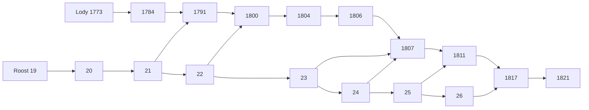

# Roost 与 Lody PR 栈联合审查

Status: proposed
Translation: current

[English](2026-10-22-roost-pr-stack-integration.md)

## 摘要

10 个开放 Roost PR 和 13 个开放 Lody PR 组成累积依赖栈。审查发现一处顺序合并文档冲突、Native 能力声明缺项和新工具链 Clippy 门槛；授权的非发布修复已处理这三项，保留运行时/正文契约及 benchmark 输入，并向后同步父分支修复。下文记录本地编译和补齐后的 Rust 套件覆盖。发布配对明确暂缓；当前 main 还升级了 Loro 依赖，原固定候选的结果不代表该新合成图已验收。

## 授权的非发布修复 — 2026-10-24

用户授权修复审查中的非发布问题，并明确暂不处理发布配对。解码器 Clippy 修复已放到
Roost #27，提交 `345cc5e3b49bdfb67b38906fd649d2a58e56976d`；Roost #28
合入父分支修复并补齐两个 owner 能力类型值，提交
`ae53cf64967d669ecdff6df32a6f34df7a74d687`。固定宽度迭代器保留非空、整除、
数量和字段检查；Native 实际广播能力、wire/正文格式、持久化及全部版本字段保持不变。

Rust 1.99.1 fmt/全目标 Clippy、SDK 类型检查/构建，以及既有 Native 可赋值编译契约/
格式检查通过。首次全量串行 Rust 测试有一项 rs3 HTTP `Transport(Unavailable)`
失败，日志保留。失败项单跑、所属完整 22 项套件、之前未执行的 target 及文档测试通过，
合计 379 项独立通过、6 项既有忽略；没有重跑已成功的无关套件。放置父/子提交后，
源码哈希与已验证输入一致，日志位于 `pr-stack-audit-20261024/fixes/`。

Lody #1839 将 #1830 合入自己的 head，保留唯一 guide 冲突中非空的报告链接。
添加本报告更新之前，完整解决树与修复前 #1839 逐字节一致。因此该处理修复祖先关系、
清除顺序合并冲突，没有改变运行时、测试或 benchmark 输入；#1845 继承修复后的父分支。
既有 Lody 全量运行时检查和测量保留原源码标识，本次文档/祖先关系修复仅运行根格式化及
文档检查，没有重启完整运行时测试或 benchmark。

发布版本、Rust/npm 发包、平台包依赖 pins、Lody catalog/lockfile、最新 main 依赖整合
及部署继续暂缓。下方审查表格是**修复前快照**，不代表声明/lint 和文档修复仍未完成；
registry 依赖图仍是明确的发布门槛。

## 修复前审查快照 — 2026-10-24

本次更新核对 10 个开放 Roost PR（#19–28）和 13 个开放 Lody PR（下列 #1773–1845）。
没有修改实现、PR 基线、就绪状态、合并、发包或部署状态。唯一跟踪文件修改是这份双语报告，
放在独立本地审查分支。结论来自定向源码/契约审查及合并检查，不是所有损坏或并发时序的正确性证明。

### 当前精确源码与合并结果

| 来源 | 固定提交 |
| --- | --- |
| Roost main | `1b6df6199ca2973efd6912f2e7611ba306e9aaa3` |
| Roost #28 栈顶 | `bb40f9eab9b539c5fe8ebecda61f9ee945a96a44` |
| Lody main | `c92f71fe5c4bcc0c93beb20cff4d4004a32dff41` |
| Lody #1845 栈顶 | `56d5514f923c69c4c9dac6790e5edb9b90057b41` |
| Lody #1839 整合基线 | `812bc3c21da3b3d160eccd6f2cbd05884962d4eb` |

Roost 为 main 独有 0 个提交、栈独有 19 个提交。每个前置 head 都是后一个 head 的祖先；
完整 main/栈顶合并及 #19–28 顺序合并模拟均通过。

Lody 为 main 独有 15 个提交、栈顶独有 29 个提交，共同祖先为 `957b513ee391`。
当前 main 和 #1845 可以自动合并。两边共同修改五个路径：`doc.ts`、`message-handler.ts`、
`session-execution-service.ts`、Roost backend contract 测试和 `create-workspace-runtime.ts`。
这些重叠的定向审查没有发现新增 P0/P1 语义冲突：main 的 Loro 持久化失败 observer 仍在 Loro
仓库内部；通知摘要通过原本完整的单条读取接口，读取准确的助手消息 ID。

存在 **一处真实的顺序合并冲突**：合入 #1830 后，#1839 会在
`.agents/docs/roost-validation.md` 冲突。#1839 的整合基线包含 #1821 和固定 main，
但不包含 #1830，因此 #1830 是并行的 benchmark/报告分支，不是 #1839 的 Git 祖先。
唯一冲突块在 #1830 一侧为空，另一侧是 #1839 新增的报告链接。在仅用于审查的虚拟树里保留
这些链接后，#1845 可以合并，最终完整树为 `bf03b998b142d0175abde1ed6ea708f040c84557`，
与当前 main + #1845 **逐文件完全相同**。因此 #1830 没有运行时、测试或报告内容遗落在
最终合成树之外。这说明内容关系，没有解决任何真实分支，也不能替代合成树上的测试。

### 当前依赖顺序

下列箭头表示落地顺序。Roost 全部箭头都是 Git 祖先关系；Lody 的 #1830 → #1839
还需要上述文档冲突处理，以及 retarget/rebase。

- Roost：#19 → #20 → #21 → #22 → #23 → #24 → #25 → #26 → #27 → #28。
- Lody：#1773 → #1784 → #1791 → #1800 → #1804 → #1806 → #1807 → #1811 → #1817 → #1821 → #1830 → #1839 → #1845。

| 后续 PR | 职责 / 跨仓前置依赖 |
| --- | --- |
| [Roost #27](https://github.com/loro-dev/roost/pull/27) | 共享不可变 frame 正文；接 #26；最终 container 10 / RSP3 |
| [Roost #28](https://github.com/loro-dev/roost/pull/28) | Native 收据检查和有界观察；接 #27；保持 container 10 |
| [Lody #1830](https://github.com/LodyAI/Lody/pull/1830) | #27 的 benchmark/报告，基于 #1821；没有运行时 API 改动 |
| [Lody #1839](https://github.com/LodyAI/Lody/pull/1839) | Native 提交/observer/head 及协议/缓存 v3；依赖 Roost #28 和整合基线 |
| [Lody #1845](https://github.com/LodyAI/Lody/pull/1845) | 位置映射及按需历史读取；接 #1839；不新增 Roost API |

较早的配套边界仍为 #1791 ↔ Roost #21、#1800 ↔ #22、#1807 ↔ #23/#24、
#1811 ↔ #25、#1817 ↔ #26。#1773/#1784 在各自 head 可以使用已发布的 0.2.0，
从 #1791 开始引入尚未发包的要求。

落地时保留祖先关系；如果父 PR 使用 squash/rebase，需 rebase 并重定向后续 PR，
不能假定旧 base 仍有效。#1839 的整合分支不是另一个 PR，也不是在栈顶之后另打一遍的优化；
重定向时保留其中的 main 合并及所属修改。本次没有自动关闭、合并 PR 或转为 ready。

### 后续替换与独立版本契约

重复修改属于累积改进，最终整合栈没有发现互斥的运行时实现。Roost #27 将 RSP2 正文副本
替换为 RSP3 引用，同时保留 #19 的有界 inline/expand、#20 的 Native outbox 策略、
#22 的 packed log，以及 #23–26 的缓存与 checkpoint 校验。#28 保留精确事务检查，
观察事件只负责唤醒，不能替代 journal 读取或 CAS。

实际 container 演进为 5（#19）、7（#20）、8（#21）、9（#22–26），最后到 10（#27–28）。
较早 v8/v9 断言描述中间 head，不是最终要求。最终运行时只接受新库/v10，没有迁移、旧读取器
或自动删除。整合完统一发一次最终版本，中间容器不必逐个对外发布。旧数据继续匹配旧运行时，
除非另有明确的数据处理决定。

最终 Lody owner 要求 `commit-metadata-v1`、`derived-indexes-v1`、`receipt-checks-v1`
和 `commit-observation-v1`。历史协议和渲染缓存为 3，agent 收据独立保持 2。
位置 checkpoint 2 认证可重建的本地派生状态，不是新的正文或 wire 格式。
跨协议 v3 边界时 CLI 和渲染端要配套上线；这些独立版本号不存在冲突。

### 明确的 CI 与发布阻塞

当前 CI 失败 **不能全部归因于 registry 版本**：

| 边界 | 证据及处理要求 |
| --- | --- |
| Roost #28 Native 声明 | [Linux job](https://github.com/loro-dev/roost/actions/runs/39926735363/job/120324862721) 和一个 Windows job 在 addon 构建后，源码内 `pnpm check` 报 TS2322。`NativeCapability` 包含 `receipt-checks-v1` 和 `commit-observation-v1`，但 [`OwnerCapability`](https://github.com/loro-dev/roost/blob/bb40f9eab9b539c5fe8ebecda61f9ee945a96a44/ts/node/client.d.mts#L4) 漏了这两个值。SDK 直接链接 `../../ts`，这是源码类型声明未同步，与 npm 是否发布无关。需同步能力契约，重跑 Native 类型及平台检查。 |
| Roost #27/#28 Rust | [#28 Rust 检查](https://github.com/loro-dev/roost/actions/runs/39926735298/job/120324860752) 及 #27 在 Rust 1.99.1 下执行 `cargo +stable clippy --offline --locked --all-targets -- -D warnings` 时，于 `src/projection/codec.rs:70` 被 `chunks_exact_to_as_chunks` 阻塞；前面的单元及文档测试通过。修正 lint 时需保留字节解码行为。 |
| Roost 发布准备 | [#27 发布预览](https://github.com/loro-dev/roost/actions/runs/39803040267/job/119915082257) 遇到已经发布的 `0.2.0` 版本冲突；源码 manifest 仍用该版本。需统一准备新的 SDK/Native/六平台版本；本次不发布任何包。 |
| Lody registry 配对 | [#1845 静态检查](https://github.com/LodyAI/Lody/actions/runs/40000297359/job/120574799546) 和 #1839 仍安装已发布 SDK/Native 0.2.0，缺少新 API/能力。#1839 使用旧配对时还有真实 generation fence 行为断言失败，不仅是编译错误。需发布后固定配套版本，更新 catalog/lockfile，再跑 registry CI，不能压掉类型或能力检查。 |
| 历史 Roost #23/#24 平台检查 | 抽查失败日志属于 pnpm 12.3.4 的 registry timeout / HTTP 503 获取失败，发生在运行时断言前，与当前 #28 的声明错误不同。 |

之前使用匹配本地包的 #1845 已通过完整 Lody 根检查，包括 CLI 4,559 项（跳过 4 项）、
组件 5,962 项、shared 1,610 项及桌面打包/测试，覆盖旧 registry 配对失败的 generation fence
用例。这不能使 Roost 独立的 Native 声明检查变绿，也不能证明已发布依赖图可用，
或消除上述两处 Roost 源码/工具链门槛。

### 剩余验收与下一步

当前 main 将 Loro 1.16.3 升到 1.17.0、LoroRepo 0.23.3 升到 0.25.0、
streams-crdt 0.19.1 升到 0.19.2。这些是上游改动，本次审查没有修改它们。
之前全仓检查和 benchmark 保留原固定源码的口径，没有验证今天合成后的依赖图或新的 Loro
对比。本次只读及合并审查没有重新启动全套测试或 benchmark。

落地前应清掉 Roost 类型声明/lint/版本门槛；按 Roost 链合入后从 main 统一发布一个最终版本；
更新 Lody pins 和 lockfile，重定向链时处理唯一文档冲突，然后在实际合成依赖图上运行所属行为
测试和必需的全量检查。需要报告当前 main 性能时，再对固定的新图重新 benchmark。
本次没有进行实现修复或修改 PR。

原始 GitHub 元数据、失败 CI 日志、精确 refs、祖先/merge-tree 结果和虚拟树证据保存在仓库外的
`shared-body-validation/pr-stack-audit-20261024/`。Roost HTTPS 重新 fetch 卡住后已取消；
GitHub API 的 head/main 与本地现有精确提交对象匹配。Lody 当前 refs 已拉取。
虚拟合并只创建临时 commit/index 对象，没有更新工作分支或远端 refs。
文档检查单独验证报告，不构成运行时验收。

## 以下为历史证据 — 原固定 2026-10-22 快照

后续章节保留早期源码、测量和之后的共享正文记录。当前 PR 清单、container 和落地阻塞以上文为准；
历史 benchmark 继续对应原输入，不能改称今天合成树的测量。

## 范围与源码标识

快照日期：2026-10-22。GitHub PR 元数据、完整 head/base SHA、检查链接及原始日志保存在仓库之外。此次审查没有修改原 PR 分支、发布包或部署状态。

- Roost main：`1b6df6199ca2973efd6912f2e7611ba306e9aaa3`。
- Roost 栈顶 [#26](https://github.com/loro-dev/roost/pull/26)：`d4b07d48d53036da824372d5531f41da1fce02d2`。
- Lody main：`957b513ee391c5b69101ae3d22ee353f1d6f4b20`。
- Lody 栈顶 [#1821](https://github.com/LodyAI/Lody/pull/1821)：`d494724c30e4389148b81762162436d0b6063450`。
- Lody 共同祖先：`a8cffe6f1be2a7b6983770afdebe5231b0a7ae10`。
- 独立克隆中的本地集成分支：`codex/roost-stack-integration`。测量的集成提交为 `812bc3c21da3b3d160eccd6f2cbd05884962d4eb`，源码树为 `8735cfc54c5317255f87ed6bbdc395521174fa4c`，另有已标识的 harness 测量补充。

此次审查覆盖依赖、联合行为及下文明确范围的本地测量，不构成重新逐行证明全部实现正确。既有 benchmark 的口径与缺失项目继续遵循[验证指南](../../../docs/roost-validation.md)及其关联报告。

## PR 清单及顺序

以下 PR 在快照时均开放。Roost #19 非草稿，其他 17 个为草稿。每一条链中，前一个 head 都是后一个 head 的祖先。跨仓库依赖指所需 API 或配套 SDK 优化。

| PR                                                     | 职责                               | 前置依赖             | Head           |
| ------------------------------------------------------ | ---------------------------------- | -------------------- | -------------- |
| Roost [#19](https://github.com/loro-dev/roost/pull/19) | 有界小子树内联，减少投影行         | main                 | `0f81d7b12960` |
| Roost [#20](https://github.com/loro-dev/roost/pull/20) | 去掉 Native 不使用的 outbox 副本   | #19                  | `60f6b160cfc0` |
| Roost [#21](https://github.com/loro-dev/roost/pull/21) | 紧凑事件与原子本地提交元数据       | #20                  | `4afe55a11d62` |
| Roost [#22](https://github.com/loro-dev/roost/pull/22) | 有界压缩日志块，最终容器 v9        | #21                  | `3068595c7b31` |
| Roost [#23](https://github.com/loro-dev/roost/pull/23) | 有界已封存正文缓存                 | #22                  | `c40524ae7a52` |
| Roost [#24](https://github.com/loro-dev/roost/pull/24) | 减少重复历史追赶往返               | #23                  | `f4cc6b837eb2` |
| Roost [#25](https://github.com/loro-dev/roost/pull/25) | 条件原子派生检查点                 | #24                  | `ff1a639f930c` |
| Roost [#26](https://github.com/loro-dev/roost/pull/26) | 复用私有检查点及分支目录证据       | #25                  | `d4b07d48d530` |
| Lody [#1773](https://github.com/LodyAI/Lody/pull/1773) | 紧凑 Agent 重放收据                | main                 | `ce653a2199e9` |
| Lody [#1784](https://github.com/LodyAI/Lody/pull/1784) | 紧凑渲染端变更收据                 | #1773                | `e920a7830d4e` |
| Lody [#1791](https://github.com/LodyAI/Lody/pull/1791) | 内容和渲染元数据原子提交           | #1784；Roost #21     | `061460cb7406` |
| Lody [#1800](https://github.com/LodyAI/Lody/pull/1800) | 压缩存储下的契约断言               | #1791；Roost #22     | `8e3375961a77` |
| Lody [#1804](https://github.com/LodyAI/Lody/pull/1804) | 复用未变 owner 投影                | #1800                | `2cfda8cfd2dd` |
| Lody [#1806](https://github.com/LodyAI/Lody/pull/1806) | 安装经证明的文本投影               | #1804                | `af7e50bf7442` |
| Lody [#1807](https://github.com/LodyAI/Lody/pull/1807) | 复用封存投影，减少封存后的整窗读取 | #1806；Roost #23/#24 | `bab14a8f424c` |
| Lody [#1811](https://github.com/LodyAI/Lody/pull/1811) | 合并内容、SDK 进度与暂存 goal 提交 | #1807；Roost #25     | `f06b820f3628` |
| Lody [#1817](https://github.com/LodyAI/Lody/pull/1817) | 语义变更贯穿私有投影               | #1811；Roost #26     | `435148029bff` |
| Lody [#1821](https://github.com/LodyAI/Lody/pull/1821) | 标量索引调度，避免读取完整历史     | #1817                | `d494724c30e4` |

Roost #15–#18、Lody #1735/#1737/#1765 已合并，无需再次应用。Lody [#1483](https://github.com/LodyAI/Lody/pull/1483) 只删除未使用的 `readGoalProjection` import：当前 main 已没有该 import，新栈则在行为测试中使用它。这条旧清理已过时，不应套入新栈。此次没有关闭 PR。

## 冲突判断

- Roost 有 14 个栈独有提交，没有 main 独有提交；栈顶已包含 main，8 个 PR 的相邻 head 祖先关系全部成立。
- Lody 有 24 个栈独有提交、27 个 main 独有提交；10 个 PR 的相邻 head 祖先关系全部成立。实际执行本地 `merge --no-commit --no-ff` 无需手动解决冲突。
- 双方同时修改的文件有三个：`AGENTS.md`、`session-execution-service.ts`、共享 `acp/history-apply.ts`。
- 合并保留 main 的 Node 安全版本下限；使用 Node 24.22.1 验证，没有绕过运行时检查。
- 会话执行同时保留 main 的原始用户文本标题、Inbox 准入/恢复和脱离 turn 等待的 Code Collab 刷新，也保留新栈无正文的待处理输入读取。
- main #1805 为根工具及标准化子工具统一有界存储投影。新栈不可变规划器调用同一个 `NotificationOnHistoryApplier`，因此必须保留新投影并正确追踪变更。现有子工具、存储策略和不可变规划测试共同覆盖这个交界。

首次文档检查还发现一处实际组合门禁冲突：根 `AGENTS.md` 在 main 为 8,137 字节，在栈顶为 8,185 字节，各自都未越界，但合并后达到 8,230，超过 8,192 字节上限。新增的根级 Roost 报告规则没有必要：现有验证指南已经承载所要求的报告规范。本地集成副本删除该新增规则，完整保留 main 的原始说明，包括 Node 安全版本下限，大小为 8,137 字节；没有新产品需求需要再增加一条根规则。这项纯文档处理没有写回现有 PR 分支。

Native 事务、SDK 检查点、Lody owner 投影及历史契约测试被后续 PR 多次修改，是有意依赖，不是需要二选一的独立补丁。Git 无文本冲突不能证明事务、证明条件、重试和恢复都正确。GitHub 的 MERGEABLE 只针对各 PR 声明的父分支，不代表整栈与 main 已验证。Lody #1800 是必须保留的测试适配，不是另一项运行时优化：Roost #22 压缩日志行后，旧测试直接扫描 SQLite 内部行已不能证明保留更新被完整覆盖。

## 当前 CI 与发布阻塞

Roost #26 的 Rust/SDK 检查及全部 6 平台 Native 构建测试通过。剩余的[发布准备任务](https://github.com/loro-dev/roost/actions/runs/39726241452/job/119653660877)失败，是 npm dry-run 拒绝复用已发布的 `0.2.0`。#23/#24 较早的平台失败属于不同原因：已下载的日志显示 npm/pnpm 下载超时或 HTTP 503，并非运行时断言失败。

Lody [#1821 静态检查](https://github.com/LodyAI/Lody/actions/runs/39758120547/job/119755205267)及[桌面 smoke 构建](https://github.com/LodyAI/Lody/actions/runs/39758120634/job/119755252945)缺失 `readCommitMetadata`、`annotateCommit`、`commitMetadataAfter`、`commitContentBatch`、`advanceActiveBranchDirectory` 及 Native 能力类型。锁文件仍安装已发布的 0.2.0；从 #1791 起存在这个发布依赖，#1773/#1784 自身 head 没有出现同类失败。源码链接仅是本地测试设置，不能代替可安装的发布包或修复 CI。

最终组合 Rust 存储只接受全新数据库或容器 v9，npm 0.2.0 使用 v4。没有迁移、自动删除和旧格式 reader；旧数据必须保留匹配的旧运行时。此前同意实验数据可以重建，并不授权删除任何在线数据库。复制使用的 wire v1 与本地容器变化分开判断。

## 联合验证

已在 Node 24.22.1、pnpm 10.20.0 下完成最新 main 合并依赖的 frozen 安装。仅替换本克隆的 CLI Roost 依赖链接，共享包解析到合并克隆内部。初次运行时检查使用构建的 SDK/Native 源码包，最终 Native 接入检查使用安装后的候选 tarball。Native 和 SDK 从固定 Roost 栈顶重新构建；addon SHA-256 为 `524c5497695dc4e2502d60aa0b6419d0cc6cf35bb30cccb8b7b5cc8df52b3ced`，完整构建输入清单保存在仓库之外。

| 检查                                   | 已完成的组合源码结果                                   |
| -------------------------------------- | ------------------------------------------------------ |
| SDK 类型检查及构建                     | 通过                                                   |
| Native 存储/恢复、同步及发布 fixture   | 59 项通过，零跳过                                      |
| SDK Chromium、WebKit、进程 host        | 164 项通过，零跳过                                     |
| CLI / shared / components 全量测试     | 4,543 项通过、4 项跳过 / 1,610 项通过 / 5,961 项通过   |
| 候选拆分包下的 Electron 单元及打包测试 | 226 + 40 项通过，零跳过                                |
| 候选拆分包下的 8 个 CLI 归属文件       | 227 项通过，零跳过                                     |
| 根静态及边界检查                       | 类型、lint、Effect，以及 test 后所有 i18n/边界检查通过 |
| Native 候选打包                        | 6 平台产物校验、本机安装、SQLite 重开及加密同步通过    |
| 格式及文档检查                         | 通过；文档零错误、71 项既有警告，零受保护主题          |

初次 Native 测试误用缺少构建来源证明的旧相邻 addon，协议检查失败；已排除该次运行并保留日志。重建后，先通过真实 SDK 写入/重开探针再执行完整测试。直接运行发布单元文件也缺失 npm fixture 环境，以表格中的完整 `npm test` 为有效结果。Kimi/Pi 源码子模块未初始化还导致链接检查失败，补齐精确指针后消除；没有安装或消费它们的运行时。这些是环境准备修正，不作产品回归判断；验证指南已补充二进制来源及 npm fixture 的要求。

最初的完整 `pnpm check` 返回失败，是因为 3 项 Electron 打包 fixture 需要已安装的 host 平台包，源码链接不包含该布局；此次没有因此修改运行时实现。从 [Roost #26 CI](https://github.com/loro-dev/roost/actions/runs/39726241452) 下载了 6 个真实平台产物，使用既有发布脚本组装。其 PR merge 提交 `6ef36e4cc242ad5fe4f5da06202feea93eba7dd3` 与 Roost 栈顶的源码树完全一致，均为 `6e395f1d8f8d9ccdf2f2cd86b639cf2c728b4a1f`。私有离线安装仅选中 main 和 darwin-arm64；其 addon SHA-256 为 `cd399a4a7ad7d3483c222cae048ff46473dcc708ae9ced4df21bb7c27418e324`。替换本克隆的 Native 链接后，完整 Electron 测试和 8 个 CLI 归属文件通过；根脚本在 test 之后的每项检查均另行执行并通过，已成功的无关测试没有重复。原始根检查失败日志完整保留，没有标成命令整体成功。其他根测试跳过为 RPC 3 项、platform 1 项。桌面应用 E2E/构建及 registry 版本安装仍属于发布阶段门禁。

初次合并审查只做行为检查；后续本地性能对比使用下述固定基线和完整候选，先前报告不升级为完整恢复或网络结果。平台 CI 和本次源码链接测试不能替代发布后干净 registry 安装的接入验证。

## 本地 benchmark：固定配对与范围

本轮在 Apple M4、32 GiB、10 核的同一台本机，以 Node 24.22.1、1536 MiB JS 堆及 2 GiB 被测进程 RSS 预算顺序执行。基线是 Lody main `957b513ee` 与 npm 已发布的 Roost 0.2.0；候选是本地集成 `812bc3c21`、Roost SDK `d4b07d48d530` 和同源码树的完整 Native 候选包。Loro 参考使用候选的共享语义及相同业务输入。基线和候选 Native 的 SHA-256 分别是 `76654274189f57e25dc3f40cf300b58ab3dd0c80f391706e60c71d5b3c936e03`、`cd399a4a7ad7d3483c222cae048ff46473dcc708ae9ced4df21bb7c27418e324`；候选包版本字段仍为 0.2.0，不能依赖版本字段区分实现。

沿用既有 durable/dispatch harness，仅增加角色分开的创建时间、混合通知类别、恢复后首段追加、64/256/1024 KiB 附近内存采样，以及 WAL/SHM 记录。相同 harness 字节同时用于两个独立克隆，没有修改产品运行时。源码、模块及二进制哈希在每个阶段前后校验。

| 工作负载       | 规模及阶段                                                                             |
| -------------- | -------------------------------------------------------------------------------------- |
| 短会话         | 2 条消息，224 × 256 B 追加，16 KiB 工具正文                                            |
| 真实流式长历史 | 500 轮 / 1,000 条消息，10,000 × 256 B 追加，每条 assistant 保留 16 KiB 工具正文        |
| 单条回复增长   | 1 轮，1,024 × 1 KiB 追加，16 KiB 工具正文                                              |
| 混合/恢复      | 10 轮，100 × 1 KiB/回复，含 thinking、Unicode、工具/plan 批次及中途 finish/open        |
| 固定前缀调度   | 100 / 1,000 / 10,000 条已完成消息，另加活跃 user/assistant，测试首选、热选、追加和分页 |

每项使用 baseline-1 → candidate-1 → Loro-1 → Loro-2 → candidate-2 → baseline-2 顺序，两次/组；每次写入、重开和分页均独立进程。调度数据按实现分别准备，因为本地容器 v4/v9 不兼容，再复制各自的已关闭种子执行测量和新进程校验。两边均为 SQLite WAL/FULL，每次 action 后显式持久化控制文档。真实流式长历史保留每个已声明更新；固定前缀调度则批量导入最终消息，二者不混作同一恢复数据。

结果校验包括完整预期正文、收据重试、新进程完整 digest、跨实现业务 digest、完整唯一分页及外部 SQLite quick_check。CPU 和内存属于被测 Node 进程，包含 Native Worker，排除 pnpm/Vitest 父 launcher；没有测 Roost 独占内存、网络/Stream offset、ACP 恢复或渲染首屏。数据库逻辑页、WAL/SHM 文件和 JS/RSS 分开报告，n=0 表示未测。独立 tool/plan 耗时未拆开，混合批次不可解释为单项成本。

### 完成情况与排除项

24 轮持久化用例均完成写入、新进程重开和分页。两组 Roost 在三个 dispatch 历史规模下均完成两轮。计划要求成功的 126 个阶段中完成 124 个，不能标为全部通过。Loro 的 10,000 条历史第二轮从全新已关闭的种子副本重试后，仍两次超过相同的 2 GiB RSS 上限。第一次在关闭阶段报错；重试在选择索引 8（第 9 次选择）记录到 2,048.1 MiB，尚未开始追加。失败轮的部分输出不纳入汇总，也没有新进程验证。因此 Loro 的 10,000 条历史只有 n=1，其他测量组为 n=2，没有提高资源上限。

124 个成功阶段保留的写入/重开摘要、跨实现业务摘要均一致；89 个数据库路径共 208 次关闭后 SQLite 检查均通过。这是这些夹具的行为证据，不是对所有损坏、并发及崩溃时序的证明。两次失败与成功记录一起保留。阶段台账、原始 JSON/日志、模块路径、源码/工具/二进制 hash 和 SQLite 布局证据保存在仓库外。实际执行的 durable harness hash 为 `987e9c6200ed07ca391a3d594c7c63007441c0efd218a5a66fd4f328a23dafe5`，dispatch 为 `b01c6575ef31261ec5c2cca8ad4e850b2af5f805ecff90f04d19e68458ecd9a6`。这层测量补充没有修改产品运行时代码。

### 持久化追加与其他写操作

耗时包含 backend 确认和显式控制文档持久化。下表每格为 p50 / p95 / 最大值，单位 ms：前两项取两轮各自分位数的中位数，最大值取两轮中实际最大的观测值。每轮通知批次数按用例顺序为 224 / 10,000 / 1,024 / 1,000。两次重复不足以证明总体尾延迟或统计显著性。

| 用例             | 基线                   | 候选                 | Loro                 |
| ---------------- | ---------------------- | -------------------- | -------------------- |
| 两条消息         | 4.93 / 7.58 / 20.04    | 2.89 / 3.95 / 17.08  | 0.35 / 3.15 / 25.37  |
| 1,000 条流式消息 | 5.48 / 17.22 / 339.43  | 1.03 / 2.92 / 83.87  | 0.20 / 2.88 / 232.44 |
| 单条 1 MiB 回复  | 28.77 / 44.61 / 177.32 | 2.13 / 4.06 / 115.90 | 1.84 / 3.64 / 31.96  |
| 混合/续写        | 15.05 / 22.72 / 150.86 | 2.18 / 3.53 / 16.12  | 0.37 / 1.18 / 8.14   |

候选的流式历史追加 p95 为 1.84–3.99 ms，和 Loro 的 2.69–3.07 ms 重叠，不能据此宣称该操作已快于 Loro。相比基线，候选改善了写入随规模增长的成本；混合批次仍比 Loro 贵。

下表每格为创建用户消息 / 创建助手消息 / finish，同样取各轮 p95 的中位数。短对话与单条长回复中，每种操作每轮只有一次；流式历史每轮 500 次，混合用例每轮 10 次。n=1 的值只是单次操作耗时，不是稳定的尾延迟，逐次值保存在原始 JSON 中。

| 用例             | 基线                    | 候选                 | Loro                |
| ---------------- | ----------------------- | -------------------- | ------------------- |
| 两条消息         | 27.88 / 26.95 / 6.09    | 38.22 / 28.04 / 7.62 | 22.43 / 2.24 / 3.49 |
| 1,000 条流式消息 | 194.78 / 380.80 / 17.69 | 11.10 / 17.26 / 5.01 | 1.64 / 3.16 / 0.87  |
| 单条 1 MiB 回复  | 45.41 / 44.95 / 77.62   | 34.64 / 25.81 / 9.92 | 15.94 / 2.22 / 1.86 |
| 混合/续写        | 109.65 / 215.55 / 27.35 | 28.01 / 21.46 / 9.46 | 17.50 / 1.70 / 1.03 |

混合通知分类如下，n 是每轮批次数，并非两轮合计。分类依据该次完整通知列表；和工具/plan 同批的 markup 归入组合批次。未单独隔离工具和 plan 各自的成本。

| Backend | Batch             | n/trial | p50 ms | p95 ms | max ms |
| ------- | ----------------- | ------- | ------ | ------ | ------ |
| 基线    | text              | 890     | 14.98  | 22.27  | 150.86 |
| 基线    | textMarkup        | 10      | 14.98  | 19.87  | 28.53  |
| 基线    | textToolPlanBatch | 100     | 15.68  | 24.09  | 65.55  |
| 候选    | text              | 890     | 2.13   | 3.02   | 16.01  |
| 候选    | textMarkup        | 10      | 6.74   | 9.62   | 11.68  |
| 候选    | textToolPlanBatch | 100     | 3.14   | 5.00   | 16.12  |
| Loro    | text              | 890     | 0.35   | 1.06   | 8.14   |
| Loro    | textMarkup        | 10      | 1.03   | 3.27   | 3.77   |
| Loro    | textToolPlanBatch | 100     | 0.73   | 1.60   | 7.94   |

混合用例的 resume 包含同一助手条目的 finish + reopen 和两次持久化屏障，不是 ACP 会话恢复。以下两列每轮各有 10 次观测。

| Backend | Finish + entry reopen p95 ms | First resumed append p95 ms |
| ------- | ---------------------------- | --------------------------- |
| 基线    | 83.99                        | 24.51                       |
| 候选    | 34.14                        | 7.45                        |
| Loro    | 1.32                         | 1.29                        |

### CPU、内存与存储

CPU 每格为通知追加 CPU / 整个写阶段 CPU，单位秒。前者包含通知批次及其持久化，后者还包含消息创建、增量读取、诊断窗口和全量校验。CPU 是测量进程 user+system 总时间，包含 Native Worker，不是墙钟延迟或整机 CPU 占用率。

| Workload         | 基线           | 候选          | Loro          |
| ---------------- | -------------- | ------------- | ------------- |
| 两条消息         | 1.40 / 1.81    | 0.89 / 1.40   | 0.16 / 0.29   |
| 1,000 条流式消息 | 82.39 / 277.65 | 14.98 / 39.55 | 12.22 / 15.54 |
| 单条 1 MiB 回复  | 30.73 / 33.44  | 2.78 / 4.07   | 2.55 / 2.70   |
| 混合/续写        | 15.86 / 20.79  | 2.89 / 4.95   | 0.87 / 1.12   |

下表 RSS 单位 MiB，按阶段取两轮中位数。全量校验前不含最后的全量导出，但包含此前诊断窗口和正确性读取；峰值是校验前各采样点的最大值，不是持续 OS 监控。原始轨迹的 heap/external/ArrayBuffer 只描述当前 JS isolate，RSS 覆盖整个进程，两者不能直接相加，也不能视为 Roost 独占内存。未强制 GC，关闭后 RSS 和高水位增长不能直接证明泄漏。

| Workload         | Backend | Opened MiB | Pre-validation MiB | Growth MiB | Sampled peak before validation MiB | After full export MiB | After close MiB |
| ---------------- | ------- | ---------- | ------------------ | ---------- | ---------------------------------- | --------------------- | --------------- |
| 两条消息         | 基线    | 335.2      | 417.6              | 82.3       | 417.6                              | 417.6                 | 415.3           |
| 两条消息         | 候选    | 325.8      | 388.4              | 62.6       | 388.4                              | 388.4                 | 385.7           |
| 两条消息         | Loro    | 314.2      | 351.4              | 37.2       | 351.4                              | 351.4                 | 352.1           |
| 1,000 条流式消息 | 基线    | 331.0      | 481.3              | 150.3      | 530.4                              | 485.4                 | 598.8           |
| 1,000 条流式消息 | 候选    | 325.7      | 550.6              | 224.9      | 550.6                              | 568.2                 | 658.6           |
| 1,000 条流式消息 | Loro    | 302.0      | 583.6              | 281.5      | 588.3                              | 583.6                 | 682.6           |
| 单条 1 MiB 回复  | 基线    | 319.0      | 513.5              | 194.6      | 635.2                              | 534.0                 | 542.4           |
| 单条 1 MiB 回复  | 候选    | 321.9      | 476.9              | 154.9      | 476.9                              | 494.4                 | 474.7           |
| 单条 1 MiB 回复  | Loro    | 301.5      | 483.4              | 181.9      | 639.9                              | 484.4                 | 497.4           |
| 混合/续写        | 基线    | 319.2      | 558.6              | 239.4      | 599.0                              | 563.2                 | 551.9           |
| 混合/续写        | 候选    | 326.3      | 510.3              | 184.0      | 521.8                              | 522.9                 | 523.2           |
| 混合/续写        | Loro    | 302.8      | 492.5              | 189.7      | 492.5                              | 494.9                 | 520.4           |

流式历史候选的全量校验前 RSS 为 548.1–553.2 MiB，基线为 467.7–495.0 MiB。写入更快，但这一阶段的内存反而增加。运行时长和 GC 行为可能参与其中，本实验未定位到保留对象的归属，因此不能宣称整组改动降低了内存。

存储每格为相对空库的逻辑数据库增长 MiB / 当前 WAL 文件 MiB / SHM KiB。采样点是写阶段完成校验后、句柄仍打开时，不是峰值分配或关闭后的文件大小。Roost 合计正文库与控制库。WAL 单列为磁盘占用的一部分，不能当作多保存了一份对话内容。

| Workload         | 基线            | 候选            | Loro            |
| ---------------- | --------------- | --------------- | --------------- |
| 两条消息         | 0.8 / 7.1 / 64  | 0.5 / 7.1 / 64  | 0.1 / 3.2 / 32  |
| 1,000 条流式消息 | 96.6 / 8.1 / 64 | 68.2 / 8.0 / 64 | 13.4 / 4.0 / 32 |
| 单条 1 MiB 回复  | 14.8 / 8.0 / 64 | 6.3 / 7.9 / 64  | 1.4 / 3.9 / 32  |
| 混合/续写        | 18.0 / 8.1 / 64 | 8.3 / 7.9 / 64  | 1.9 / 3.9 / 32  |

短对话精确增量为：基线 796 KiB，候选 556–560 KiB（中位数 558），Loro 128 KiB。相比基线减少 29.9%，仍是 Loro 的 4.36 倍；这不等于线上机器内存或 Stream bytes 同比例减少。本夹具打开状态的 WAL 文件，两组 Roost 均约 7.1 MiB，Loro 约 3.2 MiB。

全部短对话阶段结束后的只读布局检查找到一个明确的剩余放大点：候选 `history.db` 为 504 KiB，72 条 projection 记录占用 72 个 overflow 页，分配 288 KiB，仅存 40.36 KiB payload，其中空置 247.36 KiB。`roost_kv` 使用 WITHOUT ROWID 和 4 KiB 页；这个布局的索引 B-tree payload 阈值为 1,002 字节，稍大的记录会溢出，与 [SQLite 文件格式](https://www.sqlite.org/fileformat.html#b_tree_pages)一致。基线原先也有这 72 处 projection 溢出，因此减少 payload/日志副本后仍留下这层分配成本。这是下一次独立存储实验的依据，尚不能保证所有空置字节都能在正确性和延迟不变的条件下回收；本轮没有修改布局。

### 单条回复增长与新进程读取

单条回复达到 64/256/1,024 KiB 时，每格为最后 64 次追加的 p95 ms / 诊断窗口前 RSS MiB。全部 1,024 个片段都逐次持久化，实际验证了同一条回复增长的情况。

| Reply KiB | 基线          | 候选         | Loro         |
| --------- | ------------- | ------------ | ------------ |
| 64        | 17.29 / 380.9 | 5.26 / 371.7 | 1.19 / 327.7 |
| 256       | 25.05 / 477.0 | 3.96 / 398.0 | 2.50 / 429.3 |
| 1024      | 48.40 / 569.7 | 2.89 / 440.6 | 5.09 / 468.4 |

新进程重开和分页如下。各值为两次阶段观测的中位数（分页 p95 为每轮 page p95）。最新/最旧窗口最多 20 条，完整导出位于这两次读取之后。Loro 在 backend open 阶段导入完整文档，Roost 延后加载正文，所以单独的 full export 调用不等于完整恢复。阶段计时始于已加载的测试模块内部，不含模块导入、ACP、传输和可见 UI；换进程也不代表 OS 文件缓存是冷的。

| Workload         | Backend | Backend open ms | Stage start → latest ms | Latest 20 ms | Oldest 20 ms | Full export ms | Paging p95 ms | Paging total ms |
| ---------------- | ------- | --------------- | ----------------------- | ------------ | ------------ | -------------- | ------------- | --------------- |
| 两条消息         | 基线    | 86.16           | 114.62                  | 1.06         | 3.69         | 8.09           | 12.61         | 12.61           |
| 两条消息         | 候选    | 89.40           | 118.98                  | 1.52         | 0.42         | 10.51          | 6.50          | 6.50            |
| 两条消息         | Loro    | 27.18           | 49.09                   | 1.90         | 0.14         | 0.36           | 3.47          | 3.47            |
| 1,000 条流式消息 | 基线    | 362.09          | 377.16                  | 2.54         | 2,220.25     | 1,549.90       | 52.88         | 2,407.34        |
| 1,000 条流式消息 | 候选    | 247.74          | 266.20                  | 2.86         | 846.72       | 779.95         | 31.41         | 982.16          |
| 1,000 条流式消息 | Loro    | 530.56          | 563.82                  | 5.67         | 0.67         | 12.62          | 12.91         | 154.34          |
| 单条 1 MiB 回复  | 基线    | 212.39          | 237.72                  | 2.93         | 1.42         | 48.54          | 48.53         | 48.53           |
| 单条 1 MiB 回复  | 候选    | 116.40          | 136.45                  | 1.20         | 0.62         | 26.09          | 3.58          | 3.58            |
| 单条 1 MiB 回复  | Loro    | 50.02           | 69.45                   | 1.68         | 0.21         | 0.25           | 4.27          | 4.27            |
| 混合/续写        | 基线    | 210.16          | 230.68                  | 3.20         | 2.26         | 59.93          | 68.33         | 68.33           |
| 混合/续写        | 候选    | 180.58          | 205.38                  | 4.10         | 2.57         | 50.13          | 13.22         | 13.22           |
| 混合/续写        | Loro    | 71.81           | 97.43                   | 4.76         | 1.53         | 1.37           | 6.13          | 6.13            |

### 固定历史规模的 dispatch

前缀由已完成消息批量导入，不保留完整流式编辑历史。候选在复制种子前建立持久化派生索引，这项准备单独计时（每个种子 n=1）：

| Prefix | Backend | Import ms | Initial index preparation ms |
| ------ | ------- | --------- | ---------------------------- |
| 100    | 基线    | 888.05    | N/A                          |
| 100    | 候选    | 631.47    | 58.97                        |
| 100    | Loro    | 64.82     | 1.25                         |
| 1000   | 基线    | 7,174.59  | N/A                          |
| 1000   | 候选    | 5,498.11  | 776.05                       |
| 1000   | Loro    | 342.84    | 10.58                        |
| 10000  | 基线    | 78,224.86 | N/A                          |
| 10000  | 候选    | 56,792.27 | 8,568.63                     |
| 10000  | Loro    | 4,791.73  | 58.23                        |

因此，10,000 条历史候选首次选择的 2.53–2.68 ms，前提是已经付过 8,568.63 ms 的首次索引准备成本，不能解释为首次重建索引只需 2.6 ms。准备过程也占内存，候选种子进程 RSS 达到 863.8 MiB；它和正式选择测量是不同进程。

open 与首次选择显示完整轮次的最小–最大值；warm 两列取每轮 12 次选择各自 p50/p95 的中位数。RSS 为最新窗口 → 第 13 次选择，位于追加与全量物化之前。Loro 的 10,000 条历史只有一轮完整结果，不混入失败的第二轮。

| Prefix messages | Backend | Complete trials | Backend open min–max ms | First selection min–max ms | Warm p50 / p95 ms | RSS latest → after 13 selections MiB |
| --------------- | ------- | --------------- | ----------------------- | -------------------------- | ----------------- | ------------------------------------ |
| 100             | 基线    | 2               | 107.30–107.34           | 111.89–112.50              | 0.63 / 0.72       | 358.2 → 371.7                        |
| 100             | 候选    | 2               | 91.62–91.64             | 2.32–2.52                  | 0.38 / 0.53       | 362.9 → 363.4                        |
| 100             | Loro    | 2               | 28.86–29.23             | 2.23–2.29                  | 0.73 / 0.92       | 329.8 → 337.3                        |
| 1000            | 基线    | 2               | 240.91–385.37           | 2,059.31–3,057.73          | 11.24 / 20.24     | 362.8 → 488.2                        |
| 1000            | 候选    | 2               | 174.34–186.27           | 4.97–6.48                  | 1.05 / 1.93       | 367.3 → 367.8                        |
| 1000            | Loro    | 2               | 272.10–272.15           | 18.35–36.12                | 6.70 / 19.24      | 493.1 → 515.7                        |
| 10000           | 基线    | 2               | 262.18–300.99           | 10,987.04–11,995.82        | 97.63 / 125.08    | 408.3 → 1,470.4                      |
| 10000           | 候选    | 2               | 178.74–194.34           | 2.53–2.68                  | 0.40 / 0.57       | 415.3 → 415.6                        |
| 10000           | Loro    | 1               | 1,817.75–1,817.75       | 80.34–80.34                | 52.11 / 66.36     | 1,379.6 → 1,575.0                    |

有界 dispatch 索引体现出结构优势：10,000 条历史下，候选 warm 选择约 0.40 ms，RSS 保持在约 415 MiB；基线首次需要选择完整 transcript，重复选择期间从约 408 增至 1,470 MiB。Loro 成功的一轮 warm 中位数为 52.11 ms，RSS 从约 1,380 增至 1,575 MiB。收益属于本地打开后的历史/队列选择，不代表完整会话恢复或端到端回复耗时。

各规模的其余写入/读取如下。追加显示 p50 / p95，其余每格是每个完整轮次各一次观测的中位数，不是尾延迟。这里的 entry reopen 不包含前面单独计时的 finish，和混合用例 resume 的范围不同。

| Prefix | Backend | Append p50 / p95 ms | Finish ms | Entry reopen ms | First resumed append ms | User create ms | Assistant create ms | Adjacent page ms | Old turn ms | Full export ms |
| ------ | ------- | ------------------- | --------- | --------------- | ----------------------- | -------------- | ------------------- | ---------------- | ----------- | -------------- |
| 100    | 基线    | 5.24 / 18.68        | 5.59      | 12.84           | 6.38                    | 53.56          | 105.16              | 89.54            | 113.65      | 95.96          |
| 100    | 候选    | 1.56 / 14.81        | 6.34      | 8.68            | 1.83                    | 7.19           | 9.47                | 36.83            | 0.56        | 78.26          |
| 100    | Loro    | 0.30 / 11.38        | 0.75      | 0.30            | 0.84                    | 1.63           | 1.36                | 0.58             | 0.02        | 0.95           |
| 1000   | 基线    | 17.89 / 57.39       | 15.96     | 33.75           | 19.43                   | 156.20         | 281.49              | 306.36           | 3,319.30    | 2,316.19       |
| 1000   | 候选    | 5.32 / 51.62        | 15.05     | 28.44           | 4.52                    | 25.31          | 28.69               | 95.69            | 2.74        | 1,854.62       |
| 1000   | Loro    | 0.36 / 46.01        | 0.90      | 0.36            | 4.80                    | 1.88           | 1.55                | 1.78             | 0.04        | 10.10          |
| 10000  | 基线    | 6.88 / 95.01        | 7.05      | 12.96           | 8.14                    | 62.00          | 120.03              | 102.29           | 14,398.54   | 13,873.71      |
| 10000  | 候选    | 2.46 / 77.81        | 4.13      | 10.86           | 5.68                    | 8.28           | 11.11               | 39.94            | 0.64        | 8,108.71       |
| 10000  | Loro    | 0.31 / 56.64        | 0.68      | 0.34            | 40.45                   | 1.76           | 1.37                | 11.10            | 0.04        | 130.17         |

候选 10,000 条历史的完整导出仍需 7.91–8.31 秒；Loro 成功轮在已全量导入后，该调用为 130.17 ms。全量导出不在有界选择路径内，不能因读取单次耗时而恢复成完整历史选择。

### 结论与剩余验证

完整候选通过了关联行为测试，完成的测量夹具内容校验也一致。本轮支持“增长写入成本大幅下降、已建索引的 dispatch 明显加速”，同时仍存在约 4–5 倍的逻辑存储差距、相对基线的流式历史 RSS 回升、较慢的全量物化，以及 Loro 一轮资源受限失败。这些问题都保留在报告中。

本轮未完成网络延迟/Stream offset、全新副本完整恢复、ACP replay、页面绘制或长期保留内存归因。发包及 registry consumer 验证仍是落地门槛，源码/本地包测试不能替代未来发布包的检查。本轮数据本身不构成继续改运行时、清理线上数据、发包或部署的授权。

## 后续研究：热值布局

后续隔离研究保持集成源码/SDK/Native 不变，分别预建原 KV schema 和普通 rowid
schema。16 轮配对均完成写入/重开/分页；加上 setup 共 50 个阶段、100 次外部
SQLite 检查通过，完整内容、重试和跨布局/Loro 业务摘要一致。这不是默认建表或产品
实现改动。

正文库+控制库增量：短用例 560 → 336 KiB，流式历史 68.13 → 38.29 MiB，
单条 1 MiB 回复 6.28 → 3.06 MiB，混合/续写 8.28 → 4.63 MiB。RSS 没有明确
改善。历史追加 p95 为 4.47 → 7.54 ms，追加 CPU 20.60 → 24.43 秒；单条长回复
也有 CPU/p95 更差的观测。本机其他任务占满数个核心（10 核采样 load 约 20），
所以不能据此证明性能不变，该原型没有通过速度验收。

数据库增长仍约为此前 Loro 对照的 2.2–2.9 倍。Roost 归属提案
`2026-10-22-hot-kv-sqlite-layout` 记录完整资源表、逐字节保留的布局备选和剩余
日志/投影 payload 重复。若剩余体积不可接受，共享有界正文表示需要先讨论设计、
再做原型；行布局兼容不等于这种大改也正确或更快。本后续研究未改原 PR 或运行时代码。

## 建议落地流程

1. 保留各 PR 的审查边界，先联合测试完整栈顶与最新 main。不要向栈顶重复 cherry-pick 每个 PR，也不需要把中间容器版本投入生产。
2. 解决实际联合失败后再改变草稿/审查状态；任一 main 或栈顶变化都重新确认源码标识。
3. Roost 按依赖从底向上合并，统一准备一版匹配的 core/SDK/Native，要求 6 平台打包及发布检查通过。后续 PR 当前指向父分支，父项落地后应改为指向 main。两个仓库都允许 merge commit、squash、rebase，且不会自动删除已合并分支；保留祖先关系的 merge commit 能保持后续 diff 简单，使用 squash 则需要重新整理后续栈，不能只修改 base 名称。发布需要负责人明确授权。
4. 在最早使用新 API 的 Lody #1791 同时更新精确 SDK/Native 版本、catalog 放行项及 lockfile，并把该版本与 #1800 的压缩存储断言传播到后续栈；只更新 #1821 会让前面的接入 PR 继续安装 0.2.0 而 CI 失败。用 registry 包重新 frozen 安装，执行静态检查、CLI/桌面构建和关联集成测试，不依赖源码链接。
5. Lody 从底向上合并，或审查后另行决定整合 PR；然后通过正常 CI 更新私有 staging 的 OSS 指针。staging 部署和调试 CLI 替换仍是另外的授权步骤。

保留原栈便于逐项审查、定位回归；压成两个大 PR 可以减少落地队列，但会增大存储/事务与接入改动的单次审查范围。压 PR 是可选管理动作，完整联合测试不依赖它。

## 共享正文后续验收，2026-10-22

用户授权 Roost 完整共享不可变正文重构，隔离于本文固定候选。`codex/shared-body-storage` 从 Roost `d4b07d48d53036da824372d5531f41da1fce02d2` 开始；Lody 运行时代码没有变化。所属笔记是 Roost 的 `.agents/notes/proposed/architecture/2026-10-22-hot-kv-sqlite-layout.md`。新私有门禁为 10/RSP3，不保留旧读写兼容或迁移。上文原始 PR 整合和对照数据保留。

| 负载             | DB 增量 KiB 旧→新 | Loro KiB | 追加 p95 ms 旧→新 | RSS MiB（增长）旧→新            | 追加 CPU s 旧→新 |
| ---------------- | ----------------- | -------- | ----------------- | ------------------------------- | ---------------- |
| 两条消息         | 560 → 240         | 128      | 2.35 → 1.58       | 389.0 (+61.7) → 388.3 (+60.5)   | 0.406 → 0.319    |
| 1,000 条流式消息 | 69,814 → 24,212   | 13,720   | 1.50 → 1.26       | 544.6 (+217.7) → 539.7 (+212.0) | 10.340 → 9.497   |
| 单条 1 MiB 回复  | 6,436 → 1,812     | 1,448    | 1.45 → 1.45       | 480.9 (+154.1) → 467.0 (+139.6) | 1.283 → 1.170    |
| 混合/续写        | 8,472 → 3,286     | 1,904    | 1.95 → 1.86       | 517.1 (+189.7) → 514.9 (+187.7) | 1.479 → 1.432    |

以上为相同 harness、每组两轮本地中位数。DB 合计 history+control，排除 WAL/SHM；RSS 包含整个测试进程，在最后全量验证前采样，增长相对 backend open。1,000 条首个冷追加补至每组六轮：24.13→27.39 ms；用户明确接受约 3.3 ms 的差异。10,000 条已准备索引的首次选择仍约 2.5 ms，13 次选择的 RSS 增长约 0.34 MiB；全量物化为 8.66→7.81 秒，仍是另一项操作。

本地验收已完成：118 个 benchmark 阶段、212 次 SQLite 检查通过，Native 37/37、
Lody 六个文件 133 项通过，最终完整串行 Rust 检查为 377 项通过/6 项既有忽略。
fmt/clippy/docs 通过。之前的本地 HTTP IncompleteMessage 在未改基线也复现
（3/20，新版 1/20）；失败日志保留，没有修改生产传输行为。Native 构建输入哈希
匹配，CLI 原依赖链接已恢复。

用户随后要求两边提交草稿 PR。Roost 运行时改动以 #26 为基线；Lody 的
benchmark/报告以 #1821 为基线，不更改运行时 API 或依赖版本。上文测量过的集成
源码及其固定 main 合并均保留。后续 PR 仅包含 benchmark 观测、归属指南及报告，
不把无关 main 提交混入依赖链。尚未发包、合并或部署。

提交前在保留的集成 checkout 上检查：使用固定且匹配的候选包链接，根目录
`pnpm check` 完整通过，包含所有测试后边界门禁；根目录 `pnpm format` 通过，
没有留下无关已跟踪文件改动。指南、中英报告和 benchmark 的局部格式检查通过。
`pnpm run docs check` 为零错误、71 项既有提醒、零受保护主题。这些本地检查
不替代后续 registry 发包验证。

草稿审查链接：[Roost #27](https://github.com/loro-dev/roost/pull/27) 在 #26 之后
提交共享正文运行时改动；[Lody #1830](https://github.com/LodyAI/Lody/pull/1830)
在 #1821 之后提交本 benchmark/报告。原有依赖链分支未改，两份 PR 均未合并或发包。
