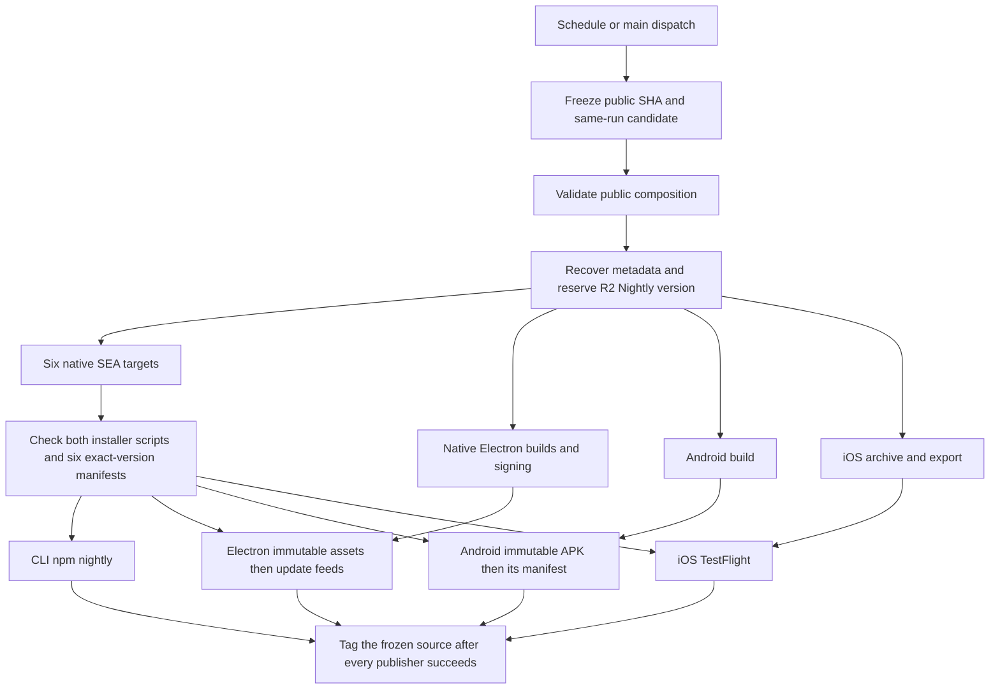

# Public cloud client release migration

This is Track C of the client migration. These workflows are disabled until the
Repository Variable `CLIENT_RELEASES_ENABLED` is exactly `true`. Keep this PR in
draft until the dependencies below are integrated and the owner completes cutover.
It does not change the local-only default build, private web deployment, or legacy
cross-repository publishers.

`MOBILE_IOS_RELEASE_ENABLED=true` belongs in Repository Variables: the stable
iOS job checks it before entering `cloud-production`, so an Environment-only
value cannot enable that job.

## Entry points and order

`nightly-cloud.yml` runs at 18:00 UTC. Scheduled runs skip when the latest
`nightly-*` version tag already points to the admitted main SHA; manual main runs
may try the same source again. Candidate timestamps come from the original Actions
run creation time. A retry requires its original immutable candidate artifact.
`_nightly-version.json`, immutable build artifacts, installer checks, and the feed
transaction journal retain the existing recovery behavior.

`release-clients.yml` uses linked Release Please components on `release` (stable)
and `main` (`next`). It publishes only when Release Please created a release.
Both workflows validate with three parallel Ubuntu matrix lanes: `lint`,
`typecheck-desktop-cli`, and `typecheck-mobile`. The desktop lane retains the other
workspace packages' typechecks and ACP preparation; mobile runs on a separate
runner. Stable keeps the historical `validate-app-redirects` job id, now expanded
into those matrix jobs. Recovery requires complete, terminal validation results,
at least one failed lane, and untouched publishers. Private website redirect
validation stays with private deployment.

The five `publish-*.yml` entry points are independent, commit-pinned dispatches.
Production dispatches run from `release`, so the environment's release-only branch
policy still applies. They require the exact current tip/version and a failed
`release-clients.yml` push run for the selected component. Staging dispatches use
current `main` and a `next` version. Android derives its code from the original
source run timestamp. Stable iOS recovery checks App Store Connect before native
build and immediately before upload, admits only an untouched version, and uses
build 1. Nightly iOS resolves a fresh TestFlight build number for each attempt.

The main release workflow also supports a stricter recovery mode: Release Please
succeeded, public validation failed, and every publisher was skipped. It never
runs Release Please again and selects one client component plus its required SEA
publication/check. Other partial releases
use the component workflow or rerun failed jobs; ambiguous state fails closed.

New Nightly runs use the published Electron Stable version from
`STABLE_ELECTRON_VERSION_URL`. They increment its minor version, reset the patch
to zero and reserve a sequence starting at zero for that cycle. Retries reuse
the run’s reservation even if Stable advances.

## Native iOS Nightly

Nightly calls `publish-ios-native.yml` to build the pinned `apps/mobile/ios`
submodule, including its nested dependencies. It installs the native client's own
pnpm workspace and lockfile, generates runtime assets and the XcodeGen project,
then archives the `Lody` scheme for the **Lody Native** TestFlight app
(`ai.lody.mobile`). Stable releases build Capacitor in `release-clients.yml`;
`publish-ios.yml` provides a manual Capacitor recovery entry on `release`.

The native publisher keeps the reserved Nightly marketing version, App Store
Connect build-number lookup, non-canceling iOS lock, exact-source admission and
same-run SEA publication gate. It stamps the generated app Info.plist and passes
the version/build to every archived target, verifies the archived versions and
exported dynamic-library linkage, then uploads the IPA to App Store Connect.
It uses the existing `cloud-nightly` Apple API key, distribution certificate and
team configuration. Provisioning profiles must cover all four native targets:

| Secret                                                 | Bundle ID                               |
| ------------------------------------------------------ | --------------------------------------- |
| `IOS_APP_PROVISIONING_PROFILE_BASE64`                  | `ai.lody.mobile`                        |
| `IOS_SHARE_PROVISIONING_PROFILE_BASE64`                | `ai.lody.mobile.share`                  |
| `IOS_NOTIFICATION_SERVICE_PROVISIONING_PROFILE_BASE64` | `ai.lody.mobile.notification-service`   |
| `IOS_LIVE_ACTIVITY_WIDGET_PROVISIONING_PROFILE_BASE64` | `ai.lody.mobile.LodyLiveActivityWidget` |

The share and notification-service profiles are native-specific; the Capacitor
notification profile cannot sign the native notification bundle. Configure them
in `cloud-nightly` before the first run. `LODY_AUTH_URL`, `LODY_AUTH_SITE_URL` and
`LODY_SERVER_URL` (or `SERVER_URL`) supply the native `CONVEX_URL`,
`CONVEX_SITE_URL` and `CF_WORKER_URL` HTTPS origins. `VITE_ONESIGNAL_APP_ID` (or
`ONESIGNAL_APP_ID`) supplies `LODY_ONESIGNAL_APP_ID`. These public values apply
identically to the generated Swift configuration and bundled cloud runtime.
The runner needs Xcode 27.1, Metal Toolchain, CMake and XcodeGen; preparation uses
the pinned native client's Metal setup script and installs missing build tools.

## Build duration and memory

Capacitor mobile dependency installs set `LODY_SKIP_ELECTRON_POSTINSTALL=1` and select
`{./apps/mobile-capacitor}...`, including its complete dependency closure. Track A's
package is named `@lody/mobile-capacitor`; the directory selector includes its
complete dependency closure independently of the package selector. `@lody/shared` brings
`acp-extension-core` into this closure; its own prepare script still builds its
runtime export. Android sets up Java before installation and hashes only the
Capacitor Gradle files and wrapper properties for its dependency cache.

Native Nightly and Capacitor stable iOS start dependency installation/archive/export after common
validation (and Nightly version reservation), concurrently with SEA. Immediately
before uploading, `wait-release-gate.mjs` waits up to 60 minutes for the current
run's exact-source `verify-daemon-installation` job to succeed. Failure, cancellation,
skip, ambiguous/wrong-source evidence or timeout prevents upload. Manual iOS checks
the exact version's public installer at that same upload boundary. Keep the existing
iOS lock across build and upload so concurrent builds cannot reuse an unresolved
App Store train/build number. Stable recovery rechecks App Store admission after
the wait, immediately before upload.

macOS Electron jobs explicitly use a 4096 MiB Node heap. The previous private
`build-app.mjs` honors an existing `NODE_OPTIONS` heap, rather than overwriting it;
Track B must preserve that behavior. `.github/scripts/observe-macos-build.sh` prints
physical memory, `vm_stat`, swap snapshots and `/usr/bin/time -l` maximum RSS around
the compile/package command, including the after snapshot on failure. No environment
or credential dumps are included.

Future shared compilation can replace the `build` invocation in Nightly's `build`
job and stable/manual `build-electron` with an artifact download after an
`ubuntu-latest` compile job. That artifact would contain platform-neutral Electron
`out/` plus CLI `dist/`, bound to the admitted SHA, channel, version, cloud
configuration and build identity. Keep platform-native runtime staging, native
addons, signing/notarization and packaging on their target runner. First verify
these outputs contain no host-specific native closure and that packaging can
consume them without rebuilding. This PR leaves `package-electron.mjs` unchanged.

Nightly desktop publication installs only the Electron dependency closure with
lifecycle scripts disabled, rather than installing every workspace project. All
R2 publishers use `.github/scripts/setup-aws-cli.sh`: reuse a runner's existing
CLI, otherwise install AWS CLI v2 from its official HTTPS distribution for the
runner's operating system/architecture, before injecting any upload credentials.

The supplied duration savings are the migration owner's prior measurements;
these workflow changes have not yet been benchmarked on public release runners.

## Track A and Track B integration contract

No `apps/`, `packages/`, workspace manifest, or Sparkle action files change here.
Before enabling, verify these dependencies against the merged A/B heads:

- Track A provides `apps/mobile-capacitor`, named `@lody/mobile-capacitor`, with the existing
  `ci:sync:android:nightly`, Android stable sync, and iOS sync scripts. It keeps the
  Android output filename, app identity, provisioning targets and iOS project
  structure used by the former private client.
- Track B provides `apps/cli/{sea-release,sea-publish,sea-retry,nightly-npm,
check-installer,install-native-acceptance}.mjs`, `prepare:publish`, and
  `apps/cli/.publish/lody`. Its package selector is `lody` and cloud mode is explicit
  `LODY_PLATFORM=cloud`. Installer and SEA paths resolve this public root.
- Track B provides `apps/electron/{nightly-candidate,nightly-release,nightly-mobile,
nightly-artifacts,release-profile,sparkle-signing}.mjs`, plus the related imports.
  All filesystem paths must resolve the public root, not `lody-oss/` or former
  cloud directories. Electron has `build`, `build:mac:release`,
  `build:mac:staging`, `build:win`, `build:linux`, `build:linux:arm64`, and
  `package:nightly:{mac,win,linux,linux-arm64}`. Builds honor `LODY_PLATFORM=cloud`
  and `VITE_LODY_PLATFORM=cloud`; local defaults remain local.
- The candidate format remains schema 1 for reservation/feed compatibility. The
  legacy `privateSha` and `ossSha` fields both contain the single public commit.
  Track B's candidate validation/export and publication ancestry checks must accept
  `LodyAI/Lody` sources without querying private history. The transition from an
  existing private candidate must compare its recorded OSS ancestry and preserve
  build/version monotonicity; comparing an old private SHA with a new public SHA
  cannot work. This is a required Track B integration change, not established by
  copying the old helper unchanged.
- Track B migrates `.github/actions/generate-sparkle-appcast` and updates its
  internal package/script paths. Nightly supplies both generated display and native
  versions. Both signed ZIPs are verified before generating separate arm64/x64 feeds.
- `.github/scripts/resolve-ios-app-store-build-number.mjs` is copied here as an
  additional workflow dependency; it previously lived under private `scripts/`.

Stable manifest versions are seeded from the private client packages (`0.113.1`),
which are ahead of its stable manifest (`0.112.0`). The prerelease manifest uses
the same `0.113.1` baseline, so Next cannot restart from an older release cycle.
Reconcile both manifests and all three
packages against the final private shipped state immediately before cutover.

## Owner configuration and cutover

Configure `CLIENT_RELEASES_ENABLED` and `NIGHTLY_ENABLED` under **Settings →
Secrets and variables → Actions → Variables** as **Repository Variables**. Their
admission checks run in job-level `if:` expressions before an environment is
available; Environment Variables cannot supply these switches. Set both to the
literal string `true` only at the corresponding cutover step below.

All client workflows pin Node `22.23.4` for desktop/mobile native extension
compatibility. Only `publish-daemon-sea.yml` pins Node `26.13.0` for SEA packaging.

Create `cloud-staging` and `cloud-nightly` restricted to `main`, and
`cloud-production` restricted to `release` with required reviewers. Keep signing,
Apple, Android and R2 credentials in those environments. Production reviewers apply
to publishing jobs; Release Please's environment-free job uses only its scoped
GitHub token. Cloud origins, update URLs/prefixes, telemetry public keys, app IDs,
and other build-time public values are environment variables, not private secrets.
The migrated steps document their exact names at each consumer.

Configure npm trusted publishers for `LodyAI/Lody` and the calling workflow files:
`nightly-cloud.yml` / `cloud-nightly`, `release-clients.yml` /
`cloud-production` and `cloud-staging`, and `publish-cli-existing.yml` for the two
stable/staging environments. Allow OIDC publish and Nightly dist-tag recovery.
There is no `NPM_TOKEN` fallback.

Set an explicit nonnegative `NIGHTLY_BUILD_NUMBER_OFFSET` so the new workflow's
`run_number + offset` exceeds the latest private reservation's build number and
still fits 99,989,999. Preserve the R2 reservation and journal; do not reset either.
Confirm all requested hosted runner labels, including `xcode-27` with Xcode 27.1,
are available to this repository before enabling.

Disable private Nightly publishing and the public notification dispatch before
setting public `NIGHTLY_ENABLED=true`. Disable private stable publishing before
enabling public stable publication. Never run private and public publishers against
the same bucket/prefix/npm tag together. Finally set `CLIENT_RELEASES_ENABLED=true`.
Rollback disables public publishers before restoring private triggers. Legacy
workflow deletion and private-source cleanup happen after successful real cycles.

## Validation limits

Node tests cover admission, version chronology, recovery API state, immutable APK
writes, metadata rollback and tag idempotency. They do not establish native builds,
notarization, npm OIDC configuration, uploads or device installation.

The installed actionlint 1.7.12 predates GitHub's `concurrency.queue: max`. Validate
with `.github/actionlint.yaml` and ignore only the diagnostic
`^unexpected key "queue" for "concurrency" section`; all other diagnostics must be
resolved. GitHub documents the queue field in its
[workflow syntax](https://docs.github.com/en/actions/reference/workflows-and-actions/workflow-syntax#concurrency).
The explicit Xcode label is included in the linter configuration; that declaration
does not prove hosted capacity.
