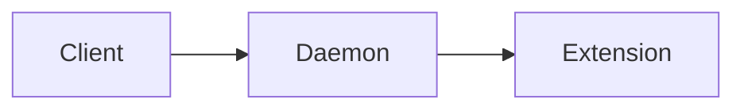

# diagrams, wireframes, and vector

Three drawing surfaces, picked by what you are showing:

- **Node-and-edge diagrams** (flowcharts, sequences, state, architecture
  dependencies) → write a ```` ```mermaid ```` fenced block. The mermaid
  renderer computes all layout; you write only the graph in mermaid syntax.
  This is the disciplined default — reach for it first for anything that is a
  set of nodes with connections.
- **Wireframes and UI mockups** (a window, a sidebar layout, a checklist card) →
  `Mock`: describe the nesting and the renderer computes every coordinate —
  you never write x/y/w/h.
- **Precise vector art** (an icon, an annotated figure, a shape the above cannot
  express) → the lowercase `svg` family below.

## Prefer ` ```mermaid ```` for node-and-edge diagrams

Anything that reads as *boxes connected by arrows* — a pipeline, a sequence
chart, a dependency or architecture graph — belongs in mermaid, not hand-drawn
SVG. Inside a `genui` surface you can still emit a fenced block where the
markup accepts one:

````

````

mermaid covers `flowchart`, `sequenceDiagram`, `stateDiagram`, `graph` and
more; the host renders it. Do not rebuild these by hand with `<svg>` — the
result is less legible and cannot be re-laid-out.

## `Mock` — wireframes and UI mockups

`Mock` renders a compact greyscale svg wireframe from a *declarative nested
layout*. You write the structure as JSX and the renderer runs a flex pass that
computes every x/y/w/h — you never position anything. The output matches the
house wireframe style: hairline frame, layered `fill-opacity` blocks, centred
labels.

```genui
<Mock w={160} h={132}>
  <Mock:Col>
    <Mock:Cell h={15}/>            {/* title bar strip */}
    <Mock:Row>
      <Mock:Cell w={33} tone="band"/>   {/* sidebar */}
      <Mock:Box label="Webview" sub="Own UI Runtime" hint="postMessage"/>
    </Mock:Row>
  </Mock:Col>
</Mock>
```

- `Mock` — the svg root. `w`/`h` set the viewBox (default 160×132), `pad`
  insets the whole frame.
- `Mock:Col` / `Mock:Row` — split their box vertically / horizontally among
  children. `gap` sets spacing; children with a fixed `h` (in a `Mock:Col`) or
  `w` (in a `Mock:Row`) take it and the rest share what remains by `flex`.
- `Mock:Cell` — a block; optional single `label`. `w`/`h` fix its size.
- `Mock:Box` — a labelled block; centres up to three lines: `label`, `sub`,
  `hint`. Lines that would overflow the box are dropped.
- `Mock:Lines` — placeholder content bars (nav items, form rows, body text).
  `count` bars of `size` px, the last bar shortened unless `lastShort={false}`.
- `tone` — one grey family, deepest→lightest: `deep` `.5` / `mid` `.3` /
  `band` `.16` / `soft` `.09` / `faint` `.05` + dashed outline.

Keep `Mock` self-contained — it cannot take state or events; it is a static
schematic.

## `svg` family — hand-placed shapes

`<svg>` draws custom diagrams and figures inline — the family keeps real
lowercase SVG element names, unlike the PascalCase catalog components. It is a
confined subset: only the elements and attributes below exist, so a surface
can paint vector shapes but never load resources, embed HTML, or run handlers.
The one exception is `svg:text`, namespaced to stay distinct from the prose
`Text` tag. Reach for `svg` only when neither mermaid nor `Mock` can express the
shape — you are then responsible for every coordinate.

### Typography discipline

Hand-placed SVG looks clean only with restraint. Follow this scale:

- Font sizes: `8` (captions), `9` (labels), `10` (item titles), `11–12`
  (section titles). `font-weight="600"` for titles only; everything else `400`.
- Colour: `currentColor` for all text. Fills use `currentColor` with
  `fill-opacity` in `.05` / `.08` / `.12` / `.15` bands — restrained grey is the
  default look; one accent hue maximum (a muted `#d97706` or similar), reserved
  for the single element you want highlighted.
- Outlines: `stroke="currentColor"` `stroke-opacity=".25"–.35`; dashed
  connectors via `stroke-dasharray="4 3"` or `"3 3"`.

## Elements

- `svg` — root. `viewBox` (e.g. `"0 0 340 220"`), `width`, `height`,
  `preserveAspectRatio`, `role`, `aria-label`.
- `g` — group. Shares paint attributes plus `transform`.
- `rect` — `x`, `y`, `width`, `height`, `rx`, `ry`.
- `circle` — `cx`, `cy`, `r`. `ellipse` — `cx`, `cy`, `rx`, `ry`.
- `line` — `x1`, `y1`, `x2`, `y2`.
- `polyline` / `polygon` — `points` (e.g. `"0,0 10,10 20,0"`).
- `path` — `d`.
- `svg:text` / `svg:tspan` — labels. `x`, `y`, `dx`, `dy`, `rotate`,
  `text-anchor`, `font-size`, `font-weight`, `font-family`, `letter-spacing`.

## Paint attributes

All elements accept `fill`, `stroke`, `stroke-width`, `stroke-dasharray`,
`stroke-dashoffset`, `stroke-linecap`, `stroke-linejoin`, `fill-opacity`,
`stroke-opacity`, `fill-rule`, `opacity`, `transform`, `color` (sets
`currentColor`), `vector-effect`. Use `fill="none"` for outlines and
`fill="currentColor"` to follow the theme. An attribute not in this contract
is dropped, not rendered.

```genui
<svg viewBox="0 0 340 220">
  <rect x="3" y="3" width="334" height="214" rx="7" stroke="currentColor" fill="none" />
  <rect x="4" y="25" width="94" height="188" fill="currentColor" opacity=".05" />
  <svg:text x="13" y="43" font-size="9">Workspace</svg:text>
</svg>
```

Expressions drive geometry, so a diagram can reflect state:

```genui
{@state const [level, setLevel] = useState(60)}
<Column>
  <svg viewBox="0 0 200 20">
    <rect width={level * 2} height="20" rx="4" fill="currentColor" opacity=".3" />
  </svg>
  <Slider value={level} max={100} onChange={(n) => setLevel(n)} />
</Column>
```

## Misuse patterns

- `<text>` inside `<svg>` renders as a paragraph, not a label — use `svg:text`.
- `image`, `foreignObject`, `use`, `a`, `script`, and `animate*` elements are
  not in the catalog; neither are `href`, `style`, `class`, or `on*` attributes.
- Set geometry as attributes, not `style`: `x="10"`, never `style="left:10px"`.
