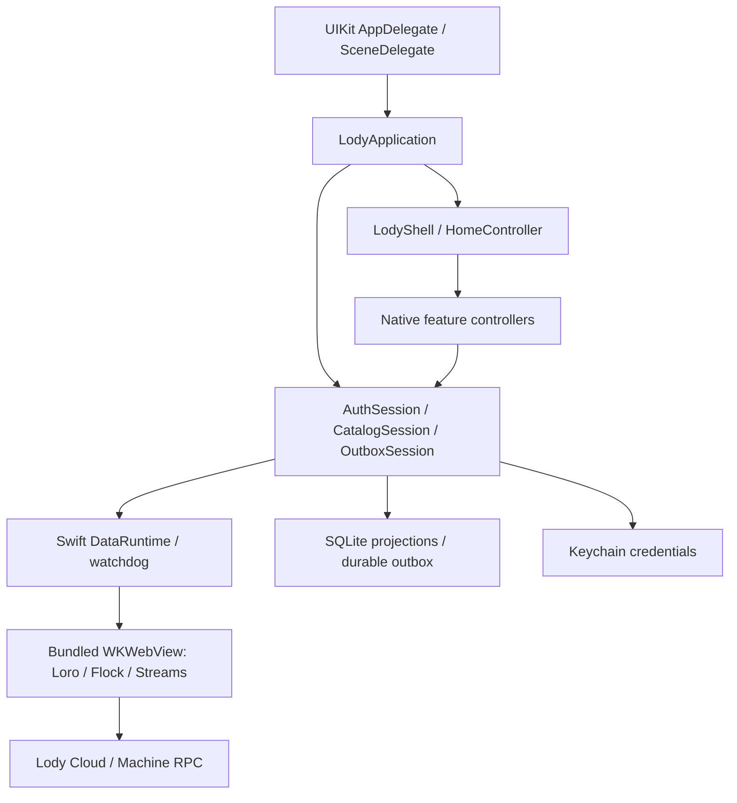

<div align="center">
  
  <h1>Lody iOS</h1>
  <p><b>Native iOS Client</b> · AI Collaboration & Session Companion for Mobile</p>

  <p>
    
    
    
    
  </p>

</div>

https://github.com/user-attachments/assets/0bc0ab48-6f12-44e9-ae13-07af9c6b780d


---

## Origin and maintenance

This is Lody’s integrated iOS client, derived from
**[Innei/lody-ios](https://github.com/Innei/lody-ios)** by
[Innei](https://github.com/Innei) and contributors. Their native application,
LodyKit architecture, chat UI, and protocol runtime form the foundation of this
client. See the [mobile credits](../README.md#credits-and-origins) for import
provenance and the [upstream project](https://github.com/Innei/lody-ios) for its
independent development history. Please report integration issues to Lody.

The source is under active development. Upstream TestFlight links and workflows
refer to the upstream distribution, not a release of this repository.

## Overview

**Lody iOS** is a native open-source client crafted for iPhone, providing a lightweight and secure bridge between remote Lody services and local workspaces.

The application UI and native state run in Swift and UIKit. LodyKit owns navigation, screens, authentication, catalog projections and durable sends. A Swift-managed offscreen WebView runs the bundled Loro/Flock protocol engine; React Native, Expo, Hermes and Metro are no longer app dependencies.

---

## Agent settings

Settings → Agent follows the Web mobile provider page: select a machine in a native
sheet, then manage that machine’s providers and setup requests. Forms support
provider names and instructions, custom commands and arguments, preset credentials
and endpoints, write-only environment patches, Codex authentication profiles,
runtime paths, and capability-driven title options. Save and test persists changes
before probing a persisted agent; newly queued setups continue through setup status
and authentication. Managed-runtime status/install and Pi extension discovery are
also available while creating a supported provider. Saved providers expose a separate usage refresh;
quota and pace displays remain sourced from the catalog usage projection.

ACP sign-in supports method selection, browser authorization, user codes, consent,
and typed input requests through the public machine RPC. Pending setups awaiting
authentication expose the same flow. Browser links stay disabled until any required
consent is accepted by the machine. Auth events are scoped to the active flow, and
provider-change events refresh and merge only the affected machine. Credentials stay on the selected machine;
list data and local caches exclude environment values. Existing keys offer Keep,
Replace, or Remove, and submitted secrets are cleared. Ownership, machine
capabilities, offline state, and revision checks gate writes. Sorbet connection and
endpoint-store management still require native encrypted feature transport and
show their specific unavailable capability.

`agents-settings`, `agents-presets`, `agents-pi`, and `agents-auth-methods` are
independent offline UI verification cases for provider CRUD and failure recovery,
preset/secret preservation, Pi runtime patches, and method-selection flow identity
plus consent-before-browser behavior. They use production controllers with synthetic
service boundaries and perform no external sign-in.

Roles remain a separate setting. Settings home has no Machines entry; machine
details and execution-machine selectors elsewhere remain available.

## How this was built

Lody iOS started as a one-day prototype and became a usable TestFlight client in about a week, driven by coding agents under tight product constraints: iOS only, one native kit module, system UI when React Native cannot meet HIG, and an offscreen WebView for Flock/Loro because official Node/CRDT packages do not bundle in Metro.

The full first-person write-up is **[Prototype in a Day, Shipped in a Week: Building Lody iOS in Live](https://innei.in/en/posts/tech/lody-ios-prototype-to-product)**.

What that week actually looked like:

- **Constraints before features.** The first prompt named the architecture (RN template, one Kit module, no Android, Swift when RN is not enough) and left product surface to be inferred.
- **Decide, then implement.** Navigation chrome, search, iPad shell, and onboarding were argued in the open; rejected paths stayed off `main`.
- **HIG as acceptance, not taste.** Native `UIBarButtonItem`, system sheets, and semantic colors were required; RN fakes of system chrome were rejected on screenshots.
- **Verify without login.** Offline Debug scenes, leased Simulators, screenshots for visual state, and video for temporal behavior became the gate: if the verify script was right, the change shipped.
- **RN as the base, Swift where it matters.** Chat, composer, list rows, and diffs moved into LodyKit. Swift grew from a few hundred lines on day one to nearly half the UI surface by the end of the week.

---

## Features

### Authentic Apple HIG Native Experience

- **Human Interface Guidelines Compliance**: Native adoption of iOS semantic colors, automatic light and dark mode adaptation, and Dynamic Type with system fonts. `LodyTextStyle` retains semantic sizes, weights, line heights and tracking for UIKit and SwiftUI; code uses the system monospaced face. Native UI needs no bundled font registration.
- **Native Navigation**: The UIKit shell owns navigation controllers, transparent headers, and automatic scroll edge effects. Home uses an adaptive native split with session and inspector navigation. Transient flows open as native sheets through `LodyShell.presentNative`, and system grouped rows use UIKit `UICollectionViewListCell` via `LodyGroupedList`.
- **Bilingual by Default**: English and Simplified Chinese product copy lives in `packages/LodyKit/Sources/LodyKit/Resources/Localizable.xcstrings`. Swift uses `String(localized:)`, Xcode compiles the catalog, and CI checks translation coverage and format arguments. Permission prompts live in `apps/ios/App/InfoPlist.xcstrings`.

### High-Performance Native Streaming Chat

- **Virtualized Chat Collection**: The chat view is backed by native Swift `UICollectionView`, maintaining full 60/120 fps smoothness even with extensive message histories.
- **CoreText Markdown Rendering**: Deeply integrated with [MarkdownView](https://github.com/Lakr233/MarkdownView) and [Litext](https://github.com/Lakr233/Litext), natively supporting complex tables, syntax-highlighted code blocks, task lists, LaTeX math formulas, and system text selection handles.
- **Smooth Character Fade-In**: Balanced batch scheduling paired with low-level `CTRunDraw` character alpha transitions delivers gentle, flicker-free streaming output during AI generation.
- **Native Input (`ChatComposerView`)**: Pixel-perfect keyboard avoidance matching system input methods, local draft persistence with automatic restoration, and real-time model thinking effort controls.

The iOS app uses fixed Ink accents in both light and dark appearances, including
Send and Stop; conversation activity/status colors remain unchanged. Preferences contains the app-icon picker. Settings has no Appearance, MCP servers,
or Memory pages; dark canvases use fixed soft backgrounds. Process status labels use the same regular type
as their duration, without a leading loading icon. The final visible command group
shimmers while its turn runs, even after its tools complete or record a duration,
and when hidden thinking calls follow it.
User bubbles collapse to six measured lines. Agent footer icons align with the
message edge: Copy, Info and Fork, 32 pt apart, followed by time 12 pt after
the last glyph. The whole opened-chats count row toggles
its children, while the opener above opens the conversation. Normal replies use 16 pt body text and 18 pt semibold headings;
thoughts retain 15 pt body text and 17 pt headings, with Dynamic Type scaling.
MCP creation and reply receipts use compact conversation-list rows from the public
operation payloads: provider marks, single-line titles, trailing status and curved
child connectors, without filled card backgrounds. Consecutive creation receipts share a five-row expandable group; cards
retain the creating turn's status and refresh titles and provider marks from the live catalog.
Progress-linked successes are hidden, while errors, cancellations and uncertain or
incomplete result batches remain visible. Reply cards open the saved Markdown reply;
shortened receipts say so, and a separate button opens the exact conversation or Tab.
The related-conversations icon above the composer opens a live native tree, with
each conversation and its contained Tabs sharing one horizontally scrolling row.
Scrollbars stay hidden; edge fades indicate more targets in either direction.
Only opened-by descendants receive indentation and curved rails. Adjacent operation
receipts for the same conversation also share a horizontal row, retaining each
target’s independent full-reply and navigation actions. The current exact target
uses a subtle background and accessibility selection; layout conveys containment
without Tab/current/directory labels. Status icons replace redundant visible status
words while keeping accessible descriptions, reply excerpts and error notices.
Running rows use the Home working-grid indicator. Missing
precise openers never fall back to provenance-only root IDs. Archived and side-panel
sessions are excluded; closed Tabs appear only when current. The tree does not
change archive ownership or read additional transcripts.

The workspace switcher is `Chrome/WorkspaceSwitcherPanel`, a popover anchored to
the capsule that never adapts into a sheet. A `UIMenu` wraps long titles onto
several lines and offers no fade, so the panel draws its own menu-style rows:
leading checkmark, circular avatar, and the name on one line that fades out at the
trailing edge (`LodyFadingLabel`, mirrored for right-to-left) instead of wrapping or
showing an ellipsis. Rows keep full names and the selected trait for VoiceOver; up
to eight rows show before the list scrolls, and the width stays between 240 and
320 pt within the window. Selecting the current workspace is a no-op; catalog
changes refresh the open panel. The account email heads the panel, projected
explicitly through the session source and chrome model. Empty email removes the
heading; synthetic sources never fall back to the live account. Workspace
management stays in Settings.

Conversation Back, title/machine, Tabs and More controls belong to the page, so
UIKit’s interactive pop moves them with its content instead of separately animating
the system back circle. The transparent header registers its controls with UIKit through
`UIScrollEdgeElementContainerInteraction`, retaining the transcript’s native `.soft`
top-edge blur. A noninteractive 55% semantic canvas tint protects the title and
machine subtitle, fading to transparent over 32 pt below the header rather than
adding an opaque chrome material. The transcript scrolls underneath;
content/find insets keep initial content and search below the controls. The shell hides native navigation only for conversations;
detail pages retain their native bars. Back uses the existing navigation/split
owner, and controls retain native glass styling and accessibility labels. The book-layout
conversation list popover anchors to the visible page sidebar button and its bounds;
native navigation-bar controls retain their bar-item anchors.

Conversation titles use 16 pt semibold system text, fading at the trailing edge
only on overflow rather than inserting an ellipsis. VoiceOver retains the full title. User bubbles fill the available
reading width beside the avatar; long-press offers Copy, plus Edit for the last
eligible user message, without inline action buttons. Below the conversation title,
secondary-gray machine text starts with a presence icon; tapping the header opens
the panel with name and presence, owner avatar and name, then
private/shared visibility. Visibility comes from the public machine-registration
query on opening; unavailable data is shown as unknown, never inferred as private.
The bottom machine capsule is omitted. The trailing Tabs button appears only with
other open Tabs; More retains closed-Tab recovery and New current working directory
conversation, using the existing create-Tab operation.
Chat inline code matches the body size in a monospaced face. Prose blocks use
secondary-label grey (links use web’s muted light/dark blue); fenced code retains its own sizing
and colours. With MarkdownView's shared code colour, a list or quote containing a
fence keeps its original code colours throughout that block.

In compact Chats Home, project grouping reveals an opaque project index while
scrolling, over the existing full-width list. Tap a logo or scrub the rail to jump
through committed rendered sections, including Pinned and unassigned chats. Only
the visible 56 pt rail intercepts touches; no index recognizer is installed on rows.
It stays visible through dragging/deceleration and for 0.8 seconds after scrolling
or scrubbing ends. Renewed interaction invalidates pending dismissal. Snapshot
replacement, backgrounding, detachment and size changes cancel the interaction.
Search, time/status groupings and the iPad sidebar retain their existing lists.
VoiceOver adjustment follows rendered group order. Repository identities flow from
catalog `repoFullName` through the root row to cached GitHub owner avatars, displayed
in dedicated 24 pt image views at full opacity; projects without artwork use one
initial. Targets are 48 × 48 pt with 48 pt centre spacing, 12 pt capsule end
padding and an 8 pt trailing screen inset. Dense rails show a bounded set of evenly
spaced landmarks without shrinking targets or artwork. Landmarks stay fixed during
a gesture; selection highlights a landmark only when that destination is selected.
Scrubbing anchors to the tapped destination with an 8 pt movement allowance, then
maps each direction to the rail endpoint; small finger drift does not jump to a
different proportional destination. Scrubbing and VoiceOver still reach every project. Pinned and unassigned
groups keep their symbols. The opaque semantic
background follows light/dark appearance. Entrance and exit use a short 12 pt slide
and fade, with full opacity at rest. Dismissal disables touch targets immediately;
Reduce Motion uses immediate visibility changes.
`verify:native --case chat-list-scroll` covers hit bounds, direct navigation,
48 pt target spacing, stable dense landmark taps, complete scrub/VoiceOver reach,
deterministic linger cancellation and cached artwork.

### Native Schedules

Schedules uses the Chats list layout, with task and scheduled-message rows grouped
by Needs attention, Active, Paused and Ended. Each row separates its title and
status from the recurrence and execution context; search filters by title.

The editor places current status and quick actions above separate Task, When and
Run with cards. Weekdays and month days are directly selectable; date and time
use native pickers in the computer's time zone. Owners can run, pause or resume
supported tasks and open the last conversation. Teammates' tasks and scheduled
messages retain their existing read-only rules, and deletion requires confirmation.

Successful list reads persist as bounded SQLite display snapshots per account and
workspace. Cold starts restore the saved list before refreshing from the runtime;
failed reads retain it. Logout clears these snapshots and fences late writes.
Optimistic states are never persisted, and cached rows do not authorize mutations.
Opened details and editor choices stay in memory within the current Home page.
Returning to a loaded editor
shows its snapshot immediately while detail and choices refresh independently;
failed refreshes retain existing content, and refreshes preserve unsaved edits.
Cached details can be edited immediately; Save waits for fresh detail validation
and blocks when the refresh detects changed remote content.
Pause/resume preview their state immediately and roll back on failure, with the
existing unknown-outcome warning when a reply is lost. Pending commands fence
older reads; account/workspace changes discard snapshots and late responses.
The runtime still re-reads current data before mutations. A workspace without a
saved list shows the loading state until its first successful read.

### Project groups

Project groups are desktop's multi-repository projects: one project whose members are
GitHub repositories or local folders. Mobile shows them but does not create or edit
them yet.

- The runtime catalog carries a group conversation's members (`protocol/project-run.ts`,
  web `buildSessionProjectMemberRows`): placement order with submodules under their
  parent, and each member's branch, diff, publish state and current PR (the last PR
  recorded for its repository).
- `Catalog/ProjectGroupStore` keeps the workspace's groups. It reads them when the
  workspace changes, when the catalog names an unknown `group:` id and when Settings ›
  Projects opens, restoring the last accepted list first. The iPad project list adds
  runnable groups that have no conversations yet ("N repositories or folders").
  Settings › Projects lists every group after the folders and opens a read-only page
  with the group's computer, creator and members.
- In a group conversation the action bar's context capsule summarises repositories,
  PRs and the group-wide diff. Its popover lists every member (identity, path · branch,
  ±diff, PR) instead of web's hidden selected member, so every PR stays visible. A PR
  row opens that PR's page, which carries merge and the other PR actions. The bar's
  own actions stay Create PR / Draft and Commit & Push, sent with web's
  `withProjectGroupPrScope` text so the agent publishes every changed member.
- A single-repository conversation shows only the latest PR of its own repository.

### Code Diffs & Workspace File Browsing

- **Turn Changes Overview**: Automatically summarizes file changes for each conversation turn, with one-tap access to all modified files.
- **Word-Level Diff Highlighting**: File, workspace and tool-detail diffs render natively in LodyKit.
- **Remote Workspace File Tree**: Browse project directories and files on remote Macs or servers at any time, with previews via native code view `LodyCodeView` or system Quick Look.
- **Project Files from More**: a live conversation in a local project offers Project Files in its More menu (`SessionController.openProjectFiles`). `FilesController` lists folders through runtime `listDir`, which lists the conversation's own folder (its worktree when it has one) with the machine's `file/list-dir`, or the local project's folder on machines without the `sessionDirectoryListing` capability; a file opens in `FileContentController` through `readFile`, which renders Markdown with a Source toggle and opens relative Markdown links in place. Android mirrors this in `chat/ProjectFiles.kt` ([Android README](../android/README.md#project-files)).

### Live Preview & Simulator Streaming

- **Preview Chip**: When an agent reports a local dev server, a chip above the composer opens it through the machine's Lody Quick Tunnel. Long-press copies the share link, opens it in Safari, or stops sharing. The control proof is signed natively with the Keychain credential; only short-lived tunnel links reach the app.
- **Native Simulator Viewer**: A [baguette](https://github.com/tddworks/baguette) server behind the tunnel opens a pushed native page. Native WebRTC DataChannels carry H.264/MJPEG frames, touches and hardware controls, with automatic WebSocket fallback for older CLI versions or failed connections. H.264 decodes into `AVSampleBufferDisplayLayer`; the device frame and side buttons are drawn natively. Quick Tunnel is still required for signaling and artwork. Hardware actions (Home, lock, rotate, shake, volume, screenshot) sit in the navigation bar.

### Offscreen WASM CRDT Data Sync Engine

- **Seamless CRDT Collaboration**: Executes official Loro / Flock CRDT incremental sync cores and Streams clients in a Swift-managed offscreen `WKWebView`, using the browser-safe protocol runtime.
- **Watchdog Protection**: Native Swift probing keeps background execution resilient, supporting graceful hot recovery if an anomaly occurs.
- **Multi-Session Background Sync**: Local SQLite display projections ensure millisecond cold starts, while background synchronization maintains real-time bi-directional updates for active sessions.

### Security First & Hardware Isolation

- **Native Sign-in**: Email and password, Sign in with Apple, Google SDK, and GitHub/Discord system authorization with a PKCE handoff. No device codes or hosted login UI. See [configuration and verification](docs/native-auth.md).
- **System Keychain Storage**: All authentication credentials and sensitive communication keys are strictly isolated in the iOS Keychain and never exposed in app-accessible shared storage.

---

## Architecture



## Directory Structure

The Xcode navigator includes app sources, extensions, runtime inputs, scripts and
verification files. `Shared Extension Sources` groups the LodyKit files compiled
by extensions; their single source of truth remains the local Swift package.
Generated runtime assets and build configuration live under `.generated`.

```text
apps/ios/Lody.xcodeproj              # Generated Xcode project
apps/ios/project.yml                # XcodeGen: app, extensions and verify hosts
apps/ios/App/                       # UIKit entry, plist, entitlements and app assets
apps/ios/App/Resources/             # Images, file icons and dependency notices
apps/ios/Extensions/                # Share and notification service
apps/ios/.generated/                # Generated plist, XcodeGen input and runtime assets
apps/ios/runtime/decoder/           # Browser-safe decoding adapter
apps/ios/scripts/                   # Asset generation and source checks
apps/ios/verification/kit/          # Native behavior checks
apps/ios/verification/ui/           # Offline UI verification
apps/ios/tests/                     # Protocol and tooling Node tests
packages/LodyKit/Package.swift      # LodyKit library, dependencies and Metal resources
packages/LodyKit/Sources/LodyKit/    # UIKit UI, native state and coordinators
packages/LodyKit/Sources/LodyKit/Resources/ # Native String Catalog
packages/LodyKit/DataChannel/        # Pinned native transport build
packages/cloud-runtime/              # Bundled browser-safe protocol and contract
packages/lody-core/                  # Swift wire types and routing policies
packages/chat-kit/                   # Native chat core
packages/lexical-swift/              # Native editor
```

---

## Development & Build

### Prerequisites

- **macOS**: Sequoia or later — GitHub iOS verification and TestFlight use the macOS 27 preview image
- **Xcode**: 26.5 or later with Command Line Tools — local offline Simulator baselines default to iOS 26.5; GitHub iOS jobs use the Xcode 27 preview image and iOS 27.0
- **Node.js**: Node 22 LTS, version 22.13 or later
- **pnpm**: `11.10.0` (`corepack enable`)
- **XcodeGen**: `brew install xcodegen`
- **CMake**: `brew install cmake` for the pinned native data channel library

### Getting Started

1. **Clone the repository and install JavaScript dependencies**:

   ```sh
   # From the Lody repository root:
   git submodule update --init --recursive apps/mobile/ios/packages/chat-kit
   cd apps/mobile/ios
   corepack pnpm install --frozen-lockfile
   ```

2. **Generate the native project and open Xcode**:

   ```sh
   pnpm ios
   ```

   `pnpm ios` builds bundled protocol assets and the native data channel library,
   then generates `apps/ios/Lody.xcodeproj` with XcodeGen. Xcode resolves
   Swift packages directly. Select a simulator and Run. `pnpm start` opens the
   existing project. App, extensions and offline verification hosts come from
   `project.yml`; rerun `pnpm prebuild` after changing those sources.
   LodyKit is a local Swift package in `packages/LodyKit`; SwiftPM discovers its
   sources automatically and bundles its Metal shaders.

3. **Update native assets**:

   After editing `packages/cloud-runtime` or `apps/ios/runtime/decoder`, run:

   ```sh
   pnpm bundle
   ```

### Quality Checks & Testing

```sh
pnpm check            # TypeScript, locale catalogs, generated license notices, Prettier
pnpm test             # Protocol tests and Simulator tooling tests
pnpm bundle           # Build bundled WebView protocol assets and native catalogs
pnpm licenses:build   # Regenerate the in-app notices after dependency changes
```

### Offline UI Verification

UI baselines run without login, user credentials, cloud access, or a connected machine: the runner launches with `--ui-verify` and injects deterministic native data at the Auth/Catalog boundary, and every case starts from the development-only Debug page.

```sh
pnpm verify:simulator --name '<current verify>' -- <command>   # Lease a Lody * Verify Simulator
pnpm verify:native                                             # Swift behavior checks
pnpm verify:ui --app /absolute/path/to/Lody.app                # Offline UI baselines
pnpm verify:ui --suite core --app /absolute/path/to/Lody.app  # PR core paths, Release app
```

The runner captures screenshots for visual states and video for temporal behavior; missing scenes and timeouts fail the run. See [`apps/ios/verification/ui/README.md`](apps/ios/verification/ui/README.md) for the case inventory and Simulator leasing rules.

### Releases

The nested `.github/workflows/` files are retained upstream references and do
not run from this subdirectory. This import does not configure signing,
TestFlight publishing, or an official mobile release pipeline.

---

## License

Lody iOS is released under the [GNU Affero General Public License v3.0](LICENSE) (**AGPL-3.0-only**). You may use, modify, and distribute it, including commercially, provided that derivative works and network-served modifications stay under the same license and their source stays available to users.

Bundled third-party libraries and assets keep their own licenses. The full list and license texts are available in the app under **Settings → Open Source Licenses**. The notices are generated from the production dependency closure by `pnpm licenses:build` and verified in CI by `pnpm check`.

---

## Acknowledgements

Lody iOS is made possible thanks to these open-source projects and creators:

- **[Innei/lody-ios](https://github.com/Innei/lody-ios)**: Created by [Innei](https://github.com/Innei) and contributors; the original native client and protocol runtime on which this integration is directly based.

- **[FlowDown](https://github.com/Lakr233/FlowDown)**: Thanks to [Lakr233](https://github.com/Lakr233) and contributors. Lody's native message collection view, stream batching mechanism, and dynamic measurement cache architecture drew significant inspiration from FlowDown.
- **[unixzii](https://github.com/unixzii)**: Original author of Litext, the CoreText rich-text engine underneath MarkdownView and Lody's native chat rendering. Also a generous teacher — a great deal of this project's iOS knowledge came from him.
- **[MarkdownView](https://github.com/Lakr233/MarkdownView) & [Litext](https://github.com/Lakr233/Litext)**: High-performance, extensible CoreText Markdown rendering and typography for iOS.
- **[Loro](https://github.com/loro-dev/loro)**: High-performance, production-grade next-generation CRDT state synchronization.
- **[AXe](https://github.com/cameroncooke/AXe)**: Simulator UI automation driving the offline UI baselines.
- **[baguette](https://github.com/tddworks/baguette)**: Headless iOS Simulator control and streaming (Apache-2.0). The native simulator viewer is a client of its HTTP and WebSocket protocol; baguette itself runs on the Mac and is not bundled.
- **[libdatachannel](https://github.com/paullouisageneau/libdatachannel)**: Native data-only Simulator transport (MPL-2.0), built from pinned source at `pnpm prebuild` with media and WebSocket disabled, over [libjuice](https://github.com/paullouisageneau/libjuice) (MPL-2.0), [usrsctp](https://github.com/sctplab/usrsctp) (BSD-3-Clause) and [Mbed TLS](https://github.com/Mbed-TLS/mbedtls) (Apache-2.0). No camera, microphone or WebView is involved.
- **[vphone-client](https://github.com/datdadev/vphone-client)**: Its native remote iPhone viewer (hardware decode into `AVSampleBufferDisplayLayer`, raw UIKit touch forwarding, never dropping input behind video) shaped the design of Lody's simulator viewer.

## Backend configuration

See [native backend configuration](docs/backend-configuration.md) for the optional
`../.env.local`, production defaults, public TLS endpoints and isolated local stores.

### Native canvas appearance

App-owned dark backgrounds are fixed soft `#111113`. `LodyTint` provides plain,
grouped and opaque canvases, while `LodyAppearance` uses the same dark base for
`bgBase` and `bgGrouped`. Light backgrounds retain their existing semantics.
Camera and simulator media surfaces use the fixed dark color in both themes;
launch uses the matching dynamic `CanvasBackground` asset. The app icon is available under Settings → Preferences. There is no Appearance
page; legacy `darkBackground` values are ignored, not migrated.
This supersedes the optional pure-black background described in the historical
Home design and settings migration documents. Masks, scrims, shadows, media
content and foreground colors remain unchanged. The native `design` check tests
legacy values, both themes and increased contrast, including text readability.

Conversation More → Archive returns to Home immediately while the write continues.
Success is silent; a failed write shows a warning only while its original Home,
account and workspace remain active. Unarchive stays on the conversation.
The existing native session suite can isolate these menu actions with
`LODY_VERIFY_SESSION_ARCHIVE_ONLY=1 pnpm verify:ui --case session-native --require-video --app /absolute/path/to/Lody.app`.
The `session-info-bar` native check explicitly holds and releases archive writes
to verify immediate navigation, silent delayed success and scoped delayed failure.
