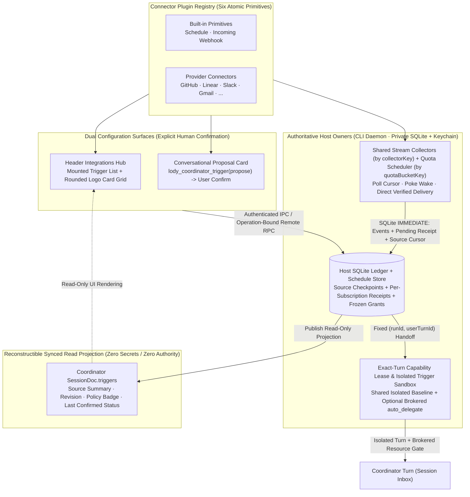

# Coordinator Connector Triggers

Status: draft
Translation: current

[中文](coordinator-connector-triggers.zh.md)

## Scenario

In [Project Coordinator Mode](project-coordinator-mode.md), users want to attach standing external and time-based triggers to a coordinator conversation—either from a dedicated Integrations button in the coordinator header or by asking the coordinator in chat. Representative scenarios include recurring digests (Schedules), custom HTTP webhooks, repository monitoring (for example, summarizing new GitHub issues), issue-tracker triage (Linear), channel or mention alerts (Slack), and inbox monitoring (Gmail).

Existing Lody primitives solve adjacent problems without covering standing multi-provider coordinator triggers:

1. **One-shot waits vs. standing subscriptions**: `lody_automation` conditions (`AutomationWait`) finalize on their first match and do not maintain advancing watermarks across recurring events.
2. **Branch-bound PR polling vs. provider-extensible connectors**: the PR reconciler ([local GitHub PR observation](local-github-pr-observation.md)) observes only pull requests already linked to a session, rather than repository-, team-, channel-, or mailbox-scoped streams across pluggable providers.
3. **Notify-by-default vs. unattended child delegation**: most external events are informational reminders for the coordinator to summarize; automatically spawning or messaging worker conversations (`lody_session_create` / `lody_session_chat`) must require explicit per-trigger user authorization and host-level resource enforcement so untrusted third-party content (such as a public GitHub issue or incoming email) cannot escalate into host side effects or unattended child execution.

## Architecture: Pluggable Connector Primitives and Host-Enforced Trigger Sandbox

Coordinator triggers separate **provider-specific ingestion plugins** from a **host-owned collection, delivery, and capability-enforcement kernel**. Adding a new integration registers a self-contained plugin against six atomic primitives without modifying the coordinator conversation kernel, Loro stream topology, or session admission rules.

### 1. Six Atomic Primitives of a Connector Plugin

Every built-in or third-party integration implements one declarative `ConnectorPlugin` contract composed of five plugin-supplied primitives and one kernel-owned execution sandbox:

1. **`PluginManifest` (Identity and Hub Card)**: declares stable `pluginId`, category, localized title and one-line summary, rounded brand SVG logo, theme accent, and supported capabilities. The header Integrations Hub renders its rounded-rectangle card grid directly from registered manifests.
2. **`AuthProvider` (Principal-Bound Connection and Host Credentials)**:
   - Binds every `connectionId` to `(principalUserId, providerAccountId, tenantId, grantedScopes)` and reports only non-secret status (`builtin`, `connected`, `needs_auth`, `expired`, `local_cli`) to the UI.
   - Resolves credentials exclusively on the host (or explicit cloud token broker) across `none`, `oauth`, `keychain_secret` (`@lody/platform` host secret storage), and `ambient_cli` (such as `gh`).
   - Dynamic option queries, subscription creation, polling, summary delivery, and policy upgrades verify that the **acting user both can edit the target coordinator conversation AND owns (or holds explicit grant to) `connectionId`**. In encrypted workspaces, trigger creation, confirmation, and policy upgrades additionally require `actingUserId === machineOwnerUserId` (freezing `authorizingUserId` into the rule and receipt). On shared machines, ambient host credentials (`gh`, local environment) are restricted to `requesterUserId === machineOwnerUserId` and never lent to collaborators.
3. **`TriggerSchema` (Declarative Config and Dynamic Options)**: defines typed event streams per plugin using a shared field-descriptor + Zod schema plus an optional host `resolveDynamicOptions` query. One schema drives both the modal configuration form and `lody_coordinator_trigger` validation.
4. **`IngressAdapter` (Three Composable Ingress Modes, Stream Sharing, and Quota Buckets)**:
   - Separates **stream collection sharing**, **per-subscription baselines**, and **rate-limit quota sharing**:
     - `collectorKey` (`workspaceId + connectionId + canonicalResourceId + upstreamQueryParams + streamKind`): shared **only** when subscriptions produce the exact same upstream event stream with interchangeable checkpoints (merging periodic ticks and push pokes into one in-flight fetch, and stopping only when the last active subscription unsubscribes). Subscriptions watching different repositories or query scopes use distinct `collectorKey`s so one resource's cursor never advances another's. Each subscription independently stores its own `enabledBaseline` (`seedCursor` at enablement): adding subscription B to an active `collectorKey` records only B's `enabledBaseline` without overwriting the shared collector checkpoint, and receipt fan-out filters events against each subscription's `enabledBaseline` and downstream predicates so catching-up subscription A loses no events while B receives no pre-enablement history.
     - `quotaBucketKey` (provider credential or App installation identity, matching [`pr-poll-scheduler.ts`](../apps/cli/src/lib/pr-poller/pr-poll-scheduler.ts)): coordinates rate limits and cooldowns across all `collectorKey`s that share the same underlying credential.
   - Composes one or more ingress modes:
     - `poll_cursor`: `seedCursor(ctx, config)` records the initial high-water mark at enablement without replaying old backlog; `pollDelta(ctx, config, checkpoint)` returns `{ items, nextPageToken?, nextCheckpoint, gapDetected?, rateLimitResetAt?, authInvalid? }`.
     - `poke_wake`: stateless wake signal that schedules an immediate `pollDelta` on the matching `collectorKey` without carrying authoritative state.
     - `direct_delivery`: push-only ingress where the request body is the sole copy of the event (such as `Incoming Webhook`). Under a per-`endpointId` HMAC-SHA256 secret domain (supporting bounded key-rotation overlap), the signature MUST cover `endpointId + timestamp + deliveryId + sha256(rawBody)` with freshness validation and byte size limits. HTTP `2xx` ACK is returned **only after** the §4 SQLite `IMMEDIATE` transaction commits both normalized events and per-subscription `pending_delivery` receipts: a replay with identical `(endpointId, deliveryId)` and body digest returns the existing receipt idempotently, whereas the same `(endpointId, deliveryId)` with a different body digest is rejected.
5. **`EventNormalizer` (Versioned Deduplication and Sanitization)**: transforms provider items into bounded `NormalizedTriggerEvent` records (`dedupKey` combining `collectorKey + objectId + eventKind + eventVersion`, `occurredAt`, `actor`, `title`, plain-text `cleanBody` with HTML/MIME stripped, `externalRef`, `completeness: 'observed' | 'gap'`, and `trustLevel`). Even when sender identity is cryptographically verified, `cleanBody` remains untrusted data.
6. **`ExecutionSandbox` (Kernel-Owned Coalescing, Two-Phase Handoff, and Resource Gate)**: plugins never touch session history, queues, or permissions; all batching, Inbox reconciliation, output filtering, and capability enforcement live inside the host runtime.

### 2. Header Integrations Hub, Active-Coordinator Binding, and Dual Creation Flow

A `Triggers` (Integrations) button in the coordinator header toolbar ([`session-chat-interface.tsx`](../packages/components/src/components/sessions/session-chat-interface.tsx)) displays the active trigger count and health state (amber on auth expiry, repeated check failures, or recorded `gap` warnings). Clicking it opens the **Coordinator Integrations Modal**:

- **Mounted Triggers Section**: lists active and paused triggers bound to this coordinator—unifying `Schedules` targeting `existing_session: coordinatorSessionId` and standing connector subscriptions—with brand logo, rule summary, active permission badge (`Notify only` vs. `Auto-delegate`), enable/pause `Switch`, manual test/run, edit, and delete.
- **Integrations Catalog Grid**: presents registered plugins as rounded-rectangle logo cards (`Schedule`, `Incoming Webhook`, `GitHub`, `Linear`, `Slack`, `Gmail`, and subsequent plugins).
- **Conversational Proposal (`lody_coordinator_trigger`)**: in chat, the coordinator calls `lody_coordinator_trigger` (`propose` / `propose_edit`) to emit an interactive confirmation card; nothing is scheduled or subscribed until the authenticated user confirms the card.
- **Protocol Capability Gate and Active-Coordinator Verification**:
  - Clients offer Coordinator Triggers—and claim `"Notify only"` enforcement on coordinator-targeted Schedules—only when the host advertises `MachineMeta.protocolCapabilities.coordinatorTriggers` (plus versioned `coordinatorTriggersRemote` for remote control where `rpc` is permitted).
  - **Change Coordinator / Archive / Delete Reconciliation**: because `Change coordinator` creates a newer unarchived coordinator while leaving the previous coordinator session unarchived and alive ([`project-board-model.ts`](../packages/components/src/components/project-mode/project-board-model.ts)), liveness/archive checks alone are insufficient. Before crash/reconnect recovery AND before every trigger Inbox handoff or prepared-Schedule dispatch ([`schedule-engine.ts`](../apps/cli/src/lib/schedules/schedule-engine.ts)), the host resolves the current active coordinator for `(ownerUserId, projectKey)`: if metadata sync is still pending, handoff waits; if the session is archived, deleted, or superseded by a newer coordinator, the host pauses the superseded trigger bindings, cancels undelivered grants, and blocks automatic handoff until explicit user rebinding. Deleting a coordinator purges its local rules, pending receipts, webhook endpoints, and unreferenced keychain secrets.

### 3. Relationship Between `Schedule` and `Webhook`

- **Product layer (peer built-in primitive cards)**: `Schedule` is the universal **time-driven** card (reusing `ScheduleStore` with `destination = existing_session: coordinatorSessionId`), while `Incoming Webhook` is the universal **direct-delivery push** card for arbitrary CI scripts, monitors, or internal hooks without a dedicated SaaS plugin.
- **Transport engine layer (complementary Pull + Poke inside replayable app connectors)**: SaaS plugins (`GitHub`, `Linear`, `Slack`, `Gmail`) pair periodic `poll_cursor` ticks with optional `poke_wake` notifications. Online cloud-connected workspaces get near-real-time wakeups in plaintext workspaces, while local-only builds and waking laptops catch up via `poll_cursor` within each provider's history retention window.
- **E2EE privacy boundary**: terminating a plaintext third-party SaaS webhook in Lody Cloud to emit a payload-free poke still exposes the webhook payload to Cloud at termination. **In v1, encrypted workspaces disable all cloud webhook termination and cloud `Incoming Webhook` relays**: replayable connectors run host-direct `poll_cursor` locally, and `Incoming Webhook` exposes only host-verified local HTTP ingress; end-to-end sender-sealed cloud relays are deferred to a separate protocol specification.

### 4. Physical Storage, Operation-Bound Authority, and Two-Phase Crash Recovery

No new Loro Stream IDs are introduced, and `ScheduleDefinition` Registry fingerprints remain unchanged:

| Logical State | Authoritative Owner | Sync & Consistency Contract |
| :--- | :--- | :--- |
| Timed trigger definitions | `ScheduleRegistry` (`:sr`) and `schedule-<id>` docs ([`schedule-types.ts`](../packages/shared/src/schedule-types.ts)) | Authoritative for schedule enablement and timing; preserves Schedule v2/v3 fingerprints and E2EE `scheduleDeclaration` + manual-run signature checks ([`schedule-execution-authorization.ts`](../apps/cli/src/lib/e2ee/schedule-execution-authorization.ts)). |
| Connector subscriptions, source checkpoints, pending receipts, proposals, and coordinator Schedule grants | Coordinator host's private SQLite ([`ledger.ts`](../apps/cli/src/automations/storage/ledger.ts)) with normalized index columns | **Single execution authority**. Mutations require authenticated local IPC or verified operation-bound remote proof (`coordinatorTriggersRemote`) committing the exact `(workspaceId, machineId, coordinatorSessionId, requestId, operation, parameters, expectedConfigRevision, expectedGrantRevision)` ([`control.ts`](../packages/shared/src/automations/control.ts)). Coordinator-targeted Schedule grants bind explicitly to `(scheduleId, activationId, definitionFingerprint, coordinatorSessionId)` (where `definitionFingerprint + activationId` serves as the Schedule's `configRevision`); editing a Schedule definition invalidates any prior `auto_delegate` grant and falls back to `summarize_and_notify`. |
| Coordinator UI read projection (`triggers`) | Optional root key `triggers` on `SessionDoc` (`{workspaceId}:s:{coordinatorSessionId}`, [`session-doc-schemas.ts`](../packages/shared/src/session-doc-schemas.ts)) | **Derived, reconstructible read projection only**—never drives ingestion or grants authority. Published by the host after authoritative ledger/Registry commits so any device (including E2EE peers without remote `rpc`) can inspect mounted triggers, revisions, and status. |
| Provider tokens & webhook HMAC secrets | Cloud OAuth broker (hosted plaintext) + `@lody/platform` OS Keychain / `gh` CLI (local & E2EE) | Never stored in Loro documents or unencrypted logs; local builds issue zero product-cloud requests. |

- **Two-phase collection-to-Inbox durability** (matching [`automations/AGENTS.md`](../apps/cli/src/automations/AGENTS.md) and [`schedules/AGENTS.md`](../apps/cli/src/lib/schedules/AGENTS.md)):
  1. **SQLite `IMMEDIATE` collection commit**: normalized `events`, per-subscription `pending_delivery` receipt with fixed `(runId, userTurnId)` (grouped per `(triggerId, configRevision, grantRevision)` coalescing window), and the updated **collector `sourceCheckpoint`** commit atomically in SQLite. One blocked, stopped, or superseded coordinator never stalls collection for sibling subscriptions.
  2. **Idempotent Session Inbox handoff**: the host prepares and submits `userTurnId` from the staged receipt, reconciling uncertain crashes by exact `(sessionId, userTurnId)` identity and re-materializing only proven-unsubmitted inputs. Editing instructions, pausing, or changing permissions seals any open batch; previously accepted receipts execute under the **intersection of their frozen grant and the current live rule grant**.

### 5. Isolated Coordinator Baseline, Scoped Delegation, and Atomic Trust Upgrade

Every trigger run and coordinator-bound Schedule run executes under a **shared isolated coordinator baseline** paired with an **exact-turn capability token (`TriggerTurnLease`)** bound to `(sessionId, userTurnId, runId, triggerId, configRevision, grantRevision, effectiveGrant)`—never a bare `sessionId` lookup—so `Stop`, turn completion, turn replacement, or grant revocation immediately invalidates the token and lingering processes can never borrow a subsequent turn's lease ([`session-execution-service.ts`](../apps/cli/src/session/session-execution-service.ts)). Every resource owner verifies that exact lease before commit across HTTP MCP, stdio MCP, in-process daemon Session tools, CLI socket commands, and Schedule/Automation daemon services:

- **Shared isolated coordinator baseline (applies to BOTH `summarize_and_notify` and `auto_delegate`)**:
  - During any trigger- or schedule-driven turn, **the coordinator conversation itself never receives filesystem write, native file-edit, shell/terminal execution, ambient credential inheritance, or direct control-socket mutation rights** ([`agent-client.ts`](../apps/cli/src/agent/agent-client.ts), [`message-handler.ts`](../apps/cli/src/lib/message-handler.ts)). For ACP providers whose interactive harness cannot disable native file/process tools, both `summarize_and_notify` and `auto_delegate` turns execute through a **host-sandboxed / restricted-tool invocation** exposing only bounded `<trusted_owner_instruction>`, `<untrusted_external_events>`, read-only project/board snapshots, and the host-brokered tools explicitly permitted by `effectiveGrant`. Ordinary human turns retain full coordinator capabilities.
  - **Restricted output allowlist (`send_message` hardening, both modes)**: output accepts **plain summary Markdown and host-verified event `externalRef` links only**—arbitrary workspace file-path `attachments` and model-authored executable `card.actions` (`session_dispatch`, `client_command`, or unverified `coordinator_prompt` strings) are rejected. Ending the turn with no summary output leaves no chat bubble (quiet filtering).
  - **`propose_work_item` (independent opt-in, default `false`)**: blocked by default so digests never clutter the Project Board. When explicitly enabled on a trigger, permits only idempotent creation of a new `0`-member `stage: "proposed"` `WorkItem` keyed by `runId`, forbidding edits to existing `WorkItem`s or member `SessionMeta`.

1. **`summarize_and_notify` (strict fail-closed default)**:
   - Applied whenever `auto_delegate` has not been explicitly authorized for the current `(triggerId, configRevision, coordinatorSessionId)` or Schedule `(scheduleId, activationId, definitionFingerprint, coordinatorSessionId)` (including pre-existing Schedules, edited Schedule definitions, global Schedules-page runs, and CLI runs). Permits zero child-session creation or cross-session messaging (`lody_session_create` and `lody_session_chat` are hard-rejected).
2. **`auto_delegate` (explicit per-trigger human grant — adds ONLY host-brokered child dispatch)**:
   - Unlocked only after explicit user authorization; keeps the coordinator itself inside the isolated baseline above and adds **only** host-brokered `lody_session_create` / `lody_session_chat` under a **shared durable per-`runId` budget** (`maxChildrenPerRun`, shared across single calls, batch `items[]`, retries, and transitive derivations) and **resolved-target validation** ([`session.ts`](../apps/cli/src/commands/session.ts)):
     - **Same-machine-only in v1 (both plaintext and E2EE)**: the Trigger Grant gate enforces `target.machineId === hostMachineId` unconditionally in v1 (closing [`message-handler.ts`](../apps/cli/src/lib/message-handler.ts)'s owner cross-machine path until a cross-machine sub-grant and distributed budget protocol is specified).
     - **Project/repository binding**: the Trigger Grant, confirmation card, and child-turn provenance freeze the **authorized `workContext`** (exact `projectId` or canonical `repo` + allowed branch scope); user access to another project on the same machine never authorizes cross-project dispatch.
     - **`lody_session_create` and `lody_session_chat` parity plus creation-lineage check**: both new child creation (`lody_session_create`) and continuing a child conversation (`lody_session_chat`) must satisfy the **identical current-grant check set**—`target.machineId === hostMachineId`, matching `authorizedWorkContext`, current `allowedRoleIds`, and effective `modeId` / `configOptionValues` within `workerModeCap`—AND `lody_session_chat` additionally requires host-persisted child creation provenance matching the current `(workspaceId, coordinatorSessionId, triggerId)` (rejecting continuations when provenance is absent, belongs to another trigger even with identical Role/project config, or exceeds a narrowed grant).
3. **Host-Synthesized Progressive Trust Upgrade (`TriggerActionProposal`)**:
   - In `summarize_and_notify`, the model may emit a structured `delegationProposal` (`{ summary, suggestedRoleId?, rationale }`); **the Host persists an immutable `TriggerActionProposal`** freezing `(proposalId, workspaceId, machineId, coordinatorSessionId, authorizingPrincipal, triggerId, expectedConfigRevision, expectedGrantRevision, resolvedOneTimeTarget, proposedNextGrant, batchRunId, eventBatchDigest)`—keeping cryptographic `eventBatchDigest` distinct from display `summary`—and renders two host-verified UI actions showing the exact resolved machine, project, Role, and permission cap:
     - **Handle this item once** and **Handle now & allow this trigger to auto-delegate next time** **compete for a single atomic decision on `proposalId` using the same SQLite `IMMEDIATE` transaction pattern**.
     - Selecting either button executes **one SQLite `IMMEDIATE` transaction** that verifies the acting principal and `(expectedConfigRevision, expectedGrantRevision)`, marks `proposalId` consumed, and stages the unique durable one-time dispatch receipt before asynchronous Inbox handoff; selecting **Handle now & allow this trigger to auto-delegate next time** additionally commits `proposedNextGrant` at `grantRevision + 1` inside that same transaction—tracking dispatch completion and standing grant state separately afterward while preventing lost tasks after crash or duplicate dispatches on retry.
4. **E2EE Rule-Author, Signer, Local Receipt, and Schedule Grant Verification**:
   - Versioned `turnExecutionContent` ([`e2ee-execution-intent.ts`](../packages/shared/src/e2ee-execution-intent.ts)) commits `{ runId, triggerId, configRevision, grantRevision, eventBatchDigest }`. In encrypted workspaces, rule creation, proposal confirmation, and policy upgrades verify `actingUserId === machineOwnerUserId` and freeze `authorizingUserId` into both the SQLite rule and staged receipt; **both Inbox admission and actual execution start** ([`execution-intent-verification.ts`](../apps/cli/src/lib/e2ee/execution-intent-verification.ts), [`agent-execution.ts`](../apps/cli/src/lib/e2ee/agent-execution.ts)) then require: (1) `verified.requesterDevice === selfDevice`, (2) execution `principal === 'owner'`, (3) `receipt.authorizingUserId === requesterUserId === machineOwnerUserId` (so a shared member with Session edit rights can never originate a rule later machine-signed by the host), and (4) exact match against this host's locally frozen SQLite receipt (`runId`, `sessionId`, `userTurnId`, `triggerId`, `configRevision`, `grantRevision`, `eventBatchDigest`). Coordinator-targeted Schedules continue verifying their original `scheduleDeclaration` and manual-request signatures ([`schedule-engine.ts`](../apps/cli/src/lib/schedules/schedule-engine.ts), [`schedule-execution-authorization.ts`](../apps/cli/src/lib/e2ee/schedule-execution-authorization.ts)) at both handoff and start while intersecting with the host's `(scheduleId, activationId, definitionFingerprint, coordinatorSessionId)` trigger grant (falling back to `summarize_and_notify` whenever no matching tuple exists).

### 6. Provider Completeness & Recovery Contracts

Each connector declares its concrete checkpoint, pagination, and gap semantics rather than claiming unbounded offline history replay:

| Plugin | Ingress Mode & Stream Checkpoints | Pagination, Gap & Recovery Contract |
| :--- | :--- | :--- |
| **Schedule** | `ScheduleStore` clock planner (`existing_session`) | Existing `misfirePolicy`, `overlapPolicy`, and `scheduleRunKey` ledger semantics; defaults to `summarize_and_notify` on coordinators unless granted `auto_delegate`. |
| **Incoming Webhook** | `direct_delivery` (`endpointId + timestamp + deliveryId + bodyDigest` HMAC + rotation) | Commits event + `pending_delivery` receipt in §4's SQLite `IMMEDIATE` transaction before HTTP `2xx` ACK; offline recovery on local-only endpoints depends on sender retry. |
| **GitHub** | `poll_cursor` + optional `poke_wake` (`GitHubCredentialResolver`) | **Per-stream checkpoints** (Issues, Issue Comments, Review Requests, Workflow Runs tracked separately—never a single shared `updatedAt`), stable `(updatedAt, id)` pagination with overlap dedup, and shared `quotaBucketKey` / per-repo cooldowns ([`pr-poll-scheduler.ts`](../apps/cli/src/lib/pr-poller/pr-poll-scheduler.ts)). |
| **Linear** | `poll_cursor` + optional `poke_wake` (OAuth or Keychain API Key) | Per-stream `(updatedAt, id)` pagination; snapshot polls observe latest state while intermediate multi-hop transitions between polls require history/webhook events and otherwise surface snapshot semantics honestly. |
| **Slack** | Socket Mode / Events `poke_wake` + `poll_cursor` (`conversations.history` & `conversations.replies`) | Separates Socket connection token from channel/thread read credentials; ACKs Socket envelopes only after SQLite staging; tracks subscribed thread `latestReplyTs` separately because channel `lastTs` does not advance on older-thread replies. |
| **Gmail** | `poll_cursor` (`users.history.list`) + optional Pub/Sub `poke_wake` (`gmail.readonly`) | Paginates `pageToken` to completion before advancing `historyId`; on `404` expired `historyId`, runs bounded query resync reconciled against seen message IDs and emits `completeness: 'gap'` if intermediate history cannot be reconstructed (never reusing initial `seedCursor`). |

## Evidence

- **Implemented in v1**:
  - Shared connector catalog, schemas, wake envelope, and local IPC contracts: [`packages/shared/src/coordinator-triggers.ts`](../packages/shared/src/coordinator-triggers.ts), [`packages/shared/src/coordinator-actions.ts`](../packages/shared/src/coordinator-actions.ts), [`packages/shared/src/session-doc-schemas.ts`](../packages/shared/src/session-doc-schemas.ts), [`packages/shared/src/node/local-session-control.ts`](../packages/shared/src/node/local-session-control.ts).
  - Host trigger service, SQLite store, event batching, per-turn delegation enforcement (`summarize_and_notify` vs. `auto_delegate`), and GitHub connector (`issue.opened`, `issue.commented`, `pr.opened`, `pr.review_requested`, `workflow_run.failed`, `release.published` with per-stream watermarks and `If-None-Match` ETag polling): [`apps/cli/src/automations/connectors/types.ts`](../apps/cli/src/automations/connectors/types.ts), [`apps/cli/src/automations/connectors/github.ts`](../apps/cli/src/automations/connectors/github.ts), [`apps/cli/src/automations/connectors/service.ts`](../apps/cli/src/automations/connectors/service.ts), [`apps/cli/src/mcp/lody-mcp-server.ts`](../apps/cli/src/mcp/lody-mcp-server.ts) (`lody_coordinator_trigger`).
  - Coordinator Header Integrations Hub, rounded brand card grid (`Schedule`, `GitHub`, plus catalog cards for `Linear`, `Slack`, `Google Mail`, `Webhook`), `trigger.enable` / `trigger.grant_delegate` client commands, and `<coordinator_trigger_wake>` chat banner: [`packages/components/src/components/project-mode/coordinator-triggers-panel.tsx`](../packages/components/src/components/project-mode/coordinator-triggers-panel.tsx), [`packages/components/src/components/project-mode/use-coordinator-action-executor.ts`](../packages/components/src/components/project-mode/use-coordinator-action-executor.ts), [`packages/components/src/components/sessions/session-chat-interface.tsx`](../packages/components/src/components/sessions/session-chat-interface.tsx), [`packages/components/src/components/ai-gui/view.tsx`](../packages/components/src/components/ai-gui/view.tsx).
- **Intended future phases (not yet implemented)**: `Linear`, `Slack`, `Gmail`, and `Incoming Webhook` runtime adapters, remote `coordinatorTriggersRemote` control proofs, cross-subscription shared `collectorKey` multiplexing, and ACP provider native tool-stripping sandboxes on non-MCP harnesses.
- **Executed validation**: deterministic unit and integration suites in [`packages/shared/tests/session-doc-forward-compat.test.ts`](../packages/shared/tests/session-doc-forward-compat.test.ts), [`packages/shared/tests/local-session-control.test.ts`](../packages/shared/tests/local-session-control.test.ts), [`apps/cli/src/automations/connectors/connectors.test.ts`](../apps/cli/src/automations/connectors/connectors.test.ts), and [`packages/components/tests/coordinator-bubble-avatar.test.tsx`](../packages/components/tests/coordinator-bubble-avatar.test.tsx), plus package typechecks, i18n checks, and boundary checks.
