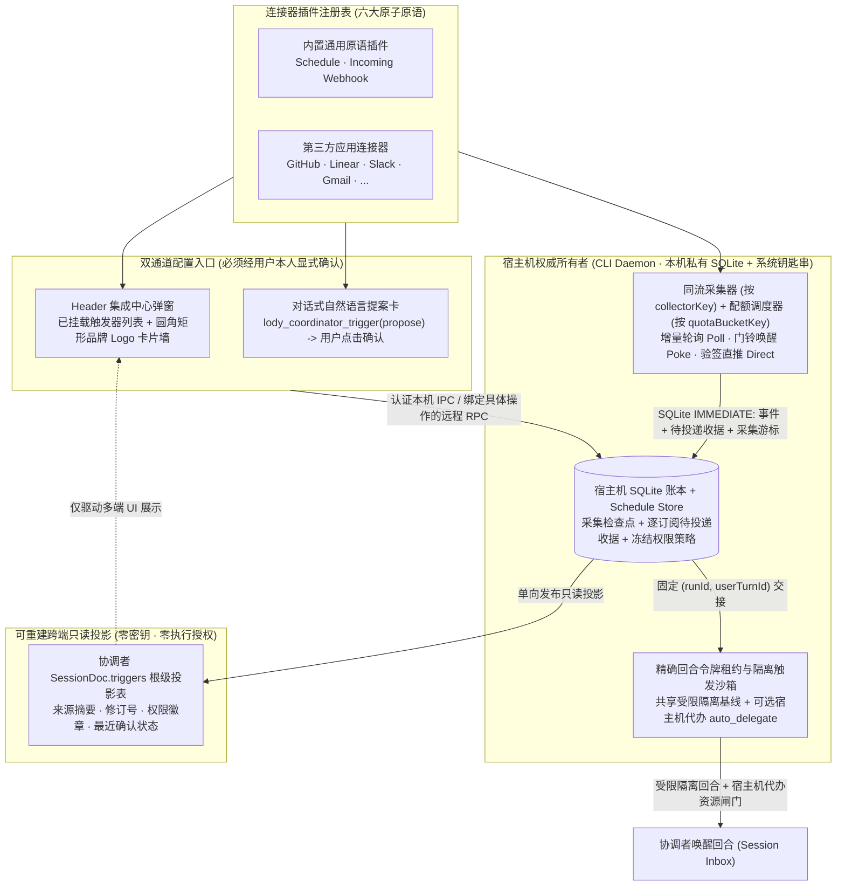

# 协调者连接器与触发器插件架构

Status: draft
Translation: current

[English](coordinator-connector-triggers.md)

## 场景与问题

在[项目协调者模式](project-coordinator-mode.zh.md)中，用户希望为协调者对话挂载常驻的外部事件与时间触发器——既可以通过协调者对话右上角 Header 新增的集成入口以圆角矩形品牌卡片方式添加，也可以直接在聊天中用自然语言让协调者协助生成提案并确认启用。典型场景包括：周期性汇总（定时任务 Schedule）、自定义 HTTP Webhook、代码仓动态监测（例如发现新 GitHub Issue 时总结提醒）、工单分诊（Linear）、频道或 `@提及` 提醒（Slack），以及重要邮件摘要（Gmail）。

Lody 现有基础设施覆盖了相邻能力，但直接承载多源常驻触发器仍存在三处结构性缺口：

1. **一次性等待 vs. 常驻增量订阅**：`lody_automation` 的条件等待（`AutomationWait`）首次命中即进入终态（`matched`），不支持跨事件持续生效与水位线（Watermark）推进。
2. **分支级 PR 轮询 vs. 可插拔多源连接器**：现有 PR 协调器（[本地 GitHub PR 观测](local-github-pr-observation.zh.md)）仅观测已关联到具体会话的 PR，无法以统一插件契约扩展到仓库级 Issue、Linear 团队工单、Slack 频道或 Gmail 邮箱。
3. **默认总结提醒 vs. 自动派生子对话的资源级权限隔离**：绝大多数外部事件本质上是让协调者提炼并提醒用户的信息源，并不需要每次创建或驱动子对话（`lody_session_create` / `lody_session_chat`）。是否允许触发器自动建立子对话，必须具备每个 Schedule / Trigger 独立的授权模型与宿主机资源所有者硬边界，防止公开仓库 Issue 或外部邮件中的恶意 Prompt 注入窃取工作区文件或越权拉起无人值守执行。

## 总体架构：六大插件原子原语与宿主机权限沙箱

协调者触发器将**特定平台的连接器插件（Connector Plugins）**与**宿主机统一持有的同源采集、两阶段持久投递及资源级权限内核**彻底解耦。每接入一种新集成，只需实现六个正交原子原语并注册到插件表，无需修改协调者对话内核、Loro 流拓扑或会话准入逻辑。

### 1. 连接器插件的六个原子能力原语（Atomic Primitives）

内置通用触发器与第三方集成统一实现 `ConnectorPlugin` 契约，由五个插件声明原语和一个内核独占沙箱原语组成：

1. **`PluginManifest`（插件身份与圆角卡片原语）**：声明稳定 `pluginId`、分类、多语言名称与一句话说明、圆角品牌 SVG Logo、主题色与能力集。Header 集成中心的圆角矩形卡片网格完全由注册表自动遍历渲染。
2. **`AuthProvider`（主体绑定的连接与宿主机凭证原语）**：
   - 每个连接句柄 `connectionId` 强绑定 `(principalUserId, providerAccountId, tenantId, grantedScopes)`，向前端仅暴露脱敏状态（`builtin`、`connected`、`needs_auth`、`expired`、`local_cli`）。
   - 仅在宿主机侧（或显式启用云端时的托管令牌服务）按 `none`、`oauth`、`keychain_secret`（`@lody/platform` 系统钥匙串）与 `ambient_cli`（如 `gh`）解析凭证。
   - 动态选项读取、创建订阅、后台采集、摘要投递与权限升级均按**同一请求主体**校验：请求者必须同时有权编辑目标协调者会话、且拥有（或获明确授予）该 `connectionId`。在加密工作区中，创建、确认与提权还须额外验证实际授权人 `actingUserId === machineOwnerUserId`（将 `authorizingUserId` 冻结写入规则与收据）。在共享机器上，宿主机环境凭证（如本机 `gh`、环境变量）严格限定 `requesterUserId === machineOwnerUserId`，禁止协作者借用宿主机私人身份。
3. **`TriggerSchema`（声明式配置与动态选项原语）**：用统一的字段描述符 + Zod Schema 定义插件支持的事件流与过滤参数，并提供宿主机侧 `resolveDynamicOptions` 动态拉取可选仓库、Linear 团队、Slack 频道或 Gmail 标签。同一份 Schema 同时驱动前端配置表单与 `lody_coordinator_trigger` 参数校验。
4. **`IngressAdapter`（三种可组合接入模式、同流采集与独立配额桶）**：
   - 严格区分**上游采集流共享**、**逐订阅启用基线**与**速率配额桶共享**：
     - `collectorKey`（`workspaceId + connectionId + canonicalResourceId + upstreamQueryParams + streamKind`）：**仅当多个订阅产生完全同一条上游事件流且 `checkpoint` 可互换时**才共享单次在途拉取（合并周期节拍与 Poke，最后一个活跃订阅移除时停止监听）；同一连接下订阅不同仓库或不同上游查询参数的实例使用独立 `collectorKey`，防止以 A 资源的游标推进 B。每个订阅各自独立保存启用水位 `enabledBaseline`（启用时的 `seedCursor`）：向已有活跃 `collectorKey` 新增订阅 B 时仅写入 B 的 `enabledBaseline`，绝不覆盖共享采集进度；扇出生成收据时按各订阅自身的 `enabledBaseline` 与下游过滤规则筛选，确保正在追赶旧水位的订阅 A 不漏事件、且新订阅 B 不会收到启用前的历史事件。
     - `quotaBucketKey`（按第三方真实凭证或 App 安装身份标识，对齐 [`pr-poll-scheduler.ts`](../apps/cli/src/lib/pr-poller/pr-poll-scheduler.ts)）：跨共享同一底层凭证的所有 `collectorKey` 统一调度速率额度与冷却窗口。
   - 组合以下一种或多种接入能力：
     - `poll_cursor`（可重读增量流）：`seedCursor(ctx, config)` 在启用时记录初始高水位而不回放历史积压；`pollDelta(ctx, config, checkpoint)` 返回 `{ items, nextPageToken?, nextCheckpoint, gapDetected?, rateLimitResetAt?, authInvalid? }`。
     - `poke_wake`（无状态唤醒门铃）：仅请求对应 `collectorKey` 立即调度一次 `pollDelta`，自身不携带权威状态。
     - `direct_delivery`（不可重读直推载荷，如通用 `Incoming Webhook`）：在专属 `endpointId` 的 HMAC-SHA256 密钥域（支持有界密钥轮换重叠期）下，签名内容必须同时覆盖 `endpointId + timestamp + deliveryId + sha256(rawBody)`，并校验新鲜度窗口与字节上限。**必须先通过 §4 的 SQLite `IMMEDIATE` 事务同时落盘标准化事件与每订阅 `pending_delivery` 收据后，才返回 HTTP `2xx` ACK**：相同 `(endpointId, deliveryId)` 且正文摘要一致的合法重投幂等返回既有收据；相同 `(endpointId, deliveryId)` 但正文摘要不同直接拒绝。
5. **`EventNormalizer`（版本化幂等键与清洗原语）**：将平台载荷转换为有界 `NormalizedTriggerEvent`（组合 `collectorKey + objectId + eventKind + eventVersion` 的 `dedupKey`、`occurredAt`、`actor`、标题、剥离 HTML/MIME 后的纯文本 `cleanBody`、`externalRef`、`completeness: 'observed' | 'gap'` 及 `trustLevel`）。即便发送者经过签名认证，`cleanBody` 正文仍一律按不可信数据处理。
6. **`ExecutionSandbox`（内核独占的突发合并、两阶段交接与资源权限闸门）**：插件绝不直接写会话历史、入队消息或判断权限；合并、恢复对账、输出白名单与资源级拦截全部由宿主机内核收口。

### 2. Header 集成中心界面、当前活跃协调者绑定与双通道创建

在协调者对话 Header 右上角工具栏（[`session-chat-interface.tsx`](../packages/components/src/components/sessions/session-chat-interface.tsx)）新增 **「集成 / Triggers」** 按钮，展示已启用触发器计数及健康状态点（凭证失效、连续失败或出现历史 `gap` 缺口时提示琥珀色）。点击后打开**协调者集成中心弹窗**：

- **当前对话已挂载区**：统一列出绑定到当前协调者的 `Schedule`（`existing_session: coordinatorSessionId`）与常驻连接器订阅，展示品牌图标、规则摘要、权限徽章（`仅提醒` / `可自动建子对话`）、启停 `Switch`、手动测试、编辑与删除。
- **圆角矩形 Logo 卡片目录**：以圆角矩形卡片墙展示已注册插件（`Schedule`、`Incoming Webhook`、`GitHub`、`Linear`、`Slack`、`Gmail` 及后续扩展插件）。
- **对话内提案确认（`lody_coordinator_trigger`）**：用户在聊天中描述需求时，协调者调用 `lody_coordinator_trigger`（`propose` / `propose_edit`）输出交互确认卡，经用户本人点击确认后才激活。
- **机器协议协商与当前活跃协调者复核**：
  - 仅当目标机器声明 `MachineMeta.protocolCapabilities.coordinatorTriggers`（远程控制另需在支持 `rpc` 的工作区声明版本化 `coordinatorTriggersRemote`）时，UI 才开放协调者触发器并承诺对指向协调者的 Schedule 实施“仅提醒”约束。
  - **更换协调者 / 归档 / 删除对账**：由于项目执行「更换协调者（`Change coordinator`）」后，旧协调者会话仍可保持存活且未归档（[`project-board-model.ts`](../packages/components/src/components/project-mode/project-board-model.ts) 取同一用户与项目下最新未归档协调者），仅检查存活与归档状态不足以识别旧协调者。因此在重启/重连恢复以及每次触发器 Inbox 交接和已 `prepared` 待 `dispatch` 的协调者 Schedule 最终交接前（[`schedule-engine.ts`](../apps/cli/src/lib/schedules/schedule-engine.ts)），宿主机均须重新解析 `(ownerUserId, projectKey)` 当前绑定的活跃协调者：元数据未同步完成时保持待定；若会话已归档、已删除或已被新协调者替代，则自动暂停旧绑定、取消未执行授权并阻断向旧协调者自动投递（重新绑定须经用户确认）。删除协调者会话时一并回收本机规则、待投递收据、Webhook 端点及无其他订阅引用的钥匙串密钥。

### 3. 定时任务（`Schedule`）与 `Webhook` 的双层关系

- **产品层（并列的两个内置通用原语卡片）**：`Schedule` 是通用**时间驱动**卡片（复用 `ScheduleStore` 的 `existing_session` 目标，不引入第二套 Cron 调度器）；`Incoming Webhook` 是通用**直推驱动（`direct_delivery`）**卡片，供尚无专属品牌卡片的 CI 脚本、监控平台或内部服务直接推送唤醒。
- **传输引擎层（可重读应用连接器内部的 Pull + Poke 互补通道）**：`GitHub`、`Linear`、`Slack`、`Gmail` 等可重读连接器组合周期 `poll_cursor` 与可选 `poke_wake` 信号——明文工作区连接云端时获得秒级实时唤醒，本地构建或笔记本休眠唤醒后在第三方历史保留期内按水位线补齐。
- **E2EE 隐私诚实边界**：若第三方原始 Webhook 在云端终止后再转为无正文 Poke，云端在终止瞬间仍接触了业务载荷。**在 v1 中，加密工作区一律禁用所有云端 Webhook 终止与云端 `Incoming Webhook` 转发**：可重读连接器仅在宿主机本地直连执行 `poll_cursor`，`Incoming Webhook` 仅开放宿主机直接验签的本地 HTTP 入口；端到端发送方公钥密封转发留待未来独立协议规范定义。

### 4. 物理存储、绑定具体操作的写权威与两阶段崩溃恢复

不新增任何 Loro Stream ID，且保持 `ScheduleDefinition` 指纹算法不变：

| 逻辑状态 | 权威所有者 | 同步与一致性契约 |
| :--- | :--- | :--- |
| 定时类触发器定义 | `ScheduleRegistry`（`:sr`）与 `schedule-<id>` 文档（[`schedule-types.ts`](../packages/shared/src/schedule-types.ts)） | 决定定时任务启停与规划；完整保留 Schedule v2/v3 指纹及 E2EE 原始声明与手动运行签名校验（[`schedule-execution-authorization.ts`](../apps/cli/src/lib/e2ee/schedule-execution-authorization.ts)）。 |
| 连接器订阅、采集检查点、待投递收据、提案记录与协调者 Schedule 独立权限授权 | 协调者宿主机私有 SQLite（[`ledger.ts`](../apps/cli/src/automations/storage/ledger.ts)，规范化索引列） | **唯一执行权威**。创建、编辑与升降权必须经本机认证 IPC 或经校验且绑定具体操作的远程证明（`coordinatorTriggersRemote`），精确签名覆盖 `(workspaceId, machineId, coordinatorSessionId, requestId, operation, parameters, expectedConfigRevision, expectedGrantRevision)`（[`control.ts`](../packages/shared/src/automations/control.ts)）。指向协调者的 Schedule 独立 grant 显式绑定四元组 `(scheduleId, activationId, definitionFingerprint, coordinatorSessionId)`（以 `definitionFingerprint + activationId` 对应当前 Schedule 定义修订 `configRevision`）；修改 Schedule 定义后旧自动委派权自动失效并回退为 `summarize_and_notify`。 |
| 协调者触发器 UI 只读投影（`triggers`） | 协调者 `SessionDoc` 可选根键 `triggers`（`{workspaceId}:s:{coordinatorSessionId}`，[`session-doc-schemas.ts`](../packages/shared/src/session-doc-schemas.ts)） | **纯派生可重建投影**——绝不反向驱动采集或授予权限。由宿主机在权威账本/Registry 提交后单向发布，使多端（含禁用远程 RPC 的 E2EE 设备）可直接展示来源、修订与最近确认状态。 |
| 第三方连接器令牌与 Webhook HMAC 密钥 | 云端托管令牌服务（明文云模式）+ `@lody/platform` 系统钥匙串 / `gh` CLI（Local 与 E2EE 模式） | 严禁写入 Loro 文档或明文日志；默认桌面本地构建零产品云请求即可完整运行。 |

- **采集到 Session Inbox 的两阶段持久交接**（对齐 [`automations/AGENTS.md`](../apps/cli/src/automations/AGENTS.md) 与 [`schedules/AGENTS.md`](../apps/cli/src/lib/schedules/AGENTS.md)）：
  1. **本机 SQLite `IMMEDIATE` 采集事务**：在单个本机事务内同时写入标准化 `events`、按 `(triggerId, configRevision, grantRevision)` 窗口聚合的每订阅 `pending_delivery` 收据（绑定固定 `runId` 与 `userTurnId`），随后才推进**共享采集源 `sourceCheckpoint`**。单个协调者被 Stop、归档或替代不会阻塞同源其他订阅接收事件。
  2. **幂等 Inbox 交接与对账恢复**：宿主机凭持久化收据以固定 `(sessionId, userTurnId)` 向 Session Inbox 交接，崩溃或超时后按同一身份对账恢复，仅在证明尚未提交时重交，杜绝漏发与重复派单。修改指令、暂停或升降权立即切分新批次；已接纳旧收据仅能按**冻结授权与当前最新授权的交集**执行，绝不能借用后来的提权。

### 5. 协调者共享受限基线、项目级委派钳制与原子渐进提权

每次触发器运行及指向协调者的 Schedule 运行，统一运行在**共享受限协调者基线**之上，并携带绑定精确 `(sessionId, userTurnId, runId, triggerId, configRevision, grantRevision, effectiveGrant)` 的**逐回合能力令牌（`TriggerTurnLease`）**——绝不只按 `sessionId` 查询当前活跃回合——一旦发生 `Stop`、回合结束、切入下一回合或撤权即刻失效，残余进程无法凭 `sessionId` 借用后续人类回合的权限（[`session-execution-service.ts`](../apps/cli/src/session/session-execution-service.ts)）。所有资源所有者在提交前校验该精确租约（覆盖 HTTP MCP、stdio MCP、进程内直连 Session 工具、CLI socket 命令与 Schedule/Automation 专用服务）：

- **协调者自身的共享受限隔离基线（同时适用于 `summarize_and_notify` 与 `auto_delegate`）**：
  - 在任何触发器或定时唤醒回合中，**执行该外部事件的协调者自身始终不具备工作区写文件、原生编辑、终端执行、宿主私人凭证继承或直接控制 socket 写能力**（[`agent-client.ts`](../apps/cli/src/agent/agent-client.ts)、[`message-handler.ts`](../apps/cli/src/lib/message-handler.ts)）。对于原生文件/进程工具无法在交互式 ACP 会话中剥离的 provider，`summarize_and_notify` 与 `auto_delegate` 回合统一通过**宿主机受控隔离环境（仅暴露有界 `<trusted_owner_instruction>`、`<untrusted_external_events>`、只读项目/看板快照及 `effectiveGrant` 显式允许的宿主机代办工具）**运行；普通人类对话回合继续保留协调者完整能力。
  - **独立输出白名单（收敛 `send_message`，两种模式共用）**：仅接受**纯摘要 Markdown 与宿主机核验的事件 `externalRef` 链接**——硬性拒绝任意工作区路径 `attachments`，并禁止模型自由构造可执行 `card.actions`（拒绝自由填写的 `session_dispatch`、`client_command` 或未核验 `coordinator_prompt`）。若模型判定事件无需提醒，不输出摘要即静默结束。
  - **`propose_work_item`（独立默认关闭能力）**：默认禁止写入 `SessionDoc.workItems`，避免提醒摘要污染项目看板。仅当用户显式为该触发器开启 `propose_work_item: true` 时，才允许按 `runId` 幂等创建 `0` 成员、`stage: "proposed"` 的新任务项，禁止修改既有 `WorkItem` 或成员 `SessionMeta`。

1. **`summarize_and_notify`（严格失败关闭默认档位）**：
   - 凡未对当前触发器 `(triggerId, configRevision, coordinatorSessionId)` 或定时任务四元组 `(scheduleId, activationId, definitionFingerprint, coordinatorSessionId)` 显式授予自动委派权的运行（含既有 Schedule、修改定义后的新 Schedule、全局 Schedules 页与 CLI 运行），一律以此模式执行，硬性拒绝一切 `lody_session_create` 与 `lody_session_chat` 调用。
2. **`auto_delegate`（逐实例显式授权 —— 仅额外开放受目标与预算钳制的宿主机代办派单）**：
   - 解锁后协调者自身仍保持上述受限隔离基线，**唯一新增能力**是由宿主机代办校验的 `lody_session_create` / `lody_session_chat`，受**共享持久化每 `runId` 预算**（`maxChildrenPerRun`，单条、批量 `items[]`、重试及再派生共用）与**最终解析目标全项检查**（[`session.ts`](../apps/cli/src/commands/session.ts)）约束：
     - **v1 明文与加密工作区统一限本机**：触发器授权闸门在 v1 无条件执行 `target.machineId === hostMachineId`（主动封堵 [`message-handler.ts`](../apps/cli/src/lib/message-handler.ts) 的 owner 跨机分支；跨机子授权与分布式预算留待后续独立规范）。
     - **绑定目标项目/仓库身份**：将最终允许的 `authorizedWorkContext`（精确 `projectId` 或规范化 `repo` 及允许分支范围）写入 grant、确认卡与子回合来源；用户对机器上另一项目 B 拥有访问权不能授权项目 A 的触发器向 B 派单。
     - **`lody_session_create` 与 `lody_session_chat` 同等校验当前授权及创建归属**：新建子会话与续跑子会话必须通过**完全相同的当前最新授权检查项**——`target.machineId === hostMachineId`、匹配 `authorizedWorkContext`、命中当前 `allowedRoleIds`、且最终生效的 `modeId` 与权限选项处于当前 `workerModeCap` 之内——并且 `lody_session_chat` 还须额外验证宿主机持久化的子会话创建来源精确匹配当前 `(workspaceId, coordinatorSessionId, triggerId)`（创建来源缺失、属于同项目下另一触发器 B、或在 grant 收窄后超出现有范围时一律拒绝续跑）。
3. **宿主机单次原子消费的「渐进式权限升级」（`TriggerActionProposal`）**：
   - 在 `summarize_and_notify` 回合中，模型仅能随摘要提交 `delegationProposal`（`{ summary, suggestedRoleId?, rationale }`）；**由宿主机持久化生成不可变 `TriggerActionProposal`**，冻结 `(proposalId, workspaceId, machineId, coordinatorSessionId, authorizingPrincipal, triggerId, expectedConfigRevision, expectedGrantRevision, resolvedOneTimeTarget, proposedNextGrant, batchRunId, eventBatchDigest)`（严格区分用于身份哈希绑定的 `eventBatchDigest` 与用于界面展示的文本 `summary`），由客户端按宿主机记录渲染确切的目标机器、项目、Role 与权限上限：
     - **「仅本次创建子对话处理」** 与 **「本次处理，并允许该触发器今后自动创建子对话」** **共用同一本机 SQLite `IMMEDIATE` 事务模式，竞争同一 `proposalId` 的唯一一次决定**。
     - 点击任一按钮均在**同一笔本机 SQLite `IMMEDIATE` 事务**内原子完成：校验操作主体与 `(expectedConfigRevision, expectedGrantRevision)`、标记消费 `proposalId`、并落盘唯一单次派发意图收据，随后异步交接 Inbox；仅第二个按钮在**同一笔事务内**额外写入 `grantRevision + 1` 的 `proposedNextGrant`（后续分别追踪本次派发完成态与常驻授权态，杜绝消费后崩溃丢单或重试重复派单）。
4. **E2EE 授权人身份、本机签发者、冻结收据与 Schedule 四元组双阶段复验**：
   - 版本化 `turnExecutionContent`（[`e2ee-execution-intent.ts`](../packages/shared/src/e2ee-execution-intent.ts)）覆盖 `{ runId, triggerId, configRevision, grantRevision, eventBatchDigest }`。在加密工作区中，创建、确认与提权时验证实际授权人 `actingUserId === machineOwnerUserId` 并将 `authorizingUserId` 冻结进 SQLite 规则与收据；**Inbox 接纳与实际启动两处**（[`execution-intent-verification.ts`](../apps/cli/src/lib/e2ee/execution-intent-verification.ts)、[`agent-execution.ts`](../apps/cli/src/lib/e2ee/agent-execution.ts)）必须同时满足：（1）`verified.requesterDevice === selfDevice`、（2）执行 `principal === 'owner'`、（3）`receipt.authorizingUserId === requesterUserId === machineOwnerUserId`（防止拥有会话编辑权的共享成员先写入规则再被宿主机器代签执行）、（4）精确匹配本机 SQLite 已冻结收据（`runId`、`sessionId`、`userTurnId`、`triggerId`、`configRevision`、`grantRevision`、`eventBatchDigest`）。指向协调者的 Schedule 在交接与实际启动（[`schedule-engine.ts`](../apps/cli/src/lib/schedules/schedule-engine.ts)、[`schedule-execution-authorization.ts`](../apps/cli/src/lib/e2ee/schedule-execution-authorization.ts)）继续完整复验原 `scheduleDeclaration` 与手动签名，同时与宿主机绑定的 `(scheduleId, activationId, definitionFingerprint, coordinatorSessionId)` 独立 grant 取交集（不匹配时一律按 `summarize_and_notify` 执行）。

### 6. 各连接器的真实检查点、分页与缺口恢复契约

各卡片明确声明实际可提供的完整性与恢复保证，不把“恢复到当前水位”夸大为“无损补齐无限历史”：

| 插件卡片 | 接入模式与分流检查点 | 分页、缺口标记（`gap`）与恢复契约 |
| :--- | :--- | :--- |
| **Schedule** | `ScheduleStore` 本地时钟规划（`existing_session`） | 沿用既有 `misfirePolicy`、`overlapPolicy` 与 `scheduleRunKey` 账本语义；在协调者上默认 `summarize_and_notify`，需独立授权才可 `auto_delegate`。 |
| **Incoming Webhook** | `direct_delivery`（覆盖 `endpointId + timestamp + deliveryId + bodyDigest` 的 HMAC + 轮换） | 先通过 §4 的 SQLite `IMMEDIATE` 事务同时落盘事件与 `pending_delivery` 收据再返回 `2xx` ACK；纯本机监听离线期间恢复取决于发送方重试。 |
| **GitHub** | `poll_cursor` + 可选 `poke_wake`（`GitHubCredentialResolver`） | **按真实事件流分别维护检查点**（Issue、评论、Review Request、Actions 各自独立，不共用单一对象 `updatedAt`），稳定 `(updatedAt, id)` 分页与重叠去重，按 `quotaBucketKey` 共享额度并独立维护仓库冷却（[`pr-poll-scheduler.ts`](../apps/cli/src/lib/pr-poller/pr-poll-scheduler.ts)）。 |
| **Linear** | `poll_cursor` + 可选 `poke_wake`（OAuth 或 Keychain API Key） | 按流维护稳定 `(updatedAt, id)` 分页；轮询快照仅证明当前状态（两次轮询间多次流转若需逐次捕获须结合事件历史，否则如实按最新快照语义呈现）。 |
| **Slack** | Socket Mode / Events `poke_wake` + `poll_cursor`（`conversations.history` 与 `conversations.replies`） | 连接令牌与频道/线程读取凭证分开建模；Socket envelope 落盘后再 ACK；对已订阅讨论串单独维护 `latestReplyTs`（频道 `lastTs` 无法反映旧线程的新回复）。 |
| **Gmail** | `poll_cursor`（`users.history.list`）+ 可选 Pub/Sub `poke_wake`（`gmail.readonly`） | 完整遍历 `pageToken` 后再推进 `historyId`；遇到 `404`（`historyId` 过期）时执行有界查询全量对账并重建新水位，无法还原的中间窗口显式标记 `completeness: 'gap'`（绝不误用首次启用的忽略旧邮件逻辑）。 |

## 依据与验证

- **v1 已落地实现**：
  - 共享插件目录、触发器配置 Schema、唤醒消息信封与本地 IPC 契约：[`packages/shared/src/coordinator-triggers.ts`](../packages/shared/src/coordinator-triggers.ts)、[`packages/shared/src/coordinator-actions.ts`](../packages/shared/src/coordinator-actions.ts)、[`packages/shared/src/session-doc-schemas.ts`](../packages/shared/src/session-doc-schemas.ts)、[`packages/shared/src/node/local-session-control.ts`](../packages/shared/src/node/local-session-control.ts)。
  - 宿主机触发器服务、SQLite 存储、10s 事件聚合、逐回合子对话权限闸门（`summarize_and_notify` 与 `auto_delegate`），以及 GitHub 连接器（覆盖 `issue.opened`、`issue.commented`、`pr.opened`、`pr.review_requested`、`workflow_run.failed`、`release.published` 分流水位与 `If-None-Match` ETag 增量轮询）：[`apps/cli/src/automations/connectors/types.ts`](../apps/cli/src/automations/connectors/types.ts)、[`apps/cli/src/automations/connectors/github.ts`](../apps/cli/src/automations/connectors/github.ts)、[`apps/cli/src/automations/connectors/service.ts`](../apps/cli/src/automations/connectors/service.ts)、[`apps/cli/src/mcp/lody-mcp-server.ts`](../apps/cli/src/mcp/lody-mcp-server.ts)（`lody_coordinator_trigger`）。
  - 协调者 Header 触发器按钮与圆角品牌卡片集成中心（`Schedule`、`GitHub` 已可用，`Linear`、`Slack`、`Google Mail`、`Webhook` 预置目录卡片）、`trigger.enable` / `trigger.grant_delegate` 客户端指令，以及 `<coordinator_trigger_wake>` 唤醒事件卡片渲染：[`packages/components/src/components/project-mode/coordinator-triggers-panel.tsx`](../packages/components/src/components/project-mode/coordinator-triggers-panel.tsx)、[`packages/components/src/components/project-mode/use-coordinator-action-executor.ts`](../packages/components/src/components/project-mode/use-coordinator-action-executor.ts)、[`packages/components/src/components/sessions/session-chat-interface.tsx`](../packages/components/src/components/sessions/session-chat-interface.tsx)、[`packages/components/src/components/ai-gui/view.tsx`](../packages/components/src/components/ai-gui/view.tsx)。
- **后续阶段演进项（尚未实现）**：`Linear`、`Slack`、`Gmail` 与 `Incoming Webhook` 运行时连接器实现、远程 `coordinatorTriggersRemote` 控制证明、跨订阅同流 `collectorKey` 合并采集，以及非 MCP ACP 适配器的原生工具剥离沙箱。
- **已执行的验证**：[`packages/shared/tests/session-doc-forward-compat.test.ts`](../packages/shared/tests/session-doc-forward-compat.test.ts)、[`packages/shared/tests/local-session-control.test.ts`](../packages/shared/tests/local-session-control.test.ts)、[`apps/cli/src/automations/connectors/connectors.test.ts`](../apps/cli/src/automations/connectors/connectors.test.ts) 与 [`packages/components/tests/coordinator-bubble-avatar.test.tsx`](../packages/components/tests/coordinator-bubble-avatar.test.tsx) 确定性行为测试，以及全包 Typecheck、i18n 完整性与边界静态检查。
